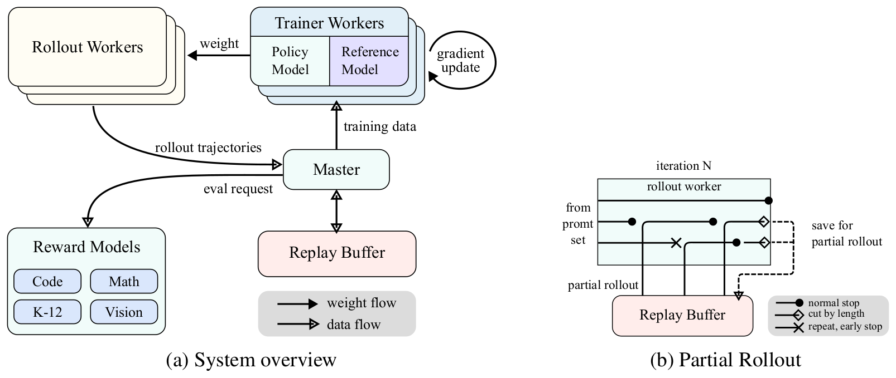
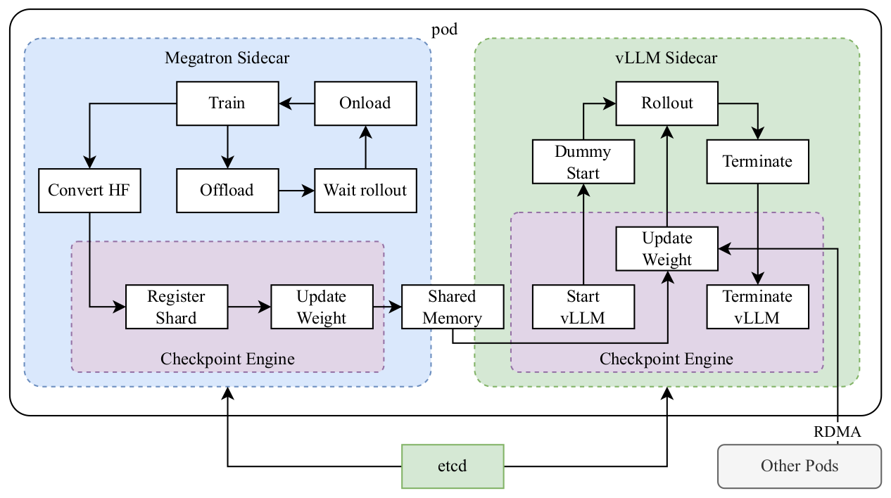
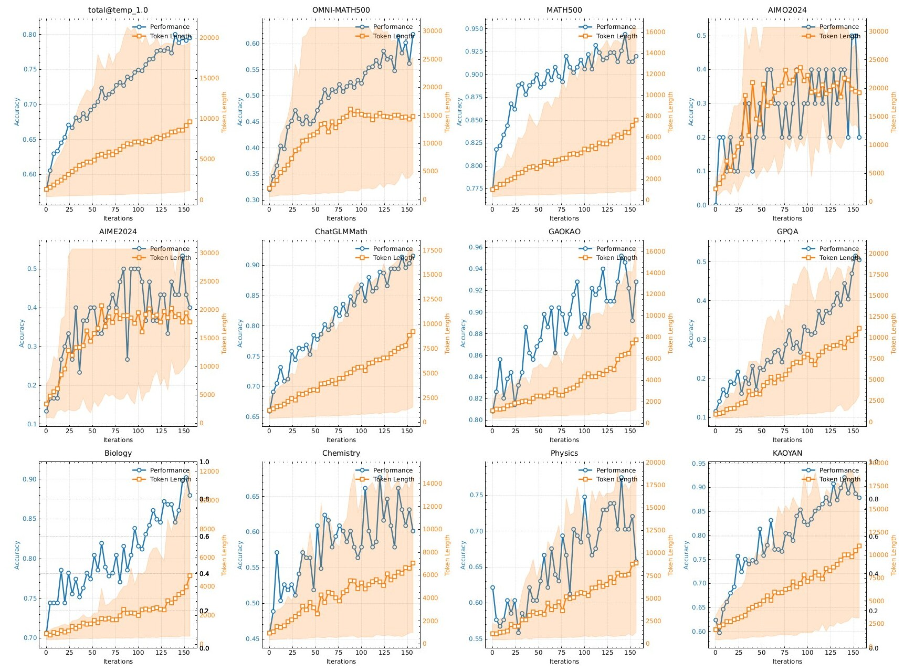
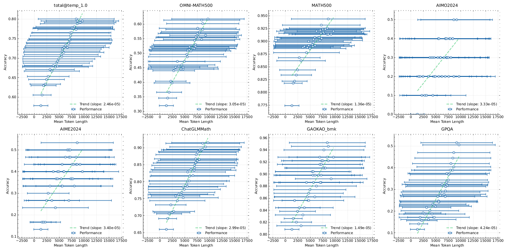
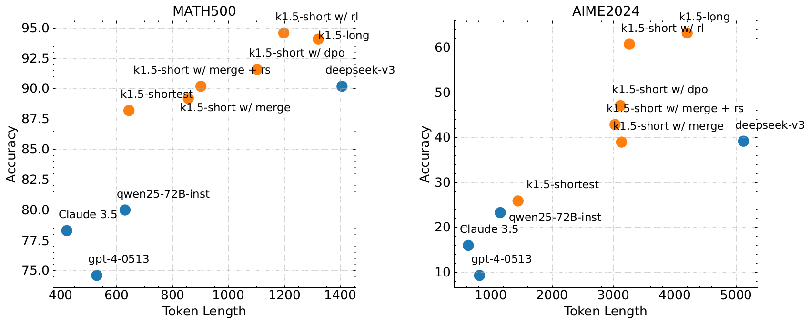
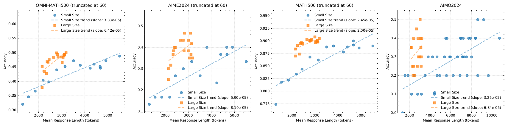
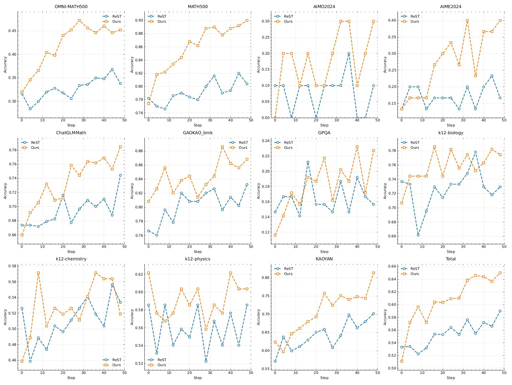
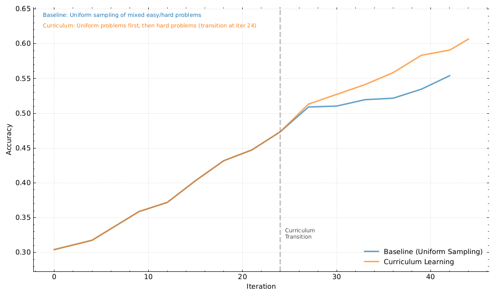

# 论文中文解读：《Kimi k1.5: Scaling Reinforcement Learning with LLMs》

> **基本信息**：Kimi Team（Moonshot AI，月之暗面；作者名单见原文附录 A，按名字字母序排列），arXiv:2501.12599，首次公开于 2025 年 1 月；本文依据本地 PDF，即 arXiv v4（2025 年 6 月 3 日版，共 25 页）。官方入口：[arXiv](https://arxiv.org/abs/2501.12599)、[GitHub](https://github.com/MoonshotAI/Kimi-k1.5)。
>
> **本文的读法**：图为从 PDF 中按图裁出的原图，表为逐格核对后的中文转录（模型名、数据集名、数字保持原样，表头与行名译成中文）。每张图后有中文图题、图中文字翻译和读图结论，因此不必再翻英文版。从图上读出的近似数值一律写作“约”。凡是论文没有写、由本文推算或补充的内容，都标明“推算”或“背景说明”。

## 一、一句话结论

k1.5 是 Kimi 团队的多模态（文本加视觉）推理模型技术报告。核心主张是：把强化学习（RL）的上下文窗口扩到 128K，让模型在 token 空间里自己做“规划、反思、纠错”，就能在**不使用**蒙特卡洛树搜索、价值函数和过程奖励模型的前提下取得很强的推理能力。具体由几块拼成：奖励只看最终答案是否正确；用在线策略镜像下降（online policy mirror descent）的一个变体做策略优化，不训练价值网络；用长度惩罚抑制 overthinking；用课程采样与优先采样提高训练效率；用 partial rollout 把超长回答切成多段、跨迭代完成，使 128K 的 RL 训练可行；最后用 long2short 把长思维链（long-CoT）的能力迁移到短输出模型。

报告给出的数字：long-CoT 版在 AIME 2024 上 `pass@1` 为 77.5、MATH-500 为 96.2、Codeforces 为 94 百分位、MathVista 为 74.9，对标 OpenAI o1；short-CoT 版在 AIME 2024 上为 60.8（GPT-4o 为 9.3，摘要称最高提升 550%）、MATH-500 为 94.6、LiveCodeBench 为 47.3。需要同时记住：模型规模、RL 数据量和多数关键超参数论文都没有披露，模型权重也没有开源（见第十章）。

## 二、背景与动机

### 2.1 为什么把 RL 当作新的扩展轴

用“预测下一个 token”做预训练时，规模定律说明同比例增大模型参数和数据量可以持续提升智能，但这条路受限于可获得的高质量训练数据量。用 RL 训练大模型，模型靠奖励去探索，就不再局限于一个现成的静态数据集，等于给持续提升多开了一条轴。摘要指出，此前公开发表的 RL 工作还没有产出有竞争力的结果；k1.5 的报告就是要公开一套能做到的训练配方：RL 训练技术、多模态数据配方和基础设施优化。

### 2.2 四个关键成分（引言）

1. **长上下文扩展（long context scaling）**：把 RL 的上下文窗口扩到 128K，并观察到性能随上下文变长而持续提升。关键做法是 partial rollout：生成新轨迹时复用以前轨迹的大段前缀，避免从头重新生成。论文把上下文长度看成 RL 持续扩展的一个关键维度。
2. **改进的策略优化**：推导了长 CoT 下 RL 的形式化，采用在线策略镜像下降的变体做稳健的策略优化，再配合采样策略、长度惩罚和数据配方优化。
3. **简单的框架**：因为能扩展上下文长度，学出的 CoT 呈现出规划、反思和纠错的性质；增加上下文长度相当于增加搜索步数。所以不需要蒙特卡洛树搜索、价值函数、过程奖励模型这些更复杂的技术。
4. **多模态**：文本与视觉数据联合训练，能同时对两种模态做推理。

另外，论文提出 long2short 方法，用长 CoT 技术改进短 CoT 模型，具体包括“带长度惩罚的长 CoT 激活”和模型合并等。

### 2.3 开发流程与两个术语

k1.5 的开发分几个阶段：预训练，vanilla SFT（普通监督微调），long-CoT SFT，强化学习。本报告聚焦 RL：先讲 RL 提示集的构造和 long-CoT SFT，再讲 RL 训练策略；预训练与 vanilla SFT 的细节放在后面（第七章）。

- **long-CoT 模型**：输出很长的思维链，测试时要消耗更多 token；**short-CoT 模型**：回答较短，是标准 LLM 的风格。论文的“long2short”就是把前者的思考先验迁移到后者，使后者在有限的测试时 token 预算下也能提升。

## 三、RL 提示集的构造（2.1 节）

论文的初步实验发现，RL 提示集的质量和多样性对 RL 是否有效起关键作用：好的提示集既能引导模型学到稳健的推理，也能降低 reward hacking 和对表面模式过拟合的风险。高质量的 RL 提示集有三个性质：

- **多样覆盖（diverse coverage）**：覆盖 STEM、编程、通用推理等广泛学科，增强模型的适应性。
- **难度均衡（balanced difficulty）**：包含分布合理的易、中、难题，促进渐进式学习，避免对某个复杂度过拟合。
- **可准确评测（accurate evaluability）**：提示应能被验证器客观、可靠地评估，保证衡量的是正确的推理，而不是表面模式或随机猜测。

对应的做法如下。

**多样覆盖**：用自动过滤器挑出既需要丰富推理、又便于评测的题目。数据包含 STEM、竞赛、通用推理等领域，既有纯文本也有图文问答；还建立了一个标签系统，按领域和学科给提示分类，保证各学科的均衡。

**用模型自己评估难度**：对每个提示，用一个 SFT 模型在较高的采样温度下生成 10 次答案，通过率就是难度的代理（通过率越低越难）。这样难度评估与模型自身能力对齐，对 RL 训练很有效：可以预先过滤掉大多数过于简单的题，也便于在 RL 中尝试不同的采样策略。

**避免奖励被钻空子**：需要保证每个提示的推理过程和最终答案都能被准确验证。经验观察发现，一些复杂推理题的答案很简单、容易被猜中，会造成**假阳性验证**，即模型通过错误的推理过程得到了正确答案。为此，论文排除了容易出现这种情况的题型：选择题、判断题和证明题。对于通用问答任务，还提出一个简单有效的方法来剔除“易被钻空子”的提示：让一个模型不写任何 CoT 步骤、直接猜测答案，如果它在 N 次尝试内猜对了，这个提示就被认为太容易被钻空子而剔除；论文发现 N = 8 能剔除大多数这类提示。更先进的验证模型留作未来研究。

读法：这套过滤的目标是让“答案对”尽量等价于“推理对”，因为后面的 RL 只看最终答案。这一点与 [DeepSeek-R1](../deepseek_r1/论文中文解读.md) 不同：R1 的 RL 数据里包含 22K 道 STEM 多选题。

## 四、Long-CoT SFT：先给模型一个“会思考”的起点（2.2 节）

有了精炼后的 RL 提示集，论文用提示工程构造一个小而高质量的 long-CoT 预热（warmup）数据集，里面是经过准确验证的推理路径，同时覆盖文本和图像输入。这个做法类似拒绝采样（rejection sampling，RS），但重点是通过提示工程来生成长 CoT 推理路径。预热数据集要包含人类式推理中最基本的几种认知过程：

- **规划（planning）**：模型在执行之前系统地列出步骤；
- **评估（evaluation）**：对中间步骤做批判性评估；
- **反思（reflection）**：让模型重新考虑并改进自己的做法；
- **探索（exploration）**：鼓励考虑替代解法。

在这个预热数据集上做轻量的 SFT，就能让模型内化这些推理策略，使微调后的 long-CoT 模型生成更详细、逻辑更连贯的回答，在各类推理任务上表现更好。论文没有给出预热数据集的规模。

## 五、强化学习（2.3 节）

### 5.1 把长思维链看成“隐式搜索”（2.3.1）

**设定**。训练集 $\mathcal{D}=\{(x_i,y_i^*)\}_{i=1}^{n}$ 由问题 $x_i$ 和对应的标准答案 $y_i^*$ 组成，目标是训练策略模型 $\pi_\theta$，让它能准确解出测试题。在复杂推理中，从问题 $x$ 到解 $y$ 的映射并不简单；CoT 的做法是用一串中间步骤 $z=(z_1,z_2,\dots,z_m)$ 来连接 $x$ 与 $y$，每个 $z_i$ 是一段连贯的 token 序列，是解题的一个重要中间步骤。解题时，思考 $z_t\sim\pi_\theta(\cdot\mid x,z_1,\dots,z_{t-1})$ 被自回归地采样，随后采样最终答案 $y\sim\pi_\theta(\cdot\mid x,z_1,\dots,z_m)$。用 $y,z\sim\pi_\theta$ 表示这个采样过程；思考和最终答案都是作为语言序列采样的。

**规划算法的视角**。为进一步增强推理能力，已有工作在推理时用规划算法探索不同的思考过程，核心是由价值估计引导、显式构造一棵思考的搜索树。设 $T$ 是一棵搜索树，每个节点是一个部分解 $s=(x,z_{1:|s|})$，即问题加上到该节点为止的一串思考。规划算法用一个 critic 模型 $v$ 给出反馈 $v(x,z_{1:|s|})$，用来评估当前离解出问题还有多远、识别已有部分解中的错误（反馈可以是判别式分数，也可以是一段语言序列）；再根据所有节点的反馈选出最有希望的节点去扩展，搜索树随之生长，如此迭代直到得到完整的解。

**关键的一步：把搜索树“压平”进上下文**。思考和反馈都是语言 token，都可以看成中间推理步骤，所以可以把规划算法看成直接作用在一串推理步骤上的映射 $A(\cdot\mid z_1,z_2,\dots)$：搜索树里保存的全部信息，被压平成提供给算法的完整上下文。于是论文提出一个有趣的想法：不去显式构造搜索树、实现规划算法，而是**训练一个模型去近似这个过程**。这里“思考的数量”（即语言 token 数）就相当于传统规划算法的计算预算。长上下文窗口的进展使训练和测试阶段都能无缝扩展；如果可行，模型就能通过自回归预测，直接在推理空间里做**隐式搜索**，从而不仅学会解训练题，还发展出解决每个具体问题的能力，更好地泛化到没见过的测试题。

### 5.2 优化目标（式 (1)）

于是论文考虑用 RL 训练模型生成 CoT。设 $r$ 是一个奖励模型（或规则），根据标准答案 $y^*$ 判断给定问题 $x$ 的候选答案 $y$ 是否正确，取值 $r(x,y,y^*)\in\{0,1\}$。对可验证的问题，奖励直接由预定义的规则决定，例如编程题看是否通过测试用例；对标准答案是自由形式的问题，则训练一个奖励模型 $r(x,y,y^*)$ 来预测答案是否与标准答案一致。生成的 CoT 的质量，只通过“它能否导向正确的最终答案”来评估。优化目标是（原文式 (1)）：

$$
\max_{\theta}\ \mathbb{E}_{(x,y^*)\sim\mathcal{D},\,(y,z)\sim\pi_\theta}\big[r(x,y,y^*)\big]
$$

论文希望通过扩大 RL 训练，得到一个兼具两类方法优点的模型：简单的提示式 CoT，以及加了规划的 CoT。推理时模型仍然只是自回归地采样一段语言序列，所以部署时不需要为复杂规划算法做复杂的并行；但与简单提示方法的关键区别是，模型不应只是照着一串推理步骤往下写，还应学会关键的规划技能，包括识别错误、回溯和修正解法，并把已经探索过的全部思考当作上下文来利用。

### 5.3 策略优化：在线策略镜像下降的变体（2.3.2）

训练算法是在线策略镜像下降的一个变体（论文引用 Abbasi-Yadkori et al. 2019、Mei et al. 2019、Tomar et al. 2020；原文把 descent 拼成了 decent）。算法迭代进行：在第 $i$ 轮，把当前模型 $\pi_{\theta_i}$ 当作**参考模型**，优化下面这个用相对熵（KL）正则化的策略优化问题（原文式 (2)）：

$$
\max_{\theta}\ \mathbb{E}_{(x,y^*)\sim\mathcal{D}}\Big[\mathbb{E}_{(y,z)\sim\pi_\theta}\big[r(x,y,y^*)\big]-\tau\,\mathrm{KL}\big(\pi_\theta(x)\,\Vert\,\pi_{\theta_i}(x)\big)\Big]
$$

其中 $\tau>0$ 是控制正则化强度的参数。下面分四步看懂它如何变成一个能训练的损失。

**第一步：闭式解**。这个目标有闭式最优解：

$$
\pi^*(y,z\mid x)=\frac{\pi_{\theta_i}(y,z\mid x)\,\exp\big(r(x,y,y^*)/\tau\big)}{Z},\qquad Z=\sum_{y',z'}\pi_{\theta_i}(y',z'\mid x)\exp\big(r(x,y',y^*)/\tau\big)
$$

$Z$ 是归一化因子。直观地说，新的最优策略就是把参考策略按 $\exp(r/\tau)$ 重新加权：奖励高的轨迹概率被放大，$\tau$ 越小放大得越狠；$\tau$ 很大时则几乎不动。

**第二步：把闭式解写成一个可回归的等式**。两边取对数，对任意 $(y,z)$ 都有下面的约束成立，论文指出这使我们可以在优化时利用**离策略（off-policy）数据**：

$$
r(x,y,y^*)-\tau\log Z=\tau\log\frac{\pi^*(y,z\mid x)}{\pi_{\theta_i}(y,z\mid x)}
$$

**第三步：代理损失（surrogate loss）**。据此让当前要优化的 $\pi_\theta$ 去拟合这个等式，得到平方损失：

$$
L(\theta)=\mathbb{E}_{(x,y^*)\sim\mathcal{D}}\Big[\mathbb{E}_{(y,z)\sim\pi_{\theta_i}}\Big[\Big(r(x,y,y^*)-\tau\log Z-\tau\log\frac{\pi_\theta(y,z\mid x)}{\pi_{\theta_i}(y,z\mid x)}\Big)^{2}\Big]\Big]
$$

**第四步：近似 $\tau\log Z$，并写出梯度**。$Z$ 要对所有可能的 $(y,z)$ 求和，无法精确计算，所以用从 $\pi_{\theta_i}$ 采出的 $k$ 个样本 $(y_1,z_1),\dots,(y_k,z_k)$ 来近似：

$$
\tau\log Z\approx\tau\log\frac{1}{k}\sum_{j=1}^{k}\exp\big(r(x,y_j,y^*)/\tau\big)
$$

论文还发现，直接用采样奖励的经验均值 $\bar r=\operatorname{mean}\big(r(x,y_1,y^*),\dots,r(x,y_k,y^*)\big)$ 来代替，实际效果也很好。理由是：当 $\tau\to\infty$ 时，$\tau\log Z$ 趋近 $\pi_{\theta_i}$ 下的期望奖励。最后对代理损失求梯度，得到学习算法。对每个问题 $x$，用参考策略 $\pi_{\theta_i}$ 采样 $k$ 个回答，梯度为（原文式 (3)）：

$$
\frac{1}{k}\sum_{j=1}^{k}\Big(\nabla_\theta\log\pi_\theta(y_j,z_j\mid x)\,\big(r(x,y_j,y^*)-\bar r\big)-\frac{\tau}{2}\nabla_\theta\Big(\log\frac{\pi_\theta(y_j,z_j\mid x)}{\pi_{\theta_i}(y_j,z_j\mid x)}\Big)^{2}\Big)
$$

**本文补充的推导（原文只给结果）**：记 $\rho=\pi_\theta/\pi_{\theta_i}$。对损失求梯度，因为 $\pi_{\theta_i}$ 不依赖 $\theta$，所以 $\nabla_\theta L=-2\tau\,\mathbb{E}\big[(r-\tau\log Z-\tau\log\rho)\,\nabla_\theta\log\pi_\theta\big]$。除以 $-2\tau$ 得到上升方向 $\mathbb{E}\big[(r-\tau\log Z)\nabla_\theta\log\pi_\theta-\tau\log\rho\,\nabla_\theta\log\pi_\theta\big]$。再用 $\tau\log Z\approx\bar r$，并注意 $\tau\log\rho\,\nabla_\theta\log\pi_\theta=\frac{\tau}{2}\nabla_\theta(\log\rho)^2$（因为 $\nabla_\theta\log\rho=\nabla_\theta\log\pi_\theta$），就得到式 (3)。

**怎么读式 (3)**：

- 第一项就是**以采样奖励均值为基线的策略梯度**（REINFORCE 型）：回答的奖励高于均值就提高它的对数概率，低于均值就降低。
- 第二项是一个 $\ell_2$ 正则：惩罚 $\log\rho$ 的平方，也就是不让新策略相对本轮参考策略 $\pi_{\theta_i}$ 偏离太远。本轮刚开始时 $\theta=\theta_i$，$\log\rho=0$，这一项的梯度为 0；随着参数偏离，拉回的力才逐渐变大。
- 与普通的在策略（on-policy）正则化策略梯度的区别有两点：回答是从 $\pi_{\theta_i}$ 而不是 $\pi_\theta$ 采样的（所以可以用离策略数据）；以及用了 $\ell_2$ 正则。论文因此把它看作在策略正则化策略梯度到离策略情形的自然推广（引用 Nachum et al. 2017）。
- 例如 $k=4$、只有第 1 个回答答对，则 $\bar r=0.25$，四个回答的权重是 $(+0.75,-0.25,-0.25,-0.25)$：与 GRPO 不同，这里不除以标准差（推算）。

**每轮迭代的流程**：从 $\mathcal{D}$ 采一批问题，对每个问题用参考策略 $\pi_{\theta_i}$ 采 $k$ 个回答，按式 (3) 更新参数得到 $\theta_{i+1}$；$\theta_{i+1}$ 成为下一轮的参考策略。因为每一轮的参考策略不同，每轮考虑的是一个不同的优化问题，所以在每轮开始时还要**重置优化器**。论文没有给出 $\tau$、$k$、学习率、批大小等数值。

**与 GRPO 的对比**（GRPO 见 [DeepSeek-R1 解读](../deepseek_r1/论文中文解读.md)）：

| 维度 | DeepSeek-R1 的 GRPO | k1.5 的镜像下降变体 |
|---|---|---|
| 同题多样本 | 每题采样一组输出 | 每题采样 $k$ 个回答 |
| 基线 | 组内奖励均值，并除以组内标准差 | 采样奖励均值，不除以标准差 |
| 限制更新幅度 | PPO 式的概率比裁剪，加上对参考策略的 KL 项 | 对 $\log\rho$ 的 $\ell_2$（平方）惩罚，没有裁剪 |
| 参考策略 | 固定一段时间，每 400 步换成最新策略 | 每一轮迭代都换成当前策略，并重置优化器 |
| 价值网络 | 不用 | 不用 |

（该表根据两篇论文各自的公式整理。）两者的共同点是：同题多样本、组内奖励做基线、没有价值模型。

**为什么不用价值网络**。论文把价值网络排除在训练系统之外，这也是此前研究用过的做法（引用 Ahmadian et al. 2024）。这个选择显著提高了训练效率；但论文进一步假设：经典 RL 里用价值函数做信用分配的惯例，可能并不适合长 CoT 这个场景。考虑这样一种情形：模型已经生成了部分 CoT $(z_1,\dots,z_t)$，接下来有两个可能的推理步骤，$z_{t+1}$ 直接导向正确答案，而 $z'_{t+1}$ 含有一些错误。如果有一个理想的价值函数，它会指出 $z_{t+1}$ 的价值高于 $z'_{t+1}$；按标准的信用分配原则，选择 $z'_{t+1}$ 会因优势为负而被惩罚。然而，探索 $z'_{t+1}$ 对训练模型生成长 CoT 极有价值：用长 CoT 最终得到的答案是否正确来做奖励信号，只要模型从 $z'_{t+1}$ 之后成功恢复并得到正确答案，就能学到“试错”的模式。论文的结论是：应当鼓励模型探索多样的推理路径来增强解复杂问题的能力，这种探索会产生大量经验，支撑规划技能的形成；目标不只是在训练题上达到高准确率，而是让模型掌握有效的解题策略，最终提高在测试题上的表现。

### 5.4 长度惩罚（2.3.3）

训练中观察到一个 **overthinking** 现象：回答长度在 RL 训练中显著增长。这虽然带来更好的性能，但过长的推理在训练和推理时都很昂贵，而且人类通常也不喜欢 overthinking。为此论文引入**长度奖励**来抑制 token 长度的快速增长，提高 token 效率。给定同一个问题 $x$（标准答案为 $y^*$）的 $k$ 个采样回答 $(y_1,z_1),\dots,(y_k,z_k)$，设 $\mathrm{len}(i)$ 是第 $i$ 个回答的长度，$\mathrm{min\_len}=\min_i\mathrm{len}(i)$，$\mathrm{max\_len}=\max_i\mathrm{len}(i)$。若 $\mathrm{max\_len}=\mathrm{min\_len}$（长度相同），所有回答的长度奖励设为 0；否则长度奖励为：

$$
\mathrm{len\_reward}(i)=\begin{cases}\lambda & \text{if } r(x,y_i,y^*)=1\\ \min(0,\lambda) & \text{if } r(x,y_i,y^*)=0\end{cases},\qquad \lambda=0.5-\frac{\mathrm{len}(i)-\mathrm{min\_len}}{\mathrm{max\_len}-\mathrm{min\_len}}
$$

用文字说：在**答对**的回答中鼓励更短的、惩罚更长的；对**答错**的回答，则明确惩罚过长的。这个长度奖励再按一个权重参数加到原来的奖励上（权重数值论文没有给出）。

**一个数值例子（推算）**：同一题的 4 个回答长度为 2,000、4,000、6,000、8,000 token，则 $\lambda$ 依次为 $+0.5,\,+0.17,\,-0.17,\,-0.5$（相对长度 0、1/3、2/3、1）。若前三个答对、第 4 个答错，长度奖励是 $+0.5,\,+0.17,\,-0.17$ 和 $\min(0,-0.5)=-0.5$；若最短的那个答错，则它的长度奖励是 $\min(0,+0.5)=0$，即不奖励短而错的回答，只是不惩罚。可见：长度是相对同题其他回答归一化的，$\lambda$ 的取值范围是 $[-0.5,+0.5]$，对答错的回答只有当长度超过同题长度范围的中点时才有负的长度奖励。

初步实验中，长度惩罚可能在训练初期拖慢训练。为缓解这一点，论文提出逐步 **warm up** 长度惩罚：先用标准的策略优化（不带长度惩罚），之后在训练的其余阶段使用恒定的长度惩罚。

### 5.5 采样策略（2.3.4）

RL 算法本身有较好的采样性质（更难的题带来更大的梯度），但训练效率有限，所以一些事先设计好的采样方法可能带来额外收益。论文利用两个信号：第一，收集的 RL 数据本来就带有不同的难度标签（例如竞赛题比小学数学题难）；第二，RL 训练会对同一个问题多次采样，所以可以追踪每个问题的成功率，作为难度的另一个度量。据此提出两种采样方法：

- **课程采样（curriculum sampling）**：从较容易的任务开始，逐步过渡到更难的任务。理由是：初始的 RL 模型能力有限，把有限的计算预算花在很难的题上，往往只得到很少的正确样本，训练效率低；而收集的数据天然带有年级和难度标签，按难度采样是一种直观有效的做法。
- **优先采样（prioritized sampling）**：在课程采样之外，用优先采样把精力集中在模型表现不佳的问题上。追踪每个问题 $i$ 的成功率 $s_i$，按正比于 $1-s_i$ 的概率采样问题，成功率越低的问题被采到的概率越高。这把模型的努力导向它最薄弱的地方，学得更快、总体表现更好。

后面的消融（图 9）验证了课程采样的效果（见 9.5 节）。

### 5.6 训练配方的更多细节（2.3.5）

**代码题的测试用例生成**。许多网上的编程题没有现成的测试用例，而测试用例是代码题 RL 的奖励来源，所以论文设计了自动生成测试用例的方法。重点针对不需要特殊评测器（special judge）的题目，并假设这些题有标准解答，以便利用标准解答生成更高质量的测试用例。做法是：

1. 使用广泛使用的测试用例生成库 CYaRon，并用基础的 Kimi k1.5 模型根据题面生成测试用例；输入包括 CYaRon 的用法说明和题目描述；
2. 对每道题，先用生成器产生 50 个测试用例，并为每个测试用例随机抽取 10 份标准提交（ground truth submissions）；
3. 在这些提交上运行测试用例：若 10 份提交里至少有 7 份给出一致的结果，这个测试用例就被判为有效；
4. 经过这轮过滤得到入选的测试用例后，只有当 10 份提交中至少 9 份能通过全部入选测试用例，这道题和它的入选测试用例才被加入训练集。

统计数据：从 1,000 道线上竞赛题的样本中，约 614 道不需要 special judge；作者开发了 463 个测试用例生成器，每个至少产生 40 个有效测试用例，最终有 323 道题进入训练集。

**数学题的奖励建模**。评估数学解答的难点在于，不同的书写形式可能表示同一个答案，例如 $a^2-4$ 和 $(a+2)(a-2)$ 都可能是同一题的有效解答。论文用两种方法提高奖励模型的打分准确率：

1. **经典奖励模型（Classic RM）**：借鉴 InstructGPT 的做法，实现了基于价值头（value-head）的奖励模型，收集约 80 万条数据来微调；模型的输入是“问题”“参考答案”和“回答”，输出一个标量，表示回答是否正确。
2. **思维链奖励模型（Chain-of-Thought RM）**：近期研究表明，加了 CoT 推理的奖励模型在需要细致判断正确性的任务（如数学）上可以显著优于经典方法。因此论文收集了同样规模的、约 80 万条带 CoT 标注的数据来微调 Kimi 模型。输入与经典 RM 相同，但模型先显式生成逐步的推理过程，再以 JSON 格式给出最终的正确性判断，奖励信号因而更稳健、更可解释。

人工抽查时，经典 RM 的准确率约为 84.4，CoT RM 达到 98.5（原文未给出抽查样本量）。RL 训练中采用的是 CoT RM，以保证更正确的反馈。

**视觉数据**。为提高真实世界图像推理能力、并更好地对齐视觉输入与 LLM，视觉 RL 数据主要来自三类：

1. **真实世界数据**：各年级需要读图理解和推理的科学题、需要视觉感知与推断的地点猜测任务、需要理解复杂图表的数据分析等；
2. **合成的视觉推理数据**：人工生成的程序化图像与场景，用于提高特定的视觉推理技能，例如理解空间关系、几何图案和物体间的相互作用；它们提供可控的环境，也提供取之不尽的训练样本；
3. **文本渲染数据**：把文本内容转成图像格式（文档、代码片段、结构化数据转成截图或照片），使模型对同一个文本问题无论是纯文本输入还是文字渲染成图像输入，都给出一致的回答，也有助于提升处理文字密集型图像的能力。

## 六、long2short：把长 CoT 的能力压回短输出（2.4 节）

长 CoT 模型性能强，但测试时比标准的短 CoT LLM 要消耗多得多的 token。不过，可以把长 CoT 模型的“思考先验”迁移给短 CoT 模型，使其在有限的测试时 token 预算下也能提升。论文给出了四类 long2short 方法：

- **模型合并（model merging）**：模型合并被发现有助于保持泛化能力；论文发现把一个 long-CoT 模型和一个较短的模型合并，也能提高 token 效率。做法不需要训练，只是对两个模型的权重做简单平均，得到新模型。
- **最短拒绝采样（shortest rejection sampling）**：观察到模型对同一个问题生成的回答长度差异很大。于是对同一个问题采样 $n$ 次（实验中 $n=8$），选出其中**最短的正确回答**用于监督微调。
- **DPO**：与最短拒绝采样类似，用 long-CoT 模型对每个问题生成多个回答。**最短的正确解**作为正样本，较长的回答作为负样本，负样本既包括答错的较长回答，也包括比所选正样本长 1.5 倍的、答对的较长回答。这些正负样本对构成成对偏好数据，用于 DPO 训练。
- **long2short RL**：在标准的 RL 训练阶段结束后，选出在性能与 token 效率之间平衡最好的模型作为基础模型，再做一个单独的 long2short RL 阶段。这个阶段使用 5.4 节的长度惩罚，并**显著缩短最大 rollout 长度**，进一步惩罚超出期望长度的回答，即使这些回答可能是正确的。

这几种方法的效果对比见 9.4 节（图 7）。论文的结论是 long2short RL 的 token 效率最高。

## 七、预训练与 vanilla SFT（2.5 节与附录 B）

RL 的效率与底座模型的性能密切相关，所以论文也介绍了预训练和普通 SFT，但细节有限：论文声明不开源其专有模型，同时承诺尽可能完整地披露数据管线和方法；模型架构方面只说是 Transformer 解码器的一个变体，支持多模态，并改进了架构与优化策略，具体的架构扩展实验留给后续发表；还指出底座模型的大部分性能来自预训练数据质量与多样性的提升。参数量等规模信息没有给出。（原文图 11 只是一个示意图：文本序列与图文交错序列输入 Transformer，再用大规模强化学习提升推理能力，本文不放。）

### 7.1 预训练（三个阶段）

- **视觉—语言预训练**：先只用语言数据训练，建立稳固的语言基础；再逐步引入图文交错数据，获得多模态能力。视觉塔（visual tower）起初单独训练、不更新语言模型参数，之后解冻语言模型层，最终把视觉—文本数据的比例提高到 30%。最终的数据配比与权重由小模型上的消融实验确定。
- **冷却（cooldown）**：用高质量的语言和视觉—语言数据继续训练，巩固能力。实证发现冷却阶段加入合成数据，在数学推理、知识类任务和代码生成上提升显著。英文和中文部分取自预训练语料的高保真子集；数学、知识、代码领域采用混合做法：选取部分预训练子集，再用合成内容增强，即用已有的数学、知识、代码语料作为素材，通过专有语言模型生成问答对，并用拒绝采样保证质量，这些合成问答对经全面验证后才进入冷却数据集。
- **长上下文激活**：用上采样的长上下文冷却数据训练，使模型能处理更长的序列。长上下文数据中 40% 是完整注意力数据，60% 是局部注意力数据：完整注意力数据一部分来自高质量的自然数据，一部分是合成的长上下文问答与摘要数据；局部注意力数据来自对冷却数据的均匀采样。RoPE 频率设为 1,000,000（RoPE 见 [RoPE 解读](../rope/论文中文解读.md)）；训练中逐步把最大序列长度从 4,096 增加到 32,768，最终到 131,072（即 128K）。

预训练数据（附录 B）：语言数据分五个领域——英文、中文、代码、数学与推理、知识；多模态数据包括 caption（图像描述）、图文交错、OCR、知识和通用问答五类。语言数据用多维度质量过滤框架：规则过滤、基于 FastText 的分类、基于嵌入的相似度分析（去重）、基于 LLM 的质量评估，再据综合质量分数动态调整采样率（高质量上采样，低质量下采样）；代码数据沿用 BigCode 的方法，对标记语言（如 JSON、YAML）下采样、对 32 种主要编程语言上采样；数学数据针对数学内容专门开发了清洗流程和 OCR 模型，再做两阶段清洗（FastText 初筛，再用微调过的语言模型精筛）；知识数据来自习题、教材、论文等，经 OCR 质量、教育价值、文档类型等多维标签过滤和采样。

多模态数据（附录 B.2）的五类：**图像描述**（caption）数据为模型提供基础的模态对齐和广泛的世界知识，来源是开源中英文数据集加大量内部数据，并严格限制合成 caption 的比例以降低幻觉风险，预训练中还变换图像分辨率；**图文交错**数据有助于多图理解、获得图像的详细知识、提高长多模态上下文能力，并有助于保持语言能力，来源是开源数据集和用教材、网页、教程构造的内部数据，并做了数据重排以保持图文顺序正确；**OCR** 数据涵盖多语言文本、密集排版、网页内容和手写样本，并按 OCR 2.0 的思路覆盖图、表、几何图、mermaid 图和自然场景文字，同时做旋转、扭曲、颜色调整、加噪声等增强；**知识**类数据（如精心整理的几何数据）用版面解析加 OCR 处理教材、论文等材料，并针对信息图额外开发了提取纯文字信息的管线；**通用问答**数据包含 grounding、表格与图表问答、网页 agent 和通用问答，并用打分模型和人工分类来平衡难度与多样性。

### 7.2 vanilla SFT

**数据**：对问答、写作、文本处理等非推理任务，先人工标注构造种子数据集，训练一个种子模型；再收集多样的提示，用种子模型为每个提示生成多个回答，由标注员排序并改进排名最高的回答，得到最终版本。对数学、编程等推理任务，规则验证和基于奖励模型的验证比人工判断更准确高效，所以用拒绝采样来扩充 SFT 数据集。

**规模**（原文）：约 100 万条文本样本，另有约 100 万条文本—视觉样本（涵盖图表解读、OCR、基于图像的对话、视觉编程、视觉推理、带图的数学与科学题等）。文本样本的构成如下表。

| 类别 | 样本数 |
|---|---:|
| 通用问答 | 500k |
| 代码 | 200k |
| 数学与科学 | 200k |
| 创意写作 | 5k |
| 长上下文任务（摘要、文档问答、翻译、写作） | 20k |

（原文第 8 页。各项相加为 925k，原文总说约 100 万。）

**训练设置**：先在 32K token 的序列长度上训练 1 个 epoch，再在 128K 序列长度上训练 1 个 epoch。第一阶段（32K）学习率从 $2\times10^{-5}$ 衰减到 $2\times10^{-6}$，在第二阶段（128K）重新预热到 $1\times10^{-5}$，最后衰减到 $1\times10^{-6}$。为提高训练效率，把多个训练样本打包进同一条训练序列。

## 八、RL 基础设施（2.6 节）

### 8.1 迭代同步的训练系统（2.6.1）

k1.5 采用**迭代同步**的 RL 框架：每次迭代包含一个 rollout 阶段和一个训练阶段。rollout 阶段，由中心 master 协调的 rollout 工作进程与模型交互，对各种输入生成回答序列，也就是 rollout 轨迹；这些轨迹存入回放缓冲区（replay buffer），论文说这样可以打破时间相关性，保证训练数据多样且无偏。训练阶段，训练工作进程（trainer workers）从中取经验数据来更新模型权重。master 是整个系统的中枢，管理 rollout 进程、训练进程、奖励模型评测和回放缓冲区之间的数据流与通信，并平衡负载。训练进程使用的轨迹，既可能在一次迭代里完整生成，也可能分布在多次迭代里（见 partial rollout）；整个过程由奖励模型监督，它评估输出质量并提供反馈。系统还包含一个代码执行服务，专门处理代码题，是奖励模型的组成部分：用真实的代码执行来验证模型的解答。

*图 3（原文 Figure 3，第 8 页）：用于 LLM 的大规模强化学习训练系统。左 (a)，系统总览；右 (b)，partial rollout（部分采样）示意。*

**图中文字翻译与读法**：

- **左图 (a) System overview（系统总览）**：Rollout Workers（采样进程）、Trainer Workers（训练进程，内含 Policy Model 策略模型和 Reference Model 参考模型，以及 gradient update 梯度更新）、Master（主控）、Replay Buffer（回放缓冲区）、Reward Models（奖励模型：Code、Math、K-12、Vision）。箭头含义：weight（权重，从训练进程流向采样进程）、rollout trajectories（采样出的轨迹，送给 Master）、eval request（评测请求，由 Master 发给奖励模型）、training data（训练数据，由 Master 送往训练进程），Master 与 Replay Buffer 之间是双向数据流。图例：实心箭头 weight flow（权重流）、空心箭头 data flow（数据流）。
- **右图 (b) Partial Rollout（部分采样）**：上方方框是第 N 次迭代（iteration N）里的 rollout worker，轨迹来自 from prompt set（提示集）。图例：实心圆点 normal stop（正常结束）、菱形 cut by length（因长度被截断）、叉号 repeat, early stop（因重复而提前终止）。被截断的轨迹经 save for partial rollout（保存以便续采）存入 Replay Buffer，之后在 partial rollout 的箭头指示下，从缓冲区取出，接着在后续迭代里继续生成。
- **读图结论**：Rollout 与 Training 通过 Master 和回放缓冲区解耦；权重只从训练端单向流向采样端；奖励（代码、数学、K-12、视觉四类）由独立的奖励模型或执行服务给出。

### 8.2 Partial rollout：让 128K 的 RL 训练可行（2.6.2）

**要解决的问题**：长 CoT 的轨迹长度差别很大（RL 的上下文窗口最大为 128K）。同步迭代时，如果等每条轨迹都生成完，整个迭代就会被最慢的几条拖住。

**做法**：为每次 rollout 设一个固定的输出 token 预算，限制每条轨迹的长度。如果某条轨迹在 rollout 阶段超出了 token 上限，没生成完的部分就被存入回放缓冲区，在下一次迭代里接着生成。这样不会有任何一条超长轨迹独占系统资源。同时，rollout 工作进程是异步运行的：当一些进程在处理长轨迹时，另一些可以独立处理新的、较短的 rollout 任务，保证所有进程都在为训练贡献，最大化计算效率。

**怎么复用**：如图 3(b) 所示，系统把长回答分段，分布在多次迭代里（从第 $n-m$ 次到第 $n$ 次迭代）。回放缓冲区是集中存储，保存这些回答片段，其中**只有当前迭代（第 $n$ 次）需要按在策略方式计算**；之前的片段（第 $n-m$ 到 $n-1$ 次）可以直接从缓冲区复用，不必重复 rollout。这种分段做法显著降低计算开销：不是一次性 rollout 整个回答，而是增量地处理并存储片段，既能生成长得多的回答，又保持较快的迭代速度。训练时，某些片段还可以被排除在损失计算之外，进一步优化学习过程。

**重复检测**：partial rollout 的实现还带来重复检测：系统识别生成内容中的重复序列并提前终止，减少不必要的计算；检测到的重复还可以被施加额外惩罚，以抑制在提示集上产生冗余内容。

**需要注意（本文评论）**：一条轨迹的前缀可能由旧版本的策略生成、后缀由新版本生成，所以训练数据并非严格的在策略数据，这也是 5.3 节的目标设计成能利用离策略数据的原因之一（这一联系是本文的推断，原文没有明说）。论文也没有给出 partial rollout 相对朴素 rollout 的吞吐或耗时对比数据。

### 8.3 训练与推理的混合部署（2.6.3）

RL 训练的每个阶段是：

- **训练阶段**：开始时，Megatron 和 vLLM 各自运行在独立的容器里，外面包着一个叫 checkpoint-engine 的 shim 进程。Megatron 开始训练；训练完成后，Megatron 卸载（offload）GPU 显存，并准备把当前权重传给 vLLM。
- **推理阶段**：Megatron 卸载后，vLLM 先以 dummy（占位）权重启动，再通过 Mooncake（见 [Mooncake 解读](../kimi_mooncake/论文中文解读.md)）接收从 Megatron 传来的最新权重并更新。rollout 完成后，checkpoint-engine 停止所有 vLLM 进程。
- **下一轮训练阶段**：vLLM 占用的显存释放后，Megatron 重新装载（onload）显存，开始新一轮训练。

论文发现现有工作难以同时满足以下三个特性：复杂的并行策略（Megatron 与 vLLM 的并行策略可能不同，Megatron 分布在多个节点上的训练权重很难与 vLLM 共享）；最小化 GPU 空闲（在策略 RL 中，SGLang、vLLM 等可能在训练期间预留部分 GPU，反而让训练 GPU 空闲，让训练与推理共用同一批设备更高效）；动态扩缩容（有时保持训练不变、增加推理节点能显著加速，系统应能在需要时利用空闲的 GPU 节点）。

*图 4（原文 Figure 4，第 10 页）：混合部署框架。*

**图中文字翻译与读法**：

- **整体**：一个 pod（Kubernetes 的 pod）里并排放两个 sidecar 容器：左边 Megatron Sidecar（训练侧），右边 vLLM Sidecar（推理侧），二者共享全部 GPU；每个 sidecar 里各有一个 Checkpoint Engine（检查点引擎，紫色虚线框）。pod 外有 etcd（全局元数据服务，与两个检查点引擎相连）和 Other Pods（其他 pod，通过 RDMA 与 vLLM 侧的权重更新相连）。
- **Megatron 侧**：Train（训练）、Offload（卸载显存）、Wait rollout（等待 rollout）、Onload（重新装载显存）构成一个循环；训练完成后经 Convert HF（把权重转成 Hugging Face 格式）进入检查点引擎，依次是 Register Shard（登记分片）、Update Weight（更新权重），写入 Shared Memory（共享内存）。
- **vLLM 侧**：Start vLLM（启动 vLLM）、Dummy Start（用 dummy 权重启动）、Update Weight（更新权重，权重经共享内存或 RDMA 到达）、Rollout（采样）、Terminate（结束）、Terminate vLLM（终止 vLLM 进程）。
- **读图结论**：每次迭代里，训练与推理分时复用同一批 GPU：训练完卸载显存并转换权重，vLLM 启动后拉取权重做 rollout，结束后终止，再把显存还给训练。论文称由此实现了**从训练到推理阶段不到 1 分钟、反过来约 10 秒**的切换。

**混合部署策略**：用 Kubernetes 的 Sidecar 容器共享所有可用 GPU，把训练与推理两种负载放进同一个 pod。主要优点：资源共享和管理高效，避免训练与推理分在不同节点时，训练节点空等推理节点；使用不同的部署镜像，训练和推理可以各自独立迭代以获得更好的性能；架构不限于 vLLM，可以方便地集成其他框架。

**Checkpoint Engine**：负责管理 vLLM 进程的生命周期，暴露 HTTP API 来触发 vLLM 上的各种操作；为保证整体的一致性和可靠性，用 etcd 服务管理的全局元数据系统来广播操作和状态。由于 CUDA graph、NCCL 缓冲区和 NVIDIA 驱动等原因，要通过 vLLM 的 offload 完全释放 GPU 显存很困难，所以为了尽量少改动 vLLM，论文选择在需要时终止并重启它，换取更好的 GPU 利用率和容错性。Megatron 的 worker 把自己持有的检查点转换成共享内存里的 Hugging Face 格式，转换时考虑了流水线并行和专家并行，使检查点里只剩下张量并行；共享内存里的检查点再被切成分片，登记到全局元数据系统；用 Mooncake 通过 RDMA 在节点之间传输检查点；vLLM 需要做一些修改来加载权重文件并做张量并行转换。

### 8.4 代码沙箱（2.6.4）

沙箱是执行用户提交代码的安全环境，针对代码执行和代码基准评测做了优化；通过动态切换容器镜像，支持 MultiPL-E、DMOJ Judge Server、Lean、Jupyter Notebook 等不同用例。对于编程任务的 RL，沙箱提供一致、可重复的评测机制，保证训练数据评判的可靠性；反馈系统支持多阶段评估（如代码执行反馈和仓库级编辑），并保持统一的上下文，使不同编程语言之间的基准比较公平。服务部署在 Kubernetes 上以获得可扩展性和韧性，通过 HTTP 接口对外提供，利用其自动重启和滚动更新保证可用性和容错。为优化性能并支持 RL 环境，加入了三项技术：

- **用 crun**：用 crun 而不是 Docker 作为容器运行时，显著缩短容器启动时间；
- **复用 cgroup**：预先创建好 cgroup 供容器使用，在高并发场景下，为每个容器创建、销毁 cgroup 会成为瓶颈；
- **磁盘用量优化**：用上层挂载为 tmpfs 的 overlay 文件系统来控制磁盘写入，提供固定大小的高速存储空间，适合短暂存在的负载。

下表是原文给出的两个对比（第 11 页）：

| 指标 | Docker | 沙箱 |
|---|---:|---:|
| (a) 容器启动时间（秒） | 0.12 | 0.04 |
| (b) 16 核机器上每秒最多启动的容器数 | 27 | 120 |

这些优化提高了 RL 中代码执行的效率，为评估 RL 生成的代码提供一致、可靠的环境，对迭代训练和模型改进至关重要。

## 九、实验（第 3 节与附录 C）

### 9.1 评测基准与口径

k1.5 是多模态模型，所以在不同模态的基准上做了评测，分三类：

- **文本**：MMLU、IF-Eval、CLUEWSC、C-Eval；
- **推理**：HumanEval-Mul、LiveCodeBench、Codeforces、AIME 2024、MATH-500；
- **视觉**：MMMU、MATH-Vision、MathVista。

附录 C 的要点：

- MMLU 覆盖 57 个学科；IF-Eval 有 500 多条带可验证指令的提示；CLUEWSC 是 CLUE 里的共指消解任务；C-Eval 含 13,948 道多选题、52 个学科、四个难度等级。
- HumanEval-Mul 取 MultiPL-E 中 HumanEval 的 8 种主流语言（Python、Java、C++、C#、JavaScript、TypeScript、PHP、Bash）翻译版。
- **LiveCodeBench 的版本不同**：short-CoT 模型用 2024 年 8 月到 11 月的题（v4），long-CoT 模型用 2024 年 12 月到 2025 年 2 月的题（v5）。所以表 2 与表 3 里的 LiveCodeBench 数字不能直接比较。
- **Codeforces 的口径**：为在 Div2 和 Div3 比赛中取得更高排名，论文对 k1.5 long-CoT 模型生成的代码做**多数投票**，并使用同一模型生成的测试用例；Codeforces ELO 评级对应的百分位取自 OpenAI Day 12 的演讲。
- **IF-Eval 的口径**：由于版本变动，表 3 里的 IF-Eval 数字来自一个中间模型，论文说之后会用最终模型更新。
- MATH-500 含 500 道题；MMMU 含 1.15 万道多模态题；MATH-Vision 含 3,040 道带视觉情境的数学题（16 个学科、5 个难度级）；MathVista 融合各种数学与视觉任务。
- 论文没有系统说明各基准的采样温度、采样次数和输出长度上限：只有图 5 的子图名里出现 temp_1.0，图 7 的说明提到 k1.5-short w/ rl 的 AIME 2024 是 8 次运行的平均，附录 C.2 提到 Codeforces 用多数投票。

### 9.2 主结果（原文表 2、表 3，第 12 页）

**long-CoT 模型**。论文说，经过 long-CoT SFT（第四章）和视觉—文本联合 RL（第五章），模型的长程推理能力显著增强；测试时计算量的扩展进一步增强了表现（原文没有细说具体怎么扩展），使模型在多种模态上取得 state-of-the-art 的结果。下表中“语言模型”是纯语言模型（QwQ-32B Preview、OpenAI o1-mini），“视觉语言模型”是 QVQ-72B Preview、OpenAI o1 与 Kimi k1.5；“-” 表示原文没有该数；粗体是原文加粗的该行最好成绩（Codeforces 一行 o1 与 k1.5 并列）。

| 类别 | 基准（指标） | QwQ-32B Preview | OpenAI o1-mini | QVQ-72B Preview | OpenAI o1 | Kimi k1.5 |
|---|---|---:|---:|---:|---:|---:|
| 推理 | MATH-500（EM） | 90.6 | 90.0 | - | 94.8 | **96.2** |
| 推理 | AIME 2024（Pass@1） | 50.0 | 63.6 | - | 74.4 | **77.5** |
| 推理 | Codeforces（Percentile，百分位） | 62 | 88 | - | **94** | **94** |
| 推理 | LiveCodeBench（Pass@1） | 40.6 | 53.1 | - | **67.2** | 62.5 |
| 视觉 | MathVista-Test（Pass@1） | - | - | 71.4 | 71.0 | **74.9** |
| 视觉 | MMMU-Val（Pass@1） | - | - | 70.3 | **77.3** | 70.0 |
| 视觉 | MathVision-Full（Pass@1） | - | - | 35.9 | - | **38.6** |

（原文表 2，第 12 页；原文图 1 是同一组数字的柱状图。）读法：k1.5 long-CoT 在 MATH-500（96.2 对 94.8）、AIME 2024（77.5 对 74.4）、MathVista（74.9 对 71.0）上高于 o1，Codeforces 与 o1 并列（94），但在 LiveCodeBench（62.5 对 67.2）和 MMMU-Val（70.0 对 77.3）上低于 o1。所以摘要里的“matching o1”是概括，不是处处持平或更好。

**short-CoT 模型**。这个模型整合了传统 SFT（7.2 节）、RL（第五章）和 long2short 蒸馏（第六章）。论文说它在多个任务上表现与领先的开源和闭源模型相当或更好，在自然语言理解、数学、编程和逻辑推理上优势明显。下表中“语言模型”是 Qwen2.5 72B-Inst.、LLaMA-3.1 405B-Inst.、DeepSeek V3，“视觉语言模型”是 Qwen2-VL、Claude-3.5-Sonnet-1022、GPT-4o 0513 与 Kimi k1.5。

| 类别 | 基准（指标） | Qwen2.5 72B-Inst. | LLaMA-3.1 405B-Inst. | DeepSeek V3 | Qwen2-VL | Claude-3.5-Sonnet-1022 | GPT-4o 0513 | Kimi k1.5 |
|---|---|---:|---:|---:|---:|---:|---:|---:|
| 文本 | MMLU（EM） | 85.3 | **88.6** | 88.5 | - | 88.3 | 87.2 | 87.4 |
| 文本 | IF-Eval（Prompt Strict） | 84.1 | 86.0 | 86.1 | - | 86.5 | 84.3 | **87.2** |
| 文本 | CLUEWSC（EM） | 91.4 | 84.7 | 90.9 | - | 85.4 | 87.9 | **91.7** |
| 文本 | C-Eval（EM） | 86.1 | 61.5 | 86.5 | - | 76.7 | 76.0 | **88.3** |
| 推理 | MATH-500（EM） | 80.0 | 73.8 | 90.2 | - | 78.3 | 74.6 | **94.6** |
| 推理 | AIME 2024（Pass@1） | 23.3 | 23.3 | 39.2 | - | 16.0 | 9.3 | **60.8** |
| 推理 | HumanEval-Mul（Pass@1） | 77.3 | 77.2 | **82.6** | - | 81.7 | 80.5 | 81.5 |
| 推理 | LiveCodeBench（Pass@1） | 31.1 | 28.4 | 40.5 | - | 36.3 | 33.4 | **47.3** |
| 视觉 | MathVista-Test（Pass@1） | - | - | - | 69.7 | 65.3 | 63.8 | **70.1** |
| 视觉 | MMMU-Val（Pass@1） | - | - | - | 64.5 | 66.4 | **69.1** | 68.0 |
| 视觉 | MathVision-Full（Pass@1） | - | - | - | 26.6 | **35.6** | 30.4 | 31.0 |

（原文表 3，第 12 页；原文图 2 是同一组数字的柱状图。视觉语言模型的成绩取自 OpenCompass 评测平台；IF-Eval 一行如 9.1 节所述来自一个中间模型。）读法：

- 数学与编程是 short-CoT 版的强项：AIME 2024 为 60.8，下一名 DeepSeek V3 为 39.2；MATH-500 为 94.6，高于 DeepSeek V3 的 90.2；LiveCodeBench 为 47.3，高于 DeepSeek V3 的 40.5。
- 摘要里“最高提升 550%”指 AIME 2024 上对 GPT-4o 的比较：$(60.8-9.3)/9.3\approx5.5$，即约 +554%（推算）；对 Claude-3.5-Sonnet 为 $(60.8-16.0)/16.0\approx2.8$，约 +280%（推算）。这是在一个只有 30 题的小基准（背景说明）上、针对一个很低的基数算出来的相对提升，引用时要看绝对数。
- 并非所有项都领先：MMLU（87.4，低于 LLaMA-3.1 405B 的 88.6）、HumanEval-Mul（81.5，低于 DeepSeek V3 的 82.6）、MMMU-Val（68.0，低于 GPT-4o 的 69.1）、MathVision-Full（31.0，低于 Claude 的 35.6）都不是最好。

### 9.3 长上下文扩展（3.3 节，图 5、图 6）

为研究 RL 的扩展性质，论文用一个**中等规模的模型**做分析。图 5 展示的是在数学提示集上训练的**小模型变体**，其训练准确率和回答长度随训练迭代的演化；原文特别说明，图中的分数来自一个内部的 long-CoT 模型，其规模比 k1.5 long-CoT 模型小得多，阴影部分表示回答长度的 95% 分位。

*图 5（原文 Figure 5，第 13 页）：训练准确率和回答长度随训练迭代增加的变化（12 个评测集）。*

**图中文字翻译与读法**：

- 12 个小图依次为：total@temp_1.0（原文未解释，推测是所有评测集合并、温度 1.0 下的总体表现）、OMNI-MATH500、MATH500、AIMO2024；AIME2024、ChatGLMMath、GAOKAO、GPQA；Biology（生物）、Chemistry（化学）、Physics（物理）、KAOYAN（考研）。
- 每个小图横轴 Iterations（训练迭代，约 0–155）。左纵轴 Accuracy（准确率，蓝线 Performance 为表现）；右纵轴 Token Length（回答的 token 长度，橙线是平均长度，橙色阴影带是长度的 95% 分位范围）。
- **读图结论**：随训练进行，准确率和回答长度**同步上升**：例如 total@temp_1.0 的准确率约从 0.58 升到 0.80，平均长度约从 1,500 增至 9,500 token；MATH500 的平均长度约增至 8,000 token，而 AIMO2024 与 AIME2024 这类更难的基准，平均长度约增至 1.7–2.0 万 token，上升更陡（以上均为读图近似）。这正是原文的观察：更有挑战性的基准，回答长度增长得更陡，说明模型学会为复杂问题生成更精细的解答。AIME 与 AIMO 类基准的准确率曲线波动很大，推测与题量少有关。

图 6 把同样的检查点重新画成“准确率对平均回答长度”的散点，并拟合了趋势线：

*图 6（原文 Figure 6，第 14 页）：模型表现随回答长度而提升。*

**图中文字翻译与读法**：

- 8 个小图依次为：total@temp_1.0、OMNI-MATH500、MATH500、AIMO2024；AIME2024、ChatGLMMath、GAOKAO_bmk、GPQA。横轴 Mean Token Length（平均 token 长度），纵轴 Accuracy（准确率）。每个蓝色圆点（图例 Performance）是一个检查点，带一条水平线段表示该检查点回答长度的波动范围（原文没有说明具体统计量，线段会延伸到负值，说明它不是分位区间，可能是均值加减标准差，这是推测）；绿色虚线（图例 Trend）是线性趋势，图例里标有斜率。
- 各图的趋势斜率（单位：准确率每 token）如下，最右列是换算成每增加 1,000 token 的准确率增量（推算）：

| 评测集 | 趋势斜率 | 约合每增加 1,000 token |
|---|---:|---:|
| total@temp_1.0 | 2.46e-05 | +0.025 |
| OMNI-MATH500 | 3.05e-05 | +0.031 |
| MATH500 | 1.36e-05 | +0.014 |
| AIMO2024 | 3.33e-05 | +0.033 |
| AIME2024 | 3.40e-05 | +0.034 |
| ChatGLMMath | 2.99e-05 | +0.030 |
| GAOKAO_bmk | 1.49e-05 | +0.015 |
| GPQA | 4.24e-05 | +0.042 |

- **读图结论**：所有评测集的趋势都向上，说明在这个小模型上，输出的上下文长度与解题能力强相关（原文的结论）。较难的题（AIME、AIMO、GPQA）斜率更大；MATH500、GAOKAO 这类接近饱和的基准斜率较小。

论文最后说，k1.5 的最终训练把上下文长度扩到 128K，并在难推理基准上看到持续改进。**证据边界**：支撑这一说法的是一个小得多的内部模型在数学提示集上的曲线（平均长度主要在 2 万 token 以内，95% 分位带的上沿约 3 万）；论文没有给出 128K 最终训练的“性能对上下文长度”的曲线，也没有“RL 窗口从 32K 扩到 128K”的直接对比实验。

### 9.4 long2short 的效果（3.4 节，图 7）

论文把 long2short RL 与 DPO、最短拒绝采样、模型合并比较，关注 token 效率（即长 CoT 模型如何让一个短模型获益）。图 7 里各名称的含义：k1.5-long 是被选来做 long2short 训练的 long-CoT 模型；k1.5-short w/ rl 是 long2short RL 得到的短模型；k1.5-short w/ dpo 是用 DPO 提高 token 效率的短模型；k1.5-short w/ merge 是模型合并之后的模型；k1.5-short w/ merge + rs 是在合并后的模型上再做最短拒绝采样得到的短模型；k1.5-shortest 是 long2short 训练中得到的最短的模型。

*图 7（原文 Figure 7，第 14 页）：Long2Short 的性能。k1.5 系列模型的 token 效率都优于其他模型。*

**图中文字翻译与读法**：

- 左图 MATH500，右图 AIME2024；横轴 Token Length（平均回答长度，token），纵轴 Accuracy（准确率）。橙色点是 k1.5 系列，蓝色点是其他模型（gpt-4-0513、Claude 3.5、qwen25-72B-inst、deepseek-v3）。越靠上、越靠左，表示又准又省 token。
- MATH500 上的近似读数：k1.5-short w/ rl 约 94.6（约 1,200 token）；k1.5-long 约 94（约 1,300 token）；k1.5-short w/ dpo 约 91.6（约 1,100 token）；merge + rs 约 90（约 900 token）；merge 约 89（约 860 token）；k1.5-shortest 约 88.2（约 650 token）；deepseek-v3 约 90.2（约 1,400 token）；qwen25-72B-inst 约 80（约 630 token）；Claude 3.5 约 78.3（约 430 token）；gpt-4-0513 约 74.6（约 530 token）。
- AIME2024 上的近似读数：k1.5-short w/ rl 为 60.8（原文正文：8 次运行平均，平均只用 3,272 token）；k1.5-long 约 63（约 4,200 token）；dpo 约 47（约 3,100 token）；merge + rs 约 43（约 3,000 token）；merge 约 39（约 3,100 token）；k1.5-shortest 约 26（约 1,450 token）；deepseek-v3 约 39.2（约 5,100 token）；qwen25-72B-inst 约 23.3；Claude 3.5 约 16.0；gpt-4-0513 约 9.3（后三者约 600–1,200 token）。
- **读图结论**：原文的结论是 long2short RL 的 token 效率最高，优于 DPO 和模型合并；k1.5 系列的所有模型（橙色）都比其他模型（蓝色）的 token 效率更高。例如 k1.5-short w/ rl 在 AIME 2024 上 Pass@1 为 60.8，平均只用 3,272 token（对比 DeepSeek-V3 约 5,100 token、39.2，约少用 36% 的 token，推算）；k1.5-shortest 在 MATH500 上达到 88.2，所用 token 与其他短模型大致相当。
- **证据边界**：图 7 里的 k1.5-long 只是被选来做 long2short 训练的那个长 CoT 模型，它在 AIME 2024 上约为 63，低于表 2 里最终 long-CoT 模型的 77.5（MATH500 约 94，低于 96.2）；两者不是同一个检查点。

### 9.5 消融实验（3.5 节）

**(1) 模型大小与上下文长度的扩展（图 8）**。论文的主要贡献是用 RL 提升模型生成长 CoT 的能力、从而提升推理能力，一个自然的问题是：这与单纯增大模型相比如何？为此在同一数据集上训练了两个不同大小的模型（原文只称 Small Size 和 Large Size，没有给出参数量），记录 RL 过程中所有检查点的评测结果和平均推理长度。

*图 8（原文 Figure 8，第 15 页）：不同模型大小下，模型表现与回答长度的关系。*

**图中文字翻译与读法**：

- 四个小图：OMNI-MATH500（truncated at 60）、AIME2024（truncated at 60）、MATH500（truncated at 60）、AIMO2024；括号里的 “truncated at 60” 原文没有解释。横轴 Mean Response Length (tokens)（平均回答长度，token），纵轴 Accuracy（准确率）。蓝色圆点是小模型（Small Size），橙色方块是大模型（Large Size），虚线是各自的趋势线，图例标有斜率：

| 评测集 | 小模型斜率 | 大模型斜率 |
|---|---:|---:|
| OMNI-MATH500 | 3.33e-05 | 6.42e-05 |
| AIME2024 | 5.90e-05 | 8.10e-05 |
| MATH500 | 2.45e-05 | 2.00e-05 |
| AIMO2024 | 3.25e-05 | 6.84e-05 |

- **读图结论**：大模型一开始表现更好，但小模型通过 RL 优化出的更长 CoT 可以达到相当的表现；不过大模型通常有更好的 token 效率（橙色点集中在较短的长度上，同样长度下准确率更高）。这说明：如果追求最好的性能，扩展较大模型的上下文长度上限更高、也更省 token；但如果测试时的计算量有预算限制，训练较小的模型并给它更长的上下文也是可行的方案。图上 MATH500 一栏大模型的斜率（2.00e-05）反而略小于小模型（2.45e-05），原文没有解释。

**(2) 负梯度的作用：对比 ReST（图 10）**。论文研究了在这个设定下用 ReST（Gulcehre et al. 2023）作为策略优化算法的效果。ReST 与包括本文方法在内的其他 RL 方法的主要区别是：它通过拟合当前模型采样出的**最佳回答**来迭代改进模型，而不对错误回答施加负梯度来惩罚。

*图 10（原文 Figure 10，第 16 页）：与使用 ReST 做策略优化的对比。*

**图中文字翻译与读法**：

- 12 个小图依次为：OMNI-MATH500、MATH500、AIMO2024、AIME2024；ChatGLMMath、GAOKAO_bmk、GPQA、k12-biology；k12-chemistry、k12-physics、KAOYAN、Total。横轴 Step（训练步，0–48），纵轴 Accuracy（准确率）；蓝色圆点虚线 ReST，橙色方块虚线 Ours（本文方法）。
- **读图结论**：本文方法在大多数评测集上全程高于 ReST，而且上升更明显。例如 Total 一栏，本文方法约从 0.51 升到 0.65，ReST 约从 0.53 升到 0.59；OMNI-MATH500 上本文方法约 0.45，ReST 约 0.34；MATH500 上约 0.90 对约 0.80（均为读图近似）。论文据此说，本文方法的样本复杂度更优，加入负梯度显著提高了模型生成长 CoT 的效率，用更少的训练样本取得稳健的表现；这也意味着策略优化算法的选择在这个设定下很关键，因为 ReST 与其他 RL 方法的差距在别的领域并没有这么明显。个别小图（如 k12-chemistry、k12-physics、GPQA）两条线交错，差异不明显，需谨慎。

**(3) 采样策略：课程采样（图 9）**。训练集 $\mathcal{D}$ 包含难度各异的问题。使用课程采样时，先用整个 $\mathcal{D}$ 做预热阶段，之后**只聚焦难题**训练模型；对照组是不做任何课程调整的均匀采样。

*图 9（原文 Figure 9，第 15 页）：课程学习方法对模型表现的分析。*

**图中文字翻译与读法**：

- 横轴 Iteration（迭代，0–约 44），纵轴 Accuracy（准确率，0.30–0.65）。图内文字：Baseline: Uniform sampling of mixed easy/hard problems（基线：对易难混合的问题均匀采样，蓝线）；Curriculum: Uniform problems first, then hard problems (transition at iter 24)（课程：先均匀采样各类问题，再只采难题，在第 24 次迭代处切换，橙线）。灰色竖虚线标注 Curriculum Transition（课程切换点）。图例 Baseline (Uniform Sampling) 与 Curriculum Learning。
- **读图结论**：前 24 次迭代两条线完全重合（都在做均匀采样，准确率约从 0.30 升到 0.47）；切换后课程学习的曲线上升更快：到第 42 次迭代左右约 0.59，而均匀采样约 0.55；课程曲线继续画到约第 44 次迭代，约 0.61（读图近似）。论文据此说课程采样显著提升表现，原因是它逐步增加挑战，先做一般性的预热，再集中到更难的题上，使模型的推理与解题能力更强。注意：这是单个训练曲线、没有多次重复实验的对比，图上没有误差线；而且这里的“课程”只是“预热后只采难题”这一个简单方案。

## 十、论文结论、证据边界与常见误读

### 10.1 论文自己的结论与展望（第 4 节）

- 从实践里提炼出的关键洞见：**上下文长度的扩展对 LLM 的持续改进至关重要**。论文用优化的学习算法，以及 partial rollout 等基础设施优化，实现了高效的长上下文 RL 训练；如何进一步提高长上下文 RL 训练的效率与可扩展性，是接下来的重要问题。
- 论文给出了训练配方和系统设计：形式化长 CoT 的 RL，推导在线镜像下降的变体做稳健优化，并试验了采样策略、长度惩罚和数据配方。结论是：靠长上下文扩展和改进的策略优化，即使不用蒙特卡洛树搜索、价值函数和过程奖励模型，也能取得强性能。
- 未来方向：研究如何改进信用分配、减少 overthinking，同时不损害模型的探索能力；long2short 方法潜力很大，它们大幅提升了短 CoT 模型的表现，还可以与长 CoT RL 迭代结合，进一步提高 token 效率，在给定的上下文长度预算下榨取最佳性能。

### 10.2 论文没有披露的信息

- **模型规模与架构**：只说是 Transformer 解码器的变体并支持多模态，没有给出参数量、层数等；图 8 里的两个模型只叫 Small Size 和 Large Size。
- **RL 数据**：没有给出 RL 提示集的总量和各领域占比（只给了代码题的生成统计、数学奖励模型的数据量和 SFT 数据量）；long-CoT 预热数据集的规模也没有给出。
- **关键超参数**：没有给出 $\tau$、每题采样数 $k$、学习率、批大小、迭代数、长度奖励的权重，也没有给出 long2short RL 阶段把最大 rollout 长度缩到多少（只说“显著缩短”）。
- **评测设置**：没有系统给出各基准的采样温度、次数和长度上限；表 2 所说“测试时计算量扩展”的具体做法没有细说。
- **partial rollout 的收益**：没有吞吐、耗时之类的对比数据。
- **128K 最终训练**：没有给出它的性能对上下文长度的曲线。
- **开放性**：论文（附录 B）明确说目前不开源其专有模型，只承诺披露数据管线和方法。引用时应写“技术报告公开”，不能写“k1.5 权重开源”。

### 10.3 本文补充的证据边界

- **“匹配 o1”是概括**：表 2 里 k1.5 long-CoT 在 LiveCodeBench（62.5 对 67.2）和 MMMU-Val（70.0 对 77.3）上低于 o1。
- **Codeforces 的 94 百分位**依赖对生成代码做多数投票、使用同一模型生成的测试用例，且 ELO 评级对应的百分位取自 OpenAI 的一个演讲（附录 C.2）；论文没有说明评测所用的具体比赛集合和提交方式，所以这个数字不宜与真人参赛的名次直接等同。
- **IF-Eval 数字来自中间模型**（附录 C.1）；LiveCodeBench 在表 2（v5，2024 年 12 月到 2025 年 2 月）和表 3（v4，2024 年 8 月到 11 月）里用的是不同版本，不能跨表比较。
- **扩展与消融实验的模型不是最终的 k1.5**：图 5 用的是比 k1.5 long-CoT 小得多的内部模型（原文明说），图 6 与图 5 同属 3.3 节的小模型分析；图 8（只称 Small/Large）和图 10（对比 ReST）没有交代模型规模。“128K 上持续提升”的论断没有对应曲线（9.3 节）。
- **图 7 的 k1.5-long 不是表 2 的最终模型**（9.4 节）。
- **最终答案奖励不能保证中间推理正确**：论文自己观察到有的题答案很容易被猜中，所以排除选择、判断、证明题并剔除易被猜中的提示；但对保留下来的题，只要最终答案对，中途的错误探索也会得到正奖励（这正是论文有意为之，见 5.3 节），因此 CoT 里的每一步是否真实、必要或忠实，并没有被奖励约束。
- **小基准方差大**：AIME 2024、AIMO2024 题量很少（背景说明），单题影响大；图 5 中这两个基准的曲线波动明显。
- **消融多为单次曲线**：图 9、图 10 没有误差线，也没有说明重复次数。

### 10.4 常见误读

- **“k1.5 把 RL 窗口从 32K 扩到 128K 后能力继续提升”**：论文只说把 RL 的上下文窗口扩到 128K 并观察到随上下文变长而持续提升；它给出的曲线是小模型上的回答长度与准确率的相关（图 5、图 6），并没有“32K 对 128K”的直接对比。
- **“k1.5 不用任何奖励模型”**：论文不用过程奖励模型和价值函数；但用结果奖励模型（数学题的 CoT 奖励模型）和代码沙箱来判断最终答案是否正确。
- **“k1.5 就是 GRPO”**：不是。二者形式相近（同题多样本、组内均值基线、无价值模型），但 k1.5 用平方对数比正则和每轮更新的参考策略（5.3 节）。
- **“long2short 就是蒸馏”**：论文的 long2short 包含四类方法，效果最好的是带长度惩罚、缩短最大 rollout 长度的 long2short RL，而不是蒸馏或模型合并。
- **“长度惩罚就是越短越好”**：长度奖励是相对同题其他回答归一化的，答对时偏好更短，答错时只惩罚过长的；并且是先不加惩罚训练一段时间再恒定施加（5.4 节）。
- **“课程采样就是先易后难直到结束”**：消融里的课程是“先均匀采样做预热，再只采难题”；而优先采样是按 $1-s_i$ 加权，二者是不同的机制。

## 十一、复现检查清单

- **RL 提示集**：覆盖 STEM、编程、通用推理，含文本与图文；用 SFT 模型在较高温度下对每个提示采样 10 次，以通过率估计难度；排除选择题、判断题、证明题；对通用问答，让模型不写 CoT 直接猜答案，8 次内猜中的提示剔除。
- **奖励**：代码题用 CYaRon 生成测试用例（每题 50 个候选，10 份标准提交里至少 7 份一致才算有效，且至少 9 份通过全部入选用例的题才入训练集），在沙箱里执行；数学题用 CoT 奖励模型（约 80 万条 CoT 标注数据，人工抽查准确率约 98.5，对比经典奖励模型约 84.4）；视觉数据含真实世界、合成和文本渲染三类。
- **冷启动**：用提示工程构造小而高质量的 long-CoT 预热数据（规划、评估、反思、探索），做轻量 SFT。
- **优化**：每轮用当前模型作参考策略，每题采样 $k$ 个回答，按式 (3) 更新（均值基线加平方对数比正则），每轮重置优化器；不训练价值网络。$\tau$、$k$ 等需要自行调。
- **长度惩罚**：按 5.4 节公式计算同题内相对长度，先不加惩罚，之后用恒定的权重加到奖励上。
- **采样**：先易后难的课程采样，加上按 $1-s_i$ 加权的优先采样；若复现消融，则预热后只采难题。
- **系统**：partial rollout（固定 token 预算、片段存入回放缓冲区、只对当前迭代做在策略计算、检测重复）；训练与推理混合部署（Megatron 加 vLLM，用 Mooncake 传权重，切换时间目标是训练到推理不到 1 分钟、反向约 10 秒）；高并发的代码沙箱（crun、cgroup 复用、tmpfs 的 overlay 文件系统）。
- **long2short**：模型合并（权重平均）、最短拒绝采样（$n=8$ 取最短的正确回答）、DPO（正样本为最短正确回答，负样本含答错的长回答和比正样本长 1.5 倍的答对回答）、long2short RL（选平衡最好的模型，加长度惩罚并缩短最大 rollout 长度）。
- **评测**：区分 LiveCodeBench 的 v4 与 v5、Codeforces 的多数投票口径和百分位换算、IF-Eval 的中间模型数字；其他模型的成绩来源要核对（表 3 的视觉语言模型取自 OpenCompass）。

## 十二、与相关论文的关系

k1.5 与 [DeepSeek-R1](../deepseek_r1/论文中文解读.md) 是同期（2025 年 1 月）公开的两条“用可验证结果奖励做长 CoT 强化学习”的路线，它们的主要差别如下（根据两篇论文整理）：

| 维度 | DeepSeek-R1 | Kimi k1.5 |
|---|---|---|
| 策略优化 | GRPO：组内标准化优势，PPO 式裁剪，对参考策略的 KL | 在线策略镜像下降的变体：均值基线，平方对数比正则，每轮更换参考策略 |
| 价值模型 | 不用 | 不用 |
| 奖励 | 推理任务用规则奖励（准确率加格式），不用神经奖励模型；通用任务用奖励模型 | 结果奖励：规则或奖励模型（数学用 CoT 奖励模型，代码用测试用例沙箱），另加长度奖励 |
| 题型选择 | RL 数据含 22K 道 STEM 多选题 | 排除选择、判断、证明题，并剔除易被猜中的提示 |
| 训练流程 | R1-Zero 纯 RL；R1 用冷启动 SFT、推理 RL、拒绝采样 SFT、全场景 RL 四阶段 | long-CoT 预热 SFT 后做 RL；再做 long2short |
| 上下文长度 | R1-Zero 的最大输出 32,768，8.2k 步后提到 65,536 | RL 上下文窗口 128K，靠 partial rollout 支撑 |
| 模态 | 文本 | 文本加视觉 |
| 开放性 | 开放权重，附录给出大量训练细节 | 只发布技术报告 |

其他相关阅读：

- **后续的长 CoT RL 工作**：[MiniMax-M1](../minimax_m1/论文中文解读.md)（用混合 lightning attention 降低长生成成本，并用 CISPO 修改裁剪）；Kimi 团队后来的 [Kimi K2](../kimi_k2/论文中文解读.md) 是开放权重的 MoE 模型，定位在 agentic 能力而不是长思考。
- **RL 与偏好优化**：[PPO](../proximal_policy_optimization/论文中文解读.md)、[DPO](../dpo/论文中文解读.md)（long2short 里的一种方法）、[InstructGPT](../openai_instructgpt/论文中文解读.md)（经典奖励模型借鉴的做法）。
- **推理与测试时计算**：[Chain-of-Thought](../chain_of_thought/论文中文解读.md)、[Tree of Thoughts](../tree_of_thoughts/论文中文解读.md)（论文 5.1 节所说“显式搜索树”的代表）、[Let’s Verify Step by Step](../lets_verify_step_by_step/论文中文解读.md)（过程奖励模型）、[Scaling LLM Test-Time Compute Optimally](../scaling_test_time_compute/论文中文解读.md)。
- **系统**：[Mooncake](../kimi_mooncake/论文中文解读.md)（混合部署里用它在节点间传权重）、[RoPE](../rope/论文中文解读.md)（长上下文激活阶段的位置编码）。

## 原文证据导航

- [原论文 PDF](paper.pdf)
- [原文提取文本](paper.txt)
- [论文概要](论文概要.md)
