# 论文中文解读：《Kimi K2: Open Agentic Intelligence》

> **基本信息**：Kimi Team（Moonshot AI，月之暗面），技术报告，arXiv:2507.20534（首版 2025 年 7 月，本地 PDF 为 2026 年 2 月 3 日的 v2）；论文原文 [arXiv 页面](https://arxiv.org/abs/2507.20534)，模型权重 [Hugging Face](https://huggingface.co/moonshotai/Kimi-K2-Instruct)（论文脚注 1），RL 权重同步所用的 [checkpoint-engine 代码](https://github.com/MoonshotAI/checkpoint-engine)（论文脚注 4）。
>
> **本文的读法**：图均为从 PDF 中按图裁出的原图，表为逐格核对后的中文转录（数字与原文一致，表头与行名译成中文，模型名、数据集名保持英文）。每张图后有中文图题、图中文字翻译和读图结论；从图上读出的近似数值写作“约”，正文给出的数字优先用原文数字。凡标注“笔者推导”“笔者核算”的是为帮助理解而补充的推理或计算，不是论文原话。

## 一、一句话结论

Kimi K2 是一个为“agentic 能力”（自主感知、规划、推理并调用工具行动）而设计的开放权重 MoE 大模型：总参数 1.04T，每个 token 激活 32.6B（61 层，384 个路由专家中激活 8 个，另有 1 个共享专家，MLA 注意力，64 个注意力头）。报告在三个层面各做了一件事：

1. **优化器**：提出 MuonClip = Muon + QK-Clip。Muon 的 token 效率高，但大规模训练时 attention logit 会爆炸；QK-Clip 在每步更新之后，按注意力头把 query/key 投影权重缩小，使最大 logit 不超过阈值 $\tau$。K2 用 $\tau=100$ 预训练 15.5T token，没有出现 loss spike。
2. **数据**：用“改写（rephrasing）”提高高质量文本的 token 利用率；用大规模合成流水线（3000+ 真实 MCP 工具、20,000+ 合成工具，仿真交互加真实沙箱，LLM 评审按 rubric 过滤）制造 agentic 工具调用轨迹。
3. **强化学习**：把可验证奖励（RLVR）与模型对自己输出做成对比较的“自评价 rubric 奖励”结合，让没有标准答案的开放任务也能做 RL；配套的 checkpoint engine 能在 30 秒内完成 1T 模型的整套参数更新。

结果：在**非思考**（non-thinking）模式下，K2-Instruct 在开源模型里大多数基准领先，例如 SWE-bench Verified 65.8（多次尝试 71.6）、Tau2-bench 66.1、ACEBench 76.5、LiveCodeBench v6 53.7、AIME 2025 49.5、GPQA-Diamond 75.1；但在若干软件工程和工具使用基准上仍低于 Claude 4 Sonnet/Opus（见表 3 与第七节）。

## 二、背景与动机

### 2.1 报告要解决的问题

报告的出发点是：LLM 正在从“模仿静态的人类数据”转向“在与环境的交互中学习”，即 **agentic intelligence**。这对两个阶段各提出一个难题：

- **预训练**：高质量人类文本是有限的，所以“每个 token 能带来多少学习信号”（token efficiency / token utility）成为一个关键的缩放系数。K2 因此同时动了优化器（Muon）、数据（改写）和架构（更稀疏的 MoE）。
- **后训练**：多步推理、长程规划、工具使用这类能力在自然数据里很稀少、规模化成本高。需要（a）可规模化地合成结构化、高质量的 agentic 轨迹，（b）能同时利用可验证奖励与偏好/自我批评的通用 RL。

### 2.2 先备知识速览

- **MoE 与稀疏度**：MoE 层有很多“专家”前馈网络，每个 token 只被路由到其中少数几个。**激活参数**是单个 token 实际用到的参数量，**总参数**是全部专家加起来的量。本报告把**稀疏度**定义为“专家总数 ÷ 每 token 激活的专家数”，K2 为 $384/8=48$。
- **MLA（Multi-head Latent Attention，来自 DeepSeek-V2）**：把 key/value 压缩成低维 latent 再缓存，以减小推理时的 KV 缓存；推理时不会显式算出完整的 key 矩阵（论文原话 “not fully materialized”）。MLA 中每个头的 query/key 由两部分拼成：不带位置的“内容”部分 $q^C,k^C$ 和带 RoPE 的“旋转”部分 $q^R,k^R$，其中 $k^R$ 在所有头之间共享。详见 [DeepSeek-V2 解读](../deepseek_v2/论文中文解读.md)。
- **Muon**：专门针对 2D 权重矩阵的优化器。AdamW 对每个元素独立做自适应缩放；Muon 先对梯度做动量，再把动量矩阵“正交化”（把所有奇异值拉成相同），所以每一步更新在所有方向上用力均匀。具体公式见 4.1。
- **attention logit**：softmax 之前的注意力分数 $\frac{1}{\sqrt d}q_i\cdot k_j$。如果最大的 logit 变得极大（报告里的现象是超过 1000），softmax 会塌成近似 one-hot，训练容易出现 loss spike 甚至发散。
- **RLVR（Reinforcement Learning with Verifiable Rewards）**：奖励由程序或判题器给出（答案对错、单元测试是否通过等），而不是由人工偏好模型给出。
- **agentic 任务**：模型需要多轮调用工具、读取环境反馈、迭代修正，例如修仓库 issue（SWE-bench）、航班/零售客服（Tau2-bench）。

### 2.3 K2 的整体路线

| 环节 | 关键做法 | 要解决的问题 |
|---|---|---|
| 优化器 | MuonClip（Muon + QK-Clip，$\tau=100$） | Muon 省 token，但 attention logit 爆炸 |
| 预训练数据 | 知识/数学文本的风格改写，每个语料最多改写两次 | 高质量 token 有限，多 epoch 重复易过拟合 |
| 架构 | 384 个专家、64 个头、1 个 dense 层、MLA | 更高稀疏度换性能，减少头数控制长上下文推理成本 |
| 训练系统 | 16 路 PP（虚拟 stage）× 16 路 EP × ZeRO-1 DP；选择性重计算、FP8 存储、CPU offload | 1T 参数的显存与通信 |
| SFT 数据 | 工具合成 + 用户/工具模拟 + 真实沙箱 + LLM 评审过滤 | agentic 轨迹稀缺 |
| RL | RLVR gym + 自评价 rubric 奖励；预算控制、PTX 损失、温度衰减 | 如何让不可验证的任务也受益于 RL，如何避免回答越来越长 |
| RL 基础设施 | colocated 训推同机 + checkpoint engine + partial rollout | 1T 模型的引擎切换、agentic rollout 的长尾 |

## 三、总成绩一览（图 1）

先看论文的头图：K2-Instruct 与同类模型在 8 个代表性基准上的对比。完整数字在后文表 3 中，这里只用它建立整体印象。

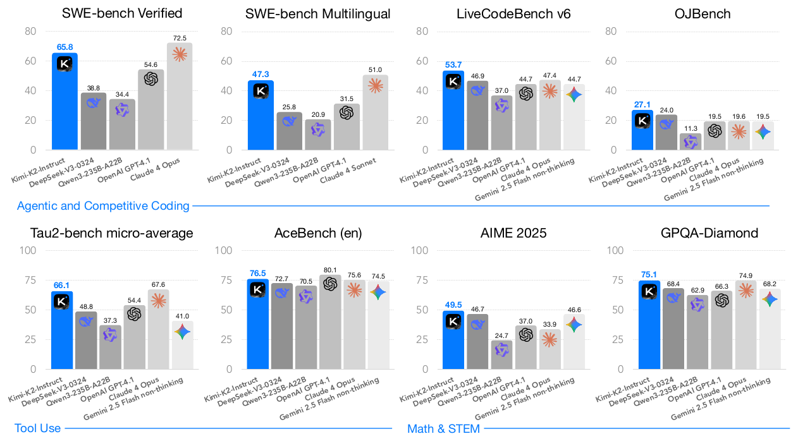

*图 1（原文 Figure 1，第 1 页）：K2-Instruct 与开源/闭源非思考模型在 8 个基准上的得分。*

**图中文字翻译与读法**：

- 共 8 个柱状子图，分三组（图下方的分组标签）：**Agentic and Competitive Coding（agentic 与竞赛编程）**：SWE-bench Verified、SWE-bench Multilingual、LiveCodeBench v6、OJBench；**Tool Use（工具使用）**：Tau2-bench micro-average（微平均）、AceBench (en)（英文）；**Math & STEM（数学与理科）**：AIME 2025、GPQA-Diamond。
- 每个子图中蓝色最左的柱是 Kimi-K2-Instruct，其余灰色柱依次为 DeepSeek-V3-0324、Qwen3-235B-A22B、OpenAI GPT-4.1、Claude 4 Opus、Gemini 2.5 Flash non-thinking（图例写在柱下方）。SWE-bench Multilingual 子图里最右的柱是 Claude 4 Sonnet（脚注：因 Opus 评测成本过高只评了 Sonnet）；SWE-bench Verified 子图没有 Gemini 柱。
- 图上数字（K2 / 最强的对照）：SWE-bench Verified 65.8（Claude 4 Opus 72.5）；SWE-bench Multilingual 47.3（Claude 4 Sonnet 51.0）；LiveCodeBench v6 53.7；OJBench 27.1；Tau2-bench 66.1（Claude 4 Opus 67.6）；AceBench 76.5（GPT-4.1 80.1）；AIME 2025 49.5；GPQA-Diamond 75.1（Claude 4 Opus 74.9）。
- 脚注 2：图中所有模型都是非思考模型。

**读图结论**：K2 在这 8 项上都是开源模型中最高；相对闭源模型，在 LiveCodeBench v6、OJBench、AIME 2025 上领先，在 SWE-bench Verified/Multilingual、Tau2-bench 微平均和 AceBench 上仍低于 Claude 4 或 GPT-4.1，GPQA-Diamond 上只高 0.2 分。所以“最强开源、逼近闭源”比“超过闭源”更准确。

## 四、预训练

### 4.1 MuonClip：给 Muon 加上稳定性护栏

#### 4.1.1 Muon 的更新规则

Muon 对每个权重矩阵 $W\in\mathbb{R}^{n\times m}$ 的更新是：先累积动量 $M_t$；对 $M_t$ 做 Newton–Schulz 迭代，近似求矩阵符号函数 $\mathrm{msign}(M_t)=UV^\top$（其中 $M_t=U\Sigma V^\top$ 是奇异值分解，即把所有奇异值换成 1，这是 Muon 的定义，论文附录 E 称之为 msign）；最后按尺寸缩放并带权重衰减地更新权重。K2 使用的是带 weight decay 并做“一致的更新 RMS 缩放”的版本（沿用 Moonlight 的做法）。

Moonlight 的前期实验（论文引用）显示：在同样算力、同样模型规模、因此同样数据量的前提下，Muon 明显优于 AdamW，这就是 K2 选择它来提高 token 效率的原因。

#### 4.1.2 问题：attention logit 爆炸，现有办法为何不够

扩大 Muon 训练规模后，出现了**训练不稳定：attention logit 爆炸**，而且在作者的实验里 Muon 比 AdamW 更容易出现。论文提到的两种现成办法都不合适：

- **logit soft-cap**（Gemma 2 的做法）：直接对 attention logit 截断；但在截断生效之前，query 和 key 的点积本身仍可能增长到过大。
- **QK-Norm**（对 query/key 做归一化）：**不适用于 MLA**，因为 MLA 的 key 矩阵在推理时没有被完整算出来。

#### 4.1.3 QK-Clip：按头缩放 query/key 权重

设某层输入表示为 $X$。对每个注意力头 $h$：

$$
Q^h=XW_q^h,\qquad K^h=XW_k^h,\qquad V^h=XW_v^h,\qquad O^h=\mathrm{softmax}\!\Big(\tfrac{1}{\sqrt d}\,Q^h K^{h\top}\Big)V^h .
$$

论文定义每个头的**最大 logit**（一个标量），即这个 batch $B$ 里 softmax 输入的最大值：

$$
S^h_{\max}=\frac{1}{\sqrt d}\max_{X\in B}\ \max_{i,j}\ Q^h_i K^{h\top}_j ,
$$

其中 $i,j$ 是同一训练样本 $X$ 中不同 token 的下标。QK-Clip 的核心想法是：只要 $S^h_{\max}$ 超过目标阈值 $\tau$，就把 $W_k,W_q$ 缩小。有一点很重要：**这个操作不改变当前这一步的前向/反向计算**，最大 logit 只是用来决定“多大力度地压住权重增长”的信号。

最朴素的做法是对所有头同时裁剪：

$$
W_q^h\leftarrow\gamma^{\alpha}W_q^h,\qquad W_k^h\leftarrow\gamma^{1-\alpha}W_k^h,\qquad \gamma=\min\!\Big(1,\frac{\tau}{S_{\max}}\Big),\quad S_{\max}=\max_h S^h_{\max},
$$

$\alpha$ 是平衡参数，通常取 0.5，即对 query 和 key 等量缩放。但作者发现实际上只有**少数头**的 logit 会爆炸，为了尽量少干预训练，改成**按头**裁剪：每个头自己的缩放因子 $\gamma_h=\min(1,\tau/S^h_{\max})$。

对普通的多头注意力（MHA）这很直接；对 **MLA**，只裁剪“不共享”的部分：

- $q^C$ 与 $k^C$（头专属的内容部分）：各乘 $\sqrt{\gamma_h}$；
- $q^R$（头专属的旋转部分）：乘 $\gamma_h$；
- $k^R$（跨头共享的旋转部分）：**不动**，避免影响其他头。

（笔者推导：每个头的 logit 可看作内容项 $q^C\!\cdot k^C$ 与旋转项 $q^R\!\cdot k^R$ 之和。内容项两边各乘 $\sqrt{\gamma_h}$，积乘 $\gamma_h$；旋转项只改 $q^R$，积也乘 $\gamma_h$。于是整个头的 logit 恰好整体缩小为原来的 $\gamma_h$ 倍，最大 logit 从 $S^h_{\max}$ 压到 $\tau$。数值例子：某头 $S^h_{\max}=400$，$\tau=100$，则 $\gamma_h=0.25$，$q^C,k^C$ 各乘 0.5，$q^R$ 乘 0.25，缩放后该头最大 logit 为 100。）

#### 4.1.4 MuonClip 算法（算法 1）

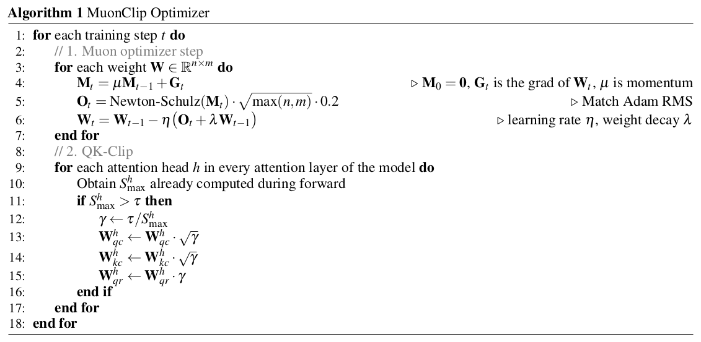

*算法 1（原文 Algorithm 1，第 4 页）：MuonClip 优化器的伪代码。*

逐行解释（$\mu$ 为动量系数，$\eta$ 为学习率，$\lambda$ 为权重衰减）：

1. 第 1 行：对每个训练步 $t$ 循环；第 2–7 行是**第一部分：Muon 步**。
2. 第 4 行：$M_t=\mu M_{t-1}+G_t$，$M_0=0$，$G_t$ 是 $W_t$ 的梯度；这是普通的动量累积。
3. 第 5 行：$O_t=\operatorname{NewtonSchulz}(M_t)\cdot\sqrt{\max(n,m)}\cdot 0.2$，旁注 “Match Adam RMS”：把正交化后的矩阵乘上系数，使更新的 RMS 与 AdamW 对齐。（笔者推导：$n\times m$ 的半正交矩阵 Frobenius 范数平方等于其秩 $\min(n,m)$，所以元素的 RMS 为 $1/\sqrt{\max(n,m)}$；乘 $\sqrt{\max(n,m)}$ 后 RMS 为 1，再乘 0.2 即 RMS 约 0.2。沿用 AdamW 的学习率与 weight decay 是 Moonlight 的出发点。）
4. 第 6 行：$W_t=W_{t-1}-\eta\,(O_t+\lambda W_{t-1})$，带权重衰减的参数更新。
5. 第 8–17 行是**第二部分：QK-Clip**，在**更新之后**对每一层的每个注意力头执行。
6. 第 10 行：取出前向过程中已经算好的 $S^h_{\max}$（不需要额外计算）。
7. 第 11–12 行：若 $S^h_{\max}>\tau$，则 $\gamma\leftarrow\tau/S^h_{\max}$。
8. 第 13–15 行：$W^h_{qc}\leftarrow W^h_{qc}\sqrt{\gamma}$，$W^h_{kc}\leftarrow W^h_{kc}\sqrt{\gamma}$，$W^h_{qr}\leftarrow W^h_{qr}\gamma$；共享的 $W_{kr}$ 不出现，即不动。

#### 4.1.5 实验证据：图 2 与图 3

论文先问两件事：不加护栏时 logit 到底会不会爆？加了 QK-Clip 的真实大模型训练是否稳定？

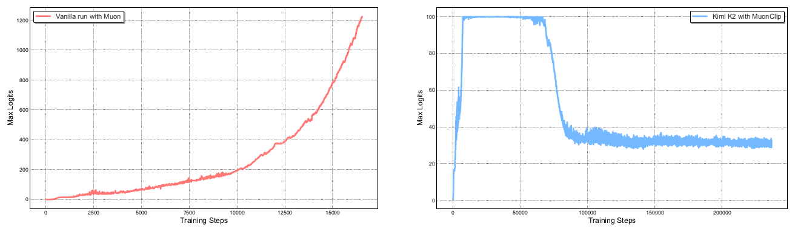

*图 2（原文 Figure 2，第 4 页）：左，中等规模模型用朴素 Muon 训练，最大 logit 迅速超过 1000；右，K2 使用 MuonClip（$\tau=100$）全程的最大 logit。*

**图中文字翻译与读法**：

- **左图 Vanilla run with Muon（朴素 Muon 训练）**：横轴 Training Steps（训练步数，0 到约 16,500），纵轴 Max Logits（最大 logit，0 到 1200）。该实验用的是 **9B 激活 / 53B 总参数**的中等规模 MoE。曲线单调上升且越来越陡：约 10,000 步时约 200，约 15,000 步时约 750，末端超过 1200（读自图）。正文说明：到这个量级通常会引起 loss spike，偶尔发散。
- **右图 Kimi K2 with MuonClip（K2 使用 MuonClip）**：横轴 Training Steps（0 到约 235,000），纵轴 Max Logits（0 到 100）。最大 logit 在最初约 8,000 步内迅速升到上限 100，被 QK-Clip 压住；保持约 100 直到大约 65,000–70,000 步，之后下降，约 90,000 步起稳定在约 30–35（读自图）。图注给出的口径是：“只在约 30% 的训练步数之后才回落到稳定范围”。整个过程**没有再调整 $\tau$**。

**读图结论**：没有护栏时 Muon 的最大 logit 会失控；有 QK-Clip 时 logit 被钳在阈值内，而且训练后期不需要再钳——网络自己把 logit 降到了正常范围。

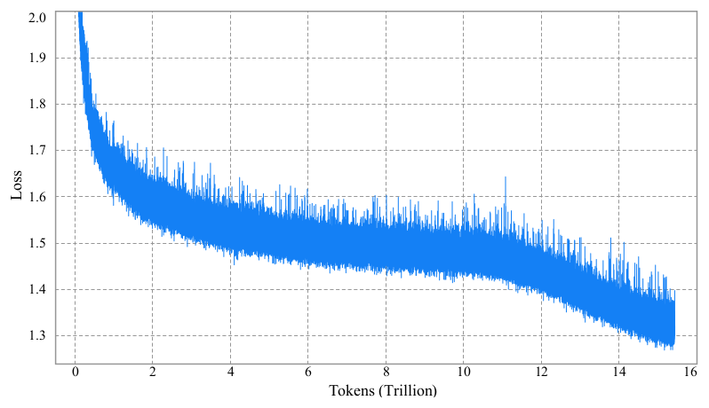

*图 3（原文 Figure 3，第 5 页）：K2 预训练的逐步 loss 曲线，未平滑、未下采样。*

**图中文字翻译与读法**：横轴 Tokens (Trillion)（训练 token 数，万亿），纵轴 Loss。曲线从 2.0 以上很快降到约 1.7，2T token 时约 1.55–1.6，之后在 1.5 上下缓慢下降（4T 到 10T token 之间近乎持平，对应恒定学习率阶段），约 11T token 以后随学习率衰减加快下降，末端约 1.3（读自图）；为清晰起见图中省略了训练最开始的部分。粗的色带是逐步 loss 的噪声范围，整条曲线上**没有尖峰**。

**读图结论**：这是“zero loss spike”这一说法的直接证据；它只说明这一次最终运行的 loss 曲线平滑，不等于所有研究性试验都没有问题。

#### 4.1.6 附录 D：QK-Clip 不损害模型质量，且会自行“关闭”

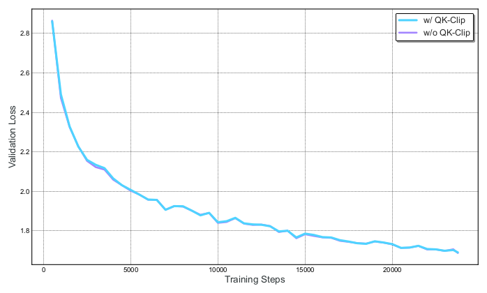

*图 A12（原文 Figure 12，第 30 页）：小规模设置、激进阈值 $\tau=30$ 下，Muon 加与不加 QK-Clip 的验证 loss。*

**图中文字翻译与读法**：横轴 Training Steps（0 到约 23,000），纵轴 Validation Loss（验证 loss）。图例 w/ QK-Clip（青色）、w/o QK-Clip（紫色）。两条曲线几乎完全重合（只有约 2,500–3,500 步附近能看到紫色线的一点偏差），都从约 2.85 降到约 1.7（读自图）。模型是 **0.5B 激活 / 3B 总参数**的小 MoE，阈值取得很低（$\tau=30$），属于“最激进”的裁剪设置。

**读图结论**：即使用很激进的阈值，验证 loss 轨迹也基本不变；论文还说下游评测没有统计显著的退化。

**自失活（self-deactivation）**：K2 的 QK-Clip 只是**暂时**起作用。前 70,000 步里，**12.7% 的注意力头**至少触发过一次 QK-Clip（把 $S_{\max}$ 钳到 100）；70,000 步之后，**所有头**都在某个时刻把 $S_{\max}$ 降到了 100 以下，QK-Clip 不再起作用。起作用时它是按头而不是按层应用的，以免对其他头过度正则；稳定之后它对训练没有任何影响。这呼应图 2 右图在约 70,000 步之后的回落。

#### 4.1.7 附录 E：为什么 Muon 更容易 logit 爆炸（作者的假设）

出发点是 logit 的上界。设 $S_{\max}=\max_{i,j}(q_i\cdot k_j)$，则

$$
\lvert q_i\cdot k_j\rvert\ \le\ \lVert q_i\rVert\,\lVert k_j\rVert\ \le\ \lVert x_i\rVert\,\lVert x_j\rVert\,\lVert W_q\rVert\,\lVert W_k\rVert .
$$

RMSNorm 使 $\lVert x_i\rVert\lVert x_j\rVert$ 有界，所以 logit 爆炸主要由 $W_q$ 或 $W_k$ 的**谱范数**增长驱动。作者的假设是：

- **更新结构不同**：Muon 的更新来自 msign，更新矩阵的所有奇异值相等，有效秩是满的；Adam 的更新谱是“偏的”，少数大奇异值占主导，有效秩低。作者在 16B 的 Moonlight 模型上验证：Muon 训练的权重比 Adam 训练的有更高的奇异值熵（即更高的有效秩）。
- **SVD 形式**：设 $W_{t-1}=\sum_i\sigma_i u_iv_i^\top$，更新矩阵 $\Delta W_t=\sum_j\bar\sigma\,\bar u_j\bar v_j^\top$，则新权重为 $W_t\leftarrow\sum_i\sigma_i u_iv_i^\top+\sum_j\bar\sigma\,\bar u_j\bar v_j^\top$。因为 Muon 下权重与更新都有更高的有效秩，奇异向量对 $u_iv_i^\top$ 与 $\bar u_j\bar v_j^\top$ **对齐的概率更大**，对应的奇异值就会**累加**增大。
- **注意力的放大效应**：logit 是双线性形式 $q_i\cdot k_j=(x_iW_q)\cdot(x_jW_k)$；论文的措辞是 $W_qW_k^\top$ 会让谱范数“平方”，因此任一矩阵奇异值的增大都会被放大。

这是**假设**而非严格证明，论文没有对它做受控的因果验证。

### 4.2 预训练数据：用改写提高 token 利用率

**token 利用率**（token utility）指每个 token 对模型更新贡献的有效学习信号。最朴素的提高方式是重复训练同样的 token，但会过拟合、泛化变差。K2 相对 K1.5 的一个关键数据改进，就是引入合成式的**改写**（rephrasing）流水线：放大高质量 token 的数量，又不引起明显过拟合。报告介绍了面向“知识”和“数学”两个领域的改写方法。

#### 4.2.1 知识数据改写

在自然的知识类文本上预训练存在一个两难：只训一个 epoch 吸收不充分，多 epoch 重复则收益递减且有过拟合风险。K2 的改写框架有三个组件：

- **风格与视角多样的提示（style- and perspective-diverse prompting）**：受 WRAP 启发，用一批精心设计的提示，让大模型以不同风格、从不同视角忠实地改写原文，提高语言多样性而保持事实不变。
- **分块自回归生成（chunk-wise autoregressive generation）**：为保持长文档的整体连贯、避免信息丢失，把文本切成片段，逐段改写，再拼回完整文章；这也绕开了 LLM 常见的隐式输出长度限制（流程见图 4）。
- **保真验证（fidelity verification）**：比较每段改写文与原文的语义一致性，作为训练前的初步质量控制。

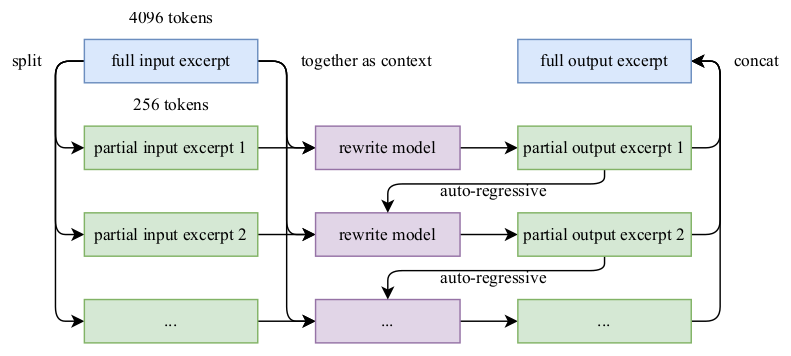

*图 4（原文 Figure 4，第 6 页）：长输入片段的自回归分块改写流水线。*

**图中文字翻译与读法**：左上 full input excerpt（完整输入片段，标注 4096 tokens）经 split（切分）得到若干 partial input excerpt（部分输入片段，每块标注 256 tokens）；每个部分片段与完整输入片段“together as context（一起作为上下文）”送入 rewrite model（改写模型），生成对应的 partial output excerpt（部分输出片段）；相邻两步之间的 auto-regressive（自回归）箭头表示上一段的改写结果会作为后续改写的上文；最后各部分输出 concat（拼接）成 full output excerpt（完整输出片段）。**读图结论**：每次只改写一小段，但上下文里始终有整篇原文和已经写好的前文，因此全文风格一致、不丢信息。

作者用 SimpleQA 准确率对比“改写”和“多 epoch 重复”，在 K2 的一个早期检查点上比较三种训练策略：（1）原始数据重复 10 个 epoch；（2）改写 1 次后重复 10 个 epoch；（3）改写 10 次、只训 1 个 epoch。

| 改写次数（# Rephrasings） | 训练轮数（# Epochs） | SimpleQA 准确率 |
|---|---:|---:|
| 0（原始 wiki 文本） | 10 | 23.76 |
| 1 | 10 | 27.39 |
| 10 | 1 | 28.94 |

（原文表 1，第 5 页。）读法：三种设置消耗的训练 token 量相同（笔者推导：都相当于 10 倍数据量，改写不改变长度的前提下），但准确率依次提高 3.63 和 5.18 个点，也就是“把同一知识换 10 种说法各读一遍”优于“读 10 遍原文”。论文说同样方法也被用到其他大规模知识语料上，结果类似，**每个语料最多改写两次**。这一实验只用了一个检查点、一个指标（SimpleQA），没有报告多次随机种子。

#### 4.2.2 数学数据改写

为增强数学推理，K2 参照 SwallowMath 的方法，把高质量数学文档改写成“学习笔记（learning-note）”风格；还把其他语言的高质量数学材料翻译成英文以增加多样性。作者坦承：虽然在改写子集上的初步实验结果有希望，但把合成数据作为持续扩大规模的策略仍是活跃的研究课题，难点包括：推广到多样的源领域时不损失事实准确性、减少幻觉和意外的毒性、能否扩展到大规模数据集。

#### 4.2.3 数据总览

K2 的预训练语料共 **15.5 万亿 token**，覆盖四个主要领域：**Web Text（网页文本）、Code（代码）、Mathematics（数学）、Knowledge（知识）**。大部分数据处理流水线沿用 Kimi K1.5 的方法；每个领域都做了严格的正确性与质量验证，并设计了针对性的数据实验。论文没有给出四个领域各自的 token 占比。

### 4.3 模型架构

K2 是 1.04 万亿参数、320 亿级激活参数的 MoE Transformer，沿用与 DeepSeek-V3 相近的设计：注意力用 MLA，模型隐藏维度 7168，MoE 专家隐藏维度 2048。缩放律分析表明继续提高稀疏度能带来明显收益，所以专家数从 DeepSeek-V3 的 256 增加到 384；为降低推理开销，注意力头数从 128 减到 64。

| 项目 | DeepSeek-V3 | Kimi K2 | 变化（Δ） |
|---|---:|---:|---|
| 层数（#Layers） | 61 | 61 | = |
| 总参数（Total Parameters） | 671B | 1.04T | ↑ 54% |
| 激活参数（Activated Parameters） | 37B | 32.6B | ↓ 13% |
| 专家总数（Experts, total） | 256 | 384 | ↑ 50% |
| 每 token 激活专家数（Experts Active per Token） | 8 | 8 | = |
| 共享专家（Shared Experts） | 1 | 1 | = |
| 注意力头数（Attention Heads） | 128 | 64 | ↓ 50% |
| Dense 层数（Number of Dense Layers） | 3 | 1 | ↓ 67% |
| 专家分组（Expert Grouping） | Yes | No | - |

（原文表 2，第 6 页。）读法：K2 层数不变，把总参数提高到 1.04T，而每 token 激活的专家数仍是 8 个路由专家加 1 个共享专家，所以激活参数反而略少于 V3。按本文的稀疏度定义（专家总数 ÷ 每 token 激活专家数），DeepSeek-V3 为 $256/8=32$，K2 为 $384/8=48$（笔者核算）；K2 的激活参数约占总参数的 3%（$32.6/1043\approx3.1\%$，笔者核算）。“专家分组”指 DeepSeek-V3 把专家分成组、限制 token 只在少数组内选专家以控制通信；K2 取消了这个限制（这是笔者对该行含义的解释，论文只在表中写了 Yes/No）。表中的百分比是原文取整结果：按 32.6B/37B 重算激活参数应约为 ↓12%，按 1.04T/671B 重算总参数应约为 ↑55%，不影响结论。

#### 4.3.1 稀疏度缩放律（图 5）

论文针对使用 Muon 的 MoE 模型族建立了稀疏度缩放律。在保持激活参数不变（即 FLOPs 不变）时，增加专家总数（提高稀疏度）会持续降低训练和验证 loss。具体地：在补偿最优的稀疏度缩放律下，要达到同样的验证 loss 1.5，稀疏度 48 相比稀疏度 8、16、32 分别能省 **1.69×、1.39×、1.15×** 的 FLOPs。稀疏度更高当然更好，但会带来更高的基础设施复杂度，所以 K2 折中选择稀疏度 48，即每次前向在 384 个专家中激活 8 个。

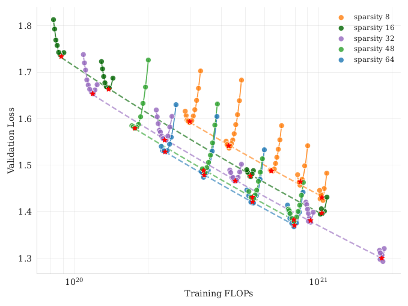

*图 5（原文 Figure 5，第 7 页）：固定激活专家数为 8、共享专家数为 1，改变专家总数得到不同稀疏度，比较验证 loss 与训练 FLOPs 的关系。*

**图中文字翻译与读法**：横轴 Training FLOPs（训练算力，对数坐标，约 $10^{20}$ 到 $2\times10^{21}$），纵轴 Validation Loss（验证 loss，约 1.3 到 1.8）。图例为 sparsity 8、16、32、48、64 五种稀疏度（颜色不同）。每种颜色有多组小规模实验的散点，红色星号和同色虚线是各稀疏度的最优点与拟合线（笔者读图理解，原文图注未逐项说明）。**读图结论**：同样的算力下，稀疏度越高，虚线越低，验证 loss 越小；48 与 64 的虚线已经很接近。

#### 4.3.2 注意力头数（图 6）

DeepSeek-V3 把注意力头数设为层数的大约两倍，以更好地利用内存带宽、提升计算效率。但上下文变长时，头数翻倍会带来显著的推理开销。这对长上下文效率至关重要的 agentic 应用是主要限制。例如序列长度 128k 时，把头数从 64 增加到 128（专家总数固定 384），推理 FLOPs 会增加 **83%**。

为评估这个设计，作者做对照实验：在不同训练算力下，比较“头数等于层数”与“头数翻倍”。在 iso-token（相同训练 token 数）条件下，翻倍头数只带来**小幅**验证 loss 改善，幅度为 0.5% 到 1.2%（图 6）。既然稀疏度 48 已经表现很强，翻倍头数的边际收益不值得推理开销，所以选 64 个头。

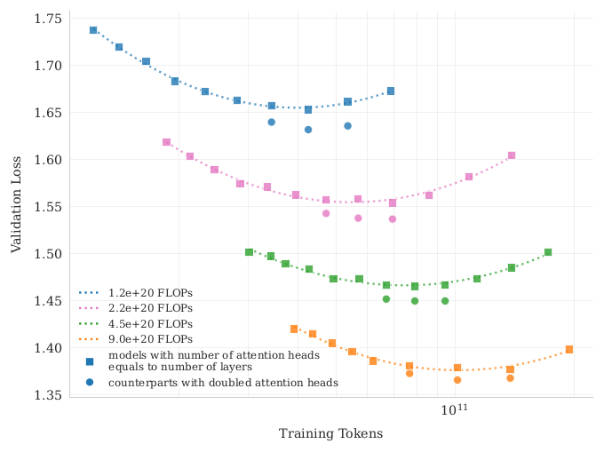

*图 6（原文 Figure 6，第 7 页）：头数等于层数的模型与头数翻倍的对照模型在不同训练 FLOPs 下的缩放曲线。*

**图中文字翻译与读法**：横轴 Training Tokens（训练 token 数，对数坐标，刻度含 $10^{11}$），纵轴 Validation Loss。四种颜色对应四个算力预算：1.2e+20、2.2e+20、4.5e+20、9.0e+20 FLOPs（图例 FLOPs，由上到下 loss 递减）。**方块**是“models with number of attention heads equals to number of layers（头数等于层数的模型）”，每个算力下有一条随 token 数先降后升的 U 形曲线（点线为拟合）；**圆点**是“counterparts with doubled attention heads（头数翻倍的对照模型）”，每个算力下有 3 个点。**读图结论**：每个算力下圆点都略低于方块曲线的最低处，差距不大，即论文所说 0.5%–1.2%。

### 4.4 训练基础设施

#### 4.4.1 计算集群

K2 在 NVIDIA H800 GPU 集群上训练。每个节点有 2 TB 内存和 8 块 GPU，节点内用 NVLink 与 NVSwitch 互联；节点之间用 8×400 Gbps 的 RoCE 互联。

#### 4.4.2 并行策略

大模型训练经常在资源动态变化下进行，所以作者没有为某个特定资源量优化一种并行策略，而是采用灵活的方案，使 K2 能在**任意 32 的倍数个节点**上训练。组合是：**16 路流水线并行（PP，带虚拟 stage）+ 16 路专家并行（EP）+ ZeRO-1 数据并行**。（论文列出的并行组合里没有张量并行。）

这种设置下，参数用 BF16 存储、梯度累积缓冲用 FP32，需要约 **6 TB** GPU 显存，分布在 **256 块 GPU** 组成的模型并行组上。（笔者核算：$1.04\text{T}\times(2+4)$ 字节 ≈ 6.2 TB，与论文一致；16 路 PP × 16 路 EP = 256 块 GPU，平均每块约 24 GB。）优化器状态的放置取决于训练配置：节点数很多时，优化器状态被分摊到可以忽略的程度；节点数很少（例如 32 个）时，可以把部分优化器状态卸载到 CPU。这样小规模和大规模实验可以复用同一套并行配置，每块 GPU 为所有状态占用约 **30 GB**，其余显存留给激活；这种一致的设计简化了系统、加快了实验迭代。

**用 interleaved 1F1B 重叠 EP 通信**：增加 warm-up 的 micro-batch 数，就能在标准 interleaved 1F1B 调度下把 EP 的 all-to-all 通信与计算重叠。相比之下 DualPipe 需要两倍的参数和梯度显存，要靠提高并行度来补偿；而增大 PP 会引入更多气泡、增大 EP 的开销更高，对超过万亿参数的模型代价高得难以承受，所以不用 DualPipe。但 interleaved 1F1B 把模型切成更多 stage，带来不小的 PP 通信开销。为缓解它，作者把权重梯度计算从每个 micro-batch 的反向中**拆出来**，与对应的 PP 通信并行执行；这样除 warm-up 阶段之外，所有 PP 通信都能被重叠。

**更小的 EP**：为了让 1F1B 阶段的计算与通信完全重叠，K2 注意力计算时间变短（64 个头对比 V3 的 128 个），因此必须尽量缩短 EP 操作的时间，做法是采用尽可能小的 EP，即 **EP = 16**。较小的 EP 组还放宽了专家均衡的约束，无需额外调优就能接近最优速度。

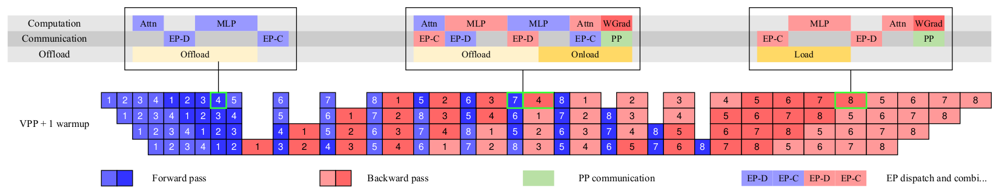

*图 7（原文 Figure 7，第 8 页）：计算、通信和 offload 在流水线各阶段的重叠。*

**图中文字翻译与读法**：

- **下方的时间线**：画了 4 个流水线 stage（每行一个）和 8 个 micro-batch 的示意（实际是 16 路 PP），左侧标注 “VPP + 1 warmup”（带虚拟流水线并行、并增加 warm-up 的调度）。蓝色格子是前向（Forward pass），红色格子是反向（Backward pass），数字是 micro-batch 序号，绿色是 PP 通信（PP communication）；图例中的 EP-D、EP-C 是专家并行的 dispatch（分发）与 combine（汇聚），其说明文字在原图中被截断为 “EP dispatch and combi...”。
- **上方三个放大框**（分别对应 warm-up、稳态 1F1B、cool-down 三个阶段，每个框三行 Computation（计算）/ Communication（通信）/ Offload（卸载））：warm-up 前向里，Attn 计算 → EP-D → MLP 计算 → EP-C，同时把激活 Offload 到 CPU；稳态阶段里，一个 micro-batch 的前向（蓝）与另一个的反向（粉红）交错，EP 的 dispatch/combine 通信被另一个 micro-batch 的计算覆盖，WGrad（权重梯度，红）与 PP 通信（绿）并行，同时既有 Offload（卸载上一个 micro-batch 的前向激活）又有 Onload（预取下一个 micro-batch 的反向激活）；cool-down 阶段只剩 Load、WGrad 与通信。

**读图结论**：稳态 1F1B 阶段（中框）里，前向与反向交错，一方的 EP 通信被另一方的计算遮住，权重梯度计算与 PP 通信并行；warm-up 阶段（左框）里通信与计算基本是串行的，这也是论文说“除 warm-up 阶段之外，所有 PP 通信都能被重叠”的原因。论文还说，offload 引起的 PCIe 流量可能轻微影响 EP 流量，但实测 EP 通信仍被完全重叠。

#### 4.4.3 激活显存削减

为参数、梯度缓冲和优化器状态预留空间后，每块设备剩下的显存装不下完整的 MoE 激活，尤其是 1F1B warm-up 阶段累积激活最多的前几个流水线 stage。采用三类技术：

- **选择性重计算（selective recomputation）**：对便宜但占显存多的环节重算，包括 LayerNorm、SwiGLU 和 MLA 的上投影；训练中还重算 MoE 的下投影。这一步是可选的，但能保持足够的显存，防止训练早期专家不均衡导致崩溃。
- **对不敏感的激活用 FP8 存储**：MoE 上投影和 SwiGLU 的输入以 FP8-E4M3 压缩，按 $1\times128$ 的 tile 并配 FP32 缩放因子；小规模实验未见可测的 loss 上升。由于预研中观察到可能的性能退化，**并不在计算中使用 FP8**（只用于存储）。
- **激活 CPU offload**：其余激活全部卸载到 CPU 内存，由 copy engine 负责异步卸载/回载，与计算和通信 kernel 重叠；1F1B 阶段，卸载上一个 micro-batch 的前向激活，同时预取下一个 micro-batch 的反向激活（模式见图 7）。

### 4.5 训练配方

下表是把正文里分散的数字整理在一起（原文第 2.5 节）。

| 阶段 | token 数 | 学习率 | 序列长度 |
|---|---|---|---|
| warm-up | 500 步 | 升至 2e-4 | 4,096 |
| 恒定学习率 | 前 10T | 2e-4 | 4,096 |
| cosine 衰减 | 其后 5.5T（合计 15.5T） | 2e-4 → 2e-5 | 4,096 |
| 退火（annealing） | 400B | 2e-5 → 7e-6 | 4k |
| 长上下文激活 | 60B | 接上 | 32k |
| 扩到 128k | 用 YaRN 方法 | - | 128k |

通用设置：MuonClip 优化器 + WSD 学习率调度；全程 weight decay 0.1；全局 batch size 67M token，退火阶段也保持不变。

笔者核算：$15.5\text{T}/67\text{M}\approx$ 23 万步，与图 2 右图横轴末端（约 23.5 万步）相符。论文没有说明退火与长上下文阶段的 460B token 是否计入 15.5T，这里不作推断。

## 五、后训练

### 5.1 监督微调（SFT）

后训练也使用 Muon 优化器，并建议用户用 Muon 来微调 K2；依据是作者此前工作（Moonlight）的结论：用 Muon 预训练的检查点，配合 Muon 微调效果最好。

SFT 数据构造遵循两条原则：**最大化 prompt 多样性**、**保证回答质量**。为此为不同任务领域设计了一组数据生成流水线，综合使用人工标注、提示工程和验证；用 K1.5 和其他内部领域专家模型生成候选回答，再由 LLM 或人工评审做自动质量评估与过滤。对于 agentic 数据，则建立专门的数据合成流水线，通过多步、交互式推理教会模型使用工具。SFT 数据的规模、轮数等细节论文没有披露。

### 5.2 大规模 agentic 数据合成

现代 LLM 智能体必须能自主使用不熟悉的工具、与外部环境交互，并在“推理—执行—纠错”的循环中迭代。真实环境能给出丰富而真实的交互信号，但成本、复杂度、隐私和可访问性使其难以大规模搭建；纯合成数据则在保真度上有局限。K2 的做法是一条三阶段流水线，在受 ACEBench 启发的合成框架上扩展，能生成数以万计多样且高质量的训练样本：

| 阶段 | 做什么 | 关键内容 |
|---|---|---|
| 工具规格生成 | 构造大规模工具库 | 从 GitHub 抓取 3000+ 个真实 MCP（Model Context Protocol）工具；通过分层领域演化合成 20,000+ 个工具 |
| Agent 与任务生成 | 为每个从工具库采样的工具集生成 agent 和任务 | 合成各种系统提示并搭配不同工具组合，得到数千个不同 agent；每个任务配有明确的 rubric |
| 轨迹生成 | 为每个 agent 与任务生成调用工具完成任务的轨迹 | 用户模拟 + 工具模拟器 + 评审过滤；编程类任务补充真实沙箱 |

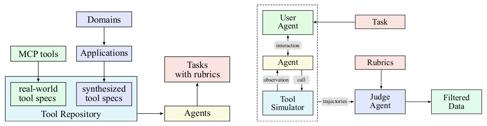

*图 8（原文 Figure 8，第 10 页）：工具使用数据合成流水线。（a）合成工具规格、agent 和任务；（b）生成并过滤 agent 轨迹。*

**图中文字翻译与读法**：

- **（a）Synthesizing tool specs, agents and tasks（合成工具规格、agent 与任务）**：Domains（领域）生成 Applications（应用），应用生成 synthesized tool specs（合成的工具规格）；MCP tools（MCP 工具）提供 real-world tool specs（真实工具规格）；两者汇入 Tool Repository（工具库）；工具库再产生 Agents，并生成 Tasks with rubrics（带 rubric 的任务）。
- **（b）Generating agent trajectories（生成 agent 轨迹）**：虚线框内是仿真环境：Task（任务）交给 User Agent（用户 agent，即用户模拟器），它与 Agent 之间有 interaction（交互）；Agent 向 Tool Simulator（工具模拟器）发出 call（调用）并收到 observation（观察）；产生的 trajectories（轨迹）连同 Rubrics（评分细则）交给 Judge Agent（评审 agent），通过的轨迹进入 Filtered Data（过滤后的数据）。

**读图结论**：整套流水线里，“任务”和“评分标准（rubric）”是在生成轨迹之前就确定好的，所以评审不是事后凭印象打分，而是对着预先写好的成功标准验收。

**领域演化与工具生成**：真实工具来自 GitHub 上的 3000+ 个 MCP 工具，直接利用现有的高质量规格。合成工具则按 WizardLM 式的演化思路分层生成：先定关键类别（如金融交易、软件应用、机器人控制），在每个类别下演化出多个具体应用领域，再为每个领域合成带有清晰接口、描述和操作语义的专用工具，共产生 20,000 多个。

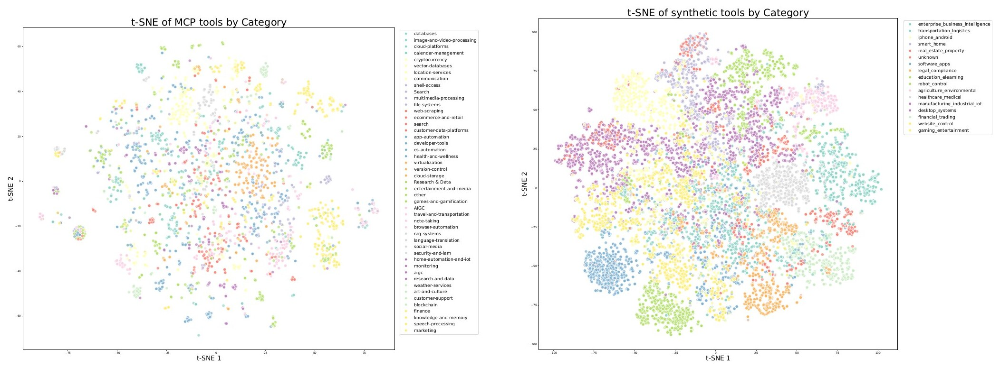

*图 9（原文 Figure 9，第 10 页）：工具嵌入的 t-SNE 可视化。（a）真实 MCP 工具，按原始来源类别着色；（b）合成工具，按预先定义的领域类别着色。*

**图中文字翻译与读法**：两个子图横轴 t-SNE 1、纵轴 t-SNE 2，每个点是一个工具的嵌入向量降到二维。右侧图例是类别名：（a）MCP 工具的来源类别，例如 databases（数据库）、cloud-platforms（云平台）、calendar-management（日历管理）、cryptocurrency（加密货币）、vector-databases（向量数据库）、location-services（位置服务）、shell-access、file-systems（文件系统）、web-scraping（网页抓取）、ecommerce-and-retail（电商零售）、developer-tools（开发者工具）、version-control（版本控制）、browser-automation（浏览器自动化）、finance（金融）、blockchain（区块链）等共 40 多类；（b）合成工具的领域类别，例如 enterprise_business_intelligence（企业商业智能）、transportation_logistics（交通物流）、iphone_android（手机）、smart_home（智能家居）、real_estate_property（房地产）、software_apps、legal_compliance（法务合规）、education_elearning（教育）、robot_control（机器人控制）、agriculture_environmental（农业与环境）、healthcare_medical（医疗）、manufacturing_industrial_iot（制造与工业物联网）、financial_trading（金融交易）、gaming_entertainment（游戏娱乐）等。**读图结论**：真实工具按来源自然聚成团，合成工具按预设领域系统性铺开，两者覆盖工具空间中互补的区域，论文据此认为工具库能覆盖不同功能。需要注意 t-SNE 只反映嵌入空间里的相似性，并不能证明工具质量或任务难度。

**Agent 多样化**：通过合成各种系统提示、给 agent 配备工具库中不同的工具组合，生成数千个不同的 agent，让它们拥有不同的能力、专长和行为模式。

**基于 rubric 的任务生成**：为每种 agent 配置生成从简单到复杂的任务；每个任务配有明确的 rubric，写明成功标准、预期的工具使用模式和评估检查点，使评价一致且客观。

**多轮轨迹生成**，由几个组件模拟真实的工具使用场景：

- **用户模拟（User Simulation）**：由 LLM 生成、有不同沟通风格与偏好的用户角色，与 agent 进行多轮对话，形成自然的交互模式；
- **工具执行环境（Tool Execution Environment）**：一个复杂的工具模拟器（功能上等价于世界模型）执行工具调用并给出逼真的反馈。它在每次工具执行之后维护并更新状态，因而可以做有持久副作用的复杂多步交互；并引入受控的随机性，产生成功、部分失败和边界情形等不同结果；
- **质量评估与过滤**：由基于 LLM 的评审对照任务 rubric 评估每条轨迹，只保留满足成功标准的轨迹，在保证质量的同时允许完成任务的策略自然多样。

**与真实执行环境的混合**：仿真可规模化，但保真度有固有局限。因此在真实性至关重要的场景，尤其是编程和软件工程任务，补充**真实执行沙箱**：真实运行代码、与真实开发环境交互，通过测试集通过率这类客观指标给出真值反馈。论文认为，仿真提供多样性、真实沙箱提供真实性，两者结合起来，加上质量过滤，等价于大规模的**拒绝采样（rejection sampling）**；这些高质量合成数据用于 SFT，显著提升了模型在多种真实应用中的工具使用能力。（论文没有给出这一数据对下游指标的单独消融数字，所以“显著提升”是论文的定性论断。）

#### 附录 B：工具调用的 token 模板

工具调用的 token 结构由三部分组成：**工具声明消息**（列出可用工具及参数的 schema）、assistant 消息中的**工具调用段**（模型发起调用）、**工具结果消息**（包含被调用工具的执行结果）。工具声明消息的原始 token 格式如下，其中 `<|im_begin|>` 等是特殊 token：

```text
<|im_begin|>
tool_declare
<|im_middle|>
# Tools

{{ tool declaration content }}
<|im_end|>
```

声明内容用 **TypeScript** 表达，因为它简洁，类型系统足以用很短的文字表达参数类型和约束；为了兼容第三方框架，部分训练数据也用 JSON（兼容 OpenAI chat completion API）作为声明语言。论文用两个简单工具（`get_weather` 和 `Calculator`）对比：同样的工具，TypeScript 写法明显比 JSON 更短：

```typescript
namespace functions {
// Get weather for a location and date
type get_weather = (_: {
  // City and country e.g. Beijing, China
  location: string,
  // Date to query, format in ‘%Y-%m-%d’
  date?: string
}) => any;
// Simple calculator
type Calculator = (_: {
  // Arithmetic expression in javascript
  expr?: string
}) => any;
}
```

模型回复中的工具调用段模板为：

```text
<|tool_call_section_begin|>
<|tool_call_begin|>
// call_id part
functions.{{tool name}}:{{counter}}
<|tool_arguments_begin|>
{{ json serialized call arguments }}
<|tool_call_end|>
<|tool_call_begin|>
// more tool calls
<|tool_call_end|>
<|tool_call_section_end|>
```

在同一轮回复里放多个工具调用即可支持**并行工具调用**。每个调用有唯一的 call id，格式为 `functions.{tool-name}:{counter}`，`counter` 是对话中从 0 开始自增的计数。推理时模型偶尔会生成意外 token，导致解析工具调用时格式出错；为此作者开发了名为 **enforcer** 的约束解码模块（受 lm-format-enforcer 启发）：一旦生成了工具调用段的起始 token，它就保证后续的工具相关 token 遵循预定义模板，并使 JSON 参数字符串符合声明的 schema。工具结果消息只是一条用 call id 编码的文本消息：

```text
<|im_begin|>
tool
<|im_middle|>
## Results of {{call_id}}
{{ execution result content }}
<|im_end|>
```

### 5.3 强化学习

论文认为 RL 比 SFT 有更好的 token 效率和泛化。在 K1.5 的基础上，K2 继续扩大 RL 的任务多样性和训练 FLOPs；为此搭建了类似 Gym 的可扩展框架，覆盖各种场景，并扩展了大量带可验证奖励的任务。对于依赖主观偏好的任务（创意写作、开放式问答），引入**自评价奖励（self-critic reward）**：让模型对自己的输出做成对比较来判断好坏。这样各个领域的任务都能受益于 RL。

#### 5.3.1 可验证奖励 Gym（Verifiable Rewards Gym）

**数学、STEM 与逻辑任务**：数据准备遵循两条原则——**覆盖多样**与**难度适中**。

- 覆盖多样：数学和 STEM 的高质量问答对来自专家标注、内部问答抽取流水线和开源数据集（论文引用了 NuminaMath、AIMO-2 的 OpenMathReasoning 等），并用标签系统有意提高覆盖不足领域的占比；逻辑任务包含结构化数据任务（如多跳表格推理、跨表聚合）和逻辑谜题（如 24 点、数独、谜语、密码算术、摩尔斯电码解码）。
- 难度适中：RL 的 prompt 集不能太容易也不能太难，否则信号太少、学习效率低。作者用 **SFT 模型的 pass@k 准确率**评估每道题的难度，只选难度适中的。

**复杂指令遵循**：好的指令遵循不仅要理解显式约束，还要处理隐含要求、边界情形，并在长对话中保持一致。方案是混合验证框架加可扩展的课程生成流水线，双路径兼顾精确性与鲁棒性：

- **混合规则验证**：（1）对有可验证输出的指令（如长度、风格约束），用代码解释器做确定性评估；（2）对需要细致理解的约束，用 LLM-as-judge。为应对模型可能“声称已满足指令但实际没有”的对抗行为，再加一层专门检测这类欺骗性声明的 **hack-check**。
- **多来源指令生成**：（1）数据团队手写的复杂条件提示和 rubric；（2）受 AutoIF 启发的 agentic 指令增强；（3）一个专门微调的模型，用来生成探测特定失败模式或边界情形的额外指令。

**忠实性（Faithfulness）**：对多轮工具使用、自生成推理链、开放环境交互这类场景，忠实性对 agentic 模型至关重要。受 FACTS Grounding 评估框架启发，训练了一个**句子级的忠实性评审模型**做自动验证，它能有效识别在上下文中没有证据支持却陈述事实的句子，并作为奖励模型提升整体忠实性。

**编程与软件工程**：为提升竞赛级编程能力，从开源数据集（论文引用 OpenCoder、KodCode）和合成来源收集题目及其判题器；为保证合成数据多样并让奖励信号正确，还加入从预训练数据中检索出的高质量人工编写单元测试。软件工程任务则收集大量 GitHub 的 pull request 与 issue，构建由用户提示/issue 与可执行单元测试组成的开发环境；它建立在 Kubernetes 驱动的稳健沙箱基础设施之上，具备可扩展性与安全性，支持 **10,000 个以上并发沙箱实例**并保持稳定，适用于竞赛编程和软件工程两类任务。

**安全（Safety）**：从人工整理的种子 prompt 起步，覆盖暴力、欺诈、歧视等常见风险类别；为模拟角色扮演、文学叙事、学术讨论等复杂越狱，用自动 prompt 演化流水线，包含三个组件：**攻击模型**（迭代生成诱导目标模型产生不安全回答的对抗 prompt）、**目标模型**（对这些 prompt 作答，模拟潜在脆弱性）、**评审模型**（判断对抗 prompt 是否成功绕过安全机制）；每次交互用特定任务的 rubric 评估，评审给出成功/失败的二元标签。

#### 5.3.2 超越可验证：自评价 rubric 奖励（Self-Critique Rubric Reward）

为把对齐扩展到没有可验证奖励的任务，作者提出基于**自我批评反馈**的通用 RL 框架，对齐 helpfulness（有用性）、creativity（创造性）、depth of reasoning（推理深度）、factuality（事实性）、safety（安全性）等细微的人类偏好，把可验证场景里学到的能力延伸到更广的主观任务。让 K2 成为合格的评审（critic）的做法是：整理开源与内部偏好数据的混合集，在 **SFT 阶段就初始化它的评审能力**。

**自批评策略优化（Self-Critiqued Policy Optimization）**：在学习循环的第一个核心环节，K2 actor（策略）对覆盖各种用法的通用 prompt 生成回答；K2 critic 则对所有结果做**成对评估**，对照一组 rubric 给出排序。rubric 由三类构成：

- **核心 rubric**（附录 F.1，代表 Kimi 想作为 AI 助手坚持的基本价值）；
- **规范性 rubric**（附录 F.2，用来消除 reward hacking）；
- 数据团队针对特定指令情境人工撰写的 rubric。

有些 rubric 可以被指定为必须遵守，但 K2 仍保留依据其内部先验权衡这些 rubric 的灵活性，使模型能随着自身 on-policy 行为演变而动态、持续地对齐，既保持与核心身份一致，又适应具体指令。

**闭环的 critic 精炼与对齐（Closed-Loop Critic Refinement and Alignment）**：RL 训练期间，critic 会被可验证信号继续精炼：用来自可验证奖励 prompt 的 on-policy rollout 持续更新 critic，把 RLVR 中客观的性能信号蒸馏进评审模型。这一迁移让主观判断落在可验证数据上，使可验证任务上的收益能提升 critic 对没有显式奖励信号的复杂任务的判断，并使 critic 的评价标准随策略演化同步校准。论文称这样的整体对齐在用户意图理解、创意写作、复杂推理和细致的语言理解等方面带来了综合提升（论文未给出单独的消融数字）。

**附录 F：rubric 的内容与局限**

- **核心 rubric**：（1）*Clarity and Relevance（清晰与相关）*：回答简洁并完整回应用户意图，去掉不必要的细节，使用简短段落或紧凑列表，除非明确要求避免长篇罗列，需要选择时应给出单一、明确的答案；（2）*Conversational Fluency and Engagement（对话流畅与投入）*：对话自然流畅，保持连贯，适度投入，提供相关观察或见解，必要时建设性地引导对话，审慎使用追问，优雅处理假设性或个人类比的问题，并按语境调整语气（共情、正式、随意）；（3）*Objective and Grounded Interaction（客观、扎实的互动）*：保持客观、扎实的语气，聚焦用户请求的实质，避免元评论（分析问题结构、话题组合、是否奇怪或交互本身），避免对用户或其输入的无端奉承和过度夸奖。
- **规范性 rubric**：（1）*Initial Praise（开头夸奖）*：回答不得以对用户或问题的赞美开头（如“这是个很好的问题”）；（2）*Explicit Justification（显式自证）*：任何解释“为什么本回答是好的”或“如何成功满足了用户请求”的句子或从句，与单纯描述内容不同，也要避免。
- **局限（F.3）**：这套框架可能偏爱“显得自信、断言式”的回答，即使在含糊或主观的语境中。原因有二：规范性规则禁止自我评估、显式免责声明或含糊措辞（如“这可能不准确”“我可能错了”），这些话虽然体现认知上的谦逊，却常被当作无信息或表演性内容而被惩罚；rubric 偏好清晰、单一，在复杂开放场景里可能抑制恰当的谨慎或多视角回答。结果是模型有时会在应该保持含糊、细微或谦逊的地方过度表达确定性；未来版本也许会更细致地处理校准过的不确定性。

#### 5.3.3 RL 算法

K2 以 K1.5 的策略优化算法为基础。对每个问题 $x$，从旧策略 $\pi_{\text{old}}$ 采样 $K$ 个回答 $\{y_1,\dots,y_K\}$，对 $\pi_\theta$ 优化如下目标：

$$
L_{\mathrm{RL}}(\theta)=\mathbb{E}_{x\sim\mathcal{D}}\!\left[\frac{1}{K}\sum_{i=1}^{K}\Big(r(x,y_i)-\bar r(x)-\tau\log\frac{\pi_\theta(y_i\mid x)}{\pi_{\text{old}}(y_i\mid x)}\Big)^{2}\right],
$$

其中 $\bar r(x)=\frac{1}{K}\sum_{i=1}^{K}r(x,y_i)$ 是所采样回答的平均奖励，$\tau>0$ 是促进稳定学习的正则化参数（注意：这里的 $\tau$ 与 QK-Clip 的阈值 $\tau$ 是两个不同的量；论文正文把平均奖励公式里的样本数写成了小写 $k$，指的就是 $K$）。与 SFT 一样，用 Muon 优化器来**最小化**这个目标。

笔者理解：这个损失要求每个回答的“相对奖励” $r-\bar r$ 与“策略相对旧策略的对数概率变化” $\tau\log(\pi_\theta/\pi_{\text{old}})$ 对齐，即奖励高于平均的回答概率被抬高，低于平均的被压低，$\tau$ 控制每步变化的幅度；这是对公式的直观解读，论文没有展开推导，推导依据见 K1.5。

随着 RL 扩展到更广的任务，主要挑战是在所有领域上取得一致的性能提升。为此在 RL 算法上做了几项补充：

- **预算控制（Budget Control）**：RL 常常导致回答长度大幅增加。更长的回答让模型能利用更多测试时计算，对复杂推理任务有益，但在非推理领域，收益往往不值得推理成本。为鼓励模型合理分配推理预算，RL 训练中对每个样本强制一个**最大 token 预算**，预算按任务类型确定；超出预算的回答会被截断并受到惩罚，促使模型在限定内给出解答。经验上这显著提高了 token 效率，使各领域的解答简洁而有效。
- **PTX 损失**：为防止联合 RL 训练中遗忘有价值的高质量数据，作者整理了一个手工挑选的高质量样本集，通过辅助的 PTX 损失加入 RL 目标。这既利用了高质量数据，又缓解了对训练中显式出现的有限任务过拟合的风险，显著提升了在更广泛领域的泛化。
- **温度衰减（Temperature Decay）**：对创意写作和复杂推理，训练初期用较高采样温度促进探索很关键，能产生多样、创新的回答，有助于发现有效策略、降低过早收敛到次优解的风险；但训练后期或评测时保持高温会引入过多随机性、损害可靠性与一致性。所以采用**温度衰减调度**，从探索逐步过渡到利用，最终收敛到稳定、高质量的输出。

### 5.4 RL 基础设施

#### 5.4.1 同机（colocated）架构

与 K1.5 类似，K2 的同步 RL 训练采用**混合同机架构**：训练引擎和推理引擎部署在同一批 worker 上。一个引擎工作时，另一个引擎释放或卸载 GPU 资源。每次 RL 迭代：中心控制器先调用推理引擎生成新数据，再通知训练引擎在新数据上训练，并把更新后的参数发回推理引擎用于下一轮迭代。每个引擎都为吞吐做了重度优化；而当模型规模达到 K2 的量级，引擎切换和故障恢复的延迟变得不可忽略。

#### 5.4.2 高效的引擎切换（图 10）

rollout 期间，训练引擎的参数被卸载到 DRAM，所以拉起训练引擎只需一次 H2D 传输（host 到 device）。难的是拉起推理引擎：它必须从训练引擎拿到更新后的参数，而两者的**分片方式（sharding）不同**。

K2 规模下设备极多，用网络文件系统来重新分片和广播参数不可行：要让开销足够低，所需聚合带宽高达**每秒数 PB**。因此作者开发了**分布式 checkpoint engine**，与训练节点同机部署来管理参数状态。更新参数时：每个 checkpoint engine worker 从训练引擎拿到一份本地参数副本；然后把**完整参数集**在所有 checkpoint engine worker 之间广播；最后每个推理引擎只从 checkpoint engine 取自己需要的参数分片。为让 1T 模型可行，更新是逐参数、流水线式进行的，使内存占用最小（附录 G）。

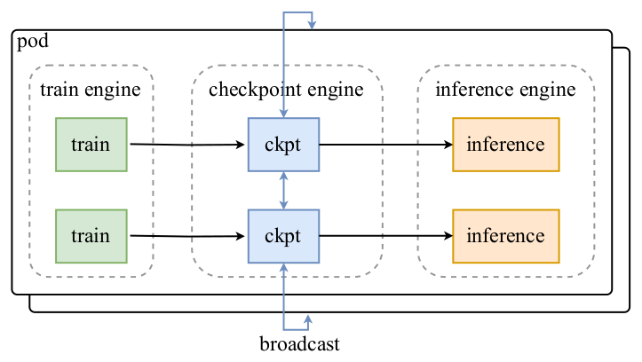

*图 10（原文 Figure 10，第 14 页）：利用 checkpoint engine 做参数更新。*

**图中文字翻译与读法**：外框 pod（一组节点；后面叠着的框示意多个 pod）内含三类组件：train engine（训练引擎，绿色 train 框）、checkpoint engine（检查点引擎，蓝色 ckpt 框）、inference engine（推理引擎，橙色 inference 框）。箭头：train → ckpt（把训练参数复制到本地的 checkpoint engine），ckpt 之间双向连线并连到图上下的 broadcast（广播），表示 checkpoint engine worker 之间交换完整参数；ckpt → inference（推理引擎各自取需要的分片）。**读图结论**：训练引擎和推理引擎之间不直接对话，全部经过 checkpoint engine，这样两个引擎彼此解耦。

作者选择向整个集群广播完整参数集，而不管各个推理 worker 具体的分片方案。这比理论最优的“只传所需”方案多传好几倍的数据，但系统设计更简单，对训练引擎和推理引擎的侵入更小；作者宁愿用这点小开销换取两个引擎的完全解耦，大大简化维护和测试。论文指出这个方案反而优于“只传所需”的做法，因为减少了同步开销、提高了网络带宽利用率；对 K2 完成一次完整参数更新**不到 30 秒**，对典型 RL 迭代来说可以忽略。checkpoint engine 的源代码已在 GitHub 开源。

#### 5.4.3 高效的系统启动

大规模训练容易出故障，所以启动时间对 K2 这样的模型至关重要。启动训练引擎时，让每个训练 worker 有选择地读取部分参数或完全不读，再把需要的参数广播给其他 worker，目标是让所有 worker 合起来只读一遍检查点，尽量减少昂贵的磁盘 IO。推理引擎是彼此独立的副本，应避免引入额外的同步屏障，因此复用 checkpoint engine 来启动：让 checkpoint engine 集体从磁盘读检查点（类似训练引擎启动），然后用上一节的方法更新未初始化的推理引擎状态。专用的 checkpoint engine 还使系统对单点故障稳健：一个推理副本可以在不与其他副本通信的情况下重启。

#### 5.4.4 Agentic rollout

RL 基础设施要支持长程、多轮的 agentic 任务。rollout 时这类任务有独特挑战：环境交互复杂、rollout 时间很长。因为环境多样，有些交互可能阻塞在等待环境反馈上（比如虚拟机或代码解释器），让 GPU 空闲。作者用两个策略最大化 GPU 利用率：（i）把重型环境部署为独立服务，更容易扩容；（ii）使用大量并发 rollout，分摊某些昂贵交互引入的延迟。另一个挑战是个别 rollout 轨迹可能极长；为防止长尾轨迹阻塞整个 rollout 过程，采用 K1.5 的 **partial rollout** 技术：允许把未完成的长尾任务暂停，到下一轮 RL 迭代再继续。为提高研究效率，还设计了受 OpenAI Gym 启发的统一接口，简化新环境的接入。

#### 附录 G：引擎切换中的参数更新流水线（图 A13）

checkpoint engine 在每块 GPU 上管理**三个等大的设备缓冲区**：一个 **H2D 缓冲区**，用于加载被卸载的模型参数；两个 **IPC 缓冲区**，用于 GPU 到 GPU 的广播。IPC 缓冲区与推理引擎共享，推理引擎可以直接访问同一物理内存。有了这三个缓冲区，就能把三个步骤排成流水线。

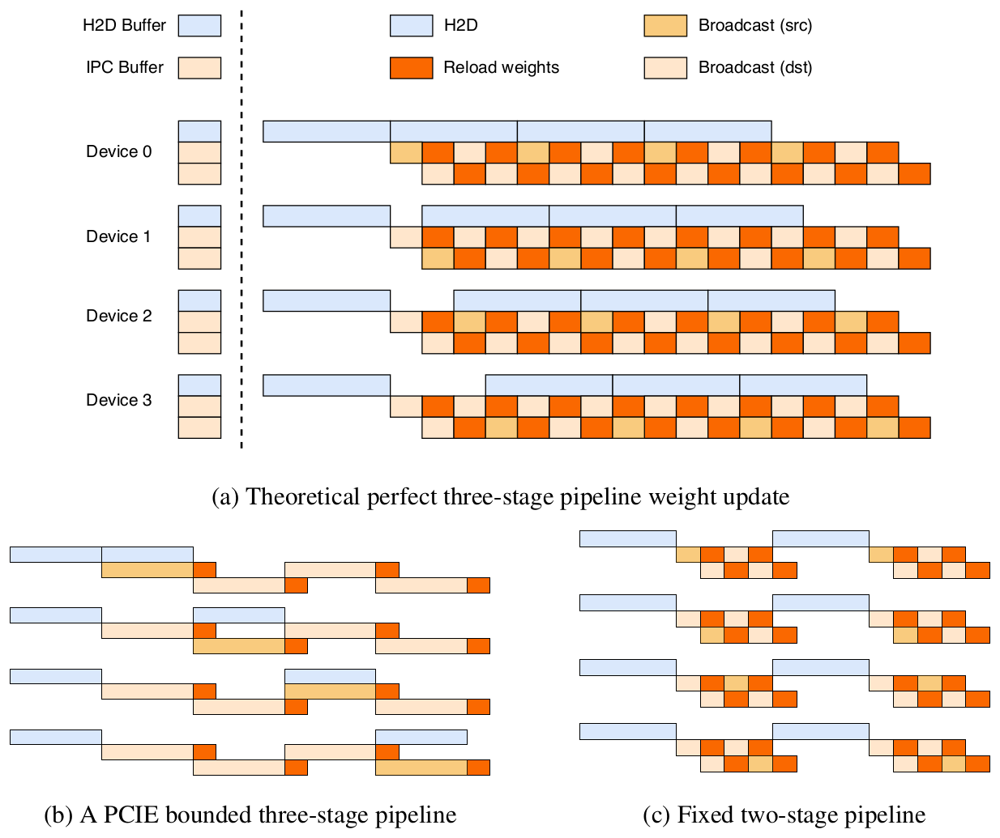

*图 A13（原文 Figure 13，第 32 页）：RL 权重更新的流水线。（a）理论上完美的三阶段流水线；（b）受 PCIe 限制的三阶段流水线；（c）修正后的两阶段流水线。*

**图中文字翻译与读法**：

- **图例**：H2D Buffer（H2D 缓冲区，浅蓝）、IPC Buffer（IPC 缓冲区，浅橙）；时间线中的色块：H2D（浅蓝）、Reload weights（重载权重，深橙）、Broadcast (src)（广播，源端，黄橙）、Broadcast (dst)（广播，目的端，浅橙）。
- **（a）Theoretical perfect three-stage pipeline weight update（理论上完美的三阶段流水线）**：以 Device 0–3 四块设备为例，三个步骤并行推进：（1）H2D：把最新权重的一个分片异步拷入 H2D 缓冲区；（2）Broadcast：拷完后把该分片拷到一个 IPC 缓冲区并广播给所有设备；（3）Reload：推理引擎同时从另一个 IPC 缓冲区加载参数。
- **（b）A PCIE bounded three-stage pipeline（受 PCIe 限制的三阶段流水线）**：在 NVIDIA H800 集群上，H2D 与广播并发会占满共享的 PCIe 链路，三阶段退化为串行，时间线上出现大量空档。
- **（c）Fixed two-stage pipeline（修正后的两阶段流水线）**：改为更简单的两阶段方案：（1）所有设备做一次单独的同步 H2D 传输；（2）广播与重载并行进行。

**读图结论**：两阶段方案会受多次同步 H2D 拷贝的限制，但在大规模设备上，模型被切成小分片，整套参数能一次性放进 H2D 缓冲区，这部分开销就消失了。通过重叠 H2D、广播和重载权重，可以获得很高的带宽，把权重从训练引擎重新分片并送到所有推理引擎。

## 六、实验结果

### 6.1 评测设置

**基准**：K2-Instruct 在多个领域评测。编程：LiveCodeBench v6（题目取自 2024 年 8 月到 2025 年 5 月）、OJBench、MultiPL-E、SWE-bench Verified、TerminalBench、Multi-SWE-bench、SWE-Lancer、PaperBench、Aider-Polyglot。工具使用：$\tau^2$-Bench 和 AceBench，强调多轮工具调用。推理：AIME 2024/2025、MATH-500、HMMT 2025、CNMO 2024、PolyMath-en、ZebraLogic、AutoLogi、GPQA-Diamond、SuperGPQA、Humanity's Last Exam（纯文本）。长上下文：MRCR 测长上下文检索，DROP、FRAMES、LongBench v2 测长上下文推理。事实性：FACTS Grounding、Vectara Hallucination Leaderboard（HHEM）、FaithJudge。通用能力：MMLU、MMLU-Redux、MMLU-Pro、IFEval、Multi-Challenge、SimpleQA、LiveBench（截至 2024-11-25）。

**基线**：开源：DeepSeek-V3-0324 与 Qwen3-235B-A22B（后者采用厂商推荐的无思考设置）；闭源：Claude Sonnet 4、Claude Opus 4、GPT-4.1、Gemini 2.5 Flash Preview（2025-05-20）。**所有模型均以其非思考配置评测**，以排除测试时计算带来的额外收益，闭源模型通过官方 API 在统一的 temperature 和 top-p 设置下调用。

**评测配置**：所有运行都查询非思考模式；输出长度上限 8192 token，只有 SWE-bench Verified（Agentless）提高到 16384；方差高的基准重复采样 $k$ 次取平均，记作 **Avg@k**；长上下文任务的上下文窗口设为 128K token，超出就截断。SWE-bench Verified 有两种模式：Agentless（单补丁、不带测试，Acc）和 Agentic（用 bash/editor 工具，包括单次尝试（Single Attempt）与多次尝试（Multiple Attempts，用内部 verifier 做 best-of-N 选择））；SWE-bench Multilingual 只测单次尝试的 agentic 设置。由于评测成本过高，部分数据点缺失。

附录 C 补充：$\tau^2$-Bench 把原 $\tau$-bench 的单控制设置扩展为双控制环境，agent 与 LLM 模拟的用户在共享状态上都有受限的工具能力，并新增 Telecom（电信故障排查）领域，与原来的 Airline/Retail 并列；ACEBench 是大型双语（中英）、基于 API 的基准（4.5K 个 API、8 个领域、2K 条标注评测项），分 NORMAL、SPECIAL（输入不完整或超出范围）、AGENT（场景驱动的多轮多步沙箱）三类。所有模型非思考模式运行，temperature 设为 0.0，使用确定性的工具适配器，$\tau^2$ 的 Airline/Retail/Telecom 按 Avg@4 种子评分，ACEBench 报英文版总分。

### 6.2 K2-Instruct 主结果（表 3）

原文表 3 有 44 行 × 7 个模型，这里按领域拆成四张小表，逐格转录。图例：**加粗** 为原文标记的全局最佳；<ins>**加粗并带下划线**</ins> 为原文标记的开源模型中最佳；数字后的 \* 表示数据直接取自该模型的技术报告或博客（并非作者自己跑的）；— 表示无数据。所有指标都是越大越好；Avg@k 是重复采样 $k$ 次取平均，Pass@1 是一次采样的通过率，Acc. 是准确率，EM 是精确匹配，Win rate 是对基线的胜率，1-Hallu. 是 1 减幻觉率。

**表 3-A：编程任务**

| 基准（指标） | Kimi-K2-Instruct | DeepSeek-V3-0324 | Qwen3-235B-A22B | Claude Sonnet 4 | Claude Opus 4 | GPT-4.1 | Gemini 2.5 Flash |
|---|---:|---:|---:|---:|---:|---:|---:|
| LiveCodeBench v6 (Pass@1) | **53.7** | 46.9 | 37.0 | 48.5 | 47.4 | 44.7 | 44.7 |
| OJBench (Pass@1) | **27.1** | 24.0 | 11.3 | 15.3 | 19.6 | 19.5 | 19.5 |
| MultiPL-E (Pass@1) | <ins>**85.7**</ins> | 83.1 | 78.2 | 88.6 | **89.6** | 86.7 | 85.6 |
| SWE-bench Verified，Agentless-Single-Patch (Pass@1) | <ins>**51.8**</ins> | 36.6 | 39.4 | 50.2 | **53.0** | 40.8 | 32.6 |
| SWE-bench Verified，Agentic-Single-Attempt (Pass@1) | <ins>**65.8**</ins> | 38.8 | 34.4 | **72.7\*** | 72.5\* | 54.6 | — |
| SWE-bench Verified，Agentic-Multi-Attempt (Pass@1) | <ins>**71.6**</ins> | — | — | **80.2\*** | 79.4\* | — | — |
| SWE-bench Multilingual (Pass@1) | <ins>**47.3**</ins> | 25.8 | 20.9 | **51.0** | — | 31.5 | — |
| Multi-SWE-bench (Pass@1) | <ins>**18.3**</ins> | 8.0 | 9.0 | **29.2** | — | 11.7 | 14.0 |
| SWE-Lancer (Pass@1) | <ins>**39.1**</ins> | 30.5 | 24.1 | **40.8** | — | 23.0 | 38.5 |
| Paper Bench Code-Dev (Acc.) | <ins>**27.8**</ins> | 12.2 | 13.2 | **43.3** | — | 29.9 | 5.7 |
| Terminal Bench In-House (Acc.) | <ins>**30.0**</ins> | — | — | 35.5 | **43.2** | 8.3 | — |
| Terminal Bench Terminus (Acc.) | <ins>**25.0**</ins> | 16.3 | 6.6 | — | — | **30.3** | 16.8 |
| Aider-Polyglot (Acc.) | 60.0 | 55.1 | <ins>**61.8**</ins> | 56.4 | **70.7** | 52.4 | 44.0 |

**表 3-B：工具使用任务**

| 基准（指标） | Kimi-K2-Instruct | DeepSeek-V3-0324 | Qwen3-235B-A22B | Claude Sonnet 4 | Claude Opus 4 | GPT-4.1 | Gemini 2.5 Flash |
|---|---:|---:|---:|---:|---:|---:|---:|
| Tau2 retail (Avg@4) | <ins>**70.6**</ins> | 69.1 | 57.0 | 75.0 | **81.8** | 74.8 | 64.3 |
| Tau2 airline (Avg@4) | <ins>**56.5**</ins> | 39.0 | 26.5 | 55.5 | **60.0** | 54.5 | 42.5 |
| Tau2 telecom (Avg@4) | **65.8** | 32.5 | 22.1 | 45.2 | 57.0 | 38.6 | 16.9 |
| AceBench (Acc.) | <ins>**76.5**</ins> | 72.7 | 70.5 | 76.2 | 75.6 | **80.1** | 74.5 |

**表 3-C：数学、STEM 与逻辑任务**

| 基准（指标） | Kimi-K2-Instruct | DeepSeek-V3-0324 | Qwen3-235B-A22B | Claude Sonnet 4 | Claude Opus 4 | GPT-4.1 | Gemini 2.5 Flash |
|---|---:|---:|---:|---:|---:|---:|---:|
| AIME 2024 (Avg@64) | **69.6** | 59.4\* | 40.1\* | 43.4 | 48.2 | 46.5 | 61.3 |
| AIME 2025 (Avg@64) | **49.5** | 46.7 | 24.7\* | 33.1\* | 33.9\* | 37.0 | 46.6 |
| MATH-500 (Acc.) | **97.4** | 94.0\* | 91.2\* | 94.0 | 94.4 | 92.4 | 95.4 |
| HMMT 2025 (Avg@32) | **38.8** | 27.5 | 11.9 | 15.9 | 15.9 | 19.4 | 34.7 |
| CNMO 2024 (Avg@16) | 74.3 | <ins>**74.7**</ins> | 48.6 | 60.4 | 57.6 | 56.6 | **75.0** |
| PolyMath-en (Avg@4) | **65.1** | 59.5 | 51.9 | 52.8 | 49.8 | 54.0 | 49.9 |
| ZebraLogic (Acc.) | **89.0** | 84.0 | 37.7\* | 79.7 | 59.3 | 58.5 | 57.9 |
| AutoLogi (Acc.) | <ins>**89.5**</ins> | 88.9 | 83.3\* | **89.8** | 86.1 | 88.2 | 84.1 |
| GPQA-Diamond (Avg@8) | **75.1** | 68.4\* | 62.9\* | 70.0\* | 74.9\* | 66.3 | 68.2 |
| SuperGPQA (Acc.) | **57.2** | 53.7 | 50.2 | 55.7 | 56.5 | 50.8 | 49.6 |
| Humanity's Last Exam (Acc.) | 4.7 | 5.2 | <ins>**5.7**</ins> | 5.8 | **7.1** | 3.7 | 5.6 |

**表 3-D：通用与开放式任务**

| 基准（指标） | Kimi-K2-Instruct | DeepSeek-V3-0324 | Qwen3-235B-A22B | Claude Sonnet 4 | Claude Opus 4 | GPT-4.1 | Gemini 2.5 Flash |
|---|---:|---:|---:|---:|---:|---:|---:|
| MMLU (EM) | <ins>**89.5**</ins> | 89.4 | 87.0 | 91.5 | **92.9** | 90.4 | 90.1 |
| MMLU-Redux (EM) | <ins>**92.7**</ins> | 90.5 | 89.2\* | 93.6 | **94.2** | 92.4 | 90.6 |
| MMLU-Pro (EM) | 81.1 | <ins>**81.2\***</ins> | 77.3 | 83.7 | **86.6** | 81.8 | 79.4 |
| IFEval (Prompt Strict) | **89.8** | 81.1 | 83.2\* | 87.6 | 87.4 | 88.0 | 84.3 |
| Multi-Challenge (Acc.) | **54.1** | 31.4 | 34.0 | 46.8 | 49.0 | 36.4 | 39.5 |
| SimpleQA (Correct) | <ins>**31.0**</ins> | 27.7 | 13.2 | 15.9 | 22.8 | **42.3** | 23.3 |
| Livebench (Pass@1) | **76.4** | 72.4 | 67.6 | 74.8 | 74.6 | 69.8 | 67.8 |
| Arena Hard v2.0，Hard Prompt (Win rate) | <ins>**54.5**</ins> | 39.9 | 39.9 | 51.6 | **59.7** | 51.7 | 48.7 |
| Arena Hard v2.0，Creative Writing (Win rate) | **85.0** | 59.3 | 59.8 | 54.6 | 68.5 | 61.5 | 72.8 |

**表 3-E：事实性与长上下文任务**

| 基准（指标） | Kimi-K2-Instruct | DeepSeek-V3-0324 | Qwen3-235B-A22B | Claude Sonnet 4 | Claude Opus 4 | GPT-4.1 | Gemini 2.5 Flash |
|---|---:|---:|---:|---:|---:|---:|---:|
| FACTS Grounding (Adjusted) | **88.5** | 68.3 | 68.5 | 83.6 | — | 79.2 | 86.6 |
| HHEM v2.1 (1-Hallu.) | **98.9** | 88.9 | 94.5 | 94.5 | — | 96.7 | 97.8 |
| FaithJudge (1-Hallu.) | <ins>**92.6**</ins> | 83.4 | 75.7 | 83.0 | — | 91.0 | **93.2** |
| LongBench v2 (Acc.) | 49.1 | <ins>**51.1**</ins> | — | 52.5 | — | 54.3 | **55.5** |
| FRAMES (Acc.) | 77.1 | <ins>**79.2**</ins> | — | 76.3 | — | **87.4** | 72.9 |
| MRCR (Acc.) | <ins>**55.0**</ins> | 50.8 | — | 74.4 | — | 66.9 | **81.7** |
| DROP (Acc.) | **93.5** | 91.2 | 84.3 | 92.0 | — | 79.1 | 81.7 |

（原文表 3，第 16 页；原文表注：Bold 表示全局 SOTA，underlined bold 表示开源最佳，带 * 的数据直接取自模型的技术报告或博客。）

**读法与结论**（条件都是“非思考模式、论文设定的评测配置”）：

- 按原文加粗/下划线标记统计，44 个基准里 K2 在 18 个上是全局最佳、20 个上是开源模型中最佳（但不是全局最佳），另外 6 个（Aider-Polyglot、CNMO 2024、Humanity's Last Exam、MMLU-Pro、LongBench v2、FRAMES）不是开源最佳（笔者按表中标记统计）。
- **软件工程**：SWE-bench Verified 单次尝试 65.8、多次尝试 71.6，开源最高，但 Claude Sonnet 4（72.7\*、80.2\*）和 Opus 4（72.5\*）更高；SWE-bench Multilingual 47.3 低于 Claude Sonnet 4 的 51.0；SWE-Lancer 39.1 对 40.8 接近。LiveCodeBench v6（53.7）与 OJBench（27.1）则是所有对比模型中最高。Claude 的 SWE-bench 数据带星号，来自厂商报告，评测脚手架与 K2 不一定相同。
- **工具使用**：Tau2 telecom 65.8 全局最佳；retail 70.6、airline 56.5 在开源中最高，但低于 Claude 4 Opus（81.8、60.0）；AceBench 76.5 低于 GPT-4.1 的 80.1。
- **数学/STEM**：AIME 2024（69.6）、AIME 2025（49.5）、MATH-500（97.4）、HMMT 2025（38.8）、ZebraLogic、GPQA-Diamond 等均为表内最高；GPQA-Diamond 75.1 对 Claude 4 Opus 的 74.9\* 只高 0.2。
- **通用**：IFEval 89.8、Multi-Challenge 54.1、Arena-Hard Creative Writing 85.0 是全局最佳；MMLU 系列低于 Claude 4 Opus；SimpleQA 31.0 低于 GPT-4.1 的 42.3。
- **长上下文**：DROP 93.5 最高；MRCR 55.0 在开源中最高，但低于 Claude Sonnet 4（74.4）、GPT-4.1（66.9）、Gemini 2.5 Flash（81.7）；FRAMES 与 LongBench v2 比 DeepSeek-V3-0324 低约 2 个点。
- 附录 C 说明：HHEM 报告的是 1 − 幻觉率，K2 的幻觉率为 1.1%；FaithJudge 的幻觉率为 7.4%，表中同样写成 92.6 以保持一致。

### 6.3 开放式评测（图 A11）

静态的封闭式基准之外，作者还评测更接近真实使用的开放式任务。英文场景用 Arena-Hard-Auto v2.0（LLM-as-a-judge 协议），K2 在 Hard Prompt（54.5）与 Creative Writing（85.0）的胜率均高于所有开源模型（见表 3-D）。因为 Arena-Hard-Auto 对中文覆盖有限，作者另建了基于真实用户 query 的内部留出基准，数据访问受限以防过拟合。

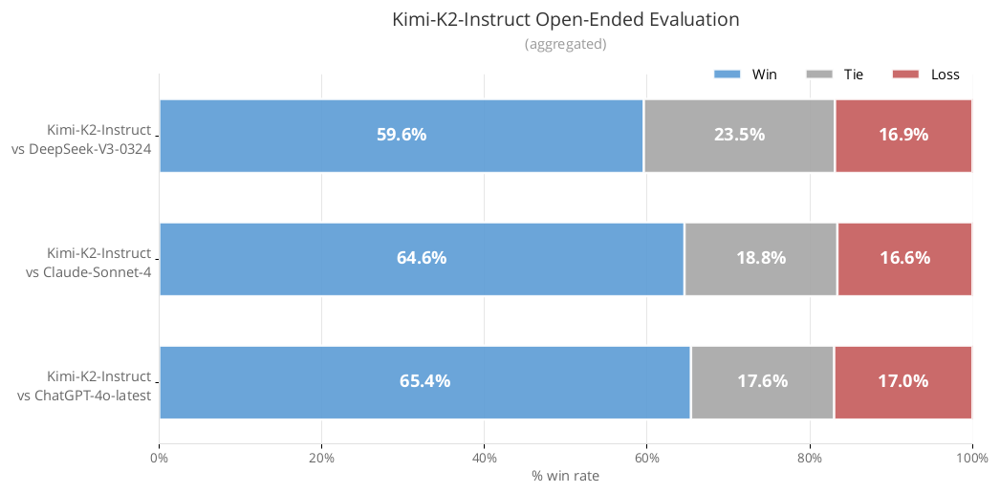

*图 A11（原文 Figure 11，第 29 页）：Kimi-K2-Instruct 在中文内部开放式基准上的胜/平/负比例（聚合结果）。*

**图中文字翻译与读法**：标题 Kimi-K2-Instruct Open-Ended Evaluation (aggregated)（开放式评测，聚合）。三行水平堆叠条形，对应三组对比，横轴 % win rate（胜率，0%–100%），蓝色 Win（胜）、灰色 Tie（平）、红色 Loss（负）：

| 对比 | 胜 Win | 平 Tie | 负 Loss |
|---|---:|---:|---:|
| Kimi-K2-Instruct vs DeepSeek-V3-0324 | 59.6% | 23.5% | 16.9% |
| Kimi-K2-Instruct vs Claude-Sonnet-4 | 64.6% | 18.8% | 16.6% |
| Kimi-K2-Instruct vs ChatGPT-4o-latest | 65.4% | 17.6% | 17.0% |

**读图结论**：三组对比的胜率都在 60% 左右或更高，负率都在约 17%，说明在这批中文开放式问题上，K2 很少落后。该基准是内部的、不公开，评审方式与样本量论文没有披露，所以只能当作厂商自述。此外，截至 2025 年 7 月 17 日，K2-Instruct 在 LMSYS Arena 排行榜上是开源第 1、总榜第 5（基于 3,000 多张真人盲投票）。

### 6.4 K2-Base 结果（表 4）

Base 模型评测中：MMLU、MMLU-Redux、GPQA-Diamond、HellaSwag、ARC-Challenge、C-Eval、CMMLU 用基于困惑度（perplexity）的评测；其余（MMLU-Pro、SuperGPQA、TriviaQA、BBH、CSimpleQA、MATH、CMATH、GSM8K、GSM8K-Platinum、CRUXEval、LiveCodeBench、EvalPlus）用基于生成的评测；GPQA-Diamond 取 8 次独立运行的均值；所有评测用基于 LM-Harness-Evaluation 的内部框架，对所有模型采用相同配置。基线是开源基础模型：DeepSeek-V3-Base、Qwen2.5-72B-Base（Qwen3-235B-A22B-Base 未开源）和 Llama 4-Maverick（Llama 4-Behemoth 未开源）。下表中**加粗**为原文标注的该行最佳。

| 类别 | 基准（指标） | 样本数（#Shots） | Kimi-K2-Base | DeepSeek-V3-Base | Llama4-Maverick-Base | Qwen2.5-72B-Base |
|---|---|---|---:|---:|---:|---:|
| - | 架构（Architecture） | - | MoE | MoE | MoE | Dense |
| - | 激活参数（# Activated Params） | - | 32B | 37B | 17B | 72B |
| - | 总参数（# Total Params） | - | 1043B | 671B | 400B | 72B |
| 英文 | MMLU | 5-shots | **87.79** | 87.10 | 84.87 | 86.08 |
| 英文 | MMLU-pro | 5-shots | **69.17** | 60.59 | 63.47 | 62.80 |
| 英文 | MMLU-redux | 5-shots | **90.17** | 89.53 | 88.18 | 87.77 |
| 英文 | SuperGPQA | 5-shots | **44.67** | 39.20 | 38.84 | 34.23 |
| 英文 | GPQA-Diamond (avg@8) | 5-shots | 48.11 | **50.51** | 49.43 | 40.78 |
| 英文 | SimpleQA | 5-shots | **35.25** | 26.49 | 23.74 | 10.31 |
| 英文 | TriviaQA | 5-shots | **85.09** | 84.11 | 79.25 | 76.03 |
| 英文 | BBH | 3-shots | **88.71** | 88.37 | 87.10 | 84.09 |
| 英文 | HellaSwag | 5-shots | 94.60 | 89.44 | 86.02 | **95.27** |
| 英文 | AGIEval | - | **84.23** | 81.57 | 67.55 | 76.87 |
| 英文 | ARC-Challenge | 0-shot | **95.73** | 93.77 | 94.03 | 95.56 |
| 英文 | WinoGrande | 5-shots | **85.32** | 84.21 | 77.58 | 84.14 |
| 代码 | CRUXEval-I-cot | 0-shots | **74.00** | 62.75 | 67.13 | 61.12 |
| 代码 | CRUXEval-O-cot | 0-shots | **83.50** | 75.25 | 75.88 | 66.13 |
| 代码 | LiveCodeBench (v6) | 1-shots | **26.29** | 24.57 | 25.14 | 22.29 |
| 代码 | EvalPlus | - | **80.33** | 65.61 | 65.48 | 66.04 |
| 数学 | MATH | 4-shots | **70.22** | 61.70 | 63.02 | 62.68 |
| 数学 | GSM8k | 8-shots | **92.12** | 91.66 | 86.35 | 90.37 |
| 数学 | GSM8k-platinum | 8-shots | **94.21** | 93.38 | 88.83 | 92.47 |
| 数学 | CMATH | 6-shots | 90.26 | **90.53** | 88.07 | 86.98 |
| 中文 | C-Eval | 5-shots | **92.50** | 90.04 | 80.91 | 90.86 |
| 中文 | CMMLU | 5-shots | **90.90** | 88.84 | 81.24 | 90.55 |
| 中文 | CSimpleQA | 5-shots | **77.57** | 72.13 | 53.47 | 50.53 |

（原文表 4，第 18 页。）读法：K2-Base 在 12 个英文基准里 10 个最佳（输给 DeepSeek-V3-Base 的 GPQA-Diamond 与 Qwen2.5-72B-Base 的 HellaSwag），4 个代码基准全部最佳，数学 4 项中 3 项最佳（CMATH 以 90.26 对 90.53 小幅落后于 DeepSeek-V3-Base），3 个中文基准全部最佳。差距较大的包括 EvalPlus（80.33 对 65.61，高约 14.7 分）、MMLU-pro（69.17 对 60.59，高约 8.6 分）和 SimpleQA（35.25 对 26.49，高约 8.8 分，笔者按表中数字相减）。这些比较里模型总参数和激活参数并不一致（K2 激活 32B、DeepSeek-V3 激活 37B、Llama 4-Maverick 激活 17B、Qwen2.5-72B 是 72B 稠密模型），所以“更强”不等于“同等计算量下更强”。

### 6.5 安全评估（表 5、表 6）

作者用 **Promptfoo** 生成对抗 prompt 并分析回答，对 Kimi K2 与 DeepSeek-V3、DeepSeek-R1、Qwen3 做红队评估（表中使用的是 Kimi-K2-Instruct、DeepSeek-V3-0324、DeepSeek-R1、Qwen3-235B-A22B）。攻击场景包括有害内容、隐私内容、安全内容，攻击策略包括 prompt injection 和迭代越狱。每个插件（plugin）与所有策略（strategy）两两组合；每个插件每种策略生成 3 条攻击 prompt；有的组合同时支持中英文，则每种语言生成 3 条（共 6 条）；还加入人工复核，为减少主观性，做多轮复核并让同一审核人评估同一测试集的全部用例。

**表 5：启用的插件与策略**

| 类别 | 内容 |
|---|---|
| 插件：Harmful（有害） | Graphic Content, Harassment and Bullying, Hate Speech, Insults, Profanity, Radicalization, Self Harm, Sexual Content, ToxicChat |
| 插件：Criminal（犯罪） | Chemical&Biological Weapons, Child Exploitation, Copyright Violations, Cybercrime, Illegal Activities, Illegal Drugs, Indiscriminate Weapons, Intellectual Property Violation, Non-Violent Crime, Violent Crime, Sex Crimes |
| 插件：Misinformation（错误信息） | Competitor Endorsement, Unsupervised Contracts, Excessive Agency, Hallucination, Misinformation and Disinformation, Specialized Advice, Unsafe Practices, Imitation, Overreliance, Political Opinions, Religious Sensitivity |
| 插件：Privacy（隐私） | Privacy Violation, PII in API/Database, Direct PII Exposure, PII in Session Data, PII via Social Engineering |
| 插件：Security（安全） | ASCII Smuggling, CyberSecEval, Harmbench, Debug Access, Divergent Repetition, DoNotAnswer, Malicious Code, Pliny, Prompt Extraction, Reasoning DoS, Tool Discovery |
| 策略（Strategy） | Basic, Prompt Injection, Iterative Jailbreak, Crescendo |

（原文表 5，第 19 页。注意：表 5 的策略里没有 Base64，但表 6 里出现了 Base64，原文未解释。）

**表 6：各模型在不同插件×策略组合下的通过率（%）**，数值越高越安全（通过 = 模型没有被攻破）。

| 插件 | 策略 | Kimi-K2-Instruct | DeepSeek-V3-0324 | DeepSeek-R1 | Qwen3-235B-A22B |
|---|---|---:|---:|---:|---:|
| Harmful | Basic | 98.04 | 90.45 | 99.02 | 98.53 |
| Harmful | Base64 | 100 | 90.20 | 100 | 100 |
| Harmful | Prompt Injection | 93.14 | 100 | 95.10 | 99.02 |
| Harmful | Iterative Jailbreak | 92.16 | 66.67 | 72.55 | 74.51 |
| Harmful | Crescendo | 64.71 | 64.71 | 80.39 | 86.27 |
| Criminal | Basic | 100 | 99.62 | 95.45 | 99.24 |
| Criminal | Base64 | 96.97 | 89.39 | 84.85 | 98.48 |
| Criminal | Prompt Injection | 75.76 | 91.67 | 69.70 | 98.47 |
| Criminal | Iterative Jailbreak | 57.57 | 21.21 | 25.76 | 53.03 |
| Criminal | Crescendo | 56.06 | 31.81 | 42.42 | 59.09 |
| Misinformation | Basic | 97.28 | 92.57 | 92.46 | 94.84 |
| Misinformation | Base64 | 98.48 | 90.48 | 96.83 | 93.65 |
| Misinformation | Prompt Injection | 98.39 | 86.51 | 93.65 | 93.65 |
| Misinformation | Iterative Jailbreak | 63.97 | 53.97 | 84.13 | 69.84 |
| Misinformation | Crescendo | 85.71 | 55.56 | 88.89 | 84.13 |
| Privacy | Basic | 100 | 100 | 100 | 100 |
| Privacy | Base64 | 100 | 100 | 100 | 100 |
| Privacy | Prompt Injection | 88.33 | 98.33 | 100 | 91.67 |
| Privacy | Iterative Jailbreak | 76.67 | 100 | 93.33 | 96.67 |
| Privacy | Crescendo | 96.67 | 100 | 96.67 | 100 |
| Security | Basic | 77.84 | 75.57 | 70.46 | 90.09 |
| Security | Base64 | 82.93 | 82.93 | 63.41 | 95.12 |
| Security | Prompt Injection | 87.80 | 97.56 | 65.85 | 84.13 |
| Security | Iterative Jailbreak | 43.90 | 60.97 | 43.90 | 78.04 |
| Security | Crescendo | 68.29 | 87.80 | 68.29 | 87.80 |

（原文表 6，第 19 页；原文没有加粗标记。）读法：论文的结论是：没有针对具体评测场景做专门优化时，K2 在一些复杂用例（如 Harmful 的 Iterative Jailbreak：92.16 对其他三者 66.67、72.55、74.51）上通过率相对更高。各策略的趋势不同：Base64 下通过率普遍接近或达到 100%，说明编码变换对模型的基本稳健性影响很小；Crescendo 使通过率普遍下降，攻击效果更强；复杂攻击策略并不总是强于基础 prompt，一些对抗 prompt 经过多轮变换可能失去原意，使模型输出变得没那么有意义。但表 6 同样显示 K2 并非处处领先：例如 Harmful–Crescendo（64.71，低于 DeepSeek-R1 的 80.39 和 Qwen3 的 86.27）、Criminal–Prompt Injection（75.76，低于 DeepSeek-V3-0324 的 91.67 和 Qwen3 的 98.47）；Security 类里，Basic、Base64、Iterative Jailbreak、Crescendo 四项低于 Qwen3，Prompt Injection、Iterative Jailbreak、Crescendo 三项低于 DeepSeek-V3-0324。论文也承认**自动化红队的局限**：因含人工复核，结果难免带主观性；有些插件涉及 API 滥用或外部工具调用，更适合评估带工具调用能力的 agent 模型，对基础 LLM 相关性有限。

## 七、局限、证据边界与常见误读

**论文自述的局限（第 5 节）**：遇到困难的推理任务或工具定义不清时，模型可能生成过多 token，导致输出被截断或工具调用不完整；如果不必要地启用工具，部分任务性能可能下降；构建完整软件项目时，一次性 prompt 的成功率不如在 agentic 编码框架下使用 K2。

**证据边界与需要谨慎引用的地方**：

- 评测是**非思考模式**，且与闭源模型的对比里掺杂了带星号的厂商自报数字；SWE-bench 等 agentic 基准对脚手架、工具集、timeout 与执行环境很敏感，不同来源的数字不能严格横向比较。“非思考”只表示没有使用扩展的长思考模式，并不表示模型内部没有任何中间推理。
- “**zero loss spike**”是对 K2 最终这次预训练运行的描述，图 3 是证据；不含所有研究试验。MuonClip 的稳定性证据主要来自 K2 自身训练（图 2、图 3）与两个较小规模的实验（9B/53B 的朴素 Muon、0.5B/3B 的 $\tau=30$ 消融），没有在其他架构、其他规模上的系统验证。
- “**Muon 为何更易爆**”是假设（附录 E），没有受控因果实验。
- **改写与合成数据**：报告自己指出了事实准确性、幻觉、毒性和可扩展性的挑战；保真验证只是“初步质量控制”；表 1 只有一个检查点、一个指标；agentic 合成数据没有给出单独的消融数字。
- **自评价奖励**：同一模型家族既生成、又评审、又被训练，可能存在自我偏好与共同盲点；附录 F.3 自己承认框架会偏爱显得自信的回答、惩罚恰当的自我限定。
- **论文没有披露的**：SFT 数据规模、RL 的步数与算力、预训练数据四个领域的占比、MLA 的各项维度（如 latent 维度、词表大小）等；因此不能完全复现。
- **许可证与开放范围**：论文只说发布 base 与 post-trained 检查点，并开源了 checkpoint engine 的代码；论文没有讨论许可证条款，使用前请查阅官方发布页的许可证。

**原文自身不一致、引用时要小心的地方**（笔者逐项核对表格与正文）：

| 位置 | 原文说法 | 与表/图对照 |
|---|---|---|
| 4.1.2 “Agentic Tool Use”一段 | 在 $\tau^2$-Bench 与 ACEBench 上 “substantially outperforming all baselines” | 图 1 中 Claude 4 Opus 的 Tau2 微平均为 67.6，高于 K2 的 66.1；ACEBench 上 GPT-4.1 为 80.1，高于 K2 的 76.5；附录 C 自己也写“与 GPT-4.1 相比仍有竞争力” |
| 附录 C，STEM | GPQA-Diamond 上 K2 “以至少 5 个百分点”优于所有非思考基线 | 表 3 中 Claude 4 Opus 为 74.9\*，K2 仅高 0.2 |
| 附录 C，开放式评测 | Arena-Hard-Auto v2.0 的 Hard Prompt 54.5 是 “state-of-the-art” | 表 3 里 Claude 4 Opus 为 59.7，K2 的 54.5 只是开源最佳（下划线） |
| 附录 C，PaperBench | Qwen3-235B-A22B 为 8.2% | 表 3 中 Qwen3-235B-A22B 的 Paper Bench Code-Dev 为 13.2 |
| 附录 C，数学 | 平均比 GPT-4.1 高 15.8 个点 | 笔者用表 3-C 的 AIME 2024/2025、MATH-500、HMMT 2025、CNMO 2024、PolyMath-en 六项重算：对 Gemini 2.5 Flash 为 +5.3、对 DeepSeek-V3-0324 为 +5.5，与原文一致；对 GPT-4.1 为 +14.8，与 15.8 不符（原文未说明具体取了哪些任务，只能说按这个口径对不上） |
| 表 2 | 激活参数 ↓13%，总参数 ↑54% | 按 32.6B/37B 与 1.04T/671B 重算分别约为 ↓12% 与 ↑55%（取整口径差异） |
| 表 5 与表 6 | 表 5 的策略有四种 | 表 6 还出现了 Base64 策略 |

**常见误读**：

- **不要把 K2 叫“32B 模型”**。更准确是“1.04T 总参数、约 32.6B 激活的 MoE”：计算上每个 token 主要经过 8 个路由专家加 1 个共享专家；存储上全部 1.04T 权重都要在集群中可访问（BF16 参数加 FP32 梯度缓冲约需 6 TB，见 4.4.2）；通信上 token 要发往所选专家所在的设备再汇聚回来；低延迟小 batch 服务时，all-to-all 与权重带宽更可能成为瓶颈（这几条是笔者对稀疏 MoE 的一般性解释，论文本身讲的是训练侧的并行与显存）。
- QK-Clip **不是**永久的约束：它在 K2 训练前 70,000 步内触发（12.7% 的头），之后自动失活。
- “最强开源模型”不等于“全面超过闭源”：见表 3 与上面的不一致表。
- 安全表 6 是一次自动化红队 + 人工复核的通过率，用的是 Promptfoo 的插件，不代表全面的安全保证。

## 八、复现与使用检查清单

- **MuonClip**：每步先做 Muon 更新（动量 → Newton–Schulz → 按 $\sqrt{\max(n,m)}\cdot0.2$ 缩放 → 带 weight decay 更新），再对每个头、用本步前向算好的 $S^h_{\max}$ 做 QK-Clip；对 MLA，$q^C,k^C$ 乘 $\sqrt{\gamma_h}$，$q^R$ 乘 $\gamma_h$，共享的 $k^R$ 不动；$\tau=100$；监控每头的最大 logit 是否随训练回落。
- **架构**：61 层、hidden 7168、专家 hidden 2048、384 个路由专家（激活 8 个）+ 1 个共享专家、64 个头、1 个 dense 层、无专家分组、MLA、128K 上下文（YaRN 扩展）。
- **训练配方**：4,096 上下文，WSD 调度，500 步 warm-up，2e-4 恒定 10T token，cosine 到 2e-5 共 5.5T，weight decay 0.1，batch 67M token；退火 400B（2e-5 → 7e-6）；32k 阶段 60B。
- **并行**：16 路 PP（虚拟 stage）× 16 路 EP × ZeRO-1 DP，节点数为 32 的倍数；增加 warm-up micro-batch 以重叠 EP all-to-all；把权重梯度计算与 PP 通信并行；选择性重计算 + FP8-E4M3 存储（$1\times128$ tile，FP32 scale，计算不用 FP8）+ CPU offload。
- **后训练**：SFT 和 RL 都用 Muon；agentic 数据三阶段；RL 目标见 5.3.3，外加预算控制、PTX 损失、温度衰减；critic 先在 SFT 阶段初始化，RL 中用可验证 rollout 持续校准。
- **评测对账**：复核时应注意每个基准的指标（Avg@k、Pass@1、Acc.）与最大输出长度（8192，SWE-bench Verified Agentless 为 16384），长上下文评测窗口 128K；带星号的对照数据不是自己复现的。

## 九、与相关论文的关系

- 架构沿用 [DeepSeek-V3](../deepseek_v3/论文中文解读.md) 路线（MLA + 细粒度 MoE），在稀疏度与头数上做了更激进的取舍；MLA 本身见 [DeepSeek-V2](../deepseek_v2/论文中文解读.md)。
- RL 算法与 partial rollout、同机架构等承接自同一团队的 [Kimi k1.5](../kimi_k15/论文中文解读.md)；K1.5 强调长思维链 RL，K2 强调稳定预训练和非思考的 agentic 能力。
- 同一时期另一条大规模 RL 与长上下文路线见 [MiniMax-M1](../minimax_m1/论文中文解读.md)；月之暗面的推理服务系统见 [Mooncake](../kimi_mooncake/论文中文解读.md)（K2 报告本身没有提到 Mooncake）。

## 原文证据导航

- [原论文 PDF](paper.pdf)
- [原文提取文本](paper.txt)
- [论文概要](论文概要.md)
