# 论文中文解读：《Mooncake: A KVCache-centric Disaggregated Architecture for LLM Serving》

> **基本信息**：Ruoyu Qin、Zheming Li、Weiran He、Mingxing Zhang、Yongwei Wu、Weimin Zheng、Xinran Xu（Moonshot AI / 清华大学），技术报告，arXiv:2407.00079（首版 2024 年 7 月，本地 PDF 为 2025 年 9 月 3 日的 v4）；论文原文 [arXiv 页面](https://arxiv.org/abs/2407.00079)，开源 trace 与代码见 [GitHub](https://github.com/kvcache-ai/Mooncake)（论文第 1 节给出的地址）。
>
> **本文的读法**：图均为从 PDF 中按图裁出的原图，表为逐格核对后的中文转录（数字与原文一致，表头译成中文）。每张图后有中文图题、图中文字翻译和读图结论；从图上读出的近似数值写作“约”，正文给出的数字优先用原文数字。凡标注“笔者核算”“笔者理解”的是为帮助理解而补充的推理或计算，不是论文原话。

## 一、一句话结论

Mooncake 是 Kimi（月之暗面的大模型服务）的线上推理平台。它的核心判断是：**KVCache 的调度是 LLM 服务调度的中心**。因此它做了三件事：（1）把 prefill 集群和 decoding 集群分开；（2）把 GPU 服务器上闲置的 CPU、DRAM、SSD 和 RDMA 网络组织成一个**分布式 KVCache 池**，用来存放和复用历史请求的前缀缓存；（3）用一个全局调度器 **Conductor** 同时考虑“缓存命中、实例负载、TTFT/TBT 延迟目标”来选择处理每个请求的 prefill 实例和 decoding 实例；并且因为线上长期过载，专门设计了**基于预测的早期拒绝（Early Rejection）**。

结果（实验用与 LLaMA2-70B 同架构的 dummy 模型和重放的真实 trace）：在长上下文的模拟场景下，相同 SLO 约束下吞吐比 vLLM 基线高 50% 到 525%；在真实负载回放中，Mooncake 能多处理约 75% 的请求。这些数字依赖基线配置、SLO 设定和负载特征，见第十节。

## 二、背景：LLM 推理服务里的几个基本概念

### 2.1 一次推理的两个阶段

现代 LLM 多为 decoder-only 的 Transformer，一次推理请求在逻辑上分两个阶段：

- **prefill（预填充）**：并行处理全部输入 token，生成第一个输出 token，同时把各层算出的 key 和 value 存下来，这些中间结果称为 **KVCache**。因为注意力的计算量随输入长度平方增长、MLP 线性增长，prefill 的计算时间随输入长度**超线性**增长；除很短的请求外，它是计算受限的。
- **decoding（解码）**：用 KVCache 自回归地一个一个生成新 token；每个请求每步只处理一个 token，并把新的 key/value 追加到 KVCache。因此它是访存受限的，计算时间随 batch size **次线性**增长。常用的优化是 **continuous batching**：每次迭代前，调度器检查所有请求的状态，把新到的请求加入 batch，把已完成的请求移出。

### 2.2 SLO、TTFT、TBT、MFU、goodput

- **TTFT（time to first token）**：从请求到达到生成第一个 token 的延迟，prefill 阶段主要关心它。
- **TBT（time between tokens）**：同一请求相邻两个 token 之间的间隔，decoding 阶段主要关心它。
- **SLO（Service Level Objective）**：服务承诺的延迟目标。例如 $\mathrm{TTFT}_{P90}=4\times$ 的含义是：90% 的请求，其 TTFT 不超过“同样条件下单独运行、没有干扰”时 TTFT 的 4 倍。论文的端到端实验设 $\mathrm{TTFT}_{P90}=10\times$、$\mathrm{TBT}_{P90}=5\times$；真实部署则使用固定的 TTFT 与 TBT 数值。
- **MFU（Model FLOPs Utilization）**：模型实际使用的算力占峰值算力的比例；批越大、算术强度越高，MFU 越高。
- **goodput（有效吞吐）**：在满足 SLO 的前提下，**完整执行完**的请求所对应的吞吐。论文的口径比常见定义更严：只有完整做完的请求才计入；一个请求若中途被丢弃或超时，之前消耗和生成的 token 全部不计，对应资源算作浪费。所以“尽早拒绝注定失败的请求”本身就是提高 goodput 的手段。

### 2.3 为什么要把 prefill 与 decoding 拆开

两个阶段的计算特点差别很大，已有工作（Splitwise、DistServe、TetriInfer 等）建议把 prefill 服务器与 decoding 服务器分开；请求从 prefill 走到 decoding 时，KVCache 也要随之迁移。图 2 用一个与 LLaMA2-70B 同架构的 dummy 模型直接展示了两者的差别。

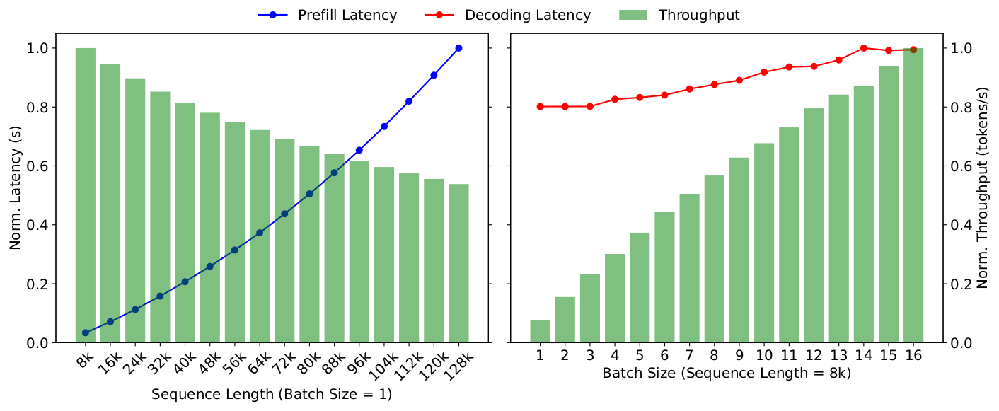

*图 2（原文 Figure 2，第 4 页）：prefill 与 decoding 阶段在不同序列长度或 batch size 下的归一化吞吐和延迟（LLaMA2-70B 架构的 dummy 模型）。*

**图中文字翻译与读法**：

- 图例：Prefill Latency（prefill 延迟，蓝色折线）、Decoding Latency（decoding 延迟，红色折线）、Throughput（吞吐，绿色柱）。纵轴 Norm. Latency (s)（归一化延迟）与 Norm. Throughput (tokens/s)（归一化吞吐），数值均归一化到 0–1。
- **左图**：横轴 Sequence Length (Batch Size = 1)（序列长度，batch 固定为 1，从 8k 到 128k）。蓝线表示 prefill 延迟：从约 0.03（8k）升到 1.0（128k），曲线越来越陡，是超线性的；绿柱表示吞吐：从 1.0（8k）降到约 0.54（128k）（读自图）。
- **右图**：横轴 Batch Size (Sequence Length = 8k)（batch 大小，序列长度固定 8k，从 1 到 16）。红线表示 decoding 延迟：从约 0.80 升到约 1.0，只涨了约两成；绿柱表示吞吐：从约 0.08（batch=1）升到 1.0（batch=16），约 13 倍（读自图并相除）。

**读图结论**：prefill 是计算受限，序列越长越慢，且单位时间处理的 token 数还在下降；decoding 是访存受限，batch 越大吞吐几乎线性提高而延迟几乎不变。两阶段的最优 batch 策略、并行方式和硬件需求不同，因此值得分开优化。

### 2.4 要解决的真问题：资源有限、长期过载

论文强调一个与大部分学术工作不同的前提：已有研究通常假设资源充足、所有请求都会被处理，只关注利用率；但现实中 GPU/加速器供给有限，MaaS（Model as a Service）提供商在高峰期严重过载，而且受限于 GPU 供应，通常**无法弹性扩容**。所以真正的核心问题变成：在满足 SLO 的前提下最大化有效吞吐，以及**该拒绝哪些请求**。论文把这类问题称为“面向过载的调度（overload-oriented scheduling）”。

提高吞吐通常有两条路：（1）尽量复用 KVCache，减少需要的计算；（2）尽量增大每个 batch 的 token 数以提高 MFU。但两者都和延迟目标冲突：从远端取复用的 KVCache 会拉长 TTFT，大 batch 会拉长 TBT。KVCache 的调度因此处在一切优化的交汇点。

## 三、整体架构

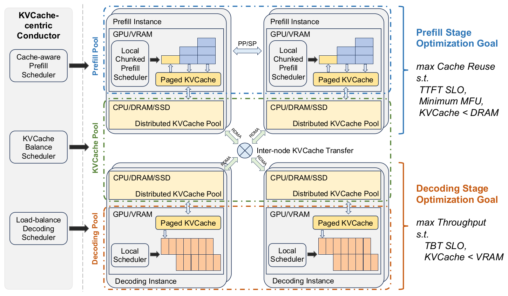

*图 1（原文 Figure 1，第 2 页）：Mooncake 的 KVCache 中心式分离架构。*

**图中文字翻译与读法**：

- **左侧 KVCache-centric Conductor**（以 KVCache 为中心的全局调度器）含三个调度器，分别指向右侧三个池：Cache-aware Prefill Scheduler（缓存感知的 prefill 调度器）→ Prefill Pool；KVCache Balance Scheduler（KVCache 均衡调度器）→ KVCache Pool；Load-balance Decoding Scheduler（负载均衡的 decoding 调度器）→ Decoding Pool。
- **Prefill Pool（prefill 池）**：每个 Prefill Instance（prefill 实例）里，GPU/VRAM 中有 Local Chunked Prefill Scheduler（本地分块 prefill 调度器）和 Paged KVCache（分页式 KVCache）；实例之间通过 PP/SP（流水线并行/序列并行）协作；GPU 下方是 CPU/DRAM/SSD 组成的 Distributed KVCache Pool（分布式 KVCache 池）。
- **KVCache Pool（KVCache 池，绿色虚线框）**：所有 prefill 与 decoding 实例的 CPU/DRAM/SSD 合在一起，节点之间通过 RDMA 做 Inter-node KVCache Transfer（节点间 KVCache 传输）。
- **Decoding Pool（decoding 池）**：每个 Decoding Instance（decoding 实例）里有 Local Scheduler（本地调度器）、Paged KVCache 和一个 continuous batch（橙色方块堆）。
- **右侧的优化目标**：Prefill Stage Optimization Goal（prefill 阶段）：max Cache Reuse（最大化缓存复用），约束为 TTFT SLO、Minimum MFU（最低 MFU）、KVCache < DRAM（KVCache 须放得进 DRAM）；Decoding Stage Optimization Goal（decoding 阶段）：max Throughput（最大化吞吐），约束为 TBT SLO、KVCache < VRAM（KVCache 须放得进显存）。

**读图结论**：prefill 的目标是“在满足 TTFT 的前提下尽量多复用缓存”，decoding 的目标是“在满足 TBT 的前提下尽量多聚合 token”，两者约束不同，所以分池；KVCache 池把闲置的 CPU/DRAM/SSD 与 RDMA 利用起来，在不增加额外成本的情况下提供较大的缓存容量和传输带宽，实现靠近 GPU 的前缀缓存。

### 3.1 KVCache 池与前缀哈希（图 3）

KVCache 在 CPU 内存中按**分页块**存放，可按请求模式使用 LRU（最近最少使用）、LFU（最不经常使用）或基于请求特征的淘汰算法；CPU 与 GPU 之间、节点之间的 KVCache 块传输由一个独立的、基于（GPUDirect）RDMA 的组件 **Messenger** 负责。这一架构也让 Mooncake 能向外部用户提供 context caching API，以提高 KVCache 的复用。

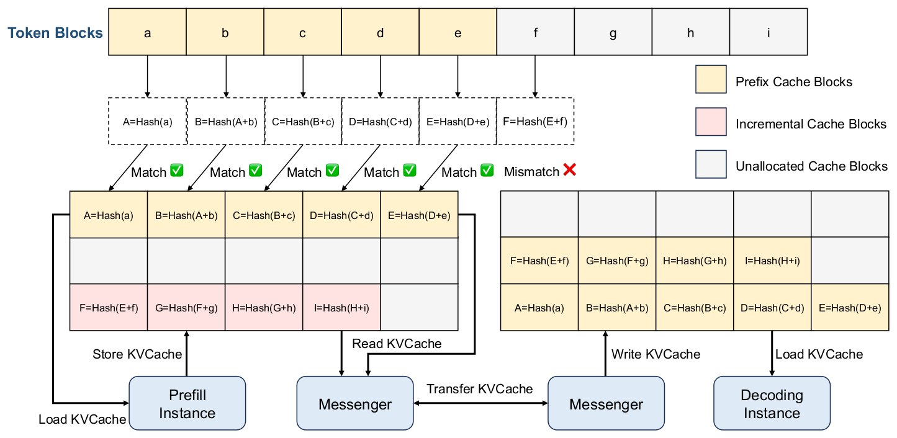

*图 3（原文 Figure 3，第 5 页）：CPU 内存中的 KVCache 池；每个块附带一个由自身内容和它的前缀共同决定的哈希值，用于去重。*

**图中文字翻译与读法**：

- 顶部 Token Blocks（token 块）a 到 i 是一个请求切成的块（trace 中的块大小为 512 个 token，见 4.1 节）。每个块的哈希是“该块内容 + 前一个块的哈希”：$A=\mathrm{Hash}(a)$，$B=\mathrm{Hash}(A+b)$，$C=\mathrm{Hash}(B+c)$，依此类推，因此哈希相同意味着“该块及其前面所有 token 都相同”。
- 图例：Prefix Cache Blocks（前缀缓存块，黄色）、Incremental Cache Blocks（增量缓存块，粉色）、Unallocated Cache Blocks（未分配块，灰色）。
- 左侧是 prefill 实例所在节点的缓存池：请求的块 a 到 e 的哈希与池里的 A 到 E 逐一 Match（匹配，打勾），到 f 处 Mismatch（不匹配，打叉）。匹配的 A–E 是可复用的前缀缓存；f 开始需要新计算，产生的 F、G、H、I 是增量缓存块（粉色）。Prefill Instance 通过 Load KVCache 读取前缀块，通过 Store KVCache 把增量块写回池。
- 中间的两个 Messenger 负责 Read KVCache（读出）和 Transfer KVCache（跨节点传输）；右侧是 decoding 节点的缓存池，Messenger 做 Write KVCache（写入）后，Decoding Instance 再 Load KVCache（加载）。

**读图结论**：用“前缀链式哈希”后，只需比较哈希就能判断某个请求的前缀有多长可以复用，并自然去重；缓存池里存的是整块 KVCache，prefill 与 decoding 两侧各有自己的 CPU 缓存，中间由 Messenger 搬运。

### 3.2 一个请求的四步流程（图 4）

请求完成 tokenize 之后，Conductor 为它选定**一对 prefill 节点和一个 decoding 节点**，然后启动由四步组成的工作流（图 4）：

1. **KVCache Reuse（缓存复用）**：被选中的 prefill 节点（组）收到请求，内容包括原始输入、可复用前缀缓存的块 ID、以及分配给该请求的完整缓存块 ID；它根据前缀缓存块 ID 把前缀缓存从远端 CPU 内存加载到 GPU 内存，作为请求的起点；没有前缀缓存就跳过。这一步的选择要同时平衡三个目标：尽量多复用 KVCache、均衡各 prefill 节点的负载、保证 TTFT SLO。
2. **Incremental Prefill（增量 prefill）**：只对没有被缓存覆盖的输入做 prefill，并把新生成的增量 KVCache 写回 CPU 内存。如果未缓存的输入 token 数超过一个阈值 $prefill\_chunk$，就把 prefill 切成多个 chunk，以流水线方式执行；这个阈值按“充分利用对应 GPU 的算力”来选，一般大于 1000 个 token。
3. **KVCache Transfer（缓存传输）**：每个节点上部署的 Messenger 服务（独立进程）负责在机器之间高速传输这些缓存。这一步与上一步的增量 prefill **异步重叠**：每一层模型产生的 KVCache 就流式地发送到目的 decoding 节点的 CPU 内存，以减少等待。
4. **Decoding（解码）**：decoding 节点的 CPU DRAM 收齐全部 KVCache 之后，请求以 continuous batching 的方式进入下一个 batch。Conductor 会根据 decoding 节点当前负载提前选定它，以免违反 TBT SLO；但本地调度器会再检查一遍这个 SLO，因为 prefill 结束之后预期负载可能已变化。这次复核可能拒绝请求，那时 prefill 的开销就白费了。

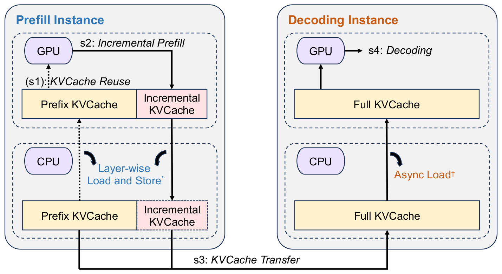

*图 4（原文 Figure 4，第 6 页）：推理实例的工作流。*

**图中文字翻译与读法**：左侧 Prefill Instance（prefill 实例），右侧 Decoding Instance（decoding 实例），各自有 GPU 与 CPU 两层存储。（s1）KVCache Reuse：把 CPU 里的 Prefix KVCache（前缀 KVCache，虚线箭头）载入 GPU；s2 Incremental Prefill：GPU 计算得到 Incremental KVCache（增量 KVCache）；两者在 CPU 与 GPU 之间通过 Layer-wise Load and Store（逐层加载与存储）进行，图注脚注（\*）说明：prefill 实例的逐层加载/存储与 prefill 计算并行，以减少传输开销（见 5.2 节）；s3 KVCache Transfer：CPU 里的前缀与增量 KVCache 一起传到 decoding 实例的 CPU，成为 Full KVCache（完整 KVCache）；然后 Async Load（异步加载）到 GPU，脚注（†）说明：decoding 实例的异步加载与 GPU 解码同时进行，避免 GPU 空闲；s4 Decoding：GPU 解码。

**读图结论**：数据路径是“远端 CPU → prefill GPU → CPU → 跨机传输 → decoding 的 CPU → GPU”，其中最耗时的两段（逐层存储、异步加载）都被计算掩盖。

## 四、真实请求 trace 与缓存分析

### 4.1 trace 的内容

为便于后续研究，作者从线上采样了 **1 小时**的请求数据，制成开源 trace。为了保留请求之间的缓存关系，采样时优先收集同一会话内的请求。共 **23,608** 条记录，字段有 timestamp、input_length、output_length、hash_ids。作者称，据其所知这是**第一个可用于真实复用分析的开源数据集**。

- `timestamp`：请求到达的相对时间，范围 0 到 3,600,000，单位毫秒。
- `input_length`、`output_length`：输入和输出的 token 数。为保护隐私，不含任何真实文本或 token，做法与 Splitwise 类似。
- `hash_ids`：描述前缀缓存关系。把 token 块（**块大小 512**）哈希成同时包含当前块和之前所有块的前缀哈希，再映射为全局唯一的 ID；相同的 hash ID 表示该块以及它之前的 token 都相同，因此可以复用对应的 KVCache。

论文给出的两条样例（原文 Listing 1）：

```json
{
  "timestamp": 27482,
  "input_length": 6955,
  "output_length": 52,
  "hash_ids": [46, 47, 48, 49, 50, 51, 52, 53, 54, 55, 56, 57, 2353, 2354]
}
{
  "timestamp": 30535,
  "input_length": 6472,
  "output_length": 26,
  "hash_ids": [46, 47, 48, 49, 50, 51, 52, 53, 54, 55, 56, 57, 2366]
}
```

两条请求的前 12 个 hash ID 相同，意味着前 $12\times512=6{,}144$ 个 token 可以共享前缀缓存。（笔者核对：6,955 个 token 需要 $\lceil6955/512\rceil=14$ 个块，6,472 个需要 13 个块，与两条样例的 hash_ids 个数一致。）

### 4.2 统计特征（图 5、图 6、表 1）

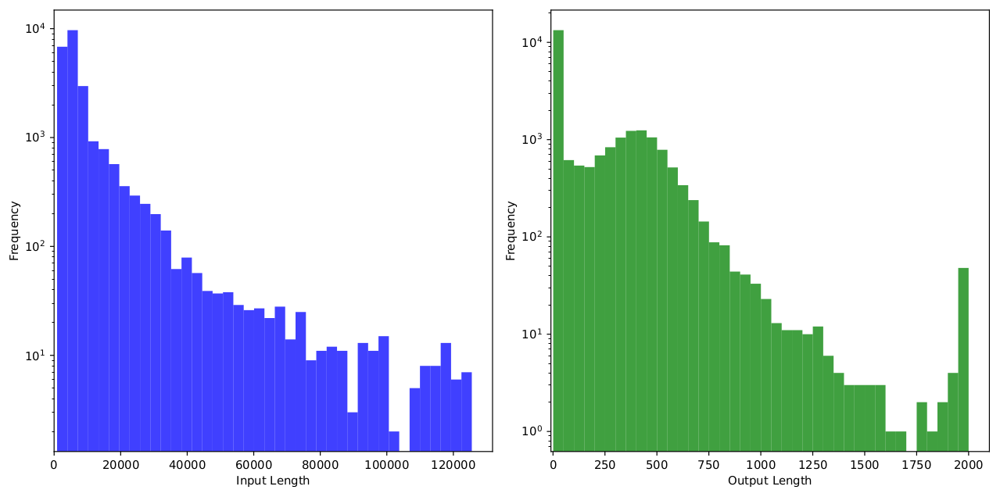

*图 5（原文 Figure 5，第 6 页）：请求 trace 中的输入长度与输出长度分布。*

**图中文字翻译与读法**：两个直方图，纵轴 Frequency（频数，对数坐标）。左图（蓝色）横轴 Input Length（输入长度，0 到约 125,000 token）：绝大多数请求在约 1 万 token 以内，频数随长度快速下降，但一直拖到十几万 token 的长尾。右图（绿色）横轴 Output Length（输出长度，0 到 2000 token）：最左端（接近 0）有一个很高的峰（约 $10^4$ 量级），在约 400 token 附近有第二个小峰，之后下降，右端 2000 处有一个小尖峰（读自图）。论文给出的平均值：**平均输入 7,590 个 token，平均输出 182 个 token**。

**读图结论**：这是典型的“长输入、短输出”负载，体现 Kimi 的长上下文处理能力；论文强调这只是代表性模式，并不是所有负载都如此。原文说平均输入输出比约 720（笔者核算：$7590/182\approx42$，所以 720 应是逐请求比值的平均，原文没有说明口径）。

作者在这个 trace 上做了一个简单的缓存策略分析，假设只有**一个全局缓存池**，比较三种淘汰策略：LRU、LFU 和 LengthAwareCache（类似 LFU，但优先保留出现在请求靠后位置的缓存块），在不同缓存容量下的命中率：

| 缓存块容量（Block capacity） | Inf（无限） | 100000 | 50000 | 30000 | 10000 | 1000 |
|---|---:|---:|---:|---:|---:|---:|
| LRUCache | 0.51 | 0.51 | 0.50 | 0.48 | 0.40 | 0.30 |
| LFUCache | 0.51 | 0.51 | 0.49 | 0.43 | 0.35 | 0.30 |
| LengthAwareCache | 0.51 | 0.50 | 0.48 | 0.42 | 0.35 | 0.30 |

（原文表 1，第 8 页；数值为缓存命中率。）读法：容量从 1,000 块增加到 50,000 块，命中率从 30% 升到约 50%，再增大容量几乎没有提升；容量无限时也只有 0.51，即这份负载**理论上最多只有约一半的 KVCache 可以复用**。这不应被解读为更大的缓存没有必要，因为样本 trace 只是真实负载的一个子集，实际场景需要的容量应相应放大。在这份数据的模式下 LRU 最好，推测是请求在时间上相邻地复用缓存。

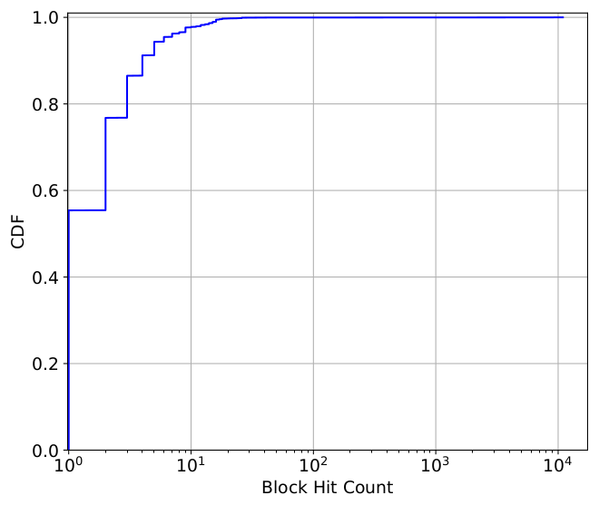

*图 6（原文 Figure 6，第 7 页）：trace 中缓存块命中次数的累积分布函数（CDF）。*

**图中文字翻译与读法**：横轴 Block Hit Count（块命中次数，对数坐标，$10^0$ 到 $10^4$），纵轴 CDF（累积概率，0 到 1）。曲线在横轴 1 处就升到约 0.55，到 2 处约 0.77，到 3 处约 0.86，约 10 次时约 0.97，之后几乎贴近 1.0，最右端延伸到约 $1.1\times10^4$（读自图）。

**读图结论**：缓存块的热度极不均衡——一半以上的块几乎没有被复用，而少数块被命中上万次，论文据此强调必须**复制热点块**，否则会造成传输拥塞。（原文正文写的是“数万次”，从图上读出的最大值约为 1.1 万次。）

## 五、Prefill 池的实现

### 5.1 为什么保持 prefill/decoding 分离，以及多节点 prefill

在引入 chunked prefill（把输入切成小块，混入 decoding 的连续 batch 中）之后，是否还需要单独的 prefill 池是有争议的：不分离则所有节点地位平等、调度更容易，而且把 chunked prefill 内联进 decoding batch 还能提高 decoding batch 的计算强度、改善 MFU。Mooncake 仍决定**保持分离**：只有当一个请求的 prefill 无需分块、也不损害 TBT SLO 时，才把它内联进 decoding batch。原因有两个：（1）prefill 节点处理长上下文需要不同的跨节点并行设置；（2）分离带来节省显存的机会（5.2 节）。

近期 LLM 的上下文长度从 8k 增加到 128K 甚至 1M，长上下文请求的输入 token 数往往是输出的 10 到 100 倍，所以优化 TTFT 至关重要。长上下文 prefill 并行度充足，适合用多于一台 8 卡机器并行处理，但：

- 把**张量并行**（TP）扩展到多个节点，每层要做两次昂贵的基于 RDMA 的 all-reduce，会大幅拉低 prefill 节点的 MFU。
- **序列并行（SP）**（Ring Attention、Striped Attention 等）把请求的输入序列切到不同节点上；利用注意力算子的结合律，每层至少需要一次跨节点通信，网络消耗大大减少、MFU 提高；但 MFU 仍不如只用单节点 TP。较理想的部署是把 prefill 节点分成两组，一组只用 TP，另一组用 SP，只有为满足 TTFT SLO 必要时才把请求送到 SP 组。这又引出如何动态调整两组节点数量的问题：静态并行设置会让整个集群的利用率偏低；已有研究（LoongServe）提出弹性序列并行，可以动态扩缩 SP 组，但会增加架构复杂度，例如需要事先建立全局通信组，调整期间又让 Conductor 在考虑缓存复用率和 SLO 违反等指标时变得更复杂，难以适应部署中频繁的即时扩缩；而且 SP 仍要频繁跨节点通信，降低 MFU，并与节点间传输 KVCache 争抢网络。

为此，Mooncake 利用 decoder-only Transformer 的**自回归性质**，实现了用于长上下文 prefill 的**分块流水线并行（Chunked Pipeline Parallelism，CPP）**：把 prefill 集群中每 $X$ 个节点分成一个流水线 prefill 节点组。对每个请求，输入 token 被切成 chunk，每块不超过 $prefill\_chunk$；同一请求的不同 chunk 可以由不同节点**同时处理**，从而并行化、降低 TTFT。CPP 有两点好处：

1. 与训练中的流水线并行类似，只在流水线 stage 的边界需要跨节点通信，易于被计算掩盖，MFU 更好，也更少与 KVCache 传输争抢网络；
2. 它自然适用于短上下文和长上下文：对短上下文 prefill 没有明显开销，也避免了频繁动态调整节点划分。

论文称这种流水线加速在训练系统中已有探索，但据其所知这是**首次用于推理阶段**，因为长上下文推理才刚出现。

### 5.2 Layer-wise Prefill（逐层 prefill）

除算力外，显存也是宝贵资源，作者希望尽量减少状态（主要是 KVCache）对 VRAM 的占用。理论上，一个请求的 KVCache 大小为 $S$、处理时间为 $T$，则它的占用代价为 $S\times T$。如果把请求分块、每个 chunk 内联到其他 decoding 请求的 batch 里（chunked prefill），$T$ 会增加，占用代价随之变大。

另外，prefill 是逐层进行且计算受限的，所以可以把 KVCache 的传输与转存同它的计算**重叠**，进一步减少占用代价。Mooncake 中 KVCache 的加载与存储通过 launch 和 wait 两类操作**异步**执行：每层注意力计算开始之前，模型等待该层 KVCache 的异步加载完成，并触发下一层的异步加载；注意力计算结束后，启动该层 KVCache 的异步存储；所有层计算完毕后，再等待全部异步存储完成。这种传输重叠使 prefill 实例的执行时间大致等于“KVCache 加载时间”或“标准 prefill 时间”（取决于前缀缓存占输入长度的比例）。

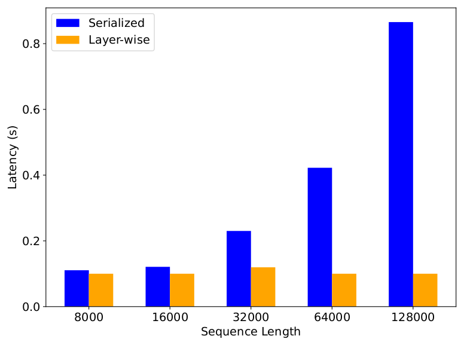

*图 7（原文 Figure 7，第 9 页）：不同请求长度下存储 KVCache 的延迟。图注说明：Layer-wise 延迟指“逐层 prefill”与“不存储 KVCache 的 prefill”之间的延迟差。*

**图中文字翻译与读法**：横轴 Sequence Length（序列长度：8000、16000、32000、64000、128000），纵轴 Latency (s)（延迟，秒）。蓝柱 Serialized（串行存储；笔者理解为 prefill 算完后再串行存储）的额外延迟约为 0.11、0.12、0.23、0.42、0.87 秒（读自图）；橙柱 Layer-wise（逐层重叠）的额外延迟基本保持在约 0.10–0.12 秒。

**读图结论**：串行存储的额外延迟随序列长度近似线性增大，128k 时接近 0.9 秒；逐层重叠后几乎与序列长度无关，因此能有效降低长上下文请求的延迟。

这样做的主要好处是：只要显存能放下**一个**请求，prefill 调度就可以**不用考虑可用显存大小**。如图 1 所示，prefill 节点的调度只需考虑 KVCache 的分布和可用 DRAM 大小。论文还展望：这部分空闲显存可以另有用途，例如 OpenAI 的 Batch API 提供异步批量请求、费用低 50%、只承诺 24 小时内完成；这类请求没有严格的 TBT 要求，如果显存足够容纳其 KVCache，甚至可以把它们的 decoding 阶段内联到 prefill 处理里以提高 MFU。

## 六、以 KVCache 为中心的调度

本节讨论常规负载下，Conductor 如何调度请求和 KVCache 块；过载情形留到下一节。

### 6.1 Prefill 全局调度（算法 1）

以往的 LLM 服务研究通常按每个实例已分配的请求数来衡量负载并做负载均衡；Mooncake 选择 prefill 实例时还要考虑**前缀缓存的命中长度**和**可复用 KVCache 块的分布**。倾向于把请求路由到前缀缓存更长的实例以减少计算，但为了整体均衡和满足 TTFT SLO，把请求发到别的节点有时更好。为此论文提出了缓存感知的全局调度算法，同时考虑“因前缀缓存而节省的 prefill 时间”和“实例负载带来的排队时间”。

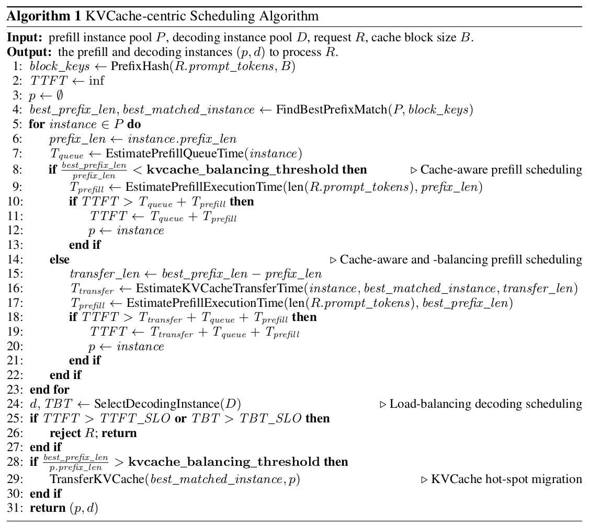

*算法 1（原文 Algorithm 1，第 10 页）：KVCache 中心的调度算法。*

逐行解释（$P$ 为 prefill 实例池，$D$ 为 decoding 实例池，$R$ 为请求，$B$ 为缓存块大小）：

1. 第 1 行：$block\_keys\leftarrow$ PrefixHash$(R.prompt\_tokens,B)$：把请求的输入切成大小为 $B$ 的块，对每个块算一个哈希，哈希里拼上前一个块的哈希（链式前缀哈希）。
2. 第 2–3 行：初始化最优 TTFT 为无穷大，选中的 prefill 实例 $p$ 为空。
3. 第 4 行：在所有 prefill 实例中找前缀匹配最长者：返回最长匹配长度 $best\_prefix\_len$ 和持有它的实例 $best\_matched\_instance$。（请求的块哈希依次与每个 prefill 实例的缓存键比较，得到各实例的前缀匹配长度 $prefix\_len$。）
4. 第 5–7 行：遍历每个 prefill 实例；取它自己的匹配长度 $prefix\_len$；估计它的排队时间 $T_{queue}$（把队列里所有请求的 prefill 时间相加）。
5. 第 8–13 行：**缓存感知调度**。若 $best\_prefix\_len/prefix\_len<kvcache\_balancing\_threshold$，即这个实例自己的缓存与全局最优差距不大，就直接在本实例上用本地前缀计算：估计执行时间 $T_{prefill}$（由请求长度和 $prefix\_len$ 决定），若 $T_{queue}+T_{prefill}$ 比当前最优 TTFT 更小，就更新最优 TTFT 并选中这个实例。
6. 第 14–22 行：**缓存感知 + 缓存均衡调度**。否则（本实例前缀比全局最优短很多）：要传输的长度 $transfer\_len=best\_prefix\_len-prefix\_len$；估计从最佳持有者到本实例的传输时间 $T_{transfer}$；执行时间按全局最优前缀长度 $best\_prefix\_len$ 估计；若 $T_{transfer}+T_{queue}+T_{prefill}$ 比当前最优 TTFT 更小，就选中它。（笔者理解：本实例没有任何前缀、$prefix\_len=0$ 时比值为无穷大，自然走这个分支。）
7. 第 24 行：为请求选择 decoding 实例并得到预计的 TBT（负载均衡）。
8. 第 25–27 行：若预计 TTFT 超过 TTFT SLO，或预计 TBT 超过 TBT SLO，则**拒绝**该请求并返回。论文说明此时 Conductor 直接向上层返回 HTTP 429 Too Many Requests。
9. 第 28–30 行：若 $best\_prefix\_len/p.prefix\_len>kvcache\_balancing\_threshold$，则执行 TransferKVCache$(best\_matched\_instance,p)$，即**热点迁移**：把最长前缀缓存从持有者复制到选中的实例，这样热点缓存会自动在更多机器上有副本。
10. 第 31 行：返回 $(p,d)$。

算法骨架很简单，难点在于各组件的工程实现。例如预测 prefill 的计算时间：用离线测试数据拟合的预测模型，根据请求长度和前缀缓存命中长度估计 prefill 时长；由于 Transformer 计算模式规律，只要离线数据足够，预测误差界较小。排队时间是排队中所有请求的 prefill 时间之和。实际实现中，各实例的 TTFT 是并行计算的，处理时间相比推理时间可以忽略。更难的是预测传输时间：它不仅取决于传输数据量，还取决于当前网络状态，尤其是发送节点是否拥塞，这也要求复制热点 KVCache 块。论文指出，类似的复用逻辑 vLLM 中也已实现，但开源版 vLLM 只支持本地 KVCache 缓存。

### 6.2 缓存负载均衡与热点迁移

在 Mooncake 集群中，每台 prefill 机器各自管理一组本地前缀缓存，它们的使用频率差别很大：例如系统提示几乎每个请求都会访问，而存放本地长文档内容的缓存可能只被一个用户用到。从分布式缓存系统的角度看，需要决定如何备份缓存，使全局 prefill 调度既能高命中又能低负载。

一个朴素方案是收集每个块的全局使用情况，用预测模型预测其未来使用并据此调度。但与 prefill 时间的估计不同，负载高度动态、随时间变化显著，尤其是用户量快速增长的 MaaS 提供商，几乎不可能准确预测未来使用。所以论文提出一个**基于启发式的自动热点迁移方案**：请求不一定被送到前缀缓存最长的 prefill 实例，因为它可能负载太高；这时 Conductor 把缓存的位置连同请求一起转给另一个实例，由这个实例主动从持有者拉取 KVCache 并保存在本地。（笔者注：原文这一句的比较条件写为“预计的额外 prefill 时间短于传输时间”，与算法 1 里“总 TTFT 更小就迁移”的逻辑方向似乎相反，疑为笔误，这里以算法 1 为准。）更重要的是，如果远端最佳前缀匹配长度**不大于**本地可复用前缀乘以一个阈值，就**宁可重新计算**输入 token。两种策略既缩短了请求的 prefill 时间，也促成了热点缓存的自动复制，使其更广泛地分布到多台机器上。论文脚注说明：这个阈值目前是人工调节的，未来可以用算法自适应调整。

### 6.3 调度实验（图 8）

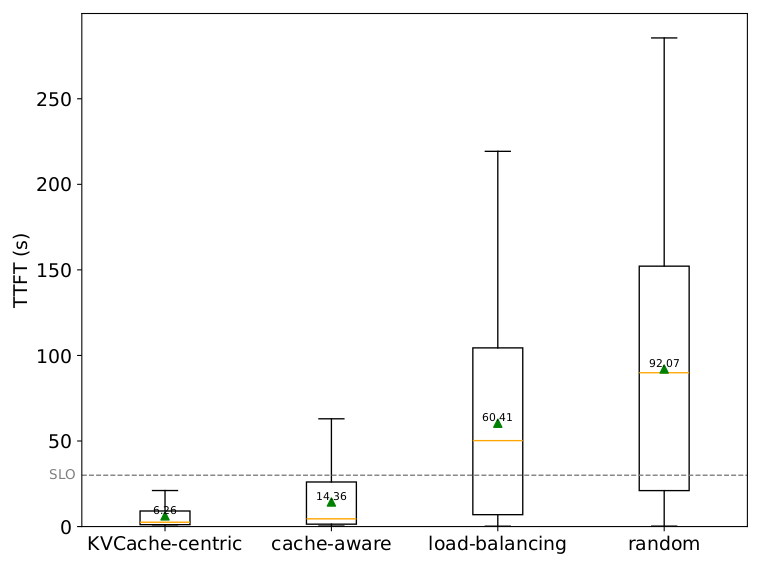

*图 8（原文 Figure 8，第 11 页）：在 Mooncake 集群上的 prefill 调度实验。*

实验设置：用夜间闲置的机器搭建 **8 个 prefill 实例 + 8 个 decoding 实例**的 Mooncake 集群，重放 **23,000** 条真实请求；比较四种调度：随机调度（random，随意选一个 prefill 实例）、负载均衡调度（load-balancing，选负载最轻的实例）、6.1 节的缓存感知调度（cache-aware）、本节包含缓存负载均衡的 KVCache 中心调度（KVCache-centric）。用平均 TTFT 和 TTFT SLO 达成率评估。

**图中文字翻译与读法**：横轴为四种调度策略 KVCache-centric、cache-aware、load-balancing、random；纵轴 TTFT (s)（首 token 延迟，0 到约 280 秒）；每个箱线图的橙色横线是中位数，绿色三角及旁边数字是平均 TTFT，上下须线是分布范围；灰色虚线 SLO 是 TTFT 的达标线（读自图，约 30 秒）。平均 TTFT 分别为：**KVCache-centric 6.26 秒，cache-aware 14.36 秒，load-balancing 60.41 秒，random 92.07 秒**。

**读图结论**：KVCache 中心调度的平均 TTFT 最低，约为 cache-aware 的 0.44 倍、load-balancing 的 0.10 倍、random 的 0.07 倍（笔者按图上数字相除）；KVCache-centric 的箱体和上须都在 SLO 线以内（上须约 22 秒）；cache-aware 的箱体在线内、上须超出（约 63 秒）；load-balancing 和 random 的箱体大面积在 SLO 线之上（以上均读自图）。论文据此认为缓存感知和缓存负载均衡两种策略都显著降低了 TTFT。注意这是一次 8P+8D 的实验，论文没有给出 SLO 达成率的具体数字。

## 七、面向过载的调度

### 7.1 过载下的调度：如何定义“负载”

大多数 LLM 服务研究假设所有请求都会被处理。但对商业推理服务，用户请求量增长很快，集群推理资源的增长速度远低于请求增速，所以**过载是普遍现象**，尤其在高峰期；全部处理既不经济也不现实。为平衡成本与用户体验，系统应尽量处理请求，直到系统负载达到预设阈值；之后剩余请求被直接拒绝，或延后重试。Mooncake 作为分离式推理系统，调度策略更灵活，但也面临非分离系统没有的独特挑战。

在耦合系统里，prefill 与 decoding 相互干扰，TTFT 和 TBT 的预测很复杂，所以负载常用“正在处理的请求数 / 系统最大容量”来衡量。Mooncake 的两阶段是独立处理的，所以直接用**SLO 满足程度**作为负载度量：设 $l_{ttft}$ 与 $l_{tbt}$ 分别为 TTFT 与 TBT 的 SLO 约束；prefill 实例和 decoding 实例的负载，由该实例上**预测的最大 TTFT 与 TBT** 同 $l_{ttft}$、$l_{tbt}$ 的比较给出。据此调度需要做两个决定：根据 prefill 实例的负载决定是否接收 prefill 阶段；根据 decoding 实例的负载决定是否继续 decoding 阶段。

### 7.2 早期拒绝（Early Rejection）

实际上，单个 prefill 或 decoding 实例的负载并不能准确反映系统真正处理的请求数，原因是同一个请求的 prefill 与 decoding 调度之间有**时间差**：如果请求在 prefill 完成之后才被 decoding 实例因高负载拒绝，prefill 阶段花费的算力就白费了；因此 prefill 阶段实际成功处理的请求数小于负载指标显示的数量。

自然的做法是把对 decoding 实例的负载评估**提前到 prefill 开始之前**，这就是 **Early Rejection**：请求到达时，Conductor 依据 prefill 池与 decoding 池两者中**较大的负载**决定是否接收。这显著减少了被拒请求造成的无效计算，也改善了负载均衡。

### 7.3 早期拒绝引起的负载波动（图 9、图 10a）

但 Early Rejection 带来了新问题。

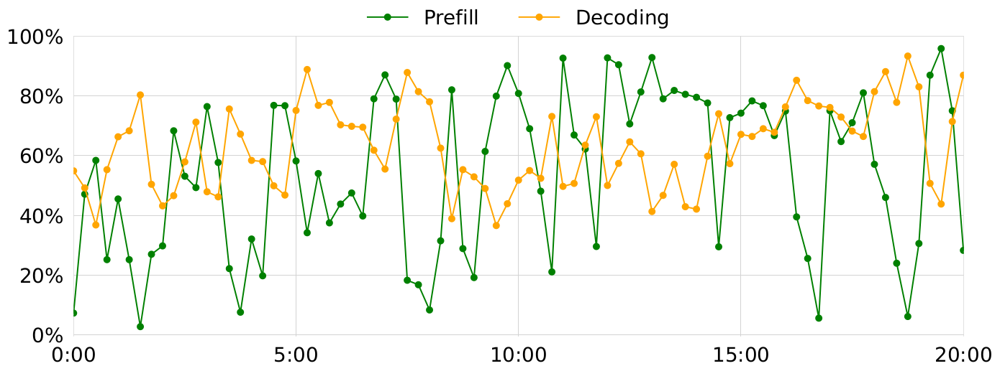

*图 9（原文 Figure 9，第 13 页）：使用 Early Rejection（尚未使用基于预测的版本）时，20 台机器的集群里 prefill 与 decoding 实例 20 分钟内的负载。*

**图中文字翻译与读法**：横轴为时间 0:00 到 20:00（分钟），纵轴为负载（0% 到 100%）；绿色折线 Prefill（prefill 实例负载），黄色折线 Decoding（decoding 实例负载）。可见两条线大体呈**反相**起伏：例如约 7:30 时 decoding 负载约 88% 而 prefill 约 18%，约 10:00 前后 prefill 约 90% 而 decoding 约 44%（读自图）。**读图结论**：这就是论文所说的“prefill 与 decoding 机器之间显著的反相波动”；论文还指出，prefill 机器越少、prefill 阶段耗时越长，这种现象越明显。

论文把根因归为：预测 decoding 负载的时刻与它真正执行的时刻之间存在时间差；按当前 decoding 负载来调度天然是滞后的，造成 prefill 与 decoding 负载之间的波动与相位错开。图 10(a) 用一个理论例子说明，绿色曲线表示 prefill 实例负载（缩放到 0–1），黄色曲线表示 decoding 实例负载：

- **阶段 1**：prefill 与 decoding 负载都低，Conductor 接收大量请求，直到 prefill 负载到上限；
- **阶段 2**：prefill 处理完的请求被调度到 decoding 实例，decoding 负载升高，Conductor 因此拒绝新到的请求，prefill 负载降低；
- **阶段 3**：没有新请求进入 decoding，decoding 负载下降；此时 Conductor 又接收大量请求，直到 prefill 实例满载；
- **阶段 4**：decoding 负载上升，Conductor 又拒绝请求，prefill 负载很低。

prefill 与 decoding 之间这种剧烈的负载波动使整个推理集群的资源利用率很差。

### 7.4 基于预测的早期拒绝（图 10b）

为解决负载波动，论文提出 **Early Rejection Based on Prediction**（基于预测的早期拒绝）框架：预测新请求 prefill 结束之后 decoding 的负载，并据此决定是否接收，从而缓解波动。核心是准确预测之后一段时间内的 decoding 负载，有两种途径：

- **请求级（request level）**：预测每个请求的输出长度。如果能事先知道输出长度，就能更准确地估计 TTFT 和 TBT，进而估计一个 decoding 实例在指定时间后能完成多少请求、新增多少请求，得到那时的负载。但预测每个请求的输出长度要么代价高、要么精度低，在资源紧张、又需要准确预测的过载条件下尤其困难。论文把请求级预测留作未来工作。
- **系统级（system level）**：不预测单个请求的完成时间，而是估计经过一段时间后整体的 batch 数或各实例的 TBT 状态。这种预测是持续进行的，对精度要求较低，更适合过载场景。**Mooncake 目前采用系统级预测**：假设每个请求的 decoding 阶段耗时均为一个固定值 $t_d$。对于给定的时刻 $t$：（1）把 $t$ 时刻 prefill 实例能完成的请求，加到（统一的）decoding 实例中；（2）把在 $t$ 之前将要完成的请求（执行时间超过 $t_d$）从 decoding 实例中移除；（3）最后计算所有 decoding 实例的平均 TBT 与 $l_{tbt}$ 之比，作为预测的负载。

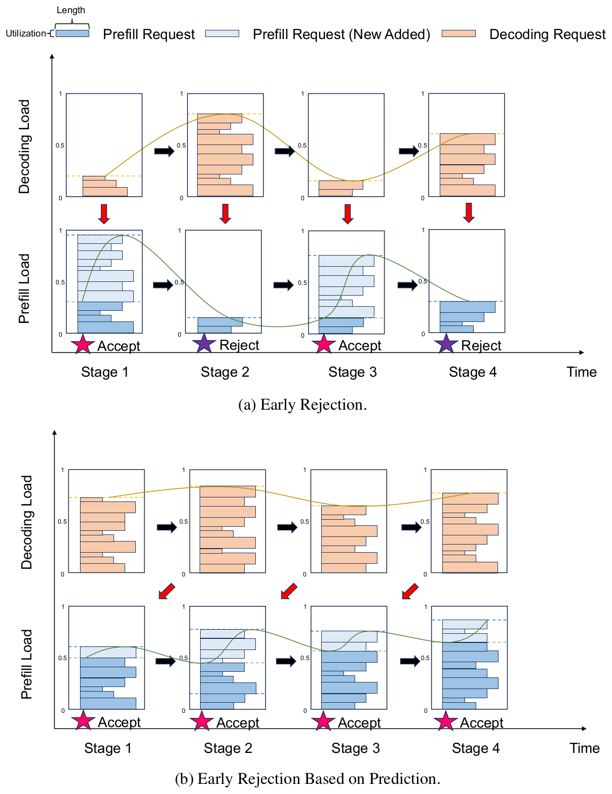

*图 10（原文 Figure 10，第 14 页）：采用 Early Rejection 与基于预测的 Early Rejection 时，实例负载随阶段的变化。*

**图中文字翻译与读法**：图例：Prefill Request（prefill 请求，蓝色条）、Prefill Request (New Added)（新加入的 prefill 请求，浅蓝色条）、Decoding Request（decoding 请求，橙色条）；每个小方框里条的长度（Length）表示请求长度，条的数量/总高度表示 Utilization（利用率，负载）。每组上排为 Decoding Load（decoding 负载），下排为 Prefill Load（prefill 负载），横轴 Stage 1 到 Stage 4 为四个时间阶段；红色粗箭头表示请求从 prefill 流向 decoding；星标表示 Accept（接收，粉红星）或 Reject（拒绝，紫星）；黄色/绿色曲线分别是 decoding/prefill 负载随时间的变化。

- **(a) Early Rejection**：阶段 1 decoding 负载低（约 0.2）、prefill 被接收的请求堆满（约 0.95）→ Accept；阶段 2 decoding 负载冲高（约 0.8）→ Reject，prefill 负载降到约 0.15；阶段 3 decoding 降到约 0.15 → Accept，prefill 又升到约 0.75；阶段 4 decoding 约 0.6 → Reject，prefill 约 0.3（读自图）。两条曲线反相起伏。
- **(b) Early Rejection Based on Prediction**：四个阶段全部 Accept，decoding 负载稳定在约 0.65–0.85，prefill 负载在约 0.5–0.85 之间平缓变化（读自图）。

**读图结论**：这是个示意图，不是实测数据；它说明了“按当前 decoding 负载拒绝”会导致相位错开和振荡，而“按预测的未来 decoding 负载拒绝”能让两者平稳。

## 八、实验

### 8.1 实验设置

为保护专有信息并便于复现，论文所有实验结果都基于**与 LLaMA2-70B 同架构的 dummy 模型**和**重放的真实负载 trace**；trace 只含请求到达时间、输入 token 数、输出 token 数和重映射后的块哈希，不含任何真实用户内容。

- **试验床**：高性能计算节点集群，每个节点 8 块 NVIDIA A800-SXM4-80GB GPU（各 80GB HBM，NVLink 互联），配备支持节点间最高 800 Gbps 互联带宽的 RDMA 网卡；每个节点根据启动参数部署一个 prefill 实例或一个 decoding 实例。
- **数据集与负载**：见表 2，用公开数据集，外加自行生成的、长度和前缀缓存比例预设的模拟数据，以及 23,000 条带到达时间戳的真实请求 trace；真实 trace 按实际到达时间重放，其他场景用泊松到达过程模拟，并用 RPS（每秒请求数）控制请求率。
- **指标**：关注在既定 SLO 下各系统的吞吐；在不同 RPS 下测量 TTFT 和 TBT，RPS 越高吞吐越高；用 P90 值作为最终指标判断大多数请求是否满足 SLO；TTFT 和 TBT 的阈值取最低请求率下观测值的 10 倍和 5 倍（原文写作 “multiplying the lowest observed RPS values by factors of 10 and 5”，按上下文理解为最低请求率下观测到的 TTFT/TBT）；超出阈值即不满足 SLO，所消耗的资源算作浪费；为便于比较，所有 TTFT 与 TBT 都按这些上限归一化，基线为 1.0。
- **基线**：vLLM（采用 continuous batching 与 PagedAttention）。但 vLLM 把 prefill 和 decoding 耦合，长上下文场景下会干扰 decoding。

| 数据集 | 平均输入长度 | 平均输出长度 | 缓存比例（Cache Ratio） | 到达模式 |
|---|---|---:|---|---|
| ArXiv Summarization | 8088 | 229 | 约 0% | 泊松过程 |
| L-Eval | 19019 | 72 | >80% | 泊松过程 |
| 模拟数据（Simulated Data） | 16k、32k、64k、128k | 512 | 50% | 泊松过程 |
| 真实数据（Real Data） | 7955 | 194 | 约 50% | 基于时间戳 |

（原文表 2，第 15 页。注意：真实数据的平均输入/输出长度 7955/194 与 4.2 节开源 trace 的统计值 7,590/182 不同，原文没有解释差异的原因。）

### 8.2 公开数据集（图 11）

在 ArXiv Summarization 与 L-Eval 上，以 4 个 vLLM 实例（vLLM-[4M]）为基线；Mooncake 有两种配置：3 个 prefill + 1 个 decoding（Mooncake-[3P+1D]）和 2 个 prefill + 2 个 decoding（Mooncake-[2P+2D]）。

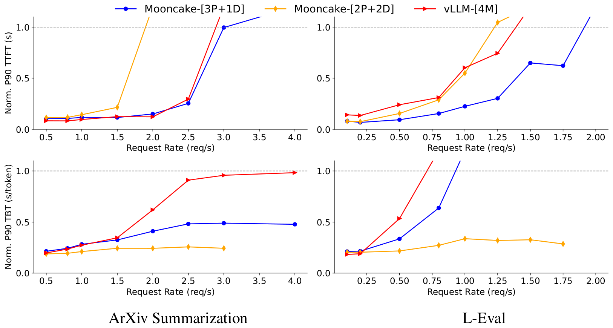

*图 11（原文 Figure 11，第 16 页）：ArXiv Summarization 与 L-Eval 数据集上 Mooncake 与 vLLM 的端到端实验。*

**图中文字翻译与读法**：2×2 的折线图。左列 ArXiv Summarization，右列 L-Eval；上排纵轴 Norm. P90 TTFT (s)（归一化的 P90 首 token 延迟），下排纵轴 Norm. P90 TBT (s/token)（归一化的 P90 token 间隔）；横轴 Request Rate (req/s)（请求率，每秒请求数）；灰色虚线 1.0 是 SLO 上限（超过就违约）。蓝线 Mooncake-[3P+1D]（圆点）、橙线 Mooncake-[2P+2D]（菱形）、红线 vLLM-[4M]（三角）。

- **ArXiv Summarization**：TTFT 上，[3P+1D] 与 vLLM-[4M] 在低请求率下都很低；vLLM 在约 2.5 到 3 req/s 之间越过 1.0，[3P+1D] 约在 3.0 req/s 触及 1.0；[2P+2D] 在约 1.5 到 2.0 req/s 之间就急剧升高（读自图）。TBT 上，vLLM 随请求率升到约 0.9–1.0（逼近上限），[3P+1D] 约 0.5 以内，[2P+2D] 约 0.25 以内。
- **L-Eval**：TTFT 上，[3P+1D] 明显低于另外两者，约 1.9 req/s 才触及 1.0；vLLM 与 [2P+2D] 在约 1.3–1.4 req/s 触及；TBT 上，vLLM 在约 0.75 req/s 就超过 1.0，[3P+1D] 约 1.0 req/s 超过，[2P+2D] 一直约 0.2–0.35（读自图）。

论文的结论：在满足 SLO 时，**Mooncake-[3P+1D] 在 ArXiv Summarization 和 L-Eval 上的吞吐分别比 vLLM-[4M] 高 20% 和 40%**（笔者读图核对：与上排 TTFT 曲线上最后一个达标的采样点相符，ArXiv 为 3.0 对 2.5 req/s，L-Eval 为 1.75 对 1.25 req/s；若同时看下排 TBT，L-Eval 上 vLLM 在 0.5 req/s 之后就已违约，说明这两个百分比大概只是按 TTFT 曲线读出的，原文没有交代口径）；L-Eval 上因缓存比例高（前缀缓存显著缩短 prefill 时间），Mooncake 的吞吐优势更大。Mooncake-[2P+2D] 的 TBT 更低，但 TTFT 比 [3P+1D] 和 vLLM-[4M] 差，原因是 prefill 与 decoding 实例之间的**负载不均衡**（prefill 实例太少）。论文说，真实集群中对 prefill/decoding 实例的需求在一段时间内通常稳定，只有轻微的暂时失衡，因此两类实例的比例可以预先设定；更灵活的部署与转换方法留待未来研究。

### 8.3 模拟数据（图 12）

模拟数据的集群配置同上（[3P+1D]、[2P+2D]、vLLM-[4M]）。长上下文请求会严重干扰 vLLM 的 decoding 阶段，所以实验里 vLLM **逐个处理请求，而不是成批处理**。

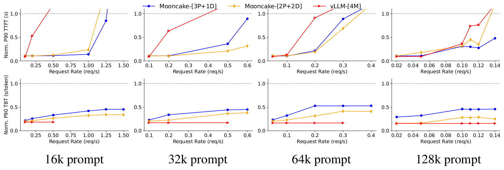

*图 12（原文 Figure 12，第 16 页）：模拟数据上 Mooncake 与 vLLM 的端到端实验。*

**图中文字翻译与读法**：四列依次是 16k prompt、32k prompt、64k prompt、128k prompt（提示长度）；每列上排为归一化 P90 TTFT，下排为归一化 P90 TBT（s/token），横轴 Request Rate (req/s)（各列的范围不同：16k 约 0.1–1.5，32k 约 0.1–0.6，64k 约 0.05–0.4，128k 约 0.02–0.14）；图例与图 11 相同（蓝：Mooncake-[3P+1D]，橙：Mooncake-[2P+2D]，红：vLLM-[4M]），灰色虚线为 1.0 上限。

- **TTFT（上排）**：红线（vLLM）在每个长度下都比 Mooncake 更早、更陡地越过 1.0；
- **TBT（下排）**：红线 vLLM 平坦地停在约 0.15–0.18（因为逐个处理请求），Mooncake 在约 0.2–0.5 之间，**始终低于 1.0**。

论文的结论：虽然 Mooncake 采用批处理，但其两阶段分离设计有效减少了 prefill 对 decoding 的影响，保证从不违反 TBT SLO；在同样的 TTFT、TBT SLO 约束下，Mooncake 的吞吐提升**从 50% 到 525%**。（笔者读图推算：16k prompt 子图里，Mooncake-[3P+1D] 最后一个满足 SLO 的点约为 1.25 req/s，vLLM-[4M] 约为 0.2 req/s，$1.25/0.2=6.25$ 倍，即 +525%，与论文给出的最大值吻合；论文没有逐个长度列出提升百分比。）

### 8.4 真实负载（图 13）

用 10 个 prefill 实例和 10 个 decoding 实例（Mooncake-[10P+10D]），对比 20 个 vLLM 实例（vLLM-[20M]），重放真实 trace 做压力测试。TTFT 上限设为 **30 秒**，TBT 阈值上限为**每 token 0.1 秒**。

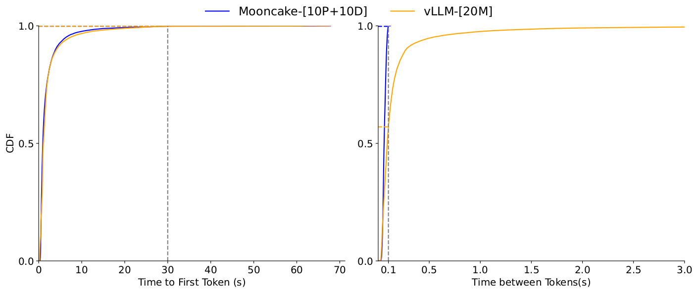

*图 13（原文 Figure 13，第 17 页）：真实负载下 Mooncake 与 vLLM 的请求 TTFT 与 TBT 分布。*

**图中文字翻译与读法**：两幅 CDF 图，纵轴都是 CDF（累积分布函数，0 到 1）。左图横轴 Time to First Token (s)（首 token 延迟，0 到约 70 秒），灰色竖虚线是 30 秒的 TTFT 上限；蓝线 Mooncake-[10P+10D] 与橙线 vLLM-[20M] 几乎重合，在 30 秒处都已接近 1.0。右图横轴 Time between Tokens(s)（token 间隔，0.1 到 3.0 秒），灰色竖虚线是 0.1 秒的 TBT 上限；蓝线（Mooncake）在 0.1 秒左右已达到 1.0，橙线（vLLM）在 0.1 秒处只有约 0.57，之后缓慢爬升，长尾一直延伸到约 3 秒。

论文的结论：两个系统的 TTFT 分布几乎相同，接近 100% 的请求满足 TTFT SLO；但是 Mooncake-[10P+10D] 约 100% 的请求满足 TBT SLO，而 vLLM-[20M] 只有 **57%** 满足，且有些请求的 TBT 极高。在这个实验中，Mooncake 能在遵守 SLO 的前提下处理约 **75% 更多的请求**。（论文没有说明 75% 是如何由这两条 CDF 折算出来的。）

### 8.5 过载场景（表 3）

这一节评估系统在过载下能处理的最大请求数。基线策略与论文提出的 Early Rejection、Early Rejection based on Prediction（7.2、7.4 节）比较：基线按负载拒绝请求，会因拒绝已经完成 prefill 的请求而造成资源浪费（原文对基线的描述有些含糊，这里按 7.2 节理解为各阶段只按自身负载判断，decoding 阶段才发现过载而拒绝时 prefill 已白做）；两个新策略综合考虑系统负载，从而减少不必要的拒绝。实验搭建 8 个 prefill 实例 + 8 个 decoding 实例的集群，用 23,000 条真实 trace，并把重放速度提高到 **2 倍**来模拟过载。

| 基线（Baseline） | 早期拒绝（Early Rejection） | 基于预测的早期拒绝（Early Rejection based on Prediction） |
|---:|---:|---:|
| 4183 | 3771 | 3589 |

（原文表 3，第 17 页；数值为系统拒绝的请求数，越少越好。）读法：基线拒绝 4,183 个请求，Early Rejection 拒绝 3,771 个，基于预测的 Early Rejection 拒绝 3,589 个。相对基线分别减少约 9.8% 与 14.2%（笔者按表中数字相除）。论文的解释：通过及早拒绝，Mooncake 避免了不必要的 prefill 计算，提高了系统资源的有效利用；通过预测 decoding 实例的负载，进一步缓解负载波动，提高了请求处理能力。

## 九、相关工作与未来方向

**相关工作**：Orca（iteration 级调度）、vLLM（动态 KVCache 管理）、FlexGen、Sarathi、FastServe 等；Mooncake 的设计在这些工作基础上建立，尤其受益于 vLLM 开源社区。Splitwise 的 arXiv 发布处于 Mooncake 早期开发阶段，对其有启发；DistServe（为每个阶段优化资源分配与并行策略以最大化 GPU goodput）、TetriInfer（结合 chunked prefill 与两阶段分离，并提出预测式两阶段调度）等是同期工作。前缀缓存方面，Prompt Cache、SGLang 的 RadixAttention 等；AttentionStore 是同期工作，提出分层 KVCache 系统，Mooncake 与它共享许多设计选择，但论文强调：长上下文推理中 KVCache 极大，需要高容量、高效传输和以 KVCache 为中心的全局调度，而且 Mooncake 不是独立的缓存服务，而是把节省内存的缓存存储机制与缓存感知调度结合起来。

论文还特别提醒：真实线上 trace 中的可复用性远小于开源基准复现出的结果——**即使假设存储容量和 TTFT SLO 都无限，理论上也只有约 50% 的 KVCache 可复用**（对应表 1 的 0.51）；但这高度依赖应用场景，对某些场景（如其 chat-to-paper 服务 papers.cool）可高达 90%。

**未来方向**：（1）更多异构加速器：计算型与带宽型加速器分工，用 GDDR/LPDDR 方案、存内计算（PIM）或混合键合等面向内存的设备降低 decoding 阶段访存受限操作的成本；（2）把注意力算子与其他线性算子分离（decoding 阶段注意力算术强度只正比于注意力头数除以 KV 头数，且不能靠增大 batch 提高），论文引用的初步模拟表明这种架构有提高总体吞吐的潜力；DeepSeek-V2 的 MLA 则从另一个角度直接提高算术强度；（3）与减小 KVCache 的算法正交且互补（压缩、选择重要 token、跨层共享、无 KVCache 的混合架构），它们能增大 batch、提高命中率；（4）调度方面，开发考虑请求优先级与不同 TTFT/TBT SLO 的策略，改进 KVCache 的复制、迁移与淘汰策略，动态平衡 prefill 与 decoding 实例，并利用空闲资源做面向批处理的卸载任务。

## 十、局限、证据边界与常见误读

- **实验用的是 dummy 模型**：LLaMA2-70B 架构的随机/占位模型加重放的 trace，目的是保护生产信息，因此结论依赖这种架构的 KVCache 大小与计算比例；换成 MLA 等 KVCache 更小的模型，缓存容量与传输的权衡会变化（论文自己在未来方向里也提到了 MLA）。绝对延迟不等同于 Kimi 生产线上的数值。
- **基线只有 vLLM**：没有与其他分离式系统（Splitwise、DistServe 等）做同台对比，也没有对“全局 KVCache 池 vs 仅本地缓存”做端到端消融。模拟数据实验里 vLLM 被设为逐个处理请求以避免 decoding 被长 prefill 干扰，所以 50%–525% 的数字在一定程度上取决于这个基线配置。
- **“525%”和“75%”是特定场景下的数字**：525% 是模拟数据中的最大值（笔者推算来自 16k 子图的相邻采样点）；75% 来自一次真实负载回放，且论文没有写明折算方法；二者都依赖长上下文、较高复用和具体的 SLO 设定。
- **trace 只有 1 小时**：隐私处理后只保留前缀结构，不含内容语义；一小时不一定代表日周期、突发热点和所有用户群。论文自己指出本 trace 的理论复用上限只有约 50%，所以缓存收益不能外推到高复用场景（也不能外推到低复用场景）。
- **论文的预测与阈值多为启发式**：热点迁移用的 $kvcache\_balancing\_threshold$ 目前人工调节；过载预测假设每个请求的 decoding 耗时统一为 $t_d$；请求级预测（输出长度）没有实现。
- **早期拒绝以牺牲被拒用户换取整体 goodput**：论文没有讨论公平性、重试和用户可见错误率；优先级调度只是在开发中。
- **P/D 分离**带来额外的故障恢复、调度和尾延迟复杂性，论文没有深入讨论；2P+2D 的结果也显示了实例比例不当的代价，动态调整比例是未来工作。
- **原文自身的几处不一致**（笔者核对）：（1）真实数据的平均输入/输出长度（表 2：7955/194）与开源 trace 统计（7,590/182）不同；（2）平均输入输出比约 720 无法由两个平均值相除得到（约 42），口径未说明；（3）4.2 节正文写块命中“数万次”，图 6 的最大值约为 1.1 万次；（4）6.2 节关于何时迁移的文字与算法 1 的比较方向似乎相反。

## 十一、复现检查清单

- **trace 与指标**：块大小 512 token；请求的 timestamp、input_length、output_length、hash_ids；P90 的 TTFT/TBT；SLO 阈值取最低请求率下值的 10 倍（TTFT）和 5 倍（TBT）；真实 trace 实验里 TTFT 上限 30 秒、TBT 上限 0.1 秒/token。
- **评估缓存系统应同时报告**：命中率与块大小、TTFT/TBT 的 P50/P90/P99、RDMA 传输量及与计算的重叠比例、拒绝率与被浪费的算力、提示/输出长度分布与到达突发性，以及**完成请求的 goodput**，而不是只统计生成的 token 数。
- **配置**：A800-SXM4-80GB × 8 / 节点，NVLink，RDMA 最高 800 Gbps；实例配置 [3P+1D]、[2P+2D]、[10P+10D]、8P+8D；$prefill\_chunk$ 一般大于 1000 token；过载实验重放速度 2 倍；基线 vLLM-[4M]、vLLM-[20M]。

## 十二、与相关论文的关系

- Mooncake 是月之暗面推理服务侧的系统论文，与同公司的模型论文 [Kimi K2](../kimi_k2/论文中文解读.md) 互补（K2 报告本身没有提到 Mooncake）；MLA 对 KVCache 大小的影响见 [DeepSeek-V2](../deepseek_v2/论文中文解读.md)。
- 与华为的 [CloudMatrix384](../ascend_cloudmatrix384/论文中文解读.md) 对照：两者都把缓存从“单实例私有状态”提升为可调度的资源池，但硬件假设不同。

| 维度 | Mooncake | CloudMatrix384（CloudMatrix-Infer） |
|---|---|---|
| 基础硬件 | 常规 GPU 集群 + RDMA | 384 颗 Ascend NPU 通过 UB（Unified Bus）互联的超节点 |
| 解耦 | Prefill / Decoding / KVCache 池 | Prefill / Decode / Cache（PDC 解耦） |
| 缓存 | 利用 CPU DRAM/SSD，显式迁移 | 超节点内统一访问的内存池 |
| 重点 | KVCache 复用与过载调度 | 针对 DeepSeek MoE/MLA 的 EP320 与算子协同设计 |

## 原文证据导航

- [原论文 PDF](paper.pdf)
- [原文提取文本](paper.txt)
- [论文概要](论文概要.md)
