# 论文中文解读：《Optimal Kernel Orchestration for Tensor Programs with Korch》

> **基本信息**：Muyan Hu\*、Ashwin Venkatram†、Shreyashri Biswas†、Balamurugan Marimuthu†、Bohan Hou、Gabriele Oliaro、Haojie Wang、Liyan Zheng、Xupeng Miao、Jidong Zhai、Zhihao Jia（University of Illinois at Urbana-Champaign、Advanced Micro Devices、Carnegie Mellon University、SambaNova Systems、清华大学；\* 工作始于在 CMU 的实习，† 为同等贡献），arXiv:2406.09465v1（2024 年 6 月 13 日）；论文原文 [官方页面](https://arxiv.org/abs/2406.09465)；开源代码 [humuyan/Korch](https://github.com/humuyan/Korch)。论文正文没有写会议名，但附录里的 artifact 仓库叫 ASPLOS24-Korch-AE，致谢里也提到 shepherd，本文据此推断它发表于 ASPLOS 2024（推断，非原文明示）。
>
> **本文的读法**：图为从 PDF 中按图裁出的原图，表为逐格核对后的中文转录（数字与原文一致，表头翻译为中文）。每张图后有中文图题、图中文字翻译与读图结论，因此不必再翻英文版。从柱状图上读出的数值写作“约”，原文正文给出的数字优先；凡是“由图或表中数字算出”的比值都注明是本文的计算。标明“说明性示例”的内容是为了讲清机制而编的，不是原文内容。

## 一、一句话结论

现有深度学习框架（TensorFlow、TensorRT、TVM、DNNFusion 等）把“怎样把计算图里的算子映射到 GPU kernel”当作**算子融合**问题：由专家手写融合规则，能融合就贪心地融合。Korch 认为这有两个缺陷：算子级融合粒度太粗（例如 softmax 内部含逐元素、向量归约、向量广播三种并行度和访存模式都不同的成分，整体放进一个 kernel 或整体不融合都不是最优），以及依赖手工规则与贪心。Korch 的做法分两步。

1. **Operator fission（算子裂解）**：用规则把每个算子拆成少数几类基本张量代数 primitive（逐元素、reduce/broadcast、layout 变换、线性变换），得到 primitive graph，并在其上做图变换；
2. **Kernel orchestration（kernel 编排）**：用深度优先搜索枚举 primitive graph 上所有合法的候选 kernel（凸子图），逐个生成并**实测延迟**；再把“选哪些候选 kernel 去覆盖整张图”写成**二元线性规划**（BLP），用现成求解器求总延迟最小的方案，并且**允许同一个 primitive 在多个 kernel 里被重复执行**。

在 V100（FP32）和 A100（TF32）上，对 5 个视觉模型（batch 为 1），相对 PyTorch 2.0.1、TVM 0.11、TensorRT 8.2，Korch 最多快 1.7 倍（V100）和 1.6 倍（A100），平均 1.39 倍和 1.30 倍（本文用图 6 的标注倍数核对：这两个数字是相对每个模型上**最快的那个基线**算出来的）。

## 二、背景与动机

### 2.1 什么是 kernel orchestration

DNN 模型表示为有向无环图：节点是张量算子（如矩阵乘、卷积），边是在算子之间传递的张量。GPU 上的计算以 **kernel** 组织，一个 kernel 是由许多硬件线程以 SPMD（单程序多数据）方式同时执行的函数。原文把“把 DNN 各个算子定义的计算编排成 GPU kernel 的执行”这件事叫做 **kernel orchestration**，并指出此前的方法大多忽略了它，因此错过很多优化机会。

现有框架用**算子融合**（operator fusion）来做这件事：把多个算子的计算融合进一个 kernel，减少 kernel 启动开销、消除不必要的中间结果实例化。TensorFlow、TensorRT、TVM 采用领域专家手工设计的融合规则，并只要能用就贪心地应用；DNNFusion 按输入输出元素之间的数据依赖把算子分成五类，针对类型组合而不是算子组合来制定规则。

### 2.2 现有融合方法的两个局限

**局限一：算子粒度的融合太粗。** 有的算子放进单个 kernel 里性能并不最优。以 softmax 为例：

$$
\mathrm{softmax}(x_i)=\frac{e^{x_i}}{\sum_j e^{x_j}}.
$$

它包含三种成分：逐元素计算（指数函数）、向量级聚合（分母里的求和）、向量级广播（缩放因子 $s=1/\sum_j e^{x_j}$ 被用来计算所有输出元素）。这三种成分的并行度与访存模式各不相同，很难为整个 softmax 生成单个高性能 kernel；反过来给每个成分各生成一个 kernel 也不好，因为那会带来很高的 kernel 启动开销和不必要的中间结果实例化。更好的办法是在更细的粒度上做**跨算子**融合，例如把 softmax 的逐元素成分与前一个或后一个算子里的逐元素成分融合。但这类优化无法表示成“算子融合”，所以被现有框架排除在外。

**局限二：依赖手工规则与贪心。** 手工规则需要大量工程投入，也可能错过难以人工发现的细微优化；原文引用已有工作指出，为一种设备设计的融合规则不能直接用于别的设备（例如不同代的 GPU），而 AI 加速器越来越多样。

### 2.3 为什么愿意付出“冗余计算”：算力增长快于带宽

Korch 的一个关键设计是允许某些 primitive 被重复执行（本文 5.4 节）。原文的理由是：现代 GPU 的浮点吞吐的增长速度远高于显存带宽的增长速度。

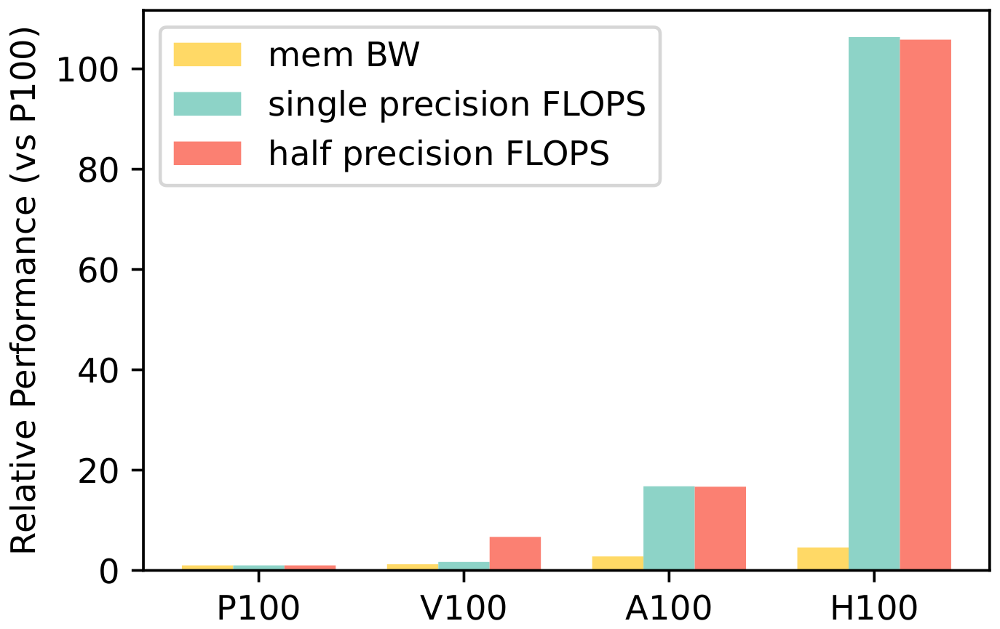

*图 5（原文 Figure 5，第 6 页）：各代 GPU 的显存带宽与浮点吞吐对比，纵轴以 P100 的性能为 1 做归一化。*

**图中文字翻译与读法**：

- 横轴四代 GPU：P100、V100、A100、H100；纵轴 Relative Performance (vs P100)（相对 P100 的性能）；每代三根柱子：mem BW（显存带宽，黄）、single precision FLOPS（单精度浮点吞吐，青）、half precision FLOPS（半精度浮点吞吐，红）；
- **读图结论**：从 P100 到 H100，带宽只涨了不到 5 倍，而 FLOPS 涨了上百倍。因此“多算一次廉价的 primitive”往往比“把中间结果写回显存再读回”更划算。原文没有说明图中 FLOPS 是否包含 Tensor Core，读者引用时应注意。

读图近似值（相对 P100，读图误差约 ±0.3）：

| GPU | 显存带宽 | 单精度 FLOPS | 半精度 FLOPS |
|---|---|---|---|
| P100 | 1（基准） | 1（基准） | 1（基准） |
| V100 | 约 1.3 | 约 1.7 | 约 6.7 |
| A100 | 约 2.9 | 约 17 | 约 17 |
| H100 | 约 4.6 | 约 106 | 约 106 |

## 三、系统总览

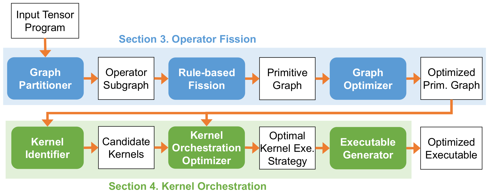

*图 1（原文 Figure 1，第 2 页）：Korch 总览。*

**图中文字翻译与读法**：

- 上方蓝色带 **Section 3. Operator Fission（第三节 算子裂解）**，自左向右：Input Tensor Program（输入张量程序）→ Graph Partitioner（图划分器）→ Operator Subgraph（算子子图）→ Rule-based Fission（基于规则的裂解）→ Primitive Graph（primitive 图）→ Graph Optimizer（图优化器）→ Optimized Prim. Graph（优化后的 primitive 图）；
- 下方绿色带 **Section 4. Kernel Orchestration（第四节 kernel 编排）**：Optimized Prim. Graph 同时送入 Kernel Identifier（kernel 识别器）→ Candidate Kernels（候选 kernel）→ Kernel Orchestration Optimizer（kernel 编排优化器）→ Optimal Kernel Exe. Strategy（最优 kernel 执行策略）→ Executable Generator（可执行文件生成器）→ Optimized Executable（优化后的可执行文件）；
- **读图结论**：整条流水线是“划分 → 裂解 → 图变换 → 枚举候选 kernel → 求解选择 → 生成可执行文件”。

各步骤的职责：

- **图划分器**：与先前工作（MetaFlow、PET）类似，先把输入计算图划分成较小的子图，以缩小每个子图的优化空间，同时保留优化机会。原文没有给出划分规则；
- **规则式裂解引擎**：用基于规则的方法把每个算子解耦成一个或多个 primitive，生成与原图功能等价的 primitive graph；
- **图优化器**：采用 TASO 提出的超优化技术，用 TASO 发现的图变换去优化 primitive graph。把算子裂解成细粒度 primitive 之后，才能做一些在算子图上不可能做的图级变换（第四节）；
- **kernel 识别器**：用深度优先搜索找出 primitive graph 上所有可能的 kernel；**kernel profiler** 实测每个候选 kernel 的延迟；
- **编排优化器**：以所有候选 kernel 及其延迟为输入，用 BLP 求解器选出一个最优策略：执行候选 kernel 的一个子集，并由输入算出整个张量程序的输出，使总执行代价最小；
- **可执行文件生成器**：按最优策略生成可以直接部署在现代 GPU 上的可执行文件。

## 四、Operator fission：从算子到 primitive

### 4.1 为什么要裂解

张量算子是按代数语义与性质设计的，而不是按它们在 GPU 上的实现设计的。对归一化、聚合这类数学语义复杂的算子，把算子定义的全部计算放在一个 kernel 里往往性能不佳。Korch 因此先把每个算子解耦成少数几类**基本张量代数 primitive**；每个 primitive 的计算具有统一的并行度和数据访问模式，因此可以高效地放进单个 kernel。与常用的计算图相比，primitive graph 是组织 DNN 计算的更灵活的表示。

### 4.2 四类 primitive 及其数学定义

记 $O_p(I)$ 为 primitive $p$ 在 $n$ 个输入张量 $I=(I_1,\dots,I_n)$ 上运行得到的输出张量（不失一般性，假设每个 primitive 只有一个输出张量，多输出可以逐个分析）。对 $m$ 维张量 $O$，$O[\vec{x}]$ 表示位置 $\vec{x}=(x_1,\dots,x_m)$ 处的输出值；$I_k[\vec{x}]$ 表示第 $k$ 个输入张量在位置 $\vec{x}$ 处的值。

**第 1 类：Elementwise（逐元素）primitive**。输出与所有输入的形状、数据布局相同，每个输出元素只依赖各输入在同一位置的元素：

$$
O[\vec{x}]=f\big(I_1[\vec{x}],\,I_2[\vec{x}],\,\dots,\,I_n[\vec{x}]\big).
$$

不涉及 layout 变换，通常可作为前处理或后处理步骤与其他 primitive 融合。

**第 2 类：Reduce 与 Broadcast primitive**。reduce 以单个张量为输入，沿给定维度 $k$ 对每一行做聚合（$\oplus$ 是聚合算子，如求和）：

$$
O[x_1,\dots,x_{k-1},x_{k+1},\dots,x_m]=\bigoplus_{x_k} I_1[x_1,\dots,x_{k-1},x_k,x_{k+1},\dots,x_m].
$$

broadcast 做相反的事，沿给定维度复制输入张量：

$$
O[x_1,\dots,x_{k-1},x_k,x_{k+1},\dots,x_m]=I_1[x_1,\dots,x_{k-1},x_{k+1},\dots,x_m].
$$

**第 3 类：Layout transformation（布局变换）primitive**。以一个张量为输入，只改变数据布局，不做算术运算：

$$
O[\vec{x}]=I_1\big[L(\vec{x})\big],
$$

其中 $L$ 是从输出位置 $\vec{x}$ 到输入位置的一一映射。布局变换 primitive 可以有多个输入或输出，例如 Concat 与 Split，因为它们要改变输入张量底层的布局。

**第 4 类：Linear transformation（线性变换）primitive**。用来刻画矩阵乘、卷积等计算密集算子。若 $p$ 的输出对**每个**输入张量都是线性的，即对任意 $Y,Z,\vec{x}$ 和 $1\le k\le n$：

$$
O(I_1,\dots,I_{k-1},\,Y+Z,\,I_{k+1},\dots,I_n)[\vec{x}]=O(I_1,\dots,I_{k-1},\,Y,\,I_{k+1},\dots,I_n)[\vec{x}]+O(I_1,\dots,I_{k-1},\,Z,\,I_{k+1},\dots,I_n)[\vec{x}],
$$

$$
\alpha\cdot O(I_1,\dots,I_{k-1},\,Y,\,I_{k+1},\dots,I_n)[\vec{x}]=O(I_1,\dots,I_{k-1},\,\alpha\cdot Y,\,I_{k+1},\dots,I_n)[\vec{x}],
$$

则称它为线性变换 primitive。（原文在式中用省略号代表其余输入，这里写成 $I_{k+1},\dots,I_n$ 以便阅读。）

**表 1：常用 primitive 的例子**

| primitive 类型 | 代表性算子 |
|---|---|
| Elementwise（逐元素） | Add, Sub, Mul, Div, Relu, Sqrt, Erf |
| Reduce and broadcast（归约与广播） | ReduceSum, ReduceMean, MaxPool, Broadcast |
| Layout transformation（布局变换） | Transpose, Split, Concat, Slice, Pad, Reshape |
| Linear transformation（线性变换） | Conv, GEMM, Batched GEMM |

（原文表 1，第 4 页。）

### 4.3 fission 规则与 Softmax 的例子

对每个 DNN 算子，Korch 要求开发者给出一条 **operator fission rule**：它是从该算子到功能等价的 primitive graph 的一个变换。为说明设计这样的规则有多复杂，原文给出 softmax 的规则（图 3）。

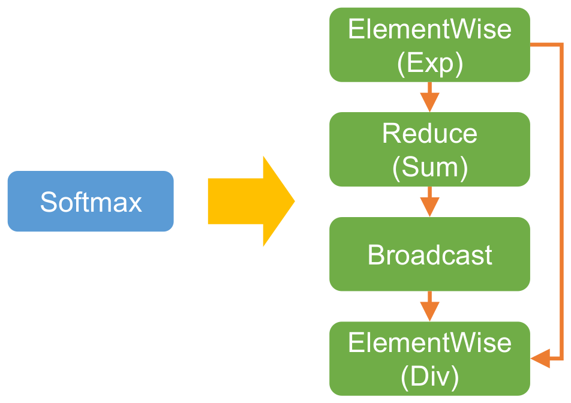

*图 3（原文 Figure 3，第 4 页）：Softmax 的 operator fission 规则。*

**图中文字翻译与读法**：左边蓝色方块 Softmax（一个算子）经黄色箭头变成右边的绿色 primitive 图：ElementWise (Exp)（逐元素指数）→ Reduce (Sum)（求和归约）→ Broadcast（广播）→ ElementWise (Div)（逐元素除法）；另有一条边从 Exp 直接连到最后的 Div（分子）。读图结论：softmax 被拆成“逐元素的指数、一次 reduce、一次 broadcast、逐元素的除法”四个 primitive，每个都有统一的并行度与访存模式。注意原文的 softmax（式 1）没有减去最大值，图 3 也没有这一步。

**不能表示的算子**：上面四类 primitive 足以表示今天 DNN 里的各种张量算子（包括本文评估的全部 DNN），但有的算子无法用它们表示，例如 Topk（返回输入张量沿某一维最大的 $k$ 个元素）。Korch 把这类算子当作**不透明（opaque）primitive**，图优化时只优化 primitive graph 的其余部分。

### 4.4 fission 带来的第一类优化：primitive graph 上的变换

裂解之后，可以在 primitive graph 上做算子层面不可能做的变换。图 2b 以 Transformer 的多头注意力片段为例：

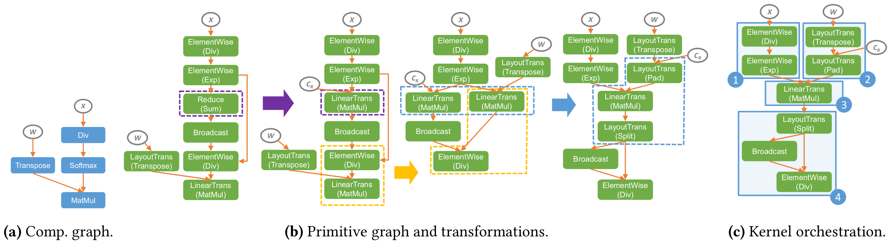

*图 2（原文 Figure 2，第 4 页）：operator fission 使后续对 primitive graph 的优化变换成为可能。图 2b 中同色虚线框标出一次对 primitive graph 的变换；三个变换合起来，把 Softmax 里的 reduce primitive 与随后的 MatMul 融合成一个 MatMul。*

**图中文字翻译与读法**：

- **(a) Comp. graph（计算图）**：输入 X 经 Div（缩放）、Softmax，再与来自 W 的 Transpose 一起进入 MatMul；
- **(b) Primitive graph and transformations（primitive 图与变换）**，从左到右四个状态：
  1. 裂解后的 primitive graph：X → ElementWise (Div) → ElementWise (Exp) → Reduce (Sum)（紫色虚线框）→ Broadcast → ElementWise (Div)（Exp 的输出也直接送到这个 Div）→ LinearTrans (MatMul)；W → LayoutTrans (Transpose) 作为 MatMul 的另一个输入；
  2. 紫色大箭头（变换 1）：**Reduce (Sum) 换成 LinearTrans (MatMul)**，引入一个全 1 的常量输入张量 $C_R$（图中记作 $C_R$，原文正文写作 $C_s$）；
  3. 黄色箭头（变换 2）：**把逐元素 Div 与随后的 MatMul 交换位置**，用的是 TASO 发现的一条变换；此时两个 MatMul（一个与 $C_R$ 相乘，一个与 W 相乘）共享同一个输入（Exp 的输出），被蓝色虚线框圈住；
  4. 蓝色箭头（变换 3）：**把共享输入的两个 MatMul 合并成一个**，办法是引入一个 LayoutTrans (Pad)（把 $C_R$ 补进 W 的转置里）和一个 LayoutTrans (Split)（把结果拆回两路）；最终是 X → Div → Exp → MatMul（输入含 Pad 后的 $[W^{\top}\ C_R]$）→ Split → Broadcast → Div；
- **(c) Kernel orchestration（kernel 编排）**：蓝框与圈号 1 到 4 标出四个 kernel：① {Div, Exp}，② {Transpose, Pad}，③ {MatMul}，④ {Split, Broadcast, Div}。

**这三步变换在数学上是什么**：设 $A=\exp(X/c)$ 是要逐行归一化的矩阵（$c$ 是缩放常数），softmax 之后再与 $W^{\top}$ 相乘，即 $Y=\big(A\oslash\mathrm{Bc}(r)\big)W^{\top}$。其中 $r_i=\sum_j A_{ij}$ 是第 $i$ 行之和，$\mathrm{Bc}$ 表示把 $r$ 沿列方向广播成与 $A$ 同形，$\oslash$ 表示逐元素除。

- **变换 1**：行和 $r=A\,C_R$，其中 $C_R$ 是全 1 列向量。即“求和”等价于“与全 1 向量做矩阵乘”（原文脚注 2：reduce 的 Sum 可以变成与全 1 向量的 MatMul）；
- **变换 2**：因为 $r_i$ 只依赖行下标 $i$、不依赖被求和的列下标 $j$，所以 $\sum_j \frac{A_{ij}}{r_i}W^{\top}_{jk}=\frac{1}{r_i}\sum_j A_{ij}W^{\top}_{jk}$，即 $\big(A\oslash\mathrm{Bc}(r)\big)W^{\top}=\big(A\,W^{\top}\big)\oslash\mathrm{Bc}'(r)$（$\mathrm{Bc}'$ 是沿输出列方向的广播）：先乘再除；
- **变换 3**：$A\,W^{\top}$ 与 $A\,C_R$ 共享左操作数 $A$，所以 $\big[\,A\,W^{\top}\ \ A\,C_R\,\big]=A\,\big[\,W^{\top}\ \ C_R\,\big]$：把全 1 列拼（Pad）到 $W^{\top}$ 旁边，一次 MatMul 同时算出乘积和行和，再 Split 开。

**说明性数值检查（非原文）**：取 $A=(1\ \ 2)$，$W^{\top}=\begin{pmatrix}3\\4\end{pmatrix}$。直接算：$r=3$，$(A/r)W^{\top}=(1\cdot3+2\cdot4)/3=11/3$。合并后：$A\,[W^{\top}\ \ C_R]=(1\ \ 2)\begin{pmatrix}3&1\\4&1\end{pmatrix}=(11\ \ 3)$，Split 得到 $11$ 和 $3$，再广播并相除得 $11/3$，与直接算一致。

这三步让 Korch 能把 softmax 的 reduce primitive 融合进一个 MatMul：reduce 不再是需要单独 kernel 的、并行度不同的成分，而是库里优化过的 MatMul 的一个额外列。

### 4.5 fission 带来的第二类优化：更灵活的 kernel 编排

对图 2c 里优化后的 primitive graph，Korch 作出如下映射（原文的解释）：

- Div 与 Exp 映射到 kernel ①：由于逐元素计算的算术强度很低，其性能与只做一个 Div 的单个 kernel 相同；
- Transpose 与 Pad 映射到 kernel ②：性能与单个 Transpose kernel 相同；
- MatMul 单独映射到 kernel ③：它是计算密集的，单独成 kernel 才能使用 CUDA 库提供的 kernel（见本文 6.1 节）；
- Split、Broadcast、Div 全部映射到 kernel ④：Split 与 Broadcast 不引入算术运算，执行很便宜。

这个优化带来的性能提升来自：kernel ④ 比单独启动一个 Softmax kernel 快得多。注意此时**原来一个 Softmax 算子的计算被分散到了全部四个 kernel 里**，这是算子级融合表达不出来的。

## 五、Kernel orchestration：枚举候选 kernel 并用 BLP 选择

本节是论文的核心。输入是一个 primitive graph，目标是找到把 primitive 映射到 kernel 的最优策略，使执行延迟最小。

### 5.1 问题的形式化：凸子图与 execution state

primitive graph 记为有向无环图 $G=(P,E)$：每个节点 $p\in P$ 是一个张量代数 primitive，每条边 $(p_1,p_2)\in E$ 表示 $p_1$ 的输出张量是 $p_2$ 的输入。每个 kernel 执行一个或多个 primitive。为了避免 kernel 之间的循环依赖（两个 kernel 都要等对方先开始），一个 kernel 包含的 primitive 必须构成 $G$ 的**凸子图**。记 $x\to^{*}y$ 表示 $G$ 中存在从 $x$ 到 $y$ 的路径。

**定义 1（凸子图）**：节点集合 $P'\subseteq P$ 构成 $G$ 的凸子图，当且仅当不存在 $p_1,p_2\in P'$ 和另一个节点 $q\in P\setminus P'$，使得 $p_1\to^{*}q$ 且 $q\to^{*}p_2$。

**原文例子（图 4a）**：节点集 $\{p_1,p_4,p_8\}$ 是凸子图，可以放进单个 kernel；节点集 $\{p_1,p_2,p_5\}$ 不是凸子图，不能放进单个 kernel，因为它与执行 $p_3$ 的 kernel 有循环依赖（$p_5$ 依赖 $p_3$，而 $p_3$ 依赖 $p_1$）。

为了找出所有凸子图，Korch 引入 execution state。

**定义 2（execution state，执行状态）**：节点集合 $P'\subseteq P$ 是 $G$ 的一个 execution state，当且仅当对任意边 $(p_1,p_2)\in E$，若 $p_2\in P'$ 则 $p_1\in P'$（即 $P'$ 对“前驱”封闭：包含一个节点就必须包含它所有的前驱）。

**定理 1**：节点集 $P'\subseteq P$ 是 $G$ 的凸子图，当且仅当 $P'$ 是两个 execution state 之差：$P'=P_1\setminus P_2$。

证明思路（原文）：（$\Leftarrow$）假设 $P'=P_1\setminus P_2$，但存在 $p_1,p_2\in P'$、$q\notin P'$ 使 $p_1\to^{*}q\to^{*}p_2$。则 $p_1,p_2\in P_1$ 且 $\notin P_2$；$q\notin P_1$ 或 $q\in P_2$。若 $q\notin P_1$：$q\to^{*}p_2$ 且 $p_2\in P_1$，与 $P_1$ 是 execution state（前驱封闭）矛盾；若 $q\in P_2$：$p_1\to^{*}q$ 且 $p_1\notin P_2$，与 $P_2$ 是 execution state 矛盾。所以 $P'$ 是凸的。（$\Rightarrow$）若 $P'$ 是凸的，令 $S=\{p\mid p\notin P',\ \exists(p,p')\in E,\ p'\in P'\}$（$P'$ 在外面的直接前驱），取 $P_1$ 为 $P'$ 的前驱闭包，$P_2$ 为 $S$ 的前驱闭包，由凸性可得 $P'=P_1\setminus P_2$。

**说明性示例（非原文）**：菱形图 $p_1\to p_2$，$p_1\to p_3$，$p_2\to p_4$，$p_3\to p_4$ 的 execution state 一共 6 个：$\varnothing$、$\{p_1\}$、$\{p_1,p_2\}$、$\{p_1,p_3\}$、$\{p_1,p_2,p_3\}$、$\{p_1,p_2,p_3,p_4\}$。例如 $\{p_2\}=\{p_1,p_2\}\setminus\{p_1\}$ 是凸子图；而 $\{p_1,p_4\}$ 不是：$p_1\to p_2\to p_4$ 且 $p_2$ 在集合外，它也无法写成两个 execution state 之差。

**execution state 的数量**：直观上，execution state 的个数随图的**深度**（关键路径上的算子数）线性增长，随**宽度**（并发算子数）指数增长。虽然一般情形下 execution state 数可能随 primitive 数指数增长，但现代 DNN 架构通常是“深而不宽”，所以 execution state 数有限，显式考虑全部 execution state 是可行的。为了简单，原文估计一个 primitive graph 大约有 $O(\lvert P\rvert)$ 个 execution state 和 $O(\lvert P\rvert^{2})$ 个候选 kernel（这一简化也被先前工作 Piper 采用），其中 $\lvert P\rvert$ 是 primitive 数。

### 5.2 Kernel identifier（Algorithm 1）

下面是原文 Algorithm 1 的中文伪代码（逐步含义见注释）：

```text
输入：primitive graph G = (P, E)
输出：G 的所有可能的 kernel

B = {}                                  // B：G 的 execution state 数据库
function Dfs(X):                        // X：当前 execution state
    for v in P \ X:                     // 找一个新的可以执行的 primitive
        if 对所有 (u, v) in E 都有 u in X:   // v 的所有前驱都已经在 X 里
            X' = X ∪ {v}
            if X' not in B:
                B = B ∪ {X'}
                Dfs(X')
Dfs(∅)                                  // 从空的 execution state 出发做深度优先搜索

K = {}                                  // K：候选 kernel 数据库
for D1 in B:
    for D2 in B:
        if D1 ⊂ D2:
            P' = D2 \ D1                // 两个 execution state 之差：凸子图（定理 1）
            for O ⊂ P':                 // O：P' 的一个可能输出集合
                K, latency = Profiling(P', O)    // 生成 kernel 并实测延迟
                if latency ≠ ∞:         // 生成失败则返回 ∞
                    K = K ∪ {(K, P', O, latency)}
返回 K
```

读法与补充：

- 算法先从空状态出发，用 DFS 枚举所有 execution state：每次选一个“所有前驱都已在当前状态里”的新节点加进去；
- 对每一对满足 $D_1\subset D_2$ 的 execution state，差集 $P'=D_2\setminus D_1$ 就是一个可能成为 kernel 的凸子图。伪代码没有显式把空集放进 $B$，但图 4b 里 $k_{13}=\{p_1,p_2\}$ 这类从图起点开始的 kernel 说明空集必须参与枚举，本文按此理解。

**输入与输出的确定**：子图 $G'=(P',E')$ 的输入显然是 $G'$ 里入度为 0 的节点；但输出不能简单取出度为 0 的节点，因为有的出度为正的节点也会成为另一个候选 kernel 的输入。原文因此定义：

**定义 3（可能的输出集合）**：节点集合 $O$ 是候选子图 $G'=(P',E')$ 的可能输出集合，当且仅当对任意 $u\in O$，存在边 $(u,v)\in E$ 且 $v\in P\setminus P'$（即 $O$ 里每个节点都被 kernel 之外的节点使用）。

按字面，整图的最终输出节点（没有后继）不满足这一定义，原文没有单独说明；图 4b 中的 $k_{20}$ 以最终输出 $p_{12}$ 为输出，说明实际实现把整图输出也算作可能的输出。

- $P'$ 和 $O$ 一起送给 **kernel profiler**（本文 6.1 节）为这些 primitive 生成 kernel；生成成功就返回实测延迟，否则返回 $\infty$，表示 $P'$ 不被 Korch 的后端支持；
- 实现里每个候选 kernel 有任意多个输入张量、**只有一个输出张量**（本文 6.1 节），所以实际上 $O$ 是单个节点。

### 5.3 原文例子：一个自注意力子图（图 4）

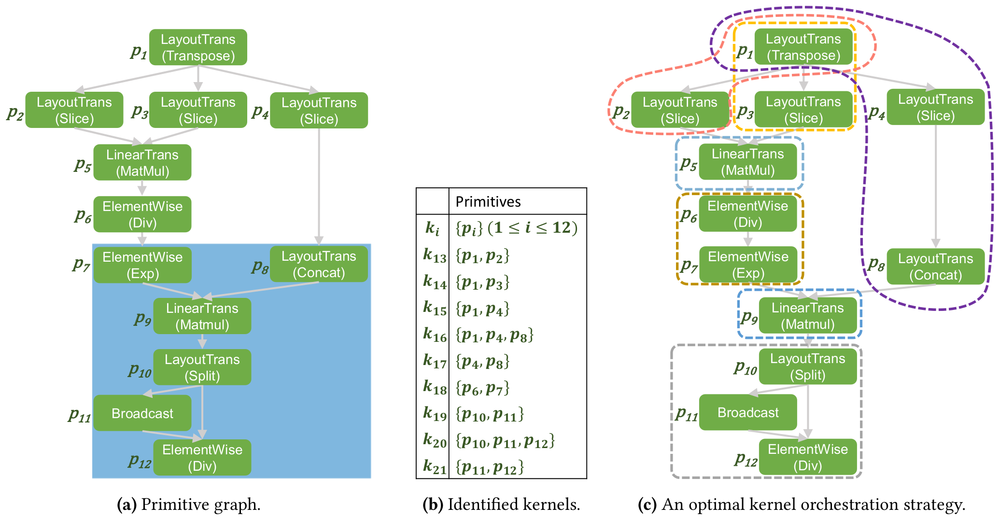

*图 4（原文 Figure 4，第 6 页）：一个自注意力子图的 kernel 编排例子。图 4a 中带阴影的子图与图 2 的 primitive graph 变换结果类似。*

**图中文字翻译与读法**：

**(a) Primitive graph（primitive 图）**：12 个 primitive，边的方向是数据流（从生产者指向消费者）：

| 编号 | primitive（原文标签） | 输入来自 |
|---|---|---|
| $p_1$ | LayoutTrans (Transpose) | 图输入 |
| $p_2$、$p_3$、$p_4$ | LayoutTrans (Slice) | 各自来自 $p_1$ |
| $p_5$ | LinearTrans (MatMul) | $p_2$ 与 $p_3$ |
| $p_6$ | ElementWise (Div) | $p_5$ |
| $p_7$ | ElementWise (Exp) | $p_6$ |
| $p_8$ | LayoutTrans (Concat) | $p_4$ |
| $p_9$ | LinearTrans (Matmul) | $p_7$ 与 $p_8$ |
| $p_{10}$ | LayoutTrans (Split) | $p_9$ |
| $p_{11}$ | Broadcast | $p_{10}$ |
| $p_{12}$ | ElementWise (Div) | $p_{10}$ 与 $p_{11}$ |

蓝色阴影区域是 $\{p_7,\dots,p_{12}\}$，即图 2 里变换后的“Exp、Pad（这里是 Concat）、MatMul、Split、Broadcast、Div”那一段。

**(b) Identified kernels（识别出的候选 kernel）**：

| 候选 kernel | 包含的 primitive |
|---|---|
| $k_i$（$1\le i\le 12$） | $\{p_i\}$ |
| $k_{13}$ | $\{p_1,p_2\}$ |
| $k_{14}$ | $\{p_1,p_3\}$ |
| $k_{15}$ | $\{p_1,p_4\}$ |
| $k_{16}$ | $\{p_1,p_4,p_8\}$ |
| $k_{17}$ | $\{p_4,p_8\}$ |
| $k_{18}$ | $\{p_6,p_7\}$ |
| $k_{19}$ | $\{p_{10},p_{11}\}$ |
| $k_{20}$ | $\{p_{10},p_{11},p_{12}\}$ |
| $k_{21}$ | $\{p_{11},p_{12}\}$ |

共 21 个候选；含 MatMul 的候选只有单独的 $k_5$、$k_9$（计算密集的 primitive 直接对应库 kernel，见本文 6.1 节）。

**(c) An optimal kernel orchestration strategy（一个最优的 kernel 编排策略）**：用不同颜色的虚线圈出被选中的 7 个 kernel：$k_{13}=\{p_1,p_2\}$（红）、$k_{14}=\{p_1,p_3\}$（黄）、$k_{16}=\{p_1,p_4,p_8\}$（紫）、$k_5=\{p_5\}$（蓝）、$k_{18}=\{p_6,p_7\}$（棕）、$k_9=\{p_9\}$（蓝）、$k_{20}=\{p_{10},p_{11},p_{12}\}$（灰）。

**读图结论**：$p_1$（Transpose）出现在 $k_{13}$、$k_{14}$、$k_{16}$ 三个被选中的 kernel 里，即**被执行了三次**。原文的解释是：这样可以减少 kernel 启动与数据搬运开销，三个 kernel 各自在读取输入时顺带做转置，而不必先把转置后的完整中间张量写回显存。

### 5.4 二元线性规划（BLP）的形式化

**问题定义**：对给定的 primitive graph $G$，设 kernel 识别器找到 $M$ 个候选 kernel $K_1,\dots,K_M$。编排优化器的输出是一个 $M$ 维二值向量 $\vec{u}=(u_1,\dots,u_M)$：$u_i=1$ 表示策略里执行 $K_i$，$u_i=0$ 表示不执行。与 TASO 一样，原文假设一个执行策略的运行时间等于各 kernel 运行时间之和（式 2）：

$$
\mathrm{Cost}(\vec{u})=\sum_{i=1}^{M}c_i\,u_i,
$$

其中 $c_i$ 是 kernel $K_i$ 的**实测运行时间**。这里没有解析式的代价模型：每个候选的 $c_i$ 都要生成 kernel 后实际测量。

**关联矩阵**：用两个 $M\times\lvert P\rvert$ 的二值矩阵 $I$ 与 $O$ 表示 kernel 与 primitive 的关系（这里的 $I$、$O$ 是关联矩阵，与 4.2 节里表示输入、输出张量的 $I_k$、$O$ 不是一回事）：

- $I_{ij}=1$ 当且仅当 primitive $p_j$ 是 kernel $K_i$ 的**输入**（$p_j$ 的输出张量被 $K_i$ 读取）；
- $O_{ij}=1$ 当且仅当 $p_j$ 是 $K_i$ 的**输出**（原文此处把 $O$ 的定义也写成 “input”，按上下文与约束式 (3)(4) 应为 output，是笔误）。

于是 $\sum_{i=1}^{M}O_{ij}u_i$ 表示被选中的 kernel 里有多少个产出了 $p_j$ 的输出。原文据此说 $\sum_i O_{ij}u_i>1$ 对应“primitive 被执行多次”：与现有方法把计算不相交地划分给各 kernel（没有冗余计算）不同，Korch **允许一个 primitive 被执行多次**。

本文补充一点理解：像图 4c 里 $p_1$ 这样只出现在 kernel 内部、不是任何被选 kernel 的输出的 primitive，它的重复执行体现为多个被选 kernel 的 primitive 集合**相互重叠**（$k_{13}$、$k_{14}$、$k_{16}$ 都含 $p_1$），而不体现在这个求和里；约束式 (3)(4) 只关心每个 kernel 的输入与输出，所以允许这种重叠。

**约束**：令 $T\subseteq P$ 是整图的输出 primitive 集合，BLP 最小化式 (2)，并满足两族约束。

- **输出约束**（式 3）：保证有效的策略执行了模型输出对应的所有 primitive：

$$
\sum_{i=1}^{M}O_{ij}\,u_i\ge 1\qquad\forall\,p_j\in T.
$$

- **依赖约束**（式 4）：检查 kernel 之间的数据依赖：一个 kernel 只有在它的所有输入张量都已被之前的 kernel 算出之后才能执行：

$$
\sum_{i=1}^{M}O_{ij}\,u_i\ge I_{kj}\,u_k\qquad\forall\,p_j\in P,\ k\in[1,M].
$$

原文强调：Korch **不要求所有 primitive 都被执行**，这个形式化隐式地做了剪枝；可以把 Korch 的 kernel 执行策略看作用候选 kernel 子图去**覆盖**整张计算图，约束只有子图之间的依赖关系。

**与 tensor rematerialization 的对比**：tensor rematerialization 是 DNN 训练里常用的技术：前向时丢弃部分中间结果，反向时再重新算出，以训练时多执行一些 kernel 为代价降低显存峰值；它实际上增加了对显存的访问。Korch 里 primitive 的冗余则是为了让含重叠 primitive 的 kernel 能被机会性地融合，目的是减少访存与 kernel 启动。

**说明性示例（编造的小图与数字，非原文）**：设 primitive graph 是菱形：$p_1\to p_2$，$p_1\to p_3$，$p_2\to p_4$，$p_3\to p_4$，$p_4$ 是整图输出（$T=\{p_4\}$）；$p_1$ 是廉价的 layout 变换，$p_2$、$p_3$ 是逐元素算子，$p_4$ 是逐元素的 Add。假设识别出 6 个单输出的候选 kernel，实测延迟如下：

| kernel | 包含的 primitive | 输出 | 需要的外部输入 | 延迟 $c_i$（µs） |
|---|---|---|---|---|
| $K_1$ | $\{p_1\}$ | $p_1$ | 无（读图输入） | 10 |
| $K_2$ | $\{p_2\}$ | $p_2$ | $p_1$ | 10 |
| $K_3$ | $\{p_3\}$ | $p_3$ | $p_1$ | 10 |
| $K_4$ | $\{p_4\}$ | $p_4$ | $p_2$、$p_3$ | 10 |
| $K_5$ | $\{p_1,p_2\}$ | $p_2$ | 无 | 11 |
| $K_6$ | $\{p_1,p_3\}$ | $p_3$ | 无 | 11 |

- **目标**：$\min\ 10u_1+10u_2+10u_3+10u_4+11u_5+11u_6$；
- **输出约束**：$u_4\ge1$（只有 $K_4$ 产出 $p_4$）；
- **依赖约束**：$u_2+u_5\ge u_4$（$K_4$ 需要 $p_2$）、$u_3+u_6\ge u_4$（$K_4$ 需要 $p_3$）、$u_1\ge u_2$ 与 $u_1\ge u_3$（$K_2$、$K_3$ 需要 $p_1$）；
- **可行解**：$K_1,K_2,K_3,K_4$ 共 40 µs（$p_1$ 单独成 kernel，写出完整中间张量）；$K_1,K_2,K_6,K_4$ 与 $K_1,K_3,K_5,K_4$ 各 41 µs；$K_5,K_6,K_4$ 共 32 µs。

最优是最后一个：$p_1$ 被 $K_5$ 与 $K_6$ 各执行一次，共执行 2 次，但省掉一个 kernel 启动与 $p_1$ 的中间张量写出。

## 六、实现

### 6.1 Operator fission 与 kernel profiler

**primitive graph 的表示**：用 ONNX 格式表示，ONNX 算子覆盖第四节的全部 primitive 类型（Broadcast 在 ONNX 算子的计算中隐式完成）。裂解引擎以 ONNX 图为输入，基于规则做 operator fission，构造等价的 primitive graph，输出也是 ONNX 格式。

**kernel profiler**：以一个（子）primitive graph 为输入，为它生成 GPU kernel 并实测其运行性能。与先前工作（TVM）一致，要求每个 primitive graph 恰好有**一个输出**，因此每个候选 kernel 有任意多个输入张量和一个输出张量。对每个候选 kernel，profiler 检查子图里是否含**线性变换 primitive**：

- **没有线性变换 primitive** → 判为**访存密集**，送给 TVM 的 **MetaSchedule** 做超参数调优。MetaSchedule 是在 TensorIR 里开发的概率式 schedule DSL，统一了此前的 AutoTVM 与 Ansor。Korch 用它为给定 primitive graph 与目标硬件生成高性能 kernel：先按预定义的 schedule 规则把 ONNX 图降低成 TensorIR schedule，再用 Ansor 后端找最佳 schedule；profiler 实测 kernel 性能，把延迟、降低后的 schedule 和生成的 CUDA 代码返回给编排优化器。由于访存密集 kernel 的 schedule 相对简单，多数可以在 2 分钟内调完；
- **含线性变换 primitive** → 判为**计算密集**。Korch 沿用先前工作（如 EinNet）的启发式，直接把这类 primitive graph 降低到厂商库（cuDNN、cuBLAS、TensorRT）而不是 TVM。理由是计算密集算子的 schedule 更复杂，在较短的调优时间内难以自动生成超过厂商实现的 kernel。极少数情况下计算密集 primitive graph 与厂商库定义的参数对不上，Korch 就**拒绝**这个候选。

**候选的筛选**：理论上候选 kernel 数应与节点数的平方同阶，但实际数量远小于此：多数候选可被简单启发式拒绝，例如一个 kernel 里算子太多无法生成，或包含多个线性变换 primitive。

### 6.2 求解与可执行文件生成

- **求解器**：把 kernel 编排形式化成 BLP（按第 5.4 节构造约束），用 Python 线性规划工具包 **PuLP** 求解。测试用例里最大的子图有 **584 个 execution state、3,078 个候选 kernel**；PuLP 对评估里**所有** primitive graph 都能在 **1,000 秒内**收敛到最优解；
- **可执行文件生成器**：得到最优策略和所有被选候选 kernel 的 CUDA 代码后，Korch 按 kernel 之间的数据依赖把它们的实现拼接在一起，使整张计算图的端到端执行延迟与 ILP 的目标函数（式 2）一致。注意 Korch 只考虑编排后 kernel 的**顺序执行**，不考虑 CUDA multi-stream 等 kernel 间优化；原文说通过修改 ILP 的形式化可以纳入更高级的 kernel 执行策略，留作未来工作。

## 七、实验

### 7.1 设置

- **平台**：V100 用 AWS p3.8xlarge 实例：32 核 Intel Xeon CPU、4 块 V100 16GB SXM GPU、CUDA 11.7、Ubuntu 20.04；A100 用 Perlmutter 超算：SUSE Linux Enterprise Server 15 SP4，每节点 64 核 AMD EPYC CPU、4 块 A100 80GB SXM GPU、CUDA 11.7。端到端推理延迟在**单块 GPU** 上测量；
- **精度**：V100 上所有 DNN 用 FP32；A100 上启用 Tensor Core，用 **TF32**；
- **工作负载**（均为真实 DNN，batch size 为 1）：

| 模型 | 说明 | 输入分辨率 |
|---|---|---|
| Candy | 用于快速风格迁移的卷积神经网络 | 224×224 |
| YOLOv4 | 基于 CNN 的目标检测器 | 416×416 |
| YOLOX-Nano | 基于 CNN 的目标检测器 | 416×416 |
| Segformer | 用于语义分割的视觉 Transformer | 512×512 |
| EfficientViT | 用于高分辨率、低计算量视觉任务的视觉 Transformer 主干 | 2048×2048 |

- **基线**：PyTorch 2.0.1、TVM 0.11（commit 61a4f21）、TensorRT 8.2。

### 7.2 端到端性能（图 6）

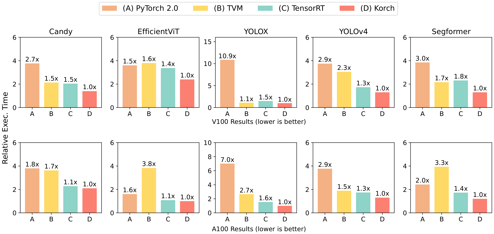

*图 6（原文 Figure 6，第 9 页）：V100 与 A100 上的端到端性能对比（越低越好）。*

**图中文字翻译与读法**：

- 上排 V100 Results (lower is better)（V100 结果，越低越好），下排 A100 Results (lower is better)（A100 结果）；每排五个子图依次是 Candy、EfficientViT、YOLOX、YOLOv4、Segformer；每个子图四根柱子：A = PyTorch 2.0（橙）、B = TVM（黄）、C = TensorRT（青）、D = Korch（红）；纵轴 Relative Exec. Time（相对执行时间）；
- 每根柱子上方标出**以 Korch 为 1.0x 的相对执行时间**（越小越好）。柱高与标注倍数大体成比例，原文没有说明纵轴的绝对单位，本文只使用标注倍数；
- 下面两张表是把标注倍数逐一转录的结果。最后一列“最佳基线”是每行 A、B、C 中最小的倍数，也就是 Korch 相对**该模型上最快的基线**的加速比，是本文的计算。

**表（图 6 转录）：V100 上相对 Korch 的执行时间倍数**

| 模型 | (A) PyTorch 2.0 | (B) TVM | (C) TensorRT | (D) Korch | 最佳基线（本文计算） |
|---|---|---|---|---|---|
| Candy | 2.7x | 1.5x | 1.5x | 1.0x | 1.5x |
| EfficientViT | 1.5x | 1.6x | 1.4x | 1.0x | 1.4x |
| YOLOX | 10.9x | 1.1x | 1.5x | 1.0x | 1.1x |
| YOLOv4 | 2.9x | 2.3x | 1.3x | 1.0x | 1.3x |
| Segformer | 3.0x | 1.7x | 1.8x | 1.0x | 1.7x |

**表（图 6 转录）：A100 上相对 Korch 的执行时间倍数**

| 模型 | (A) PyTorch 2.0 | (B) TVM | (C) TensorRT | (D) Korch | 最佳基线（本文计算） |
|---|---|---|---|---|---|
| Candy | 1.8x | 1.7x | 1.1x | 1.0x | 1.1x |
| EfficientViT | 1.6x | 3.8x | 1.1x | 1.0x | 1.1x |
| YOLOX | 7.0x | 2.7x | 1.6x | 1.0x | 1.6x |
| YOLOv4 | 2.9x | 1.5x | 1.3x | 1.0x | 1.3x |
| Segformer | 2.0x | 3.3x | 1.4x | 1.0x | 1.4x |

（原文图 6，第 9 页。）

**原文的结论，以及本文的核对**：

- 原文：Korch 在 V100 上最高 1.7 倍、在 A100 上最高 1.6 倍；V100 与 A100 上的平均加速分别为 1.39 倍和 1.30 倍。本文用上表的“最佳基线”列核对：V100 的最大值是 Segformer 的 1.7，平均 $(1.5+1.4+1.1+1.3+1.7)/5=1.40$（标注倍数已四舍五入，原文数字 1.39 用的是未取整数据）；A100 的最大值是 YOLOX 的 1.6，平均 $(1.1+1.1+1.6+1.3+1.4)/5=1.30$。所以原文的“最高”“平均”都是**相对每个模型上最快的基线**，而不是相对 PyTorch eager（对 PyTorch 最高可达 10.9 倍）；
- 原文：Segformer 与 EfficientViT 是被现有框架重度优化过的视觉 Transformer，Korch 仍能把它们的延迟分别最多降低 1.7 倍与 1.4 倍（对应上表：Segformer 的 V100 上 1.7，EfficientViT 的 V100 上 1.4）。对 Candy、YOLOv4、YOLOX-Nano 这类传统 CNN，Korch 比现有框架平均快 1.31 倍（本文核对：两种 GPU 上三个 CNN 的最佳基线倍数共 6 个，平均约 1.32，与原文基本一致）；
- 在 A100 上，最佳基线对全部 5 个模型都是 TensorRT；TVM 在 A100 上有三个模型（EfficientViT 3.8、Segformer 3.3、YOLOX 2.7）的倍数明显大于它在 V100 上的对应值（1.6、1.7、1.1），与原文“TVM 在 A100 上弱于 TensorRT”的说法一致。

**为什么 A100 上收益反而更小**：原文指出，先前方法已验证，A100 这类先进 GPU 理论上应从 kernel 融合等张量程序优化中获益更多，因为它们的算力/带宽比更高（图 5）；实验里相反，原文归因于两点。（1）kernel 编排不仅优化访存密集算子（这是以往 kernel 融合方法的主要加速来源），也改善计算密集算子的性能（例如本文 7.4 节案例一里的数据布局调整）；（2）Korch 的 kernel 编排依赖 TVM 为候选 kernel 做灵活的代码生成，而实验显示 TVM 在 A100 上比高度优化的 TensorRT 差，说明用更先进的 kernel 生成技术还有改进 Korch 的空间。

### 7.3 把 operator fission 单独移植到 TensorRT（图 7）

为说明 operator fission 本身的作用，作者把它移植到 TensorRT：**不使用**基于 ILP 的 kernel 编排，而是把 fission 之后的 primitive graph 直接交给 TensorRT，由它决定 kernel 编排策略并用自己的 kernel 做代码生成。由于 TensorRT 对 Transformer 模型高度优化，选 Segformer 做这个实验以使比较更有说服力。

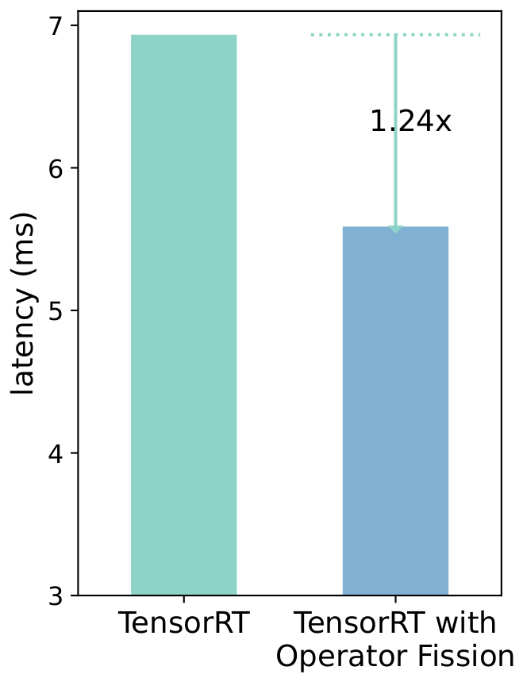

*图 7（原文 Figure 7，第 9 页）：operator fission 的加速：把 primitive graph 而不是计算图交给 TensorRT，得到 1.24 倍加速。*

**图中文字翻译与读法**：纵轴 latency (ms)（延迟，毫秒，起点为 3 而不是 0）；两根柱子：TensorRT（青）约 6.9 ms，TensorRT with Operator Fission（带 operator fission 的 TensorRT，蓝）约 5.6 ms（读图近似值）；中间箭头标注 1.24x。实验在 V100 上、Segformer 模型上。读图结论：只做 fission 就比直接用 TensorRT 快 1.24 倍，说明收益不全来自全局求解器，暴露细粒度的 IR 本身就有价值。

### 7.4 案例分析

以下结果都在 V100 上测量。

#### 案例一：冗余计算（EfficientViT 注意力块）

图 8 比较 TensorRT 与 Korch 在 EfficientViT 注意力块上的 kernel 编排策略。Korch 先对 primitive graph 做变换（图 9），合并 ReduceSum 与 MatMul，再做 kernel 编排。

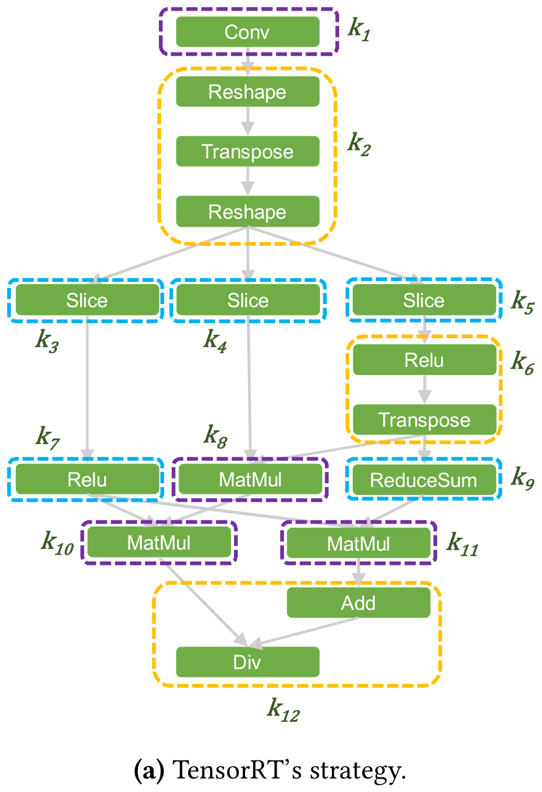

*图 8a（原文 Figure 8，第 10 页）：TensorRT 的策略（12 个 kernel）。*

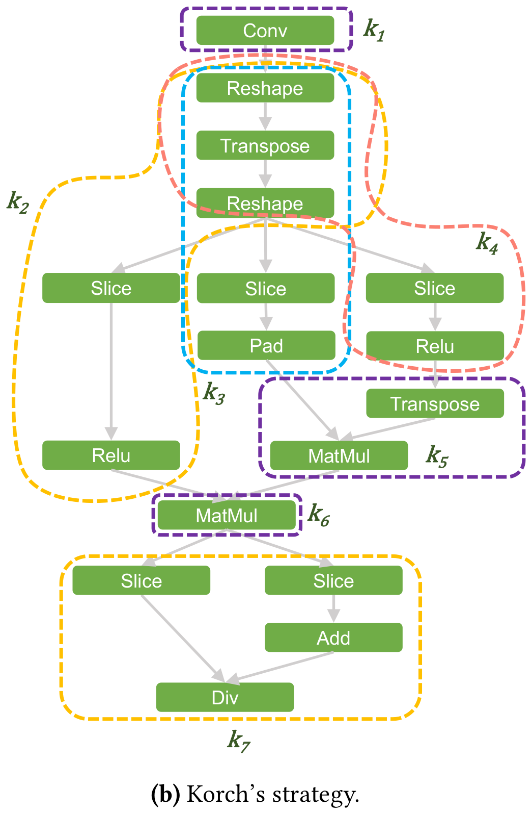

*图 8b（原文 Figure 8，第 10 页）：Korch 的策略（7 个 kernel）。Korch 在做 kernel 编排之前，先应用图 9 的图变换。*

**图中文字翻译与读法**：

- 图 8a（TensorRT）：$k_1$ Conv；$k_2$ {Reshape, Transpose, Reshape}；$k_3$、$k_4$、$k_5$ 各是一个 Slice；$k_6$ {Relu, Transpose}；$k_7$ Relu；$k_8$ MatMul；$k_9$ ReduceSum；$k_{10}$ MatMul；$k_{11}$ MatMul；$k_{12}$ {Add, Div}，共 12 个 kernel；
- 图 8b（Korch）：$k_1$ Conv；$k_2$ 含 {Reshape, Transpose, Reshape, 左路 Slice, Relu}；$k_3$ 含 {Reshape, Transpose, Reshape, 中路 Slice, Pad}；$k_4$ 含 {Reshape, Transpose, Reshape, 右路 Slice, Relu}；$k_5$ 含 {Transpose, MatMul}；$k_6$ 是 MatMul；$k_7$ 含 {两个 Slice, Add, Div}，共 7 个 kernel。（各 kernel 的成员是本文按图中虚线框的走向和原文“Reshape+Transpose+Reshape 在 $k_2$、$k_3$、$k_4$ 三个 kernel 里各执行一次”读出的，虚线交叠处以原图为准。）$k_2$、$k_3$、$k_4$ 各自都包含 “Reshape + Transpose + Reshape”，也就是这三个算子被执行了三次；
- 本文对这个块的对应解读（非原文逐项说明）：这是一个 ReLU 线性注意力，三个 Slice 取出 Q、K、V，ReLU 后用 $K^{\top}V$ 与 $K^{\top}\mathbf{1}$（对 $K^{\top}$ 求和，即 ReduceSum）分别算出分子和分母，再做 Add 与 Div。

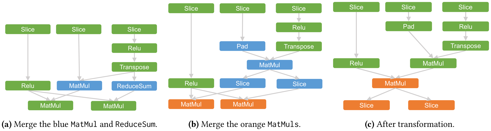

*图 9（原文 Figure 9，第 11 页）：从图 8a 到图 8b 的 primitive graph 变换。同色节点表示一次对 primitive graph 的变换。ReduceSum 与 MatMul 的合并与图 2 的做法类似。*

**图中文字翻译与读法**：（a）Merge the blue MatMul and ReduceSum（合并蓝色的 MatMul 与 ReduceSum）：两个蓝色节点被合并成一个带 Pad 的 MatMul 加上两个 Slice（图 (b) 里的蓝色节点）；（b）Merge the orange MatMuls（合并橙色的两个 MatMul）：共享输入的两个 MatMul 合并成一个 MatMul，再 Slice 出两路；（c）After transformation（变换之后）：得到图 8b 使用的 primitive graph。

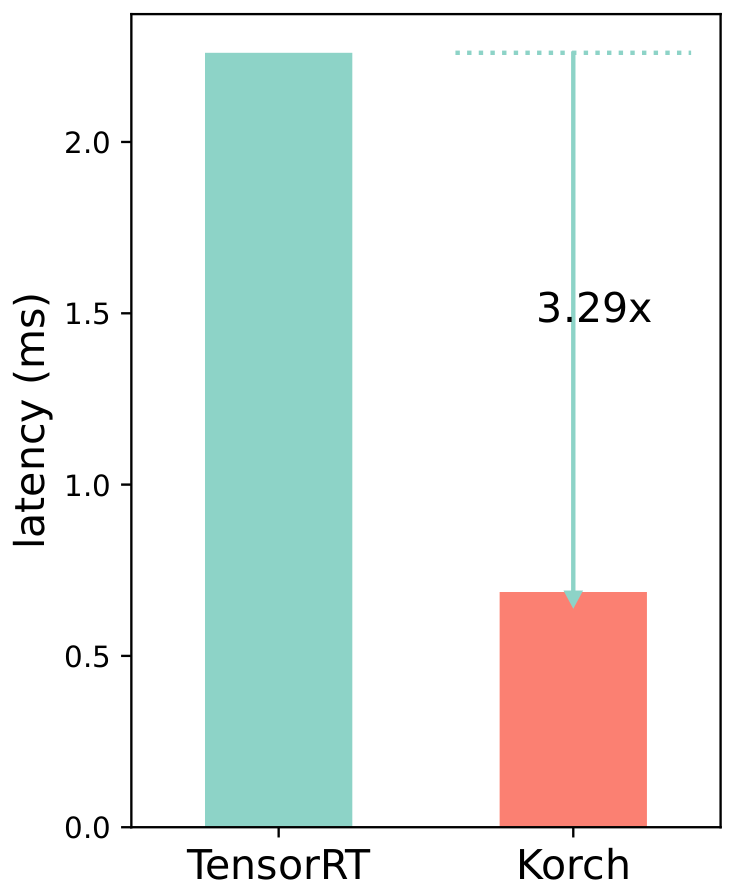

*图 10（原文 Figure 10，第 11 页）：EfficientViT 注意力块的案例：Korch 的策略（图 8b）比 TensorRT 的策略（图 8a）快 3.29 倍。*

**图中文字翻译与读法**：纵轴 latency (ms)（延迟）；TensorRT 约 2.26 ms，Korch 约 0.69 ms（读图近似值）；标注 3.29x。

**原文的分析**：

- Korch 在 kernel 编排中融合相邻的访存密集算子（如图 8b 的 $k_2$），并机会性地把 Transpose 与 MatMul 融合以优化数据布局（比较图 8a 的 $k_8$ 与图 8b 的 $k_5$），这是 TensorRT 没有考虑的；
- 具体地，图 8a 中 $k_8$ 的输入矩阵的长宽比极端，达到 1024:1；改变数据布局之后，图 8b 里的 $k_5$ 比图 8a 里的 $k_8$ 快 **3.52 倍**，二者使用**同一个** TensorRT MatrixMultiply 后端；
- Korch 还允许 Reshape+Transpose+Reshape 在三个 kernel（$k_2$、$k_3$、$k_4$）里各执行一次。由于这些算子都是访存密集的，延迟主要由访存开销决定，所以 Korch 的映射策略减少了 kernel 总数并改善总延迟；
- Korch 在这个注意力块上只用 **7 个 kernel**，比 TensorRT 少 5 个，整个子图比 TensorRT 快 **3.29 倍**；
- 如果在图 8a 的图上直接做 kernel 编排而不做 primitive graph 变换，优化器也需要做冗余计算（把 $k_6$ 里的 Transpose 挪进 $k_8$ 和 $k_9$），才能优化 $k_8$ 里 MatMul 的数据布局。但先前工作没有考虑冗余计算，所以这种数据布局变换在先前工作的优化空间之外。

#### 案例二：把一个算子映射到不同的 kernel（Softmax 与 InstanceNorm）

- **Segformer 的 Softmax**：Korch 用图 2b 的变换分解 Softmax，再按图 4c 类似的方式做 kernel 映射：Softmax 被映射到图 2b 的全部四个 kernel 里，在这个自注意力块上比 TensorRT 快 **1.50 倍**；
- **Candy 的 InstanceNorm**：为优化 Candy 这类 CNN，Korch 可以在融合时打破算子边界。图 12 展示 Candy 里一个常见的网络模式：TensorRT 把 InstanceNorm、ReLU、Pad 各映射到独立的 kernel，而 Korch 可以把 InstanceNorm 分解，并把其中一部分融合进随后的 ReLU 和 Pad 里，这个子图上取得 **1.32 倍**加速。

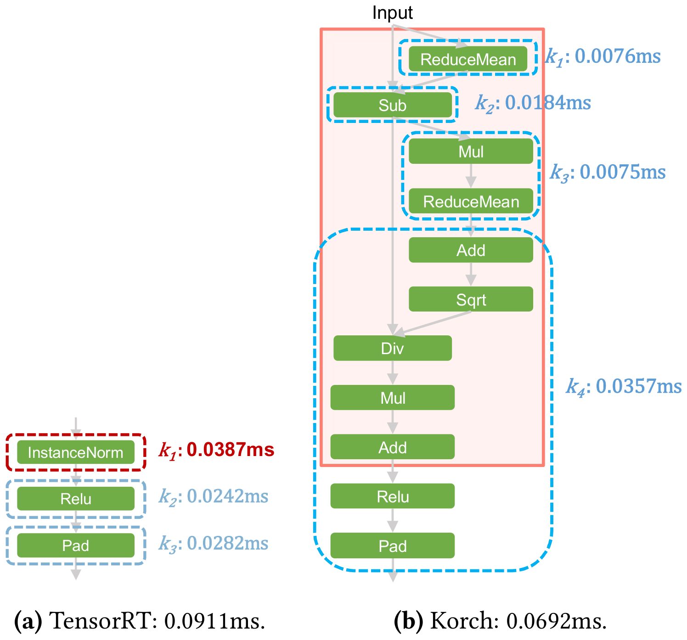

*图 12（原文 Figure 12，第 12 页）：Candy 里一个常见子图模式上，kernel 编排策略与 kernel 延迟的对比。图 12b 中的红框是 InstanceNorm 的 operator fission。Korch 在这个子图上比 TensorRT 快 1.32 倍。*

**图中文字翻译与读法**：（a）TensorRT：总计 0.0911 ms；（b）Korch：总计 0.0692 ms，红框圈出 InstanceNorm 被裂解出的 primitive（从 Input 出发：ReduceMean、Sub、Mul、ReduceMean、Add、Sqrt、Div、Mul、Add），蓝色虚线圈出各 kernel。每个 kernel 旁的数字是实测延迟。转录如下：

| 方案 | kernel | 包含的算子 | 延迟（ms） |
|---|---|---|---|
| TensorRT | $k_1$ | InstanceNorm | 0.0387 |
| TensorRT | $k_2$ | Relu | 0.0242 |
| TensorRT | $k_3$ | Pad | 0.0282 |
| TensorRT | 合计 | | 0.0911 |
| Korch | $k_1$ | ReduceMean | 0.0076 |
| Korch | $k_2$ | Sub | 0.0184 |
| Korch | $k_3$ | Mul、ReduceMean | 0.0075 |
| Korch | $k_4$ | Add、Sqrt、Div、Mul、Add、Relu、Pad | 0.0357 |
| Korch | 合计 | | 0.0692 |

（原文图 12，第 12 页。）本文核对：两个方案的各 kernel 延迟相加分别为 0.0911 与 0.0692 ms，$0.0911/0.0692\approx1.32$。读图结论：Korch 把 InstanceNorm 裂解出的后半部分（Add、Sqrt、Div、Mul、Add）与后面的 ReLU、Pad 合进同一个 kernel $k_4$，而前面的均值 reduce、减均值、平方后再求均值各自成 kernel；一个 InstanceNorm 因此被分散到四个 kernel 里，这是算子级融合表达不出来的。（本文对这些 primitive 数学角色的理解：先求均值、减去均值，再求平方的均值得到方差，后半部分依次是加 $\epsilon$、开方、做除法归一化、乘 $\gamma$、加 $\beta$；原文没有逐项说明。）

#### 案例三：贪心融合可能次优（Segformer 子图）

图 11 展示 Segformer 一个子图的两种 kernel 编排策略。因为所有算子都是访存密集且可融合的，TVM 直接把整个子图融合进一个 kernel（策略 A）；Korch 在 batch size 为 1 时同样选策略 A，在 batch size 为 16 时选策略 B。

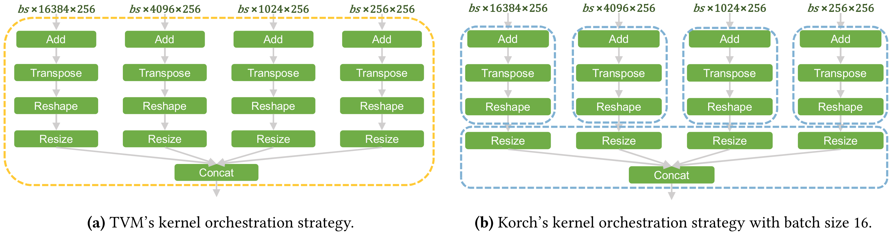

*图 11（原文 Figure 11，第 12 页）：Segformer 子图上的两种 kernel 编排策略。TVM 总是选策略 (a)，Korch 在 batch size 为 1 时选 (a)，在 batch size 为 16 时选 (b)。*

**图中文字翻译与读法**：子图有四条并行分支，输入张量大小依次为 bs×16384×256、bs×4096×256、bs×1024×256、bs×256×256（bs 是 batch size），每条分支是 Add → Transpose → Reshape → Resize，四路 Resize 的输出一起送入 Concat。(a) TVM 的 kernel 编排策略：整个子图一个大 kernel（黄色虚线框）；(b) Korch 在 batch size 为 16 时的策略：每条分支的 {Add, Transpose, Reshape} 各一个 kernel（4 个），四个 Resize 与 Concat 合成最后一个 kernel（5 个 kernel，蓝色虚线框）。

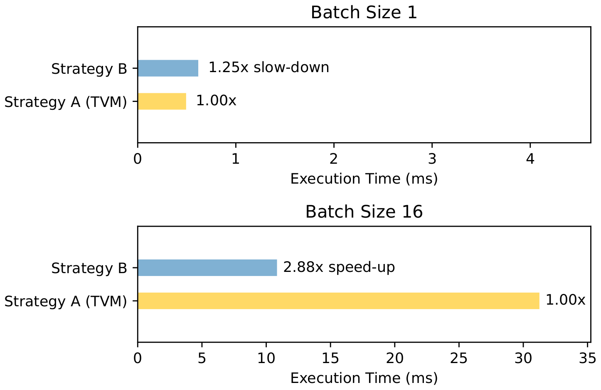

*图 13（原文 Figure 13，第 12 页）：Segformer 子图上不同 kernel 编排策略的对比。TVM 总是选策略 A，Korch 在 batch size 为 1 时选策略 A，在 batch size 为 16 时选策略 B。*

**图中文字翻译与读法**：上图 Batch Size 1，下图 Batch Size 16；横轴 Execution Time (ms)（执行时间，毫秒）；每图两根横条：Strategy A (TVM)（黄）与 Strategy B（蓝）。读图近似值如下：

| 子图 batch size | 策略 A（TVM，整体融合） | 策略 B（5 个 kernel） | 图中标注 |
|---|---|---|---|
| 1 | 约 0.49 ms（标注 1.00x） | 约 0.62 ms | B 慢 1.25 倍（1.25x slow-down） |
| 16 | 约 31.2 ms（标注 1.00x） | 约 10.8 ms | B 快 2.88 倍（2.88x speed-up） |

**原文的结论**：整张子图融合在 batch size 为 1 时是高效的，但在 batch size 为 16 时是次优的，因为 TVM 无法为整张图生成高度优化的 kernel；在不修改 TVM 代码生成后端的前提下，改用多个 kernel（图 11b）执行这张图，得到加速。注意：**原文 §6.4 正文写的是 2.24 倍加速，而图 13 标注（并且图中柱长也支持）的是 2.88 倍**，原文没有解释这个不一致，本文引用时保留两个数字并说明来源。读图结论：“融合越多越好”不成立，最优融合方案随 batch size 而变化；Korch 因为依据实测延迟而不是规则来选择，所以能在 batch 为 1 时保留整体融合。

### 7.5 调优时间（表 2）

下表给出评估中所有 DNN 的 primitive graph 节点数、候选 kernel 数以及端到端调优时间（在 Perlmutter 上）。

**表 2：primitive graph 节点数、候选 kernel 数与端到端调优时间**

| 模型 | 节点数 | 候选 kernel 数 | 调优时间 |
|---|---|---|---|
| Candy | 184 | 1031 | 5.5h |
| EfficientViT | 380 | 2174 | 11.5h |
| YOLOX | 367 | 3361 | 2.8h |
| YOLOv4 | 569 | 4644 | 12.2h |
| Segformer | 672 | 11400 | 9.2h |

（原文表 2，第 11 页。）原文的分析：

- 理论上候选 kernel 数应与节点数的平方同阶，但实际数量远小于此（例如 Segformer 有 672 个节点，$672^{2}\approx45$ 万，而候选只有 11,400 个），因为多数候选能被简单启发式拒绝；
- Korch 调优时间的大头是 TVM MetaSchedule 对访存密集 kernel 的调优。作者用 TVM 数据库避免对同一个候选 kernel 多次调优，且候选 kernel 的调优可以在多块 GPU 上并行；
- 最长的调优时间是 12.2 小时，其中有一个 kernel 就要用 TVM MetaSchedule 调 12 小时；
- 作者认为 kernel 调优是一次性成本，Korch 的调优开销在实际应用中可以接受。

调优时间并不随节点数单调增长（例如 YOLOX 有 367 个节点只用 2.8 小时，EfficientViT 有 380 个节点要用 11.5 小时），原文没有解释这种差别。

## 八、相关工作与未来工作

**相关工作**（原文第 7 节）：

- **Kernel orchestration**：DNNFusion 从产生最小中间结果的一对一算子开始融合，再用贪心策略尝试融合它的后继与前驱；Korch 的系统性新做法是先 fission 再用二元规划找最优执行策略。PyTorch 2.0 也会把算子分解成 primitive，但只是为了把算子数从约 2000 降到约 250 的稳定集合，以简化为新算子、新硬件的工程工作；
- **动态规划方案**：DP 广泛用于领域专用编译器的融合（如 PolyMageDP 用于图像处理流水线）。与 Korch 有两点不同：DP 直接融合算子，错过跨算子融合机会；Korch 考虑 primitive 的重复执行，这在 DP 里难以考虑，却能被二元线性规划自然地建模；
- **图优化**：TensorFlow、TensorRT、MetaFlow 用专家设计的图变换规则优化算子图；TASO 自动生成并验证给定算子集合的图变换，用回溯搜索来应用；PET 扩展 TASO，生成部分等价变换及其校正 kernel。Korch 的 kernel 编排与这些图级优化**正交**，可以结合；事实上 Korch 用 TASO 发现的图变换去优化 primitive graph；
- **手写 kernel**：专家手写的 kernel 可以对特定子图达到近似最优，例如 FlashAttention 为注意力优化 kernel **内部**的设备显存访问；这与 Korch（优化 DNN 算子在多个 kernel 之间的编排）正交，手写 kernel 可以直接作为额外后端加入 kernel profiler，在识别出注意力子图时被编排优化器考虑；
- **Kernel 生成**：Halide 把图像处理程序解耦成算法与 schedule；这一思想被许多深度学习编译器采用。TVM 用基于学习的方法预测 schedule 代价并在预定义的 schedule 空间里找高效 schedule；Ansor 自动生成 schedule 模板，得到比 TVM 更好的 schedule。Korch 直接用 TVM 与 Ansor 为给定 primitive 集合生成高性能 kernel；Triton、Hidet 等新的 kernel 生成框架也都可以作为 kernel profiling 的后端选择。

**未来工作**（原文第 8 节）：

- **加速调优**：端到端调优时间的大头是候选 kernel 的 profiling。虽然评估里的总调优时间可以接受，但候选 kernel 数随图的**宽度**呈指数增长，限制了 Korch 向一般张量程序的扩展；一个可能的办法是建一个轻量代价模型，快速丢弃低效候选；
- **扩展 BLP 形式化**：目前只考虑单输出的候选子图；如果恰当地定义子图的多个输出，可以去掉单输出约束；还可以把数据布局纳入 BLP：为每个候选 kernel $K$ 指定每个输入输出的数据布局（如 NCHW、NHWC），让求解器在计算图上自动选择最优布局。

## 九、局限、证据边界与常见误读

### 9.1 局限与证据边界

- **候选 profiling 与求解成本高**：候选 kernel 数随图宽度指数增长；端到端调优 2.8 到 12.2 小时（表 2）；有的单个 kernel 就要调 12 小时；
- **假设 kernel 顺序执行**：总延迟是各 kernel 延迟之和，不建模 CUDA multi-stream、kernel 重叠或通信；
- **单输出候选**：每个候选 kernel 只有一个输出张量；
- **fission 规则需人工定义**：每个算子的 fission 规则由开发者给出，要自行保证数值语义；无法用四类 primitive 表示的算子（如 Topk）当作不透明 primitive；
- **数据布局不在 BLP 里**：每个候选 kernel 的数据布局是固定的，布局选择只能靠 primitive graph 变换与编排间接实现；
- **后端能力限制结论**：memory-intensive kernel 靠 TVM MetaSchedule 生成，A100 上 TVM 弱于 TensorRT；计算密集 primitive 直接用厂商库，不能匹配库参数的候选会被拒绝；
- **实验范围**：只评估 5 个视觉模型（3 个 CNN、2 个视觉 Transformer）的单 GPU 推理，batch size 为 1（batch 为 16 只出现在 Segformer 一个子图的案例里），V100 的 FP32 与 A100 的 TF32；不含训练、动态 shape、大语言模型、多 GPU；
- **图划分规则未给出**：原文只说划分子图以缩小优化空间并保留优化机会，没有说明如何划分；
- **原文内部不一致**：原文 §6.4 正文写 Segformer 子图的加速为 2.24 倍，图 13 标注为 2.88 倍；原文 §4.2 把 $O_{ij}$ 的定义误写成 input；原文 §3 正文的全 1 张量写作 $C_s$，图中写作 $C_R$。

### 9.2 常见误读

- **“Operator fission 就是 lowering”**：普通 lowering 只是换成更低层的表示；Korch 的 fission 是为了开放跨算子的重组与“一个算子的计算分散到多个 kernel”的覆盖空间（图 2c 里一个 Softmax 被分散到四个 kernel）；
- **“BLP 保证全局最优，所以最终程序全局最优”**：它只在**已枚举的候选集合**、**实测延迟**和**顺序执行/延迟可加**的模型内最优；漏掉的候选（单输出限制、被启发式拒绝的候选、后端无法生成的 kernel）、profile 噪声、忽略 kernel 间重叠，都会限制结论；
- **“冗余计算一定是坏事”**：某些 reshape/transpose 等廉价的 layout 变换在多个消费者 kernel 里各算一遍，可以避免物化与额外 kernel（图 4c 里 $p_1$ 算 3 次，图 8b 里 Reshape+Transpose+Reshape 算 3 次）；算力增长快于带宽是它的前提（图 5）；与训练里的 rematerialization 目的不同；
- **“最高 1.7 倍”是相对 PyTorch eager 的**：不是。它是相对每个模型上最快的基线（图 6 的“最佳基线”列），对 PyTorch 最高可达 10.9 倍；
- **“A100 收益更小说明新 GPU 不需要融合”**：原文的解释是 Korch 的收益不只来自访存密集算子，且它依赖的 TVM 代码生成在 A100 上弱于 TensorRT，没有任何证据表明新 GPU 不需要融合；
- **“primitive 越细越好”**：fission 只是开放自由度，最终是否融合回去由实测延迟决定（例如 Segformer 子图在 batch 为 1 时 Korch 仍选择整体融合）；primitive 越细，候选越多、调优越慢。

## 十、复现检查清单

- 软件与硬件：V100（FP32）与 A100（TF32）；CUDA 11.7；PyTorch 2.0.1、TVM 0.11（commit 61a4f21）、TensorRT 8.2；artifact 附录里列出的环境是 AWS p3.2xlarge（一块 V100-SXM2-16GB）、CUDA 11.7、cuDNN 8.6.0、TensorRT 8.2.0.6；
- 工作负载：Candy、YOLOv4、YOLOX-Nano、Segformer、EfficientViT，batch 为 1，输入分辨率见 7.1 节；artifact 附录里提供了 Candy（ONNX 模型库的 fast_neural_style）与 Segformer（huggingface 上的 `nvidia/segformer-b0-finetuned-ade-512-512`）两个模型的 ONNX 文件，正文没有说明评估所用 Segformer 的具体变体；
- 保留原始 ONNX 与 fission 之后的 primitive graph；单独验证每条 fission 规则与图变换的数值语义和浮点容差；
- 记录：子图划分结果、各子图的 execution state 数与候选 kernel 数、每个候选的实测延迟（TVM 数据库）、MetaSchedule 的调优预算（原文只说多数访存密集 kernel 2 分钟内调完）、profile 次数；
- 报告求解器时间（PuLP，最大子图 584 个 execution state、3,078 个候选，1,000 秒内收敛）和总调优时间（表 2）；
- artifact 的默认配置**不启用** TensorRT 后端（`enable_trt` 为 False），因为启用至少使调优时间翻倍而加速有限；默认配置下 Candy 端到端约 3 小时、Segformer 约 7 小时，结果会比图 6 略慢；fission 移植到 TensorRT 的实验约 5 分钟；
- 与 TensorRT 比较时固定精度与 Tensor Core 模式（A100 用 TF32）；
- 检查 batch size 或 shape 变化是否需要重新求解：图 11 与图 13 显示最优策略会随 batch size 改变（这是本文由该案例得出的推论，原文没有明说）。

## 十一、与相关论文的关系

- [FusionStitching](../fusion_stitching/论文中文解读.md)：扩大异构算子的融合与代码生成能力，用 warp 内、block 内重用把代价高的算子放进融合 kernel 中间；Korch 则在 primitive 粒度上搜索，并允许重复执行；
- [Welder](../welder/论文中文解读.md)：以 tile 流量联合优化存储层次；与 Korch 的“先拆再选”思路互补；
- [Event Tensor](../event_tensor/论文中文解读.md)：把细粒度任务依赖带入 persistent megakernel，支持动态调度；Korch 的候选 kernel 之间只考虑顺序执行；
- [TASO](../taso/论文中文解读.md)：Korch 用 TASO 发现的图变换优化 primitive graph，并沿用它“总运行时间等于各 kernel 运行时间之和”的假设；
- [TVM](../tvm_compiler/论文中文解读.md)、[Ansor](../ansor/论文中文解读.md)、[MetaSchedule](../metaschedule/论文中文解读.md)：Korch 用 TVM MetaSchedule（统一 AutoTVM 与 Ansor）为访存密集的候选 kernel 生成并调优代码；
- [FlashAttention](../flash_attention/论文中文解读.md)：手写 kernel 的代表，原文建议把它作为额外后端接入 kernel profiler。

## 原文证据导航

- [原论文 PDF](paper.pdf)
- [原文提取文本](paper.txt)
- [论文概要](论文概要.md)
