# 论文中文解读：《High-Resolution Image Synthesis with Latent Diffusion Models》

> **基本信息**：Robin Rombach、Andreas Blattmann（共同一作）、Dominik Lorenz、Patrick Esser、Björn Ommer（Ludwig Maximilian University of Munich 与 IWR, Heidelberg University；Esser 另属 Runway ML），arXiv:2112.10752（本地 PDF 为 v2，2022 年 4 月 13 日；该文一般引用为 CVPR 2022，本地 PDF 未标会议名）；论文原文 [官方页面](https://arxiv.org/abs/2112.10752)；作者在原文中给出的代码与预训练模型地址为 `https://github.com/CompVis/latent-diffusion`。
>
> **本文的读法**：本文按“背景（为什么像素空间扩散太贵）→ 方法（感知压缩 + 潜空间扩散 + 交叉注意力条件）→ 实现细节 → 实验（压缩率权衡、无条件生成、文本/布局/类别条件、超分辨率、修复、算力）→ 局限”的顺序，把原文逐项讲清楚。图均取自论文原文（从 PDF 按图裁出，照片类用 JPEG），每张图后有中文图题、图中文字翻译与读图结论；表为逐格核对后的中文转录，数字与原文一致，粗体沿用原文的最优值标注（原文用下划线标次优值，转录中略去）。原文公式编号（1）–（25）沿用；原文没有算法框的地方，本文用“补充”标出自己整理的伪代码或推导。

## 一、一句话结论

直接在像素空间训练和采样扩散模型（DM）极其昂贵：训练要几百个 GPU 日，采样要几十到上千次大网络前向（原文引用的 ADM 采样步数为 25 到 1000）。作者的做法是把“压缩”与“生成”拆成两个阶段：先训练一个感知压缩自编码器（编码器 $\mathcal E$、解码器 $\mathcal D$，用感知损失 + patch 对抗损失训练，只带很弱的 KL 或 VQ 正则），把图像压到空间下采样 $f$ 倍的潜空间；再在这个**固定的**潜空间里训练扩散模型。因为潜空间仍保留二维空间结构，扩散网络仍是以卷积为主的 U-Net，不必像先前的两阶段自回归方法那样把图像压得很狠。再给 U-Net 加上**交叉注意力**层，就能以文本、布局、类别等任意模态为条件（把条件编码器 $\tau_\theta$ 与扩散网络联合训练）；空间对齐的条件（低分辨率图、掩码图像、语义图）则直接与输入通道拼接，并且能卷积式地推广到比训练分辨率更大的图。

主要结果（均出自原文，条件见后文各表）：

- 感知压缩的权衡：$f=4$ 到 $8$（LDM-4 至 LDM-8）在效率与质量间最平衡；像素空间的 LDM-1 在同样的训练预算下 2M 步后 FID 比 LDM-8 高约 38。
- 无条件生成：CelebA-HQ 256×256 上 FID 5.11（对比表中所有方法最低）；LSUN-Bedrooms 上与 ADM 接近（2.95 对 1.90），但参数量约为一半、训练资源约少 4 倍。
- 类条件 ImageNet 256×256：LDM-4-G（classifier-free guidance，$s=1.5$）FID 3.60、IS 247.67，优于 ADM-G（4.59、186.7），参数 400M 对 608M。
- 文本到图像（MS-COCO）：1.45B 参数的 LDM-KL-8-G FID 12.63、IS 30.29，与 6B 的 GLIDE（12.24）、4B 的 Make-A-Scene（11.84）相当。
- 修复（Places，512×512 裁剪）：big, w/ ft 模型在全部样本上 FID 1.50，在 40–50% 掩码的困难样本上 FID 9.39，优于表 7 中所有对比方法。
- 效率：与同参数量的像素空间扩散相比，修复任务上训练时间至少快 2.7 倍，同时 FID 好至少 1.6 倍。

## 二、背景与动机

### 2.1 像素空间扩散为什么贵（原文第 1 节，第 1–2 页）

高分辨率复杂场景的图像合成目前主要靠放大基于似然的模型（含数十亿参数的自回归 Transformer）；GAN 的出色结果主要局限在变化有限的数据上，因为对抗学习难以扩展到复杂的多模态分布。扩散模型（由一系列去噪自编码器构成）在图像合成及其他领域取得了令人印象深刻的结果，并在类条件图像合成和超分辨率上达到当时最优；即使无条件的 DM 也能直接用于修复、上色或笔画合成。作为基于似然的模型，它们不会出现 GAN 的模式崩溃和训练不稳定，并且大量使用参数共享，能够建模极复杂的自然图像分布而不需要自回归模型那样的数十亿参数。

但基于似然的模型有“模式覆盖”的特点，容易把过多的容量（也就是算力）花在建模数据中**不可察觉的细节**上。虽然重加权的变分目标（DDPM 的 $L_{\mathrm{simple}}$）通过对初始去噪步欠采样来缓解这一点，DM 仍然很贵：训练和评估都需要在高维 RGB 空间里反复做函数求值（以及梯度计算）。例如训练最强的 DM 往往要数百个 GPU 日（原文引用 ADM 论文的 150–1000 个 V100 日），采样 5 万张图在单张 A100 上约需 5 天。这带来两个后果：训练需要只有少数人才有的大量算力，并留下巨大的碳足迹；评估一个训练好的模型也很耗时耗显存，因为同一网络要顺序运行很多步（ADM 论文中 25 到 1000 步）。

### 2.2 “离开像素空间”：感知压缩与语义压缩（图 2）

作者先分析了一个已训练好的像素空间 DM 的率失真（rate-distortion）权衡。任何基于似然的模型的学习大致可分两个阶段：第一阶段是**感知压缩**，去掉高频细节，但几乎没学到语义变化；第二阶段，真正的生成模型学习数据的语义与概念构成（**语义压缩**）。于是目标变成：先找到一个在感知上等价、但计算上更合适的空间，再在其中训练扩散模型。

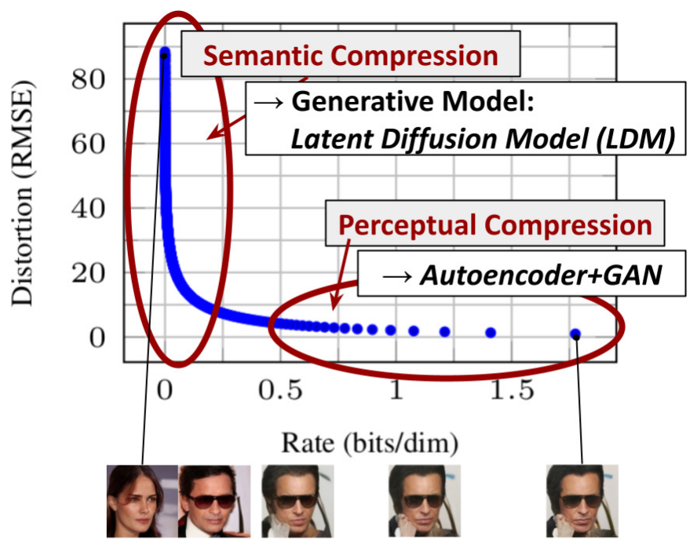

*图 2（原文 Figure 2，第 2 页）：说明感知压缩与语义压缩：数字图像的大部分比特对应不可察觉的细节。DM 可以通过最小化相应损失项来抑制这些语义上无意义的信息，但（训练时的）梯度和（训练与推断时的）神经网络主干仍要在所有像素上计算，造成多余的计算和不必要的昂贵优化与推断。作者提出潜扩散模型（LDM）作为有效的生成模型，并用一个单独的温和压缩阶段，只去除不可察觉的细节。数据与图像来自 DDPM 论文。*

**图中文字翻译与读法**：

- **坐标轴**：横轴 Rate (bits/dim)（码率，比特每维），纵轴 Distortion (RMSE)（失真，均方根误差）。蓝色圆点是一个像素空间扩散模型在不同反向过程时刻的率失真点（即 [DDPM](../ddpm/论文中文解读.md) 的图 5 与表 4 的那条曲线）。
- **左上红椭圆 Semantic Compression（语义压缩）→ Generative Model: Latent Diffusion Model (LDM)**：从图上读出：曲线在码率很小（约 0 到 0.2 bits/dim）的区间里，失真从约 88 陡降到十来个单位（DDPM 表 4 中码率 0.12 bits/dim 处失真为 12.0）。这一段决定图像的语义内容，由生成模型负责，作者让 LDM 来做这件事。
- **右下红椭圆 Perceptual Compression（感知压缩）→ Autoencoder+GAN**：曲线向右延伸的长尾，码率从约 0.5 一直到约 1.8 bits/dim，而失真只从几个单位缓慢降到约 1。这一段对应高频的、人眼不敏感的细节，由自编码器加 GAN 损失处理。
- **图下方的人脸缩略图**：对应不同码率处的重构。码率约为 0 时（最左，一个与原图无关的女性人脸）语义信息还没有传过来；稍右一张已是戴墨镜的男子，语义内容对了，但姿态与原图不同；其余三张（直到最右、约 1.8 bits/dim 处）姿态与原图一致，彼此只在细节上有差别，读起来几乎无异（图上没有标注各缩略图对应的确切码率，这里按它们与曲线的连线位置判断）。
- **读图结论**：绝大部分码率（比特）花在不可察觉的细节上；把这部分交给一个只做“温和压缩”的自编码器，之后的生成模型只需处理语义部分。这是 LDM 的立论依据。

### 2.3 论文的六点贡献（原文第 1 节）

1. 与纯 Transformer 方法（VQGAN、DALL-E 一类）相比，本方法对更高维数据的扩展更平滑，因此既能工作在能给出更忠实、更多细节的重构的压缩水平（见图 1），又能高效地用于百万像素级图像合成。
2. 在多个任务（无条件图像合成、修复、随机超分辨率）和数据集上取得有竞争力的性能，同时显著降低计算成本；与像素空间扩散相比，推断成本也显著降低。
3. 与以往同时学习编码器/解码器和基于 score 的先验的工作（LSGM）不同，本方法不需要在重构能力与生成能力之间做精细的加权；这保证了极其忠实的重构，并且只需要很少的潜空间正则化。
4. 对于超分辨率、修复和语义合成这类稠密条件任务，模型可以卷积式地应用，渲染约 1024² 像素的大幅一致图像。
5. 设计了基于交叉注意力的通用条件机制，支持多模态训练；用它训练了类条件、文本到图像和布局到图像模型。
6. 发布预训练的潜扩散与自编码模型，这些模型除用于训练 DM 之外还可能用于其他任务。

### 2.4 相关工作（原文第 2 节，第 2–3 页）

- **GAN**：可高效采样高分辨率图像，感知质量好，但难优化，难以捕获完整数据分布。**基于似然的方法**强调良好的密度估计，使优化更稳定。VAE 与 flow 能高效合成高分辨率图像，但样本质量不及 GAN。**自回归模型**（ARM）密度估计强，但网络计算量大、采样是顺序的，限制在低分辨率；像素表示里含有几乎察觉不到的高频细节，最大似然训练在它们上面花费过多容量，导致训练时间长。为扩展到高分辨率，若干两阶段方法用 ARM 去建模压缩后的潜图像空间。
- **扩散概率模型**：在密度估计和样本质量上达到当时最优。其生成能力来自底层网络用 U-Net 实现时与图像类数据归纳偏置的天然契合。最佳合成质量通常用重加权目标训练，此时 DM 相当于一个有损压缩器，可以在图像质量与压缩能力之间折中。但在像素空间评估和优化的代价是推断速度低、训练成本很高；前者可以部分靠先进采样策略（DDIM 等）和层次化方法缓解，但在高分辨率数据上训练总要计算昂贵的梯度。LDM 同时解决两个问题，在更低维的压缩潜空间里工作。
- **两阶段图像合成**：VQ-VAE 用自回归模型在离散化潜空间上学习富有表达力的先验；DALL-E 把这一做法扩展到文本到图像，学习离散图像与文本表示的联合分布；VQGAN 的第一阶段使用对抗与感知目标，让自回归 Transformer 扩展到更大的图像。但可行的 ARM 训练所需的高压缩率（并带来数十亿可训练参数）限制了整体性能，而压缩较少则算力代价高。LDM 因为卷积主干在更高维潜空间里扩展得更平缓，可以自由选择压缩水平，在“学一个强大的第一阶段（不把太多感知压缩留给扩散模型）”与“保证高保真重构”之间取得最佳折中（图 1）。
- **与联合训练的区别**：已有方法或联合学习编码/解码模型与基于 score 的先验（LSGM），或分开学习；前者仍需要在重构与生成能力之间做困难的加权，并被本文方法超越（第 4 节）；后者聚焦于人脸等高度结构化的图像。

## 三、方法

### 3.1 感知图像压缩：第一阶段自编码器（原文 3.1 节与附录 G，第 3–4、29 页）

感知压缩模型基于 VQGAN 的先前工作，是一个自编码器，用**感知损失**（LPIPS）与**基于 patch 的对抗目标**（patch-based adversarial objective）的组合训练。这保证重构被约束在图像流形上（强制局部真实感），避免只依赖像素空间损失（L2、L1）带来的模糊。

**符号**：给定 RGB 图像 $x\in\mathbb R^{H\times W\times 3}$，编码器 $\mathcal E$ 把 $x$ 编码为潜表示 $z=\mathcal E(x)$，解码器 $\mathcal D$ 从潜表示重构图像 $\tilde x=\mathcal D(z)=\mathcal D(\mathcal E(x))$，其中 $z\in\mathbb R^{h\times w\times c}$。编码器对图像做下采样，倍数 $f=H/h=W/w$，作者研究不同的 $f=2^m$（$m\in\mathbb N$）。

**两种正则化**（为避免任意高方差的潜空间）：

- **KL-reg.**：对学到的潜变量加一个很小的、向标准正态的 KL 惩罚，类似 [VAE](../vae/论文中文解读.md)；
- **VQ-reg.**：在解码器内使用向量量化层。这个模型可以解释成 VQGAN，只是量化层被解码器吸收（成为 $\mathcal D$ 的第一层）。

因为后续的 DM 设计成处理这个潜空间 $z=\mathcal E(x)$ 的**二维结构**，可以用相对温和的压缩率并得到很好的重构。这与先前依赖对潜空间做任意一维排序、再自回归建模其分布的工作（VQGAN、DALL-E）形成对比，后者忽略了潜空间固有的结构。所以本文的压缩模型能更好地保留 $x$ 的细节（见表 8）。

**完整训练目标（附录 G，式 25）**：

$$
L_{\mathrm{Autoencoder}}=\min_{\mathcal E,\mathcal D}\max_{\psi}\Big(L_{\mathrm{rec}}\big(x,\mathcal D(\mathcal E(x))\big)-L_{\mathrm{adv}}\big(\mathcal D(\mathcal E(x))\big)+\log D_\psi(x)+L_{\mathrm{reg}}(x;\mathcal E,\mathcal D)\Big).\qquad\text{(25)}
$$

其中 $D_\psi$ 是基于 patch 的判别器，被优化去区分原图和重构 $\mathcal D(\mathcal E(x))$；$L_{\mathrm{rec}}$ 是重构（感知）损失，原文没有展开它的具体形式；$L_{\mathrm{adv}}$ 是对抗项；$L_{\mathrm{reg}}$ 是对潜变量的正则项，使其零均值、方差小。两种正则的具体做法：

- (i) **KL 项**：$q_{\mathcal E}(z\mid x)=\mathcal N(z;\mathcal E_\mu,\mathcal E_\sigma^2)$ 与标准正态之间的低权重 KL，如标准 VAE；
- (ii) **VQ 层**：学习含 $|\mathcal Z|$ 个样本的码本。

为获得高保真重构，两种情形都只用**非常小**的正则：KL 项权重约为 $10^{-6}$，或选取高的码本维度 $|\mathcal Z|$。

**在潜空间里训练 DM 时（附录 G）**，分两种情形：

**(i) KL 正则的潜空间**：采样 $z=\mathcal E_\mu(x)+\mathcal E_\sigma(x)\cdot\varepsilon=:\mathcal E(x)$，$\varepsilon\sim\mathcal N(0,1)$。如果要对潜变量**重新缩放**，则用数据的第一个批次估计方差

$$
\hat\sigma^2=\frac{1}{bchw}\sum_{b,c,h,w}\big(z^{b,c,h,w}-\hat\mu\big)^2,\qquad \hat\mu=\frac{1}{bchw}\sum_{b,c,h,w}z^{b,c,h,w},
$$

并把 $\mathcal E$ 的输出缩放成使重缩放后的潜变量具有单位标准差：$z\leftarrow z/\hat\sigma=\mathcal E(x)/\hat\sigma$。（上式对 $b,c,h,w$ 全部求和，得到的是一个**标量**方差，正文称为“逐分量标准差”。）

**(ii) VQ 正则的潜空间**：在量化层**之前**取出 $z$，并把量化操作吸收进解码器（可以看作 $\mathcal D$ 的第一层）。VQ 潜空间的方差接近 1，不需要重新缩放（附录 D.1）。

### 3.2 潜扩散模型（原文 3.2 节，第 4 页；附录 B）

**扩散模型回顾**：DM 是通过逐步对一个正态分布的变量去噪来学习数据分布 $p(x)$ 的概率模型，这对应于学习一条固定的、长度为 $T$ 的马尔可夫链的反向过程。对于图像合成，最成功的模型依赖于 $p(x)$ 变分下界的一个**重加权**变体，与 denoising score matching 相呼应。这些模型可以解释成一串等权重的去噪自编码器 $\epsilon_\theta(x_t,t)$（$t=1\ldots T$），训练它们预测输入 $x_t$ 的去噪版本，其中 $x_t$ 是 $x$ 的加噪版本。相应的目标可简化为（见附录 B）

$$
L_{\mathrm{DM}}=\mathbb E_{x,\ \epsilon\sim\mathcal N(0,1),\ t}\Big[\big\lVert\epsilon-\epsilon_\theta(x_t,t)\big\rVert_2^2\Big],\qquad\text{(1)}
$$

其中 $t$ 在 $\{1,\dots,T\}$ 上均匀采样。这就是 [DDPM](../ddpm/论文中文解读.md) 的 $L_{\mathrm{simple}}$。

**潜空间的生成建模**：有了训练好的 $\mathcal E$ 与 $\mathcal D$，就得到一个高效的低维潜空间，其中高频的、不可察觉的细节被抽象掉了。与高维像素空间相比，这个空间更适合基于似然的生成模型，因为它们现在可以 (i) 专注于数据中重要的语义部分，(ii) 在更低维、计算上高效得多的空间里训练。与此前在高度压缩的离散潜空间里依赖自回归、基于注意力的 Transformer 的工作不同，LDM 可以利用模型提供的**图像特有的归纳偏置**：包括主要用二维卷积层构建 U-Net，以及用重加权的界把目标进一步集中在感知上最相关的比特上。此时目标变为

$$
L_{\mathrm{LDM}}:=\mathbb E_{\mathcal E(x),\ \epsilon\sim\mathcal N(0,1),\ t}\Big[\big\lVert\epsilon-\epsilon_\theta(z_t,t)\big\rVert_2^2\Big].\qquad\text{(2)}
$$

模型主干 $\epsilon_\theta(\circ,t)$ 实现为**随时间条件化的 U-Net**。因为前向过程是固定的，训练时 $z_t$ 可以很高效地由 $\mathcal E$ 得到；从 $p(z)$ 得到的样本只需通过 $\mathcal D$ 一次前向即可解码到图像空间。

**与 DDPM 符号的对应（附录 B，第 16–17 页，整理）**：附录 B 用信噪比 $\mathrm{SNR}(t)=\alpha_t^2/\sigma_t^2$ 描述扩散模型，要点如下。

1. 前向过程 $q(x_t\mid x_0)=\mathcal N(x_t\mid\alpha_tx_0,\sigma_t^2I)$（式 4）；马尔可夫结构（$s<t$）$q(x_t\mid x_s)=\mathcal N(x_t\mid\alpha_{t\mid s}x_s,\sigma_{t\mid s}^2I)$，$\alpha_{t\mid s}=\alpha_t/\alpha_s$，$\sigma_{t\mid s}^2=\sigma_t^2-\alpha_{t\mid s}^2\sigma_s^2$（式 5–7）。
2. 令 $\alpha_t\leftrightarrow\sqrt{\bar\alpha_t}$、$\sigma_t\leftrightarrow\sqrt{1-\bar\alpha_t}$ 即回到 DDPM 的写法。
3. ELBO 对离散时间步分解为（式 9）$-\log p(x_0)\le\mathrm{KL}\big(q(x_T\mid x_0)\,\Vert\,p(x_T)\big)+\sum_{t=1}^{T}\mathbb E_{q(x_t\mid x_0)}\mathrm{KL}\big(q(x_{t-1}\mid x_t,x_0)\,\Vert\,p(x_{t-1}\mid x_t)\big)$，先验 $p(x_T)$ 取标准正态，第一项只依赖最终信噪比 $\mathrm{SNR}(T)$。

参数化：把真实后验里未知的 $x_0$ 换成估计 $x_\theta(x_t,t)$，即 $p(x_{t-1}\mid x_t):=q(x_{t-1}\mid x_t,x_\theta(x_t,t))$（式 10–12）；这时 ELBO 的各项化为

$$
\sum_{t=1}^{T}\mathbb E_{\epsilon\sim\mathcal N(0,I)}\ \tfrac12\big(\mathrm{SNR}(t-1)-\mathrm{SNR}(t)\big)\big\lVert x_0-x_\theta(\alpha_tx_0+\sigma_t\epsilon,\,t)\big\rVert^2.\qquad\text{(13)}
$$

再用 DDPM 的重参数化 $\epsilon_\theta(x_t,t)=(x_t-\alpha_tx_\theta(x_t,t))/\sigma_t$（式 14），重构项变为去噪目标 $\lVert x_0-x_\theta(\alpha_tx_0+\sigma_t\epsilon,t)\rVert^2=\frac{\sigma_t^2}{\alpha_t^2}\lVert\epsilon-\epsilon_\theta(\alpha_tx_0+\sigma_t\epsilon,t)\rVert^2$（式 15）；最后对每一项取相同权重，就得到式（1）。

**补充：LDM 的训练与采样流程**（原文没有算法框，下面是根据 3.1–3.3 节整理的伪代码；$\mathcal E,\mathcal D$ 在第二阶段冻结）：

```text
阶段 1（只做一次，可复用）：用式 (25) 训练自编码器 (E, D)，正则很弱（KL 权重约 1e-6，或大码本）
阶段 2：在冻结的 E 上训练扩散网络 ε_θ（以及条件编码器 τ_θ）
repeat
    取 (x, y) ~ 数据                       （无条件模型没有 y）
    z = E(x)                               （KL 版：z = E_μ(x) + E_σ(x)·ε'；可再除以 σ̂ 缩放）
    t ~ Uniform({1, ..., T})，ε ~ N(0, I)
    z_t = α_t · z + σ_t · ε                （即 DDPM 的 √ᾱ_t z + √(1−ᾱ_t) ε）
    对 θ（及 τ_θ 的参数）做梯度下降：∇ ‖ ε − ε_θ(z_t, t, τ_θ(y)) ‖²
until 收敛
采样：z_T ~ N(0, I)；对 t = T..1 用 ε_θ（DDPM 或 DDIM 更新）得到 z_{t-1}；最后 x̃ = D(z_0)（一次前向）
```

### 3.3 条件机制：交叉注意力（原文 3.3 节与图 3，第 4–5 页）

与其他类型的生成模型类似，扩散模型原则上能建模形如 $p(z\mid y)$ 的条件分布。这可以用条件去噪自编码器 $\epsilon_\theta(z_t,t,y)$ 实现，从而通过输入 $y$（文本、语义图或其他图像到图像的翻译任务）控制合成过程。然而在图像合成里，把 DM 的生成能力与类别标签或输入图像的模糊版本之外的其他条件结合，此前研究很少。作者用**交叉注意力**机制增强 U-Net 主干，使 DM 成为更灵活的条件图像生成器。

为了预处理来自各种模态（如语言提示）的 $y$，引入一个领域专用编码器 $\tau_\theta$，把 $y$ 投影到中间表示 $\tau_\theta(y)\in\mathbb R^{M\times d_\tau}$（$M$ 个 token，每个 $d_\tau$ 维），再通过交叉注意力层映射到 U-Net 的中间层，其中

$$
\mathrm{Attention}(Q,K,V)=\mathrm{softmax}\!\left(\frac{QK^{\top}}{\sqrt d}\right)\cdot V,\qquad Q=W_Q^{(i)}\cdot\varphi_i(z_t),\quad K=W_K^{(i)}\cdot\tau_\theta(y),\quad V=W_V^{(i)}\cdot\tau_\theta(y).
$$

这里 $\varphi_i(z_t)\in\mathbb R^{N\times d_\epsilon^i}$ 表示实现 $\epsilon_\theta$ 的 U-Net 的（展平的）中间表示，$N$ 是空间位置数；$W_Q^{(i)},W_K^{(i)},W_V^{(i)}$ 是可学习的投影矩阵。（原文印的维度是 $W_V^{(i)}\in\mathbb R^{d\times d_\epsilon^i}$、$W_Q^{(i)}\in\mathbb R^{d\times d_\tau}$、$W_K^{(i)}\in\mathbb R^{d\times d_\tau}$；但按上面的乘法，$W_Q$ 作用在 $d_\epsilon^i$ 维的 $\varphi_i$ 上、$W_V$ 作用在 $d_\tau$ 维的 $\tau_\theta(y)$ 上，所以 $W_Q$ 与 $W_V$ 的维度在原文里应是写反了，疑为笔误。）**读法**：query 来自图像特征（潜空间的每个位置），key 与 value 来自条件 token，所以每个潜空间位置按相关性从条件序列里取信息。

基于图像-条件对，条件 LDM 通过下式学习：

$$
L_{\mathrm{LDM}}:=\mathbb E_{\mathcal E(x),\ y,\ \epsilon\sim\mathcal N(0,1),\ t}\Big[\big\lVert\epsilon-\epsilon_\theta\big(z_t,t,\tau_\theta(y)\big)\big\rVert_2^2\Big],\qquad\text{(3)}
$$

其中 $\tau_\theta$ 与 $\epsilon_\theta$ 通过式（3）**联合优化**。这种条件机制很灵活：$\tau_\theta$ 可以用领域专用的“专家”参数化，例如 $y$ 为文本提示时用（无掩码的）Transformer。

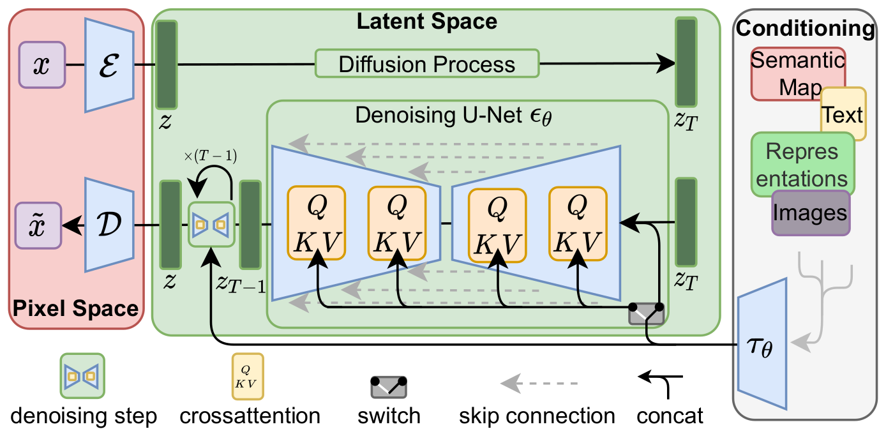

*图 3（原文 Figure 3，第 4 页）：LDM 的条件既可以通过拼接（concatenation），也可以通过更一般的交叉注意力（cross-attention）机制施加。见 3.3 节。*

**图中文字翻译与读法**：

- **Pixel Space（像素空间，左侧红色区域）**：输入图像 $x$ 经编码器 $\mathcal E$ 得到潜变量 $z$；右下的重构 $\tilde x$ 由解码器 $\mathcal D$ 从 $z$ 解码得到。
- **Latent Space（潜空间，中间绿色区域）**：上方 “Diffusion Process（扩散过程）” 把 $z$ 逐步加噪到 $z_T$（前向过程）。下方是生成路径：从 $z_T$ 出发，经过 “Denoising U-Net $\epsilon_\theta$（去噪 U-Net）”，其中的橙色方块 $Q$、$K$、$V$ 是交叉注意力层，虚线灰色箭头是 skip connection（跳跃连接）；左侧的小图标 “denoising step（去噪步）” 带有循环箭头 “$\times(T-1)$”，表示去噪步重复，依次得到 $z_{T-1},\dots,z$，最后由 $\mathcal D$ 解码为 $\tilde x$。
- **Conditioning（条件，右侧灰色区域）**：Semantic Map（语义图）、Text（文本）、Representations（表示）、Images（图像）等各类条件输入，经领域专用编码器 $\tau_\theta$ 编码。
- **switch（开关）**：右下的开关决定条件的进入方式——接到 U-Net 各层的 $K,V$（交叉注意力），或者通过 concat（拼接，用图例中的弯箭头表示）直接与 $z_T$ 输入拼接。
- **读图结论**：同一套架构既能做交叉注意力条件（文本、布局、类别标签，序列型），也能做拼接条件（低分辨率图、掩码图、语义图，空间对齐型）。

### 3.4 其他使用方式：拼接条件与图像引导（原文 4.3.2、附录 C）

**拼接条件**：把空间对齐的条件信息与 $\epsilon_\theta$ 的输入拼接，LDM 就能作为高效的通用图像到图像翻译模型。作者用它训练语义合成、超分辨率（4.4 节）与修复（4.5 节）模型。此时 $\tau_\theta$ 是恒等映射（超分辨率），或只是对语义图下采样。

**后验引导（post-hoc image-guiding，附录 C）**：扩散模型的一个有趣特点是，无条件模型也可以在测试时被条件化。对 $\epsilon$-参数化、固定方差的模型，Dhariwal 与 Nichol 的分类器引导写成

$$
\hat\epsilon\leftarrow\epsilon_\theta(z_t,t)+\sqrt{1-\alpha_t^2}\,\nabla_{z_t}\log p_\Phi(y\mid z_t),\qquad\text{(16)}
$$

即用条件分布 $\log p_\Phi(y\mid z_t)$ 修正 “score” $\epsilon_\theta$。作者把引导分布重新解释为通用的图像到图像翻译：给定目标图像 $y$，$p_\Phi(y\mid\mathcal T(\mathcal D(z_0(z_t))))$，其中 $\mathcal T$ 可以是任何可微变换（恒等、下采样等）。取方差固定为 1 的高斯引导，则 $\log p_\Phi(y\mid z_t)=-\tfrac12\lVert y-\mathcal T(\mathcal D(z_0(z_t)))\rVert_2^2$（式 17），成为 $L_2$ 回归目标。用它可以让 256² 的无条件样本引导 512² 的卷积合成（原文图 14，$\mathcal T$ 为 2× 双三次下采样）；还可以把 $L_2$ 换成 LPIPS 感知相似度（4.4 节、D.6）。

**classifier-free guidance**（原文第 4.2 节起多处用到，引用 Ho 与 Salimans，未写公式）：训练时按一定概率丢弃条件，采样时把有条件与无条件的噪声预测外推。按常用写法（补充）：$\tilde\epsilon=\epsilon_\theta(z_t,\varnothing)+s\,\big(\epsilon_\theta(z_t,c)-\epsilon_\theta(z_t,\varnothing)\big)$，尺度 $s$ 越大越贴合条件、多样性越低；原文各处的 “c.f.g. $s$” 或 “unconditional guidance $s$” 即这个尺度。

### 3.5 卷积式采样与潜空间尺度（原文 4.3.2、附录 D.1，第 7、20 页）

用空间对齐的条件训练的 LDM 可以卷积式地用于比训练分辨率更大的图像。作者在 256²（来自 384² 的裁剪）的输入上训练语义合成，但发现模型能泛化到更大的分辨率，在卷积式评估时可生成百万像素量级的图像（图 9）。超分辨率与修复模型也用同样方式生成 512² 到 1024² 的大图。此时，由潜空间尺度所诱导的**信噪比**会显著影响结果。附录 D.1 解释：潜空间方差（$\mathrm{Var}(z)/\sigma_t^2$）决定了信噪比；直接在 $f=4$ 的 KL 正则自编码器的潜空间训练时，这一比值很高，模型会在反向去噪的早期就分配大量语义细节；按分量标准差把潜空间缩放后，信噪比下降。VQ 正则的潜空间方差接近 1，无需缩放。再结合 classifier-free guidance，可对文本条件的 LDM-KL-8-G 直接合成大于 256² 的图像（原文图 13）。

## 四、实现细节

### 4.1 U-Net 与条件编码器（附录 E.2.1，第 24–26 页）

**U-Net**：基于 ADM 的 “ablated UNet”。对带条件的模型，用一个浅层（无掩码）Transformer 替换 U-Net 里的自注意力层，该 Transformer 由 $T$ 个块构成（这里的 $T$ 是块数，与扩散步数无关，原文沿用了同一个字母），每块交替做 (i) 自注意力、(ii) 逐位置 MLP、(iii) 交叉注意力；没有 (ii) 与 (iii) 时就等价于 “ablated UNet”。

**文本与布局的 $\tau_\theta$**：实现为无掩码的 Transformer，处理 token 化后的 $y$，输出 $\zeta:=\tau_\theta(y)\in\mathbb R^{M\times d_\tau}$，由 $N$ 个 Transformer 块组成，每块含全局自注意力、LayerNorm 与逐位置 MLP：

$$
\begin{aligned}
&\zeta\leftarrow\mathrm{TokEmb}(y)+\mathrm{PosEmb}(y)\qquad\text{(18)}\\
&\text{for } i=1,\dots,N:\quad \zeta_1\leftarrow\mathrm{LayerNorm}(\zeta),\quad \zeta_2\leftarrow\mathrm{MultiHeadSelfAttention}(\zeta_1)+\zeta,\\
&\qquad\qquad\quad\ \ \zeta_3\leftarrow\mathrm{LayerNorm}(\zeta_2),\quad \zeta\leftarrow\mathrm{MLP}(\zeta_3)+\zeta_2\qquad\text{(19)–(22)}\\
&\zeta\leftarrow\mathrm{LayerNorm}(\zeta)\qquad\text{(23)}
\end{aligned}
$$

具体到三类条件：

- **文本**：使用公开的 BERT 分词器（HuggingFace 的 BertTokenizerFast）；序列长度 77，$N=32$，维度 1280（表 17）。
- **布局**：把边界框的空间位置离散化，把每个框编码为 $(l,b,c)$ 三元组，$l$ 是（离散化的）左上角位置，$b$ 是右下角位置，类别信息在 $c$ 中；序列长度 92，$N=16$，维度 512。
- **类条件**：$\tau_\theta$ 只是一个可学习的嵌入层，维度 512，把类别 $y$ 映射为 $\zeta\in\mathbb R^{1\times512}$；类条件模型同样通过交叉注意力实现。

**$\tau_\theta$ 不依赖时间步 $t$**：原文说可以通过再对 $t$ 条件化来增强 $\tau_\theta$ 的表达能力，但这会降低推断速度，所以没有采用，留待未来工作。

下表是 U-Net 里替换自注意力层的 Transformer 块的结构（原文表 16，第 26 页；$n_h$ 为注意力头数，$d$ 为每头维度）。

| 层 | 输出形状 |
|---|---|
| 输入 | $\mathbb R^{h\times w\times c}$ |
| LayerNorm | $\mathbb R^{h\times w\times c}$ |
| Conv1×1 | $\mathbb R^{h\times w\times d\cdot n_h}$ |
| Reshape | $\mathbb R^{h\cdot w\times d\cdot n_h}$ |
| 重复 $T$ 次：SelfAttention → MLP → CrossAttention | $\mathbb R^{h\cdot w\times d\cdot n_h}$ |
| Reshape | $\mathbb R^{h\times w\times d\cdot n_h}$ |
| Conv1×1 | $\mathbb R^{h\times w\times c}$ |

### 4.2 无条件 LDM 的超参数（原文表 12，第 24 页）

这是表 1 中数字对应的模型，全部在单张 NVIDIA A100 上训练。

| 超参数 | CelebA-HQ 256×256 | FFHQ 256×256 | LSUN-Churches 256×256 | LSUN-Bedrooms 256×256 |
|---|---:|---:|---:|---:|
| $f$ | 4 | 4 | 8 | 4 |
| $z$ 形状 | 64×64×3 | 64×64×3 | - | 64×64×3 |
| $\lvert\mathcal Z\rvert$（码本大小） | 8192 | 8192 | - | 8192 |
| 扩散步数 | 1000 | 1000 | 1000 | 1000 |
| 噪声调度 | linear | linear | linear | linear |
| 参数量 | 274M | 274M | 294M | 274M |
| 通道数（Channels） | 224 | 224 | 192 | 224 |
| 深度（Depth） | 2 | 2 | 2 | 2 |
| 通道倍增（Channel Multiplier） | 1,2,3,4 | 1,2,3,4 | 1,2,2,4,4 | 1,2,3,4 |
| 注意力分辨率 | 32, 16, 8 | 32, 16, 8 | 32, 16, 8, 4 | 32, 16, 8 |
| 每头通道数（Head Channels） | 32 | 32 | 24 | 32 |
| 批大小 | 48 | 42 | 96 | 48 |
| 迭代数∗ | 410k | 635k | 500k | 1.9M |
| 学习率 | 9.6e-5 | 8.4e-5 | 5.e-5 | 9.6e-5 |

读法：除 LSUN-Churches 外都是 $f=4$ 的 VQ 正则潜空间（$\lvert\mathcal Z\rvert=8192$）；LSUN-Churches 用 $f=8$ 的 KL 正则（表 1 里写作 LDM-8∗，原文“$z$ 形状”与“码本”两格填 “-”）。原文该表没有解释“Depth”“Channels”等项，按 ADM 的 U-Net 约定理解：Depth 是每个分辨率层级的残差块数，Channels 是基础通道数，Channel Multiplier 是各层级的通道倍数，Attention resolutions 是做注意力的特征图分辨率。原文把迭代数 “Iterations∗” 的星号留作标记，但该表没有对应脚注。

### 4.3 条件 LDM 的超参数（原文表 15，第 25 页）

| 任务 | 文本到图像 | 布局到图像 | 布局到图像 | 类标签到图像 | 超分辨率 | 修复 | 语义图到图像 |
|---|---:|---:|---:|---:|---:|---:|---:|
| 数据集 | LAION | OpenImages | COCO | ImageNet | ImageNet | Places | Landscapes |
| $f$ | 8 | 4 | 8 | 4 | 4 | 4 | 8 |
| $z$ 形状 | 32×32×4 | 64×64×3 | 32×32×4 | 64×64×3 | 64×64×3 | 64×64×3 | 32×32×4 |
| $\lvert\mathcal Z\rvert$ | - | 8192 | 16384 | 8192 | 8192 | 8192 | 16384 |
| 扩散步数 | 1000 | 1000 | 1000 | 1000 | 1000 | 1000 | 1000 |
| 噪声调度 | linear | linear | linear | linear | linear | linear | linear |
| 模型大小 | 1.45B | 306M | 345M | 395M | 169M | 215M | 215M |
| 通道数 | 320 | 128 | 192 | 192 | 160 | 128 | 128 |
| 深度 | 2 | 2 | 2 | 2 | 2 | 2 | 2 |
| 通道倍增 | 1,2,4,4 | 1,2,3,4 | 1,2,4 | 1,2,3,5 | 1,2,2,4 | 1,4,8 | 1,4,8 |
| 注意力头数 | 8 | 1 | 1 | 1 | 1 | 1 | 1 |
| Dropout | - | - | 0.1 | - | - | - | - |
| 批大小 | 680 | 24 | 48 | 1200 | 64 | 128 | 48 |
| 迭代数 | 390K | 4.4M | 170K | 178K | 860K | 360K | 360K |
| 学习率 | 1.0e-4 | 4.8e-5 | 4.8e-5 | 1.0e-4 | 6.4e-5 | 1.0e-6 | 4.8e-5 |
| 条件方式 | CA | CA | CA | CA | concat | concat | concat |
| 交叉注意力分辨率 | 32, 16, 8 | 32, 16, 8 | 32, 16, 8 | 32, 16, 8 | - | - | - |
| 嵌入维度 | 1280 | 512 | 512 | 512 | - | - | - |
| Transformer 深度 | 1 | 3 | 2 | 1 | - | - | - |

（原文表 15，第 25 页。CA 即 cross-attention；concat 为拼接。原文说明：除修复模型用 8 块 V100 训练外，其余全部在单张 NVIDIA A100 上训练。）

**读法**：需要序列条件的任务（文本、布局、类别）用 CA，空间对齐的任务（超分、修复、语义图）用 concat；文本到图像模型是 1.45B 参数、批大小 680，其余多在 100M 到 400M 量级。修复模型的学习率只有 1.0e-6，在该表中明显小于其他任务，原文没有解释。

### 4.4 压缩率分析用的 LDM-$f$ 家族（原文表 13，第 24 页）

用于 4.1 节的分析：同一计算预算（单张 A100）、同样的训练步数和同样的参数量，$f\in\{1,2,4,8,16,32\}$，在 ImageNet 上做类条件训练。表中最后一行“潜变量元素数 / 压缩倍数”为本文根据 $z$ 形状计算，不是原文的列。

| 超参数 | LDM-1 | LDM-2 | LDM-4 | LDM-8 | LDM-16 | LDM-32 |
|---|---:|---:|---:|---:|---:|---:|
| $z$ 形状 | 256×256×3 | 128×128×2 | 64×64×3 | 32×32×4 | 16×16×8 | 88×8×32 |
| $\lvert\mathcal Z\rvert$ | - | 2048 | 8192 | 16384 | 16384 | 16384 |
| 扩散步数 | 1000 | 1000 | 1000 | 1000 | 1000 | 1000 |
| 噪声调度 | linear | linear | linear | linear | linear | linear |
| 模型大小 | 396M | 391M | 391M | 395M | 395M | 395M |
| 通道数 | 192 | 192 | 192 | 256 | 256 | 256 |
| 深度 | 2 | 2 | 2 | 2 | 2 | 2 |
| 通道倍增 | 1,1,2,2,4,4 | 1,2,2,4,4 | 1,2,3,5 | 1,2,4 | 1,2,4 | 1,2,4 |
| 头数 | 1 | 1 | 1 | 1 | 1 | 1 |
| 批大小 | 7 | 9 | 40 | 64 | 112 | 112 |
| 迭代数 | 2M | 2M | 2M | 2M | 2M | 2M |
| 学习率 | 4.9e-5 | 6.3e-5 | 8e-5 | 6.4e-5 | 4.5e-5 | 4.5e-5 |
| 条件方式 | CA | CA | CA | CA | CA | CA |
| CA 分辨率 | 32, 16, 8 | 32, 16, 8 | 32, 16, 8 | 32, 16, 8 | 16, 8, 4 | 8, 4, 2 |
| 嵌入维度 | 512 | 512 | 512 | 512 | 512 | 512 |
| Transformer 深度 | 1 | 1 | 1 | 1 | 1 | 1 |
| 潜变量元素数（压缩倍数，本文计算） | 196608（1×） | 32768（6×） | 12288（16×） | 4096（48×） | 2048（96×） | 2048（96×，按 8×8×32 计） |

（原文表 13，第 24 页。LDM-32 的 $z$ 形状原文印为 “88 × 8 × 32”，表 14 里同样如此；按 $f=32$ 对 256×256 输入应是 8×8 的空间尺寸，疑为排版错误。其通道数 32 也与表 8 中 $f=32$ 的三行（VQ 的 $c=16$，KL 的 $c=64$ 与 $c=16$）都不同，原文没有解释。表 14 是同样的六个模型在 CelebA-HQ 上做无条件训练、用于图 7 左图的设置，模型大小 258M–274M，批大小 9 到 128，均训练 500k 次迭代，不再重复转录。）

**读法**：各 $f$ 的参数量被刻意控制得接近（约 391M–396M），批大小则随 $f$ 增大而增大（7、9、40、64、112、112）；原文没有说明批大小为何不同，推测是为了在单卡显存内尽量用满（潜空间越小，同样显存能放更多样本），因此这是“同样参数量、同样训练步数、同样单卡预算”下的比较，而不是同样批大小。

## 五、实验

### 5.1 感知压缩的权衡（原文 4.1 节，第 5–6 页；图 6、图 7、表 8）

**设置**：研究不同下采样因子 $f\in\{1,2,4,8,16,32\}$ 的 LDM（记作 LDM-$f$，LDM-1 就是像素空间的 DM）。为了得到可比的测试场，所有实验都固定在单张 NVIDIA A100 上，训练相同的步数、用相同的参数量。原文还有一个有趣的观察：在 VQ 正则化潜空间训练的 LDM 有时样本质量更好，尽管 VQ 正则化第一阶段模型的重构能力略逊于连续（KL）版本（表 8）。

**第一阶段模型的重构性能（表 8）**。下表给出在 OpenImages 上训练、在 ImageNet-Val 上评估的所有自编码器（原文称为 autoencoder zoo）。$f$ 是下采样因子，$\lvert\mathcal Z\rvert$ 是码本大小（KL 行写 KL），$c$ 是潜变量通道数；R-FID 是重构 FID（越小越好），R-IS 为重构 IS（越大越好），PSNR（越大越好）、PSIM（感知相似度，越小越好）、SSIM（越大越好）。† 表示无注意力的自编码器。

| $f$ | 模型 | $\lvert\mathcal Z\rvert$ | $c$ | R-FID↓ | R-IS↑ | PSNR↑ | PSIM↓ | SSIM↑ |
|---:|---|---:|---:|---:|---:|---:|---:|---:|
| 16 | VQGAN [23] | 16384 | 256 | 4.98 | – | 19.9 ±3.4 | 1.83 ±0.42 | 0.51 ±0.18 |
| 16 | VQGAN [23] | 1024 | 256 | 7.94 | – | 19.4 ±3.3 | 1.98 ±0.43 | 0.50 ±0.18 |
| 8 | DALL-E [66] | 8192 | - | 32.01 | – | 22.8 ±2.1 | 1.95 ±0.51 | 0.73 ±0.13 |
| 32 | 本文（VQ） | 16384 | 16 | 31.83 | 40.40 ±1.07 | 17.45 ±2.90 | 2.58 ±0.48 | 0.41 ±0.18 |
| 16 | 本文（VQ） | 16384 | 8 | 5.15 | 144.55 ±3.74 | 20.83 ±3.61 | 1.73 ±0.43 | 0.54 ±0.18 |
| 8 | 本文（VQ） | 16384 | 4 | 1.14 | 201.92 ±3.97 | 23.07 ±3.99 | 1.17 ±0.36 | 0.65 ±0.16 |
| 8 | 本文（VQ） | 256 | 4 | 1.49 | 194.20 ±3.87 | 22.35 ±3.81 | 1.26 ±0.37 | 0.62 ±0.16 |
| 4 | 本文（VQ） | 8192 | 3 | 0.58 | 224.78 ±5.35 | 27.43 ±4.26 | 0.53 ±0.21 | 0.82 ±0.10 |
| 4† | 本文（VQ，无注意力） | 8192 | 3 | 1.06 | 221.94 ±4.58 | 25.21 ±4.17 | 0.72 ±0.26 | 0.76 ±0.12 |
| 4 | 本文（VQ） | 256 | 3 | 0.47 | 223.81 ±4.58 | 26.43 ±4.22 | 0.62 ±0.24 | 0.80 ±0.11 |
| 2 | 本文（VQ） | 2048 | 2 | 0.16 | 232.75 ±5.09 | 30.85 ±4.12 | 0.27 ±0.12 | 0.91 ±0.05 |
| 2 | 本文（VQ） | 64 | 2 | 0.40 | 226.62 ±4.83 | 29.13 ±3.46 | 0.38 ±0.13 | 0.90 ±0.05 |
| 32 | 本文（KL） | KL | 64 | 2.04 | 189.53 ±3.68 | 22.27 ±3.93 | 1.41 ±0.40 | 0.61 ±0.17 |
| 32 | 本文（KL） | KL | 16 | 7.3 | 132.75 ±2.71 | 20.38 ±3.56 | 1.88 ±0.45 | 0.53 ±0.18 |
| 16 | 本文（KL） | KL | 16 | 0.87 | 210.31 ±3.97 | 24.08 ±4.22 | 1.07 ±0.36 | 0.68 ±0.15 |
| 16 | 本文（KL） | KL | 8 | 2.63 | 178.68 ±4.08 | 21.94 ±3.92 | 1.49 ±0.42 | 0.59 ±0.17 |
| 8 | 本文（KL） | KL | 4 | 0.90 | 209.90 ±4.92 | 24.19 ±4.19 | 1.02 ±0.35 | 0.69 ±0.15 |
| 4 | 本文（KL） | KL | 3 | 0.27 | 227.57 ±4.89 | 27.53 ±4.54 | 0.55 ±0.24 | 0.82 ±0.11 |
| 2 | 本文（KL） | KL | 2 | 0.086 | 232.66 ±5.16 | 32.47 ±4.19 | 0.20 ±0.09 | 0.93 ±0.04 |

（原文表 8，第 21 页。原文没有“模型”这一列：前三行是对比的 VQGAN 与 DALL-E，其余是本文第一阶段模型；上半部分有码本的是 VQ 版，下半部分写 KL 的是 KL 版，这里为便于阅读按上下三段加了“模型”列。）

**读法**：

- **压缩越狠，重构越差**：$f=32$ 的 VQ 版 R-FID 31.83，$f=16$ 为 5.15，$f=8$ 为 1.14，$f=4$ 为 0.58（均在 $\lvert\mathcal Z\rvert$ 较大的那行），$f=2$ 为 0.16；PSNR 同步从 17.45 升到 30.85。
- **与已有两阶段方法比**：同样 $f=8$，DALL-E 的 R-FID 为 32.01、PSNR 22.8，本文 VQ 版为 1.14、23.07；同样 $f=16$，VQGAN 的 R-FID 为 4.98、PSNR 19.9，本文为 5.15、20.83（R-FID 略差，PSNR 更好）。$f=4$ 的 0.58 / 27.43 正是图 1 里 “ours (f=4)” 标出的数。
- **KL 与 VQ**：同样 $f=4$，KL 版 R-FID 0.27 优于 VQ 版 0.58 与 0.47，PSNR 也更高（27.53 对 27.43、26.43）；与原文所说“VQ 正则化第一阶段重构能力略逊于连续版本”一致。
- **注意力的影响**：$f=4$、$\lvert\mathcal Z\rvert=8192$ 时去掉注意力（4†）R-FID 由 0.58 升到 1.06，PSNR 由 27.43 降到 25.21；原文说无注意力的自编码器在高分辨率解码时能降低 GPU 显存。

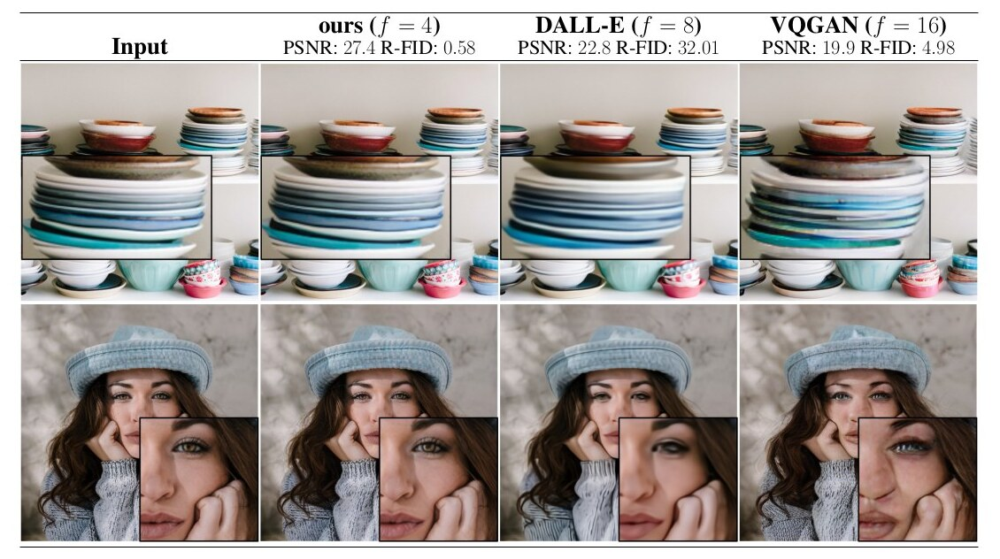

*图 1（原文 Figure 1，第 1 页）：用更温和的下采样提高可达质量的上界。由于扩散模型对空间数据具有出色的归纳偏置，不需要相关生成模型在潜空间里那样的大幅空间下采样，但仍可借助合适的自编码模型大幅降低数据维度（见第 3 节）。图像来自 DIV2K 验证集，在 512² 像素下评估；空间下采样因子记作 $f$。重构 FID 与 PSNR 在 ImageNet-val 上计算，见表 8。*

**图中文字翻译与读法**：

- **布局**：第一列 Input（输入）；其余三列依次是 ours ($f=4$)（本文）、DALL-E ($f=8$)、VQGAN ($f=16$) 的重构。列标题下给出各自在 ImageNet-val 上的 PSNR 与 R-FID：ours 27.4 / 0.58，DALL-E 22.8 / 32.01，VQGAN 19.9 / 4.98。上下两行是两张图（一叠盘子、一位戴帽子的女士），黑框是放大的局部。
- **读图结论**：看盘子叠的放大图——本文 $f=4$ 的重构几乎还原了盘沿的高光与纹理；DALL-E（$f=8$）明显变糊；VQGAN（$f=16$）出现扭曲的纹理伪影。看女士的眼睛——本文保留了睫毛和雀斑，DALL-E 变糊，VQGAN 的眼睛形变。这说明“压缩更温和”（$f=4$）能显著抬高重构质量的上界，是 LDM 能在不牺牲细节的前提下压缩的依据。

**不同 $f$ 下的训练进度（图 6）**。图 6 展示在 ImageNet 上类条件 LDM、2M 训练步里样本质量随训练进度的变化（100 DDIM 步，$\kappa=0$；所有模型在单张 A100 上、相同计算预算训练）。

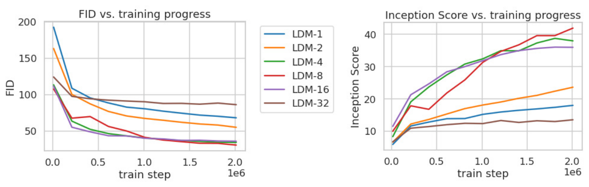

*图 6（原文 Figure 6，第 6 页）：分析不同下采样因子 $f$ 的类条件 LDM 在 ImageNet 上 2M 训练步内的训练过程。像素空间的 LDM-1 需要比更大下采样因子的模型（LDM-{4-16}）长得多的训练时间；像 LDM-32 那样过多的感知压缩限制了整体样本质量。所有模型在单张 NVIDIA A100 上用相同计算预算训练。结果取自 100 DDIM 步与 $\kappa=0$。*

**图中文字翻译与读法**：

- **左图 FID vs. training progress**：横轴 train step（训练步，$0$ 到 $2.0\times10^6$），纵轴 FID（越低越好）。六条线 LDM-1（蓝）、LDM-2（橙）、LDM-4（绿）、LDM-8（红）、LDM-16（紫）、LDM-32（棕）。从图上读出（近似值）：2M 步时 LDM-1 约 68、LDM-2 约 55、LDM-4 约 35、LDM-8 约 31、LDM-16 约 36、LDM-32 约 86。
- **右图 Inception Score vs. training progress**：纵轴 Inception Score（越高越好）。2M 步时 LDM-8 约 42、LDM-4 约 38、LDM-16 约 36、LDM-2 约 24、LDM-1 约 18、LDM-32 约 13（均为从图上读出的近似值）。
- **读图结论**（原文）：(i) 下采样因子很小（LDM-{1,2}）训练进展缓慢；(ii) $f$ 过大（LDM-32）则在较少训练步后保真度停滞。作者把 (i) 归因于把大部分感知压缩留给了扩散模型，(ii) 归因于第一阶段压缩太强造成信息损失、限制了可达质量。LDM-{4–16} 在效率与感知保真度之间取得良好平衡：2M 步后像素扩散（LDM-1）与 LDM-8 的 FID 差距约 38（读图：68 对 31 大致吻合）。

**FID 与采样吞吐的权衡（图 7）**。

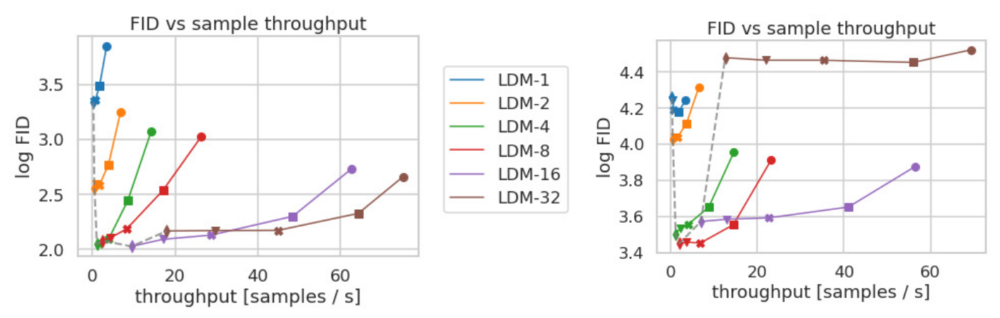

*图 7（原文 Figure 7，第 6 页）：比较不同压缩率的 LDM 在 CelebA-HQ（左）和 ImageNet（右）上的表现。不同标记表示用 DDIM 采样时的 {10, 20, 50, 100, 200} 步，沿每条线从右到左。虚线表示 200 步时的 FID，显示 LDM-{4-8} 的强劲表现。FID 在 5000 个样本上评估；所有模型在单张 A100 上分别训练了 500k（CelebA）/ 2M（ImageNet）步。*

**图中文字翻译与读法**：

- **坐标轴**：横轴 throughput [samples / s]（采样吞吐，每秒生成的样本数，越右越快），纵轴 log FID（FID 的自然对数，越低越好）。图例同图 6：LDM-1 至 LDM-32 六种颜色。
- **每条线上的点**：对应 DDIM 步数 {10, 20, 50, 100, 200}，从右到左步数增多（越右越快、质量越差）；灰色虚线连接各模型 200 步的点。
- **读图结论**：LDM-1（蓝，像素空间）在两个数据集上都位于最左上，既慢又差（从图上读出：吞吐不到约 4 样本/秒，CelebA-HQ 上 $\log\mathrm{FID}$ 约 3.3 到 3.85，ImageNet 上约 4.2）；LDM-{4–8}（绿、红）以及 LDM-16（紫，在 ImageNet 上也不错）在同样吞吐下 FID 大幅低于 LDM-1，同时吞吐更高；LDM-32（棕）虽然最快（从图上读出可达约 70–75 样本/秒），但在 ImageNet 上 FID 很高（$\log\mathrm{FID}$ 约 4.5，对应 FID 约 90，与图 6 中 2M 步时约 86 相符），在 CelebA-HQ 上用足步数后才接近 LDM-4–16。原文的结论是：复杂数据集如 ImageNet 需要较低的压缩率以避免质量下降；LDM-4 与 LDM-8 提供了获得高质量合成结果的最佳条件。
- **纵轴是对数**：读数时要换算成 FID，不要把差距当成线性的。

### 5.2 无条件图像生成（原文 4.2 节，第 5–6 页；表 1、图 4）

**设置**：在 CelebA-HQ、FFHQ、LSUN-Churches、LSUN-Bedrooms 的 256² 图像上训练无条件模型，评估 (i) 样本质量（FID）与 (ii) 对数据流形的覆盖（Precision 与 Recall）。FID、Precision、Recall 用来自模型的 5 万个样本与各数据集的整个训练集估计，用 torch-fidelity 计算 FID，Precision 与 Recall 用 Dhariwal 与 Nichol 的脚本（附录 E.3.1）。

下表是表 1（无条件图像合成的评估指标）。FID 越低越好，Precision、Recall 越高越好；“N-s”表示用 DDIM 采样器采样 N 步；∗ 表示在 KL 正则的潜空间训练。表 1 里 CelebA-HQ 的数字取自 [43, 63, 100]，FFHQ 的取自 [42, 43]。

**CelebA-HQ 256×256**

| 方法 | FID↓ | Prec.↑ | Recall↑ |
|---|---:|---:|---:|
| DC-VAE [63] | 15.8 | - | - |
| VQGAN+T. [23]（k=400） | 10.2 | - | - |
| PGGAN [39] | 8.0 | - | - |
| LSGM [93] | 7.22 | - | - |
| UDM [43] | 7.16 | - | - |
| LDM-4（本文，500-s） | **5.11** | 0.72 | 0.49 |

**FFHQ 256×256**

| 方法 | FID↓ | Prec.↑ | Recall↑ |
|---|---:|---:|---:|
| ImageBART [21] | 9.57 | - | - |
| U-Net GAN（+aug）[77] | 10.9（7.6） | - | - |
| UDM [43] | 5.54 | - | - |
| StyleGAN [41] | 4.16 | 0.71 | 0.46 |
| ProjectedGAN [76] | **3.08** | 0.65 | 0.46 |
| LDM-4（本文，200-s） | 4.98 | **0.73** | **0.50** |

**LSUN-Churches 256×256**

| 方法 | FID↓ | Prec.↑ | Recall↑ |
|---|---:|---:|---:|
| DDPM [30] | 7.89 | - | - |
| ImageBART [21] | 7.32 | - | - |
| PGGAN [39] | 6.42 | - | - |
| StyleGAN [41] | 4.21 | - | - |
| StyleGAN2 [42] | 3.86 | - | - |
| ProjectedGAN [76] | **1.59** | 0.61 | 0.44 |
| LDM-8∗（本文，200-s） | 4.02 | **0.64** | **0.52** |

**LSUN-Bedrooms 256×256**

| 方法 | FID↓ | Prec.↑ | Recall↑ |
|---|---:|---:|---:|
| ImageBART [21] | 5.51 | - | - |
| DDPM [30] | 4.9 | - | - |
| UDM [43] | 4.57 | - | - |
| StyleGAN [41] | 2.35 | 0.59 | 0.48 |
| ADM [15] | 1.90 | **0.66** | **0.51** |
| ProjectedGAN [76] | **1.52** | 0.61 | 0.34 |
| LDM-4（本文，200-s） | 2.95 | **0.66** | 0.48 |

（原文表 1，第 6 页。）

**读法**：

- CelebA-HQ 上 LDM-4 的 FID 5.11 是表中最优（原文称“新的 state-of-the-art”，优于此前基于似然的模型与 GAN，也优于联合训练的 LSGM）。
- **与 GAN 的 FID 比较并不全胜**：FFHQ 上 StyleGAN（4.16）、ProjectedGAN（3.08）的 FID 低于 LDM-4（4.98）；LSUN-Churches 上 ProjectedGAN（1.59）、StyleGAN2（3.86）低于 LDM-8（4.02）；LSUN-Bedrooms 上 StyleGAN（2.35）、ProjectedGAN（1.52）、ADM（1.90）都低于 LDM-4（2.95）。
- **Precision/Recall 上的优势**：LDM 的 Precision 与 Recall 一般高于 GAN 的对应值（FFHQ 0.73/0.50 对 StyleGAN 0.71/0.46、ProjectedGAN 0.65/0.46；Churches 0.64/0.52 对 ProjectedGAN 0.61/0.44；Bedrooms 的 Recall 0.48 与 StyleGAN 持平，高于 ProjectedGAN 的 0.34）。原文据此说 LDM “一致地”改进了 GAN 方法的 Precision 与 Recall，并认为这印证了基于似然、模式覆盖的训练目标相对对抗方法的优势。
- 原文的另一句话：在除 LSUN-Bedrooms 外所有数据集上优于此前基于扩散的方法；在 LSUN-Bedrooms 上与 ADM 接近，但使用约一半的参数、训练资源少 4 倍（见表 18）。
- **原文内部的小差异**：附录图 28、30 的图题给出 CelebA-HQ 的 FID 为 5.15（500 步，$\eta=0$）、LSUN-Churches 的 LDM-8 为 4.48，与表 1 的 5.11、4.02 不同；附录 E.3.1 说明不同数据处理流程会使 FID 略有变化（ImageNet 的 7.76 对 7.77、LSUN-Bedrooms 的 2.95 对 3.0）并呼吁统一的评估流程。引用时以表 1 为准。

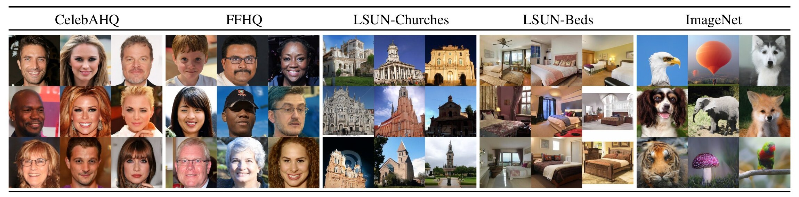

*图 4（原文 Figure 4，第 5 页）：LDM 在 CelebAHQ、FFHQ、LSUN-Churches、LSUN-Bedrooms 和类条件 ImageNet 上的样本，分辨率均为 256×256。放大查看效果更好；更多样本见补充材料。*

**图中文字翻译与读法**：从左到右五组，每组 3×3 个样本：CelebAHQ（名人人脸）、FFHQ（普通人脸）、LSUN-Churches（教堂）、LSUN-Beds（卧室）、ImageNet（类条件，按外观辨认，有白头海雕、热气球、白灰色的哈士奇类犬、垂耳长毛犬、大象、狐狸、老虎、蘑菇、彩色鹦鹉（类别名是本文按外观辨认，原文没有标注））。人脸的皮肤、头发、眼镜等细节清晰；教堂和卧室的整体布局（建筑轮廓、床与窗的相对位置）连贯；个别样本的细节仍不够自然（如部分卧室里床与家具的比例略怪），原文没有逐张评价。这是图 1 之后第一组展示 LDM 在 256² 无条件/类条件生成质量的定性证据，与表 1 的数字互相印证。

### 5.3 文本到图像与布局到图像（原文 4.3.1 节，第 6–7 页；图 5、表 2、图 8、表 9）

**文本到图像**：在 LAION-400M 上训练 1.45B 参数的 KL 正则 LDM（$f=8$），以语言提示为条件。用 BERT 分词器，把 $\tau_\theta$ 实现成 Transformer 来推断潜码，再通过（多头）交叉注意力映射进 U-Net。这种“领域专家学语言表示 + 视觉合成”的组合对复杂的用户自定义文本提示泛化良好。定量评估沿用已有工作：在 MS-COCO 验证集（256×256）上，与 3 万个验证集样本比较 FID 与 IS（附录 E.3.2）。

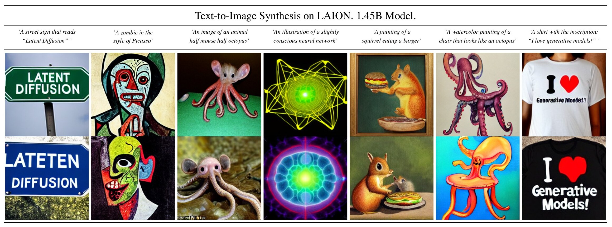

*图 5（原文 Figure 5，第 6 页）：本文文本到图像模型 LDM-8 (KL)（在 LAION 数据库上训练）对用户自定义文本提示的样本。样本用 200 个 DDIM 步、$\eta=1.0$ 生成，使用 unconditional guidance，$s=10.0$。*

**图中文字翻译与读法**：七个提示（各配上下两张样本）：“A street sign that reads ‘Latent Diffusion’”（写着“Latent Diffusion”的路牌）、“A zombie in the style of Picasso”（毕加索风格的僵尸）、“An image of an animal half mouse half octopus”（半鼠半章鱼的动物）、“An illustration of a slightly conscious neural network”（略有意识的神经网络插画）、“A painting of a squirrel eating a burger”（松鼠吃汉堡的画）、“A watercolor painting of a chair that looks like an octopus”（长得像章鱼的椅子的水彩画）、“A shirt with the inscription: ‘I love generative models!’”（印有“I love generative models!”的衬衫）。读图要点：能组合不常见概念（半鼠半章鱼、章鱼椅子、松鼠吃汉堡），毕加索风格也能表现；**写字并不总是正确**——路牌的上行样本拼对了 “LATENT DIFFUSION”，下行样本却拼成 “LATETEN DIFFUSION”（首字母 L 还被画面边缘截掉）；衬衫的上行样本文字有拼写错误（读起来像 “Generastive Moodel!”），下行的黑色衬衫则基本拼对 “Generative Models!”。这说明精确的字符级文字渲染并不稳定，这是读图所见，原文没有评论。

**表 2：文本条件图像合成**。MS-COCO 256×256，FID 越低越好、IS 越高越好；† / ∗ 上标按原文表注表示数字分别取自 [109] / [26]。

| 方法 | FID↓ | IS↑ | 参数量 | 备注 |
|---|---:|---:|---:|---|
| CogView† [17] | 27.10 | 18.20 | 4B | self-ranking，rejection rate 0.017 |
| LAFITE† [109] | 26.94 | 26.02 | 75M | |
| GLIDE∗ [59] | 12.24 | - | 6B | 277 DDIM steps，c.f.g. [32] $s=3$ |
| Make-A-Scene∗ [26] | **11.84** | - | 4B | c.f.g for AR models [98] $s=5$ |
| LDM-KL-8 | 23.31 | 20.03±0.33 | 1.45B | 250 DDIM steps |
| LDM-KL-8-G∗ | 12.63 | **30.29**±0.42 | 1.45B | 250 DDIM steps，c.f.g. [32] $s=1.5$ |

（原文表 2，第 6 页；LDM-KL-8-G 一行原文也带 ∗，但这是本文自己的结果，疑为排版重复。）

**读法**：不使用引导时 LDM-KL-8 的 FID 为 23.31，优于 CogView（27.10）与 LAFITE（26.94）等自回归和 GAN 方法；使用 classifier-free guidance（$s=1.5$）后 FID 降到 12.63、IS 升到 30.29，与 GLIDE（6B 参数）和 Make-A-Scene（4B 参数）相当，而参数只有 1.45B。原文的措辞是“与最新的扩散和自回归方法持平，同时显著减少参数量”，不是超越：Make-A-Scene（11.84）与 GLIDE（12.24）的 FID 仍低于 12.63；IS 的最优是 LDM-KL-8-G 的 30.29。

**布局到图像**：以 OpenImages 上的语义布局（边界框 + 类别）为条件训练，并在 COCO 上微调（图 8）。

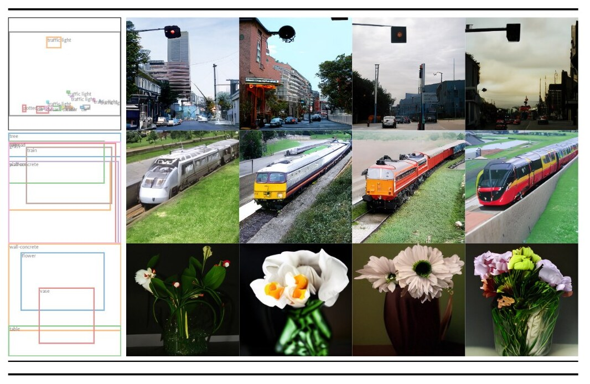

*图 8（原文 Figure 8，第 7 页）：用 LDM 在 COCO 上的布局到图像合成，见 4.3.1 节。定量评估见补充材料 D.3。*

**图中文字翻译与读法**：每行左边是一个布局（带类别标签的边界框：第一行有一个位于画面上方的 “traffic light” 框，底部还有若干很小的框，标签太小读不清，其中可辨认出 “traffic light”；第二行有 “tree”“grass”“train”“wall-concrete” 等；第三行有 “wall-concrete”“flower”“vase”“table”），右边四列是同一布局的四个样本。读图结论：样本对布局的遵守程度较高（第一行四张里交通灯都出现在画面上方、约 40% 宽度处，与布局框的位置一致；火车沿铁轨斜放在草地上；花插在花瓶里），而不同样本之间的外观（建筑、火车配色、花的种类）多样。位置一致是从图上量得的，原文没有给出定量的布局遵守度。

**表 9：布局到图像合成的 FID**（附录 D.3）：

| 方法 | COCO 256×256 FID↓ | OpenImages 256×256 FID↓ | OpenImages 512×512 FID↓ |
|---|---:|---:|---:|
| LostGAN-V2 [87] | 42.55 | - | - |
| OC-GAN [89] | 41.65 | - | - |
| SPADE [62] | 41.11 | - | - |
| VQGAN+T [37] | 56.58 | 45.33 | 48.11 |
| LDM-8（100 steps，本文） | 42.06† | - | - |
| LDM-4（200 steps，本文） | **40.91**∗ | **32.02** | **35.80** |

（原文表 9，第 22 页。† 表示在 COCO 上从头训练；∗ 表示从 OpenImages 微调。）

**读法**：在 COCO 上从头训练的 LDM-8（42.06）与最新的布局到图像模型相当（LostGAN-V2 42.55、OC-GAN 41.65、SPADE 41.11），从 OpenImages 微调的 LDM-4 超过它们（40.91）。OpenImages 上 LDM-4 比 VQGAN+T 低 13.31（256²）与 12.31（512²）；附录 D.3 的文字写的是“领先近 11”，与表 9 不一致，以表为准。评估协议（附录 E.3.3）：COCO 取 COCO Segmentation Challenge 划分里的 2048 张未增广样本（与 VQGAN+T 论文用的相同），OpenImages 取验证集的 2048 张中心裁剪测试图。

### 5.4 类条件 ImageNet（原文 4.3.1 节与附录 D.4，第 7、22 页；表 3、表 10、图 4）

**设置**：评估 4.1 节里最好的类条件 ImageNet 模型（$f\in\{4,8\}$）。类别标签经单个 512 维的可学习嵌入层，通过交叉注意力进入 U-Net（附录 E.2.1）。v2 版相对 v1 用更大的批大小重新训练了类条件模型，并使用 classifier-free guidance（附录 A 变更记录）。

**表 3**：类条件 ImageNet 256×256 上与近期最优方法比较（原文在附录表 10 给出更详细的对比）。

| 方法 | FID↓ | IS↑ | Precision↑ | Recall↑ | 参数量 | 备注 |
|---|---:|---:|---:|---:|---:|---|
| BigGan-deep [3] | 6.95 | 203.6±2.6 | **0.87** | 0.28 | 340M | - |
| ADM [15] | 10.94 | 100.98 | 0.69 | **0.63** | 554M | 250 DDIM steps |
| ADM-G [15] | 4.59 | 186.7 | 0.82 | 0.52 | 608M | 250 DDIM steps |
| LDM-4（本文） | 10.56 | 103.49±1.24 | 0.71 | 0.62 | 400M | 250 DDIM steps |
| LDM-4-G（本文） | **3.60** | **247.67±5.59** | **0.87** | 0.48 | 400M | 250 steps，c.f.g [32]，$s=1.5$ |

（原文表 3，第 7 页。G 表示带引导；c.f.g 即 classifier-free guidance。）

**读法**：无引导时 LDM-4 与 ADM 的 FID 几乎相同（10.56 对 10.94），但参数少约 28%（400M 对 554M）、算力更少（表 18）；加引导后，LDM-4-G 在 FID（3.60 对 4.59）、IS 与 Precision 上全面优于 ADM-G，且参数少约 34%。代价是 Recall 下降：引导使 Recall 从 0.62 降到 0.48，说明引导是以牺牲多样性换保真度。

**附录表 10：更详细的 ImageNet 对比**（含训练步数与批大小）：

| 方法 | FID↓ | IS↑ | Precision↑ | Recall↑ | 参数量 | 备注 |
|---|---:|---:|---:|---:|---:|---|
| SR3 [72] | 11.30 | - | - | - | 625M | - |
| ImageBART [21] | 21.19 | - | - | - | 3.5B | - |
| ImageBART [21] | 7.44 | - | - | - | 3.5B | 0.05 acc. rate∗ |
| VQGAN+T [23] | 17.04 | 70.6±1.8 | - | - | 1.3B | - |
| VQGAN+T [23] | 5.88 | **304.8**±3.6 | - | - | 1.3B | 0.05 acc. rate∗ |
| BigGan-deep [3] | 6.95 | 203.6±2.6 | **0.87** | 0.28 | 340M | - |
| ADM [15] | 10.94 | 100.98 | 0.69 | **0.63** | 554M | 250 DDIM steps |
| ADM-G [15] | 4.59 | 186.7 | 0.82 | 0.52 | 608M | 250 DDIM steps |
| ADM-G, ADM-U [15] | 3.85 | 221.72 | 0.84 | 0.53 | n/a | 2 × 250 DDIM steps |
| CDM [31] | 4.88 | 158.71±2.26 | - | - | n/a | 2 × 100 DDIM steps |
| LDM-8（本文） | 17.41 | 72.92±2.6 | 0.65 | 0.62 | 395M | 200 DDIM steps，2.9M train steps，batch size 64 |
| LDM-8-G（本文） | 8.11 | 190.43±2.60 | 0.83 | 0.36 | 506M | 200 DDIM steps，classifier scale 10，2.9M train steps，batch size 64 |
| LDM-8（本文） | 15.51 | 79.03±1.03 | 0.65 | **0.63** | 395M | 200 DDIM steps，4.8M train steps，batch size 64 |
| LDM-8-G（本文） | 7.76 | 209.52±4.24 | 0.84 | 0.35 | 506M | 200 DDIM steps，classifier scale 10，4.8M train steps，batch size 64 |
| LDM-4（本文） | 10.56 | 103.49±1.24 | 0.71 | 0.62 | 400M | 250 DDIM steps，178K train steps，batch size 1200 |
| LDM-4-G（本文） | 3.95 | 178.22±2.43 | 0.81 | 0.55 | 400M | 250 DDIM steps，unconditional guidance [32] scale 1.25，178K train steps，batch size 1200 |
| LDM-4-G（本文） | **3.60** | 247.67±5.59 | **0.87** | 0.48 | 400M | 250 DDIM steps，unconditional guidance [32] scale 1.5，178K train steps，batch size 1200 |

（原文表 10，第 22 页。∗：按 VQ-VAE-2 提出的方式做分类器拒绝采样，接受率 0.05。）

**读法**：LDM-8-G 用的是**分类器**引导（classifier scale 10；参数 506M 比 395M 多出的约 111M 应是这个分类器，原文没有逐项说明），LDM-4-G 用的是 classifier-free guidance。两组 LDM-8 只有训练步数不同（2.9M 对 4.8M），多训练约 66% 使 FID 由 8.11 降到 7.76（无引导 17.41 降到 15.51），可见 LDM-8 在 2.9M 步时尚未饱和。原文指出：与像素空间方法不同，这个分类器在潜空间里训练代价很低（附录 D.4）。ADM-G + ADM-U 级联（表中 3.85；见第六节：该数字疑为 ADM 在 512×512 上的值，256×256 上应为 3.94）略优于 $s=1.25$ 的 LDM-4-G（3.95），LDM 要把引导尺度提高到 1.5 才取得表中最低的 FID（3.60），代价是 Recall 降到 0.48。

### 5.5 卷积采样：超越 256²（原文 4.3.2 节，图 9）

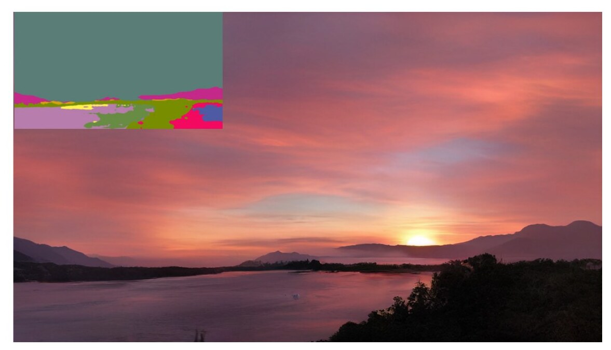

*图 9（原文 Figure 9，第 7 页）：在 256² 分辨率上训练的 LDM 能泛化到更大分辨率（这里是 512×1024）的空间条件任务，如风景图像的语义合成。见 4.3.2 节。*

**图中文字翻译与读法**：左上角的彩色块是输入的语义图（尺寸小于生成图；不同颜色是不同语义类别，原文没有给出颜色与类别的对应，上方大片青灰色对应图中的天空区域）；整幅图是模型卷积式生成的 512×1024 日落湖景，天空、远山、湖面与林木的布局连贯，看不出明显的拼接痕迹。读图结论：用空间对齐的条件（语义图拼接到潜变量）训练的模型，因为 U-Net 主要由卷积构成，能直接用于比训练分辨率更大的输入。原文说明此时潜空间尺度（信噪比）会显著影响结果，见图 15。

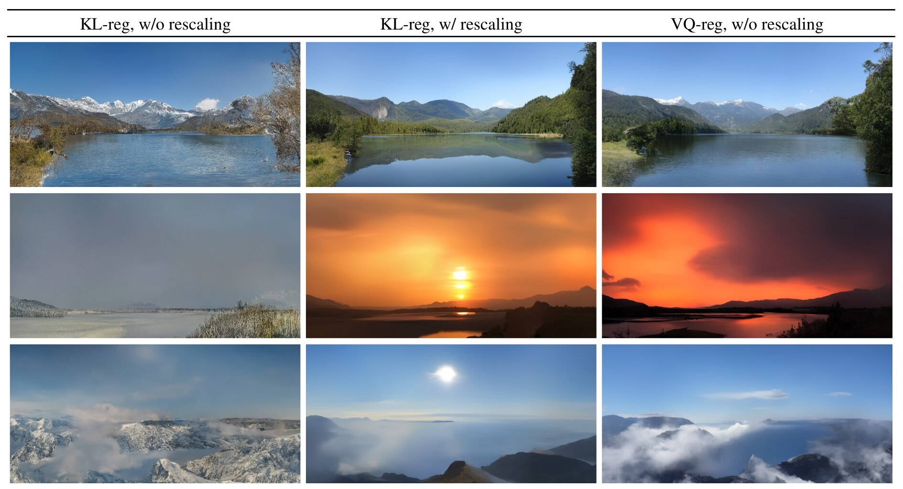

*图 15（原文附录 Figure 15，第 20 页）：说明潜空间重新缩放对卷积采样的影响，这里是风景图的语义图像合成。见 4.3.2 节与 D.1 节。*

**图中文字翻译与读法**：三列：KL-reg, w/o rescaling（KL 正则、不缩放）、KL-reg, w/ rescaling（KL 正则、缩放）、VQ-reg, w/o rescaling（VQ 正则、不缩放）；每行是同一张输入语义图在三种潜空间设置下生成的大图（三行对应三张不同的语义图，这是从各行三张图的布局相近判断的，原文没有逐行说明）。读图：第 2 行最明显，KL 不缩放（左）几乎只有一片缺乏结构的灰色，而 KL 缩放（中）与 VQ（右）都得到结构完整的日落景观；第 1、3 行三列都还能得到结构完整的风景，差别不如第 2 行明显。原文对这张图的解释是：KL 潜空间不缩放时信噪比过高，模型在反向去噪的早期就分配了大量语义细节。结论：用 KL 正则的潜空间做卷积式大图生成时，要按潜变量标准差重新缩放；VQ 潜空间的方差接近 1，不必缩放。

### 5.6 超分辨率（原文 4.4 节，第 8 页；表 5、表 4、图 10）

**设置**：直接把低分辨率图拼接作为条件。第一组实验沿用 SR3：退化固定为带抗混叠的 4 倍双三次下采样，按 SR3 的数据处理流程在 ImageNet 上训练（短边小于 256 的图像被剔除）。用 OpenImages 上预训练的 $f=4$ 自编码模型（VQ 正则，见表 8），把低分辨率条件 $y$ 与 U-Net 的输入拼接，即 $\tau_\theta$ 为恒等映射。

**表 5：ImageNet-Val（256²）上的 ×4 超分辨率**。FID 上标 † 表示 FID 特征在验证集划分上计算，‡ 表示在训练集划分上计算；最后一列 samples/s 是单张 NVIDIA A100 上的吞吐量。

| 方法 | FID↓ | IS↑ | PSNR↑ | SSIM↑ | 参数量 | 吞吐 [samples/s] |
|---|---:|---:|---:|---:|---:|---:|
| Image Regression [72] | 15.2 | 121.1 | **27.9** | **0.801** | 625M | N/A |
| SR3 [72] | 5.2 | **180.1** | 26.4 | 0.762 | 625M | N/A |
| LDM-4（本文，100 steps） | 2.8†/4.8‡ | 166.3 | 24.4±3.8 | 0.69±0.14 | **169M** | 4.62 |
| LDM-4（本文，big，100 steps） | **2.4†/4.3‡** | 174.9 | 24.7±4.1 | 0.71±0.15 | 552M | 4.5 |
| LDM-4（本文，50 steps，guiding） | 4.4†/6.4‡ | 153.7 | 25.8±3.7 | 0.74±0.12 | 184M | 0.38 |

（原文表 5，第 8 页；“LDM-4（本文，big，100 steps）”这一行在原文中被排成了 “emphLDM-4”，是排版残留。）

**读法**：

- **FID 与 IS**：LDM-SR 的 FID 优于 SR3（2.8/4.8 对 5.2），SR3 的 IS 更高（180.1 对 166.3）。
- **PSNR 与 SSIM**：简单的图像回归模型取得最高的 PSNR（27.9）与 SSIM（0.801），但这些指标与人类感知并不吻合，更偏爱模糊而不是对不齐的高频细节（原文引用 LPIPS 与 SR3 的论述）。
- **后验引导**：用基于感知损失的图像引导器（附录 D.6）可以把 PSNR 与 SSIM 推高（24.4 → 25.8，0.69 → 0.74），代价是 FID 变差（2.8/4.8 → 4.4/6.4）。吞吐方面，带 guiding 的 50 步版本（0.38 样本/秒）比不带 guiding 的 100 步（4.62 样本/秒）慢约 12 倍；原文只给出数字，没有解释原因（推测是 guiding 每步要对解码后的图像计算感知损失的梯度）。
- **参数量**：LDM-4 只需 169M 参数，约为 SR3 / Image Regression 的 625M 的 27%。

**附录表 11：更详细的超分对比**（含与像素空间 DM 在同等算力下的对比）：

| 方法 | FID↓ | IS↑ | PSNR↑ | SSIM↑ |
|---|---:|---:|---:|---:|
| Image Regression [72] | 15.2 | 121.1 | **27.9** | **0.801** |
| SR3 [72] | 5.2 | **180.1** | 26.4 | 0.762 |
| LDM-4（本文，100 steps） | **2.8†/4.8‡** | 166.3 | 24.4±3.8 | 0.69±0.14 |
| LDM-4（本文，50 steps，guiding） | 4.4†/6.4‡ | 153.7 | 25.8±3.7 | 0.74±0.12 |
| LDM-4（本文，100 steps，guiding） | 4.4†/6.4‡ | 154.1 | 25.7±3.7 | 0.73±0.12 |
| LDM-4（本文，100 steps，+15 ep.） | **2.6†/4.6‡** | 169.76±5.03 | 24.4±3.8 | 0.69±0.14 |
| Pixel-DM（100 steps，+15 ep.） | 5.1†/7.1‡ | 163.06±4.67 | 24.1±3.3 | 0.59±0.12 |

（原文表 11，第 23 页。原文说明：最后两行比前面的结果多训练了 15 个 epoch；Pixel-DM 是像素空间的基线，获得与 LDM-4 同样的算力，参数量只能近似可比，因为两种结构不可能完全匹配。）

**读法**：同等算力下，LDM-4 的 FID（2.6/4.6）约为像素空间 DM 的一半（5.1/7.1），SSIM 也明显更高（0.69 对 0.59），且采样快得多（附录 D.6）。

**用户研究（表 4）**。遵循 SR3 的协议：二选一强制选择（2-alternative forced choice），每张图被受试者观看 3 秒后回答。

| 用户研究 | SR（ImageNet）Pixel-DM（$f=1$） | SR（ImageNet）LDM-4 | 修复（Places）LaMa | 修复（Places）LDM-4 |
|---|---:|---:|---:|---:|
| 任务 1：相对真值的偏好 ↑ | 16.0% | **30.4%** | 13.6% | **21.0%** |
| 任务 2：偏好分数 ↑ | 29.4% | **70.6%** | 31.9% | **68.1%** |

（原文表 4，第 8 页。任务 1：给受试者看真值与生成图，问更喜欢哪一张，表中数字是生成图被选中的比例；任务 2：在两个方法生成的图之间选择。超分辨率的问题是“哪一张是中间这张低分辨率图的更好的高质量版本？”；修复的问题是“哪一张里修复区域更真实？”，细节见附录 E.3.6。）

**读法**：LDM-4 在两个任务里都明显优于对应基线（超分 70.6% 对 29.4%，修复 68.1% 对 31.9%）；任务 1 里 LDM 相对真值也有 30.4%（超分）和 21.0%（修复）的偏好率，高于像素基线与 LaMa。

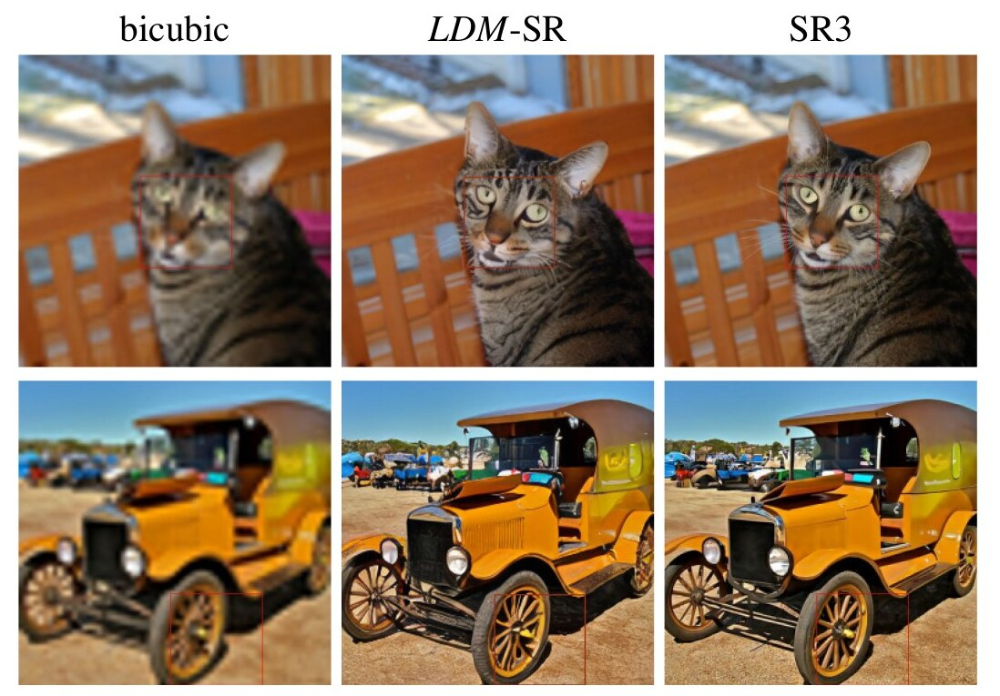

*图 10（原文 Figure 10，第 8 页）：ImageNet-Val 上 64→256 的超分辨率。LDM-SR 在渲染真实纹理方面有优势，而 SR3 能合成更连贯的精细结构。更多样本和裁剪见附录。SR3 的结果来自其论文。*

**图中文字翻译与读法**：三列分别是 bicubic（双三次插值，模糊的 64×64 上采样图）、LDM-SR、SR3；上排一只猫，下排一辆老式汽车，红框标出局部区域（原文图题说明附录里有更多样本和放大裁剪）。读图：双三次明显模糊；LDM-SR 与 SR3 都恢复出清晰的毛发、眼睛、车灯和轮辐；原文的结论是 LDM-SR 的纹理更逼真，SR3 的精细结构更连贯。这与 FID（LDM 更好）、IS（SR3 更好）的数字方向一致，但是否“更连贯”是主观判断。

**通用超分辨率（LDM-BSR，附录 D.6.1）**：只用双三次下采样训练的 LDM-SR 难以泛化到不遵循这一预处理的图像。为得到能处理真实世界图像的超分模型，作者把双三次降采样换成 Zhang 等人的 BSR 退化流水线（随机顺序地施加 JPEG 压缩噪声、相机传感器噪声、不同插值的降采样、高斯模糊核与高斯噪声），并调整了原参数（原参数的退化过强）；得到的 LDM-BSR 比固定退化的 LDM-SR 锐利得多，可作为通用上采样器（附录图 18、19，可把类条件 LDM 的样本放大到 1024²）。

### 5.7 修复（原文 4.5 节，第 8–9 页；表 6、表 7、图 11）

**设置**：修复是填充图像中被掩码的区域，原因可能是图像部分损坏，也可能是要替换不想要的内容。评估遵循 LaMa 的协议（LaMa 是依赖 Fast Fourier Convolutions 的专用修复架构），在 Places 数据集上训练和评估。用 LaMa 的代码生成合成掩码，用固定的 2k 验证与 30k 测试样本，训练时随机裁剪 256×256，评估在 512×512 裁剪上进行（附录 E.2.2）。

**第一阶段设计的影响（表 6）**：比较 LDM-1（像素空间的条件 DM）与 LDM-4（KL 与 VQ 两种正则），以及第一阶段无注意力的 VQ-LDM-4（降低高分辨率解码的显存）。为可比，所有模型固定参数量。

| 模型（正则类型） | 训练吞吐（samples/s） | 采样吞吐 @256 | 采样吞吐 @512 | 训练+验证 小时/epoch | FID@2k（第 6 个 epoch） |
|---|---:|---:|---:|---:|---:|
| LDM-1（无第一阶段） | 0.11 | 0.26 | 0.07 | 20.66 | 24.74 |
| LDM-4（KL，有注意力） | 0.32 | 0.97 | 0.34 | 7.66 | 15.21 |
| LDM-4（VQ，有注意力） | 0.33 | 0.97 | 0.34 | 7.04 | 14.99 |
| LDM-4（VQ，无注意力） | 0.35 | 0.99 | 0.36 | 6.66 | 15.95 |

（原文表 6，第 8 页。采样吞吐上标 † 表示与图 7 有偏差，源于不同的 GPU 设置与批大小，见补充材料。）

**读法**：像素扩散与潜扩散之间训练时间每 epoch 加速至少约 2.7 倍（20.66 对 7.66 小时），同时 FID 好约 1.6 倍（24.74 对 15.21，比值 1.63；对 VQ 有注意力版为 1.65；但对无注意力的 VQ 版是 24.74 对 15.95，比值约 1.55，略低于原文所说的“至少 1.6 倍”）；采样吞吐在 256 分辨率下提升约 3.7 倍，512 下约 4.9 倍（0.07 对 0.34）。无注意力的第一阶段略损失质量（FID 15.95 对 14.99）但更快。

**与其他修复方法比较（表 7）**：30k 张 512×512 的 Places 测试裁剪。“40–50% masked” 一列是需要修复 40–50% 图像区域的困难样本上的指标。

| 方法 | 40–50% 掩码 FID↓ | 40–50% 掩码 LPIPS↓ | 全部样本 FID↓ | 全部样本 LPIPS↓ |
|---|---:|---:|---:|---:|
| LDM-4（本文，big，w/ ft） | **9.39** | 0.246±0.042 | **1.50** | 0.137±0.080 |
| LDM-4（本文，big，w/o ft） | 12.89 | 0.257±0.047 | 2.40 | 0.142±0.085 |
| LDM-4（本文，w/ attn） | 11.87 | 0.257±0.042 | 2.15 | 0.144±0.084 |
| LDM-4（本文，w/o attn） | 12.60 | 0.259±0.041 | 2.37 | 0.145±0.084 |
| LaMa [88]† | 12.31 | **0.243**±0.038 | 2.23 | **0.134**±0.080 |
| LaMa [88] | 12.0 | **0.24** | 2.21 | 0.14 |
| CoModGAN [107] | 10.4 | 0.26 | 1.82 | 0.15 |
| RegionWise [52] | 21.3 | 0.27 | 4.75 | 0.15 |
| DeepFill v2 [104] | 22.1 | 0.28 | 5.20 | 0.16 |
| EdgeConnect [58] | 30.5 | 0.28 | 8.37 | 0.16 |

（原文表 7，第 9 页。† 表示在本文的测试集上重新计算，因为 LaMa 原来使用的测试集无法获得。）

**读法**：

- 本文带注意力的 LDM-4 在整体图像质量（FID）上优于 LaMa（40–50% 掩码：11.87 对 12.31；全部样本：2.15 对 2.23）。LPIPS 比 LaMa 略高（0.257 对 0.243）：作者认为这是由于 LaMa 只给出一个结果，倾向于恢复更接近“平均图像”的内容，而 LDM 的结果多样（附录图 21）；另外用户研究（表 4）里人类更偏爱 LDM 的结果。
- **更大的 big 模型**：在无注意力的 VQ 正则第一阶段潜空间训练更大的扩散模型，U-Net 在特征层级的三层上用注意力，用 BigGAN 的残差块做上下采样，参数 387M（对比 215M）。训练后作者注意到 256² 与 512² 分辨率下样本质量不一致，假设是额外的注意力模块导致；但在 512² 上微调半个 epoch 能让模型适应新的特征统计，创造了修复的新最优 FID（big, w/o attn, w/ ft）：40–50% 掩码上 9.39，全部样本上 1.50，均优于所有对比方法（包括 CoModGAN 的 10.4 与 1.82）。

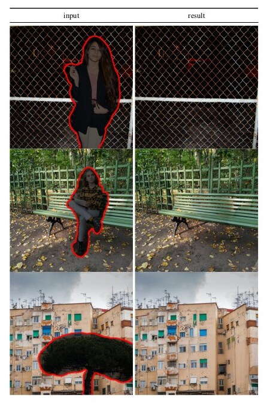

*图 11（原文 Figure 11，第 9 页）：用本文 big、w/ ft 修复模型做物体移除的定性结果。更多结果见图 22。*

**图中文字翻译与读法**：左列 input（输入）：要移除的物体被红线圈出（铁丝网前的女士、长椅上的女士、公寓楼前的一棵大树）；右列 result（结果）：模型填补后的图像，铁丝网的网格、长椅与地上的落叶、楼房的窗户与外墙都延续自然，没有明显的拼接痕迹。读图结论：对结构规整的背景（网格、窗户阵列）也能补得连贯；这是定性展示，原文没有给出这组图的失败样例。

### 5.8 算力对比（附录 F，第 28 页；表 18）

作者把 A100 的训练天数按 ×2.2 的加速比折合成 V100 天（对应 U-Net 上 A100 相对 V100 的加速），与对手的数字（取自 ADM 论文）比较。表中：Generator Compute 是生成器训练算力（V100 天），Classifier Compute 是分类器引导所需的分类器训练算力，Overall Compute 是总算力，Inference Throughput 是推断吞吐（单张 A100 上每秒样本数），Nparams 是参数量。

| 方法 | 生成器算力 | 分类器算力 | 总算力 | 推断吞吐∗ | 参数量 | FID↓ | IS↑ | Precision↑ | Recall↑ |
|---|---:|---:|---:|---:|---:|---:|---:|---:|---:|
| **LSUN Churches 256²** | | | | | | | | | |
| StyleGAN2 [42]† | 64 | - | 64 | - | 59M | 3.86 | - | - | - |
| LDM-8（本文，100 steps，410K） | 18 | - | 18 | 6.80 | 256M | 4.02 | - | 0.64 | 0.52 |
| **LSUN Bedrooms 256²** | | | | | | | | | |
| ADM [15]†（1000 steps） | 232 | - | 232 | 0.03 | 552M | 1.9 | - | 0.66 | 0.51 |
| LDM-4（本文，200 steps，1.9M） | 60 | - | 55 | 1.07 | 274M | 2.95 | - | 0.66 | 0.48 |
| **CelebA-HQ 256²** | | | | | | | | | |
| LDM-4（本文，500 steps，410K） | 14.4 | - | 14.4 | 0.43 | 274M | 5.11 | - | 0.72 | 0.49 |
| **FFHQ 256²** | | | | | | | | | |
| StyleGAN2 [42] | 32.13‡ | - | 32.13† | - | 59M | 3.8 | - | - | - |
| LDM-4（本文，200 steps，635K） | 26 | - | 26 | 1.07 | 274M | 4.98 | - | 0.73 | 0.50 |
| **ImageNet 256²** | | | | | | | | | |
| VQGAN-f-4（本文，第一阶段） | 29 | - | 29 | - | 55M | 0.58†† | - | - | - |
| VQGAN-f-8（本文，第一阶段） | 66 | - | 66 | - | 68M | 1.14†† | - | - | - |
| BigGAN-deep [3]† | 128–256 | | 128–256 | - | 340M | 6.95 | 203.6±2.6 | 0.87 | 0.28 |
| ADM [15]（250 steps）† | 916 | - | 916 | 0.12 | 554M | 10.94 | 100.98 | 0.69 | 0.63 |
| ADM-G [15]（25 steps）† | 916 | 46 | 962 | 0.7 | 608M | 5.58 | - | 0.81 | 0.49 |
| ADM-G [15]（250 steps）† | 916 | 46 | 962 | 0.07 | 608M | 4.59 | 186.7 | 0.82 | 0.52 |
| ADM-G, ADM-U [15]（250 steps）† | 329 | 30 | 349 | n/a | n/a | 3.85 | 221.72 | 0.84 | 0.53 |
| LDM-8-G（本文，100，2.9M） | 79 | 12 | 91 | 1.93 | 506M | 8.11 | 190.4±2.6 | 0.83 | 0.36 |
| LDM-8（本文，200 ddim steps，2.9M，batch size 64） | 79 | - | 79 | 1.9 | 395M | 17.41 | 72.92 | 0.65 | 0.62 |
| LDM-4（本文，250 ddim steps，178K，batch size 1200） | 271 | - | 271 | 0.7 | 400M | 10.56 | 103.49±1.24 | 0.71 | 0.62 |
| LDM-4-G（本文，250 ddim steps，178K，batch size 1200，classifier-free guidance，scale 1.25） | 271 | - | 271 | 0.4 | 400M | 3.95 | 178.22±2.43 | 0.81 | 0.55 |
| LDM-4-G（本文，250 ddim steps，178K，batch size 1200，classifier-free guidance，scale 1.5） | 271 | - | 271 | 0.4 | 400M | 3.60 | 247.67±5.59 | 0.87 | 0.48 |

（原文表 18，第 28 页。训练算力单位为 V100 天，对手的数字除非另有说明取自 ADM 论文；∗：吞吐为单张 NVIDIA A100 上每秒样本数；†：数字取自 ADM 论文；‡：假设在 2500 万训练样本上训练；††：对 ImageNet 验证集的 R-FID。LSUN-Bedrooms 一行里 LDM-4 的“生成器算力 60 / 总算力 55”是原文印的数字，两者不一致，原文没有解释。）

**读法**：

- **训练算力**：LSUN-Bedrooms 上 LDM-4（60 V100 天）约为 ADM（232）的 1/4（与正文“训练资源少 4 倍”一致）；ImageNet 上 LDM-4-G 总算力 271，对 ADM-G 的 962 约 3.5 倍；LDM-8-G 只需 91，约 10 倍。LSUN-Churches 上 LDM-8（18）约为 StyleGAN2（64）的 28%，FID 接近（4.02 对 3.86）。
- **推断吞吐**：ImageNet 上 LDM-4（0.7 样本/秒）约为 ADM（250 步，0.12）的 5.8 倍，LDM-4-G（0.4）约为 ADM-G（250 步，0.07）的 5.7 倍。LSUN-Bedrooms 上 LDM-4（1.07）约为 ADM（1000 步，0.03）的 36 倍（步数也不同：200 对 1000）。
- **边界**：算力以 V100 天折合（统一用 ×2.2 的加速比），并且对手数字来自别人的论文，计算方式不一定完全相同；吞吐是单卡 A100、不同步数下的数字，不同步数的结果不能直接比较“每步速度”。

## 六、局限、证据边界与常见误读

**原文第 5 节（第 9 页）自己交代的局限与影响**：

- LDM 显著降低了相对像素方法的计算需求，但**顺序采样过程仍比 GAN 慢**。
- 当需要**高精度**时使用 LDM 可能有问题：虽然 $f=4$ 自编码模型的图像质量损失很小（图 1），但其重构能力可能成为需要像素级精细准确度的任务的瓶颈。作者认为他们的超分辨率模型在这一点上已经有所受限。
- **社会影响**：生成模型是一把双刃剑。降低训练与推断成本有助于普及这项技术，但也使操纵数据（deep fake）与传播虚假信息、垃圾内容更容易，女性受影响尤为严重；生成模型可能泄露训练数据（含敏感个人信息时尤为担忧），对图像 DM 的程度尚未完全弄清；深度模块会复制或放大数据里已有的偏见，DM 比 GAN 覆盖数据分布更好，但本文把对抗训练与基于似然的目标结合起来的两阶段方法是否歪曲数据，仍是重要的研究问题。

**证据边界（读数字时注意）**：

- **不同表的评估流程不统一**：FID 样本数不同（表 1、10 用 5 万个，图 6、7、17 只用 5 千个，文本到图像用 3 万个 COCO 验证样本，布局到图像用 2048 张，修复表 6 的 FID@2k），比较时要看清各自的参考集（训练集或验证集）。原文自己也承认不同的数据处理流程会让 FID 略有差异（附录 E.3.1）。
- **文本到图像不是第一**：在 MS-COCO 上 LDM-KL-8-G（12.63）仍略逊于 GLIDE（12.24）与 Make-A-Scene（11.84），原文只说“持平”。
- **GAN 在 FID 上仍占优**：FFHQ、LSUN-Churches、LSUN-Bedrooms 上 ProjectedGAN 的 FID 都低于 LDM（表 1）；LDM 的优势在 Precision/Recall 与训练稳定性，而不是所有数据集上的 FID。
- **用户研究的规模与协议**：只有两个任务，每张图观看 3 秒，原文没有给出受试者人数。
- **类条件 ImageNet 的引导增益依赖设置**：classifier-free guidance 的尺度 $s$ 与分类器引导尺度（LDM-8-G 的 classifier scale 10）会改变 FID 与 Recall 的权衡，表 3 的 3.60 对应 $s=1.5$ 且 Recall 降到 0.48。
- **原文内部的小矛盾与笔误**（对照原文时容易困惑）：表 1 与附录图 28、30 里的 FID 不同（5.11 对 5.15、4.02 对 4.48）；附录 D.3 的“领先近 11”与表 9 的 13.31/12.31 不一致；$W_Q$、$W_V$ 的维度写反了；表 13、14 中 LDM-32 的 $z$ 形状印成 “88×8×32”；表 18 的 LDM-4 在 LSUN-Bedrooms 上生成器算力 60 与总算力 55 不一致；类条件 ImageNet 的 LDM-4 参数量在表 3 写 400M、表 15 写 395M；表 5 的 “emphLDM-4”。另外与 [DiT](../dit/论文中文解读.md) 对照：本文表 10、表 18 在 256×256 的语境下把 ADM-G, ADM-U 写作 FID 3.85、IS 221.72、Precision 0.84，而 DiT 论文表 2（256×256）同一行是 3.94、215.84、0.83，DiT 表 3（512×512）才是 3.85、221.72、0.84；所以本文这一行疑似引用了 512×512 的数字（两篇论文的数字不一致，是否如此以 ADM 原文为准，本文不能仅凭这两篇确认）。这些不影响主要结论。

**常见误读**：

- “latent” 不表示模型在语义符号空间里推理，它仍是连续的二维特征图（如 64×64×3）。LDM 降低的是空间分辨率主导的成本，采样仍需多步（本文用 DDIM 的 10 到 250 步）。
- 第一阶段自编码器**不是**用扩散损失训练的，也不被扩散损失反向更新（先训练、再冻结）；重构误差是生成质量的硬上限之一，所以要先单独检查自编码器重构，再诊断扩散。
- **本文没有使用 CLIP**：文本条件由 BERT 分词器加一个 32 层、1280 维的 Transformer $\tau_\theta$ 提供，$\tau_\theta$ 与 U-Net 在 LAION-400M 上联合优化（原文没有说它用预训练权重初始化）；后来 Stable Diffusion 等系统改用预训练的 CLIP 文本编码器，那不是这篇论文的内容。原文只在“潜空间可用于下游应用”处提到单图 CLIP 引导合成这一用途。
- **Stable Diffusion** 是这一范式的后续具体系统，不等同于论文全部内容（原文并未提及它）。
- 4.1 节的“最佳 $f$”只针对该实验设置（单张 A100、固定参数量与训练步数、ImageNet 与 CelebA-HQ）。复杂数据集（ImageNet）需要较低压缩率（$f=4$ 到 $8$），而不是越大越好。

## 七、复现检查清单

- 先分别检查自编码器重构（表 8 的 R-FID/PSNR 量级：$f=4$ 的 VQ 版 0.58 / 27.4，KL 版 0.27 / 27.5），再诊断扩散，否则两类错误会混在一起。
- 潜变量缩放常数必须与所用自编码器一致：KL 正则的潜空间用第一个批次估计的标量标准差 $\hat\sigma$ 缩放到单位标准差；VQ 潜空间在量化层前取 $z$ 且无需缩放。大图卷积采样对此最敏感（图 15）。
- 训练扩散：$T=1000$、线性噪声调度，$\epsilon$-预测的 MSE（式 2、3），均匀采样 $t$；条件编码器 $\tau_\theta$ 与 U-Net 联合优化，第一阶段冻结。
- 交叉注意力：query 来自 U-Net 特征，key/value 来自 $\tau_\theta(y)$；文本用 BERT 分词器、序列长度 77、32 层 1280 维 Transformer（无掩码）；条件编码器**不**接收时间步。
- classifier-free guidance：训练时要随机丢弃条件（原文没有写丢弃概率，需对照官方代码），采样时按尺度 $s$ 外推；记录 $s$（表 3 为 1.5，文本到图像图 5 为 10.0）。
- 采样设置：DDIM 的步数与 $\eta$（原文图 5：200 步、$\eta=1.0$；图 6：100 步、$\kappa=0$）要与表一致；FID 应从最终解码像素计算，不要在潜空间里算。
- FID 评估：5 万样本对整个训练集（表 1、10）；注意不同工具（torch-fidelity 与 Dhariwal-Nichol 脚本）的差异。
- 修复与超分：条件是与潜变量**拼接**（不是交叉注意力），超分的 $\tau_\theta$ 是恒等；通用超分要用 BSR 退化而不是单一的双三次。
- 评估不同 $f$ 时要保持同样的参数量、训练步数与硬件预算（表 13），否则结论不可比。

## 八、与相关论文的关系

- [VAE](../vae/论文中文解读.md)：LDM 第一阶段的 KL 正则沿用了 VAE 的“编码器输出均值与方差、对标准正态做 KL”的做法，但权重只有约 $10^{-6}$，目的只是防止潜空间尺度失控，不追求潜空间本身可采样。
- [GAN](../gan/论文中文解读.md)：第一阶段自编码器用 patch 判别器的对抗损失来避免模糊；论文里 LDM 与 GAN 的对比（表 1 的 StyleGAN、ProjectedGAN 等）显示 GAN 在若干数据集上 FID 仍占优，LDM 的优势在 Precision/Recall 与训练稳定性。
- [DDPM](../ddpm/论文中文解读.md)：LDM 的式（1）就是 DDPM 的 $L_{\mathrm{simple}}$；本文不改变扩散过程，只把它从像素空间搬到潜空间；图 2 的率失真曲线直接取自 DDPM 的分析。
- [DiT](../dit/论文中文解读.md)：DiT 保留了“在预训练自编码器的潜空间里做扩散”的框架，只把 U-Net 替换成 Transformer。

## 原文证据导航

- [原论文 PDF](paper.pdf)
- [原文提取文本](paper.txt)
- [论文概要](论文概要.md)
- 关键位置（PDF 页码）：摘要、引言、图 1 在第 1 页；图 2、六点贡献在第 2 页；相关工作与 3.1 节在第 2–3 页；图 3、3.2 节（式 1、2）、3.3 节在第 4 页；式（3）、图 4、4.1 节在第 5 页；图 5、图 6、表 1、图 7、表 2 在第 6 页；表 3、图 8、4.3 节、图 9 在第 7 页；表 4、表 5、表 6、图 10、4.5 节在第 8 页；表 7、图 11、局限与社会影响、结论在第 9 页；附录 A（变更记录）、B 在第 16–17 页；附录 C 在第 18–19 页；图 15、D.1–D.4 在第 20 页；表 8 在第 21 页；表 9、10 在第 22 页；表 11、D.6 在第 23 页；表 12、13 在第 24 页；表 14、15 在第 25 页；表 16、17、E.2 在第 26 页；E.3 在第 26–27 页；表 18（F 节）在第 28 页；附录 G 在第 29 页。
