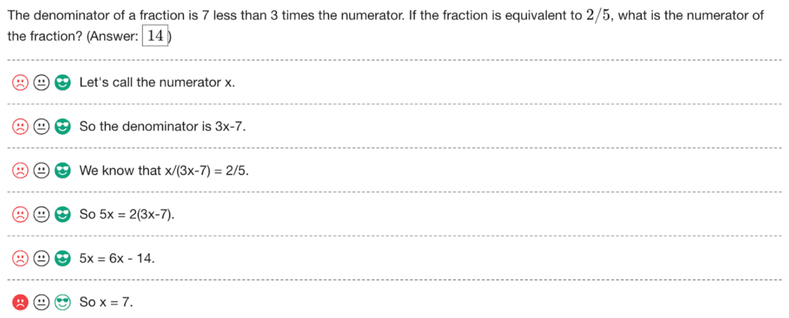
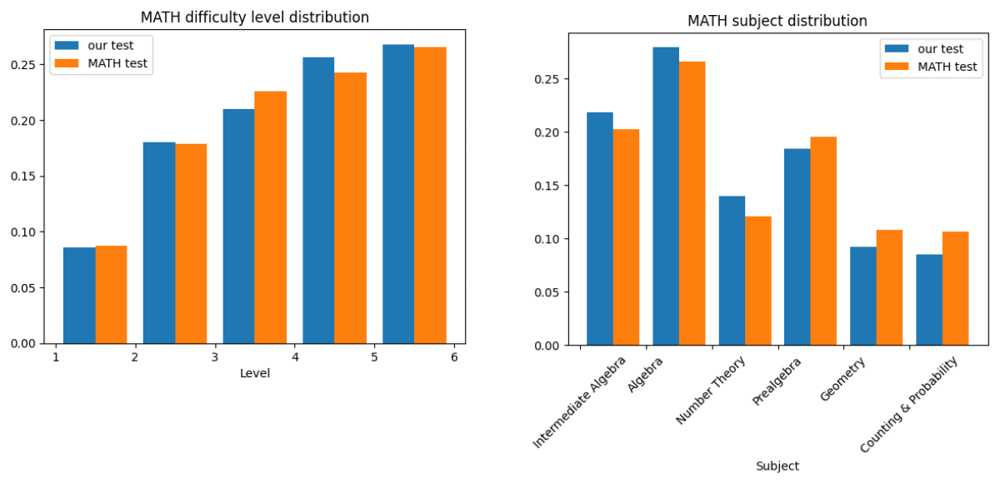
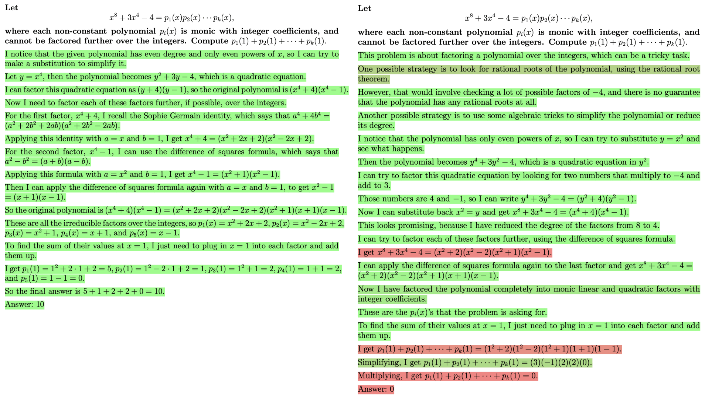
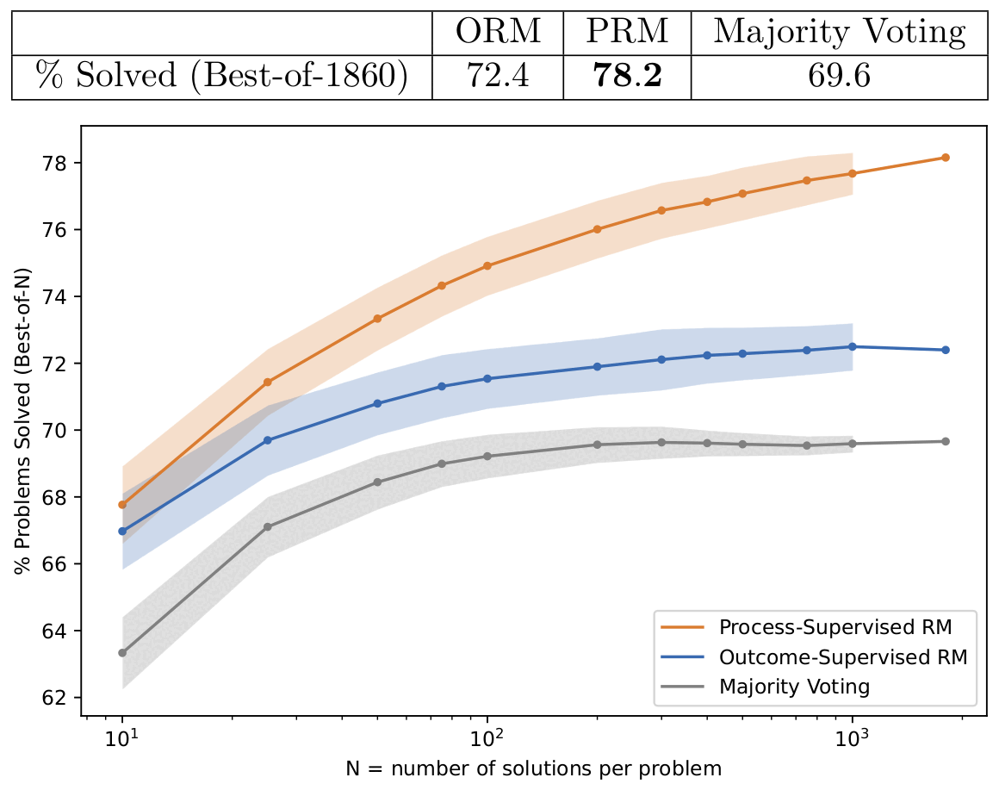
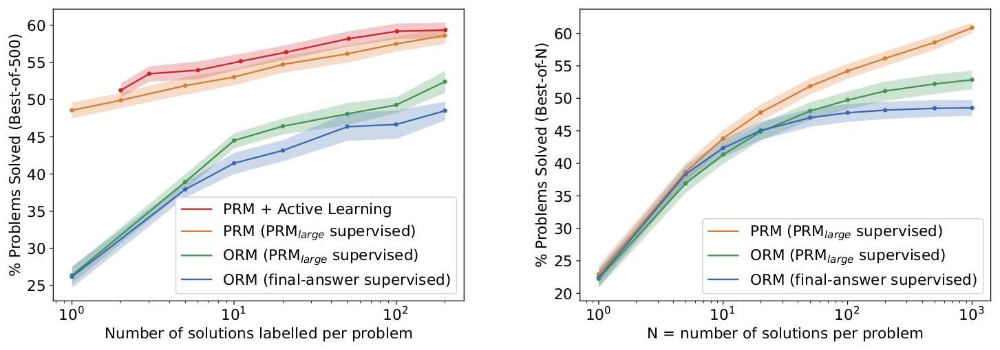
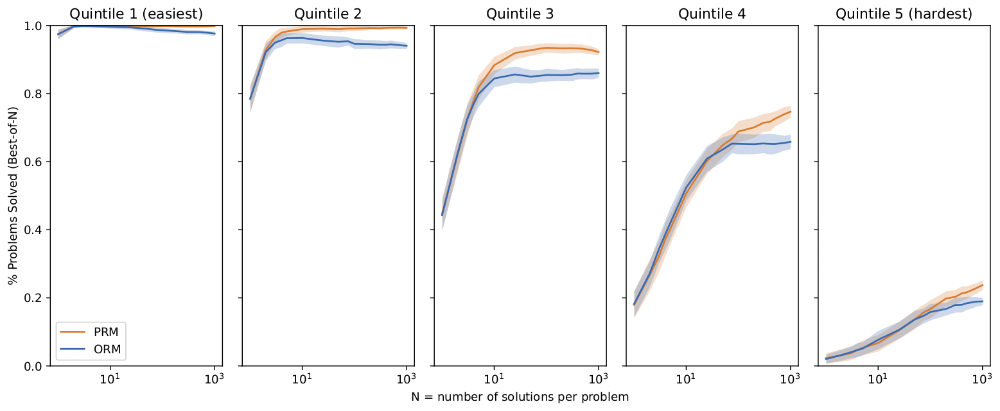
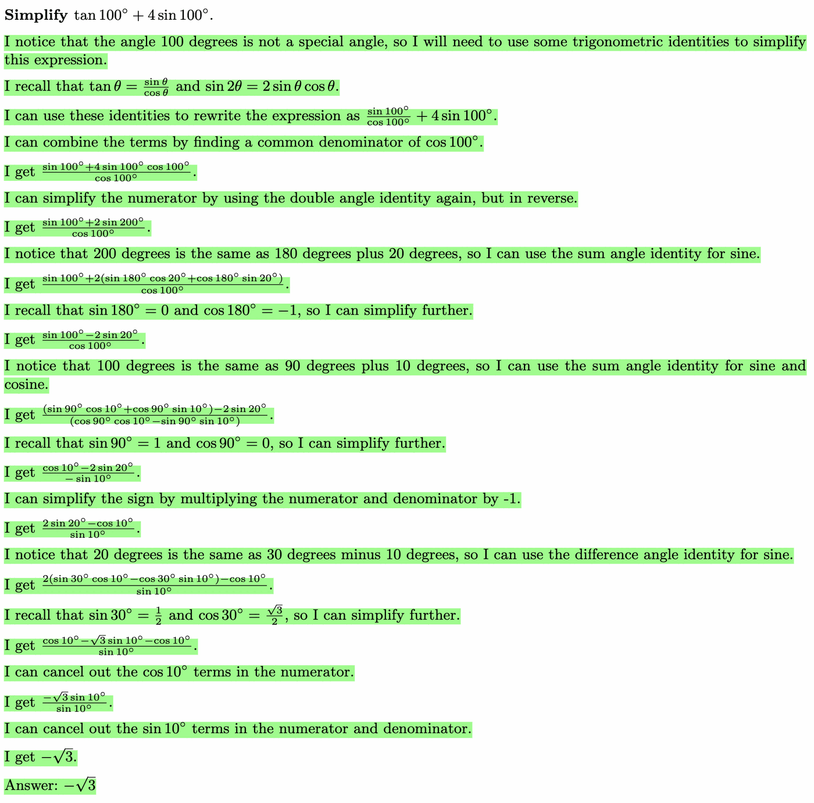
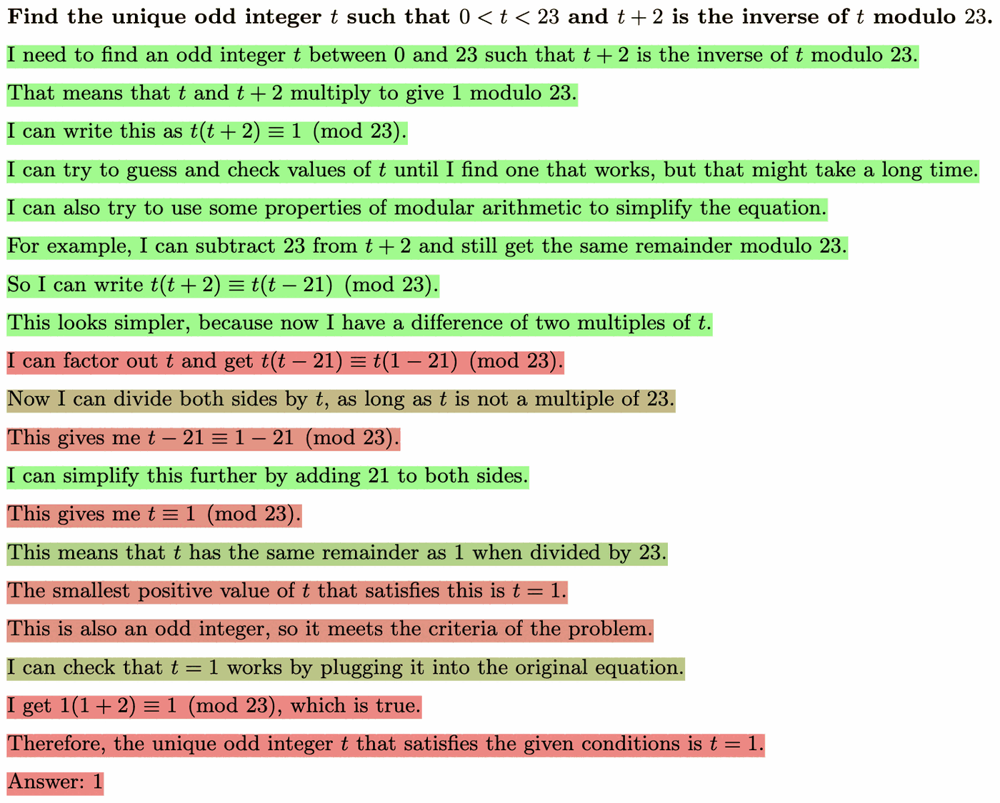
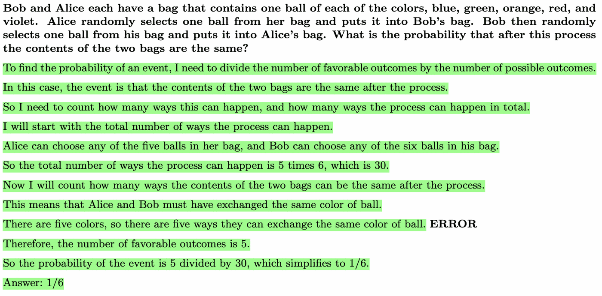
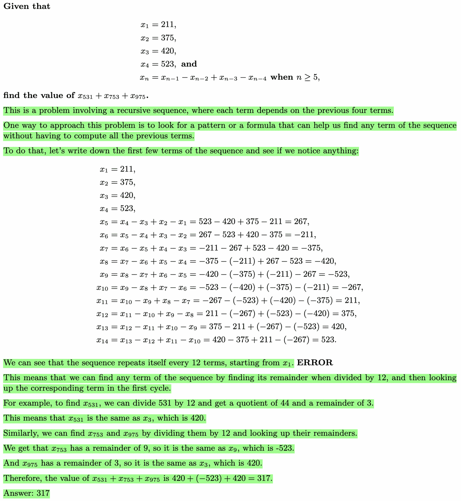

# 论文中文解读：《Let's Verify Step by Step》

> **基本信息**：Hunter Lightman、Vineet Kosaraju、Yura Burda、Harri Edwards、Bowen Baker、Teddy Lee、Jan Leike、John Schulman、Ilya Sutskever、Karl Cobbe（Lightman、Kosaraju、Burda、Cobbe 为主要作者），OpenAI，arXiv:2305.20050 v1，2023 年 5 月 31 日；论文原文 [官方页面](https://arxiv.org/abs/2305.20050)；数据集与评测子集见 [github.com/openai/prm800k](https://github.com/openai/prm800k)。
>
> **本文的读法**：论文共 6 张图（图 1–6）、4 张表（表 1–4），外加附录 I 的 12 个 PRM 打分案例。本文把 6 张图全部从原文 PDF 裁出，放在讲到它们的段落里，并配中文图题、图中文字翻译与读图结论；附录 I 的 12 个案例选 4 个放图（例 1、8、9、12），其余用一张中文表概括（图 2 的两条解答就是例 4 和例 5）。四张原文表逐格转录为 Markdown。图 3、4、6 是矢量图，本文把关键数据点读成了数值表（这类表不是原文的表，文中都有标注）；凡写“约”的数字是从图上读出的近似值，原文正文与表格给出的数字优先；本文自己的复算或推断都会明确标出。读完本文不必再翻英文原文。

**阅读地图**：想抓主线，读第一、二、六、七节；想学会人工标注协议与 PRM800K，读第四节；想知道 ORM 与 PRM 怎么训练、怎么给整条解答打分，读第五节；想审查实验设计与结论边界，读第七、十、十三节；想看 PRM 的真实打分长什么样，读 5.2 节（图 2）和 12.2 节（附录 I 案例）。

## 一、一句话结论

论文问的是一个很具体的问题：大模型对同一道数学题可以写出许多条分步解答，要从中挑出最可能正确的一条，用来挑选的“奖励模型 / 验证器”（reward model, verifier）该用什么样的人工监督来训练？是只告诉它**每条解答的最终答案对不对**（结果监督，outcome supervision，训练出 ORM），还是告诉它**每一步对不对**（过程监督，process supervision，训练出 PRM）？

做法：固定一个生成器（generator，GPT-4 经微调后只负责按“一行一步”的格式写解答），不对它做强化学习；请人工标注员给生成器写出的 MATH 解答逐步打标签，得到 PRM800K（约 80 万个步骤标签、7.5 万条解答、1.2 万道题）；用它训练 PRM。ORM 则用每题 100 条均匀采样的解答、只看最终答案来训练。评估方式是 best-of-N：每道测试题采样 N 条解答，取奖励模型评分最高的一条，再核对它的最终答案，统计答对的题目比例。此外，作者用“大 PRM 当标注员”的方式在小模型上做受控对比和主动学习实验。

主要结论（数字都带着条件）：

1. 大规模（图 3）：在 MATH 测试集的 500 题子集上，best-of-1860 的解题率是 PRM 78.2%、ORM 72.4%、多数投票（majority voting）69.6%；N 越大，PRM 与另两者的差距越大。
2. 小规模受控对比（图 4）：在完全相同的候选解答上只更换监督形式，过程监督在所有数据规模下都明显好于两种结果监督（最终答案监督、大 PRM 给出的结果监督）。
3. 主动学习（图 4a）：优先标注“当前 PRM 打高分、但最终答案其实是错的”的解答，数据效率约提高 2.6 倍。
4. 分布外（表 1）：在新发布的 AP 物理/微积分/化学与 AMC10/12 题上，best-of-100 的聚合解题率是 PRM 72.9%、ORM 63.8%、多数投票 61.3%。
5. 作者的解释与立场：过程监督让 credit assignment（信用分配，即判断错误出在哪一步）更容易；在对齐方面它更容易被人审查，且在本文设定下性能更好，因此“对齐税为负”（negative alignment tax）。这部分是论证，没有经过强化学习实验验证。

先决提醒：研究对象是**奖励模型**（怎样把验证器训得更可靠），不是让生成器本身更会推理；全文没有用奖励模型去做强化学习；78.2% 是从 1860 条候选里挑一条的结果，不是单次作答的正确率；大规模实验里 ORM 与 PRM 的训练集并不等价，真正控制变量的比较在第七节（原文第 4 节）的小规模合成监督实验里。

## 二、背景与前置知识

### 2.1 为什么需要验证器

大模型用思维链（chain-of-thought）一步步写出解答，能完成需要多步推理的任务。但即使最先进的模型，也会在不确定时编造事实（幻觉，hallucination），而在多步推理里，**一个逻辑错误就足以毁掉整条长解答**。检测并缓解这类错误对提升推理能力至关重要。

一种有效手段是训练奖励模型去区分好坏输出。奖励模型可以用在强化学习流程里（Ziegler et al., 2019；Stiennon et al., 2020；Nakano et al., 2021；Ouyang et al., 2022），也可以通过拒绝采样做搜索（Nichols et al., 2020；Shen et al., 2021；Cobbe et al., 2021）。但这样得到的系统“只和奖励模型一样可靠”，所以要研究怎样最有效地训练可靠的奖励模型。

### 2.2 结果监督与过程监督

Uesato et al. (2022) 描述了两种截然不同的训练奖励模型的方式：

- **结果监督**：奖励模型只用思维链的最终结果（例如最终答案对不对）训练，得到结果监督奖励模型（Outcome-supervised Reward Model, ORM）。
- **过程监督**：思维链的每一步都有反馈，得到过程监督奖励模型（Process-supervised Reward Model, PRM）。

偏向过程监督的理由（论文引言）：它的反馈更精确，因为能指出错误出现的确切位置；它还有几条与 AI 对齐相关的优势：更容易被人解读，并且更直接地奖励“人类认可的思维链”。另外，在逻辑推理领域，用结果监督训练的模型经常用错误的推理得到正确的最终答案（Zelikman et al., 2022；Creswell et al., 2022），过程监督已被证明能缓解这种错位行为（Uesato et al., 2022）。

### 2.3 前作与本文的三点差异

Uesato et al. (2022) 在小学数学（GSM8K）上发现，结果监督与过程监督最终性能相近（他们同时指出过程监督用更少的数据达到同样结果，见第十一节）。本文做了自己的详细比较，有三点不同：用了更强的基础模型；用了显著更多的人工反馈；在更难的 MATH 数据集（Hendrycks et al., 2021）上训练和测试。

MATH 是竞赛类数学题数据集，每道题有可以自动核对的最终答案，所以结果监督不需要人工；而过程监督没有简单的自动化办法，只能靠人工标注员逐步判断。附录 C 给出的划分是：训练集 7,500 题；测试集里有 4,500 题并入训练集、500 题留作评估，所以测试集共 5,000 题（这个总数是本文由 4,500 + 500 推算的）。

### 2.4 术语表

| 术语 | 含义 |
|---|---|
| 生成器（generator） | 固定的语言模型，负责对每道题采样分步解答；本文不对它做强化学习。大规模：GPT-4 经分步格式微调；小规模：预训练算力约少 200 倍的小模型 |
| 奖励模型 / 验证器 | 给一条解答打分的模型；本文只评价它在 best-of-N 里“把正确解答挑出来”的能力 |
| ORM | 结果监督奖励模型；训练目标是整条解答最终对或错；测试时取最后一个 token 的预测作为解答分 |
| PRM | 过程监督奖励模型；在每一步末尾预测 positive、neutral 或 negative；解答分是各步“正确”概率之积 |
| best-of-N | 每题采样 N 条解答，取奖励模型评分最高者，再按最终答案判对错，报告答对的题目占比 |
| 多数投票 | 对 N 条解答的最终答案投票（Wang et al., 2022，即自洽性方法），不需要奖励模型；是强基线 |
| PRM800K | 人工步骤级标签数据集，见第四节 |
| MathMix | 约 1.5B 个数学相关 token 的数据集，作为微调前的轻量预训练，见 12.1 节 |
| PRM_large | 大规模 PRM（GPT-4 微调、PRM800K 训练）；第七节里充当“标注员”（labelling oracle） |
| PRM_selector | 小规模 PRM，只用每题 1 个样本训练，主动学习时用来挑样本 |
| 令人信服的错误答案（convincing wrong-answer） | 被当前最佳 PRM 打高分，但最终答案是错的解答 |
| 假阳性（false positive） | 在 ORM 的自动判分里，指推理有错但最终答案碰巧正确的解答；在附录 I.3 里则指“被奖励模型打高分但其实有错”的解答，两处含义不同，需区分 |

### 2.5 论文的四项贡献

1. 过程监督能训练出比结果监督可靠得多的奖励模型；用最先进的 PRM 解出了 MATH 测试集代表性子集的 78.2%。
2. 一个大奖励模型可以可靠地近似人类监督，用来监督较小的奖励模型，从而高效地做大规模数据收集消融实验。
3. 主动学习使过程监督的数据效率提升 2.6 倍。
4. 发布完整的过程监督数据集 PRM800K，促进相关研究。

## 三、总体设计：固定生成器，只比较奖励模型

### 3.1 研究范围与评估协议

在每个模型规模上，作者只用**一个固定的生成器**产生所有解答，不用强化学习改进它。本文所说的结果监督与过程监督，特指**对奖励模型的监督**；如果用奖励模型去做强化学习，生成器会从中获得的监督不在讨论之列。用奖励模型微调生成器是自然的下一步，但被有意排除在本文重点之外。

评估一个奖励模型，就看它在“对生成器均匀采样的解答做 best-of-N 搜索”里的表现：

```text
同一道测试题 --> 固定的生成器 --> N 条分步解答 y_1, ..., y_N
                                      |
                   奖励模型（ORM 或 PRM）给每条解答打分 s(y_i)
                                      |
                           取分数最高的一条 y_hat
                                      |
               只核对 y_hat 的最终答案是否正确 --> 该题记为答对或答错
```

选择规则可以写成

$$
\hat y=\operatorname*{arg\,max}_{y\in\{y_1,\dots,y_N\}} s(y),
$$

最后报告“所选解答最终答案正确的题数 ÷ 测试题数”。奖励模型越可靠，选出正确解答的次数越多。注意这是**用最终任务成功率评价验证器**，而不是报告步骤标签的分类准确率。

### 3.2 两种规模的分工

作者在两个互补的规模上做实验：

| 项目 | 大规模 | 小规模 |
|---|---|---|
| 目的 | 推进最先进水平，训练尽可能可靠的 ORM 与 PRM | 苹果对苹果的受控比较，以及原本做不起的数据收集消融 |
| 基础模型 | GPT-4 base（只预训练，没有做过 RLHF） | 设计与 GPT-4 类似，预训练算力约少 200 倍 |
| 监督来源 | 人工步骤标签（PRM800K）、自动核对最终答案 | 大规模 PRM（PRM_large）给出的合成标签、自动核对最终答案 |
| 可比性 | ORM 与 PRM 的训练集不能直接比较 | 同一批解答，只更换监督形式 |
| 对应章节 | 第六节（图 3）、第八节（表 1）、表 4 | 第七节（图 4） |

为什么需要小规模：大规模的 ORM 与 PRM 各自是“最佳尝试”，训练集在规模、选择方式（主动学习 vs. 均匀采样）上都不同，不适合做苹果对苹果的比较；而人工标注太贵，没法在人工标签上做足够多的消融，所以改用大 PRM 作为标注员，在小模型上模拟大量数据收集。

### 3.3 基础模型与 MathMix

所有大规模模型都由基础 GPT-4 微调而来。它只做过“预测下一个 token”的预训练，没有经过任何基于人类反馈的强化学习（RLHF，Christiano et al., 2017）。小规模基础模型设计与 GPT-4 类似，但预训练算力大约少 200 倍。

作为额外的预训练步骤，作者在约 1.5B 个数学相关 token 的数据集 MathMix 上微调所有模型；与 Lewkowycz et al. (2022)（Minerva）的发现一致，这提升了模型的数学推理能力。MathMix 的构成见 12.1 节（表 2）。

### 3.4 生成器：只教格式，不教能力

为了便于解析单个步骤，作者训练生成器按“换行分隔的分步格式”写解答：先对 MATH 训练题做 few-shot 生成，筛选出最终答案正确的解答，在这些数据上把基础模型微调 **1 个 epoch**。这一步**不是为了教生成器新技能，只是教它按想要的格式输出**。

## 四、数据：PRM800K 与人工标注协议

这一节是论文的核心资源，也是原始 PDF 里分散在正文 2.4 节与附录 B、C、D 的内容，这里合并讲。

### 4.1 标注任务：每一步三选一

人工标注员看到的是大规模生成器对 MATH 题采样出的分步解答，任务是给**每一步**打 positive、negative 或 neutral 之一。作者只标注大规模生成器的解答，以便最大化“有限的人工数据资源”的价值。



*图 1（原文 Figure 1，第 4 页）：用于给解答的每一步收集反馈的标注界面截图。*

**图中文字翻译与读法**：

- **题目**（界面顶部，同时给出标准答案）：“一个分数的分母比其分子的 3 倍少 7。若该分数等于 2/5，则这个分数的分子是多少？（答案：14）”
- **解答的六步，每步左侧有三个图标**（红色皱眉脸 = negative，灰色平静脸 = neutral，绿色戴墨镜笑脸 = positive；被填充为实心的是选中的标签，这是从图标填充状态读出的）：
    1. “设分子为 x。”（选中 positive）
    2. “那么分母是 3x−7。”（positive）
    3. “我们知道 x/(3x−7) = 2/5。”（positive）
    4. “于是 5x = 2(3x−7)。”（positive）
    5. “5x = 6x − 14。”（positive）
    6. “所以 x = 7。”（选中 negative：由 5x = 6x − 14 应得 x = 14，与顶部给出的答案 14 也不符）
- **读图结论**：标注员是逐步判断的；题目旁边已经给出了标准答案（附录 D 说明标注员拿到的是标准答案而不是参考解答，见 4.3 节）；这里前五步都对，第六步是第一个错误步。

**三类标签怎么定义？** 正文 2.4 节与附录 D 的措辞侧重点不同，合起来看：

| 标签 | 正文 2.4 节的说法 | 附录 D 的操作性定义 |
|---|---|---|
| positive | 该步正确且合理 | 该步是 neutral，并且还在向解答推进 |
| neutral | 表示有歧义；实践中，微妙地带有误导性、或建议不佳但技术上仍然成立的步骤可以标为 neutral | 该步在上下文里恰当、合理、正确，且只包含容易验证的计算 |
| negative | 该步不正确或不合理 | 其余所有步骤 |

两处并不矛盾：附录 D 是对标注指令的更详细描述，用“排除法”分层（neutral 是正确但没有推进，positive 要求还向解答推进，其余都是 negative）；正文则强调 neutral 用来保留歧义。原文没有进一步调和这两种说法。

**为什么要有 neutral？** 因为这样可以把“怎样处理歧义”的决定推迟到测试时：测试时既可以把 neutral 当 positive，也可以当 negative（表 4 比较了这两种处理）。

### 4.2 只监督到第一个错误步

给过程监督打标签时，作者**有意只监督到第一个错误步为止**。理由有三条：

1. 这样结果监督与过程监督的比较更直截了当：对于正确解答，两种监督给出的信息相同（每一步都对）；对于错误解答，两者都揭示“至少有一处错误”，过程监督额外揭示了错误的确切位置。如果在第一个错误之后还继续提供过程监督，过程监督的信息优势会更大，比较就不够干净。
2. 这样人工标注成本与结果监督相近：在没有易核对的最终答案时，判断一条解答是否正确，等价于找出它的第一个错误。
3. 作者提醒：大多数 MATH 题确实有易核对的最终答案，但在更复杂的领域里，他们预期这一点不会成立。

### 4.3 两阶段数据收集

| 项目 | 阶段 1（phase 1） | 阶段 2（phase 2） |
|---|---|---|
| 做法 | 对解答的每一步，给多个备选后续步骤打标签；若所有备选都是 negative，标注员可以自己输入一步，之后解答从一个随机选出的 positive 步（没有则取 neutral 步）继续 | 预先生成整条解答，标注员从头逐步标，**遇到第一个 negative 步就结束任务** |
| 问题或特点 | 繁琐：很多步骤的备选重复；标注员把大量时间花在冗长而无趣的解答上；轨迹常陷入两种困境：无穷无尽的 neutral 步（说得合理但进展慢得令人沮丧），或需要不断人工监督的 negative 步 | 规模化、流水线化；分 10 个“代”（generation），主动学习（见 4.5 节） |
| 数据量 | 约占 PRM800K 的 5%，约 4 万个步骤标签；重复性高于后来的标签 | 绝大多数标签 |

标注员**没有拿到参考解答**，但拿到了标准最终答案。不给参考解答，是为避免把他们引向某一条特定解法；给最终答案，是因为这有时能帮标注员纠正自己的误解。完整的标注指令公开在 github.com/openai/prm800k 仓库的 prm800k/instructions 目录中。致谢里提到数据由 Scale 团队与大量标注员完成。

### 4.4 数据量的两种口径

| 口径 | 步骤标签数 | 解答数 | 题数 |
|---|---|---|---|
| 收集到的全部原始数据（未过滤，作为 PRM800K 公开） | 1,085,590 | 101,599 | 原文未给出 |
| 过滤后用于训练的 PRM800K 训练集 | 约 800,000 | 约 75,000 | 约 12,000 |

训练时会丢弃两类标签：用于质量控制的标签，以及标注员未能完成任务的步骤标签。这里的 1.2 万题与附录 C 的数字相符：7,500 道 MATH 训练题加 4,500 道 MATH 测试题（见 4.7 节）。读论文时要避免把“80 万个步骤标签”说成“80 万条解答”或“80 万道题”。

### 4.5 选哪些解答给人标：令人信服的错误答案

最直接的做法是均匀地把生成器的解答送去标注。但如果送去的解答犯的是显而易见的错误，人类反馈的价值就低。作者更希望送去**更可能骗过当前最佳奖励模型**的解答，于是采用“策略性选择”：优先送出**令人信服的错误答案**（convincing wrong-answer）：

- “令人信服”：被当前最佳 PRM 打高分；
- “错误答案”：最终答案是错的。

作者特意用这个略显啰嗦的说法，是为强调正确性**只由最终答案判断**，这偶尔会导致误判（附录 B 也提到，阶段 2 里有时会因为自动判分出错而送出本来正确的解答）。他们预期给这类解答打标签信息量更大，因为已知 PRM 在这类解答里**至少有一步判断错了**。

除了这一选择策略，数据收集过程中还会在几个时间点用最新数据**迭代重训 PRM**。每一轮：对每题生成 N 条解答，只把最“令人信服的错误答案”前 K 条送给标注员；这个前 K 的过滤可以按题做（每题 K 条），也可以在整个数据集上全局做（总共 K 条，在各题之间不均匀分布）。由于数据收集代价高昂，这些设计选择无法做大规模消融，所以作者在第七节里用最大的 PRM 当标注员，对较小的 PRM 做代理消融。

主动学习让数据的平衡发生很大变化。阶段 2 里偶尔也会送出正确解答（有时是手工注入的，有时是自动判分出错所致），但绝大多数标签来自错误解答。

### 4.6 数据的构成：表 3

作者用表 3 说明两个阶段的正确与错误比例（表题的原意：正例与负例的步骤与解答分布）。

**表 3：阶段 1、阶段 2 与合计中，以正确答案结束的解答占比，以及被标为正确的步骤占比**（单位：%）

| 指标 | 阶段 1 | 阶段 2 | 合计 |
|---|---:|---:|---:|
| 以正确答案结束的解答占比 | 85.1 | 13.2 | 14.2 |
| 正确步骤占比 | 58.6 | 74.1 | 73.1 |

（原文表 3，第 17 页。）读法：

- 阶段 1 是“均匀 + 多备选”，解答大多正确（85.1%）；阶段 2 是主动学习，被送去标注的解答里只有 13.2% 最终答案正确，合计只有 14.2%。**PRM800K 以错误答案的解答为主**，这正是主动学习“偏向错误答案”的体现。
- 但步骤层面的正确率反而更高（合计 73.1%）。原文指出：虽然主要标注的是错误解答，仍然收集了很多“单个正确步骤”的标签。结合 4.2 节的“只标到第一个错误”，还有一个自然的推论（本文推断）：每条错误解答至多贡献 1 个 negative 步，其余是第一个错误之前的正确步骤，所以步骤层面的正确率远高于解答层面。
- 表中没有说明 neutral 是否计入“正确步骤”；原文也未给出各类标签的单独计数。
- 原文接着指出：小规模消融（原文 4.2 节，本文 7.4 节）表明，这种偏向“高分错误答案”的主动学习策略尽管造成数据不平衡，仍然提升了性能。

### 4.7 质量控制与评估集划分

**质量控制**（附录 B）：阶段 2 里有一部分题是质量控制题。研究人员事先标出哪些步骤可以合理地标为错误，然后检查标注员能否一致地把这些步骤标为错误。

- 阶段 2 开始前，所有标注员都必须完成 30 道质量控制题作为筛选考试，只录用与金标准至少 75% 一致的标注员；
- 之后每一代又指定 10–20 道题作为额外的质量控制题，随机穿插给标注员；
- 用这些持续的质控结果剔除质量下滑过多的标注员，并准备关于常见错误的教育材料，提高标注员与指令的对齐。

**训练与评估划分**（附录 C）：数据收集规模扩大后，需要对同一道训练题收集多条解答的标签。为避免在 7,500 道 MATH 训练题上过拟合，作者把 4,500 道 MATH 测试集的题也并入训练集，因此**只在剩余的 500 道 MATH 测试题上评估**。这 500 题是从测试集里均匀随机抽取的。原文说明：到底需要多少道不同的训练题、方法过拟合训练集有多快，留待未来研究。这 500 题的列表公开在 PRM800K 仓库里。

图 5 说明这 500 题在难度等级与学科上能代表整个 MATH 测试集。



*图 5（原文 Figure 5，第 18 页）：两张直方图，比较完整 MATH 测试集与本文 500 题测试子集在题目难度等级和学科上的分布。*

**图中文字翻译与读法**：

- **左图 “MATH difficulty level distribution”（MATH 难度等级分布）**：横轴 Level（难度等级），纵轴为占比；蓝柱 “our test” 是本文的 500 题子集，橙柱 “MATH test” 是完整 MATH 测试集。五组柱按画在相邻整数刻度之间的位置，从左到右依次是难度 1–5 级。读出的占比（约）：1 级 0.086 / 0.087，2 级 0.18 / 0.18，3 级 0.21 / 0.23，4 级 0.26 / 0.24，5 级 0.27 / 0.27（每组前一个是本文子集，后一个是完整测试集）。
- **右图 “MATH subject distribution”（MATH 学科分布）**：横轴 Subject（学科），依次为 Intermediate Algebra（中级代数）、Algebra（代数）、Number Theory（数论）、Prealgebra（预代数）、Geometry（几何）、Counting & Probability（计数与概率）；读出的占比（约，本文子集 / 完整测试集）：中级代数 0.22 / 0.20，代数 0.28 / 0.27，数论 0.14 / 0.12，预代数 0.18 / 0.20，几何 0.09 / 0.11，计数与概率 0.085 / 0.11。
- **读图结论**：两组分布整体吻合，单个难度或学科上的偏差都在约 0.02 以内，所以 500 题子集是“代表性”的；MATH 难度越高，题目占比越大。图中只有 6 个学科，各学科占比之和约为 1；原文没有解释图里为何没有 MATH 的另一个学科 Precalculus（本文只指出这一点，不作推测）。

## 五、模型：ORM 与 PRM 怎么训练，怎么给整条解答打分

### 5.1 结果监督奖励模型（ORM）

ORM 的训练方式与 Cobbe et al. (2021) 类似，附录 E 给了细节：

- **数据**：对每道题从生成器**均匀**采样固定数量的解答（温度 1.0，不对正例和负例做重新平衡）。
- **标签**：通常通过自动核对最终答案得到，原则上也可以由人来给。
- **训练目标**：预测整条解答是否正确。训练时奖励模型对上下文里**每个 token** 都做预测，同一条解答里所有 token 的目标相同（取决于这条解答被标为正确还是错误）；这与 Cobbe et al. (2021) 的 token 级验证器（token-level verifier）一致。
- **测试**：取**最后一个 token** 的预测作为整条解答的得分。
- **超参数**：每个数据集只训练 **1 个 epoch**，不用 dropout，不联合学习语言建模目标；在合理范围内，性能对其他大多数超参数不敏感。
- **已知缺点**：自动判分并不完全可靠。推理错误但最终答案碰巧正确的“假阳性”解答会被误判为正确。

### 5.2 过程监督奖励模型（PRM）

PRM 在**每一步的最后一个 token** 处预测该步的正确性，预测以**单个 token** 的形式给出（步骤以换行分隔）。训练时最大化这些目标 token 的对数似然，所以 PRM 可以在标准语言模型流程里训练，不需要特殊改动。把原文的这句话形式化（原文没有给出公式，下式是本文对它的写法）：设一条解答有步骤 $s_1,\dots,s_K$，人工标签 $\ell_k\in\{\text{pos},\text{neu},\text{neg}\}$ 只标到第一个 negative 步（记其位置为 $K'$，若没有 negative 则 $K'=K$），则

$$
\mathcal L_{\mathrm{PRM}}=-\sum_{k=1}^{K'}\log p_\theta\big(\ell_k\mid x,\,s_{1:k}\big),
$$

其中 $x$ 是题目，$p_\theta(\cdot\mid x,s_{1:k})$ 是 PRM 在第 $k$ 步末尾对三种标签的预测。测试时，**对整条解答做一次前向就能得到所有步骤的预测**。

PRM 是从 MathMix 模型微调得到的。训练细节（附录 F.1）：

- 用 PRM800K 最初约 10% 的数据扫超参数；
- 从普通语言建模改成这种分类任务是很大的分布偏移，所以**较低的学习率**对稳定训练很重要；
- 所有 PRM 训练 **2 个 epoch**。在较小的数据集上（阶段 1 与阶段 2 的前几代）2 个 epoch 比 1 个 epoch 的最终性能更好；再多几个 epoch 在一定范围内既无明显帮助也无明显伤害；数据集更大时 2 个 epoch 的收益减弱，但为保持一致仍然用 2 个 epoch。

图 2 展示大规模 PRM 给两条解答打分的样子。



*图 2（原文 Figure 2，第 6 页）：同一道题的两条解答，由 PRM 打分。左边的解答正确，右边的解答错误。绿色背景表示 PRM 分数高，红色背景表示分数低。PRM 正确地指出了错误解答里的错误。*

**图中文字翻译与读法**：

- **题目**：设 $x^8+3x^4-4=p_1(x)p_2(x)\cdots p_k(x)$，其中每个非常数多项式 $p_i(x)$ 都是首一的整系数多项式，且在整数上不能再分解。求 $p_1(1)+p_2(1)+\cdots+p_k(1)$。
- **左：正确解答（15 行，全部是绿色，即高分）**：
    1. 我注意到这个多项式次数是偶数，而且只含 $x$ 的偶次幂，所以可以尝试换元来化简。
    2. 令 $y=x^4$，多项式变成 $y^2+3y-4$，这是一个二次方程。
    3. 它可分解为 $(y+4)(y-1)$，所以原多项式是 $(x^4+4)(x^4-1)$。
    4. 现在要在整数范围内尽可能继续分解这两个因式。
    5. 对第一个因式 $x^4+4$，我想起 Sophie Germain 恒等式：$a^4+4b^4=(a^2+2b^2+2ab)(a^2+2b^2-2ab)$。
    6. 取 $a=x$，$b=1$，得 $x^4+4=(x^2+2x+2)(x^2-2x+2)$。
    7. 对第二个因式 $x^4-1$，可用平方差公式 $a^2-b^2=(a+b)(a-b)$。
    8. 取 $a=x^2$，$b=1$，得 $x^4-1=(x^2+1)(x^2-1)$。
    9. 再对 $x^2-1$ 用一次平方差公式（$a=x$，$b=1$），得 $(x+1)(x-1)$。
    10. 所以原多项式 $=(x^2+2x+2)(x^2-2x+2)(x^2+1)(x+1)(x-1)$。
    11. 这些就是整数上全部的不可约因式，所以 $p_1=x^2+2x+2$，$p_2=x^2-2x+2$，$p_3=x^2+1$，$p_4=x+1$，$p_5=x-1$。
    12. 要求它们在 $x=1$ 处的值之和，只需把 $x=1$ 代入每个因式再相加。
    13. 得 $p_1(1)=5$，$p_2(1)=1$，$p_3(1)=2$，$p_4(1)=2$，$p_5(1)=0$。
    14. 所以最终答案是 $5+1+2+2+0=10$。
    15. 答案：10。
- **右：错误解答（20 行）**，颜色由绿到红表示分数由高到低，中等分数是黄绿或橄榄色：
    1. 这道题是关于在整数上分解多项式，这可能很棘手。（绿）
    2. 一种可能的策略是找多项式的有理根，用有理根定理。（黄绿，分数低于周围的绿色）
    3. 但那需要检查 $-4$ 的很多可能因子，而且并不保证多项式有任何有理根。（绿）
    4. 另一种策略是用一些代数技巧化简多项式或降低次数。（绿）
    5. 我注意到多项式只含 $x$ 的偶次幂，所以可以试着令 $y=x^2$ 看看。（绿）
    6. 于是多项式变成 $y^4+3y^2-4$，这是关于 $y^2$ 的二次方程。（绿）
    7. 我可以找两个乘积为 $-4$、和为 $3$ 的数来分解它。（绿）
    8. 这两个数是 $4$ 和 $-1$，所以 $y^4+3y^2-4=(y^2+4)(y^2-1)$。（绿）
    9. 现在换回 $x^2=y$，得 $x^8+3x^4-4=(x^4+4)(x^4-1)$。（绿）
    10. 这看起来很有希望，因为因式的次数从 8 降到了 4。（绿）
    11. 我可以用平方差公式继续分解每个因式。（绿）
    12. 我得到 $x^8+3x^4-4=(x^2+2)(x^2-2)(x^2+1)(x^2-1)$。（**红**：这是第一个错误，$x^4+4$ 并不是平方差，$(x^2+2)(x^2-2)$ 等于 $x^4-4$）
    13. 我可以对最后一个因式再用一次平方差公式，得 $(x^2+2)(x^2-2)(x^2+1)(x+1)(x-1)$。（绿）
    14. 现在我已把多项式完全分解成首一的整系数一次和二次因式。（黄绿）
    15. 这些就是题目要的 $p_i(x)$。（绿）
    16. 要求它们在 $x=1$ 处的值之和，只需把 $x=1$ 代入每个因式再相加。（绿）
    17. 我得到 $p_1(1)+\cdots+p_k(1)=(1^2+2)(1^2-2)(1^2+1)(1+1)(1-1)$。（**红**：把求和写成了连乘）
    18. 化简，得 $\cdots=(3)(-1)(2)(2)(0)$。（黄绿）
    19. 相乘，得 $p_1(1)+\cdots+p_k(1)=0$。（红）
    20. 答案：0。（红）
- **读图结论**：PRM 在第 12 步（第一个错误）处给出低分，准确定位了错误；由于解答分是各步“正确”概率的乘积（5.3 节），这样的低分就足以把整条解答的总分压低。第 12 步之后，第 13、15、16 步又是绿色，第 17、19、20 步再次变红，原文没有解释这些后续颜色。需要记住的是，训练标签只覆盖到第一个错误步为止（4.2 节），PRM 没有被要求为“错误之后”的步骤打分，所以这些分数不宜当作可靠的逐步判断（本文推断）。这两条解答就是附录 I 的例 4（左）与例 5（右），生成器对这道题的通过率是 4.5%（见 12.2 节）。

### 5.3 把步骤分聚合成整条解答的分数

要比较多条解答，需要给每条解答一个单一分数。原文的定义：**PRM 对一条解答的分数 = 在 PRM 看来每一步都正确的概率**，实现为各步正确概率的乘积。附录 F.2 补充了两个实现决定：

1. 确定某一步的得分时，把 neutral 标签当作 positive 还是 negative；
2. 确定解答级的分数时，对步骤分取**乘积**还是**最小值**。

步骤分是“该步标签为 positive 的概率”。把 neutral 当 positive 时，自然的实现是 $p_k=P(\text{pos})+P(\text{neu})$；当 negative 时则是 $p_k=P(\text{pos})$（原文没有给出这一公式，这是按其文字描述的自然实现，本文推断）。于是

$$
s_{\mathrm{prod}}(y)=\prod_{k=1}^{K}p_k,\qquad s_{\min}(y)=\min_{1\le k\le K}p_k .
$$

**表 4：用 PRM 的四种打分策略，在 best-of-1860 下的测试解题率**（%，越大越好；大规模 PRM）

| 步骤分的 neutral 处理 | 乘积（product） | 最小值（minimum） |
|---|---:|---:|
| neutral 视为 positive | 78.2% | 77.6% |
| neutral 视为 negative | 77.4% | 77.8% |

（原文表 4，第 20 页。）读法：

- 最佳策略是“取乘积、把 neutral 当 positive”（78.2%），但四种策略差别很小（77.4%–78.2%）。500 道题里一道题等于 0.2 个百分点，所以这些差距只相当于 2–4 道题。
- 全文其余部分默认用“neutral 视为 positive + 乘积”。
- 乘积会对步数更多的解答产生轻微的偏置（每多一步，概率连乘只会更小）。
- 这里评估的是大规模 PRM。图 3 里 PRM 曲线最后一点的 78.2% 就是这个默认策略。

### 5.4 ORM 与 PRM 对照

| 项目 | ORM | PRM |
|---|---|---|
| 监督信号 | 每条解答 1 个标签（最终答案对或错） | 每步 1 个标签（positive、neutral 或 negative），只到第一个 negative 步 |
| 标签来源 | 大规模：自动核对最终答案；小规模：最终答案或 PRM_large 合成 | 大规模：人工（PRM800K）；小规模：PRM_large 合成 |
| 训练数据（大规模） | 每题 100 条均匀采样解答，约比 PRM800K 大一个数量级，且与 PRM800K 不重合 | PRM800K：主动选出的“令人信服的错误答案”为主 |
| 训练时的预测位置 | 解答里每个 token，目标相同 | 每一步末尾的一个标签 token |
| 解答级分数 | 最后一个 token 的预测 | 各步正确概率的乘积（默认） |
| 测试时的计算 | 一次前向 | 一次前向 |

## 六、大规模实验：PRM、ORM 与多数投票（图 3）

### 6.1 设置

大规模 PRM 用 PRM800K 的步骤标签训练。为让大规模 ORM 基线尽可能强，作者让它在“每题 100 条来自生成器的均匀采样解答”上训练。这意味着 ORM 的训练集与 PRM800K **没有重叠**，而且大一个数量级。原文承认这两个训练集不能直接比较，但认为它们分别是各自监督形式下“推进最先进水平的最佳尝试”。

为什么不直接用 PRM800K 的解答训练 ORM？原文说这会有问题：主动学习策略让该数据集严重偏向错误答案解答。他们也试过在 PRM800K 解答的基础上再混入均匀采样的解答（训练 ORM 于其超集），但并没有改善 ORM 的性能。

多数投票是已知的强基线（Wang et al., 2022；Lewkowycz et al., 2022），所以图 3 也把它作为比较点。作者还试过 RM 加权投票（RM-weighted voting，Li et al., 2022；Uesato et al., 2022，即按奖励模型分数给各个答案的票加权）来结合 PRM 与多数投票的好处，但没有明显改进。

### 6.2 图 3



*图 3（原文 Figure 3，第 7 页）：比较结果监督与过程监督奖励模型在“从大量测试解答中搜索”上的表现，多数投票作为强基线。对 $N\le 1000$，阴影表示对每题总共生成的 1860 条解答做多次子采样得到的方差。*

**图中文字翻译与读法**：

- **图上方的小表**：“解题率（%）（Best-of-1860）”：ORM 72.4，PRM **78.2**（粗体），多数投票 69.6。
- **曲线图**：横轴 N = number of solutions per problem（每题的解答数，对数坐标，约 $10^1$ 到 $2\times10^3$），纵轴 % Problems Solved (Best-of-N)（best-of-N 的解题率）。橙线 Process-Supervised RM（过程监督 RM，即 PRM），蓝线 Outcome-Supervised RM（结果监督 RM，即 ORM），灰线 Majority Voting（多数投票）；阴影是子采样方差。
- **读图数据**：下表是本文从矢量图坐标读出的近似值（原文没有这张表）；最后一行取自图上方的原文小表。

| N | PRM | ORM | 多数投票 | PRM 减 ORM |
|---:|---:|---:|---:|---:|
| 10 | 约 67.8 | 约 67.0 | 约 63.3 | 约 0.8 |
| 25 | 约 71.4 | 约 69.7 | 约 67.1 | 约 1.7 |
| 50 | 约 73.3 | 约 70.8 | 约 68.4 | 约 2.5 |
| 100 | 约 74.9 | 约 71.5 | 约 69.2 | 约 3.4 |
| 200 | 约 76.0 | 约 71.9 | 约 69.6 | 约 4.1 |
| 500 | 约 77.1 | 约 72.3 | 约 69.6 | 约 4.8 |
| 1000 | 约 77.7 | 约 72.5 | 约 69.6 | 约 5.2 |
| 1860（原文小表） | 78.2 | 72.4 | 69.6 | 5.8 |

- **读图结论**：
    - 原文：ORM 比多数投票略好，PRM **在所有 N 上都更高**，并且**差距随 N 增大而变大**，这说明 PRM 在搜索大量模型生成的解答时比 ORM 和多数投票更有效。
    - 图上读到的细节：N=10 时 PRM 与 ORM 的阴影区间有重叠，优势主要来自更大的 N；多数投票在 N 约 200 之后几乎不再增长；ORM 在 N 约 1000 处达到最高（约 72.5），最后一点还略有下降；PRM 到 N=1860 仍在上升（增速放缓），尚未饱和。
    - 图中最后一个点按坐标轴读约落在 1800 附近，而原文表与正文都写 1860，本文按原文取 1860，两者应指同一个点。
    - 这张图**不是**苹果对苹果的因果比较：PRM 与 ORM 的训练集在规模与选择方式上都不同（6.1 节）。受控比较见第七节。
    - 78.2% 是 best-of-1860 的结果，不是单次作答的正确率。

## 七、小规模合成监督：把监督形式单独隔离出来（图 4）

### 7.1 为什么需要这一节

大规模结果显示 PRM 更好，但这个结果不完整。要更好地比较结果监督与过程监督，必须隔离两个混杂因素：

1. **训练集不可直接比较**：PRM 的训练集是用主动学习构造的，偏向答案错误的解答，并且比 ORM 的训练集小一个数量级；
2. **最终答案判分的假阳性**：最终答案判分会给“推理有错但最终答案碰巧正确”的伪解答打上正标签，这可能损害 ORM 的表现；而这种损害是否应该算作“结果监督”本身的缺点，作者认为不一定。

由于人工反馈代价高昂，没法用人工标注员做这些消融，所以作者用**大规模 PRM（PRM_large）去监督较小的模型**，以较低成本模拟大量的数据收集。

### 7.2 合成监督怎么做（附录 H）

PRM_large 可以给较小的模型提供“结果监督”或“过程监督”。步骤标签由 PRM_large 输出的步骤级概率决定，用一个任意设定的阈值：

- 只要 PRM_large 认为某一步是 negative 的概率大于 20%，该步就被视为错误；
- 选 20% 这个阈值，是因为作者观察到 PRM_large 略微偏向给出 positive 标签（校准偏乐观）。

设 $q_k=P_{\text{large}}(\text{neg}\mid x,s_{1:k})$ 为 PRM_large 对第 $k$ 步判为 negative 的概率，则判定规则是：当 $q_k\gt 0.2$ 时，第 $k$ 步被视为错误。

- **过程监督**：直接返回 PRM_large 给出的步骤标签（positive 或 negative），**直到第一个被标为 negative 的步骤为止**，这模仿了真实的人工标注流程。
- **结果监督（PRM_large）**：当且仅当 PRM_large 认为每一步都正确（使用同样的阈值）时，才把整条解答标为正确。
- **结果监督（最终答案）**：自动核对最终答案，不用 PRM_large。

### 7.3 过程监督与结果监督的直接比较（图 4）

作者先从小规模生成器对每题采样 1 到 200 条解答。对每个数据集，提供三种监督形式：PRM_large 的过程监督、PRM_large 的结果监督、最终答案核对的结果监督。**监督形式是这三个系列的奖励模型之间唯一的差别**，其余的训练数据完全相同。



*图 4（原文 Figure 4，第 8 页）：不同形式的结果监督与过程监督的比较。图中为 3 个随机种子的均值，阴影为标准差。原文的子图说明：(a) 用不同数据收集策略训练的四个系列的奖励模型，在不同大小的训练集上比较；(b) 三个用每题 200 个样本、不同监督形式训练的奖励模型，在不同的测试时算力预算（N）下比较。*

**图中文字翻译与读法**：

- **(a)**：横轴 Number of solutions labelled per problem（每题被标注的解答数，对数坐标，1 到约 200），纵轴 % Problems Solved (Best-of-500)（best-of-500 的解题率）。四条线：红色 PRM + Active Learning（PRM 加主动学习）、橙色 PRM (PRM_large supervised)（PRM_large 监督的 PRM，均匀采样）、绿色 ORM (PRM_large supervised)（PRM_large 监督的 ORM）、蓝色 ORM (final-answer supervised)（最终答案监督的 ORM）。
- **(b)**：横轴 N = number of solutions per problem（每题的解答数，对数坐标，1 到 $10^3$），纵轴 % Problems Solved (Best-of-N)。三条线：橙色 PRM (PRM_large supervised)、绿色 ORM (PRM_large supervised)、蓝色 ORM (final-answer supervised)，它们都用每题 200 个样本训练。

下面两张表是本文从矢量图坐标读出的近似值（原文没有这两张表），误差约 ±0.1–0.2 个百分点。

(a) 的读数（best-of-500 解题率，%）。红线的 8 个点画在比其他线各点“大 1”的横坐标上（读出的横坐标约为 2、3、6、11、21、51、101、201），表里把每个红点与小 1 的那一行对齐；原文没有解释为什么多 1，可能是把训练 PRM_selector 用的那 1 个样本也计入了标注量，这只是本文推测。两条 ORM 线没有 N=2 的点。

| 每题标注解答数 N | PRM（均匀） | ORM（PRM_large 监督） | ORM（最终答案监督） | PRM + 主动学习（红点，横坐标为 N+1） |
|---:|---:|---:|---:|---:|
| 1 | 约 48.6 | 约 26.4 | 约 26.2 | 约 51.2 |
| 2 | 约 49.9 | 无 | 无 | 约 53.5 |
| 5 | 约 51.9 | 约 38.9 | 约 37.9 | 约 54.0 |
| 10 | 约 53.0 | 约 44.5 | 约 41.5 | 约 55.2 |
| 20 | 约 54.7 | 约 46.4 | 约 43.2 | 约 56.4 |
| 50 | 约 56.2 | 约 48.1 | 约 46.4 | 约 58.2 |
| 100 | 约 57.5 | 约 49.3 | 约 46.7 | 约 59.2 |
| 200 | 约 58.6 | 约 52.4 | 约 48.5 | 约 59.3 |

(b) 的读数（每题 200 个样本训练的奖励模型，best-of-N 解题率，%）：

| N | PRM | ORM（PRM_large 监督） | ORM（最终答案监督） |
|---:|---:|---:|---:|
| 1 | 约 22.9 | 约 22.3 | 约 22.4 |
| 5 | 约 38.7 | 约 36.9 | 约 38.4 |
| 10 | 约 43.8 | 约 41.4 | 约 42.3 |
| 20 | 约 47.8 | 约 44.9 | 约 45.1 |
| 50 | 约 51.9 | 约 48.1 | 约 47.0 |
| 100 | 约 54.2 | 约 49.7 | 约 47.8 |
| 200 | 约 56.1 | 约 51.1 | 约 48.2 |
| 500 | 约 58.6 | 约 52.2 | 约 48.5 |
| 1000 | 约 60.9 | 约 52.9 | 约 48.5 |

读图结论：

- **图 4a**：过程监督在所有数据收集规模下都**显著优于两种形式的结果监督**。在读出的数据里，两类曲线在所测范围内没有交叉；差距随标注量增加而缩小（每题标 1 条时 PRM 比 ORM 高约 22 个点，每题标 200 条时高约 6–10 个点），因为 ORM 曲线更陡。ORM（最终答案监督）每题标 200 条（约 48.5%）才追平 PRM 每题只标 1 条时的水平（约 48.6%）；这与原文 7.1 节（本文第十一节）说“少量过程监督与大量结果监督性能相近”相呼应。
- **图 4b**：作者比较每个系列里最好的奖励模型在不同 N 下的 best-of-N 表现。用 PRM_large 做结果监督**明显比**最终答案核对更有效。原文给出的解释：PRM_large 能对“推理有错、最终答案却碰巧正确”的解答给出更好的监督。N 不超过 10 时三条线的差距在约 2.5 个点以内，之后 PRM 逐渐拉开；最终答案监督的 ORM 在 N 约 100–200 之后基本不再增长。
- **哪一个才是合适的“结果监督”基线？** 原文承认并不清楚。最终答案监督更明确地基于结果，但它的主要弱点（假阳性）在 MATH 上可以说被过分强调了；用 PRM_large 做结果监督，更能代表假阳性较少的领域里的结果监督。作者认为后者是更相关的基线，同时鼓励读者自行判断。无论哪种基线，图 4a 里 PRM 都更好。

### 7.4 主动学习（图 4a 红线）

设置（原文 4.2 节）：

1. 先用每题**一个**样本训练一个小规模奖励模型 PRM_selector；
2. 用它给每题 **1000 个**样本打分；
3. 为训练每个更大的奖励模型，对每题选 N 个样本（这里的 N 是每题选取的样本数，不是 best-of-N 的 N）：其中 **80%** 是按 PRM_selector 评分最“令人信服”的错误答案样本，**20%** 是剩下样本里最“令人信服”的（不论对错）；
4. 用 PRM_large 给选出的样本打标签，用这些标签训练。

这个过程保证：所有样本在 PRM_selector 看来都相对令人信服；很大一部分已知至少含一个错误；整个数据集又不至于过度偏向错误答案的解答。

结果：比较有主动学习与没有主动学习两条最优拟合线（图 4a 红线对橙线），作者估计这种主动学习的**数据效率约是均匀标注的 2.6 倍**。

> 复算：本文把读出的点在对数横轴上做了直线拟合。去掉最大的那一点（原文说它偏低）后，两条线的斜率几乎相同（均约 4.4 个百分点每十倍），主动学习线整体向左平移，在 52 到 58 的性能区间里，达到同样的解题率所需标注量比均匀标注约少 2.7 倍。这与原文的 2.6 倍同量级。原文的措辞是“比较两条最优拟合线的斜率”；按读出的数据，两条线的斜率差别很小，2.6 倍更自然的理解是两条线之间的水平距离，即达到同样性能所需标注量之比。

两条补充：

- **最大点偏低**：用最大的主动学习数据集（每题 200 个样本）训练的模型，看起来略低于预期趋势线。作者的最佳解释是：200 个样本已占整个选择池（1000 个样本）的相当大一部分，这种相对缺乏多样性限制了主动学习可能带来的收益。读出的数据里，红线最后一点约 59.3，比前 7 点的拟合线外推值（约 60.6）低 1 个点多（本文复算）。
- **迭代重训没有成功**：作者还做了初步探索：在数据收集过程中迭代重训 PRM_selector（每次迭代用当前所有已标注数据重训）。遗憾的是，他们观察到该过程不稳定，且无法诊断原因，得到的奖励模型并不比上面的模型更好。作者预期某种形式的迭代重训对主动学习有益，但目前没有具体证据，留作未来的研究方向。

## 八、分布外泛化：新发布的 STEM 考题（表 1）

为了得到分布外泛化（out-of-distribution generalization）的一个度量，作者在一个留出的 STEM 题集上评估大规模 ORM 与 PRM：题目取自最近的 AP 物理、AP 微积分、AP 化学、AMC10 与 AMC12 考试。这些考试是在预训练数据集编制之后才发布的，所以作者“高度确信”模型没见过这些题。

**表 1：用近期 STEM 考试测量分布外泛化**（解题率，%，越大越好；对 ORM、PRM 与多数投票，每题用 100 条测试样本做 best-of-100）

| 科目 | ORM | PRM | 多数投票 | 题数 |
|---|---:|---:|---:|---:|
| AP Calculus（AP 微积分） | 68.9% | **86.7%** | 80.0% | 45 |
| AP Chemistry（AP 化学） | 68.9% | **80.0%** | 71.7% | 60 |
| AP Physics（AP 物理） | 77.8% | **86.7%** | 82.2% | 45 |
| AMC10/12 | 49.1% | **53.2%** | 32.8% | 84 |
| Aggregate（聚合） | 63.8% | **72.9%** | 61.3% | 234 |

（原文表 1，第 10 页；PRM 一列的粗体沿用原文。）读法：

- 与第六节类似，PRM 同时优于 ORM 与多数投票。作者认为这说明 PRM **能承受一定程度的分布偏移**，它的强表现在全新的考题上也成立。
- 聚合行比 ORM 高 9.1 个点，比多数投票高 11.6 个点；分科目看，PRM 在四个科目上都最高。
- 值得留意：在 AP 三科上，ORM **都不如**多数投票（AP 微积分 68.9 对 80.0，AP 化学 68.9 对 71.7，AP 物理 77.8 对 82.2）；只有 AMC10/12 上 ORM（49.1）远高于多数投票（32.8），所以聚合行里 ORM 才略高于多数投票。
- **原文数字的两处小出入**：正文写“224 道 STEM 题”，但表 1 各科题数相加是 45 + 60 + 45 + 84 = 234，本文以表 1 为准（224 很可能是笔误，属本文推测）；按各行题数加权平均复算，PRM 约 73.0%、多数投票约 61.4%，与表中 72.9%、61.3% 相差不超过 0.1 个点（各行数字本身已四舍五入），ORM 约 63.5%，与表中聚合的 63.8% 差 0.3 个点，原文没有说明聚合口径（本文复算）。这些都不影响结论。
- 该评估只是“STEM 考题、答案可核对”意义上的泛化，并不证明 PRM 能泛化到所有领域。

## 九、按难度分解（附录 G，图 6）

作者按**生成器的通过率**把题目分成五个分位组（quintile；原文说的是“MATH 数据集的每个分位”，评估集是 500 题，所以每组约 100 题，这是本文的推断），分别给出 ORM 与 PRM 的 best-of-N 表现。



*图 6（原文 Figure 6，第 21 页）：按题目难度分解的 ORM 与 PRM 表现。*

**图中文字翻译与读法**：

- **五个子图**从左到右依次是 Quintile 1 (easiest)（第 1 分位，最容易）、Quintile 2、Quintile 3、Quintile 4、Quintile 5 (hardest)（第 5 分位，最难）；横轴 N = number of solutions per problem（每题的解答数，对数坐标，1 到 $10^3$，刻度标在 $10^1$ 与 $10^3$），纵轴 % Problems Solved (Best-of-N)（解题率，0 到 1）；橙线 PRM，蓝线 ORM，阴影为方差。
- **读图数据**：下表是本文从矢量图读出的近似值（原文没有这张表；每个格子写作“PRM / ORM”，N=1 时两者相同，应该就是该分位组生成器的平均通过率，这是本文推断）。

| 难度分位 | N=1 | N=10 | N=100 | N=1000 |
|---|---:|---:|---:|---:|
| 1（最易） | 0.97 / 0.97 | 1.00 / 1.00 | 1.00 / 0.99 | 1.00 / 0.98 |
| 2 | 0.78 / 0.78 | 0.99 / 0.96 | 0.99 / 0.95 | 0.99 / 0.94 |
| 3 | 0.45 / 0.44 | 0.88 / 0.84 | 0.94 / 0.86 | 0.92 / 0.86 |
| 4 | 0.18 / 0.18 | 0.51 / 0.52 | 0.69 / 0.65 | 0.75 / 0.66 |
| 5（最难） | 0.02 / 0.02 | 0.07 / 0.08 | 0.17 / 0.16 | 0.24 / 0.19 |

- **读图结论（原文）**：性能差距**不只出现在高难度题上，在所有难度上都有**；在最容易的题上，ORM 的性能随样本数增加反而略降，说明有可能找到“对抗性样本”骗过 ORM，而 PRM 在同样的样本上仍然很稳健；增加样本数对难度最高的题帮助最大，因为要找到一条真实且令人信服的解答，对难题可能需要大量的生成器样本。
- **读图补充（读出的数据，本文判断）**：
    - 在 N=1000 处 PRM 比 ORM 高：第 1 分位约 0.02，第 2 分位约 0.05，第 3 分位约 0.06，第 4 分位约 0.09，第 5 分位约 0.05。最容易和最难的两档差距最小；第 4、5 分位在 N 较小（约 25 以下）时两条线几乎重合，ORM 甚至略高，阴影区间重叠。
    - ORM 的下降在第 1 分位（约 1.00 降到约 0.98）与第 2 分位（约 0.96 降到约 0.94）都可见；第 3 分位的 PRM 在 N 超过约 100 后也略有回落（约 0.94 到 0.92）。
    - 原文说“对最难的题帮助最大”：从读出的数据看，第 5 分位的曲线到 N=1000 仍在上升，没有饱和（约 0.02 到 0.24，约 10 倍的相对增幅）；按绝对增量第 4 分位更大（约 0.18 到 0.75）。所以这句话更适合理解为“最难的一档仍在持续受益”。

## 十、讨论

### 10.1 Credit assignment

过程监督的一个明显优势是反馈更精确。用结果监督训练的奖励模型要面对困难的 credit assignment 任务：为了泛化得好，它必须自己判断一条错误解答究竟错在哪里。这在难题上尤其困难：大多数模型生成的解答在某处都有错误，所以结果监督给出的一个负标签的边际价值很低。相比之下，过程监督提供了更丰富的信号：它同时指明**前面有多少步其实是对的**以及**错误步的确切位置**。作者认为过程监督让 credit assignment 变得更容易，并相信这解释了它的强表现。

（本文推断：这与图 3、图 6 相呼应：候选池越大、题目越难，大多数样本都带错，只有“哪一步错了”的信息才能把真正正确的少数解答与“看起来对”的错误解答区分开。原文没有直接做这一机理验证。）

### 10.2 对齐影响

作者认为过程监督在 AI 对齐上有几条优势：

- 它更可能产生**可解释的推理**，因为它鼓励模型遵循人类认可的过程；
- 它**本质上更安全**：直接奖励一条“对齐的思维链”，而不是依赖结果作为对齐行为的代理（Stuhlmüller and Byun, 2022）；
- 相比之下，结果监督更难审查，传达的偏好也更不精确；最坏情况下，把结果当作不完美的代理，可能使模型在学会钻奖励信号空子之后变得不对齐（Uesato et al., 2022；Cotra, 2022；Everitt et al., 2017）。

**对齐税（alignment tax）**：有时更安全的方法会降低性能（Ouyang et al., 2022；Askell et al., 2021），这种代价称为对齐税。对齐税可能妨碍对齐方法的采用，因为存在部署最强模型的压力。本文的结果显示，过程监督实际上带来了**负对齐税**，这可能会增加它的采用，作者相信这会带来积极的对齐副作用。作者同时强调：不知道这些结果能推广到数学之外多广，把过程监督放到其他领域探究是重要的未来工作。

读法提醒：这里的“更安全”“更可解释”是**论证与动机**；本文没有做强化学习，也没有直接测量可解释性或安全性。“负对齐税”的证据只是“PRM 的选择性能更高”。

### 10.3 测试集污染

MATH 测试集里的题在多个网络场合被讨论，很可能其中一些出现在模型的预训练数据里。作者尝试用字符串匹配的启发式方法从 MathMix 中去除所有 MATH 题，但人们可以在网上发布难以检测的改写版本，所以很难对 MathMix 与 MATH 的重叠做出强保证。作者的论证有四条：

1. 检查模型生成的解答时，没有看到模型记忆 MATH 题的明显迹象（但无法排除手工检查发现不了的微妙记忆）；
2. 即便存在轻微污染使 MATH 成绩略有虚高，预期它在各方法上表现相似，所以全文的**相对比较大体不受影响**；
3. PRM 常常能把生成器通过率只有个位数百分比的 MATH 题的正确解答挑出来（例子见附录 I），生成器通过率低说明它没有因污染接触过这类题；
4. 第八节的泛化结果（在保证没有污染的新题上看到定性相似的结果）进一步支持“污染没有显著影响本工作”。

## 十一、相关工作

- **结果监督与过程监督**：Uesato et al. (2022) 在小学数学上比较了两者，发现它们得到相似的最终答案错误率，并且过程监督用更少的数据达到这些结果。本文的核心方法非常相似，三点不同：用了更强的模型来收集 PRM800K 并做大规模实验（但第七节的小规模结果表明，**不一定需要大模型**才能看到过程监督的好处）；在显著更难的 MATH 上评估；收集了多得多的过程监督数据。两者表面上冲突，作者认为可以用**监督规模的差异**解释：图 4a 的数据缩放趋势表明，少量过程监督与大量结果监督确实会得到相似性能，与 Uesato et al. 一致；趋势还表明，过程监督在规模扩大后，即使只按结果来评判，也胜过结果监督，这与第六节一致。作者认为这些结果为使用过程监督提供了有力证据。
- **合成监督**：与第七节类似，Gao et al. (2022) 用一个大奖励模型去监督较小模型的训练。他们研究 RLHF 期间出现的过度优化，实验需要大量人类偏好数据，为绕开这一挑战，他们用一个“金标准奖励模型”来代替人类反馈。本文用大规模奖励模型监督较小奖励模型，与他们的做法有相似之处。
- **自然语言推理**：几项近期关于大模型推理能力的研究与本文隐含相关：Lewkowycz et al. (2022) 表明在大量技术内容语料上微调能显著提升 MATH 表现；Wang et al. (2022) 表明自洽性（self-consistency）在许多推理基准上有惊人的强表现，并且无需额外微调；Wei et al. (2022) 与 Nye et al. (2021) 表明通过思维链或草稿本（scratchpad）显式地做中间推理对多步推理任务至关重要；Kojima et al. (2022) 表明模型只需一个简单提示就能零样本做到这一点。

作者的结论：在数学推理领域，过程监督可以训练出比结果监督可靠得多的奖励模型；主动学习只把最有价值的模型输出送去人工反馈，可以降低人类数据收集成本；他们发布 PRM800K，希望去掉这一重大门槛，催化大模型对齐的相关研究；他们认为过程监督目前仍未被充分探索。

## 十二、附录补充

### 12.1 MathMix（附录 A，表 2）

与 Lewkowycz et al. (2022)（Minerva）类似，作者构造了一个由高质量数学相关 token 组成的大规模数据集，用于轻量级预训练阶段，之后再在 MATH、PRM800K 这类较小数据集上微调。MathMix 与训练 Minerva 的数据集有两点主要不同：它更小，并且被更激进地过滤到高质量的数学解题内容；它不显式混入通用语言数据。

Minerva 用了 38.5B 个 arXiv 文档与含 LaTeX 的网页 token，并含 5% 的通用自然语言数据；MathMix 则只有 1.5B 个 token，包含单独的数学题与解答、讨论数学问题与概念的自由文本、以及合成数据，没有显式混入自然语言数据，主要因为 MathMix 本身已经含有大量自然语言数据。

**表 2：MathMix 数据集的组成**（token 数为原文的近似值；“是否出现在预训练中”按字面理解，指该部分数据是否已出现在基础模型的预训练语料里，原文没有进一步解释）

| 数据类型 | token 数 | 是否出现在预训练中？ |
|---|---:|---|
| 数学题目与解答（Math problems and solutions） | 约 275M | 否 |
| 自由形式的数学讨论文本（1）（Free-form math discussion text (1)） | 约 430M | 否 |
| 自由形式的数学讨论文本（2）（Free-form math discussion text (2)） | 约 450M | 是 |
| 合成数据（1）（Synthetic data (1)） | 约 30M | 否 |
| 合成数据（2）（Synthetic data (2)） | 约 100M | 是 |
| 批评与评分数据（Critiques grading data） | 约 500M | 否 |

（原文表 2，第 16 页。）训练量与去污染：

- 小规模实验（第七节）用一个稍小的 MathMix 变体，**去掉批评数据，只有约 1B 个 token**。
- 大模型实验在 MathMix 上训练约 3B 个 token（2 个 epoch）；小模型实验训练 6 个 epoch（约 6.6B 个 token）。
- 对照 MATH 测试集做去污染检查，包括去掉 LaTeX 后搜索匹配的 n-gram，但对其有效性不作强保证；如 10.3 节所说，预期相对比较不受污染显著影响。

**表内数字的一处出入**（对表 2 求和，本文复算）：六行相加约 1.79B，高于正文说的 1.5B；去掉批评数据后约 1.29B，与正文的“1B”、以及“6 个 epoch 约 6.6B token”推出的每个 epoch 约 1.1B 也不一致。原文没有解释，表里用的是带“约”号的近似值，应是各处取整或版本不同，本文无法核实。

### 12.2 PRM 可视化案例（附录 I）

附录 I 给出 12 个来自大规模生成器（GPT-4 系）的案例，并注明生成器的**通过率**（pass-rate）以反映题目难度。分三类：真阳性（I.1，挑选出的“精选”样本，是生成器 best-of-1860 里被大规模 PRM 排第一的解答）；真阴性（I.2，PRM 抓住了错误）；假阳性（I.3，PRM 被骗，给了高分）。下表概括全部 12 个案例；图 2 的两条解答就是例 4 和例 5。

| 例 | 类别 | 题目（概述） | 生成器通过率 | 关键步骤与 PRM 的表现 |
|---|---|---|---:|---|
| 1 | 真阳性 | 化简 $\tan 100^\circ+4\sin 100^\circ$（答案 $-\sqrt3$） | 0.1% | 要以很不明显的顺序连续使用多个三角恒等式，大多数尝试失败；PRM 正确认出一条有效的思维链（全程高分，见下图） |
| 2 | 真阳性 | 求唯一的奇数 $t$（$0\lt t\lt 23$）使 $t+2$ 是 $t$ 模 23 的逆元（答案 17） | 5.8% | 第 7、8 步开始猜测与验证，这是模型常见的幻觉点（可能谎称某个猜测成立）；PRM 逐步验证后判定思维链正确 |
| 3 | 真阳性 | 求最小的正角 $\theta$（度），使 $\tan\theta=\frac{\cos5^\circ\cos20^\circ+\cos35^\circ\cos50^\circ-\sin5^\circ\sin20^\circ-\sin35^\circ\sin50^\circ}{\sin5^\circ\cos20^\circ-\sin35^\circ\cos50^\circ+\cos5^\circ\sin20^\circ-\cos35^\circ\sin50^\circ}$（答案 120） | 1.7% | 生成器成功运用多个三角恒等式化简：分子化为 $\cos25^\circ+\cos85^\circ$，分母化为 $\sin25^\circ-\sin85^\circ$，再用和差化积 |
| 4 | 真阳性 | 即图 2 的题：$x^8+3x^4-4$ 的不可约因式在 $x=1$ 处取值之和（答案 10） | 4.5% | 一系列复杂的多项式分解；第 5 步用到 Sophie Germain 恒等式，可视为有洞察力的一步 |
| 5 | 真阴性 | 同例 4 的题（图 2 右，答案 0，错） | 4.5% | 第 12 步对并不是平方差的式子用平方差公式；PRM 抓住了这个错误 |
| 6 | 真阴性 | 30 名学生，20 人 80 分、8 人 90 分、2 人 100 分，求平均分（生成器答 83.33） | 93.5% | 第 7 步错误地化简表达式（写成 $80\times(20+1)+90\times 8+100$）；PRM 抓住。本文核对：总分 2520，平均 84 |
| 7 | 真阴性 | $A$ 是 500 的所有正因数之和，求 $A$ 的不同素因数之和（生成器答 36） | 48.0% | 第 11 步简单计算错误（91 被 3 除得 31，实际 91 不能被 3 整除）；PRM 抓住。本文核对：$A=1092$，答案应为 25 |
| 8 | 真阴性 | 同例 2 的题（生成器答 1） | 5.8% | 第 8 步的理由很奇怪，PRM 放过；第 9 步因式分解错误，PRM 抓住（见下图） |
| 9 | 假阳性 | Alice 与 Bob 各有一袋，里面蓝、绿、橙、红、紫球各一个；Alice 随机取一球放入 Bob 的袋，Bob 再随机取一球放入 Alice 的袋，求之后两袋内容相同的概率（生成器答 1/6） | 18.5% | 第 9 步细微的计数错误：认为“有 5 种颜色，所以有 5 种交换同色球的方式”，其实少算了 2 倍，因为 Bob 有 2 个选择来决定还给 Alice 哪个球；PRM 被骗。本文核对：应为 10/30，即 1/3 |
| 10 | 假阳性 | Denali 负责 16 只狗、Nate 负责 12 只狗，新政策按每组 $x$ 只狗增减分配；若 Denali 多遛 $4x$ 只、Nate 仍是 12 只，或 Nate 的 $x$ 只改派给 Denali，两人报酬之比相同；求 $x$（$x\ne0$）（生成器答 2） | 17.6% | 第 13 步试图合并同类项：正确地把线性项移到左边并合并，却把右边原样留着（写成 $-4x^2+20x=12x$，应为右边 0）；PRM 被骗。本文核对：应得 $x=5$ |
| 11 | 假阳性 | $31/11111$ 化成循环小数，循环节有几位（生成器答 3） | 13.4% | 做长除法到第 16 步，忘了在循环部分里包含前导零（循环节是 00279，共 5 位）；PRM 被骗 |
| 12 | 假阳性 | 数列 $x_1=211,x_2=375,x_3=420,x_4=523$，$x_n=x_{n-1}-x_{n-2}+x_{n-3}-x_{n-4}$（$n\ge5$），求 $x_{531}+x_{753}+x_{975}$（生成器答 317） | 9.1% | 第 4 步错误地声称数列每 12 项重复一次，实际是每 10 项；这类计数错误偶尔会骗过 PRM。本文核对：答案应为 211+420+267=898 |

下面放四个有代表性的案例。图中绿色表示 PRM 分数高，红色表示分数低，黄绿或褐色是中间分数；例 9 与例 12 中的粗体 “ERROR” 是原文标出错误位置的记号（原文没有单独说明），不是 PRM 的输出。



*附录 I 例 1（原文 Problem 1，第 23 页）：化简 $\tan 100^\circ+4\sin 100^\circ$。*

**图中文字翻译与读法**：题目“化简 $\tan 100^\circ+4\sin 100^\circ$”。解答的 25 步和最后的“答案”行全部为绿色：先注意到 100° 不是特殊角，要用三角恒等式；写成 $\sin100^\circ/\cos100^\circ+4\sin100^\circ$ 并通分；用二倍角公式反向处理分子；把 $\sin200^\circ$ 拆成 $180^\circ+20^\circ$ 并用和角公式，代入 $\sin180^\circ=0$、$\cos180^\circ=-1$；再把 $100^\circ$ 拆成 $90^\circ+10^\circ$ 化简，把 $20^\circ$ 写成 $30^\circ-10^\circ$ 用差角公式；代入 $\sin30^\circ=1/2$、$\cos30^\circ=\sqrt3/2$；约去 $\cos10^\circ$ 与 $\sin10^\circ$，得到 $-\sqrt3$。这是通过率只有 0.1% 的难题，说明 PRM 能在极罕见的正确思维链里认出“每一步都对”。



*附录 I 例 8（原文 Problem 8，第 27 页）：求唯一的奇数 $t$，使 $t+2$ 是 $t$ 模 23 的逆元。*

**图中文字翻译与读法**：前几步（改写成 $t(t+2)\equiv1\pmod{23}$，想到猜测检验、再想到用模运算性质化简，把 $t+2$ 写成 $t-21$）都是绿色；第 8 步“这看起来更简单，因为现在是两个 $t$ 的倍数之差”，原文说这个理由很奇怪，但 PRM 放过了；第 9 步“我可以提出公因子 $t$，得到 $t(t-21)\equiv t(1-21)$”，这一步分解错误，被标红。之后的分数是红色、褐色、绿色交错：第 10 步“两边同除以 $t$”为褐色（中等偏低），第 11 步红，第 12 步“两边加 21”仍为绿色，第 13–20 步（得到 $t\equiv1$ 并“验证”$1\cdot3\equiv1$，最终答案 1）多为红或橄榄色。读法要点：PRM 的分数是逐步的概率；它在第一个错误处明显下降，错误之后的分数不再受人工标签直接监督（本文推断），颜色没有那么规整。



*附录 I 例 9（原文 Problem 9，第 27 页）：Alice 与 Bob 交换球后两袋内容相同的概率。*

**图中文字翻译与读法**：解答的 11 步和最后的“答案”行全部是绿色，但答案 1/6 是错的。第 6 步算出总的交换方式有 $5\times6=30$ 种；第 9 步“有五种颜色，所以有五种交换同色球的方式”（作者标注 ERROR）是错的：Bob 的袋子里这时有两个同色球，他有 2 种选择还给 Alice，所以有利结果数应是 $5\times2=10$ 而不是 5。这是细微的计数错误，表面上看合理，PRM 被骗，说明 PRM 对需要仔细枚举的组合计数类错误仍会漏判。



*附录 I 例 12（原文 Problem 12，第 29 页）：线性递推数列，求 $x_{531}+x_{753}+x_{975}$。*

**图中文字翻译与读法**：题目给出前四项 $x_1,\dots,x_4$ 与递推式 $x_n=x_{n-1}-x_{n-2}+x_{n-3}-x_{n-4}$，求 $x_{531}+x_{753}+x_{975}$。解答先逐项算出前 14 项（图中列出，$x_{11}=211$、$x_{12}=375$ 等已经说明周期是 10），随后“可见数列每 12 项重复一次”（作者标注 ERROR，实际每 10 项一循环），据此用模 12 查表，得到 $420+(-523)+420=317$，全程为绿色。PRM 没有核对“12 项”这个声称，说明它会漏掉这类“看起来是在总结已列出的数据，其实总结错了”的错误。

## 十三、局限、证据边界与常见误读

### 13.1 局限与证据边界

1. **只在数学领域、且答案可自动核对**：结论直接支持的是“数学解题的 verifier”。原文自己说不知道能否推广到数学之外；过程监督的人工标注是否同样可行，在没有易核对的最终答案的领域也不一定成立。
2. **大规模对比不是等数据量的因果比较**：PRM 与 ORM 的训练数据在规模、选择方式上都不同。第七节的合成监督实验缓解了这一点，但依赖一个假设：PRM_large 能“可靠地近似人类监督”。原文没有给出 PRM_large 与人工标签的一致率之类的直接指标，而且它本身略微偏向给 positive 标签（附录 H）。
3. **只评估奖励模型的选择能力，没有做强化学习**：把 PRM 用于 RL，生成器可能学会利用评分器；对齐方面的论证（更可解释、更安全）本文没有直接测量。
4. **测试集小**：只有 500 题，一题 0.2 个百分点，小于 1 个百分点的差距（例如表 4）只相当于几道题，原文没有给出显著性检验；按难度分五档后，每档约 100 题（图 6），只能看趋势。
5. **污染不能完全排除**（10.3 节）：论证是“相对比较大体不受影响”，不是“没有污染”。
6. **训练集也含 4,500 道 MATH 测试题**：所以只能在剩余 500 题上比较，在完整 MATH 测试集上报告的分数不能与本文的 500 题结果直接比较。训练题的数量需求与过拟合速度没有研究（附录 C）。
7. **主动学习的 2.6 倍是特定设置的估计**：它依赖候选池（1000 个样本）、PRM_selector、MATH 分布与 80/20 的混合比例；原文还指出最大数据集下收益受限，迭代重训在本文里不稳定、没有证据。
8. **未披露的信息**：标注员人数与成本、PRM 的学习率等具体超参数、GPT-4 基础模型规模、阶段 2 每代的 N 与 K、PRM800K 各类标签的单独计数，原文都没有给出。
9. **PRM 并非完全可靠**：附录 I.3 给出的假阳性说明它会被细微的计数错误、未核对的总结性断言骗过；步骤标签的校准与可靠性没有作为独立指标报告。

### 13.2 常见误读

| 误读 | 实际情况 |
|---|---|
| “过程监督让模型更会推理” | 本文只改进了**奖励模型**（挑选解答的能力），生成器固定且不做强化学习 |
| “78% 是模型一次作答的正确率” | 这是从 1860 条候选里用 PRM 挑一条的 best-of-1860 结果，且是 500 题子集 |
| “PRM 优于 ORM 是因为 PRM 数据更多” | 大规模里 PRM 的数据其实小一个数量级；但两者并不等价，严格比较靠第七节的合成监督 |
| “PRM800K 有 80 万道题（或 80 万条解答）” | 约 80 万是**步骤标签**，对应约 7.5 万条解答、1.2 万道题 |
| “PRM800K 里正确解答占多数” | 以正确答案结束的解答只占 14.2%（表 3），主动学习使其偏向错误答案 |
| “过程监督就是把整条解答每一步都标一遍” | 本文只标到**第一个错误步**为止 |
| “主动学习提高 2.6 倍是普适常数” | 它是本文特定设置里的估计，最大数据集处还低于趋势 |
| “负对齐税证明过程监督更安全” | 证据只是性能更高；“更安全、更可解释”是论证，不是实验测量 |
| “ORM 的 100 条样本就是 PRM800K 的子集” | 不是；两者没有重叠，ORM 训练集大一个数量级 |
| “PRM 的假阳性与 ORM 的假阳性是一回事” | ORM 的假阳性指“推理错、答案对”；附录 I.3 的假阳性指“PRM 给高分、其实有错” |

## 十四、复现检查清单

- 固定生成器与格式：用 few-shot 生成、只留最终答案正确的解答，微调 1 个 epoch，让解答按换行分步；保证 ORM 与 PRM 比较的候选分布一致。
- 步骤切分与标签：三类标签（positive、neutral、negative）；标到第一个错误步为止；明确 neutral 在训练与测试时的处理（表 4 比较了两种）。
- 选择策略：用当前最佳 PRM 打分，优先送“令人信服的错误答案”，决定是按题做前 K 还是全局做前 K；是否迭代重训 PRM（本文大规模里每代重训；小规模里 selector 的迭代重训不稳定）。
- 质量控制：筛选考试 30 题、至少 75% 与金标准一致；每代 10–20 道质控题。
- ORM：每题 100 条均匀采样（温度 1.0，不重平衡）；每个 token 同一目标；1 个 epoch，无 dropout，无语言建模目标；测试时取最后一个 token。
- PRM：从 MathMix 模型微调；每步末尾预测三类标签；2 个 epoch，低学习率；解答分取各步正确概率的乘积，neutral 视为 positive。
- 评估：同一批 500 题（PRM800K 仓库中有列表）；每题 1860 条均匀采样的候选；报告 best-of-N 曲线与子采样方差，并与多数投票比较。
- 合成监督：用 PRM_large 的 negative 概率大于 20% 判错；过程监督到第一个错步；结果监督要求每步都对；对照用最终答案监督。
- 主动学习：每题 1 个样本训练 PRM_selector，给 1000 个样本打分，选 80% 最令人信服的错误答案加 20% 剩余最令人信服的样本，再由 PRM_large 打标签。
- 同时报告：pass@1（生成器单次作答）、best-of-N、候选数 N 与算力；统计两类假阳性（答案对而推理错、PRM 高分但有错）；不要把“奖励模型选择”的结论与“用奖励模型做 RL”的结论混在一起。

## 十五、与本仓库其他论文的关系

- [Chain-of-Thought](../chain_of_thought/论文中文解读.md)：逐步思维链是 PRM“按步打分”的前提；PRM 为这种逐步推理提供了密集的步骤级反馈，让搜索不必只靠最终答案。
- [Self-Consistency](../self_consistency/论文中文解读.md)：多数投票就是它的方法，也是本文最强的无验证器基线；PRM 用学习到的步骤评分替代纯频数聚合。
- [Tree of Thoughts](../tree_of_thoughts/论文中文解读.md)：ToT 用提示让模型自评节点；本文把评价器训练成独立的步骤级评分器。
- [Scaling LLM Test-Time Compute Optimally](../scaling_test_time_compute/论文中文解读.md)：用 PRM 做 best-of-N、beam search 与 lookahead，并按题目难度分配算力；它沿用本文的 MATH 划分与判分函数，但发现 PRM800K 对其模型基本无效，改用 Monte Carlo rollouts 训练 PRM，并比较了其他聚合方式（本文表 4 的默认是乘积，且各策略相差很小）。
- [s1: Simple test-time scaling](../s1_test_time_scaling/论文中文解读.md)：它的 MATH500 来自本文的 500 题测试子集（本文 4.7 节）。
- [DeepSeek-R1](../deepseek_r1/论文中文解读.md)：有意不对推理任务使用神经奖励模型，并在“没有成功的尝试”里列出 PRM 的三条局限（步骤难定义、中间步骤难判断、reward hacking 与额外训练成本）；认为 PRM 对重排序或引导搜索有用，但在其大规模 RL 里收益有限。
- [Kimi k1.5](../kimi_k15/论文中文解读.md)：核心不使用 MCTS、独立价值函数或 PRM，依赖最终答案正确性，对比过程监督路线。
- [Weak-to-Strong Generalization](../weak_to_strong/论文中文解读.md)：同属可扩展监督研究；本文是“改善监督质量”的路线，该文是“让模型泛化到超出监督之外”的路线，两者互补。
- [Constitutional AI](../constitutional_ai/论文中文解读.md)：用 AI 生成的偏好标签代替部分人类标注；本文第七节用大 PRM 的步骤标签代替人工标注，思路上同属“用强模型当标注员”（本文类比，不是原文的说法）。
- [InstructGPT](../openai_instructgpt/论文中文解读.md) 与 [Deep RL from Human Preferences](../human_preferences_rl/论文中文解读.md)：RLHF 里的奖励模型；本文研究的是奖励模型的监督粒度。
- [GPT-4 Technical Report](../openai_gpt4/论文中文解读.md)：本文的基础模型。

## 十六、图表与章节索引

| 原文位置 | 内容 | 本文位置 |
|---|---|---|
| 图 1（第 4 页） | 步骤级标注界面 | 4.1 节 |
| 图 2（第 6 页） | PRM 对正确与错误解答的打分 | 5.2 节 |
| 图 3（第 7 页） | PRM、ORM 与多数投票的 best-of-N | 6.2 节 |
| 图 4（第 8 页） | 不同形式监督的小规模比较；主动学习 | 7.3、7.4 节 |
| 图 5（第 18 页） | 500 题子集与 MATH 测试集分布 | 4.7 节 |
| 图 6（第 21 页） | 按难度分解的 ORM 与 PRM | 第九节 |
| 表 1（第 10 页） | 新发布 STEM 考题上的泛化 | 第八节 |
| 表 2（第 16 页） | MathMix 组成 | 12.1 节 |
| 表 3（第 17 页） | 正确步骤与解答占比 | 4.6 节 |
| 表 4（第 20 页） | 四种打分策略 | 5.3 节 |
| 附录 I（第 23–29 页） | 12 个 PRM 打分案例 | 12.2 节 |

| 原文章节 | 内容 | 本文章节 |
|---|---|---|
| 1 引言 | 动机、前作与四项贡献 | 二 |
| 2 方法（2.1–2.6） | 范围、基础模型、生成器、数据收集、ORM 与 PRM | 三、四、五 |
| 3 大规模监督 | 图 3 | 六 |
| 4 小规模合成监督 | 图 4，主动学习 | 七 |
| 5 分布外泛化 | 表 1 | 八 |
| 6 讨论 | credit assignment、对齐、污染 | 十 |
| 7 相关工作；8 结论 | 前作与总结 | 十一 |
| 附录 A–I | MathMix、PRM800K、评估、标注指令、ORM 与 PRM 细节、难度分解、合成监督、PRM 可视化 | 四、五、七、九、十二 |

## 原文证据导航

- [原论文 PDF](paper.pdf)
- [原文提取文本](paper.txt)
- [论文概要](论文概要.md)
- 原文第 2.1 节：研究范围，明确排除 generator 的强化学习
- 原文第 2.4–2.6 节与附录 B、D：PRM800K、标注协议、ORM 与 PRM
- 原文图 3、4：大规模曲线与受控的合成监督
- 原文表 1：新发布 STEM 题上的泛化；附录 G 与图 6：难度分解
- 原文第 6 节：credit assignment、对齐与测试集污染
- 原文附录 I：12 个 PRM 打分案例
