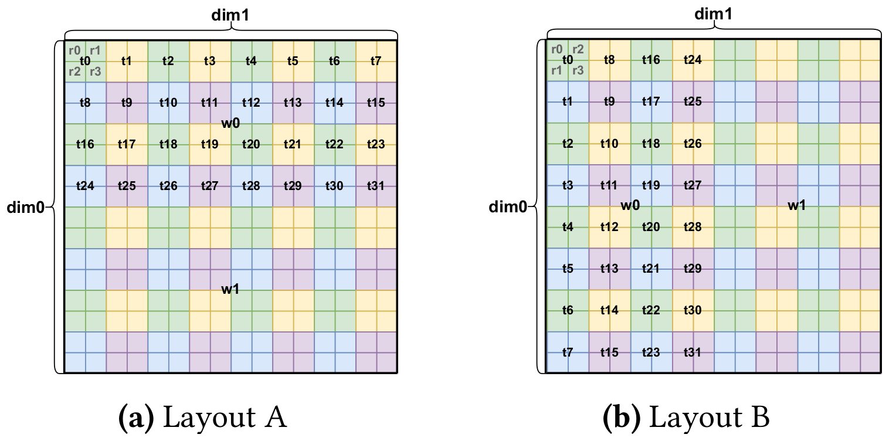
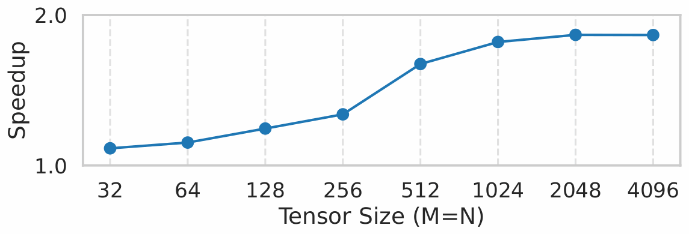
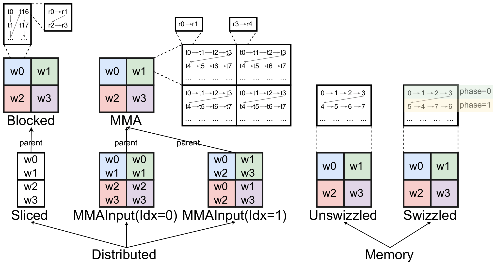
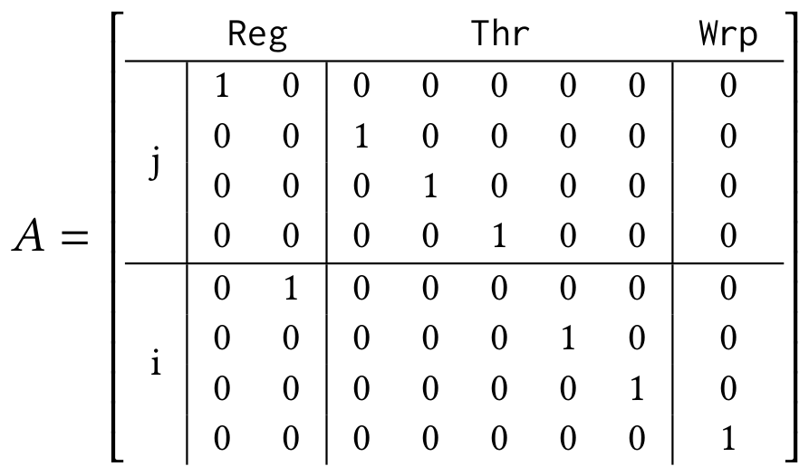
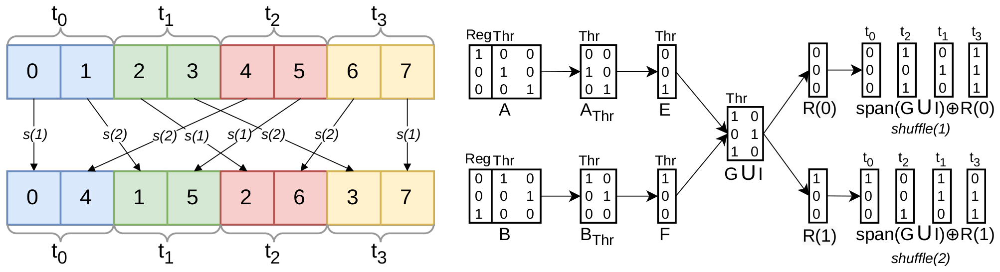
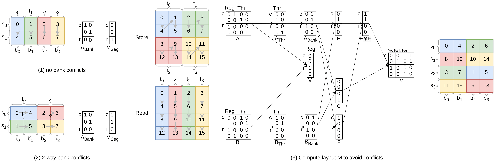
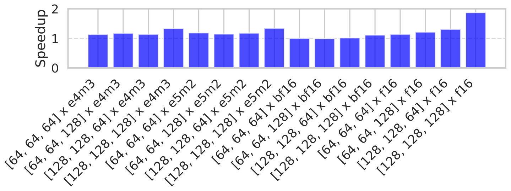
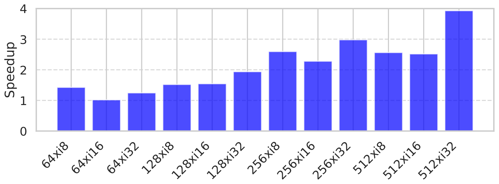
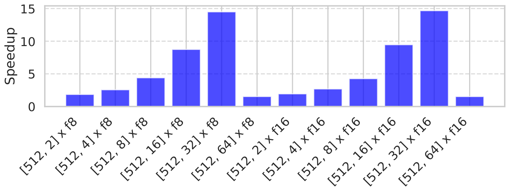
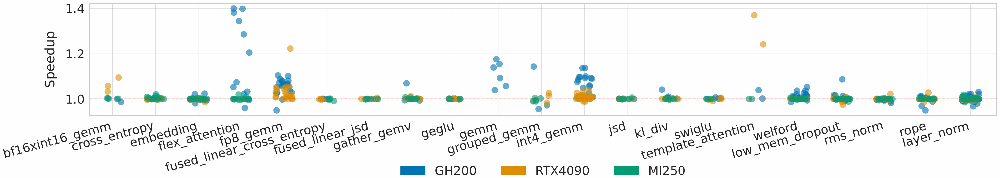

# 论文中文解读：《Linear Layouts: Robust Code Generation of Efficient Tensor Computation Using F2》

> **基本信息**：Keren Zhou（George Mason University，同时署名 OpenAI）、Mario Lezcano-Casado、Adam P. Goucher、Akhmed Rakhmati、Jeff Niu、Justin Lebar、Pawel Szczerbuk、Peter Bell、Phil Tillet、Thomas Raoux、Zahi Moudallal（后十位署名 OpenAI；前三位标注 “contributed equally”）。发表于 ASPLOS ’26（2026-03-22 至 26 日，美国匹兹堡），DOI `10.1145/3760250.3762221`；arXiv:2505.23819v5 [cs.PL]（PDF 标注 2026-03-06）。PDF 共 18 页：正文 13 页，参考文献约 2 页，附录 3 页。原文入口：[arXiv 摘要页](https://arxiv.org/abs/2505.23819)、[arXiv PDF](https://arxiv.org/pdf/2505.23819)。
>
> **阅读说明**：本文放入原文的 9 张图（图 1–9）和第 4.1 节的 $8\times8$ 矩阵原图，逐格转录原文表 1–6；图中没有印出数值的柱和点，用 `pdftocairo -svg` 导出的矢量数据读出，写作“约”。原文的矩阵、集合运算和算法，本文用独立脚本重算过（图 4、图 5 的例子、矩阵 A 与表 1、swizzle 公式、引理 9.5 等），结果在文中标作“本文验算”；本文自己补充的例子、归纳和评论都会标明。比特顺序沿用原文：向量里**最低位在前**（原文脚注 1）。

## 一、先给结论

Linear Layouts 解决的不是“用户怎样写一个 Triton kernel”，而是 Triton 后端更深的一层问题：一个逻辑 tensor 的每个元素到底落在哪个 CTA、warp、lane（线程）、register（寄存器）或 shared-memory offset 上？当两个 operator 要求不同布局时，怎样正确且低成本地搬数据？

论文把这些关系编码为有限域 $\mathbb{F}_2$（只有 $\{0,1\}$，加法是 XOR，乘法是 AND）上的**线性映射**：

$$
\mathbf{w}=A\mathbf{v}\qquad\text{（运算均在 }\mathbb{F}_2\text{ 上）}
$$

输入 $\mathbf{v}$ 是硬件资源索引的比特（寄存器号、线程号、warp 号，或共享内存偏移），输出 $\mathbf{w}$ 是逻辑张量坐标的比特。blocked、MMA、slice、broadcast、swizzle 和 layout conversion 不再是互不相干的特殊类，而可以用 composition（复合）、product（积）、left division（左除）、right inverse（右逆）、子空间交集等统一操作推导。

原文声明的四项贡献（原文第 1 节）：

1. 提出 linear layouts：用 $\mathbb{F}_2$ 线性代数表示并组合 tensor layout；
2. 完整接入 Triton GPU 后端，实现一个能为任意 Triton 操作自动选择并传播 layout 的 layout engine；
3. 新算法：自动发现“可证明地最大化读写向量化、最小化读写 bank conflict”的 swizzle，自动生成最优 warp shuffle，并对这一族 layout 通用地降低（lower）硬件指令；
4. 在合成负载和真实负载上评测，并说明它修复了 Triton 里已有的许多 bug。

主要收益的顺序是：语义统一、正确性与覆盖率、编译器可维护性，最后才是性能。核心数字及其口径（细节见第十五至十七节）：

- **正确性**：混合精度矩阵乘 784 个用例，旧 Triton 通过 366 个（46.7%，原文写 46.6%），Triton-Linear 全部通过（表 5）；reduction/broadcast 的 layout 组合共 100 个用例，旧 Triton 通过 60 个，Triton-Linear 100 个（表 4，本文把各行相加）。
- **指令层面**：load/store 的访问位宽最高从 16 bit 提到 128 bit（表 3，原文标 ↑700%）；shared memory 指令数在两侧都能通过的 layout 上最多下降 76%（表 4）。
- **局部微基准**：MXFP4 矩阵乘最高 1.87×（图 6，GH200）；layout conversion 最高 3.93×（图 7）；gather 正文写最高 14.20×，图 8 的最高柱读数约 14.7×。这些都是特定形状下的局部上限。
- **真实 kernel**：TritonBench 21 个 kernel，摘要写“265 个用例平均 1.07×、最高 1.40×”；正文给出的分平台范围：GH200 为 0.96–1.40×，RTX4090 为 0.97–1.37×，MI250 为 1.00–1.03×。本文从图 9 的矢量数据读出：265 恰好是 GH200 的点数（RTX4090 约 235 个、MI250 约 209 个），GH200 全部点的算术平均约 1.02×，原文没有说明 1.07× 的平均口径，见第十六、十七节。

## 二、先建立 tensor layout 的直觉

### 2.1 layout 是什么

原文把“逻辑 tensor 与硬件计算、存储资源之间的复杂映射”称为 **tensor layout**。设有一个 $16\times16$ 的逻辑 tensor，由两个 warp 保存。一个元素的“物理地址”不只是内存地址，也可以用以下资源坐标描述：

- 它位于哪个 warp；
- warp 中哪个 thread（lane）；
- 该 thread 的哪个 register；
- 若暂存在 shared memory，又对应哪个 bank / segment / offset。

layout 就是这些物理坐标与逻辑 $(\text{row},\text{col})$ 坐标之间的映射。

同一个 tensor 可以有多种 layout。若输入放在 row-major 的 global memory 中，某种 layout 让相邻 lane 读取相邻列，就能 coalesced load；另一种 layout 若让 lane 跨大 stride 读取，会产生更多 transaction。矩阵指令又规定 operand 必须按特定的 lane / register 形式排布。所以 layout 同时影响：

- global memory 的 coalescing 与 vectorization；
- shared memory 的 bank conflict；
- MMA / WGMMA / MFMA 等矩阵指令（intrinsic）是否可用；
- reduction / broadcast 中哪些 lane 持有重复数据；
- operator 之间是否需要寄存器 shuffle 或 shared-memory 往返。

### 2.2 GPU 与 Triton 的背景（原文第 2.1、2.2 节）

GPU 的执行单元分层：cooperative thread arrays（CTA，线程块）、warp（一组同步执行的线程；原文第 4.1 节写作“32 或 64 个线程”）、thread。每个线程有私有 register，延迟最低但容量有限。普通指令由单个线程独立执行，但有些专用单元要在更高粒度上执行：NVIDIA 的 `mma` 由一个 warp 发出，用 tensor core 并行做多个乘加；`wgmma`（warp group matrix multiply-accumulate）由多个 warp 合作；AMD 有 `mfma`。这些指令要求数据分布在多个线程与 warp 上，或放在 shared memory、Blackwell 的 Tensor Memory 等专用存储里，并且**按指定的 layout** 才能得到正确结果。

问题在于：这些 layout 通常不是 load/store 的最佳 layout，也不总能用专门指令把 global memory 直接拷到专用存储。于是数据常要被重排：面向访存的 layout（强调 coalescing 与带宽）要转成面向计算单元的 layout（强调算术吞吐）。这就是 **layout conversion**。

Triton 是一种类 Python 的 DSL，编译器后端基于 MLIR。一个 Triton kernel 遵循 SPMD 模型：计算被切成多个抽象的 program instance，开发者主要关心 CTA 级并行；Triton 里的 “tensor” 指从 PyTorch tensor 上取出的 tile。Python 代码先被翻译成 Triton dialect（`tt`），再翻译成 TritonGPU dialect（`ttg`）；这个过程中每个 tensor 都被关联一个具体 layout，以便用上硬件功能单元，例如遇到 `tt.dot`、`tt.dot_scaled` 这类 dot 操作时，tensor core 用 `mma` layout。

### 2.3 图 1 与图 2：两种 layout 与旧 heuristic 的代价



*图 1（原文 Figure 1，第 2 页）：用两个 warp 存放 $16\times16$ tensor 的两种 layout。*

**图中文字翻译与读法**：

- **符号**：$w_i$ 是第 $i$ 个 warp，$t_j$ 是第 $j$ 个线程，$r_k$ 是第 $k$ 个寄存器；横向是 dim1（列方向），纵向是 dim0（行方向）。每个同色的 $2\times2$ 区域是一个线程持有的 4 个元素，左上角那个线程的 4 个寄存器分别标出。
- **(a) Layout A**：每个线程持有一个 $2\times2$ 块，寄存器在块内按行主序编号（`r0 r1 / r2 r3`）；一个 warp 的 32 个线程在 dim1 方向排 8 个、dim0 方向排 4 个（`t0`–`t7` 在第一行，`t8`–`t15` 在第二行，以此类推）；两个 warp 沿 dim0 上下堆叠，`w0` 管上半、`w1` 管下半。所以这是“$2\times2$ 寄存器、$4\times8$ 线程、$2\times1$ warp”（原文第 4.1 节的话）。
- **(b) Layout B**：每个线程仍持有 $2\times2$ 块，但寄存器按列主序编号（`r0 r2 / r1 r3`）；线程沿 dim0 排 8 个（`t0`–`t7` 在第一列）、沿 dim1 排 4 个（第一行是 `t0 t8 t16 t24`）；两个 warp 沿 dim1 左右并排，`w0` 管左半、`w1` 管右半。
- **读图结论**：若 tensor 在内存里是 row-major，装进 layout A 比装进 layout B 更高效，因为 A 里相邻线程读取同一行里相邻的元素（coalesced read），B 里相邻线程读取相隔两行的元素。同一个逻辑 tensor 的两种 layout 之间要互转，就是 layout conversion。



*图 2（原文 Figure 2，第 2 页）：不同张量尺寸 $M\times N$ 下，float8 转置 kernel 相对 padding heuristic 的加速比。*

**图中文字翻译与读法**：横轴 Tensor Size（M=N）为 32、64、…、4096，纵轴 Speedup 的刻度是 1.0 到 2.0。原文图题只说“与 padding heuristic 相比”，没有写 GPU 型号，也没有写分子是哪种实现（上下文里应是用 linear layouts 自动导出的 swizzle，本文推测）。各点读数约为：32 时 1.11，64 时 1.15，128 时 1.25，256 时 1.34，512 时 1.67，1024 时 1.82，2048 与 4096 时均约 1.87。

**读图结论**：padding 是旧 Triton 在 shared memory 里避免 bank conflict 的常用 heuristic，对常见访问模式有效，但在“复杂访问模式”（原文语）下不是最优；这张图是引言里“旧办法不够好”的一个例子，不是论文的主要实验，不能当作端到端结论。

## 三、旧办法为什么开始失控

### 3.1 硬件 layout 越来越多

NVIDIA 的 Ampere、Hopper、Blackwell 的 tensor core 指令有不同的 operand / output layout，不同数据类型又引入变体；AMD 与 Intel 也有各自的矩阵指令（原文第 1 节）。Triton 自身还需要 blocked、sliced、MMA input / output、swizzled memory 等布局。

若每种布局用一个独立的 class / attribute，再为每对源 / 目标手写 conversion，新增第 $N$ 种 layout 就可能要新增 $O(N)$ 个 pairwise 路径，总体接近 $O(N^2)$（原文称之为 “quadratic explosion”）。规则散落后，transpose、slice、broadcast 和新数据类型很容易漏处理。论文统计，Triton GitHub 仓库里已提交的 bug 约 12% 与 layout 有关（原文引用的 [50] 是 Triton 仓库里标签为 `bug` 且含 “layout” 关键字的 open issue 检索页；这个数字是写作时的快照，不应当成当前仓库的永久比例）。

引言还举了一个手工优化的例子：FlashAttention 3 用 byte permute 与 warp shuffle 指令手工做数据搬运，绕过 shared memory 完成 layout conversion，而这类做法“尚未在 DL 编译器里实现”。FlashAttention 3 的细节见 [FlashAttention-3 中文解读](../flash_attention_3/论文中文解读.md)。

### 3.2 旧 heuristic 看得到名字，看不清语义

旧后端可能知道某个值标成 `Blocked` 或 `MMA`，却难以回答：

- 两个不同种类的 layout 是否其实等价？
- 哪些 bit 对逻辑坐标没有影响，意味着 broadcast / duplicate？
- 最多可以 vectorize 几个连续元素？
- 某个转换能否只做 register rename？
- 能否用 warp shuffle，而不经过 shared memory？
- 怎样选择同时服务读写双方的无冲突 swizzle？

当 layout 没有统一的代数语义，这些问题只能针对已知类型逐个写 pattern。原文的描述是：旧系统要求**每种 layout 自己定义接口方法**（例如每线程的元素数、连续元素数），逐元素的索引和 layout 之间的转换也得为每种 layout 显式实现，因而产生了很多有 bug 的 layout 构造与转换。Linear Layouts 的目标就是把“类型名判断”变成“矩阵 / 子空间计算”。

### 3.3 Triton 里原有的 layout 家族：图 3



*图 3（原文 Figure 3，第 4 页）：Triton 中原有的 layout。$w_i$ 是 warp $i$，$t_j$ 是线程 $j$，$r_k$ 是寄存器 $k$。*

**图中文字翻译与读法**：原文第 3 节说，所有 layout 先分成 **Distributed**（tensor 元素“分布”在不同执行单元上）与 **Memory**（元素存放在某种特殊存储里）两大类；Distributed 又分 Blocked、Sliced、MMA、MMA Input，Memory 又分 Unswizzled 与 Swizzled。

- **Blocked**（左上）：用于连续的内存访问。外层是 $2\times2$ 个 warp（`w0 w1 / w2 w3`）；放大 `w0` 可见线程编号沿列向下增长（`t0`、`t1`、…，再换到下一列的 `t16`、`t17`），每个线程的 $2\times2$ 寄存器块按行主序（`r0→r1`，`r2→r3`）。
- **MMA**：用于矩阵乘的输出。同样是 $2\times2$ 个 warp；放大后可见 $2\times2$ 个子块，每个子块里 4 个线程一行（`t0→t1→t2→t3`，再换到 `t4`…，32 个线程共 8 行，图中只画了前两行）；同一个线程在不同子块里持有不同的寄存器（左上块标 `r0→r1`）。图中右侧另一个子块标成 `r3→r4`，按寄存器编号应为 `r2→r3`，疑为原文笔误（本文判断，原文无说明）。
- **Sliced**：从父 layout（图中父 layout 是 Blocked）里取出一个维度，用作 broadcast 的输入或 reduction 的输出；图中 `w0`、`w1` 画在同一格里，按图意应是两个 warp 持有相同的切片数据（本文解读）。
- **MMA Input（Idx=0 与 Idx=1）**：矩阵乘两个输入 operand 的 layout，父 layout 是 MMA。Idx=0（左操作数）的每个格子由 `w0`、`w1` 共同持有（上排）或由 `w2`、`w3` 共同持有（下排）；Idx=1（右操作数）的每格由 `w0`、`w2` 或 `w1`、`w3` 共同持有。这说明 operand 的数据会在多个 warp 里重复。
- **Memory**：Unswizzled 是行主序，偏移 `0→1→2→3`、`4→5→6→7`；Swizzled 在 `phase=0` 的行里仍是 `0→1→2→3`，在 `phase=1` 的行里变成 `5→4→7→6`（相邻元素两两互换），用于让 MMA layout 读写 shared memory 时不发生 bank conflict。
- **读图结论**：这是原文第 4.3 节“完备性”（本文第七节）要覆盖的全部对象；旧系统为每个小方框各写一套接口和转换规则。

### 3.4 论文的替代做法

原文第 3 节的 “Our Approach”：用一种基于 linear layout 的机制定义 layout；为向后兼容，还提供工具把每个 legacy layout 定义成一个 linear layout。一旦用这些工具定义，`getNumElementsPerThread` 这类接口方法就不必再重新实现；任意 layout 都可以在不修改 Triton 编译器核心后端的情况下实例化，包括 Intel GPU 之类树外（out-of-tree）后端；并且自动得到稳健的 layout 间转换，统一代码生成里对硬件资源的判定。

## 四、数学准备：$\mathbb{F}_2$ 线性代数

### 4.1 为什么选择 $\mathbb{F}_2$

$\mathbb{F}_2$ 是只有 $\{0,1\}$ 的有限域：

```text
加法（XOR）          乘法（AND）
0 + 0 = 0            0 × 0 = 0
0 + 1 = 1            0 × 1 = 0
1 + 0 = 1            1 × 0 = 0
1 + 1 = 0            1 × 1 = 1
```

原文把加法写成 $a\oplus b=(a+b)\bmod2=a\ \mathrm{XOR}\ b$，乘法写成 $a\cdot b=(a\times b)\bmod2=a\ \mathrm{AND}\ b$。$\mathbb{F}_2$ 与二进制逻辑天然对应，硬件上也很高效，所以密码学和纠错码里广泛使用（原文第 2.4 节）。

GPU 的许多规模是 2 的幂：warp 有 32 或 64 个线程，warp group 含 4 个 warp，矩阵指令（`mma`、`wgmma`）要求 tile 尺寸为 $16\times n$；在 Triton 的编程模型里，tensor 的维度以及每个 layout 的子划分（每线程寄存器数、线程数等）也都限制为 2 的幂（原文第 4.1 节）。于是任何索引都可以展开成比特。选择 $\mathbb{F}_2$ 还有几个直接对应：XOR swizzle 本来就是 shared-memory 优化常用的形式；broadcast 对应矩阵的零列；bit permutation 对应置换列。

### 4.2 向量空间、子空间与基（原文第 2.3 节）

原文列出以下概念（对一般的域 $F$，例如 $\mathbb{R}$），本文给出它们在 $\mathbb{F}_2$ 上的读法和小例子：

- **向量空间**：带有向量加法与标量乘法、满足八条公理的非空集合 $V$。在 $\mathbb{F}_2$ 上，向量就是比特串，加法是逐位 XOR；$\mathbb{F}_2^d$ 里共有 $2^d$ 个向量。
- **子空间**：对继承的运算封闭的非空子集 $S\subseteq V$。在 $\mathbb{F}_2$ 上，子集 $S$ 是子空间，当且仅当 $0\in S$ 且 $S$ 对 XOR 封闭。
- **线性组合**：$v=a_1x_1+a_2x_2+\cdots+a_nx_n$。在 $\mathbb{F}_2$ 上，系数 $a_i$ 只能取 0 或 1，所以线性组合就是“从 $x_1,\dots,x_n$ 里挑一些做 XOR”。
- **线性无关**：方程 $a_1x_1+\cdots+a_nx_n=0$ 只有平凡解 $(a_1,\dots,a_n)=(0,\dots,0)$。在 $\mathbb{F}_2$ 上，即“没有任何一个非空子集的 XOR 等于 0”。
- **张成（span）**：$S$ 中所有线性组合的集合，是包含 $S$ 的最小子空间。
- **基**：线性无关且张成 $S$ 的向量组。一个子空间的基含 $k$ 个向量，则该子空间恰有 $2^k$ 个元素。

本文补充的小例子：在 $\mathbb{F}_2^4$ 里取 $u_1=\text{0b0101}$、$u_2=\text{0b1010}$，则 $\mathrm{span}\{u_1,u_2\}=\{\text{0000},\text{0101},\text{1010},\text{1111}\}$，共 $2^2=4$ 个元素；若再加入 $\text{0b1111}$，三者就线性相关，因为 $\text{0101}\oplus\text{1010}\oplus\text{1111}=0$。四个单位向量 $\text{0001},\text{0010},\text{0100},\text{1000}$ 是 $\mathbb{F}_2^4$ 的一组基。

### 4.3 矩阵乘法与“选列再异或”

对 $A\in\mathbb{F}_2^{m\times n}$、$B\in\mathbb{F}_2^{n\times p}$，乘积 $C=AB\in\mathbb{F}_2^{m\times p}$ 逐元素定义为

$$
c_{ij}=\bigoplus_{k=1}^{n}a_{ik}\cdot b_{kj},
$$

其中 $\bigoplus$ 表示在 $\mathbb{F}_2$ 里重复相加，即对各项乘积做 XOR。它与普通矩阵乘法完全类似，只是所有运算都在 $\mathbb{F}_2$ 中进行。

理解这套方法的**关键直觉**（本文归纳）：$A\mathbf{v}$ 等于把 $\mathbf{v}$ 中取值为 1 的那些位对应的 $A$ 的**列**逐个 XOR 起来；$A$ 的第 $k$ 列就是第 $k$ 个输入比特单独为 1 时的输出。例如 $A=\begin{bmatrix}1&0&1&0\\0&1&1&0\\1&1&0&1\end{bmatrix}$，$\mathbf{v}=(1,1,0,1)^\top$ 时，取第 1、2、4 列 $(1,0,1)^\top\oplus(0,1,1)^\top\oplus(0,0,1)^\top=(1,1,1)^\top$（本文验算，与逐行计算一致）。

### 4.4 后文会用到的几个操作

- **Hamming weight（汉明重量）**：一个比特向量或矩阵里 1 的个数（原文引用 [1]）。
- **Gaussian elimination over $\mathbb{F}_2$**：用行的 XOR 做消元，用来求右逆（原文定义 4.5）。
- **swizzle 是线性的**：XOR swizzle 是 $\mathbb{F}_2$ 上的线性变换。例如 4 位索引 $x=(x_0,x_1,x_2,x_3)$ 映射成 $(x_0\oplus x_2,\ x_1\oplus x_3,\ x_2,\ x_3)$，矩阵为 $\begin{bmatrix}1&0&1&0\\0&1&0&1\\0&0&1&0\\0&0&0&1\end{bmatrix}$；它可逆（本文验算它的平方是单位阵，即逆就是自己），而且有两列含两个非零比特，这正是原文“memory layout”定义里允许的列形态（第七节）。若把 $x_0,x_1$ 看作列比特 $j$、$x_2,x_3$ 看作行比特 $i$，它就是第七节 mma swizzle 的一个具体例子。

## 五、原文第 4.1 节：从一个 layout 具体构造矩阵

### 5.1 Layout A 的位级分析

论文以图 1(a) 的 Layout A 为例：它用 $2\times2$ 个寄存器、$4\times8$ 个线程、$2\times1$ 个 warp 铺满 $16\times16$ 的 tensor。因为这些量都是 2 的幂，可以直接看坐标的比特。表 1 取 Layout A 左上角的若干元素，写出矩阵位置到 register、thread、warp 的二进制对应：

**表 1：Layout A（图 1(a)）左上角若干元素的位置与硬件资源（逐格转录）**

| 位置 (i, j) / 二进制 | 寄存器 | 线程 | warp |
|---|---|---|---|
| `(0, 0) / (0b0, 0b0)` | `r0 / 0b0` | `t0 / 0b0` | `w0 / 0b0` |
| `(0, 1) / (0b0, 0b1)` | `r1 / 0b1` | `t0 / 0b0` | `w0 / 0b0` |
| `(0, 2) / (0b0, 0b10)` | `r0 / 0b0` | `t1 / 0b1` | `w0 / 0b0` |
| `(0, 3) / (0b0, 0b11)` | `r1 / 0b1` | `t1 / 0b1` | `w0 / 0b0` |
| ⋯ | ⋯ | ⋯ | |
| `(1, 0) / (0b1, 0b0)` | `r2 / 0b10` | `t0 / 0b0` | `w0 / 0b0` |
| `(1, 1) / (0b1, 0b1)` | `r3 / 0b11` | `t0 / 0b0` | `w0 / 0b0` |
| ⋯ | ⋯ | ⋯ | |
| `(2, 2) / (0b10, 0b10)` | `r0 / 0b0` | `t9 / 0b1001` | `w0 / 0b0` |
| `(2, 3) / (0b10, 0b11)` | `r1 / 0b1` | `t9 / 0b1001` | `w0 / 0b0` |
| ⋯ | ⋯ | ⋯ | |
| `(3, 2) / (0b11, 0b10)` | `r2 / 0b10` | `t9 / 0b1001` | `w0 / 0b0` |
| `(3, 3) / (0b11, 0b11)` | `r3 / 0b11` | `t9 / 0b1001` | `w0 / 0b0` |
| ⋯ | ⋯ | ⋯ | |

（原文表 1，第 5 页。末列在“⋯”行没有省略号，原表就是这样，不影响读数。）

**读法**：每个线程取连续的 $2\times2$ 块，所以寄存器 $r_0$ 的元素坐标的最低位 $i_0$、$j_0$ 都是 0；$r_1$ 的 $j_0$ 恒为 1；$r_2$ 的 $i_0$ 恒为 1；$r_3$ 的 $i_0$、$j_0$ 都是 1。例如线程 $t_1$ 的 $r_0$ 在 $(0,2)=(\text{0b0},\text{0b10})$，线程 $t_9$ 的 $r_1$ 在 $(2,3)=(\text{0b10},\text{0b11})$。

**三个映射函数与 XOR 合成**。原文进一步考虑三个映射函数，它们把每个硬件下标表示成“逐级变大的 tile”里的坐标：register 映射、thread 映射、warp 映射（原文行文把前两个的下标写反了，写成 “register → loc_thread, thread → loc_register”，按上下文应是 register → loc_register、thread → loc_thread）。以 warp $w_0$ 里线程 $t_9$ 的寄存器 $r_1$ 为例：

- register 映射把 $r_1$ 放在 $\mathrm{loc}_{r_1}=(0,1)=(\text{0b0},\text{0b1})$，即线程 tile 的第二列；
- thread 映射把这个 tile 放在 warp tile 里的 $\mathrm{loc}_{t_9}=(2,2)=(\text{0b10},\text{0b10})$；
- warp 映射给出 $\mathrm{loc}_{w_0}=(0,0)$；
- 三组坐标逐位 XOR 得到绝对位置：$\mathrm{loc}_{w_0}\oplus\mathrm{loc}_{t_9}\oplus\mathrm{loc}_{r_1}=(2,3)=(\text{0b10},\text{0b11})$。

### 5.2 把它写成矩阵 $A$

设向量 $\mathbf{v}$ 有 8 位：前 2 位 $v_{0:1}$ 是寄存器（Reg），接着 5 位 $v_{2:6}$ 是线程（Thr），最后 1 位 $v_7$ 是 warp（Wrp）。输出 $\mathbf{w}=A\mathbf{v}\in\mathbb{F}_2^8$ 中 $w_{0:3}=j$、$w_{4:7}=i$（因为 $j$ 是变化最快的维度）。原文给出的矩阵 $A=\mathbb{F}_2^{8\times8}$ 如下图。



*原文第 4.1 节的矩阵 $A$（第 5 页），列按输入资源 Reg / Thr / Wrp 分组，行按输出的 $j$、$i$ 两个维度分组。*

**逐格转录与读法**（行 = 输出比特，列 = 输入比特；对照上图逐项核对过）：

| 输出比特 | Reg0 | Reg1 | Thr0 | Thr1 | Thr2 | Thr3 | Thr4 | Wrp0 |
|---|---|---|---|---|---|---|---|---|
| $j_0$ | 1 | 0 | 0 | 0 | 0 | 0 | 0 | 0 |
| $j_1$ | 0 | 0 | 1 | 0 | 0 | 0 | 0 | 0 |
| $j_2$ | 0 | 0 | 0 | 1 | 0 | 0 | 0 | 0 |
| $j_3$ | 0 | 0 | 0 | 0 | 1 | 0 | 0 | 0 |
| $i_0$ | 0 | 1 | 0 | 0 | 0 | 0 | 0 | 0 |
| $i_1$ | 0 | 0 | 0 | 0 | 0 | 1 | 0 | 0 |
| $i_2$ | 0 | 0 | 0 | 0 | 0 | 0 | 1 | 0 |
| $i_3$ | 0 | 0 | 0 | 0 | 0 | 0 | 0 | 1 |

即：Reg0 翻转列的最低位 $j_0$，Reg1 翻转行的最低位 $i_0$（线程的 $2\times2$ 块）；Thr0–Thr2 翻转 $j_1$–$j_3$（8 个线程沿列方向排）；Thr3、Thr4 翻转 $i_1$、$i_2$（4 个线程沿行方向排）；Wrp0 翻转 $i_3$（两个 warp 沿行方向堆叠）。

**带标签的向量空间**。原文给每个比特打上标签：输入 $\mathbf{v}$ 属于 $\mathbb{F}_2^2\times\mathbb{F}_2^5\times\mathbb{F}_2^1$，建模 $\mathrm{Reg}\times\mathrm{Thr}\times\mathrm{Wrp}$；输出 $\mathbf{w}$ 属于 $\mathbb{F}_2^4\times\mathbb{F}_2^4$，表示逻辑 tensor 的两个维度 $(i,j)$。

**验算例子**（原文）：warp $w_0$、线程 $t_9$、寄存器 $r_1$。把整数按低位优先拆成比特：$\mathbf{v}_{\mathrm{Reg}}=\text{0b01}=[1\ 0]^\top$，$\mathbf{v}_{\mathrm{Thr}}=\text{0b01001}=[1\ 0\ 0\ 1\ 0]^\top$，$\mathbf{v}_{\mathrm{Wrp}}=\text{0b0}=[0]^\top$。$A\mathbf{v}$ 就是把 $\mathbf{v}$ 为 1 的那些位对应的列（Reg0、Thr0、Thr3）逐位 XOR：它们分别翻转 $j_0$、$j_1$、$i_1$，得到 $\mathbf{w}_j=[1\ 1\ 0\ 0]^\top=\text{0b0011}=3$，$\mathbf{w}_i=[0\ 1\ 0\ 0]^\top=\text{0b0010}=2$，即逻辑坐标 $(2,3)$，与前面三个映射 XOR 的结果、与表 1 一致。

**本文验算**：用独立脚本把这个矩阵对全部 $2\times32\times4=256$ 个（warp, 线程, 寄存器）组合求值，得到的坐标恰好铺满 $16\times16$ 且与图 1(a) 的排布（每线程 $2\times2$ 块、行内 8 个线程、4 个线程行、两个 warp 上下堆叠）完全一致；表 1 的 10 个具体行也全部一致。

**为什么标签重要**：传统描述可能写成多层的“register tile + threads per warp + warps per CTA”参数；线性描述把它们合成一张矩阵，同时保留 `Reg`、`Thr`、`Wrp` 标签。标签很重要，因为同一个向量空间里的比特在硬件成本上并不等价：跨 register 的移动只是重命名，跨 lane 要用 warp shuffle，跨 warp 通常要经过 shared memory 与同步（这条成本排序是本文对第十二节算法的归纳）。

**broadcast（重复数据）对应零列**：若在 $A_{\mathrm{Reg}}$ 里再加一列零，则寄存器 4–7 映射到与寄存器 0–3 相同的 tensor 元素（原文第 5.1 节）。

## 六、原文第 4.2 节：基本代数构件

**定义 4.1（Linear Layout）**：带标签的 $\mathbb{F}_2$ 向量空间之间的线性映射。例如 $L:\mathrm{Reg}\times\mathrm{Thr}\times\mathrm{Wrp}\to\mathbb{F}_2^n\times\mathbb{F}_2^m$；用下标表示带标签的子空间，如 $L_{\mathrm{Reg}}$（$L$ 中作用于寄存器的那些列）。

**定义 4.2（Composition，复合）**：给定 $L_1:U\to V$ 与 $L_2:V\to W$，$L_2\circ L_1:U\to W$ 定义为 $u\mapsto L_2(L_1(u))$。若 $L_1$、$L_2$ 的矩阵是 $M_1$、$M_2$，则 $L_2\circ L_1$ 的矩阵是（逐标签的）矩阵乘积 $M_2M_1$。

**定义 4.3（Product，积）**：$U\times V=\{(u,v)\mid u\in U,\ v\in V\}$。对 $L_1:U_1\to V_1$、$L_2:U_2\to V_2$，$L_1\times L_2:U_1\times U_2\to V_1\times V_2$ 把 $(u_1,u_2)$ 映射到 $(L_1(u_1),L_2(u_2))$，矩阵是（逐标签的）分块对角矩阵

$$
\begin{bmatrix}M_1&0\\0&M_2\end{bmatrix}.
$$

原文脚注 2：这个构造更常被称为映射的 direct sum（直和）$L_1\oplus L_2$；为避免与 XOR 的记号 $\oplus$ 混淆，原文把它按范畴论说成 product。

Composition 与 Product 用来由简单 layout 搭出复杂 layout：例如 composition 可以通过把父 layout 的某个维度映射到全 0 来取出一个 slice；product 可以由 register 到 thread 再到 warp 逐级构造复杂 layout。

**定义 4.4（Left Division，左除）**：矩阵 $M$ 可被 $M_1$ 左除，若 $M$ 具有如下结构，记作 $M/_{\ell}M_1=M_2$（逐标签处理）：

$$
M=\begin{bmatrix}M_1&0\\0&M_2\end{bmatrix}.
$$

它可用来判断一个 layout 能否分解出若干满足高效硬件原语（例如 `ldmatrix`）的小 layout，原文第 5.3 节使用它。

**定义 4.5（Right Inverse，右逆）**：满射的线性 layout $L:U\to V$ 有右逆。若 $M$ 是 $L$ 的 $m\times n$ 矩阵，原文把 $M^{-1}$ 定义为方程 $MX=I_m$ 的那个 $n\times m$ 的“least squares solution”，并说明可以用 $\mathbb{F}_2$ 上的 Gaussian elimination 计算；右逆用于从逻辑 tensor 的坐标恢复硬件下标。（在 $\mathbb{F}_2$ 上“最小二乘”没有通常含义，这里实际指 $MX=I_m$ 的某个特定解；挑选哪个解的准则见第十二节。）

**本文补充的四个小例子**（均已用脚本验算）：

1. **product**：$L_1=[1]$（1 个寄存器比特映射到 1 个逻辑比特），$L_2=\begin{bmatrix}0&1\\1&0\end{bmatrix}$（两比特互换）。则 $L_1\times L_2=\begin{bmatrix}1&0&0\\0&0&1\\0&1&0\end{bmatrix}$。
2. **composition**：见第十二节图 4 的转换矩阵 $C=B^{-1}\circ A$。
3. **right inverse 与 broadcast**：设 $B=\begin{bmatrix}1&0&0\\0&1&0\end{bmatrix}$（Reg0 对应 $x_0$，Reg1 对应 $x_1$，第三列是零列，即一个被重复的线程比特）。$BX=I_2$ 共有 4 个解，$X=\begin{bmatrix}1&0\\0&1\\a&b\end{bmatrix}$，$a,b\in\{0,1\}$ 任取。第三行就是“从被重复的那个线程比特读”这件事的自由度；取 $a=b=0$ 时 Hamming weight 最小（为 2），对应“所有指向同一元素的副本都从同一个来源读”。
4. **left division**：把“一次向量化访问 2 个元素”的 tile 记为 $T=[1]$（1 个寄存器比特映射到偏移最低位）。若 $L=\begin{bmatrix}1&0\\0&1\end{bmatrix}$（寄存器两比特依次映射到偏移的两个比特），$L/_{\ell}T$ 存在；若 $L'=\begin{bmatrix}0&1\\1&0\end{bmatrix}$（列主序，两比特互换），则不可直接除。这时对寄存器做一次置换 $P_{\mathrm{Reg}}$（原文记作 $P_{\mathrm{Reg}}L$；本例是交换两个寄存器比特）就化成了 $L$，即原文第 5.3 节的 “generalized vectorization”。

## 七、原文第 4.3 节：“完备性”到底指什么

原文要证明 Triton 里原有的主要 layout 家族都能表示成 linear layout，随后给出更精确的分类。

### 7.1 Distributed layouts

**Blocked layout**（命题 4.6，附录命题 9.1）：旧 Triton 里用于连续内存访问的那一族。附录的构造：设 tensor 形状为 $(d_1,\dots,d_\ell)$，$R,T,W$ 是长度为 $\ell$ 的元组，分别表示每个维度上寄存器、线程、warp 数目的 $\log_2$，满足 $R_i+T_i+W_i=d_i$；blocked layout 还有一个顺序 $o$（$o_i$ 表示第 $i$ 快的维度）。令 $\mathrm{id}_R^o$ 表示把各维寄存器比特按顺序 $o$ 以单位矩阵映到对应维度的积，$\mathrm{id}_T^o$、$\mathrm{id}_W^o$ 类似，$\sigma_o$ 表示按顺序 $o$ 重排各维度的置换，则对应的 linear layout 是

$$
\sigma_o^{-1}\circ\big(\mathrm{id}_R^o\times\mathrm{id}_T^o\times\mathrm{id}_W^o\big):\ \mathbb{F}_2^{\lvert R\rvert}\times\mathbb{F}_2^{\lvert T\rvert}\times\mathbb{F}_2^{\lvert W\rvert}\to\mathbb{F}_2^{d_1}\times\cdots\times\mathbb{F}_2^{d_\ell}.
$$

这个线性映射是线性映射的复合，所以是线性的。**本文对照**：图 1(a) 的 Layout A 就是 $R=(1,1)$、$T=(2,3)$、$W=(1,0)$（按 $(\mathrm{dim}0,\mathrm{dim}1)$ 记），变化最快的维度是 dim1；每个维度里，寄存器比特先占低位，然后是线程比特，最后是 warp 比特，所以 Reg0→$j_0$、Reg1→$i_0$、Thr0–Thr2→$j_1$–$j_3$、Thr3–Thr4→$i_1$–$i_2$、Wrp0→$i_3$，恰是第五节的矩阵 $A$（本文推导，已验算）。
**MMA layout**（命题 4.7，附录命题 9.2）：`mma` 与 `wgmma` 的输入输出 layout 是 linear layout；对 AMD 与 Intel 的矩阵指令，原文只说“可以构造性地证明它们存在”（正文第 4.3 节），并没有给出证明。附录用 tile 的形式写出了 `mma` 的结构。记 $\mathrm{id}_k^{i,j}$ 为从输入维度 $i$（Reg、Thr、Wrp）到第 $j$ 个输出维度的 $k\times k$ 单位映射（取各自空间前 $k$ 个基）。对位宽为 $b$ 的输入，`mma` 的左操作数输入与输出在寄存器上的 tile 为

$$
\mathrm{id}_{\log_2(32/b)}^{\mathrm{Reg},1}\times\mathrm{id}_2^{\mathrm{Thr},1}\times\mathrm{id}_3^{\mathrm{Thr},0}\times\mathrm{id}_1^{\mathrm{Reg},0}\times\mathrm{id}_1^{\mathrm{Reg},1},
$$

右操作数的 tile 为

$$
\mathrm{id}_{\log_2(32/b)}^{\mathrm{Reg},0}\times\mathrm{id}_2^{\mathrm{Thr},0}\times\mathrm{id}_3^{\mathrm{Thr},1}\times\mathrm{id}_1^{\mathrm{Reg},1},
$$

原文说它是前者的转置且每线程的寄存器减半。`wgmma` 左操作数的 tile 是 `mma` 左操作数 tile 再乘以 $\mathrm{id}_2^{\mathrm{Wrp},0}$（覆盖整个 warp group），输出的其余 tile 由第一个 tile 乘以 $\mathrm{id}_W^o$ 得到。**位级读法（本文）**：各因子的输入比特按从左到右由低到高排列。以左操作数、$b=16$ 为例：寄存器低位的第 1 个比特落在维度 1，第 2 个比特落在维度 0，第 3 个落在维度 1；线程的低 2 位落在维度 1，高 3 位落在维度 0。
**Sliced layout**（命题 4.8）：对某个维度做 reduction（`tt.sum`、`tt.min` 等）的结果。证明只有一句：“去掉一个维度是线性映射”。用矩阵语言说，就是删去矩阵的若干行，所得 layout 不一定是单射（可能出现零列），但仍是满射。**本文例子**：对第五节的矩阵 $A$ 沿 dim1 做 reduction，就是删掉 $j_0$–$j_3$ 四行，Reg0、Thr0、Thr1、Thr2 四列变成零列，剩下的 16 个行值各被 $2\times8=16$ 个（寄存器, 线程）副本持有，也就是说这些线程持有相同的数据。

由此得到定理 4.9：每个 distributed layout 都是 linear layout。原文于是可以用线性代数形式地定义它。

**定义 4.10（Distributed Layout）**：Triton 里的 distributed layout 是从寄存器、线程、warp 到逻辑 tensor 的满射线性 layout，其矩阵的**每一列至多有一个非零比特，且任意两个非零列不重复**。

原文的解释：distributed layout 是一个置换矩阵，其间可以插入若干零列。零列表示“该硬件比特变化时逻辑坐标不变”，即该资源保存的是**重复（replicated / broadcast）数据**。这一刻画很重要：以前只是非形式化的定义，现在已经完全翻译成线性代数与代码。

### 7.2 Memory layouts

**Memory layout** 是把逻辑 tensor 分布到一段可编程存储（shared memory、tensor memory 等）上的方式，被建模为从内存偏移 $\mathrm{Off}$ 到逻辑 tensor 坐标的映射。

**Unswizzled layout**：把偏移直接映到逻辑位置，位置 $(i,j)$ 对应坐标 $(i,j)$。但当用它读写某些 distributed layout（例如 MMA 族）时，bank conflict 使性能下降。
**mma swizzling**（定义 4.11）：为了解决上述问题引入。给定参数 $\text{vec}>0$、$\text{per\_phase}$、$\text{max\_phase}\ge0$（都是 2 的幂），把每个元素的位置 $(i,j)$ 映到偏移

$$
\Big(\Big(\big\lfloor\tfrac{i}{\text{per\_phase}}\big\rfloor\bmod\text{max\_phase}\Big)\oplus\big\lfloor\tfrac{j}{\text{vec}}\big\rfloor\Big)\cdot\text{vec}\ \oplus\ (j\bmod\text{vec}),
$$

其中 $\cdot$ 是 uint64 乘法，$\oplus$ 是 XOR，偏移以元素计。（原文公式里的除法没有印取整号，按整数除法理解；它给出的是行内的列偏移，每行的基址 $i\cdot2^n$ 在矩阵形式里体现。）
**命题 4.12**：mma swizzled layout 是 linear layout。证明：公式里的运算都是对 $i,j$ 的比特做的线性运算，所以是线性映射；它显然既单又满，因此有逆，逆定义了 memory layout（原文此处写成“从逻辑 tensor 坐标到 $\mathrm{Off}$”，方向与定义里“从偏移 $\mathrm{Off}$ 到逻辑坐标”相反，应是笔误）。
求逆后，对尺寸为 $2^m\times2^n$ 的 tensor，mma swizzling 对应的矩阵具有如下结构：

$$
\begin{bmatrix}\mathrm{I}_n&C\\0&\mathrm{I}_m\end{bmatrix},\qquad c_i=\Big(\text{vec}\cdot\big(\lfloor 2^i/\text{per\_phase}\rfloor\bmod\text{max\_phase}\big)\Big)\bmod 2^n,
$$

其中 $\mathrm{I}_m,\mathrm{I}_n$ 是 $m$ 阶、$n$ 阶单位阵，$c_i$ 是 $C$ 里与第 $i$ 个行比特对应的那一项（原文称“$C$ 的第 $i$ 行”；放进上面的分块矩阵时它占第 $i$ 列，本文验算按列处理）。直观：第 $i$ 个行比特翻转时，列偏移被 XOR 上 $c_i$；$c_i$ 要么是 0，要么是一个 2 的幂，所以每列至多两个非零比特。
**本文验算**：对随机生成的 2625 组参数（要求 $\text{vec}\cdot\text{max\_phase}\le2^n$）逐点验算，公式给出的映射是 $\mathbb{F}_2$ 线性的，矩阵恰好是上面的 $\begin{bmatrix}\mathrm{I}_n&C\\0&\mathrm{I}_m\end{bmatrix}$ 且 $c_i$ 与公式一致。若 $\text{vec}\cdot\text{max\_phase}>2^n$，XOR 项会溢出到行基址的比特，线性与矩阵结构都不再成立；原文没有写这个前提（本文补充）。
**本文例子**：取 $n=m=2$（$4\times4$）、$\text{vec}=1$、$\text{per\_phase}=1$、$\text{max\_phase}=4$，则 $c_0=1$、$c_1=2$，$C=\mathrm{I}_2$，偏移 $=4i+(j\oplus i)$。四行依次是 `0 1 2 3`、`5 4 7 6`、`10 11 8 9`、`15 14 13 12`；其中第 1 行 `5 4 7 6` 就是图 3 里 Swizzled 在 `phase=1` 的那一行。第四节的 $4\times4$ XOR 矩阵正是它。

**定理 4.13**：每个 memory layout 都是 linear layout。

**定义 4.14（Memory Layout）**：Triton 里的 memory layout 是**可逆**的 linear layout，其矩阵的列含有 1 个或 2 个非零比特：一个非零比特是普通排列，两个非零比特可表达 XOR swizzle。（第 5.4 节再讨论怎样为任意 distributed layout 计算使读写性能最优的 memory layout。）

### 7.3 不要把“完备”扩大

论文的完备性是**相对于规定的 Triton distributed / memory layout 家族与 shape operators**，并不是“任何整数 shape、任何非线性索引都能用 $A\mathbf{x}$ 表示”。最明显的限制是各维大小为 2 的幂；论文结论里也明确承认：flipping（翻转）、slicing（取带偏移的切片）不能表示成线性的 $\mathbf{y}=A\mathbf{x}$，但可以由简单扩展 “affine layouts” $\mathbf{y}=A\mathbf{x}\oplus\mathbf{b}$ 来表达，这不是论文当前的主体。

## 八、原文第 4.4 节：Layout Engine 与 shape closure

Triton 的操作分四类：(1) 计算，(2) 内存（global、shared、tensor 等），(3) layout conversion，(4) shape 操作。linear layouts 已经覆盖了前两类；这一节说明它们怎样让 layout 在 shape 操作里传播，并让元素在 layout 之间流动。

**Triton 的 Layout Engine**（原文）：

1. 先给 global memory 操作分配 blocked layout，给对输入布局有要求的计算操作（如经 `tt.dot` 暴露的 `mma`、`wgmma`）分配相应布局，这些统称 **anchor layout**；
2. 传播阶段分前向和后向两遍。前向沿 use chain 传播候选 layout，在多输入操作处合并；冲突用 heuristic 解决（例如 load/store 偏向 blocked layout），并插入 layout conversion 把有多个候选 layout 的值标准化；
3. 后向遍沿定义链反向 rematerialize layout conversion；如果链上的指令都很便宜，整条操作链可以被重新物化，以消除 layout conversion。

线性代数没有自动解决“全局最优布局选择”：它提供统一表示和合法变换，heuristic / cost model 仍负责“选哪个更快”。

**经过 shape 操作的传播**：Triton 的 shape 操作有 `tt.trans`、`tt.reshape`、`tt.join`、`tt.split`、`tt.expand_dims`、`tt.broadcast`。对每个输入（相应地输出）distributed layout，都存在同一家族中的输出（输入）layout，使这个操作在物理分布上变成**空操作（no-op）**，因而很便宜。原文在附录证明：定义 4.10 的 distributed layout 家族对这些操作是前向（相应地后向）封闭的（定理 9.3）。附录还给出了**最小性**：这个家族是满足该性质的最小家族。证明思路是：这些操作作用在逻辑 tensor 上显然是线性的，所以第一部分成立；对最小性，可以把任何 tensor reshape 成 $2\times2\times\cdots\times2$ 并做维度转置，问题化为“这些操作能否在超立方上生成任意带 0 与 1 的 layout”；全 1 的 layout 可由 blocked 编码得到，任意位置的 0 可以通过沿任意维度 reduce 插入，因此必须包含定义 4.10 的所有 linear layout。

**本文补充的直观例子**：`tt.trans` 在逻辑坐标上交换两个维度，对矩阵来说是把对应的两组行互换；互换后的矩阵仍是“置换矩阵加零列”，所以转置后得到的仍是 distributed layout，物理数据一个字节都不用动。注意原文的措辞：定义 4.10 的家族**严格大于**旧 layout 家族，例如旧 layout 不能表示“MMA layout 的转置”，而定义 4.10 显然包含它。所以旧系统无法为某些操作传播 layout，只好插入多余的 layout conversion（额外的数据搬运）。

linear layouts 使这个 engine 尽可能通用，也使第 5.2 节那样复杂的优化可以直接在 Python 前端以零运行时开销实现（原文语）。

## 九、原文第 5.1 节：两个旧系统易错的问题

没有 linear layouts 时，Triton 的 layout 属性是非形式化的、逐个实现的，容易出细微错误。原文挑了两个例子。

### 9.1 连续元素与 vectorization

每线程连续元素的个数决定能否向量化地 load / store global memory。旧 Triton 靠 heuristic：找出变化最快的维度，并假定它决定了连续元素；但若该维度只有一个元素（例如 shape 为 `[128, 1]` 时的最后一维），Triton 会关掉向量化。

用 linear layouts，问题变成：在逻辑 tensor 里，找最大的一段连续块，使它被 layout 的逆**以恒等映射**映到寄存器上。给定线性 layout $L$，找最大的 $u$，使得对任意 $i\le u$ 都有 $L_{\mathrm{Reg}}^{-1}(i)=i$。也就是检查矩阵的列，而不是枚举布局类型。

**本文例子**：对第五节的 Layout A，逻辑线性下标（行主序，$j$ 最快）的最低位 $j_0$ 来自 Reg0，下一位 $j_1$ 来自线程，所以每个线程只有 2 个元素连续；这与每个线程拿一个 $2\times2$ 块的描述一致。

**与表 3 的联系**：原文第 6.1 节的 load/store 微基准正是检验这件事——当连续元素跨越多个维度时，旧 Triton 找不全，Triton-Linear 能找到（见第十五节）。

### 9.2 Broadcast duplication

legacy layout（blocked、MMA 等）由一个初始 tile 把数据分布到 register、thread、warp 上。若 tile 比 tensor 小，tile 被复制以覆盖整个 tensor，每线程的寄存器用量增加；反之若 tile 比 tensor 大，tensor 被复制来覆盖 tile，这意味着线程与 warp 可能在寄存器里持有重复数据。在 LLVM 代码生成里处理这件事，尤其是 reduction 和 scan，很复杂，因为在任意 layout 里判断哪些线程持有重复数据并不简单——这几年一直是 Triton bug 的来源（原文引用了几个 GitHub issue）。

用 linear layouts：tiling 操作翻译成 Product；建立线性 layout 后，识别持有重复数据的线程与 warp 就变成**检测 layout 矩阵里的零列**。例如给第五节的 $A_{\mathrm{Reg}}$ 加一个零列，意味着寄存器 4–7 映射到与寄存器 0–3 相同的 tensor 元素。

## 十、原文第 5.2 节：混合精度矩阵乘

低精度数据类型在 DL 模型里被证明可以保持相同精度并提高性能；常见场景是一个 operand 精度较高、另一个较低。论文讨论 linear layouts 怎样让混合精度矩阵乘既稳健又高效。

**软件模拟（Software Emulation）**。新一代 GPU（NVIDIA B200、AMD MI350x）对 MXFP4 这类量化类型有原生硬件支持：每 32 个浮点元素共享一个 8 位指数（scale）。受限于写作时这类硬件的可得性，Triton 需要在现有架构上软件模拟。例如做 `mxfp4 × bf16` 时，先把 mxfp4 上转（upcast）成 bf16；原文指出，每组 8 个线程（`mma` layout 的一行）共享同一个 scale。用 legacy layout 实现需要新增一个 layout，以及它与所有 distributed / memory layout 的转换；另一种办法是用 blocked layout 加载指数、再用 warp shuffle 共享，但性能欠佳。

linear layouts 的做法更好：为 scale 的广播定义 shape 变换（`tt.reshape`、`tt.transpose`、`tt.broadcast`），layout engine 就能自动推出加载 scale 所需的正确 layout，其余用通用的 shared memory load 完成；这种方式也在 Python API 层暴露。

**数据洗牌（Data Shuffling）**。先加载低精度数据、再上转、再调用 Tensor Core 指令，常常低效。例如 `mxfp4 × bf16` 时，mxfp4 数据不能用向量化指令加载，因为对应的 `wgmma` 指令要求操作数每一行每线程占两个寄存器。优化办法是在计算前，在 HBM 里把**高精度操作数（bf16）预先洗牌（pre-shuffle）**，从而让低精度操作数（mxfp4）可以更宽地向量化加载。Machete 框架用几千行代码并重度依赖 CUTLASS 实现过这个方案；用 linear layouts，这个优化可以在语言层面只用约 5 行 Python 的 shape 操作完成（原文语）。脚注：对 `mma` 指令，由于它的两个操作数都可以放在寄存器里，不需要预洗牌也能做类似优化。

## 十一、原文第 5.3 节：使用 SIMD 硬件原语与 left division

SIMD 指令是现代硬件提高数据吞吐的基础。前面讨论的向量化 global memory 操作和 `mma` / `wgmma` 操作都要求 tensor 遵循由与 SIMD 指令兼容的小 tile 构成的特定 layout。这一节讨论怎样用高效的 SIMD 指令把一个 layout 映到另一个。

**定理 5.1**：给定 layout $L$，若 $L/_{\ell}T$ 存在，则带 tile $T$ 的指令可以降低（lower）$L$。证明由 tile 的定义与左除的定义直接得到。

**Shared memory 的 load 与 store**。把 distributed layout 的寄存器按 SIMD 指令映射到对应的 MMA swizzled layout，可以实现快速的 shared memory load / store。在 legacy 系统里，通用地做这件事很困难：每对 layout 要单独实现，只能支持一部分 layout，常导致错误甚至静默失败。linear layouts 给出通用的优雅解：给定由可逆矩阵 $A$ 表示、把偏移映到逻辑 tensor 的 memory layout，以及把寄存器、线程、warp 映到同一空间的 distributed layout $B$，所需映射就是

$$
L=A^{-1}\circ B.
$$

确定 $L$ 后，构造相应的 tile $T$，检查 $L/_{\ell}T$ 是否存在，就能判断某条 SIMD 指令是否兼容这个 layout。

- **向量化 `ld.shared` / `st.shared`**：大小为 $2^n$ 比特（通常 32、64、128）的向量化 shared memory 指令的 tile 是“从寄存器到内存偏移的恒等映射”，大小为 $n\times n$（原文的 $n$ 在此处与前面 “$2^n$ 比特” 的 $n$ 记号重名，按语义应理解为向量宽度所含元素数的 $\log_2$）。
- **`ldmatrix` / `stmatrix`**：这类指令要求每个线程处理 4 个连续字节，8 组、每组 4 个线程合作存放一行。对字节宽度为 $w$ 的元素类型，tile 为 $\mathrm{id}_k^{\mathrm{Reg},\mathrm{Off}}\times\mathrm{id}_2^{\mathrm{Thr},\mathrm{Off}}$，其中 $k=\log_2(4/w)$，$\mathrm{id}_k$ 是 $k\times k$ 单位阵。**本文读法**：$k$ 个寄存器比特对应线程这 4 个字节里的相邻元素，2 个线程比特对应同一行里相邻的 4 个线程（共 16 字节）。
- **广义向量化（Generalized Vectorization）**：若 $L$ 的结构不能被 $T$ 除，可以通过置换寄存器来调整。例如 layout 是列主序时不能直接向量化，此时定义 $L'=P_{\mathrm{Reg}}L$，其中 $P_{\mathrm{Reg}}$ 是寄存器置换；因为除法算法按顺序处理 $L$ 与 $T$ 的各列，可以在计算除法的同时确定 $P_{\mathrm{Reg}}$。（第六节的第 4 个小例子就是这个情形。）

## 十二、原文第 5.4 节：layout conversion 怎样分层降低

设源 layout 为 $A$，目标为 $B$，两者都是 distributed layout。把它们看成 $\mathbb{F}_2^d$ 里的向量（把逻辑 tensor $\mathbb{F}_2^{d_1}\times\cdots\times\mathbb{F}_2^{d_r}$ 拉平成 $\mathbb{F}_2^d$），用 $L_{\mathrm{Reg}}$、$L_{\mathrm{Thr}}$、$L_{\mathrm{Wrp}}$ 表示 $L$ 中作用于寄存器、线程、warp 的列集合；由定理 4.10（原文这里把“定义 4.10”写成了“定理 4.10”）可知这些列是互不相同的 2 的幂或零。

概念上的转换是

$$
C=B^{-1}\circ A.
$$

$B$ 不必可逆（可能有 broadcast），但它是满射（要覆盖整个逻辑 tensor），所以右逆存在，只是不唯一。原文选择转换时遵循两条准则：

1. **最小化跨 warp / 跨线程的数据移动**：若 $A_i=B_i$，则 $(B^{-1}\circ A)_i$ 是单位映射，对 $i\in\{\mathrm{Reg},\mathrm{Thr},\mathrm{Wrp}\}$ 分别成立；
2. **促进 broadcasting**：线性方程组 $BX=A$ 可能有多个解（如 $B$ 把同一个 tensor 元素广播到多个寄存器）。为挑出唯一解，把方程组里的松弛变量（slack variables）设为 0，得到 Hamming weight（解 $X$ 中 1 的个数）最小的解。直观上是让指向逻辑 tensor 里同一个值的所有元素，都从同一个输入执行单元读取。

然后按硬件层级决定怎样交换数据：

```text
同一 thread 内     → register permutation / reinterpretation
同一 warp 跨 lane  → warp shuffle（要求 (B⁻¹∘A) 在 Wrp 上是恒等）
其余（跨 warp 等） → shared memory + 同步 + 最优 swizzle
```

（第三行是本文的归纳：原文对前两种给出专门算法，其余情形走 shared memory，用 12.2 节的最优 swizzle。）

- **线程内交换（Intra-thread）**：$(B^{-1}\circ A)_{\mathrm{Reg}}$ 就是把 $A$ 变成 $B$ 需要的寄存器置换。
- **warp 内交换（Intra-warp）**：若 $(B^{-1}\circ A)_{\mathrm{Wrp}}$ 是恒等，可以用 warp shuffle。设没有 broadcasting，分两步：先定向量化大小，再分 tile 逐轮交换，算法见下。
- 旧系统常把 layout conversion 一律经过 shared memory；linear layouts 能证明何时 warp 比特保持不变，从而生成 shuffle；若两个 layout 实质等价，甚至把 conversion 降成 no-op（第十六节的 welford 例子）。

### 12.1 自动生成 warp shuffle（含图 4）

**向量化大小**：每次 warp shuffle 能交换的字节数取决于 $(B^{-1}\circ A)_{\mathrm{Reg}}$ 的向量化。若 $n=\lvert A_{\mathrm{Reg}}\cap B_{\mathrm{Reg}}\rvert$，则每次 warp shuffle 最多传输 $2^n$ 个元素；令 $V\subseteq A_{\mathrm{Reg}}\cap B_{\mathrm{Reg}}$ 是单条 warp 指令能交换的最大子集（NVIDIA 与 AMD 上通常是 32 位）。

**分块交换**：由于交换的是 $V$ 的基向量所定义的元素，需要对 $\mathrm{span}(V)$ 的补空间做 tile；每次 shuffle 让一个线程发送并接收 $2^{\lvert V\rvert}$ 个元素。要确定交换哪些元素，定义

$$
I=A_{\mathrm{Thr}}\cap B_{\mathrm{Thr}},\qquad E=A_{\mathrm{Thr}}\setminus I,\qquad F=B_{\mathrm{Thr}}\setminus I.
$$

$I$ 里的向量同时在 $A_{\mathrm{Thr}}$ 与 $B_{\mathrm{Thr}}$ 里，不需要交换数据；把它们从两边取出得到 $E$ 与 $F$。没有 broadcasting 时 $\lvert E\rvert=\lvert F\rvert$。选定 $E$、$F$ 的顺序（例如升序）后，定义

$$
G=\{e_i\oplus f_i\mid e_i\in E,\ f_i\in F,\ 1\le i\le\lvert E\rvert\}.
$$

$G$ 是一个子空间的基，该子空间里的每个元素在 $A$ 里属于不同线程、在 $B$ 里也属于不同线程。$V\cup I\cup G$ 是参与第一轮 shuffle 的元素所在子空间的基。接着把这组基扩展成整个 $\mathbb{F}_2^d$ 的基，扩展部分记为 $R$，把 $R$ 看成从 $0\ldots2^{\lvert R\rvert}-1$ 到 $\mathbb{F}_2^d$ 的映射。于是对每个 $i$，仿射空间 $R(i)\oplus\mathrm{span}(V\cup I\cup G)$ 在 $A$ 与 $B$ 的每个线程里都恰有一个向量化元素，可以用 $2^{\lvert R\rvert}$ 轮 shuffle 完成交换，每轮每个线程只发送和接收一个向量化单元。



*图 4（原文 Figure 4，第 9 页）：用 warp shuffle 做 layout conversion 的逐步示意。$t_i$ 是线程 $i$，$s(1)$、$s(2)$ 表示第一、第二轮 shuffle。为简单起见只画 4 个线程，对任意含 2 的幂个线程的 warp 都成立。*

**图中文字翻译与读法**：

**左半部分**：8 个元素 0–7。上排是源 layout $A$：$t_0$ 持有 $\{0,1\}$，$t_1$ 持有 $\{2,3\}$，$t_2$ 持有 $\{4,5\}$，$t_3$ 持有 $\{6,7\}$；下排是目标 layout $B$：$t_0$ 持有 $\{0,4\}$，$t_1$ 持有 $\{1,5\}$，$t_2$ 持有 $\{2,6\}$，$t_3$ 持有 $\{3,7\}$。箭头旁的 $s(1)$、$s(2)$ 表示该元素在第几轮被搬运。读出：第 1 轮搬 0、2、5、7（$t_0\to t_0$、$t_1\to t_2$、$t_2\to t_1$、$t_3\to t_3$），第 2 轮搬 1、3、4、6（$t_0\to t_1$、$t_1\to t_3$、$t_2\to t_0$、$t_3\to t_2$）。每一轮里每个线程恰好发出一个元素、收到一个元素。
**右半部分**：同一过程的矩阵推导。把 3 位逻辑下标写成 $(x_0,x_1,x_2)^\top$（低位在前，元素编号 $=x_0+2x_1+4x_2$）：

| 记号 | 本例取值 |
|---|---|
| $A_{\mathrm{Reg}}$、$A_{\mathrm{Thr}}$ | $\{(1,0,0)\}$、$\{(0,1,0),(0,0,1)\}$（图中矩阵 $A$ 是单位阵，列依次是 Reg、Thr、Thr） |
| $B_{\mathrm{Reg}}$、$B_{\mathrm{Thr}}$ | $\{(0,0,1)\}$、$\{(1,0,0),(0,1,0)\}$ |
| $V=A_{\mathrm{Reg}}\cap B_{\mathrm{Reg}}$ | 空集（没有共同的寄存器比特，本例每次 shuffle 只搬一个元素） |
| $I=A_{\mathrm{Thr}}\cap B_{\mathrm{Thr}}$ | $\{(0,1,0)\}$ |
| $E=A_{\mathrm{Thr}}\setminus I$、$F=B_{\mathrm{Thr}}\setminus I$ | $\{(0,0,1)\}$、$\{(1,0,0)\}$ |
| $G=\{e\oplus f\}$ | $\{(1,0,1)\}$ |
| $\mathrm{span}(V\cup I\cup G)$ | 对应元素 0、5、2、7，即 $\{(0,0,0),(1,0,1),(0,1,0),(1,1,1)\}$ |
| $R(0)$、$R(1)$ | $(0,0,0)^\top$、$(1,0,0)^\top$（把基扩成 $\mathbb{F}_2^3$ 的基所需的补充向量） |
| 第 1 轮元素集 $R(0)\oplus\mathrm{span}$ | $\{0,5,2,7\}$ |
| 第 2 轮元素集 $R(1)\oplus\mathrm{span}$ | $\{1,4,3,6\}$ |

图里每个小竖条上方的 $t_0,t_2,t_1,t_3$ 标出该元素在**源 layout $A$** 里属于哪个线程（元素 0、5、2、7 分别在 $t_0$、$t_2$、$t_1$、$t_3$），因此每一轮都恰好覆盖 4 个不同的源线程；同样每一轮的元素在目标 $B$ 里也属于 4 个不同的线程。
**转换矩阵（本文推导）**：这里 $A$ 是单位阵，$B=\begin{bmatrix}0&1&0\\0&0&1\\1&0&0\end{bmatrix}$（置换阵），所以 $C=B^{-1}\circ A=B^{\top}=\begin{bmatrix}0&0&1\\1&0&0\\0&1&0\end{bmatrix}$。它说明：$A$ 的寄存器比特变成 $B$ 的线程比特 $b_{t0}$，$A$ 的线程比特 $a_{t0}$ 变成 $B$ 的线程比特 $b_{t1}$，而 $A$ 的线程比特 $a_{t1}$ 变成 $B$ 的**寄存器**比特。这意味着线程之间必须交换数据；本例整个都在一个 warp 内（没有 warp 比特），所以可以用 warp shuffle。
**读图结论**：对这个例子，shuffle 方案需要 $2^{\lvert R\rvert}=2$ 轮，每轮每个线程发 1 个、收 1 个；如果一律走 shared memory，则要整体写入再读出。

**文字与图的一处不一致**：原文正文写 “$R(0)=[0,0,0]^\top$ 且 $R(1)=[0,1,0]^\top$”，而图 4 里 $R(1)=[1,0,0]^\top$。$[0,1,0]^\top$ 已经在 $\mathrm{span}(G\cup I)$ 里，不能用来扩展基，所以图是对的，正文的 $R(1)$ 是笔误（本文判断）。

**本文验算**：除了这个例子，还对 3000 个随机生成的无 broadcast 的 distributed layout 对（总比特数 2–9、线程比特数随机、$V$ 取共同寄存器比特的随机子集，其中 1344 个 $V$ 非空）重算了 $I,E,F,G,R$：每一轮的元素集在 $A$ 与 $B$ 中都恰好覆盖全部线程各一次，即每轮都是一个完整的线程置换，没有出现反例。

### 12.2 最优 swizzling（含图 5）

必须经过 shared memory 时，仍要同时满足两个目标：尽量做宽的 vector 读写；同一 transaction 里不同线程尽量落到不同 bank，避免冲突。原文给出一个算法，为**任意 linear layout** 计算最大化读写向量化、同时最小化 bank conflict 的 swizzle 布局。

**背景（本文补充）**：shared memory 被分成 32 个 bank，每个 bank 宽 4 字节；一次 warp 级访问若所有线程落在不同 bank（或同一地址），一个 wavefront（一次 transaction）就够，若 $k$ 个线程访问同一 bank 的不同地址，就要 $k$ 个 wavefront（$k$ 路 bank conflict）。向量化访问（`.v2`、`.v4`）每线程一次访问 8 或 16 字节，超过 128 字节的 transaction 会被拆成多个 128 字节的 transaction（原文语）。

**模型**：把 shared memory 的 layout 表示成映射

$$
M:\ \mathbb{F}_2^{v}\times\mathbb{F}_2^{b}\times\mathbb{F}_2^{s}\to\mathbb{F}_2^{d},\qquad s=d-v-b,
$$

第一个空间 $\mathrm{Vec}$ 对应向量化，第二个空间 $\mathrm{Bank}$ 表示每个 segment 内的 memory bank，第三个空间 $\mathrm{Seg}$ 对应 segment 编号（原文附录把第三个空间叫 $\mathrm{Idx}$，指同一个东西）。

**单 layout 的冲突条件**：每个属于不同 segment 的 bank 应被不同线程访问。令 $P=\mathrm{span}(M_{\mathrm{Vec}}\cup A_{\mathrm{Thr}})$，目标是找最大的子空间 $H$ 使 $P\cap\mathrm{span}(H)=\{0\}$。若 $P$ 与 $\mathrm{span}(H)$ 重叠，说明至少有两个线程可能在不同 segment 访问同一个 bank；最坏情形 $\mathrm{span}(H)=P$，所有线程都在不同 segment 访问同一个 bank。图 5(2) 就有 2 路冲突，因为 $t_0$ 与 $t_2$ 访问同一个 bank，$t_1$ 与 $t_3$ 也一样。

**两个 layout 的算法**（读与写各一个 layout $A$、$B$）：

1. 像 warp shuffle 那样取 $A_{\mathrm{Reg}}\cap B_{\mathrm{Reg}}$ 的一组基，得到大小为 $2^v$ 的向量化集合 $V$。
2. 对字节宽度为 $w$ 的数据类型，令 $b$ 为覆盖全部 shared memory bank 所需向量化元素数的对数；在现代 GPU 上 $b=\log_2\dfrac{128}{2^v w}$。在 NVIDIA 上，若使用 `.v4` 之类的向量化修饰符，超过 128 字节的 transaction 会被拆成多个 128 字节的 transaction，所以从 $A_{\mathrm{Thr}}$、$B_{\mathrm{Thr}}$ 中各取出最后 $\log_2\max(1,\,2^v w/4)$ 个向量，生成两个新的 layout $A_{\mathrm{Bank}}$ 与 $B_{\mathrm{Bank}}$。
3. 定义 $P=\mathrm{span}(S_{\mathrm{Vec}}\cup A_{\mathrm{Bank}})\cup\mathrm{span}(S_{\mathrm{Vec}}\cup B_{\mathrm{Bank}})$，要找最大的子空间 $H$ 使 $P\cap\mathrm{span}(H)=\{0\}$。
4. 令 $E=A_{\mathrm{Bank}}\setminus B_{\mathrm{Bank}}$，$F=B_{\mathrm{Bank}}\setminus A_{\mathrm{Bank}}$。不失一般性设 $\lvert E\rvert\le\lvert F\rvert$，按选定顺序枚举，构造 $H=\{e_i\oplus f_i\mid e_i\in E,\ f_i\in F,\ 1\le i\le\lvert E\rvert\}$。
5. 构造一组基 $C$，使它补全 $P$（即把 $P$ 张成的空间补成整个空间），再确定 $M_{\mathrm{Seg}}$ 的列：若 $\lvert H\rvert+\lvert C\rvert\ge s$，从 $H\cup C$ 里选 $s$ 个向量；若 $\lvert H\rvert+\lvert C\rvert<s$，bank conflict 不可避免，再从 $A_{\mathrm{Bank}}$ 里补足剩下的 $s-\lvert H\rvert-\lvert C\rvert$ 个向量。
6. 最后选 $M_{\mathrm{Bank}}$：像 warp shuffle 那样，把 $M$ 的已有列补全成 $\mathbb{F}_2^d$ 的一组基。

$M$ 就是在向量化最大的前提下，读写 bank conflict 最少的 swizzle 布局。



*图 5（原文 Figure 5，第 10 页）：bank conflict 与 swizzling。$t_i$ 是线程 $i$，$s_j$ 是 segment $j$，$b_k$ 是 bank $k$，图中 $c$ 表示列下标、$r$ 表示行下标（原文图注写作 “c and r denotes row and column index”，顺序与图中用法相反）。为简单起见，图里是 4 个线程、4 个 segment，每个 segment 含 4 个 bank。*

**图中文字翻译与读法**：

**(1) no bank conflicts**（无冲突）与 **(2) 2-way bank conflicts**（2 路冲突）：左边两个小例子（共 8 个元素，4 个线程，2 个 segment，4 个 bank）。两个例子里 $A_{\mathrm{Bank}}$ 都由列比特张成；(1) 里 $M_{\mathrm{Seg}}$ 取行比特，不在 $\mathrm{span}(A_{\mathrm{Bank}})$ 内，每个线程的两个元素在同一 bank 的相邻 segment 里依次访问，线程之间互不冲突；(2) 里 $M_{\mathrm{Seg}}$ 取的是列比特之一，落在 $\mathrm{span}(A_{\mathrm{Bank}})$ 内，$t_0$、$t_2$ 访问同一组 bank（$b_0,b_1$）的不同 segment，$t_1$、$t_3$ 同理，所以是 2 路冲突。（两个小图里行列比特的具体排序，原文没有逐一标清，本文只按“是否与 $A_{\mathrm{Bank}}$ 重叠”来读。）
**(3) Compute layout $M$ to avoid conflicts**（计算无冲突布局 $M$）：中间的 Store 与 Read 两个 $4\times4$ 方格给出同一份 16 元素数据的两种线程分配。Store（源 layout $A$，写入 shared memory 的一侧）：每个线程持有一个 $2\times2$ 块，$t_0=\{0,4,1,5\}$、$t_1=\{2,6,3,7\}$、$t_2=\{8,12,9,13\}$、$t_3=\{10,14,11,15\}$，箭头表示寄存器顺序（先竖向相邻的一对，再换列）。Read（目标 layout $B$，从 shared memory 读出的一侧）：每个线程持有一整列，$t_0=\{0,4,8,12\}$、$t_1=\{1,5,9,13\}$、$t_2=\{2,6,10,14\}$、$t_3=\{3,7,11,15\}$。
**右侧的矩阵与集合**：把 4 位逻辑下标写成 $(c_0,c_1,r_0,r_1)$，元素编号 $=c_0+2c_1+4r_0+8r_1$。则 $A$ 的寄存器列是 $\{r_0,c_0\}$、线程列是 $\{c_1,r_1\}$；$B$ 的寄存器列是 $\{r_0,r_1\}$、线程列是 $\{c_0,c_1\}$。

| 记号 | 本例取值（图中矩阵读出） |
|---|---|
| $V$（向量化，大小 $2^1$） | $\{r_0\}$ |
| $A_{\mathrm{Bank}}$、$B_{\mathrm{Bank}}$ | $\{r_0,c_1\}$、$\{r_0,c_0\}$ |
| $E$、$F$、$E\oplus F$ | $\{c_1\}$、$\{c_0\}$、$\{c_0\oplus c_1\}$（即 $H$） |
| $C$（补全 $P$ 的基） | $\{r_1\}$ |
| $M_{\mathrm{Vec}}$、$M_{\mathrm{Bank}}$、$M_{\mathrm{Seg}}$ | $\{r_0\}$、$\{c_1\}$、$\{r_1,\ c_0\oplus c_1\}$ |

这里 $s=2$，$\lvert H\rvert+\lvert C\rvert=2\ge s$，所以 $M_{\mathrm{Seg}}$ 取 $H\cup C$ 的全部向量。图中最终的矩阵 $M$（行 $c_0,c_1,r_0,r_1$；列 $\mathrm{Vec},\mathrm{Bank},\mathrm{Seg}$）为

$$
M=\begin{bmatrix}0&0&0&1\\0&1&0&1\\1&0&0&0\\0&0&1&0\end{bmatrix}.
$$

**最右侧的 $4\times4$ 方格**是由 $M$ 得到的 shared memory 布局：行是 segment $s_0$–$s_3$，列是 bank $b_0$–$b_3$：

| segment \ bank | $b_0$ | $b_1$ | $b_2$ | $b_3$ |
|---|---|---|---|---|
| $s_0$ | 0 | 4 | 2 | 6 |
| $s_1$ | 8 | 12 | 10 | 14 |
| $s_2$ | 3 | 7 | 1 | 5 |
| $s_3$ | 11 | 15 | 9 | 13 |

**读图结论**：向量化的一对元素（如 $(0,4)$）占相邻两个 bank，所以 4 个 bank 每次只能服务 2 个线程。原文说读和写都被拆成 4 次 transaction、都没有 bank conflict：读（图 5(3)）时，第一次 transaction 里 $t_0$ 读 0（$b_0$）和 4（$b_1$），$t_1$ 读 1（$b_2$）和 5（$b_3$）；第二次 $t_2$ 读 2（$b_2$）和 6（$b_3$），$t_3$ 读 3（$b_0$）和 7（$b_1$）。

**本文验算**：用独立脚本重做了这个例子。矩阵 $M$ 的 16 个元素落位恰好与右图方格一致；每个线程的向量对（相差 $r_0$ 的两个元素）在两种 layout 下都落在同一 segment 的相邻两个 bank 里；对写（$A$）和读（$B$）各存在 4 组“2 个线程 × 2 个 bank”的无冲突 transaction 划分，与原文叙述一致。

**为什么这个算法最优（附录第 9.2 节）**：

- **引理 9.4**（冲突次数）：给定 shared memory layout $S:\mathbb{F}_2^v\times\mathbb{F}_2^b\times\mathbb{F}_2^{\ell}\to\mathbb{F}_2^d$ 和同样表示字节宽度为 $w$ 的元素的 distributed layout $L$，令 $c=\lvert\mathrm{span}(S_{\mathrm{Vec}}\cup S_{\mathrm{Idx}})\cap\mathrm{span}(L_{\mathrm{Thr}})\rvert$，则该内存操作至少需要 $c$ 个 wavefront；若每个向量化元素覆盖 $n=2^v w/4\ge1$ 个 bank，则恰好需要 $n c$ 个 wavefront。证明分三种情形：每线程恰好覆盖一个 bank（$2^v w=4$）时有 $c$ 个 wavefront（$c-1$ 次 bank conflict）；向量化情形（$n>1$，目前 NVIDIA 与 AMD 的 $n$ 为 2 或 4）同理，每个向量化 shared memory 操作被切成 128 字节的 transaction，得到 $n c$ 个；向量化不足（$2^v w<4$）时连一个 bank 都盖不满，wavefront 数可能多于 $c$，此时 padding 以更大的内存占用换性能。向量化元素至少覆盖一个 bank 且交集平凡时，操作达到最优吞吐。
- **引理 9.5**：设 $U,V\subseteq\mathbb{F}_2^d$ 是子空间，则与 $U\cup V$ 的交仅含 0 的最大子空间维数是 $d-\max(\dim U,\dim V)$。证明：令 $I=U\cap V$，把 $U=I\oplus E$、$V=I\oplus F$ 分解，其中 $E,F$ 是各自的补空间；再把 $\mathrm{span}(U\cup V)$ 扩成整个空间，补空间记为 $C$，即 $\mathbb{F}_2^d=I\oplus E\oplus F\oplus C$。不妨设 $\dim U\le\dim V$，取 $E$ 的基 $\{e_1,\dots,e_k\}$、$F$ 的基 $\{f_1,\dots,f_{k+n}\}$（$n\ge0$），令 $G=\mathrm{span}\{e_i\oplus f_i\mid1\le i\le k\}$。那么 $C\oplus G$ 与 $U\cup V$ 的交平凡，且维数为 $d-\max(\dim U,\dim V)$；它是最大的，因为维数为 $d-\dim V+1$ 的子空间必然与 $V$ 非平凡相交。
- **引理 9.6**：按第 5.4 节记号，$\mathrm{span}(S_{\mathrm{Idx}})$ 是 $\ell$ 维且与 $P$ 的交最小的子空间。证明直接由引理 9.5：$\mathrm{span}(S_{\mathrm{Idx}})$ 就是引理里的 $C\oplus G$。
- **本文验算**：对 300 个随机的 $d\le5$ 的子空间对 $(U,V)$，用穷举搜索确认引理 9.5 的最大维数公式全部成立。
- **记号提示**：正文与附录用了不同记号：正文用 $A_{\mathrm{Bank}},B_{\mathrm{Bank}},H,M_{\mathrm{Seg}}$，附录用 $A_{\mathrm{Thr}},B_{\mathrm{Thr}},G,S_{\mathrm{Idx}}$，附录在 $|G|+|C|<\ell$ 时从 $A_{\mathrm{Thr}}$ 里补，正文是从 $A_{\mathrm{Bank}}$ 里补；图 5 里的 $A_{\mathrm{Bank}}$ 也包含了向量化的那一列 $r_0$（正文说 $A_{\mathrm{Bank}}$ 取自 $A_{\mathrm{Thr}}$，两者不完全一致）。阅读时把它们当作“同一个算法的不同写法”即可。

## 十三、原文第 5.5 节：gather 为什么能出现巨大加速

`tl.gather` 算子沿给定轴 `axis`，用 `index` 张量里的下标从源张量 `src` 里取元素。若 `src` 与 `index` 沿 `axis` 的所有元素都在同一个 warp 里，就可以用 warp shuffle 优化。判定方法：检查 $L^{\mathrm{axis}}_{\mathrm{Wrp}}$ 的所有元素是否为零（$L$ 是 `src` 与 `index` 共同的 layout，$L^{\mathrm{axis}}_{\mathrm{Wrp}}$ 是 $L$ 中作用于 warp、并映到 `axis` 维的那些列）。

为在线程之间交换元素，对 `axis` 上的每个位置 $pos$：先读 $\mathrm{index}(pos)$ 得到源的位置，用 $L(\mathrm{index}(pos))_{\mathrm{Reg}}$ 与 $L(\mathrm{index}(pos))_{\mathrm{Thr}}$ 找出持有源值的寄存器和线程；然后做 $n$ 轮 warp shuffle，$n=2^{\lvert L^{\mathrm{axis}}_{\mathrm{Thr}}\rvert}$；每一轮里线程发送自己的第 $i$ 个值，并从源线程 $L(\mathrm{index}(pos))_{\mathrm{Thr}}$ 接收一个值，仅当 $i=L(\mathrm{index}(i))_{\mathrm{Reg}}$（原文写法，下标有笔误）时才保存收到的值。（原文没有解释为什么轮数用线程比特数而不是寄存器比特数，也没有给出完整伪代码，这里照录，细节应以实现为准。）

特定的 GH200 微基准最高 14.20×（正文数字；图 8 的最高柱读数约 14.7×，见第十五节）。随着被 gather 的维度变长，多轮 shuffle 的开销上升，收益会回落。

因此正确的口径是：Linear Layouts 让编译器自动发现一条此前 legacy 后端没有使用的寄存器通信路径；这个数字是这条特定路径相对“总走 shared memory”的**局部上限**，不是 Triton-Linear 的总体加速。

## 十四、原文第 6 节：实验设计

**对照**：旧 Triton（legacy Triton，使用旧的 layout，不含第五节的优化）与集成了 linear layout 优化的 Triton-Linear。原文列出两者的区别：

- legacy Triton 使用旧的数据 layout，不支持对任意 distributed layout 的工具或它们之间的转换，易出 bug；
- legacy Triton 没有第五节那样的优化代码生成，例如 layout conversion 总是经过 shared memory，很少使用高效的硬件原语。

因为后者不仅替换了表示，还包含新的 shuffle / swizzle / gather / codegen 优化，所以性能差不能完全归因于数据结构本身。

**方法**：先用合成微基准比较 Triton 与 Triton-Linear 的测试通过率与性能，每个基准重复 10 次，报告中位数；再用 TritonBench 里的真实 kernel 比较两者，运行时间取自 TritonBench 的报告系统。微基准除 Mixed Precision Matmul 外都用 4 个 warp、1 个 CTA；Mixed Precision Matmul 每个 CTA 4 个 warp，CTA 数随输入变化。

**平台**（原文表 2，第 11 页）：

| 平台 | GPU 型号 | 显存 | 备注 |
|---|---|---|---|
| RTX4090 | NVIDIA RTX4090 | 24GB GDDR6X | Consumer GPU（消费级） |
| GH200 | NVIDIA GH200 | 80GB HBM2e | Data center GPU（数据中心） |
| MI250 | AMD MI250 | 64GB HBM2 | Data center GPU（数据中心） |

## 十五、原文第 6.1 节：微基准逐项阅读

### 15.1 Load/Store contiguity（表 3）

原文构造一个基准：对最后一维大小不同、数据类型不同的 tensor 做 load 与 store。结果：旧 Triton 在连续元素跨越多个维度时找不全最大连续元素个数，尽管每个线程其实能连续访问这些元素；linear layouts 能跨维度识别最大连续元素个数，使 load/store 指令的位宽最高提高 7×。

**表 3：load/store 指令与访问位宽（逐格转录；绿色单元格表示 Triton-Linear 位宽提高，括号里是原表的百分比）**

| Tensor 类型 | 指令：Triton | 指令：Triton-Linear | 位宽（bit）：Triton | 位宽（bit）：Triton-Linear |
|---|---|---|---|---|
| `[512, 1]` × f8 | v1.b32 | v1.b32 | 32 | 32 |
| `[512, 2]` × f8 | v1.b16 | v4.b32 | 16 | 128（↑ 700%） |
| `[512, 4]` × f8 | v1.b32 | v4.b32 | 32 | 128（↑ 400%） |
| `[512, 8]` × f8 | v2.b32 | v4.b32 | 64 | 128（↑ 100%） |
| `[512, 16]` × f8 | v4.b32 | v4.b32 | 128 | 128 |
| `[512, 1]` × f16 | v2.b32 | v2.b32 | 64 | 64 |
| `[512, 2]` × f16 | v1.b32 | v4.b32 | 32 | 128（↑ 300%） |
| `[512, 4]` × f16 | v2.b32 | v4.b32 | 64 | 128（↑ 100%） |
| `[512, 8]` × f16 | v4.b32 | v4.b32 | 128 | 128 |
| `[512, 16]` × f16 | v4.b32 | v4.b32 | 128 | 128 |

（原文表 3，第 11 页。指令 `vK.bW` 表示 $K$ 个 $W$ 位的向量访问，位宽 $=K\times W$。）

**读法与本文核对**：

- 受益的行是最后一维较小的 tensor：此时连续元素要跨多行才能凑满 128 位，旧 Triton 只看“变化最快的维度”因而放弃。
- 最突出的行 `[512, 2]` × f8：从 `v1.b16` 的 16 位提到 `v4.b32` 的 128 位，是原来的 8 倍，即增加 700%；原文正文称 “up to a 7× increase”，与表里的 ↑700% 对应（原文把“增加 700%”说成“7×”，口径与“变成 8 倍”不同）。这是**访问宽度**的提升，不等于 kernel 时间加速 7 倍，实际延迟还受 transaction、占用率、其他计算和缓存影响。
- **表内不一致**：`[512, 4]` × f8 一行，位宽 32 提到 128 是 4 倍，应标 ↑300%，原表印成 ↑400%（与 `[512, 2]` × f16 的 32→128 标 ↑300% 相比自相矛盾）；其余各行的百分比都与位宽相符。
- 原文正文写 “The pass rates of Triton and Triton-Linear are shown in Table 3”，但表 3 给的是指令与位宽，不是通过率（原文笔误）。

### 15.2 Broadcasting / reduction（表 4）

用一个微基准列举 Triton 里最常见的 layout，对形状为 `[128,16]`、`[128,128]`、`[32,128]`、`[32,32]`、`[16,16]` 的 tensor 做 reduction。

**表 4：layout 支持情况（通过数/用例数）与 shared memory 指令数**

| Layout | 通过率：Triton | 通过率：Triton-Linear | 共享内存指令数：Triton | 共享内存指令数：Triton-Linear |
|---|---|---|---|---|
| Blocked | 20/20 | 20/20 | 5888 | 1388（↓ 76%） |
| MMA | 20/20 | 20/20 | 5914 | 3517（↓ 40%） |
| MMA Input | 0/10 | 10/10 | N/A | 5884 |
| `Sliced<Blocked>` | 20/20 | 20/20 | 6703 | 4687（↓ 30%） |
| `Sliced<MMA>` | 0/10 | 10/10 | N/A | 320 |
| `Sliced<MMA Input>` | 0/10 | 10/10 | N/A | 545 |
| Custom | 0/10 | 10/10 | N/A | 913 |

（原文表 4，第 11 页；`N/A` 表示旧 Triton 在该 layout 上不能通过，无法统计。）

**读法**：

- Triton-Linear 在所有 layout 组合上通过；旧 Triton 对 MMA Input、`Sliced<MMA>`、`Sliced<MMA Input>`、Custom 全部失败。把各行相加：旧 Triton 通过 60/100，Triton-Linear 100/100（本文）。`Custom` 指什么 layout，原文没有说明。
- 在两边都通过的 layout 上，共享内存指令数下降：Blocked 76%（$1388/5888=23.6\%$）、MMA 约 40%（$3517/5914=59.5\%$）、`Sliced<Blocked>` 30%（$4687/6703=69.9\%$）。新增通过的 case 则主要体现覆盖率。
- 原文正文写 Triton-Linear “reduces the number of shared memory **store** instructions by up to 76%”，而表头写的是 “#Shared Memory Insts”（表示共享内存指令总数），两处口径略有出入。

### 15.3 Mixed precision matmul（表 5、图 6）

作者构造了两个微基准。**第一个**：枚举 Triton 里常用的数据类型两两配对，测试一个简单矩阵乘 kernel 在不同形状下的正确性。结果：Triton 在许多 case 上失败，在总共 784 个 case 中通过率只有 46.6%，Triton-Linear 全部通过。主要原因：Triton 没有正确实现小 shape 与低精度数据类型的矩阵乘；事实上 Triton 不支持最后一维连续元素超过 32 位的任何 MMA layout；linear layouts 为代码生成提供了坚实基础，支持矩阵乘中所有合法的 distributed layout。

**表 5：不同数据类型配对的通过率（通过数/用例数）**（原文把表分成并排两半，下面按原顺序合并成一张表）

| 数据类型 | Triton | Triton-Linear | 数据类型 | Triton | Triton-Linear |
|---|---|---|---|---|---|
| i16/f16 | 32/64 | 64/64 | i16/f32 | 32/32 | 32/32 |
| i16/f64 | 32/32 | 32/32 | i16/f8 | 36/96 | 96/96 |
| i32/f16 | 32/32 | 32/32 | i32/f64 | 16/32 | 32/32 |
| i32/f8 | 18/48 | 48/48 | i64/f16 | 32/32 | 32/32 |
| i64/f32 | 16/32 | 32/32 | i64/f8 | 18/48 | 48/48 |
| i8/f16 | 36/96 | 96/96 | i8/f32 | 18/48 | 48/48 |
| i8/f64 | 18/48 | 48/48 | i8/f8 | 30/144 | 144/144 |

（原文表 5，第 11 页。）

**读法与本文核对**：把 14 个配对的用例数相加是 784（左半 352、右半 432）；Triton 通过数相加是 366，$366/784=46.68\%$（原文写 46.6%）。表里的 “i16/f16” 等应是“整数类型 / 浮点类型”的两个 operand（原文没有写明 operand 顺序，也没有说明各配对下不同用例数 32、48、64、96、144 分别来自哪些 shape）。这是**正确性 / 覆盖率**结果，不能与速度混同。

**第二个**微基准评估第 5.2 节数据洗牌优化的性能收益：固定一个 operand 为 mxfp4，变化另一个 operand 的精度。



*图 6（原文 Figure 6，第 12 页）：MXFP4 矩阵乘在不同形状与数据类型下的加速比（GH200）。*

**图中文字翻译与读法**：纵轴 Speedup（0–2，虚线是 1.0）。每根柱对应一个 `[a, b, c] x 类型`，三元组的含义原文没有说明（按字面是三个维度，推测为 $M,N,K$），类型是另一个 operand 的数据类型（e4m3、e5m2、bf16、f16）。柱高读自矢量数据，单位 ×（**约**）：

| 形状三元组 | × e4m3 | × e5m2 | × bf16 | × f16 |
|---|---|---|---|---|
| `[64, 64, 64]` | 1.13 | 1.19 | 1.00 | 1.14 |
| `[64, 64, 128]` | 1.17 | 1.15 | 0.99 | 1.21 |
| `[128, 128, 64]` | 1.14 | 1.18 | 1.02 | 1.31 |
| `[128, 128, 128]` | 1.33 | 1.34 | 1.11 | 1.87 |

**读图结论**：原文说 Triton-Linear 在不同形状和数据类型上“consistently outperforms”，原因是向量化 shared memory 指令带来更高吞吐；`mxfp4 × f16` 一组出现更高的 1.87×，原因是还修复了一个问题：旧 Triton 在混合精度里对 f16 没有使用 `wgmma`，所以这一组不全是数据洗牌的功劳。图中 bf16 的前两组约为 1.00 和 0.99，说不上“outperform”。平台与对照：GH200，对照旧 Triton。

### 15.4 Layout conversion（图 7）

比较在用 warp shuffle 做 layout conversion 时 Triton 与 Triton-Linear 的性能；基准评估了不同尺寸与数据类型的 tensor。



*图 7（原文 Figure 7，第 12 页）：layout conversion 在不同形状与数据类型下的加速比（GH200）。*

**图中文字翻译与读法**：纵轴 Speedup（0–4）。横轴标签形如 `64xi8`，按字面是“尺寸 × 整数类型”（原文没有进一步说明；推测尺寸是方阵边长）。柱高读数（**约**，×）：

| 尺寸 | i8 | i16 | i32 |
|---|---|---|---|
| 64 | 1.43 | 1.02 | 1.25 |
| 128 | 1.52 | 1.55 | 1.94 |
| 256 | 2.60 | 2.28 | 2.98 |
| 512 | 2.56 | 2.52 | 3.93 |

**读图结论**：Triton-Linear 一直优于总是走 shared memory 的 Triton，最高 3.93×（`512xi32`，与正文一致）。随尺寸增大，加速比总体上升（64 时 1.0–1.4，512 时 2.5–3.9）；原文没有解释具体原因（“数据完全在 warp 内、shuffle 轮数少所以收益大”之类的说法不是原文的论断）。这是 shared-memory 往返被 warp shuffle 替代的理想场景，局部微基准的上限，不代表端到端。

### 15.5 Gather（图 8）



*图 8（原文 Figure 8，第 12 页）：gather 算子在不同形状与数据类型下的加速比（GH200）。*

**图中文字翻译与读法**：纵轴 Speedup（0–15，虚线网格间隔 5）。标签 `[512, N] x 类型` 的 $N$ 是被 gather 的维度长度。柱高读数（**约**，×）：

| 被 gather 维 $N$ | 2 | 4 | 8 | 16 | 32 | 64 |
|---|---|---|---|---|---|---|
| f8 | 1.85 | 2.57 | 4.40 | 8.74 | 14.49 | 1.53 |
| f16 | 1.94 | 2.69 | 4.27 | 9.46 | 14.67 | 1.53 |

**读图结论**：用 warp shuffle 的 gather 相对总是用 shared memory 的 Triton，随 $N$ 增大到 32 时收益最高，之后 $N=64$ 骤降到约 1.5×。原文解释：被 gather 的维度增大后，多轮 warp shuffle 的开销超过了消除 shared memory 访问的收益（正文举例 `[512, 32]` 之后）。这个趋势反而增强结果的可信度：算法不是凭空“总加速”，而是在 shuffle 成本超过 shared memory 后自然失去优势。

**数字口径**：正文写“最大加速 14.20×”，而图 8 里最高的柱（`[512, 32] x f16`）读数约 14.7×，`[512, 32] x f8` 约 14.5×；原文没有解释差别（可能图与正文取自不同次运行或统计量），本文以正文为准，并在此标出读图值（未解决）。

## 十六、原文第 6.2 节：真实 benchmark

原文在 TritonBench 的 21 个 benchmark 上，在三个平台上比较 Triton 与 Triton-Linear。因为每个 benchmark 有多个输入，所以图 9 用圆点表示每个用例的加速比（点的透明度是 0.6，重叠处颜色会加深）。注意：不是所有 benchmark 在每个平台上都可用——有些需要只有 GH200 才有的大 shared memory，有些 kernel 用到 tensor descriptor 并依赖 TMA 引擎，而 RTX4090 与 MI250 都没有 TMA。此外，低于 1.0 的加速比，原文认为大多是小输入下的运行噪声所致。



*图 9（原文 Figure 9，第 13 页）：真实 benchmark 在 RTX4090、GH200、MI250 上的加速比。*

**图中文字翻译与读法**：横轴是 21 个 TritonBench benchmark（从左到右）：`bf16xint16_gemm`、`cross_entropy`、`embedding`、`flex_attention`、`fp8_gemm`、`fused_linear_cross_entropy`、`fused_linear_jsd`、`gather_gemv`、`geglu`、`gemm`、`grouped_gemm`、`int4_gemm`、`jsd`、`kl_div`、`swiglu`、`template_attention`、`welford`、`low_mem_dropout`、`rms_norm`、`rope`、`layer_norm`。纵轴 Speedup（刻度 1.0、1.2、1.4），红色虚线是 1.0。蓝色圆点是 GH200，橙色是 RTX4090，绿色是 MI250（图例在图下方）。

**本文从矢量数据读出的点数与统计（读图约值，精度约 ±0.005）**：蓝点 265 个、橙点 235 个、绿点 209 个，共 709 个；也就是说，原文“265 个用例”是 GH200 的用例数，不是三个平台的合计。

| 平台 | 点数 | 算术平均 | 最小 | 最大 |
|---|---|---|---|---|
| GH200 | 265 | 约 1.02 | 约 0.95（`fp8_gemm`） | 约 1.40（`flex_attention`） |
| RTX4090 | 235 | 约 1.01 | 约 0.97（`low_mem_dropout`） | 约 1.37（`template_attention`） |
| MI250 | 209 | 约 1.00 | 约 0.99（`low_mem_dropout`） | 约 1.02（`cross_entropy`） |

下表是同一份矢量数据按 benchmark 归并的结果（本文整理，不是原文表格；“均值”只列 GH200，“最大”为该 benchmark 在该平台上最高的点；`-` 表示该平台没有该 benchmark 的点）：

| benchmark | GH200 点数 | GH200 均值 | GH200 最大 | RTX4090 点数 | RTX4090 最大 | MI250 点数 | MI250 最大 |
|---|---|---|---|---|---|---|---|
| `bf16xint16_gemm` | 3 | 1.00 | 1.00 | 3 | 1.09 | 3 | 1.00 |
| `cross_entropy` | 12 | 1.00 | 1.01 | 11 | 1.00 | 12 | 1.02 |
| `embedding` | 16 | 1.00 | 1.02 | 16 | 1.00 | 16 | 1.00 |
| `flex_attention` | 14 | 1.15 | 1.40 | - | - | 14 | 1.02 |
| `fp8_gemm` | 20 | 1.05 | 1.10 | 20 | 1.22 | - | - |
| `fused_linear_cross_entropy` | 4 | 1.00 | 1.00 | 4 | 1.00 | 4 | 1.00 |
| `fused_linear_jsd` | 4 | 1.00 | 1.00 | 4 | 1.01 | 4 | 1.00 |
| `gather_gemv` | 8 | 1.01 | 1.07 | 8 | 1.01 | 8 | 1.01 |
| `geglu` | 4 | 1.00 | 1.00 | 4 | 1.00 | 4 | 1.00 |
| `gemm` | 6 | 1.11 | 1.18 | - | - | - | - |
| `grouped_gemm` | 4 | 1.02 | 1.14 | 4 | 1.03 | 4 | 1.00 |
| `int4_gemm` | 32 | 1.04 | 1.14 | 32 | 1.04 | - | - |
| `jsd` | 6 | 1.00 | 1.00 | 3 | 1.00 | 6 | 1.01 |
| `kl_div` | 6 | 1.01 | 1.04 | 6 | 1.00 | 6 | 1.00 |
| `swiglu` | 4 | 1.00 | 1.01 | 4 | 1.01 | 4 | 1.00 |
| `template_attention` | 2 | 1.02 | 1.04 | 2 | 1.37 | 2 | 1.00 |
| `welford` | 20 | 1.01 | 1.05 | 12 | 1.00 | 20 | 1.01 |
| `low_mem_dropout` | 16 | 1.01 | 1.09 | 16 | 1.01 | 16 | 1.00 |
| `rms_norm` | 10 | 1.00 | 1.00 | 12 | 1.02 | 12 | 1.00 |
| `rope` | 14 | 1.00 | 1.01 | 14 | 1.03 | 14 | 1.00 |
| `layer_norm` | 60 | 1.00 | 1.03 | 60 | 1.01 | 60 | 1.02 |

**读图结论**：

- 正文给出的分平台范围：GH200 为 0.96×–1.40×，RTX4090 为 0.97×–1.37×，MI250 为 1.00×–1.03×。与矢量数据比较：RTX4090 的两端吻合；GH200 的最低点读数约 0.95×（正文 0.96×）；MI250 的范围读数约 0.99×–1.02×（正文 1.00×–1.03×），相差约 0.01。
- 收益集中在 GEMM 与 attention 一类 kernel：GH200 上 `flex_attention`（均值约 1.15，最高约 1.40）、`gemm`（约 1.11）、`fp8_gemm`、`int4_gemm`；逐元素 / 归一化类 kernel（`embedding`、`geglu`、`swiglu`、`rms_norm`、`layer_norm` 等）基本是 1.00。原文的解释：这些 kernel 里 `ldmatrix` / `stmatrix` 等高效硬件原语被广泛用在 layout conversion 与 shared memory 的 load / store 上；`welford` 里 Triton-Linear 能识别“等价” layout 之间的转换并把它降成 no-op，而旧系统不能直接比较不同种类的 layout（例如 Blocked 与 Sliced）。
- RTX4090 上 `template_attention` 的收益更高（读数约 1.31 均值、1.37 最高）。原文解释：这是 `mma`（RTX4090）与 `wgmma`（GH200）的差别。在这个 kernel 里，`tt.dot` 的左操作数在循环外定义，在循环里反复从同一地址读取，`ldmatrix` 与普通 shared memory 指令都能获得高吞吐；右操作数每次迭代都更新，`wgmma` 直接从 shared memory 访问它，只有 RTX4090 上它在优化后会被降为 `ldmatrix`，所以 GH200 上的提速相对较低。
- MI250 的收益很小（读数在 0.99×–1.02×）。原文归因：AMD GPU 缺少与 `ldmatrix` 类似的高效硬件原语。这说明统一表示具有跨平台的正确性价值，但性能优化仍受 ISA / backend 能力约束，不能自动实现完全的 performance portability。
- 低于 1 的结果（GH200 上读数约有 30 个点低于 0.995×），原文认为主要是小输入下的运行噪声。由于只重复 10 次报告 median，最好还应提供误差条或显著性分析来支撑这个判断（本文评论）。

**表 6：每个 benchmark 里 Triton GPU IR 的 local（共享）内存与 layout conversion 操作的数量（逐格转录）**

| benchmark | #Load | #Store | #Convert |
|---|---|---|---|
| `gemm` | 76 | 18 | 54 |
| `bf16xint16_gemm` | 22 | 14 | 32 |
| `int4gemm` | 9 | 3 | 6 |
| `template_attention` | 2 | 4 | 2 |
| `fp8_gemm` | 4 | 0 | 16 |
| `welford` | 0 | 0 | 8 |
| `gather_gemv` | 0 | 0 | 8 |
| `grouped_gemm` | 0 | 0 | 4 |
| `rope` | 0 | 0 | 2 |
| `embedding` | 0 | 0 | 1 |

（原文表 6，第 12 页。原文正文称它统计的是 Triton GPU IR 里的 `local_load`、`local_store` 与 `convert_layout` 操作；没有相关操作的 benchmark 被省略。）

**读法与本文核对**：原文用表 6 说明收益来自对这三类操作成本的优化。与图 9 对照，大体吻合：没有这些操作的 kernel（如 `layer_norm`）基本不变，操作多的 `gemm`（76 / 18 / 54）在 GH200 上提速较明显（均值约 1.11）；但并非严格对应，例如 `bf16xint16_gemm` 的操作数不少（22 / 14 / 32），GH200 上却几乎没有提升（读数均值约 1.00）。**表与正文的出入**：正文把 `flex_attention` 列为收益最大的 kernel 之一，而表 6 没有 `flex_attention` 一行（只有 `template_attention`）；正文还把 `welford` 拼成 “welfrod”。

## 十七、怎样正确理解各类数字

| 数字 | 含义 | 不能推出 |
|---|---|---|
| 784 个 case：旧 Triton 366 个通过 → Triton-Linear 全部通过 | 混合精度功能 / 测试覆盖 | 所有 matmul 都更快一倍 |
| 表 3 中位宽 16→128（↑700%） | 向量化访问宽度 | kernel 时间加速 7× 或 8× |
| 微基准最高 14.20×（正文）/ 约 14.7×（图 8） | gather 在 `[512, 32]` 附近用 shuffle 替代 shared memory | 真实模型普遍 14× |
| 微基准 layout conversion 最高 3.93× | 特定尺寸下 shuffle 替代 shared memory | 端到端 |
| 摘要“265 个用例平均 1.07×、最高 1.40×” | 原文对真实 kernel 的总体概括；265 是 GH200 的点数 | 每个用例平均 1.07×：从图 9 读出，GH200 全部点的算术平均约 1.02× |

**对“平均 1.07×”的核对**（本文）：原文没有说明平均怎么算。本文在图 9 的矢量数据上试了几种口径：GH200 全部 265 个点的算术平均约 1.02×；三个平台全部 709 个点的算术平均约 1.01×；只取加速比不低于 1.01× 的 119 个点平均，约 1.07×；对 GH200 上每个 benchmark 取最大值再平均，约 1.06×。没有一种自然口径恰好得到 1.07×，所以这个数字不能解释成“每个输入用例的平均加速”。原文最高 1.40× 与图 9 一致（GH200 的 `flex_attention`）。

论文真正强的证据是三者互补：形式统一带来更多合法 case（正确性）；局部机制微基准解释为何能快；真实 benchmark 则约束整体收益幅度。

## 十八、局限与开放问题

原文自述的局限与计划（原文结论）：

- **2 的幂**：linear layouts 的主要限制是 shape 必须是 2 的幂；可以通过定义更大的 tensor 并用 mask 去掉越界元素缓解；
- **仿射**：flipping 与 slicing 不能表示成线性的 $\mathbf{y}=A\mathbf{x}$，但可由简单扩展 affine layouts $\mathbf{y}=A\mathbf{x}\oplus\mathbf{b}$ 表达；
- **未来**：把 linear layouts 与硬件测量结合，建立整体性能模型，用于 kernel 的 autotuning。

本文的评论（不是原文论断）：

1. **2 的幂的代价**：把非 2 的幂扩大再 mask 可保语义，但会浪费 register、lane 或 memory transaction，尤其是离下一个 2 的幂很远时。
2. **线性而非任意仿射 / 非线性映射**：更一般的 modulo、非 2 幂或数据依赖 index 也不属于线性 layout 本身。
3. **表示能力不等于 cost model**：代数能列出正确的 layout 和 conversion，不自动知道哪个最快。占用率、寄存器压力、指令 latency、cache、pipeline 与跨 CTA 行为仍需硬件模型或 autotuning。
4. **对照包含多项同时变化**：Triton-Linear 同时引入新表示和多种 codegen 优化，而 legacy 对照里 conversion 总是走 shared memory（原文在第 6 节自己写明了这一点）。若要严格归因，应分别消融：只替换表示、开启 vectorization、开启 shuffle、开启 swizzle、开启 gather lowering 等。现有结果更像“完整重构包”对 legacy。
5. **真实 kernel 数量有限**：21 个 kernel 比纯微基准强，但不足以覆盖所有 attention、MoE、scan、persistent kernel 与新硬件；各平台的 benchmark 集合还不一样（GH200 265 个点、RTX4090 约 235、MI250 约 209）。平均值受多输入权重影响，应同时看按 kernel 和按 case 的聚合。
6. **平台优化不均衡**：MI250 约 1.00×，显示算法对 NVIDIA shuffle / 矩阵加载原语利用更成熟。统一 IR 是支持多厂商的必要条件，但不是充分条件。
7. **“可证明最优”的范围**：swizzle 的最优性是在引理 9.4–9.6 的模型内证明的（线性、2 的幂、给定向量化集合与 bank 模型）；它给出的是该模型下的最小冲突，不等于任意真实硬件、任意 kernel 上的最快方案。

## 十九、与 CuTe 和 polyhedral 编译的差异

**CuTe**（原文第 7 节）：论文把 CuTe 视为最接近的工作。两者都想解决新架构上灵活的 task mapping 问题，原文列出的区别：

- CuTe 主要供用户**手工描述** layout，linear layouts 则集成在编译器里，由 engine 传播和转换；
- linear layouts 的线性代数框架使编译器能为 layout conversion 与许多常见算子的代码 lowering 生成高效代码，这是 CuTe 没有的；
- swizzle 在 linear layouts 里是**内在定义**的，而在 CuTe 里被当成单独的一步；
- linear layouts 的维度是**带标签**的（`Reg`/`Thr`/`Wrp`/`Dim`），CuTe 使用无标签的 layout。

**本文对照（来自同一仓库的 CuTe 论文解读）**：CuTe 论文（[中文解读](../cute_layout_algebra/论文中文解读.md)）反过来评论 Linear Layouts “严格依赖 $\mathbb{F}_2$、把工作限制在 2 的幂的 shape 与 stride”，并指出 CuTe 的 integer-semimodule stride 可以取 $\mathbb{F}_2$ 元素，它的表 1 把二进制 stride 写成 $\mathbb{F}_2$ 矩阵，图 4(c) 里就有 XOR swizzle 的 layout。按本仓库对 CuTe 论文的解读，新的数学规范里 swizzle 可以直接写成 $\mathbb{F}_2$ stride，所以“swizzle 在 CuTe 里是单独一步”更像是对已有 C++ 实现的描述（这是本文的推测，没有在两篇论文里逐条核实）。两篇论文各自强调自己的优点，都没有做对比实验。

**Polyhedral 编译**（原文第 7 节）：经典多面体编译器（PluTo、Polly）用整数域 $\mathbb{Z}$ 上的仿射函数建模循环迭代变量到数组下标的映射，借助整数线性规划满足依赖、生命周期和边界约束。linear layouts 则在基于 tile 的编程框架里，用 $\mathbb{F}_2$ 上的线性函数把逻辑张量坐标映射到物理硬件资源。原文说，把这两个思想结合起来，可以为自动把顺序代码提升为加速器 kernel（如 Triton）开辟道路。两者解决的层级不同，不是简单替代关系。

**其他相关工作**：原文把已有的 DL 编译器（TVM、XLA 等端到端优化器）和更细粒度的 tile 级编程模型与编译器（Relax、Mosaic GPU、ThunderKittens、Triton）作为相关工作介绍；对基于 LLM 或强化学习改进 Triton 的工作（TritonBench 的 LLM 生成 Triton 算子、PyTorch 2、CuAsmRL），作者相信 linear layouts 能为这些框架提供硬件资源与逻辑张量之间定义明确的映射，从而增强它们。原文还把 Hidet 的 task mapping、Graphene、AMOS、Halide 等归入“硬件资源映射”的相关研究，评价是这些研究没有考察 layout conversion 的效率，缺少精细的代码生成技术和坚实的理论基础。这个评价是作者的判断，原文没有逐一对比实验；Hidet 的 task mapping 见 [Hidet 中文解读](../hidet/论文中文解读.md)。

## 二十、这篇论文对 Triton 用户有什么影响

普通用户不一定直接写 $\mathbb{F}_2$ 矩阵。它更像 backend 基础设施，理想效果是：

- 更多合法 shape / dtype / layout 能编译并得到正确结果；
- transpose / broadcast 等操作少插无谓的 conversion；
- 编译器自动使用 vector load、shuffle、swizzle 和 intrinsic；
- 新 GPU layout 接入时少写成对的转换规则。

对 compiler 开发者，矩阵本身则成为调试接口。遇到错误时可以问：

- 哪个输入比特映射到哪个逻辑比特？
- 哪些列为零，造成 replication？
- 源 / 目标 subspace 的交集是什么？
- conversion 在 Reg / Thr / Wrp 哪一层首次不同？
- 是否存在 right inverse，选择了哪组自由变量（free variables）？

这些问题比“Blocked 转 MMA 的某个 case 为什么坏了”更局部、更可验证。

## 二十一、与前几篇论文的时间线关系

```text
2019 Triton
  定义 tile-level 抽象，把线程映射交给编译器
        ↓
2024 PyTorch 2
  上层编译器大规模自动生成 Triton kernel
        ↓
2025 TritonBench
  测量人类 / LLM 写对、跑快 Triton 的现实难度
        ↓
2025/2026 Linear Layouts
  重构 Triton 后端最复杂的 tile→hardware 映射语义
```

Triton 2019 把 layout 决策交给 backend，Linear Layouts 则是在硬件复杂度增长后，为这一承诺补上系统化的数学基础。相关解读：[Triton 2019 中文解读](../triton_compiler/论文中文解读.md)、[PyTorch 2 中文解读](../pytorch_2/论文中文解读.md)、[TritonBench 中文解读](../tritonbench/论文中文解读.md)、[CuTe layout 代数中文解读](../cute_layout_algebra/论文中文解读.md)；整体脉络见 [Triton 论文阅读索引](../Triton论文阅读索引.md)。

## 二十二、最终评价

Linear Layouts 是一篇典型的编译器基础设施论文：平均几个百分点的真实性能提升不如微基准最高值吸睛，但 100% 的 mixed-precision 通过率、shape closure、统一的 conversion 和删除特殊规则才是更持久的贡献。

它也诚实暴露了抽象的边界：2 的幂、线性映射、仍需 heuristic / cost model，以及不同硬件原语造成的平台收益差异。最准确的概括不是“用线性代数让 Triton 快 40%”，而是“用 $\mathbb{F}_2$ 给 Triton layout 一个可组合、可证明、可生成高效数据移动的共同语言，并在此基础上获得温和但真实的整体加速”。

## 二十三、本文核对记录与原文瑕疵

**本文做过的独立验算**（脚本在会话临时目录中，不在仓库）：

- 第五节 $8\times8$ 矩阵 $A$ 对全部 256 个（warp, 线程, 寄存器）求值，与图 1(a)、表 1 的 10 行完全一致；
- 图 4 的集合 $I,E,F,G,V,R$ 与两轮 shuffle 方案；另用 3000 个随机 layout 对检验构造的每一轮都是完整的线程置换；
- 图 5 的 $M$ 矩阵、最终 $4\times4$ 布局、读写各 4 次无冲突 transaction；引理 9.5 在 300 个 $d\le5$ 的随机子空间对上用穷举验证；
- mma swizzle 的线性性与矩阵 $\begin{bmatrix}\mathrm{I}_n&C\\0&\mathrm{I}_m\end{bmatrix}$ 在 2625 组随机参数上验证（前提 $\text{vec}\cdot\text{max\_phase}\le2^n$）；
- 表 3、4、5 的百分比与求和；图 2、6、7、8、9 的数值由矢量数据读出，已用图上的刻度标签位置校准。

**原文的瑕疵与口径问题**（原文没有说明，引用时需谨慎）：

| 位置 | 问题 |
|---|---|
| 原文表 3 | `[512, 4]` × f8 一行，位宽 32→128 应为 ↑300%，印成 ↑400% |
| 原文第 6.1 节 Load/Store 段 | 说 “pass rates … shown in Table 3”，但表 3 是指令与位宽 |
| 原文表 4 与正文 | 正文说 shared memory **store** 指令最多降 76%，表头是 “#Shared Memory Insts” |
| 原文表 5 | Triton 通过数合计 366/784=46.68%，正文写 46.6% |
| 原文第 4.1 节 | “register → loc_thread, thread → loc_register” 的下标写反 |
| 原文第 5.4 节文字与图 4 | 正文 $R(1)=[0,1,0]^\top$，图中为 $[1,0,0]^\top$；前者已在 $\mathrm{span}(G\cup I)$ 内，是笔误 |
| 原文第 5.4 节与附录 | 同一算法的记号不一致（$A_{\mathrm{Bank}}$/$A_{\mathrm{Thr}}$、$H$/$G$、$M_{\mathrm{Seg}}$/$S_{\mathrm{Idx}}$），补足向量的来源也不同 |
| 原文图 3 | MMA 子图第二个寄存器框标 `r3→r4`，疑为 `r2→r3` |
| 原文图 5 | 图注 “c and r denotes row and column index” 的顺序与图中用法（$c$ 为列、$r$ 为行）相反；小图 (1)(2) 里行列比特的排序没有逐一标清 |
| 原文定义 4.5 | “least squares solution” 在 $\mathbb{F}_2$ 上没有通常含义 |
| 原文第 4.4、5.1、5.3、5.4 节及附录的交叉引用 | 把定义写成“Theorem 4.3/4.4/4.10/4.14”，把命题写成“Theorem 4.6” |
| 原文定义 4.11 | 公式只给行内列偏移；矩阵形式需要 $\text{vec}\cdot\text{max\_phase}\le2^n$（本文验算） |
| 原文命题 4.12 的证明 | 末句把逆说成“从逻辑 tensor 坐标到 Off”，方向写反 |
| 原文第 5.5 节 | 轮数 $n=2^{\lvert L^{\mathrm{axis}}_{\mathrm{Thr}}\rvert}$ 与“发送第 $i$ 个值、$i$ 为寄存器号”的描述不易自洽（未解决） |
| 原文图 8 与正文 | 图 8 最高柱约 14.7×（`[512, 32] x f16`），正文 14.20× |
| 原文图 9 与摘要、正文 | 265 是 GH200 点数；GH200 点的算术平均约 1.02×，摘要的 1.07× 口径未说明；GH200 最低点约 0.95×（正文 0.96×）；MI250 读数约 0.99×–1.02×（正文 1.00×–1.03×） |
| 原文第 6.2 节与表 6 | 正文把 `flex_attention` 列为收益最大的 kernel，表 6 没有这一行；“welfrod” 应为 welford；正文 `int4_gemm` 与表 6 的 `int4gemm` 写法不一致 |
| 原文图 2 | 没有说明 GPU 型号，也没有写分子是哪种实现 |

**常见误读与口径提醒**：

- “265 个真实用例”是 GH200 的点数，三个平台在图 9 里共 709 个点，不是三者合计；
- 表 3 的“↑700%”是访问位宽从 16 变成 128（8 倍），不等于 kernel 时间加速 7× 或 8×；
- 图 1 是两种 layout 的示例，图 2 是 float8 转置对 padding heuristic 的加速比，二者是引言里的动机例子，不是“旧办法失控”的系统性证据；
- “完备性”只对 Triton 规定的 layout 家族和 shape 操作成立；AMD 与 Intel 矩阵指令的 layout，原文只说“可以构造性地证明存在”，没有给出证明；
- 图 4、图 5 里的小例子只有 4 个线程，原文的算法对任意 2 的幂个线程成立，但没有在正文里给出复杂度或完整伪代码。

**未解决的问题**：

- 摘要“平均 1.07×”的计算口径；
- 图 8 最高柱约 14.7× 与正文 14.20× 的差别；
- 第 5.5 节 gather 的轮数公式；
- 概要里写的“ASPLOS 2026 Best Paper Honorable Mention”和“首次公开 2025-05-28”：论文 PDF 本身没有这两项，本文无法联网核实。

## 二十四、原文与关联阅读

- [arXiv 摘要页](https://arxiv.org/abs/2505.23819)
- [arXiv PDF](https://arxiv.org/pdf/2505.23819)
- [ASPLOS 2026 论文奖项页](https://www.asplos-conference.org/asplos2026/awards/)
- [ASPLOS 2026 正式日程](https://www.asplos-conference.org/asplos2026/program/index.html)
- [本仓库的 Triton 论文阅读索引](../Triton论文阅读索引.md)
- 上一篇：[TritonBench 中文解读](../tritonbench/论文中文解读.md)

## 原文证据导航

正文已经用中文重建论文的问题、方法、公式、实验和证据边界，并放入原文图 1–9 与第 4.1 节矩阵的原图。

- [原论文 PDF](paper.pdf)
- [原文提取文本](paper.txt)
- [论文概要](论文概要.md)
