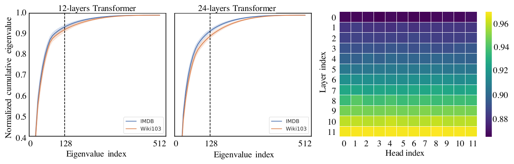
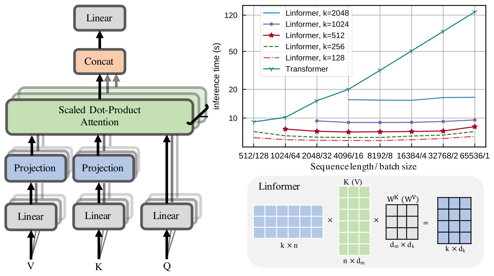
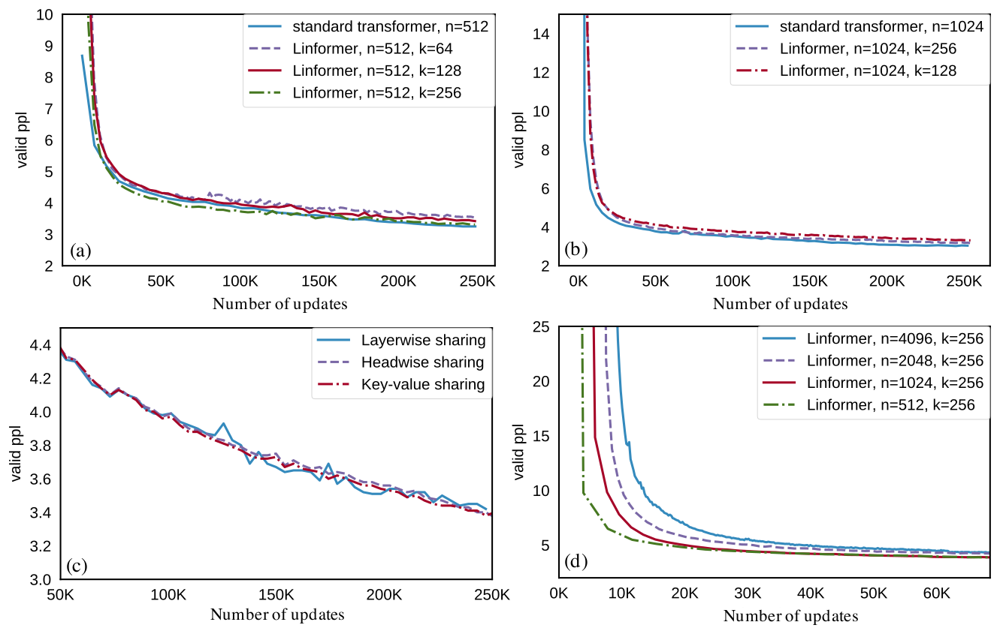

# 论文中文解读：《Linformer: Self-Attention with Linear Complexity》

> **基本信息**：Sinong Wang、Belinda Z. Li、Madian Khabsa、Han Fang、Hao Ma（Facebook AI，Seattle），arXiv:2006.04768（v3，2020 年 6 月，预印本）；论文原文 [官方页面](https://arxiv.org/abs/2006.04768)。
>
> **本文的读法**：图为从论文 PDF 裁下的原图，表为逐格核对后的中文转录（数字与原文一致，表头译成中文，模型名、数据集名保持英文）。每张图后有中文图题、图中文字翻译和读图结论。论文的理论部分写得很简略（证明放在附录且只是梗概），本文把推导思路补全；凡属笔者的推导、核算或判断，都标明“笔者”。读完不必再翻英文版。

## 一、一句话结论

标准 self-attention 的时间和显存都与序列长度 $n$ 的平方成正比。作者观察到：训练好的 Transformer 里，注意力矩阵 $P\in\mathbb{R}^{n\times n}$ 的奇异值谱呈明显的长尾，信息主要集中在前几个奇异值上，即 $P$ 近似低秩；并用 Johnson–Lindenstrauss（JL）引理论证了“存在秩为 $\Theta(\log n)$ 的近似”。据此提出 **Linformer**：用两个可学习的线性投影 $E,F\in\mathbb{R}^{k\times n}$，把 key、value 在**序列长度这一维**上从 $n$ 压到固定的 $k\ll n$，于是注意力分数矩阵只有 $n\times k$，时间与空间复杂度从 $O(n^2)$ 降到 $O(nk)$，即固定 $k$ 时为 $O(n)$。

实验上（RoBERTa 风格的预训练，加 SST-2、IMDB、QNLI、QQP 四个下游任务）：$n=512$、$k=128$ 时质量与标准 Transformer 相当（开发集平均 91.75 至 92.30，对比 RoBERTa-base 的 92.25），推理快 1.5 倍、最大 batch 大 1.7 倍；序列越长收益越大，$n=65536$、$k=128$ 时快 20 倍、最大 batch 大 60 倍（表 3，层间共享投影、单张 16GB V100）。

## 二、背景：$O(n^2)$ 从哪来，已有办法哪里不够

### 2.1 多头自注意力与上下文映射矩阵 $P$（原文式 1、2）

输入 $Q,K,V\in\mathbb{R}^{n\times d_m}$（$n$ 为序列长度，$d_m$ 为嵌入维度，$h$ 为头数）。多头注意力为

$$
\mathrm{MultiHead}(Q,K,V)=\mathrm{Concat}(\mathrm{head}_1,\dots,\mathrm{head}_h)\,W^{O},
$$

每个头为

$$
\mathrm{head}_i=\underbrace{\mathrm{softmax}\!\Big[\frac{QW^{Q}_i\,(KW^{K}_i)^\top}{\sqrt{d_k}}\Big]}_{P}\;VW^{V}_i,
$$

其中 $W^Q_i,W^K_i\in\mathbb{R}^{d_m\times d_k}$，$W^V_i\in\mathbb{R}^{d_m\times d_v}$，$W^O\in\mathbb{R}^{hd_v\times d_m}$ 是可学习矩阵；后文不区分 $d_k$ 与 $d_v$，统一记 $d$。论文把方括号里 softmax 的结果 $P\in\mathbb{R}^{n\times n}$ 叫作**上下文映射矩阵**（context mapping matrix）：第 $i$ 行是第 $i$ 个 token 对所有 $n$ 个 token 的注意力权重。计算 $P$ 需要把两个 $n\times d$ 的矩阵相乘，时间和空间都是 $O(n^2)$，这就是瓶颈所在。

### 2.2 已有的效率办法及论文的评价（第 2.2 节）

- **混合精度与量化训练**：与本文正交，本文默认使用混合精度训练；
- **知识蒸馏**：不能加速教师模型的训练，且学生通常有性能损失（例如把 12 层 BERT 蒸馏成 6 层，若干基准任务上平均下降约 2.5%，Sanh 等 2019）；
- **稀疏注意力**（Sparse Transformer、blockwise self-attention）：只计算 $P$ 的一部分元素，把复杂度降到 $O(n\sqrt n)$；但论文引用 Qiu 等（2019）说它们性能下降较大而加速有限，例如下降 2% 只换来快 20%；
- **LSH 注意力**（Reformer）：理论复杂度 $O(n\log n)$，但常数很大（论文说含 $128^2$ 的常数），只有序列极长（论文称长度大于 2048）才比标准 Transformer 更高效，并且多轮哈希增加了串行操作；
- **优化器层面**（微批次累积、梯度检查点）：以时间换内存，不加速推理。

下表对比各架构每层的时间复杂度与最小串行操作数：

| 模型架构 | 每层复杂度 | 串行操作数 |
|---|---|---|
| Recurrent（循环网络） | $O(n)$ | $O(n)$ |
| Transformer（Vaswani 等，2017） | $O(n^2)$ | $O(1)$ |
| Sparse Transformer（Child 等，2019） | $O(n\sqrt n)$ | $O(1)$ |
| Reformer（Kitaev 等，2020） | $O(n\log n)$ | $O(\log n)$ |
| Linformer | $O(n)$ | $O(1)$ |

（原文表 1，第 2 页。）读法：Linformer 同时做到每层线性复杂度和常数的串行操作数（可完全并行）。

## 三、自注意力是低秩的（第 3 节）

### 3.1 经验证据：奇异值谱分析（图 1）

作者用预训练好的 RoBERTa-base（12 层）与 RoBERTa-large（24 层），在两个任务上取注意力矩阵：Wiki103 上的掩码语言建模和 IMDB 上的分类。对不同层、不同头的 $P$ 做奇异值分解，画出**归一化累积奇异值**（前 $i$ 个奇异值之和除以全部奇异值之和），在 1 万个句子上取平均。

*图 1（原文 Figure 1，第 4 页）：左两图是预训练 Transformer（Liu 等 2019，$n=512$）自注意力矩阵的谱分析；右图是 Wiki103 数据上各层各头在第 128 个奇异值处的归一化累积奇异值热力图。*

**图中文字翻译与读法**：

- **左图 12-layers Transformer（12 层 Transformer）与中图 24-layers Transformer（24 层）**：横轴 Eigenvalue index（奇异值序号，0 到 512，竖虚线标在 128），纵轴 Normalized cumulative eigenvalue（归一化累积奇异值，0.4 到 1.0）。两条曲线：IMDB（蓝）、Wiki103（橙），阴影是各层各头之间的波动范围。（原文把奇异值写成 eigenvalue，所指是 $P$ 的奇异值。）
- **右图（热力图）**：横轴 Head index（头序号 0 至 11），纵轴 Layer index（层序号 0 至 11），颜色表示第 128 个奇异值处的归一化累积奇异值（色标约 0.88 至 0.96）。
- **读图结论**：每一层、每个头、每个任务的谱都有清晰的长尾——曲线很快上升后趋于平缓；在第 128 个奇异值（总共 512 个）处，累积值约为 0.89 至 0.94（左、中图读出的近似值）。热力图显示**层号越大颜色越黄**（累积值越大：第 0 层在顶部，深紫，约 0.87；第 11 层在底部，亮黄，约 0.97，读自色标），即高层的谱更偏斜、秩更低，低层则相对“满秩”。这是论文后文建议“高层用更小 $k$”的依据。

**证据边界**（笔者）：“前 128 个奇异值之和占总和约 90%”是一个相当宽松的“近似低秩”——后面 384 个奇异值仍占约 10%；而且是对 RoBERTa 的两个特定任务的平均，不是对所有输入、所有模型的保证。

### 3.2 理论：定理 1（自注意力是低秩的）

**定理 1**：对任意 $Q,K,V\in\mathbb{R}^{n\times d}$ 和 $W^Q_i,W^K_i,W^V_i\in\mathbb{R}^{d\times d}$，对 $VW^V_i$ 的任意一列 $w\in\mathbb{R}^{n}$，存在低秩矩阵 $\tilde P\in\mathbb{R}^{n\times n}$，使得

$$
\Pr\!\Big(\lVert\tilde Pw^{\top}-Pw^{\top}\rVert\le\epsilon\,\lVert Pw^{\top}\rVert\Big)>1-o(1),\qquad \mathrm{rank}(\tilde P)=\Theta(\log n).
$$

**证明思路**（原文第 3 节与附录 A，笔者展开）。记 $A=QW^Q_i(KW^K_i)^\top/\sqrt d$，则 $P=\mathrm{softmax}(A)=\exp(A)\,D_A^{-1}$，其中 $D_A$ 是对角矩阵，$(D_A)_{ii}=\sum_{j}\exp(A_{ji})$（行归一化）。构造

$$
\tilde P=P\,R^\top R,\qquad R\in\mathbb{R}^{k\times n},\ R_{ij}\overset{\text{i.i.d.}}{\sim}\mathcal{N}(0,1/k).
$$

它的秩 $\le\mathrm{rank}(R)\le k$。关键工具是 **Johnson–Lindenstrauss 引理**（分布形式，Arriaga & Vempala 2006 的版本）：用这样的高斯随机矩阵 $R$ 做投影，对任意向量 $x,y\in\mathbb{R}^n$，

$$
\Pr\Big(\lvert xR^\top Ry^\top-xy^\top\rvert\le\epsilon\,\lVert x\rVert\lVert y\rVert\Big)>1-2e^{-(\epsilon^2-\epsilon^3)k/4}.
$$

通俗地说：随机投影到 $k$ 维再投影回来（$R^\top R\approx I$）能近似保持内积。把它用到 $P$ 的每一行 $u$ 与向量 $w$ 上，再对 $P$ 的 $n$ 行做**并集界**，失败概率不超过 $2n\,e^{-(\epsilon^2-\epsilon^3)k/4}$。取 $k=5\log n/(\epsilon^2-\epsilon^3)$，这个界是 $2n\cdot n^{-5/4}=2n^{-1/4}\to0$，所以以概率 $1-o(1)$ 成立，此时 $\mathrm{rank}(\tilde P)=\Theta(\log n)$。

**笔者对这条定理的几点提醒**：

1. 这是**存在性**结论：$\tilde P=PR^\top R$ 要先有 $P$ 才能构造，并不是一个算法；Linformer 的实际做法（下一节）绕开了显式构造 $P$。
2. **数字上并不“紧”**：取 $\log$ 为自然对数，$n=512$ 时，$\epsilon=0.5$ 对应 $k\approx250$，$\epsilon=0.3$ 对应 $k\approx495$，$\epsilon=0.1$ 对应 $k\approx3466$，已超过 $n$；而失败概率的上界 $2n^{-1/4}$ 在 $n=512$ 时约为 0.42。所以“$\Theta(\log n)$”是渐近意义，不能直接解释为什么 $k=128$ 在实践中够用。
3. **JL 引理给的误差是相对于 $\lVert x\rVert\lVert y\rVert$ 的，不是相对于内积本身 $\lvert x\cdot y\rvert$**；论文在附录里把二者写成同一个记号 $\lVert xy\rVert$，因此定理里“误差相对于 $\lVert Pw^\top\rVert$”这一表述的严格性存疑。这一点不影响论文的经验结果。

### 3.3 为什么不直接用 SVD

直接思路是对每个注意力矩阵做 SVD，取前 $k$ 个奇异值得到最佳秩 $k$ 近似（Eckart–Young–Mirsky 定理）：

$$
P\approx P_{\text{low}}=\sum_{i=1}^{k}\sigma_iu_iv_i^{\top},
$$

结合定理 1，可以用 $O(nk)$ 的时间和空间、$\epsilon$ 的误差近似自注意力。但这需要对**每一个**注意力矩阵做一次 SVD，本身又带来额外的复杂度。因此论文提出另一种不需要分解的低秩近似：用可学习的线性投影。

## 四、方法：线性自注意力（第 4 节）

### 4.1 核心做法（式 7）与图 2

主要想法是在计算 key 和 value 时各加一个线性投影矩阵 $E_i,F_i$，把它们沿序列长度这一维**先压缩**，再做注意力。对第 $i$ 个头：

$$
\mathrm{head}_i=\mathrm{Attention}\big(QW^{Q}_i,\;E_iKW^{K}_i,\;F_iVW^{V}_i\big)
=\underbrace{\mathrm{softmax}\!\Big(\frac{QW^{Q}_i\,(E_iKW^{K}_i)^\top}{\sqrt{d_k}}\Big)}_{\bar P\,:\,n\times k}\cdot\underbrace{F_iVW^{V}_i}_{k\times d}.
$$

形状走一遍：$KW^K_i\in\mathbb{R}^{n\times d}$，$E_i\in\mathbb{R}^{k\times n}$，于是 $E_iKW^K_i\in\mathbb{R}^{k\times d}$；$QW^Q_i\in\mathbb{R}^{n\times d}$，所以 $\bar P\in\mathbb{R}^{n\times k}$；$F_iVW^V_i\in\mathbb{R}^{k\times d}$，最后 $\bar P\cdot(F_iVW^V_i)\in\mathbb{R}^{n\times d}$，输出形状与标准注意力相同。（原文第 4 节和定理 2 把 $E_i,F_i$ 的形状写成 $n\times k$，与式 7 及图 2 的 $k\times n$ 不一致，这里按能保证维度相容的 $k\times n$。）

**复杂度**：每个头里，$E_iK$ 与 $F_iV$ 各需 $O(nkd)$，$Q(EK)^\top$ 需 $O(nkd)$，$\bar P(FV)$ 需 $O(nkd)$，合计 $O(nkd)$；分数矩阵只有 $n\times k$ 个元素。若 $k\ll n$ 且固定，随 $n$ 线性增长。笔者举例：$n=4096$、$d=64$、$k=256$，每个头的分数矩阵元素数从 $n^2\approx1678$ 万降到 $nk\approx105$ 万（16 倍）；注意力部分的乘加次数，标准做法是 $QK^\top$ 与 $PV$ 各 $n^2d$，合计 $2n^2d\approx21.5$ 亿，Linformer 是 $EK$、$FV$、$Q(EK)^\top$、$\bar P(FV)$ 各 $nkd$，合计 $4nkd\approx2.7$ 亿（8 倍）。整个模型的推理加速（表 3 中 $n=4096$、$k=256$ 为 3.2 倍）还要受前馈层等不随 $k$ 变化的部分稀释。

**它为什么是“低秩分解”**（笔者）：把式 (7) 的 $\bar P$ 与 $F_i$ 合起来看，Linformer 实际使用的 token 间“注意力矩阵”是 $\bar PF_i\in\mathbb{R}^{n\times n}$，它是 $n\times k$ 与 $k\times n$ 矩阵的乘积，秩不超过 $k$——这就是论文说的“把原始 scaled dot-product 注意力分解成若干个更小的注意力，它们的组合构成原始注意力的低秩分解”。与标准注意力不同的是，$\bar PF_i$ 的每一行不再是概率分布：softmax 保证 $\bar P$ 的行和为 1，但 $F_i$ 的元素是任意实数，所以有效权重可以为负，行和也不一定为 1。

*图 2（原文 Figure 2，第 5 页）：左和右下是所提多头线性自注意力的结构与示例；右上是不同 Linformer 模型的推理时间对序列长度。*

**图中文字翻译与读法**：

- **左图（结构）**：自下而上，V、K、Q 三路输入各经过一个 Linear（线性层，每个头一份，图中用叠层表示多头）；K 和 V 两路再经过 Projection（投影，蓝色，就是 $E_i,F_i$）；然后进入 Scaled Dot-Product Attention（缩放点积注意力，绿色）；各头结果 Concat（拼接，橙色）后经过最上面的 Linear。
- **右下图（示例）**：标注 “Linformer”：$k\times n$ 的投影矩阵（蓝色）乘以 $n\times d_m$ 的 K（或 V）（绿色），再乘以 $d_m\times d_k$ 的 $W^K$（或 $W^V$）（灰色），得到 $k\times d_k$（蓝色）；
- **右上图（推理时间）**：横轴 Sequence length / batch size（序列长度 / batch size，512/128、1024/64、2048/32、4096/16、8192/8、16384/4、32768/2、65536/1，即每个点的总 token 数固定为 65536），纵轴 inference time (s)（推理时间，秒，对数式刻度）。曲线：Transformer（青绿色，带叉）与 Linformer 的 $k=128,256,512,1024,2048$。
- **读图结论**：标准 Transformer 的推理时间随序列变长从约 9 秒涨到约 120 秒；各条 Linformer 曲线基本持平（$k=128$ 最低、$k=2048$ 最高，各点数值是从图上读出的近似值：$k=128$ 约 5 至 6 秒，$k=2048$ 约 15 至 16 秒）。因为总 token 数固定，线性复杂度的模型耗时应基本不变，图上与此一致。$k$ 必须不超过 $n$，所以 $k=1024$、$2048$ 的曲线分别从 $n=2048$、$4096$ 才开始。

### 4.2 定理 2（线性自注意力）

**定理 2**：对任意 $Q_i,K_i,V_i\in\mathbb{R}^{n\times d}$ 和 $W^Q_i,W^K_i,W^V_i\in\mathbb{R}^{d\times d}$，若 $k=\min\{\Theta(9d\log d/\epsilon^2),\,5\Theta(\log n/\epsilon^2)\}$，则存在矩阵 $E_i,F_i$，使得对 $QW^Q_i(KW^K_i)^\top/\sqrt d$ 的任意一行 $w$，

$$
\Pr\Big(\lVert\mathrm{softmax}(wE_i^\top)F_iVW^V_i-\mathrm{softmax}(w)VW^V_i\rVert\le\epsilon\,\lVert\mathrm{softmax}(w)\rVert\,\lVert VW^V_i\rVert\Big)>1-o(1).
$$

意思是：用式 (7) 的形式可以在 $\epsilon$ 的误差内近似真正的 $P\cdot VW^V_i$，而且 $k$ 不依赖序列长度 $n$（取两项的较小者）。

**证明思路**（原文第 4 节与附录 B，笔者概括）：

1. 取 $E_i=\delta R$、$F_i=e^{-\delta}R$，其中 $R$ 同样是高斯随机矩阵，$\delta$ 是一个很小的常数；利用 $\exp$ 在有界区间上是 Lipschitz 连续的，选足够小的 $\delta$，使 $\exp(xE_i^\top)F_iy^\top\approx\exp(x)y^\top$ 对任意行向量 $x$ 与列向量 $y$ 以高概率成立（式 9，误差界同样来自 JL 引理）。
2. 对 $A$ 的每一行和 $V$ 的每一列用并集界，得到 $k=5\log(nd)/(\epsilon^2-\epsilon^3)$，这一步没有用到 $A$ 的低秩性，所以 $k$ 依赖 $n$。
3. 为去掉对 $n$ 的依赖，利用 $A=QW^Q(KW^K)^\top/\sqrt d$ 的秩不超过 $d$：取其中 $2d$ 行张成行空间，只对这 $2d$ 行用 JL（得到 $k=9\log d/(\epsilon^2-\epsilon^3)$），再用线性组合把误差推广到所有 $n$ 行，推广时误差放大 $\Theta(d)$，因此最终 $k=\Theta(d\log d/\epsilon^2)$，不依赖 $n$。

**笔者提醒**：正文里说“当 $k=O(d/\epsilon^2)$（与 $n$ 无关）时可以近似”，而定理里写的是 $\Theta(9d\log d/\epsilon^2)$，两处相差一个 $\log d$ 因子；附录只是证明梗概，且 $R$ 的形状（$k\times n$ 或 $n\times k$）、$\delta$ 的取值等处有不一致。对 $d=64$、$\epsilon=0.1$，$9d\log d/\epsilon^2$ 约为 24 万（自然对数），远大于 $n$。因此和定理 1 一样，它是渐近的动机性结论，实际有效的 $k$（128 或 256）靠实验确定。

### 4.3 附加的效率技巧（第 4 节末）

1. **投影参数共享**。可以跨层、跨头共享 $E_i,F_i$，论文实验了三个级别：
   - **Headwise sharing（头间共享）**：每层只用 $E,F$ 两个矩阵，所有头共用，即 $E_i=E,F_i=F$；
   - **Key-value sharing（键值共享）**：在头间共享的基础上再令 $E=F$，每层只有一个投影矩阵；
   - **Layerwise sharing（层间共享）**：整个网络、所有头、key 与 value 共用同一个投影矩阵。

   例如在 12 层、12 头的模型里，这三种分别引入 24、12、1 个不同的投影矩阵（不共享则有 $12\times12\times2=288$ 个，笔者计算）。取 $n=512$、$k=128$，每个矩阵 $k\times n=65{,}536$ 个参数，不共享共约 1887 万，头间共享约 157 万，键值共享约 79 万，层间共享约 6.6 万（笔者计算）。
2. **非均匀的投影维度**：不同层、不同头可以用不同的 $k$。图 1 右图显示高层的谱更偏斜（秩更低），所以高层可以用更小的 $k$。
3. **一般的投影**：可以用平均/最大池化，或核大小与步长都为 $n/k$ 的卷积来代替简单线性投影；卷积含需要训练的参数。

论文**只对第 1 项（参数共享）做了实验**；第 2、3 项只是建议，没有实验结果。

## 五、实验

### 5.1 预训练困惑度（图 3）

**设置**：与 RoBERTa（Liu 等 2019，基于 Transformer）比较。预训练集为 BookCorpus 加英文维基百科（33 亿词，即 3300M words），所有模型用掩码语言建模（MLM）目标，实验都在 64 张 Tesla V100 GPU 上并行，训练 250k 次更新。对所有层和头使用相同的 $k$。论文没有单独给出 Linformer 的层数、宽度等网络规模，与 RoBERTa-base 对照。

*图 3（原文 Figure 3，第 7 页）：预训练验证集困惑度（valid ppl）对更新次数。*

**图中文字翻译与读法**：

- **(a)** 最大序列长度 $n=512$：standard transformer（标准 Transformer，蓝）与 Linformer $k=64$（紫虚线）、$k=128$（红）、$k=256$（绿点划线）；横轴 Number of updates（更新次数，0 到 250K），纵轴 valid ppl（验证集困惑度，2 到 10）；
- **(b)** $n=1024$：standard transformer 与 Linformer $k=256$、$k=128$；
- **(c)** $n=512$ 下三种参数共享方式：Layerwise sharing（层间共享，蓝）、Headwise sharing（头间共享，紫虚线）、Key-value sharing（键值共享，红点划线），横轴 50K 到 250K，纵轴 3.0 到 4.4。原文此处没有写明 $k$；
- **(d)** 固定 $k=256$，$n=512,1024,2048,4096$ 四种序列长度（绿点划线、红、紫虚线、蓝），横轴 0 到约 6.8 万次更新，纵轴 5 到 25。

**读图结论与文字结论**：

- **投影维度的作用**（a、b）：$k$ 越大困惑度越低。论文说 $n=512$ 时 $k=128$、$n=1024$ 时 $k=256$，Linformer 就已经和标准 Transformer 接近。从图上读出的终点困惑度：(a) 标准约 3.3，$k=256$ 约 3.3 到 3.4，$k=128$ 约 3.4 到 3.5，$k=64$ 约 3.6；(b) 标准约 3.1，$k=256$ 约 3.2，$k=128$ 约 3.4（均为近似值）。
- **共享投影的作用**（c）：三条曲线几乎重合。论文的结论是，即使整个网络只用一个投影矩阵（层间共享），验证困惑度也几乎与不共享的相同，所以可以大幅减少额外参数和显存，而性能损失很小。
- **序列长度的作用**（d）：固定 $k=256$，序列越长，初期下降越慢，但曲线会汇合。论文的结论是“序列变长而投影维度固定时，收敛后的最终困惑度大致相同，这进一步从经验上支持线性时间的论断”。**笔者提醒**：图 3(d) 只画到约 6.8 万次更新，在那里 $n=4096$ 的曲线仍高于其他三条（约 4.4 对 3.9 至 4.2，从图上读出），所以“收敛后相同”是文字结论，图上只看得出差距在缩小。

### 5.2 下游任务（表 2）

**设置**：在 IMDB 和 SST-2（情感分类）、QNLI（自然语言推断）、QQP（文本相似度，Quora Question Pairs）上微调；对 RoBERTa、12 层 BERT-base 和 6 层蒸馏 BERT 做同样的微调。所有模型（包括 Transformer 基线）使用相同的预训练目标和语料，最多 250k 次更新；Linformer 到 250k 次更新所需的墙钟时间少得多，因此训练时间更短。表中报告开发集结果。

开发集结果（数字越大越好；$n$ 为预训练最大序列长度；Linformer 行的数字是 $k$；shared kv 表示键值共享，shared kv, layer 表示再加层间共享；粗体为原文标出的最佳）：

| $n$ | 模型 | SST-2 | IMDB | QNLI | QQP | 平均 |
|---:|---|---:|---:|---:|---:|---:|
| 512 | Liu 等（2019），RoBERTa-base | 93.1 | 94.1 | 90.9 | **90.9** | 92.25 |
| 512 | Linformer，128 | 92.4 | 94.0 | 90.4 | 90.2 | 91.75 |
| 512 | Linformer，128，shared kv | **93.4** | 93.4 | 90.3 | 90.3 | 91.85 |
| 512 | Linformer，128，shared kv，layer | 93.2 | 93.8 | 90.1 | 90.2 | 91.83 |
| 512 | Linformer，256 | 93.2 | 94.0 | 90.6 | 90.5 | 92.08 |
| 512 | Linformer，256，shared kv | 93.3 | 93.6 | 90.6 | 90.6 | 92.03 |
| 512 | Linformer，256，shared kv，layer | 93.1 | 94.1 | **91.2** | 90.8 | **92.30** |
| 512 | Devlin 等（2019），BERT-base | 92.7 | 93.5 | 91.8 | 89.6 | 91.90 |
| 512 | Sanh 等（2019），Distilled BERT | 91.3 | 92.8 | 89.2 | 88.5 | 90.45 |
| 1024 | Linformer，256 | 93.0 | 93.8 | 90.4 | 90.4 | 91.90 |
| 1024 | Linformer，256，shared kv | 93.0 | 93.6 | 90.3 | 90.4 | 91.83 |
| 1024 | Linformer，256，shared kv，layer | 93.2 | **94.2** | 90.8 | 90.5 | 92.18 |

（原文表 2，第 7 页。表题注明：这里的 RoBERTa-base 是用与 BERT 相同的语料预训练的。）

**读法**：

- $n=512$、$k=128$ 的 Linformer 与 RoBERTa-base 相当（平均 91.75 至 91.85 对 92.25）；论文说 $k=256$ 时“甚至略优”，但这只对**层间共享**的那一行成立（92.30 对 92.25，差 0.05）；不共享的 $k=256$ 为 92.08，键值共享为 92.03，都略低于 RoBERTa-base（笔者核对）。
- 论文还说层间共享的 Linformer 在三种共享方式里准确率最好：$k=256$ 时成立（92.30 对 92.08 和 92.03），$n=1024$ 时成立（92.18 对 91.90 和 91.83），但 $k=128$ 时不成立（91.83，键值共享的 91.85 更高）（笔者核对）。
- $n=1024$、$k=256$ 的结果与 $n=512$、$k=256$ 相近（91.83 至 92.18 对 92.03 至 92.30），论文据此认为 Linformer 的性能主要由投影维度 $k$ 决定，而不是比值 $n/k$。
- Linformer 的各行均高于 6 层蒸馏 BERT（平均 90.45）；也与 BERT-base（91.90）相当。
- **证据边界**：这些差距多在 0.5 个点以内，是开发集上的单次结果，论文没有给出方差；基线 RoBERTa-base 的预训练语料与 BERT 相同（不是 RoBERTa 原始语料）。

### 5.3 推理效率（表 3）

**设置**：在一张 16GB 的 Tesla V100 上比较标准 Transformer 与 Linformer（层间共享）的推理速度和显存。随机生成长度为 $n$ 的数据，做完整的前向传播，对多个 batch 平均；batch size 取内存能放下的最大值，显存节省按这个最大 batch 计算。

推理效率相对标准 Transformer 的提升倍数（左：节省的时间，即加速倍数；右：节省的内存，即最大 batch 的放大倍数；行为序列长度 $n$，列为投影维度 $k$；“-”表示 $k>n$，不适用）：

时间（加速倍数）：

| 序列长度 $n$ | $k=128$ | $k=256$ | $k=512$ | $k=1024$ | $k=2048$ |
|---:|---:|---:|---:|---:|---:|
| 512 | 1.5x | 1.3x | - | - | - |
| 1024 | 1.7x | 1.6x | 1.3x | - | - |
| 2048 | 2.6x | 2.4x | 2.1x | 1.3x | - |
| 4096 | 3.4x | 3.2x | 2.8x | 2.2x | 1.3x |
| 8192 | 5.5x | 5.0x | 4.4x | 3.5x | 2.1x |
| 16384 | 8.6x | 7.8x | 7.0x | 5.6x | 3.3x |
| 32768 | 13x | 12x | 11x | 8.8x | 5.0x |
| 65536 | 20x | 18x | 16x | 14x | 7.9x |

内存（最大 batch 的放大倍数）：

| 序列长度 $n$ | $k=128$ | $k=256$ | $k=512$ | $k=1024$ | $k=2048$ |
|---:|---:|---:|---:|---:|---:|
| 512 | 1.7x | 1.5x | - | - | - |
| 1024 | 3.0x | 2.9x | 1.8x | - | - |
| 2048 | 6.1x | 5.6x | 3.6x | 2.0x | - |
| 4096 | 14x | 13x | 8.3x | 4.3x | 2.3x |
| 8192 | 28x | 26x | 17x | 8.5x | 4.5x |
| 16384 | 56x | 48x | 32x | 16x | 8x |
| 32768 | 56x | 48x | 36x | 18x | 16x |
| 65536 | 60x | 52x | 40x | 20x | 18x |

（原文表 3，第 8 页；原文把两张子表并排放在一起，左表为时间，右表为内存。）

**读法**：

- 即使 $n=512$、$k=128$，Linformer 推理也快 1.5 倍，最大 batch 大 1.7 倍；序列越长收益越大，$n=65536$、$k=128$ 时快 20 倍、最大 batch 大 60 倍；
- 同一个 $n$，$k$ 越小收益越大；加速倍数大致随 $n/k$ 增大而增大（例如 $n=4096$：$k=128$ 为 3.4 倍，$k=2048$ 只有 1.3 倍）；
- 图 2 右上的曲线是同一实验的 100 个数据样本上的推理时间。

## 六、局限、证据边界与常见误读

**论文本身的证据边界**：

1. **只有编码器式（双向）的预训练与分类实验**：没有因果（自回归）语言建模、没有生成任务；论文没有讨论因果 mask——$E,F$ 沿序列维把所有位置混合在一起，一个位置的压缩键值里含有未来位置的信息，若要用于解码需要额外设计（笔者说明，论文未涉及）；
2. **长度被固定**：$E_i,F_i\in\mathbb{R}^{k\times n}$ 与最大长度 $n$ 绑定；论文对 $n=512,1024,2048,4096$ 分别预训练模型，没有讨论变长输入、padding 或长度外推；
3. **下游任务少、差距小**：只有 4 个任务，开发集，单次运行，未报告方差；表 2 的“略优”只在某个变体上成立；
4. **理论与实践有距离**：两个定理都是渐近的存在性结论（见 3.2 与 4.2 节的笔者提醒），实际 $k$ 靠实验选择；
5. **只验证了到 $n=4096$ 的预训练**：更长序列（最高 65536）只测了推理速度与内存，没有测质量；
6. **没有与其他高效注意力在同一设置下比较质量**：论文只比较了复杂度（表 1）和标准 Transformer。

**常见误读**：

- Linformer 不是“稀疏注意力”：每个 query 仍通过压缩后的全局摘要接触整个序列，只是摘要的容量被 $k$ 限制；
- 低秩发生在**序列维**，不是隐藏维 $d$ 变小；
- “线性复杂度”是对固定的 $k$ 而言，且指注意力部分；整个模型的加速还取决于前馈层等其他部分（表 3 的加速倍数小于注意力部分的理论倍数）；
- 理论 FLOPs 的下降不保证 kernel、小 batch 下的延迟同步改善。

## 七、复现检查清单

- $E,F$ 作用在**序列长度**维（形状 $k\times n$），不是隐藏维；写成 `einsum` 时容易转置错；
- 记录 $k$、共享方式（头间、键值、层间）和支持的最大长度 $n$；
- 效率实验要用真正的 $n\times k$ 实现，不能先构造 $n\times n$ 的全矩阵再截断；
- 画质量对 $k$ 的曲线（如 $k=64,128,256$），不要只选一个有利的点；
- 注意 padding：变长序列在固定 $n$ 的投影下需要明确补零和 mask 的处理方式；
- 对比基线时保持相同的预训练语料、更新次数和下游任务设置。

## 八、与相关论文的关系

- [Performer](../performer/论文中文解读.md)：用随机特征近似 softmax 核，也得到线性复杂度，但近似的是注意力核而不是用学习的序列维投影；
- [FlashAttention](../flash_attention/论文中文解读.md)：该论文的表 3（Long-Range Arena）里也比较了 Linformer——平均精度 54.9，低于标准 Transformer 的 59.3，加速 2.5 倍（来自 FlashAttention 论文自己的复现，不是 Linformer 原文的结论）；FlashAttention 则保持精确注意力，只优化访存；
- [Longformer](../longformer/论文中文解读.md)、[BigBird](../bigbird/论文中文解读.md)：稀疏注意力路线，与低秩路线互补；
- [BERT](../bert/论文中文解读.md)：本文的预训练与下游评估沿用其范式。

## 原文证据导航

- [原论文 PDF](paper.pdf)
- [原文提取文本](paper.txt)
- [论文概要](论文概要.md)
