# 论文中文解读：《The Llama 3 Herd of Models》

> **基本信息**：Llama Team, AI @ Meta（贡献者名单见论文末尾），arXiv:2407.21783（本地 PDF 为 v3，2024 年 11 月 23 日更新，首页标注日期 2024 年 7 月 23 日）；论文原文 [官方页面](https://arxiv.org/abs/2407.21783)，发布页 [llama.meta.com](https://llama.meta.com/)。
>
> **本文的读法**：图均为从论文 PDF 中裁出的原图，每张图后有中文图题、图中文字翻译和读图结论；表为逐格核对后的中文转录（数字与原文一致，原文用粗体标出的最好结果保留粗体，“–”表示原文没有该数字，± 后是 95% 置信区间）。附录风格的超大逐项表只摘关键行。论文没有明说、由本文根据论文数字推算的内容一律标注“推算”；从图上读出的数值一律写“约”。全文按论文顺序展开：数据、架构与 scaling law、训练基础设施、训练配方、后训练、评测、安全、推理、多模态实验。读完不需要再翻英文原文。

## 一、一句话结论

Llama 3 是 Meta 的一个“模型群”（herd）：8B、70B、405B 三个 dense Transformer 语言模型（论文里的全部结果对应 Llama 3.1 版本），原生支持多语言、代码、推理和工具使用，旗舰 405B 的上下文窗口最长 128K tokens。论文的主线是“把成熟的做法做到极致，而不是发明新结构”：

1. **数据**：约 15T 多语言 tokens（Llama 2 为 1.8T），预训练与后训练数据都做了更细致的清洗、去重、质量过滤和配比。
2. **规模**：旗舰模型用 $3.8\times10^{25}$ FLOPs 训练（约为 Llama 2 最大版本的 50 倍），405B 参数、15.6T tokens，规模由 scaling law 选定；小模型则训练得远超“计算最优”，换取更低的推理成本。
3. **复杂度管理**：选标准 dense Transformer 而不是 MoE，后训练选 SFT、拒绝采样（rejection sampling）和 DPO 而不是 PPO 类强化学习，目的是训练稳定、容易扩展。

结果（论文给定设置下）：405B 在多数基准上与 GPT-4、GPT-4o、Claude 3.5 Sonnet 同档，有赢有输；8B、70B 在各自规模上于多数基准领先；人工评测里 405B 与 GPT-4（0125）基本持平，对 GPT-4o 与 Claude 3.5 Sonnet 互有胜负。论文还开放了安全分类器 Llama Guard 3，并报告了用“组合式”方法给语言模型接入图像、视频、语音的初步实验，这些多模态模型当时尚未发布。

## 二、模型家族与总体框架

### 2.1 模型家族（表 1）

**表 1：Llama 3 模型群概览。** 本文所有结果都对应 Llama 3.1。

| 模型 | 是否微调 | 多语言 | 长上下文 | 工具使用 | 发布时间 |
|---|:-:|:-:|:-:|:-:|---|
| Llama 3 8B | ✗ | ✗¹ | ✗ | ✗ | 2024 年 4 月 |
| Llama 3 8B Instruct | ✓ | ✗ | ✗ | ✗ | 2024 年 4 月 |
| Llama 3 70B | ✗ | ✗¹ | ✗ | ✗ | 2024 年 4 月 |
| Llama 3 70B Instruct | ✓ | ✗ | ✗ | ✗ | 2024 年 4 月 |
| Llama 3.1 8B | ✗ | ✓ | ✓ | ✗ | 2024 年 7 月 |
| Llama 3.1 8B Instruct | ✓ | ✓ | ✓ | ✓ | 2024 年 7 月 |
| Llama 3.1 70B | ✗ | ✓ | ✓ | ✗ | 2024 年 7 月 |
| Llama 3.1 70B Instruct | ✓ | ✓ | ✓ | ✓ | 2024 年 7 月 |
| Llama 3.1 405B | ✗ | ✓ | ✓ | ✗ | 2024 年 7 月 |
| Llama 3.1 405B Instruct | ✓ | ✓ | ✓ | ✓ | 2024 年 7 月 |

（原文表 1，第 2 页。脚注 1：Llama 3 的 8B 和 70B 预训练时用了多语言数据，但当时的定位是只面向英文使用。）

读法：“Finetuned”列为 ✗ 的是预训练基础模型，✓ 的是经过后训练的指令模型；2024 年 4 月的第一批 Llama 3（8B、70B）没有长上下文与工具使用，2024 年 7 月的 Llama 3.1 才加入 128K 上下文、多语言和工具使用，并发布 405B。

### 2.2 三个杠杆

论文认为高质量基础模型有三个杠杆：数据、规模和复杂度管理。

- **数据**。相对 Llama 1、2，预训练和后训练的数据在数量与质量上都有提升：更细的预训练数据预处理与整理流水线，更严格的后训练数据质量保证与过滤；预训练语料约 15T 多语言 tokens，Llama 2 为 1.8T。
- **规模**。旗舰模型的预训练算力为 $3.8\times10^{25}$ FLOPs，几乎是 Llama 2 最大版本的 50 倍；具体是 405B 可训练参数、15.6T 文本 tokens。按 scaling law，旗舰模型优于用同一流程训练的小模型；scaling law 同时表明旗舰模型的大小对其训练预算大致是计算最优的，而论文**有意把更小的模型训练得远超计算最优**，因此在相同推理预算下它们比计算最优的模型更好，并且后训练阶段还用旗舰模型进一步提升这些小模型的质量。
- **复杂度管理**。选择标准的 dense Transformer（Vaswani et al., 2017）加少量改动，而不是 MoE（Shazeer et al., 2017），以最大化训练稳定性；后训练选相对简单的流程（SFT、拒绝采样、DPO），而不是更复杂、更不稳定、更难扩展的强化学习算法（Ouyang et al., 2022；Schulman et al., 2017）。

自检（推算）：6 × 405B × 15.6T 约 $3.79\times10^{25}$，与论文的 $3.8\times10^{25}$ FLOPs 吻合（$C\approx 6ND$ 是常用近似，论文没有写出这个式子）。

### 2.3 两个阶段与整体流程（图 1）

先看一张最简的总图，建立“预训练 + 后训练”的整体印象。

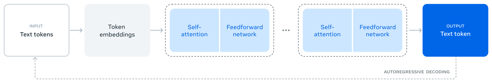

*图 1（原文 Figure 1，第 4 页）：Llama 3 是一个 Transformer 语言模型，训练目标是预测文本序列的下一个 token。*

**图中文字翻译与读法**：

- **从左到右**：INPUT Text tokens（输入文本 token）→ Token embeddings（词嵌入）→ 若干个由 Self-attention（自注意力）和 Feedforward network（前馈网络）构成的 Transformer 块（虚线框，中间的“…”表示重复很多层）→ OUTPUT Text token（输出下一个文本 token）。
- **底部虚线箭头 AUTOREGRESSIVE DECODING（自回归解码）**：输出的 token 被接回输入，逐 token 生成。
- **读图结论**：Llama 3 没有结构上的新花样，就是标准的 decoder-only 语言模型；论文的价值在数据、规模、训练系统和后训练，而不在这张图。

整体流程分两个阶段：

1. **语言模型预训练**：把大规模多语言文本转成离散 token，用下一个 token 预测训练大模型。405B 先在 8K 上下文窗口上训练 15.6T tokens，随后用“继续预训练”把支持的上下文窗口扩到 128K（见第七节）。
2. **语言模型后训练**：预训练模型懂语言但不会遵循指令。论文分多轮用人类反馈对齐，每轮包含在指令数据上的监督微调（SFT）和直接偏好优化（DPO）；后训练阶段还加入工具使用等新能力，并观察到代码、推理等方面的明显提升；安全缓解措施同样在后训练阶段加入。论文把“预训练之外的任何模型训练”都称为 post-training。

在此之上，论文还做了组合式的多模态实验：单独训练图像编码器和语音编码器，再用适配器（adapter）接入语言模型，后者在适配器训练时保持不变（第十四、十五节）。

### 2.4 总体成绩单（表 2）

表 2 是全文的“成绩单”：后训练（指令微调）后的 Llama 3 与竞争模型在关键基准上的对比。设置与评测细节在第九、十节展开。论文把对比模型分成三个“规模档”，**在每档内用粗体标出最好的**；“–”表示没有可用数字。

下面按规模档拆成三张表（原文是一张 16 行 11 列的表）。标注 △：使用 5-shot 提示（无 CoT）；◁：不使用 CoT；♢：使用 zero-shot 提示。

**表 2-A：8B 档。**

| 基准（设置） | Llama 3 8B | Gemma 2 9B | Mistral 7B |
|---|---:|---:|---:|
| MMLU（5-shot） | 69.4 | **72.3** | 61.1 |
| MMLU（0-shot，CoT） | **73.0** | 72.3△ | 60.5 |
| MMLU-Pro（5-shot，CoT） | **48.3** | – | 36.9 |
| IFEval | **80.4** | 73.6 | 57.6 |
| HumanEval（0-shot） | **72.6** | 54.3 | 40.2 |
| MBPP EvalPlus（0-shot） | **72.8** | 71.7 | 49.5 |
| GSM8K（8-shot，CoT） | **84.5** | 76.7 | 53.2 |
| MATH（0-shot，CoT） | **51.9** | 44.3 | 13.0 |
| ARC Challenge（0-shot） | 83.4 | **87.6** | 74.2 |
| GPQA（0-shot，CoT） | 32.8 | – | 28.8 |
| BFCL | **76.1** | – | 60.4 |
| Nexus | **38.5** | 30.0 | 24.7 |
| ZeroSCROLLS/QuALITY | 81.0 | – | – |
| InfiniteBench/En.MC | 65.1 | – | – |
| NIH/Multi-needle | 98.8 | – | – |
| MGSM（0-shot，CoT） | **68.9** | 53.2 | 29.9 |

**表 2-B：70B 档。**

| 基准（设置） | Llama 3 70B | Mixtral 8x22B | GPT 3.5 Turbo |
|---|---:|---:|---:|
| MMLU（5-shot） | **83.6** | 76.9 | 70.7 |
| MMLU（0-shot，CoT） | **86.0** | 79.9 | 69.8 |
| MMLU-Pro（5-shot，CoT） | **66.4** | 56.3 | 49.2 |
| IFEval | **87.5** | 72.7 | 69.9 |
| HumanEval（0-shot） | **80.5** | 75.6 | 68.0 |
| MBPP EvalPlus（0-shot） | **86.0** | 78.6 | 82.0 |
| GSM8K（8-shot，CoT） | **95.1** | 88.2 | 81.6 |
| MATH（0-shot，CoT） | **68.0** | 54.1 | 43.1 |
| ARC Challenge（0-shot） | **94.8** | 88.7 | 83.7 |
| GPQA（0-shot，CoT） | **46.7** | 33.3 | 30.8 |
| BFCL | 84.8 | – | **85.9** |
| Nexus | **56.7** | 48.5 | 37.2 |
| ZeroSCROLLS/QuALITY | 90.5 | – | – |
| InfiniteBench/En.MC | 78.2 | – | – |
| NIH/Multi-needle | 97.5 | – | – |
| MGSM（0-shot，CoT） | **86.9** | 71.1 | 51.4 |

**表 2-C：405B 档。**

| 基准（设置） | Llama 3 405B | Nemotron 4 340B | GPT-4（0125） | GPT-4o | Claude 3.5 Sonnet |
|---|---:|---:|---:|---:|---:|
| MMLU（5-shot） | 87.3 | 82.6 | 85.1 | 89.1 | **89.9** |
| MMLU（0-shot，CoT） | 88.6 | 78.7◁ | 85.4 | **88.7** | 88.3 |
| MMLU-Pro（5-shot，CoT） | 73.3 | 62.7 | 64.8 | 74.0 | **77.0** |
| IFEval | **88.6** | 85.1 | 84.3 | 85.6 | 88.0 |
| HumanEval（0-shot） | 89.0 | 73.2 | 86.6 | 90.2 | **92.0** |
| MBPP EvalPlus（0-shot） | 88.6 | 72.8 | 83.6 | 87.8 | **90.5** |
| GSM8K（8-shot，CoT） | **96.8** | 92.3♢ | 94.2 | 96.1 | 96.4♢ |
| MATH（0-shot，CoT） | 73.8 | 41.1 | 64.5 | **76.6** | 71.1 |
| ARC Challenge（0-shot） | **96.9** | 94.6 | 96.4 | 96.7 | 96.7 |
| GPQA（0-shot，CoT） | 51.1 | – | 41.4 | 53.6 | **59.4** |
| BFCL | 88.5 | 86.5 | 88.3 | 80.5 | **90.2** |
| Nexus | **58.7** | – | 50.3 | 56.1 | 45.7 |
| ZeroSCROLLS/QuALITY | **95.2** | – | **95.2** | 90.5 | 90.5 |
| InfiniteBench/En.MC | **83.4** | – | 72.1 | 82.5 | – |
| NIH/Multi-needle | 98.1 | – | **100.0** | **100.0** | 90.8 |
| MGSM（0-shot，CoT） | **91.6** | – | 85.9 | 90.5 | **91.6** |

（原文表 2，第 3 页。原文是一张表，三个 Llama 3 列在 PDF 中以浅蓝底色突出；表中 “Mixtral 8x22B”“GPT 3.5 Turbo”“GPT-4 (0125)” 的写法保持原样。）

读法：

- **8B 档**：Llama 3 8B 在 16 行里有 10 行标粗；Gemma 2 9B 在 MMLU（5-shot）和 ARC Challenge 两行更高。GPQA 与三项长上下文行没有标粗（对手缺数字）。
- **70B 档**：Llama 3 70B 在 12 行标粗，只有 BFCL（工具使用）一行低于 GPT 3.5 Turbo（84.8 对 85.9）。
- **405B 档**（按标粗统计，为本文自数）：Llama 3 405B 在 7 行标粗（IFEval、GSM8K、ARC Challenge、Nexus、QuALITY 并列、InfiniteBench/En.MC、MGSM 并列），Claude 3.5 Sonnet 7 行（MMLU 5-shot、MMLU-Pro、HumanEval、MBPP EvalPlus、GPQA、BFCL、MGSM 并列），GPT-4o 3 行（MMLU 0-shot CoT、MATH、Multi-needle 并列），GPT-4（0125）2 行（QuALITY 并列、Multi-needle 并列）。即“同档、互有胜负”，与论文“与 GPT-4 在多种任务上相当，接近最先进水平”的说法一致。
- 对比的是各模型**微调后**的版本；基础模型的对比在第九节，两者不能混读。论文还说明竞品数字取“公开报告值与自己复现值中的较好者”（第九节细说）。

## 三、预训练数据

### 3.1 总览与 Web 数据清洗

预训练语料来自多种来源，知识截止到 2023 年底。每个来源都做多种去重和清洗，目标是得到高质量 token；含大量个人可识别信息（PII）的域名和已知成人内容的域名被整体移除。数据的大头来自网页，清洗流程如下。

- **PII 与安全过滤**：过滤可能含不安全内容或大量 PII 的网站、被 Meta 多项安全标准判为有害的域名、已知成人内容域名。
- **文本抽取与清洗**：对未截断的网页 HTML 自建解析器，目标是样板内容去除的精度与正文召回；与流行的第三方（偏文章类内容的）解析器在人工评测里比较，表现更好。对含数学和代码的页面特殊处理以保留结构，保留图片的 alt 属性文本（因为数学内容常以预渲染图片出现，alt 里有对应公式）。实验发现 markdown 标记对“主要用网页数据训练的模型”有害，所以去掉全部 markdown 标记。
- **三级去重**：
  1. URL 级：在整个数据集上按 URL 去重，每个 URL 保留最新版本的页面；
  2. 文档级：在整个数据集上做全局 MinHash（Broder, 1997）去除近重复文档；
  3. 行级：类似 ccNet 的激进行级去重，在每个 3000 万文档的桶里，删除出现超过 6 次的行。人工定性分析发现这种去重不仅去掉了导航菜单、cookie 警告等残留样板，也会去掉一些频繁出现的高质量文本，但经验评测显示收益很大。
- **启发式过滤**：去除其他低质量文档、离群文档和过度重复的文档，例如：用重复 n-gram 覆盖率（Rae et al., 2021）去掉由日志、报错信息等重复内容构成的行（这类行可能很长且唯一，行级去重去不掉）；用“脏词”计数（Raffel et al., 2020）过滤域名黑名单没覆盖的成人网站；用 token 分布的 KL 散度过滤相对训练语料分布含过多离群 token 的文档。
- **基于模型的质量过滤**：尝试多种质量分类器筛选高质量 token，包括：fastText 分类器（判断一段文本是否会被 Wikipedia 引用，做法来自 Llama 1）；更耗算力的基于 RoBERTa 的分类器，其训练数据由 Llama 2 的预测产生——先构造一批清洗后的网页文档，写下质量要求，让 Llama 2 的 chat 模型判断文档是否满足，再用 DistilRoBERTa 出质量分（出于效率考虑）。多种质量过滤配置都经过实验评估。
- **代码与推理数据**：类似 DeepSeek-AI 等（2024），为代码和数学相关网页建立领域专用流水线。代码与推理两个分类器都是在 Llama 2 标注的网页数据上训练的 DistilRoBERTa；与通用质量分类器不同，这里做了提示调优，针对含数学推导、STEM 推理、以及代码与自然语言交织的网页。因为代码和数学的 token 分布与自然语言差别很大，这些流水线有领域专用的 HTML 抽取、定制的文本特征和过滤启发式。
- **多语言数据**：同样过滤含 PII 或不安全内容的网站；特色是：用基于 fastText 的语言识别模型把文档分到 **176 种语言**；在每种语言内做文档级与行级去重；用语言专用的启发式与基于模型的过滤去掉低质量文档；再用基于 Llama 2 的多语言分类器给文档做质量排序，保证高质量内容优先。预训练里的多语言 token 量是通过实验、在英文与多语言基准之间权衡后定的。

### 3.2 数据配比

数据配比由两个工具决定：知识分类与 scaling law 实验。

- **知识分类（knowledge classification）**：训练一个分类器给网页数据的信息类型归类，用它对网页上占比过高的类别（例如艺术与娱乐）降采样。
- **数据配比的 scaling law**：在某种配比上训练若干小模型，用它们预测大模型在该配比上的表现（方法见第五节）；对不同配比重复，选出新的候选配比；再用候选配比训练更大的模型，在若干关键基准上评估。
- **最终配比**：约 50% 通用知识 token，25% 数学与推理 token，17% 代码 token，8% 多语言 token。

| 类别 | 占比 | 按 15.6T 粗略折算（推算） |
|---|---:|---:|
| 通用知识 | 约 50% | 约 7.8T |
| 数学与推理 | 约 25% | 约 3.9T |
| 代码 | 约 17% | 约 2.7T |
| 多语言 | 约 8% | 约 1.2T |

（占比来自原文 3.1.2 节正文，不是表格；最后一列是本文按 15.6T 折算的粗略推算。注意训练过程中数据配比还被调整过——增加非英文占比、上调数学数据、加入更新的网页数据、下调后来发现质量较低的子集，见第七节——所以折算值只是数量级参考。）

### 3.3 退火数据（annealing data）

“退火”指预训练最后阶段把学习率线性降到 0（见 7.3 节）。论文发现，在退火阶段使用少量高质量代码与数学数据，能提升预训练模型在关键基准上的表现；做法类似 Li 等（2024b）：用上采样了特定领域高质量数据的配比来退火。要点：

- **退火数据里不包含常用基准的训练集**，这样才能评估 Llama 3 真实的少样本学习与域外泛化能力。
- **退火是否有效的评估**：沿用 OpenAI（2023a）的做法，另做实验在退火中使用 GSM8k 与 MATH 的训练集。对预训练的 Llama 3 8B，退火使 GSM8k 和 MATH 验证集上的表现分别提升 24.0% 和 6.4%（论文没有说明是绝对点数还是相对提升）；但对 405B 的提升可以忽略，说明旗舰模型有很强的上下文学习与推理能力，不需要特定的领域内训练样本就能取得强表现。
- **用退火评估数据质量**：类似 Blakeney 等（2024），退火可以用来判断小型领域数据集的价值。做法是对一个训练了 50% 的 Llama 3 8B，在 40B tokens 上把学习率线性退火到 0；新数据集占 30% 权重，其余 70% 是默认配比。这比为每个小数据集做一遍 scaling law 实验更高效。

## 四、模型架构

论文说 Llama 3 用标准的 dense Transformer（Vaswani et al., 2017），与 Llama、Llama 2 在结构上差别不大，**性能提升主要来自数据质量与多样性的改进以及训练规模的增加**。Llama 1 的结构（RMSNorm 前置归一化、SwiGLU、RoPE）见 [../llama/论文中文解读.md](../llama/论文中文解读.md)；本文没有重述这些，只在表 3 里列出 SwiGLU 与 RoPE。

相对 Llama 2 的小改动共四处：

1. **GQA（grouped query attention；Ainslie et al., 2023）**：用 8 个 key-value 头，目的是加快推理并缩小解码时的 KV cache（见 [../grouped_query_attention/论文中文解读.md](../grouped_query_attention/论文中文解读.md)）。
2. **文档掩码**：用注意力掩码禁止同一序列内不同文档之间的自注意力。论文发现这一改动在标准预训练里影响有限，但对在超长序列上继续预训练很重要（推测原因：长序列往往由多篇文档拼接而成）。
3. **128K 词表**：由 tiktoken 的 100K token 加上为更好支持非英语语言而增加的 28K token 组成。在一份英文样本上，新分词器的压缩率从 Llama 2 分词器的每 token 3.17 个字符提高到 3.94 个字符，也就是同样的训练算力能让模型“读”到更多文本（推算：3.94 / 3.17 约 1.24 倍）。增加的 28K 非英语 token 同时提高了压缩率和下游表现，且不影响英语分词。
4. **RoPE 基频提高到 500,000**：以更好地支持长上下文；Xiong 等（2023）表明这个值对长达 32,768 的上下文有效。

**表 3：Llama 3 关键超参数。** 8B、70B、405B 三个语言模型的设置。

| 项目 | 8B | 70B | 405B |
|---|---:|---:|---:|
| 层数 Layers | 32 | 80 | 126 |
| 模型维度 Model Dimension | 4,096 | 8192 | 16,384 |
| FFN 维度 FFN Dimension | 14,336 | 28,672 | 53,248 |
| 注意力头数 Attention Heads | 32 | 64 | 128 |
| Key/Value 头数 Key/Value Heads | 8 | 8 | 8 |
| 峰值学习率 Peak Learning Rate | $3\times10^{-4}$ | $1.5\times10^{-4}$ | $8\times10^{-5}$ |
| 激活函数 Activation Function | SwiGLU | SwiGLU | SwiGLU |
| 词表大小 Vocabulary Size | 128,000 | 128,000 | 128,000 |
| 位置编码 Positional Embeddings | RoPE（$\theta=500{,}000$） | RoPE（$\theta=500{,}000$） | RoPE（$\theta=500{,}000$） |

（原文表 3，第 7 页；激活函数、词表大小、位置编码三行在原文里是跨三列合并的单元格。）

读法与自检（推算）：

- 三个模型的每头维度都是 128（4096 / 32、8192 / 64、16384 / 128），Key/Value 头数一律是 8，所以 405B 的 GQA 分组比为 128 : 8 = 16 : 1。
- FFN 维度与模型维度之比：8B 和 70B 都是 3.5，405B 为 3.25。
- 参数量自检：每层注意力参数 $2d^2+2d\cdot(n_{kv}\,d_h)$（Q、O 两个 $d\times d$ 矩阵加上 K、V 两个 $d\times(n_{kv}d_h)$ 矩阵），SwiGLU 前馈 $3\,d\cdot d_{ffn}$ 个参数，再加输入嵌入与输出层各 $V\cdot d$（假设两者不共享，$V=128{,}000$）。算得 8B 约 8.03B、70B 约 70.55B、405B 约 405.84B，都与模型名吻合。
- KV cache 自检：每 token 的 KV cache 为 $2\times L\times n_{kv}\times d_h$ 个数。405B 在 BF16 下约 0.52 MB/token，128K 上下文的一条序列约 68 GB；若不用 GQA、让 128 个头都有独立的 K/V，则是 16 倍，约 1.1 TB。这就是 GQA 对长上下文推理重要的原因。
- 论文说 405B 的这套结构（126 层、维度 16,384、128 个头）对 $3.8\times10^{25}$ FLOPs 的训练预算按 scaling law 大致是计算最优的（下一节）。

## 五、Scaling law：怎样选定 405B，并预测下游表现

### 5.1 要解决的两个问题

论文用 scaling law（Hoffmann et al., 2022；Kaplan et al., 2020，见 [../chinchilla/论文中文解读.md](../chinchilla/论文中文解读.md)、[../scaling_laws/论文中文解读.md](../scaling_laws/论文中文解读.md)）决定旗舰模型在给定预训练算力下的最优大小，并且要预测旗舰模型在下游基准上的表现。后者有两个难点：（1）已有的 scaling law 通常只预测下一个 token 的损失，而不是具体基准的表现；（2）scaling law 基于小算力预训练得到，可能有噪声、不可靠（Wei et al., 2022b）。

### 5.2 IsoFLOPs 实验与最优 token 数

做法：在 $6\times10^{18}$ 到 $10^{22}$ FLOPs 的一系列算力预算上预训练模型；每个预算下训练 40M 到 16B 参数的若干规模（每个预算只用其中一部分规模）。这些运行用带 2,000 步线性 warmup 的余弦学习率，峰值学习率按模型大小在 $2\times10^{-4}$ 到 $4\times10^{-4}$ 之间，余弦衰减到峰值的 0.1；每一步的权重衰减取该步学习率的 0.1 倍；每个算力档使用固定 batch size，范围 250K 到 4M。

在每个固定算力（FLOPs）下，模型越大则能看的 token 越少，验证损失随训练 token 数呈 U 形；论文用二次多项式拟合这条“等算力曲线”（IsoFLOPs curve），其最小点就是该算力下的**计算最优模型**。

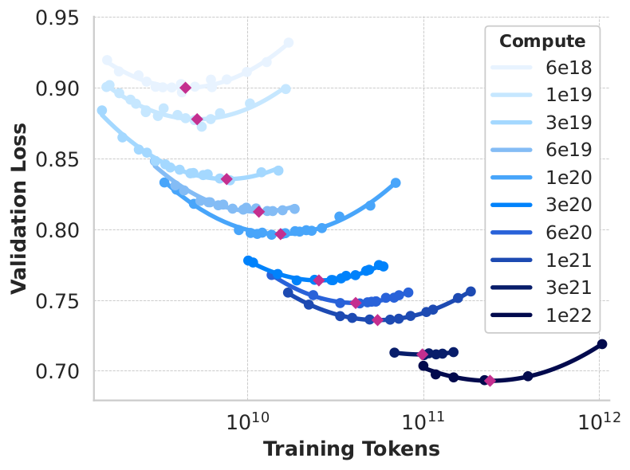

*图 2（原文 Figure 2，第 8 页）：$6\times10^{18}$ 到 $10^{22}$ FLOPs 的 IsoFLOPs 曲线。损失是在独立验证集上的负对数似然，每个算力档的测量用二次多项式近似。*

**图中文字翻译与读法**：

- **横轴 Training Tokens**：训练 token 数（对数刻度，约 $10^{9}$ 到 $10^{12}$）；**纵轴 Validation Loss**：验证损失（约 0.70 到 0.95）。
- **图例 Compute**：从浅到深依次为 6e18、1e19、3e19、6e19、1e20、3e20、6e20、1e21、3e21、1e22 FLOPs。圆点是实际训练的模型，实线是二次拟合，**洋红色菱形**标出每条曲线的最小点（该算力下的计算最优模型）。
- **读图结论**：（1）算力越大，曲线整体越低，最小点向右（更多 token）移动，从图上读出约从 $4\times10^{9}$（6e18）移到约 $2\times10^{11}$（1e22）；（2）算力越大，曲线在最小点附近越平坦——论文据此认为旗舰模型对“模型大小与训练 token 数之间的小幅取舍”相对稳健，最终就定了 405B。

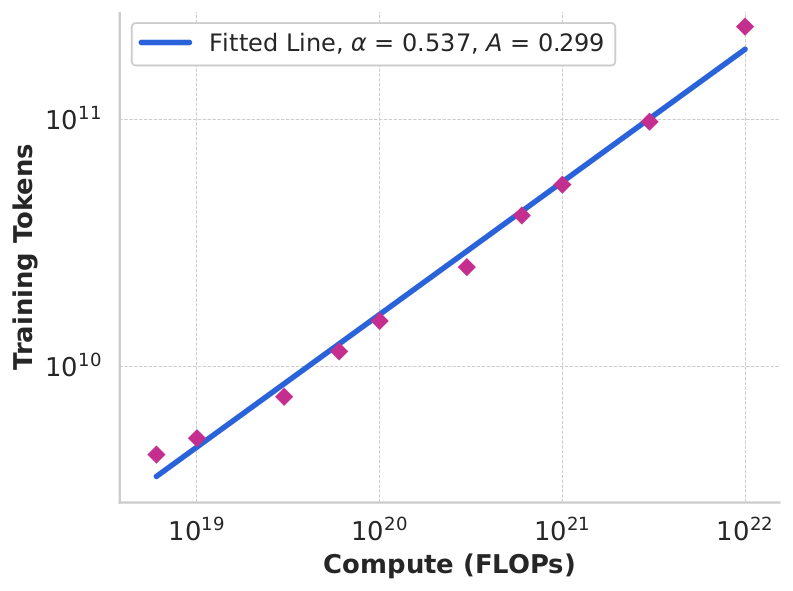

*图 3（原文 Figure 3，第 8 页）：已识别的计算最优模型的训练 token 数与预训练算力的关系，并给出拟合的 scaling law 预测；计算最优模型对应图 2 里各抛物线的最小点。*

**图中文字翻译与读法**：

- **横轴 Compute (FLOPs)**：预训练算力（对数，约 $10^{19}$ 到 $10^{22}$）；**纵轴 Training Tokens**：计算最优的训练 token 数（对数）。洋红色菱形是图 2 的各最小点，蓝色直线是幂律拟合，图中标注 “Fitted Line, α = 0.537, A = 0.299”。
- **读图结论**：在对数坐标里点大致落在一条直线上，说明最优 token 数与算力近似呈幂律；最大算力（$10^{22}$）处的点略高于拟合线。

假设最优 token 数 $N^\star(C)$ 与算力 $C$ 之间是幂律关系：

$$
N^\star(C)=A\,C^{\alpha},
$$

论文拟合得到 $(\alpha,A)=(0.53,0.29)$，把这个 scaling law 外推到 $3.8\times10^{25}$ FLOPs，建议训练一个 **402B 参数、16.55T tokens** 的模型。

需要注意一处数字口径（推算）：正文写的是 $(0.53,0.29)$，而图 3 标注的是 $(0.537,0.299)$。用图 3 的数代入，$0.299\times(3.8\times10^{25})^{0.537}$ 约 $1.63\times10^{13}$，即约 16.3T tokens，与 16.55T 接近；用正文取整后的数代入则只有约 10.5T tokens。所以正文的 $(0.53,0.29)$ 应理解为取整后的写法，16.55T 来自更精确的拟合值。另外，$6\times402\text{B}\times16.55\text{T}$ 约 $4.0\times10^{25}$，略高于 $3.8\times10^{25}$，说明论文拟合时的 FLOPs 口径与 $6ND$ 近似略有出入。

论文最终选择 405B 参数、15.6T tokens（每个参数约 38.5 个 token，推算），与建议值相近；理由见图 2 的“曲线变平坦”。

### 5.3 预测下游任务表现（两步法）

只预测验证损失还不够，论文要预测旗舰模型在基准上的**准确率**，于是分两步：

1. 先建立“计算最优模型在下游任务上的（归一化）负对数似然”与训练 FLOPs 之间的线性关系（这一步只用 $10^{22}$ FLOPs 以内、用论文数据配比训练的 scaling law 模型）；
2. 再建立负对数似然与任务准确率之间的 S 形（sigmoid）关系，这一步同时用 scaling law 模型和 Llama 2 系列模型（后者用 Llama 2 的数据配比与分词器训练、算力更高；从图 4 右图可见它们覆盖了较高的准确率区间）。

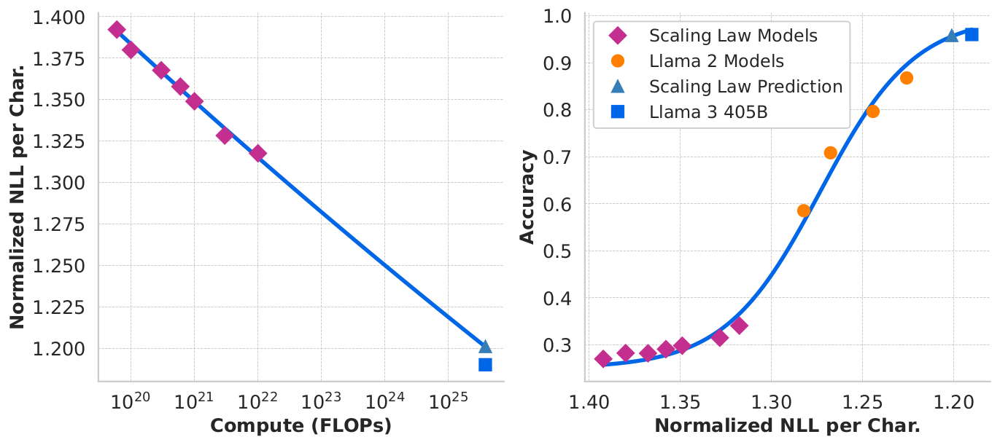

*图 4（原文 Figure 4，第 9 页）：ARC Challenge 的 scaling law 预测。左：正确答案的归一化负对数似然随预训练 FLOPs 的变化；右：ARC Challenge 准确率随正确答案归一化负对数似然的变化。这套分析使得在预训练开始之前就能预测 ARC Challenge 上的表现。*

**图中文字翻译与读法**：

- **左图**：横轴 Compute (FLOPs)（对数，$10^{20}$ 到 $10^{25}$），纵轴 Normalized NLL per Char.（按字符归一化的负对数似然，1.40 到 1.20，越低越好）。洋红色菱形是 scaling law 模型（算力不超过 $10^{22}$），蓝线是线性拟合并外推到约 $3.8\times10^{25}$；蓝色三角形为外推的预测值，蓝色方块为实际的 Llama 3 405B，约 1.19，略低于预测的约 1.20。
- **右图**：横轴是同一个负对数似然（坐标反向，1.40 到 1.20），纵轴 Accuracy（准确率，约 0.3 到 1.0）。图例：Scaling Law Models（洋红菱形，准确率约 0.27 到 0.34，接近随机）、Llama 2 Models（橙色圆点，约 0.59、0.71、0.80、0.87）、Scaling Law Prediction（蓝色三角形）、Llama 3 405B（蓝色方块）；蓝色 S 形曲线是拟合。
- **读图结论**：外推跨越约四个数量级的算力，预测值约 0.955，实际 Llama 3 405B 约 0.96（预训练基础模型在 ARC-C 上的实测见表 12：96.1），预测只略低于实际。论文把这称为“相当准确”，并在选择数据配比时用类似方法（见 3.2 节）。

## 六、训练基础设施

### 6.1 集群、存储与网络

Llama 1、2 训练在 Meta 的 AI Research SuperCluster 上；Llama 3 迁移到 Meta 的生产集群（Lee et al., 2024），这套环境为生产级可靠性优化，在规模变大时至关重要。

| 组件 | 规格（原文） |
|---|---|
| GPU | Llama 3 405B 最多用 16K 张 H100，80GB HBM3，每张 700W TDP |
| 服务器 | Meta 的 Grand Teton AI 服务器平台，每台 8 张 GPU 加 2 颗 CPU，机内 8 张 GPU 用 NVLink 互联 |
| 调度 | MAST（Meta 全球级训练调度器） |
| 存储 | Tectonic（Meta 通用分布式文件系统）：7,500 台带 SSD 的服务器共 240 PB，持续吞吐 2 TB/s，峰值 7 TB/s |
| checkpoint | 每张 GPU 的模型状态 1 MB 到 4 GB；难点是突发的 checkpoint 写入会短时间占满存储；目标是尽量减少 GPU 暂停时间，并提高存档频率以减少故障恢复时丢失的工作量 |
| 网络 | 405B 用基于 Arista 7800 与 Minipack2 OCP 机架交换机的 RoCE（RDMA over Converged Ethernet）；较小模型用 Nvidia Quantum2 InfiniBand；两种网络都是 GPU 之间 400 Gbps，并调到性能相当 |

RoCE 集群的拓扑（论文详述这一套，因为网络设计完全自有）：

- **拓扑**：24K GPU，三层 Clos 网络。底层每个机架 16 张 GPU（两台服务器），接一台 Minipack2 机架顶交换机（ToR）；中层 192 个机架通过 Cluster Switch 连成一个 3,072 GPU 的 pod（全二分带宽，无超额订阅）；顶层同一机房内的 8 个 pod 通过 Aggregation Switch 连成 24K GPU 的集群，但聚合层不保持全二分带宽，超额订阅比为 1:7。并行策略与训练作业调度器都做了拓扑感知，目标是尽量减少跨 pod 的通信。注意预训练只用了其中最多 16K 张 GPU。自检（推算）：192 × 16 = 3,072，8 × 3,072 = 24,576，与“24K”相符。
- **负载均衡**：LLM 训练产生“胖流”，传统的 ECMP 路由很难在所有路径间均衡。办法有二：集合通信库在两张 GPU 之间建立 16 条网络流而不是 1 条，让每条流更小、更好均衡；再用增强版 ECMP（E-ECMP），对 RoCE 包头中的额外字段做哈希，把这 16 条流分散到不同路径。
- **拥塞控制**：在 spine 层用深缓冲交换机吸收集合通信模式带来的瞬时拥塞，限制慢服务器造成的持续拥塞与网络反压；E-ECMP 带来的更好均衡也大幅降低拥塞概率。因此 24K GPU 集群没有使用 DCQCN 等传统拥塞控制方法。

### 6.2 并行策略：4D parallelism（图 5、表 4）

为了训练最大的模型，论文用 4D 并行——四种并行方式的组合——来切分模型，使每张 GPU 的参数、优化器状态、梯度和激活都能放进它的 HBM：

- **张量并行 TP**（tensor parallelism）：把单个权重张量切成几块放到不同设备；
- **流水线并行 PP**（pipeline parallelism）：按层把模型纵向切成若干阶段，不同设备并行处理流水线上不同阶段；
- **上下文并行 CP**（context parallelism）：把输入上下文切成若干段，缓解超长序列的显存瓶颈；
- **数据并行 DP**：用完全分片数据并行（FSDP），把模型、优化器状态、梯度分片，同时在多张 GPU 上并行处理数据，每个训练步后同步。Llama 3 用的 FSDP 只分片优化器状态与梯度；模型参数在前向之后**不重新分片**，以避免反向时额外的 all-gather 通信。

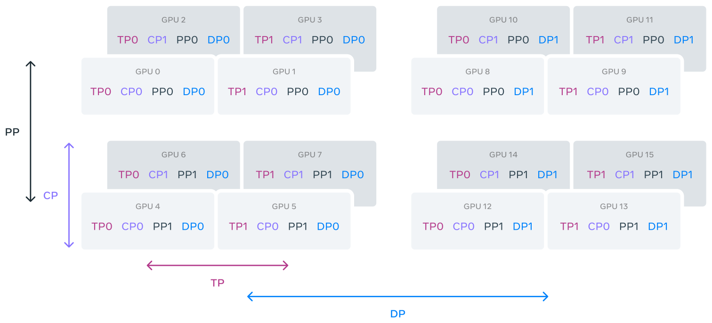

*图 5（原文 Figure 5，第 11 页）：4D 并行示意。GPU 按 [TP, CP, PP, DP] 的顺序划分并行组，其中 DP 指 FSDP。这个例子用 16 张 GPU，每个维度的组大小都是 2：|TP|=2、|CP|=2、|PP|=2、|DP|=2。*

**图中文字翻译与读法**：

- 图里每个方块是一张 GPU，方块里的 TP0/TP1、CP0/CP1、PP0/PP1、DP0/DP1 是它在四个并行维度上的下标，即位置向量 $[D_1,D_2,D_3,D_4]$，$D_i$ 为第 $i$ 个并行维度上的序号。左侧纵向箭头 PP 与 CP，底部横向箭头 TP 与 DP 标出各维度的方向。
- 按图题：GPU0 [TP0, CP0, PP0, DP0] 与 GPU1 [TP1, CP0, PP0, DP0] 在同一个 TP 组；GPU0 与 GPU2 在同一个 CP 组；GPU0 与 GPU4 在同一个 PP 组；GPU0 与 GPU8 在同一个 DP 组。可见编号规律为 GPU 编号 = TP + 2·CP + 4·PP + 8·DP（推算），TP 变化最快、DP 变化最慢。
- **读图结论**：并行维度的排序 [TP, CP, PP, DP] 是按通信需求排的：最内层需要最高带宽、最低延迟，通常限制在同一台服务器内；最外层可以跨多跳网络、容忍更高延迟。DP（FSDP）放最外层，因为它能通过异步预取分片权重和异步规约梯度来容忍更长的网络延迟。

**表 4：Llama 3 405B 预训练各阶段的并行配置与 MFU。**

| GPU 数 | TP | CP | PP | DP | 序列长度 | 每 DP 的 batch size | 每 batch tokens | 每 GPU TFLOPs | BF16 MFU |
|---:|---:|---:|---:|---:|---:|---:|---:|---:|---:|
| 8,192 | 8 | 1 | 16 | 64 | 8,192 | 32 | 16M | 430 | 43% |
| 16,384 | 8 | 1 | 16 | 128 | 8,192 | 16 | 16M | 400 | 41% |
| 16,384 | 8 | 16 | 16 | 8 | 131,072 | 16 | 16M | 380 | 38% |

（原文表 4，第 10 页。）

读法与自检（推算）：

- 三行是预训练各阶段的三种配置：8,192 张 GPU 与 16,384 张 GPU 上序列长度 8,192 的预训练（两者全局 batch 同为 16M tokens），以及 16,384 张 GPU 上序列长度 131,072 的长上下文训练（第七节）。每行 TP × CP × PP × DP 都等于 GPU 数（如 $8\times16\times16\times8=16{,}384$），每 batch 的 token 数 = 序列长度 × 每 DP 的 batch size × DP，都是 $2^{24}$ 约 16M。
- 论文报告整体 BF16 模型 FLOPs 利用率（MFU）为 38% 到 43%。从 43% 降到 41% 的原因是：为保持全局每 batch 的 token 数不变，16K GPU（DP=128）上每个 DP 组的 batch size 更小。128K 序列阶段 MFU 38%。
- 由 430 TFLOPs / 43% 与 400 / 41% 反推，隐含的 H100 BF16 峰值约 1,000 TFLOP/s，与 H100 的 989 TFLOP/s 稠密 BF16 峰值规格吻合。
- 粗估训练规模感（推算，论文没有给总时长）：$3.8\times10^{25}$ FLOPs 在 16,384 张 GPU、每张 400 TFLOP/s 下约需 $5.8\times10^{6}$ 秒，约 67 天，约 $2.6\times10^{7}$ GPU 小时，忽略故障停机与各阶段 MFU 的差异。

### 6.3 流水线并行的改进（图 6）

论文遇到现有流水线实现的三个问题：

- **batch size 约束**：现有实现要求每张 GPU 的 batch size 能被流水线阶段数整除。例如图 6 里，深度优先调度（DFS；Narayanan et al., 2021）要求 $N=PP=4$，宽度优先调度（BFS；Lamy-Poirier, 2023）要求 $N=M$（$M$ 为 micro-batch 总数，$N$ 为同一阶段前向或反向连续执行的 micro-batch 数），而预训练常常需要灵活地调 batch size。
- **显存不均衡**：第一阶段因为有嵌入层和预热的 micro-batch 而占更多显存。
- **计算不均衡**：模型最后一层之后还要算输出和损失，使最后一个阶段成为执行延迟的瓶颈。

论文的改法：

- 让 $N$ 可调（图中取 $N=5$），可以在每个 batch 里跑任意数量的 micro-batch：既可以在大规模 batch size 受限时用比阶段数更少的 micro-batch，也可以用更多 micro-batch 来藏住点对点通信，在 DFS 与 BFS 之间找到通信与显存效率的最佳点。
- 为平衡流水线，从第一阶段和最后一阶段各减去一个 Transformer 层：第一阶段的第一个模型块只有嵌入层，最后一阶段的最后一个模型块只有输出投影与损失计算。
- 用交错式调度（interleaved schedule；Narayanan et al., 2021），每个流水线 rank 上有 $V$ 个流水线阶段，整体气泡（bubble）比例为 $\dfrac{PP-1}{V\cdot M}$。
- 在 PP 里使用异步点对点通信，在文档掩码带来额外计算不均衡时提速明显；启用 `TORCH_NCCL_AVOID_RECORD_STREAMS` 以降低异步点对点通信的显存占用。
- 根据详细的显存分配剖析，主动释放后续计算不再用到的张量（包括各流水线阶段的输入输出张量）。
- 有了这些优化，8K token 的序列可以在**不做激活检查点**的情况下预训练。

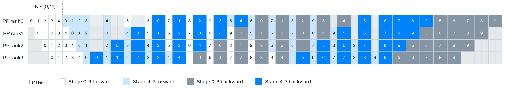

*图 6（原文 Figure 6，第 12 页）：Llama 3 中的流水线并行。8 个流水线阶段（0 到 7）分布在 4 个流水线 rank（PP rank 0 到 3）上，rank 0 的 GPU 运行阶段 0 和 4，rank 1 运行阶段 1 和 5，依此类推；彩色方块（0 到 9）是一串 micro-batch，$M$ 为 micro-batch 总数，$N$ 为同一阶段前向或反向连续执行的 micro-batch 数。关键想法是让 $N$ 可调。*

**图中文字翻译与读法**：

- 四行是 PP rank 0 到 3，横轴是时间（图底部 “Time”）。图例：白色 Stage 0-3 forward（阶段 0 到 3 的前向）、浅蓝 Stage 4-7 forward（阶段 4 到 7 的前向）、灰色 Stage 0-3 backward（阶段 0 到 3 的反向）、蓝色 Stage 4-7 backward（阶段 4 到 7 的反向）；方块里的数字是 micro-batch 编号 0 到 9。左上角虚线框标注 $N\in(0,M)$，表示 $N$ 可在 1 到 $M$ 之间取值。
- 读图要点：以 rank 0 为例，它先对 micro-batch 0 到 4 连续做阶段 0 到 3 的前向（白色），再穿插阶段 4 到 7 的前向（浅蓝），之后进入前向与反向交替的稳态，最后只剩反向（灰与蓝）；同一阶段连续处理的 micro-batch 个数就是 $N$（图中为 5）；开头与结尾的灰色空格是流水线气泡。$N$ 取多少，是在“藏住点对点通信”与“显存占用”之间调节。

### 6.4 上下文并行（CP）、数值稳定性与 NCCLX

- **长序列的上下文并行**：为扩展上下文长度、支持最长 128K 的序列训练，论文用 CP，沿序列维度切分：把输入序列切成 $2\times CP$ 块，每个 CP rank 拿两块以便负载均衡——第 $i$ 个 rank 拿第 $i$ 块与第 $(2\times CP-1-i)$ 块。（推算：因为因果注意力里靠后的块要看更多前文、计算更多，把一个靠前的块和一个靠后的块配对，各 rank 的计算量就接近。）
- **基于 all-gather 的 CP 注意力**：与已有的环状（ring）重叠通信与计算的 CP 实现不同，Llama 3 先对 K、V 张量做 all-gather，再对本地 Q 块计算注意力输出。虽然 all-gather 的通信延迟暴露在关键路径上，论文仍选它，有两个理由：（1）更容易、更灵活地支持不同类型的注意力掩码（如文档掩码）；（2）由于用了 GQA，被通信的 K、V 张量比 Q 小得多，暴露的 all-gather 延迟很小。注意力计算的时间复杂度是 $O(S^2)$，all-gather 是 $O(S)$（$S$ 为完整因果掩码下的序列长度），所以 all-gather 的开销可以忽略。
- **网络感知的并行配置**：并行维度顺序 [TP, CP, PP, DP] 按网络需求优化。论文还开发了显存消耗估计器和性能预测工具，用来探索各种并行配置、预测整体训练性能并找出显存缺口。
- **数值稳定性**：比较不同并行配置下的训练损失，修掉了若干影响训练稳定性的数值问题。为保证收敛，在多个 micro-batch 的反向计算中用 **FP32 梯度累加**，并在 FSDP 的数据并行 worker 之间用 **FP32 做梯度的 reduce-scatter**；在前向中被多次使用的中间张量（如视觉编码器的输出），其反向梯度同样用 FP32 累加。
- **集合通信库 NCCLX**：基于 Nvidia NCCL 的分支。最外层并行维度 PP 和 DP 可能经过多跳网络，延迟可达几十微秒；原版 NCCL 的集合通信（FSDP 里的 all-gather 与 reduce-scatter、PP 里的点对点）需要数据分块与分阶段拷贝，有三个低效之处：需要交换大量小控制消息、额外的内存拷贝、占用额外 GPU 周期。Llama 3 针对其中一部分做了改进——调整分块和数据传输以适应网络延迟，并让小的控制消息以更高优先级穿过网络，避免在深缓冲核心交换机里被队头阻塞。更深的改动留给未来版本。

### 6.5 可靠性与运行挑战（表 5）

16K GPU 训练的复杂度与潜在故障场景，超过了 Meta 运营过的大得多的 CPU 集群；同步训练又使其容错性更差，单张 GPU 故障就可能需要重启整个作业。尽管如此，Llama 3 实现了**超过 90% 的有效训练时间**（有效训练时间 = 用于有效训练的时间占流逝时间之比），同时支持固件与 Linux 内核升级等自动化集群维护，这些维护造成每天至少一次训练中断。

在预训练的一个 54 天快照期内，共发生 466 次作业中断：47 次是计划内的（自动化维护如固件升级，或操作员发起的配置、数据集更新），其余 419 次是意外中断，分类见表 5。约 78% 的意外中断被归因于已确认的硬件问题（如 GPU 或主机部件故障）或疑似硬件相关问题（如静默数据损坏、计划外的单机维护事件）。GPU 问题是最大的类别，占全部意外问题的 58.7%。尽管故障很多，这期间只需要三次显著的人工干预，其余问题由自动化处理。

**表 5：Llama 3 405B 预训练 54 天期间意外中断的根因分类。** 约 78% 的意外中断被归因于已确认或疑似的硬件问题。

| 组件 | 类别 | 中断次数 | 占中断比例 |
|---|---|---:|---:|
| Faulty GPU（GPU 故障） | GPU | 148 | 30.1% |
| GPU HBM3 Memory（GPU HBM3 显存） | GPU | 72 | 17.2% |
| Software Bug（软件缺陷） | Dependency | 54 | 12.9% |
| Network Switch/Cable（网络交换机/线缆） | Network | 35 | 8.4% |
| Host Maintenance（主机维护） | Unplanned Maintenance | 32 | 7.6% |
| GPU SRAM Memory | GPU | 19 | 4.5% |
| GPU System Processor | GPU | 17 | 4.1% |
| NIC（网卡） | Host | 7 | 1.7% |
| NCCL Watchdog Timeouts | Unknown | 7 | 1.7% |
| Silent Data Corruption（静默数据损坏） | GPU | 6 | 1.4% |
| GPU Thermal Interface + Sensor | GPU | 6 | 1.4% |
| SSD | Host | 3 | 0.7% |
| Power Supply（电源） | Host | 3 | 0.7% |
| Server Chassis（服务器机箱） | Host | 2 | 0.5% |
| IO Expansion Board | Host | 2 | 0.5% |
| Dependency | Dependency | 2 | 0.5% |
| CPU | Host | 2 | 0.5% |
| System Memory（系统内存） | Host | 2 | 0.5% |

（原文表 5，第 13 页。）

读法与自检（推算）：

- 各行次数相加为 419，与正文“419 次意外中断”一致。**但表里 Faulty GPU 一行的百分比有疑点**：148 / 419 约 35.3%，而不是 30.1%；其余各行百分比都等于次数 / 419。正文的 “GPU 问题占 58.7%” 恰好是表中 GPU 类各行百分比之和（30.1 + 17.2 + 4.5 + 4.1 + 1.4 + 1.4），而按次数算 GPU 类共 268 次，占约 64.0%。也就是说论文的次数列与百分比列在这一行不自洽，本文照原样转录，引用时应注明。
- 419 次意外中断分布在 54 天里，平均约每 3.1 小时一次；加上计划内共 466 次，平均约每 2.8 小时一次。要做到“有效训练时间超过 90%”，平均每次中断（含恢复）损失的时间不能超过约 17 分钟（推算：$0.1\times54\times24\times60/466$）。这解释了为什么论文强调缩短作业启动与 checkpoint 时间、做快速诊断工具。
- 论文的诊断手段：大量使用 PyTorch 内置的 NCCL flight recorder（把集合通信的元数据与调用栈记录进环形缓冲区，便于大规模下快速诊断卡死与性能问题，尤其是 NCCLX 相关问题），在 NCCLX 的 watchdog 或心跳超时时自动转储跟踪数据；通过在线配置变更按需开启更重的追踪，无需发布新代码或重启作业。NVLink 故障常表现为 CUDA kernel 里的 load/store 卡住而不返回错误码，NCCLX 与 PyTorch 紧密协同设计，使 PyTorch 能访问 NCCLX 内部状态、自动超时。
- **掉队者（straggler）**：硬件问题可能让设备仍在工作但变慢，很难发现，一个 straggler 就能拖慢成千上万张 GPU。论文开发了工具，对选定进程组里可能有问题的通信排优先级，通常只需检查少数最可疑对象就能定位。
- **环境因素**：Llama 3 405B 观察到按一天中时间变化的 1% 到 2% 吞吐波动，原因是中午较高的气温影响 GPU 的动态电压频率调节。另外，数万张 GPU 可能同时增减功耗（例如都在等 checkpoint 或集合通信完成，或整个作业启动、关闭），会造成数据中心几十兆瓦量级的瞬时功耗波动，逼近电网极限——这是未来训练更大模型时仍要面对的挑战。

## 七、训练配方

405B 的预训练配方分三个阶段：初始预训练、长上下文预训练、退火；8B 和 70B 用类似的配方。

### 7.1 初始预训练

- **优化器与学习率**：AdamW，峰值学习率 $8\times10^{-5}$，8,000 步线性 warmup，余弦衰减在 1,200,000 步内降到 $8\times10^{-7}$。
- **batch size 日程**：训练早期用较小的 batch 以提高稳定性，之后增大以提高效率。

| 阶段 | batch size | 序列长度 | 切换时机 |
|---|---:|---:|---|
| 起始 | 4M tokens | 4,096 | 开始训练 |
| 第二段 | 8M tokens | 8,192 | 预训练 252M tokens 之后 |
| 第三段 | 16M tokens | 8,192 | 预训练 2.87T tokens 之后 |

（原文 3.4.1 节正文。原文把第二段写成 “8M sequences of 8,192 tokens”，按上下文理解为 batch 为 8M tokens、序列长度 8,192；第三段只说“再翻倍到 16M”，序列长度按表 4 为 8,192。）

- 论文发现这套配方**非常稳定**：几乎没有损失尖峰，也不需要为纠正训练发散而干预。
- **训练中调整数据配比**：为提升特定下游任务，训练过程中多次调整预训练数据配比——提高非英文数据比例以提升多语言表现；上采样数学数据以提升数学推理；在后期加入更新的网页数据以推进知识截止时间；对后来被识别为质量较低的子集降采样。

### 7.2 长上下文预训练

在预训练的最后阶段，在长序列上训练以支持最长 128K token 的上下文窗口。不更早做的原因是自注意力的计算量随序列长度平方增长。上下文长度**逐步增加**，每一步训练到模型适应了新长度为止；判断“适应成功”有两个标准：（1）短上下文评测的表现完全恢复；（2）模型能完美解决到该长度为止的“大海捞针”（needle in a haystack）任务。405B 的预训练中，上下文长度分六个阶段、从原来的 8K 逐步增加到最终的 128K，这一阶段用了约 **800B** 训练 token。

### 7.3 退火

在预训练的最后 40M tokens 里，把学习率线性退火到 0，保持 128K 的上下文长度；退火阶段同时调整数据配比，上采样极高质量的数据源（见 3.3 节）；最后对退火期间的模型 checkpoint 做平均（Polyak 平均）得到最终预训练模型。（原文写的是 “final 40M tokens”；对照 3.3 节里评估数据时用的是 40B tokens，量级相差很大，原文没有解释。）

## 八、后训练

论文通过多轮后训练得到对齐后的 Llama 3：每轮在预训练 checkpoint 之上，用人工标注或合成生成的样本，先做监督微调（SFT），再做直接偏好优化（DPO，见 [../dpo/论文中文解读.md](../dpo/论文中文解读.md)），共六轮；每轮都收集新的偏好标注与 SFT 数据，并从最新模型采样合成数据。

### 8.1 总体流程（图 7）

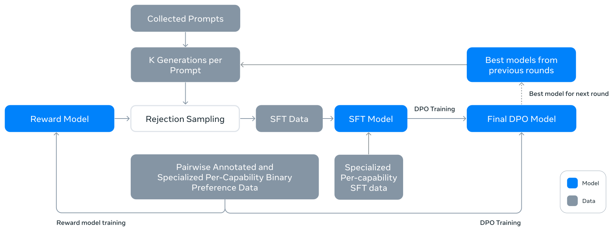

*图 7（原文 Figure 7，第 15 页）：Llama 3 后训练方法总览，包括拒绝采样、监督微调和直接偏好优化。*

**图中文字翻译与读法**：

- **方框**：蓝色为模型（Model），灰色为数据（Data）。Collected Prompts（收集到的提示）→ K Generations per Prompt（每个提示采样 K 个回复，由右上角 Best models from previous rounds，即上一轮最佳模型生成）。
- **中间一行**：Reward Model（奖励模型）→ Rejection Sampling（拒绝采样）→ SFT Data（SFT 数据）→ SFT Model（SFT 模型）→ DPO Training → Final DPO Model（本轮最终模型）；虚线 “Best model for next round” 把它送回右上角，成为下一轮采样用的模型。
- **下方两个数据框**：Pairwise Annotated and Specialized Per-Capability Binary Preference Data（成对标注、按能力专门化的二元偏好数据）同时供给奖励模型训练与 DPO 训练；Specialized Per-capability SFT data（按能力专门化的 SFT 数据）补充进 SFT。
- **读图结论**：一轮的闭环是：用上一轮最好的模型对提示各采样 K 个回复，奖励模型选最好的（拒绝采样）形成 SFT 数据，加上专项 SFT 数据训练 SFT 模型，再用偏好数据做 DPO，得到的模型成为下一轮的“最佳模型”。除非特别说明，下面都针对 405B。

### 8.2 建模

- **对话格式**：新增的工具使用等能力要求一轮对话里生成多条消息并发往不同目的地（如 user、ipython），所以设计了多消息对话协议，用特殊的头（header）token 标明每条消息的来源与目的地，用终止（termination）token 表示何时在人与 AI 之间轮换。
- **奖励模型（RM）**：在预训练 checkpoint 上训练，目标与 Llama 2 相同，**只去掉 margin 项**（数据变多后 margin 的收益递减）。成对排序损失为 $\mathcal{L}_{\mathrm{RM}}=-\log\sigma\big(r_\theta(x,y_c)-r_\theta(x,y_r)\big)$，$y_c$、$y_r$ 为被选中与被拒绝的回复（这是 Llama 2 论文的形式）。过滤掉回复相似的样本后，全部偏好数据都用于 RM；标注者对部分提示还会给出第三个“edited response”（把 chosen 再改进），所以每个样本有 2 或 3 个有序回复：edited > chosen > rejected；训练时把提示与多个回复拼成一行、回复顺序随机打乱，这比逐回复单独打分更高效而准确率不降。
- **SFT**：对人工标注的提示做拒绝采样（见 8.3），连同合成数据等，用标准交叉熵在目标 token 上微调，**屏蔽提示 token 的损失**；最大模型学习率 $10^{-5}$，训练 8.5K 到 9K 步，这组超参数在不同轮次与配比下都稳定。
- **DPO**：主要用**最新一批**偏好数据（由上一轮最好的模型收集，更贴近当轮策略的分布）。论文也试过 PPO（Schulman et al., 2017），但 DPO 在大模型上算力更少、效果更好，尤其在 IFEval 这类指令遵循基准上。学习率 $10^{-5}$，$\beta=0.1$。DPO 标准损失为

$$
\mathcal{L}_{\mathrm{DPO}}=-\,\mathbb{E}\Big[\log\sigma\Big(\beta\log\frac{\pi_\theta(y_w\mid x)}{\pi_{\mathrm{ref}}(y_w\mid x)}-\beta\log\frac{\pi_\theta(y_l\mid x)}{\pi_{\mathrm{ref}}(y_l\mid x)}\Big)\Big],
$$

其中 $y_w$、$y_l$ 是偏好对里被偏好与不被偏好的回复，$\pi_{\mathrm{ref}}$ 是参考模型（公式取自 Rafailov 等，Llama 3 论文只给了超参数）。论文做了两处修改：一是**屏蔽格式 token**——把头 token、终止 token 从 chosen 与 rejected 的损失里去掉，因为它们让损失出现冲突目标（两边共有的 token 既要升又要降），会导致尾部重复或突然生成终止 token；二是**加 NLL 正则**——对 chosen 序列加系数 0.2 的负对数似然项（类似 Pang et al., 2024），总损失约为 $\mathcal{L}_{\mathrm{DPO}}+0.2\,\mathcal{L}_{\mathrm{NLL}}(y_w)$，用来保持生成格式、防止 chosen 回复的对数概率下降。
- **模型平均**：RM、SFT、DPO 每个阶段，都把用不同数据版本或超参数得到的模型做平均。

### 8.3 后训练数据

**偏好数据**。每轮后部署多个模型做标注，对每个提示从两个不同模型各采样一个回复；标注者把偏好强度分四档（明显更好、更好、略好、微弱更好），之后还有**编辑步骤**，让标注者直接改进被偏好的回复，或用反馈提示模型自己改。RM 训练用当时全部可用的偏好数据，DPO 只用各能力最新批次；两者都只取“chosen 明显更好或更好”的样本，丢弃回复相近的样本。

**表 6：人类偏好数据统计。** 标注者与模型多轮对话并在每一轮比较回复，后处理时把每段对话按轮拆成多个样本；每个样本由提示（含此前对话）与一个回复组成。

| 数据集 | 比较数占比 | 每段对话平均轮数 | 每个样本平均 tokens | 提示平均 tokens | 回复平均 tokens |
|---|---:|---:|---:|---:|---:|
| General English（通用英语） | 81.99% | 4.1 | 1,000.4 | 36.4 | 271.2 |
| Coding（代码） | 6.93% | 3.2 | 1,621.0 | 113.8 | 462.9 |
| Multilingual（多语言） | 5.19% | 1.8 | 1,299.4 | 77.1 | 420.9 |
| Reasoning and tools（推理与工具） | 5.89% | 1.6 | 707.7 | 46.6 | 129.9 |
| 合计 Total | 100% | 3.8 | 1,041.6 | 44.5 | 284.0 |

（原文表 6，第 17 页。）读法：General English 含知识问答、精确指令遵循等落在具体能力之外的子类。相比 Llama 2，提示与回复都更长，说明任务更复杂；随着模型逐轮变强，提示的复杂度也相应提高以瞄准薄弱环节。

**SFT 数据**由三类构成：人工标注提示加拒绝采样得到的回复、针对特定能力的合成数据、少量人工整理的数据。

**表 7：SFT 数据统计。** 每个 SFT 样本由上下文（除最后一轮外的全部对话）与最终回复组成。

| 数据集 | 样本占比 | 平均轮数 | 平均 tokens | 上下文平均 tokens | 最终回复平均 tokens |
|---|---:|---:|---:|---:|---:|
| General English（通用英语） | 52.66% | 6.3 | 974.0 | 656.7 | 317.1 |
| Code（代码） | 14.89% | 2.7 | 753.3 | 378.8 | 374.5 |
| Multilingual（多语言） | 3.01% | 2.7 | 520.5 | 230.8 | 289.7 |
| Exam-like（考试类） | 8.14% | 2.3 | 297.8 | 124.4 | 173.4 |
| Reasoning and tools（推理与工具） | 21.19% | 3.1 | 661.6 | 359.8 | 301.9 |
| Long context（长上下文） | 0.11% | 6.7 | 38,135.6 | 37,395.2 | 740.5 |
| 合计 Total | 100% | 4.7 | 846.1 | 535.7 | 310.4 |

（原文表 7，第 18 页。）读法：这是“有用性”配比，SFT 与偏好数据领域重叠但整理方式不同，所以统计不同；最终配比对一些高质量来源重复多个 epoch、对另一些降采样。自检（推算）：长上下文样本只占样本数的 0.11%，但平均 38K tokens，按“占比 × 平均 tokens”折算约占全部 SFT token 的 5%。

**拒绝采样（RS）**：对每个提示，从最新的聊天模型策略（通常是上一轮最好的 checkpoint，或某项能力上最好的 checkpoint）采样 $K$ 个输出（$K$ 通常为 10 到 30），用奖励模型选出最好的，即 $y^\star=\operatorname*{arg\,max}_{k}r_\theta(x,y_k)$（与 Bai et al., 2022 一致）。后期轮次引入系统提示来引导 RS 回复的语气、风格和格式。用 PagedAttention（Kwon et al., 2023）提速：动态分配 KV cache、让同一提示的所有输出共享提示的 KV cache 页，并设定最大输出长度、只在显存足够时才执行请求以避免换出，吞吐提升超过 2 倍。

**清洗与质量控制**（大部分训练数据是模型生成的，必须严格把关）：

- **清洗**：用规则去掉不良模式（过多表情符号、感叹号），并平衡“I’m sorry”“I apologize”这类过度道歉短语的占比。
- **剪枝**：（1）**主题分类**：把 Llama 3 8B 微调成分类器，分到粗桶（如“数学推理”）和细桶（如“几何与三角”）；（2）**质量打分**：奖励模型分数位于前四分位，或 Llama 3 打分（通用英语三分制：准确性、指令遵循、语气；代码二分制：缺陷识别、用户意图）取得最高分，二者任一满足即视为高质量——两种信号分歧率很高，但结合起来在内部测试集上召回最好；（3）**难度打分**：Instag（让 Llama 3 70B 给提示做意图标注，意图越多越难）加 Llama 3 的三分制难度打分；（4）**语义去重**：用 RoBERTa 对完整对话聚类，簇内按“质量 × 难度”排序，贪心保留与已选样本最大余弦相似度低于阈值的样本。

### 8.4 各项能力的专项做法

**代码**。目标语言有 Python、Java、Javascript、C/C++、Typescript、Rust、PHP、HTML/CSS、SQL、bash/shell。

- **代码专家**：从主预训练运行分叉，在 1T tokens、超过 85% 为代码的混合数据上继续预训练（类似 CodeLlama），最后几千步用仓库级代码做长上下文微调把上下文扩到 16K，再用代码 SFT/DPO 数据对齐；它用来在各轮收集高质量代码标注，并做代码提示的拒绝采样。
- **合成数据**（SFT 中共超过 270 万条）：（1）**执行反馈**：8B、70B 用更强模型生成的数据训练会明显变好，但训练 405B 用自己生成的数据没帮助甚至更差，所以引入执行反馈做“事实依据”，生成约 100 万条对话——先生成覆盖长尾主题的编程题，再让模型求解，经静态分析（解析器加 linter）和单元测试（模型自己生成并在容器里运行）检验，失败时把原问题、错误解答和报错信息交回模型修订（修代码或修测试），**只有通过全部检查的对话才进入 SFT**，约 20% 的解答最初错误但被自我纠正，并分多轮迭代；（2）**编程语言翻译**：把 Python、C++ 的数据翻译成 Typescript、PHP 等少见语言，用语法解析、编译与执行保证质量（原文图 8 是 Python 译 PHP 的例子，本文不转载），明显提升少见语言在 MultiPL-E 上的表现；（3）**回译**：对文档、解释等执行反馈不足的能力，约 120 万条对话，流程是“生成（加注释与 docstring，或解释代码）→ 回译（只据文档或解释重新生成代码）→ 过滤（让 Llama 3 判断回译代码与原代码的忠实度，只留得分最高的）”。
- **系统提示引导与过滤**：拒绝采样时用代码专用系统提示改善可读性与文档（原文图 9 的例子，本文不转载：加注释、变量名更有信息量、更省内存）；用“模型作裁判”对正确性与风格各打 0 或 1 分、只留满分 2 的样本——这样严格的过滤起初让基准退步，因为它不成比例地删掉了难题，对策是把最难的一部分数据的回复反复修订到满足裁判标准。

**多语言**。除英语外有 7 种目标语言（德、法、意、葡、印地、西、泰）。先分叉出一个在 **90% 为多语言 token** 的配比上继续预训练的专家，后训练后用来收集非英文高质量标注。多语言 SFT 数据构成如下：

| 来源 | 占比 | 做法 |
|---|---:|---|
| 人工标注 | 2.4% | 语言学家与母语者写的开放式真实用例提示 |
| 其他 NLP 任务数据 | 44.2% | 改写成对话格式（如 exams-qa、Conic10k）；用 GlobalVoices 与 Wikimedia 的平行文本，套多语言模板模拟真实翻译对话；用 LID 过滤与 Blaser2.0 去低质量数据 |
| 拒绝采样数据 | 18.8% | 早期随机取温度 0.2 到 1，但高温易出现不自然的语码转换，最后一轮固定 0.6；奖励模型选择前先检查提示与回复的语言匹配 |
| 翻译的推理数据 | 34.6% | 尽量避免机器翻译（翻译腔、姓名/性别/文化偏见）；唯一例外是把合成的定量推理数据翻译成其他语言，这类数学题语言简单，在 MGSM 上带来明显提升 |

（来源与占比取自原文 4.3.2 节正文，表为本文整理。）

**数学与推理**。论文把推理定义为执行多步计算并得到正确答案的能力，针对五个挑战各有对策：

| 挑战 | 对策 |
|---|---|
| 缺提示（问题越难，可用提示越少） | 把数学语境的预训练数据转成问答格式；建数学技能分类体系，请人类针对薄弱技能写提示 |
| 缺带标准答案的思维链 | 用 Llama 3 生成逐步解答，按正确答案过滤，并做自验证 |
| 中间步骤可能错 | 训练结果奖励模型与逐步奖励模型过滤数据；难题用带逐步奖励模型的蒙特卡洛树搜索（MCTS）生成有效轨迹 |
| 需要用外部工具 | 让模型用“文本推理加 Python 代码”交织地解题，用代码执行结果剔除无效推理链 |
| 训练与推理的差异（推理时要依据反馈改进） | 用错误的生成模拟人类反馈，让模型纠错得到正确生成 |

**长上下文**。只用短上下文数据的 SFT 配方会使长上下文能力退步，而人工标注长样本几乎不现实，所以用早期 Llama 3 合成：（1）问答：把长文档切成 8K 块，让模型对随机块生成问答，训练时用整篇文档作上下文；（2）分层摘要：先摘要 8K 块再摘要摘要，并据摘要生成需要全局理解的问答；（3）长上下文代码推理：从 Python 仓库里删掉一个被至少五个文件依赖的关键文件，让模型指出哪些文件依赖它并生成缺失代码；样本按 16K、32K、64K、128K 分类。消融发现混入 **0.1%** 合成长上下文数据最能兼顾短、长上下文基准。DPO 只用短上下文数据也不损害长上下文表现（只要 SFT 模型足够好；猜测因为 DPO 优化步数比 SFT 少）。

**工具使用**。训练 Llama 3 使用三类工具：搜索引擎（Brave Search，回答超出知识截止期的事件）、Python 解释器（计算、读取上传文件做问答/摘要/数据分析/可视化）、数学计算引擎（Wolfram Alpha API）；模型能写分步计划、依次调用并在每次调用后推理，也提升了零样本函数调用能力。工具在 Python 里实现，调用由解释器执行，必须在系统提示里启用，核心工具可单独开关。数据靠人工标注与偏好：在**消息级别**标注（标注者在同一上下文的两条助手消息间选择，都不好就编辑一条，不能改工具输出），**不做拒绝采样**（工具基准上没观察到收益）；先用旧 checkpoint 的合成数据自举，再逐步从单轮标注过渡到多轮、多步工具使用与数据分析。工具数据集有三类：单步（few-shot 生成必须调用工具的合成提示，过滤掉约 30% 无法执行或格式有问题的调用）、多步（至少两次调用，类似 ReAct）、文件上传（.txt、.docx、.pdf、.pptx、.xlsx、.csv、.json 等）；零样本函数调用数据从 The Stack 挖掘真实函数，覆盖单个、嵌套、并行调用，并合成多轮函数调用对话。为让模型对简单查询不调用工具，还混入工具已启用但答案不需工具的简单数学与问答样本。论文用一个例子（原文图 10，本文不转载）展示：模型先写三步计划，依次调用 `brave_search` 查通胀率与饼干价格，再写 Python 计算并给出最终答案。

**事实性（factuality）**。原则是让后训练使模型“知道自己知道什么”，而不是增加知识。**知识探测**流程：从预训练数据抽一个片段，让 Llama 3 据此提事实性问题，对问题多次采样回答，用 Llama 3 以原片段为参照判断正确性与信息量，对“一致地有信息量但不正确”的回复生成拒答。这些数据鼓励模型只回答自己有知识的问题，不确定就拒答；另外还收集少量处理敏感话题中事实矛盾的标注数据。

**可控性（steerability）**。通过带自然语言指令的系统提示来增强，重点是回复长度、格式、语气和人设。让标注者在通用英语类别里设计系统提示（论文的例子是一个“为忙碌家庭服务的愉快的膳食计划助手”，规定了计划天数、含哪几餐、先请用户确认再给购物清单、注意预算等），再与模型对话评估其遵循程度，所得偏好数据用于奖励建模、拒绝采样、SFT 与 DPO。

## 九、预训练模型评测（原文第 5.1 节）

本节评测的是**预训练基础模型**（没有指令微调），并与同规模的其他模型比较；论文说能复现的竞品都尽量复现。评测的具体配置（shot 数、指标等超参数）发布在其 Github 仓库，评测中产生的数据（对公开基准）发布在 Huggingface。

### 9.1 基准清单与评测方法（表 8）

论文在正文说这些评测覆盖八个顶层类别：常识推理、知识、阅读理解、数学与推理及问题求解、长上下文、代码、对抗性评测、综合评测。**表 8** 实际列出的是下面七类（没有单独的“知识”类，但表 15 里出现了 NaturalQuestions 等，可能属于该类）。

**表 8：预训练基准分类。** 评测预训练 Llama 3 所用的全部基准，按能力分组。

| 能力类别 | 基准 |
|---|---|
| 阅读理解 Reading Comprehension | SQuAD V2、QuAC、RACE |
| 代码 Code | HumanEval、MBPP |
| 常识推理/理解 Commonsense reasoning/understanding | CommonSenseQA、PiQA、SiQA、OpenBookQA、WinoGrande |
| 数学、推理与问题求解 Math, reasoning, and problem solving | GSM8K、MATH、ARC Challenge、DROP、WorldSense |
| 对抗 Adversarial | Adv SQuAD、Dynabench SQuAD、GSM-Plus、PAWS |
| 长上下文 Long context | QuALITY、many-shot GSM8K |
| 综合 Aggregate | MMLU、MMLU-Pro、AGIEval、BIG-Bench Hard |

（原文表 8，第 29 页，原文的引用标注从略。）

**评测设置**：对每个基准，论文既计算 Llama 3 的分数，也计算其他同规模预训练模型的分数，能重算的就用自己的流水线重算；为公平比较，对其他模型取“自己算的分数”与“该模型公开报告的、设置相当或更保守的分数”中**较好的一个**。有些模型无法（重新）计算——例如预训练模型没有发布，或者 API 不提供对数概率；所有与 Llama 3 405B 同档的模型都是这种情况，因此**不报告 405B 的类别平均值**（类别平均要求所有基准的数字齐全）。

**显著性估计**：基准分数只是对模型真实表现的估计，因为基准集是有限样本，有方差。论文按 Madaan 等（2024b）报告 95% 置信区间（CI），假设基准分数服从高斯分布：

$$
\mathrm{CI}(S)=1.96\times\sqrt{\frac{S\,(1-S)}{N}},
$$

其中 $S$ 是观察到的基准分数（如准确率或 EM），$N$ 是基准的样本数。高斯假设并不严格成立（分数有界），但初步的 bootstrap 实验表明对离散指标这个 CI 是很好的近似；对不是简单平均的分数不给 CI。因为抽样不是唯一的变异来源，这些 CI 只是能力估计真实变异的**下界**。读表时可以用它判断差距是否有意义：例如题目少的 HumanEval，CI 约 ±7 个点，几个点的差距并不显著。

### 9.2 8B 与 70B 的类别平均（图 12）

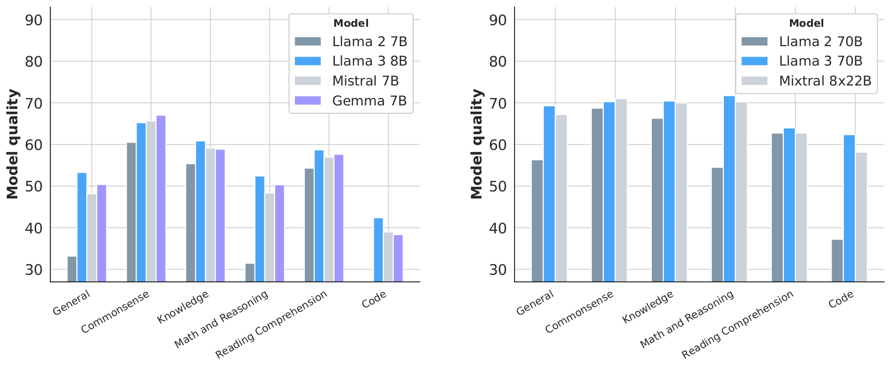

*图 12（原文 Figure 12，第 30 页）：预训练 Llama 3 8B 与 70B 在预训练基准上的表现，按能力类别汇总（对该类别所有基准的准确率取平均）。*

**图中文字翻译与读法**：

- **左图（8B 档）**：横轴是六个能力类别 General（综合）、Commonsense（常识）、Knowledge（知识）、Math and Reasoning（数学与推理）、Reading Comprehension（阅读理解）、Code（代码）；纵轴 Model quality（模型质量，即该类基准的平均准确率）。图例：Llama 2 7B、Llama 3 8B、Mistral 7B、Gemma 7B。**右图（70B 档）**：坐标相同，图例为 Llama 2 70B、Llama 3 70B、Mixtral 8x22B。
- **读图结论**（数值均为从图上读出的近似值）：（1）8B：Llama 3 8B 在 General 约 53（Llama 2 7B 约 33）、Math and Reasoning 约 52（Llama 2 7B 约 31）、Code 约 42（Mistral 7B 约 39、Gemma 7B 约 38；Llama 2 7B 的柱子低于坐标轴下限，图中看不到），几乎各类领先；唯独 Commonsense 上 Llama 3 8B（约 65）略低于 Gemma 7B（约 67）。（2）70B：Llama 3 70B 相对 Llama 2 70B 提升很大，如 General 约 56 到 69、Math and Reasoning 约 54 到 72、Code 约 37 到 62；Commonsense 几乎没有提升（约 69 到 70），Mixtral 8x22B 约 71 略高。论文的解释是常识类基准“可能已经饱和”。（3）70B 档 Llama 3 70B 总体也强于 Mixtral 8x22B（如 Code 约 62 对约 58），与正文“Llama 3 70B 也优于 Mixtral 8x22B”一致。

### 9.3 详细结果（表 9 至表 13）

下面五张表给出各规模预训练模型在阅读理解、代码、常识、数学与推理和综合任务上的结果。原文用粗体标出每个规模档内的最好结果；±后是 95% 置信区间。论文的总体结论：Llama 3 405B 在同类模型里表现有竞争力，并明显优于以往的开源模型。

**表 9：阅读理解任务上的预训练模型表现。**

| 模型 | SQuAD | QuAC | RACE |
|---|---:|---:|---:|
| Llama 3 8B | 77.0 ±0.8 | **44.9** ±1.1 | **54.3** ±1.4 |
| Mistral 7B | 73.2 ±0.8 | 44.7 ±1.1 | 53.0 ±1.4 |
| Gemma 7B | **81.8** ±0.7 | 42.4 ±1.1 | 48.8 ±1.4 |
| Llama 3 70B | 81.8 ±0.7 | **51.1** ±1.1 | 59.0 ±1.4 |
| Mixtral 8×22B | **84.1** ±0.7 | 44.9 ±1.1 | **59.2** ±1.4 |
| Llama 3 405B | **81.8** ±0.7 | **53.6** ±1.1 | **58.1** ±1.4 |
| GPT-4 | – | – | – |
| Nemotron 4 340B | – | – | – |
| Gemini Ultra | – | – | – |

（原文表 9，第 30 页。）读法：阅读理解上 Llama 3 并不是全面领先——SQuAD 上 8B 档被 Gemma 7B 超过（81.8 对 77.0），70B 档被 Mixtral 8×22B 超过（84.1 对 81.8）；QuAC 上 Llama 3 各档最好。405B 档的竞品没有数字，所以标粗只是“有数字者中最好”。

**表 10：代码任务上的预训练模型表现。**

| 模型 | HumanEval | MBPP |
|---|---:|---:|
| Llama 3 8B | **37.2** ±7.4 | **47.6** ±4.4 |
| Mistral 7B | 30.5 ±7.0 | 47.5 ±4.4 |
| Gemma 7B | 32.3 ±7.2 | 44.4 ±4.4 |
| Llama 3 70B | **58.5** ±7.5 | 66.2 ±4.1 |
| Mixtral 8×22B | 45.1 ±7.6 | **71.2** ±4.0 |
| Llama 3 405B | 61.0 ±7.5 | **73.4** ±3.9 |
| GPT-4 | 67.0 ±7.2 | – |
| Nemotron 4 340B | 57.3 ±7.6 | – |
| Gemini Ultra | **74.4** ±6.7 | – |

（原文表 10，第 30 页。）读法：HumanEval 上 405B（61.0）低于 GPT-4（67.0）和 Gemini Ultra（74.4），但这些差距都在 ±7 的置信区间量级；MBPP 上 70B 档 Mixtral 8×22B（71.2）高于 Llama 3 70B（66.2），而 Llama 3 405B 的 73.4 与之相近。

**表 11：常识理解任务上的预训练模型表现。**

| 模型 | CommonSenseQA | PiQA | SiQA | OpenBookQA | Winogrande |
|---|---:|---:|---:|---:|---:|
| Llama 3 8B | **75.0** ±2.5 | 81.0 ±1.8 | 49.5 ±2.2 | 45.0 ±4.4 | 75.7 ±2.0 |
| Mistral 7B | 71.2 ±2.6 | **83.0** ±1.7 | 48.2 ±2.2 | 47.8 ±4.4 | **78.1** ±1.9 |
| Gemma 7B | 74.4 ±2.5 | 81.5 ±1.8 | **51.8** ±2.2 | **52.8** ±4.4 | 74.7 ±2.0 |
| Llama 3 70B | **84.1** ±2.1 | 83.8 ±1.7 | **52.2** ±2.2 | 47.6 ±4.4 | 83.5 ±1.7 |
| Mixtral 8×22B | 82.4 ±2.2 | **85.5** ±1.6 | 51.6 ±2.2 | **50.8** ±4.4 | **84.7** ±1.7 |
| Llama 3 405B | **85.8** ±2.0 | **85.6** ±1.6 | **53.7** ±2.2 | **49.2** ±4.4 | 82.2 ±1.8 |
| GPT-4 | – | – | – | – | 87.5 ±1.5 |
| Nemotron 4 340B | – | – | – | – | **89.5** ±1.4 |

（原文表 11，第 31 页。）读法：常识类基准区分度小，很多差距落在 ±2 到 ±4 的区间内；Llama 3 405B 在 Winogrande 上（82.2）甚至低于 70B（83.5），印证论文“常识基准可能已饱和”的判断。

**表 12：数学与推理任务上的预训练模型表现。**

| 模型 | GSM8K | MATH | ARC-C | DROP | WorldSense |
|---|---:|---:|---:|---:|---:|
| Llama 3 8B | **57.2** ±2.7 | 20.3 ±1.1 | **79.7** ±2.3 | **59.5** ±1.0 | 45.5 ±0.3 |
| Mistral 7B | 52.5 ±2.7 | 13.1 ±0.9 | 78.2 ±2.4 | 53.0 ±1.0 | 44.9 ±0.3 |
| Gemma 7B | 46.4 ±2.7 | **24.3** ±1.2 | 78.6 ±2.4 | 56.3 ±1.0 | **46.0** ±0.3 |
| Llama 3 70B | 83.7 ±2.0 | 41.4 ±1.4 | **92.9** ±1.5 | **79.6** ±0.8 | **61.1** ±0.3 |
| Mixtral 8×22B | **88.4** ±1.7 | **41.8** ±1.4 | 91.9 ±1.6 | 77.5 ±0.8 | 51.5 ±0.3 |
| Llama 3 405B | 89.0 ±1.7 | **53.8** ±1.4 | 96.1 ±1.1 | **84.8** ±0.7 | **63.7** ±0.3 |
| GPT-4 | **92.0** ±1.5 | – | **96.3** ±1.1 | 80.9 ±0.8 | – |
| Nemotron 4 340B | – | – | 94.3 ±1.3 | – | – |
| Gemini Ultra | 88.9♢ ±1.7 | 53.2 ±1.4 | – | 82.4△ ±0.8 | – |

（原文表 12，第 31 页。♢：11-shot；△：可变 shot 数。）读法：405B 在 MATH（53.8，对 Gemini Ultra 的 53.2）、DROP（84.8）、WorldSense（63.7）上有数字者中最好，在 GSM8K（89.0 对 GPT-4 的 92.0）和 ARC-C（96.1 对 96.3）上略低于 GPT-4。

**表 13：综合语言任务上的预训练模型表现。**

| 模型 | MMLU | MMLU-Pro | AGIEval | BB Hard |
|---|---:|---:|---:|---:|
| Llama 3 8B | **66.7** | **37.1** | **47.8** ±1.9 | **64.2** ±1.2 |
| Mistral 7B | 63.6 | 32.5 | 42.7 ±1.9 | 56.8 ±1.2 |
| Gemma 7B | 64.3 | 35.1 | 46.0 ±1.9 | 57.7 ±1.2 |
| Llama 3 70B | **79.3** | **53.8** | **64.6** ±1.9 | **81.6** ±0.9 |
| Mixtral 8×22B | 77.8 | 51.5 | 61.5 ±1.9 | 79.5 ±1.0 |
| Llama 3 405B | 85.2 | **61.6** | **71.6** ±1.8 | **85.9** ±0.8 |
| GPT-4 | **86.4** | – | – | – |
| Nemotron 4 340B | 81.1 | – | – | 85.4 ±0.9 |
| Gemini Ultra | 83.7 | – | – | 83.6 ±0.9 |

（原文表 13，第 31 页。）读法：MMLU 上 405B（85.2）略低于 GPT-4（86.4）、高于 Gemini Ultra（83.7）和 Nemotron 4 340B（81.1）；8B、70B 在四项综合基准上都领先各自档位。

**表 14：预训练模型的长上下文任务表现。**

| 基准 | Llama 3 8B | Llama 3 70B | Llama 3 405B |
|---|---:|---:|---:|
| QuALITY（5-shot） | 56.0 ±2.1 | 82.8 ±1.6 | 87.6 ±1.4 |
| GSM8K（16-shot） | 60.0 ±9.6 | 83.0 ±7.4 | 90.0 ±5.9 |

（原文表 14，第 34 页。）读法：论文只给出这两项预训练阶段的长上下文结果，更全面的长上下文结果（含“大海捞针”类探测任务）在后训练评测中（第十节）；表 8 里的 many-shot GSM8K 应对应第二行的 16-shot GSM8K（本文推测）。

### 9.4 对多选题设置的稳健性（图 13、图 14）

已有工作表明，多选题（MCQ）基准上的模型分数甚至排名，可能对看似任意的设计选择很敏感：上下文示例的顺序与标签、提示的具体格式、答案选项的格式与顺序。论文据此用 MMLU 评估预训练模型对四类因素的稳健性：

- **少样本标签偏置**（few-shot label bias）：四个示例的标签分布不同——全部相同（A A A A）；全部不同（A B C D）；只有两种标签（A A B B 与 C C D D）；
- **标签变体**（label variants）：按 Alzahrani 等（2024）的两组选项符号——常见的、与语言无关的符号（\$ & # @）和没有隐含相对顺序的罕见符号（œ § з ü）；另外还有两种常规标签写法（A. B. C. D. 与 A) B) C) D)）和数字列表（1. 2. 3. 4.）；
- **答案顺序**（answer order）：按 Wang 等（2024a），把数据集里所有答案选项按一个固定排列重新映射标签，看结果有多稳定；
- **提示格式**（prompt format）：五种任务提示，提供的信息量不同——有的只是让模型回答问题，有的声明模型的专业能力或要求选出最佳答案。

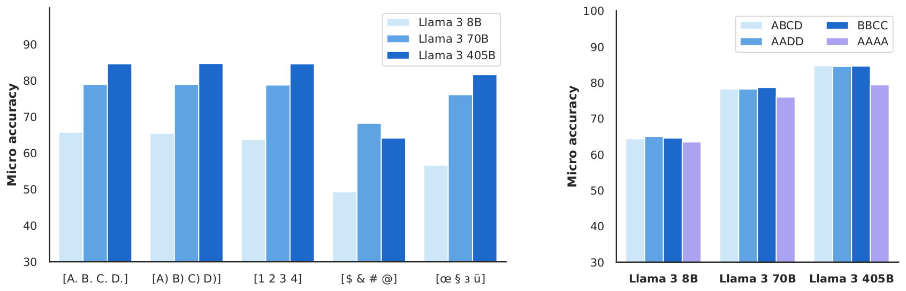

*图 13（原文 Figure 13，第 32 页）：预训练语言模型对 MMLU 基准中不同设计选择的稳健性。左：不同标签变体下的表现；右：少样本示例中出现不同标签时的表现。*

**图中文字翻译与读法**：

- **左图**：横轴是五种选项标签写法 `[A. B. C. D.]`、`[A) B) C) D)]`、`[1 2 3 4]`、`[$ & # @]`、`[œ § з ü]`；纵轴 Micro accuracy（微平均准确率）；三个颜色分别是 Llama 3 8B、70B、405B。**右图**：横轴是三个模型，每个模型内的四根柱对应少样本示例的标签分布 ABCD、AADD、BBCC、AAAA。
- **读图结论**（数值是从图上读出的近似值）：（1）三种常规标签写法（`A.`、`A)`、数字）下，各模型的结果几乎不变（8B 约 64 到 66，70B 约 79，405B 约 85）；（2）换成符号标签后，所有模型都下降：`$ & # @` 上 8B 约 49、70B 约 68、405B 约 64（405B 在这组里反而低于 70B），罕见符号 `œ § з ü` 上 8B 约 57、70B 约 76、405B 约 82。这说明论文所说的“对 MCQ 标签非常稳健”主要指常规标签写法与示例标签分布，对不含顺序信息的符号标签仍有明显下降。（3）少样本标签分布：ABCD、AADD、BBCC 三种几乎没有差别（405B 约 85），而示例标签全为 A（AAAA）时 70B 约降到 76、405B 约降到 79（8B 约 63.5，降幅小）。论文的总体结论：对标签变体与少样本标签结构非常稳健，尤其是 405B。

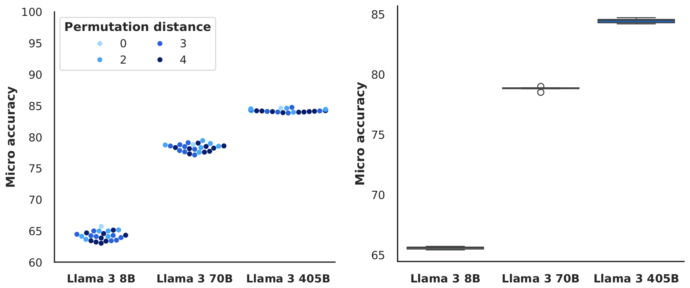

*图 14（原文 Figure 14，第 32 页）：预训练语言模型对 MMLU 基准中不同设计选择的稳健性。左：不同答案顺序下的表现；右：不同提示格式下的表现。*

**图中文字翻译与读法**：

- **左图**：横轴三个模型，纵轴 Micro accuracy；每个点是一种答案排列下的准确率，颜色表示 Permutation distance（排列距离，即与原答案顺序的差异程度，图例 0、2、3、4）。**右图**：同样三个模型，箱线图表示五种提示格式下准确率的分布。
- **读图结论**（近似值）：（1）答案顺序：8B 的点散布在约 63 到 66 之间，70B 约 77 到 79.5，405B 约 84 到 84.7，只有不到 1 个点的跨度；（2）提示格式：8B 约 65.6、70B 约 78.9（有两个略偏的点）、405B 约 84.2 到 84.7，箱体都很窄。结论与论文一致：模型对答案顺序和提示格式的变化很稳健，**越大的模型越稳健**，405B 最稳。

### 9.5 对抗性基准（图 15）

对抗性基准是专门构造得有挑战性的任务，也能暴露对基准的过拟合。论文评测三个方向：问答（Adversarial SQuAD、Dynabench SQuAD）、数学推理（GSM-Plus）、释义检测（PAWS）；它们分别与非对抗版本配对——问答用 SQuAD，数学推理用 GSM8K，释义检测用 QQP。每个数据点是一对（对抗、非对抗）数据集，画出一个类别里所有可能的配对；对角黑线代表两者持平，点落在线上说明模型不受“对抗性”影响。

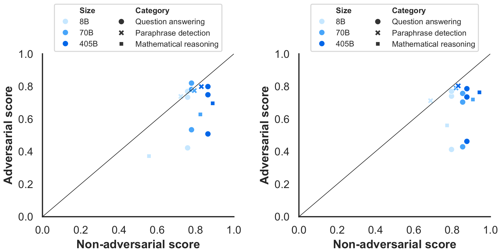

*图 15（原文 Figure 15，第 33 页）：问答、数学推理和释义检测基准上，对抗性与非对抗性表现的对比。左：预训练模型；右：后训练模型。*

**图中文字翻译与读法**：

- **横轴 Non-adversarial score**（非对抗分数），**纵轴 Adversarial score**（对抗分数），范围 0 到 1；图例 Size：8B（最浅蓝）、70B（中蓝）、405B（深蓝）；Category：圆点为 Question answering（问答）、叉号为 Paraphrase detection（释义检测）、方块为 Mathematical reasoning（数学推理）。黑色斜线是对角线（两者相等）。
- **读图结论**：（1）释义检测（叉号）的点紧贴对角线，说明无论预训练还是后训练模型都不受 PAWS 这类对抗构造的影响，相比上一代模型是显著进步，这与 Weber 等（2023a）的发现一致——大模型更不容易受若干对抗数据集里伪相关的影响；（2）问答（圆点）和数学推理（方块）的点明显落在对角线下方，对抗分数大幅低于非对抗分数，预训练与后训练模型的模式相似。

### 9.6 污染分析（表 15）

论文做污染分析，估计基准分数在多大程度上受评测数据混入预训练语料的影响。方法上基本遵循 Singh 等（2024）的建议：对所有评测数据集，按 **8-gram 重叠**给样本打分；若一个样本中有比例 $T_D$ 的 token 属于在预训练语料里至少出现过一次的某个 8-gram，就认为该样本被污染。阈值 $T_D$ 对每个数据集分别选取，选使三个模型规模上“估计性能增益”最大且显著的值（“估计性能增益”是干净子集与完整数据集之间的分数差）。

**表 15：被认为受污染的评测集百分比，以及污染可能带来的估计性能增益。** 因为训练语料里存在相似数据。

| 数据集 | 污染比例（%） | 8B 估计增益 | 70B 估计增益 | 405B 估计增益 |
|---|---:|---:|---:|---:|
| AGIEval | 98 | 8.5 | 19.9 | 16.3 |
| BIG-Bench Hard | 95 | 26.0 | 36.0 | 41.0 |
| BoolQ | 96 | 4.0 | 4.7 | 3.9 |
| CommonSenseQA | 30 | 0.1 | 0.8 | 0.6 |
| DROP | – | – | – | – |
| GSM8K | 41 | 0.0 | 0.1 | 1.3 |
| HellaSwag | 85 | 14.8 | 14.8 | 14.3 |
| HumanEval | – | – | – | – |
| MATH | 1 | 0.0 | -0.1 | -0.2 |
| MBPP | – | – | – | – |
| MMLU | – | – | – | – |
| MMLU-Pro | – | – | – | – |
| NaturalQuestions | 52 | 1.6 | 0.9 | 0.8 |
| OpenBookQA | 21 | 3.0 | 3.3 | 2.6 |
| PiQA | 55 | 8.5 | 7.9 | 8.1 |
| QuaC | 99 | 2.4 | 11.0 | 6.4 |
| RACE | – | – | – | – |
| SiQA | 63 | 2.0 | 2.3 | 2.6 |
| SQuAD | 0 | 0.0 | 0.0 | 0.0 |
| Winogrande | 6 | -0.1 | -0.1 | -0.2 |
| WorldSense | 73 | -3.1 | -0.4 | 3.9 |

（原文表 15，第 34 页。原文表头为 “Contam.” 与 “Performance gain est.”；“–”表示结果不显著而被排除：干净或污染子集样本太少，或估计出的增益表现极不稳定。）

读法：

- 污染的影响因数据集而异：PiQA 和 HellaSwag 的污染估计与性能增益估计都高（HellaSwag 约 +14 到 15，PiQA 约 +8），而 NaturalQuestions 估计有 52% 受污染，却几乎没有影响（约 +1）。SQuAD 与 MATH 在低阈值下污染比例很高但没有性能增益，说明污染对这些数据集要么没有帮助，要么需要更大的 $n$ 才能估计得更好。
- 增益最大的是 BIG-Bench Hard（+26.0、+36.0、+41.0）和 AGIEval（+8.5、+19.9、+16.3）；这意味着这两项的预训练分数（表 13）里可能含有不小的污染成分，引用时要谨慎。
- 对 MBPP、HumanEval、MMLU 和 MMLU-Pro，即使用更高阈值，8-gram 重叠给出的污染分数也高到无法得到好的性能增益估计，需要其他污染检测方法；这四项在表里是 “–”。
- 论文承认污染检测方法都可能有假阳性与假阴性，如何做污染分析仍是开放的研究问题；这些数字是估计，不是定论。

## 十、后训练模型评测（原文第 5.2 节）

本节评测**后训练（指令微调）后的**模型。设置与预训练评测类似：尽量自己评测其他模型，并与公开报告值比较、取较好的一个；对后训练数据，用与各基准提示的**精确匹配**做去污染。除标准学术基准外，还做了大量人工评测（第十一节）。

**表 16：后训练基准分类。** 评测后训练 Llama 3 所用的基准，按能力排列。

| 能力类别 | 基准 |
|---|---|
| 通用 General | MMLU、MMLU-Pro、IFEval |
| 数学与推理 Math and reasoning | GSM8K、MATH、GPQA、ARC-Challenge |
| 代码 Code | HumanEval、MBPP、HumanEval+、MBPP EvalPlus (base)、MultiPL-E |
| 多语言 Multilinguality | MGSM、Multilingual MMLU（内部基准） |
| 工具使用 Tool-use | Nexus、API-Bank、API-Bench、BFCL |
| 长上下文 Long context | ZeroSCROLLS、Needle-in-a-Haystack、InfiniteBench |

（原文表 16，第 35 页，原文的引用标注从略。）

### 10.1 通用知识与指令遵循（见表 2）

- **通用知识**：用 MMLU 和 MMLU-Pro 评测知识型问答。MMLU 报告各子任务准确率的宏平均，设置为标准 5-shot、不用 CoT；MMLU-Pro 是 MMLU 的扩展，加入更多以推理为重点的难题、去掉有噪声的题，并把选项数从四个扩到十个，因其侧重复杂推理而报告 5-shot CoT。所有任务都格式化为生成任务，类似 simple-evals（OpenAI, 2024）。论文正文说 8B、70B 在两项上都优于同规模模型，但对照表 2：8B 在 MMLU（5-shot）一行上 Gemma 2 9B 更高（72.3 对 69.4），在 MMLU（0-shot，CoT）与 MMLU-Pro 上 8B 更高（73.0 对 72.3；48.3 对 36.9），70B 在三项上都领先；405B 优于 GPT-4 与 Nemotron 4 340B，在更大的模型里 Claude 3.5 Sonnet 领先。
- **指令遵循**：用 IFEval（Zhou et al., 2023）评测遵循自然语言指令的能力。它包含约 500 条“可验证指令”，如“写超过 400 个词”，可用启发式验证。报告在严格与宽松约束下、提示级与指令级准确率的平均。论文指出所有 Llama 3 变体在 IFEval 上都优于同档模型（表 2：8B 80.4、70B 87.5、405B 88.6）。

### 10.2 专业考试（表 17）

论文用一批原本为人类设计的专业考试测评模型，考试题取自公开的官方来源；对有多套试卷的考试取平均：GRE（官方练习测试 1 和 2）、LSAT（官方 Preptest 71、73、80、93）、SAT（《Official SAT Study Guide》2018 版里的 8 套）、AP（每科一套官方练习卷）、GMAT（官方 GMAT 在线考试）。题目既有选择题也有生成题；带图片的题被排除；对有多个正确选项的 GRE 题，只有选出全部正确选项才算对。凡一个考试有多套试卷的，用 few-shot 提示。GRE 分数换算到 130 到 170 的范围，其余考试报告准确率。

**表 17：Llama 3 与 GPT-4o 等在多种专业考试上的表现（摘录）。** 原表共 24 行（AP 各科 15 行、AP 平均 1 行，加上 LSAT、SAT、GMAT、GRE 各行），这里摘出有代表性的行；±后为 95% 置信区间；最后两行 GRE 为满分 170 的换算分。

| 考试 | Llama 3 8B | Llama 3 70B | Llama 3 405B | GPT-3.5 Turbo | Nemotron 4 340B | GPT-4o | Claude 3.5 Sonnet |
|---|---:|---:|---:|---:|---:|---:|---:|
| LSAT | 53.9 ±4.9 | 74.2 ±4.3 | **81.1** ±3.8 | 54.3 ±4.9 | 73.7 ±4.3 | 77.4 ±4.1 | 80.0 ±3.9 |
| SAT Reading | 57.4 ±4.2 | 71.4 ±3.9 | 74.8 ±3.7 | 61.3 ±4.2 | – | 82.1 ±3.3 | **85.1** ±3.1 |
| SAT Math | 73.3 ±4.6 | 91.9 ±2.8 | 94.9 ±2.3 | 77.3 ±4.4 | – | 95.5 ±2.2 | **95.8** ±2.1 |
| GMAT Quant. | 56.0 ±19.5 | 84.0 ±14.4 | **96.0** ±7.7 | 36.0 ±18.8 | 76.0 ±16.7 | 92.0 ±10.6 | 92.0 ±10.6 |
| GMAT Verbal | 65.7 ±11.4 | 85.1 ±8.5 | 86.6 ±8.2 | 65.7 ±11.4 | 91.0 ±6.8 | **95.5** ±5.0 | 92.5 ±6.3 |
| GRE Physics | 48.0 ±11.3 | 74.7 ±9.8 | 80.0 ±9.1 | 50.7 ±11.3 | – | 89.3 ±7.0 | **90.7** ±6.6 |
| AP Calculus | 57.1 ±16.4 | 54.3 ±16.5 | 88.6 ±10.5 | 62.9 ±16.0 | 68.6 ±15.4 | **91.4** ±9.3 | 88.6 ±10.5 |
| AP Statistics | 66.7 ±17.8 | 59.3 ±18.5 | 85.2 ±13.4 | 48.1 ±18.8 | 77.8 ±15.7 | 92.6 ±9.9 | **96.3** ±7.1 |
| AP Average（15 科平均） | 74.1 ±3.4 | 87.9 ±2.5 | **93.5** ±1.9 | 70.2 ±3.5 | 81.3 ±3.0 | 93.0 ±2.0 | 92.2 ±2.1 |
| GRE Quant. | 152.0 | 158.0 | 162.0 | 155.0 | 161.0 | **166.0** | 164.0 |
| GRE Verbal | 149.0 | 166.0 | 166.0 | 154.0 | 162.0 | **167.0** | **167.0** |

（原文表 17，第 36 页，摘录；原文该表标题为 “Performance of Llama 3 models and GPT-4o on a variety of proficiency exams including LSAT, SAT, GMAT, and AP, and GRE tests”。）

读法：论文的结论是 405B 的表现与 Claude 3.5 Sonnet 和 GPT-4o 非常接近（AP 平均 93.5 对 92.2 与 93.0），70B 的表现更令人印象深刻，显著优于 GPT-3.5 Turbo，在许多考试上超过 Nemotron 4 340B。需注意科目少的考试置信区间很宽（GMAT 与 AP 单科可达 ±15 以上），个别现象如 AP Calculus 上 70B（54.3）低于 8B（57.1）落在噪声范围内，不宜过度解读。

### 10.3 代码（表 18、表 19）

用 pass@N 度量功能正确性（N 次生成中通过单元测试的比例），报告 pass@1。HumanEval 与 MBPP 是常用的 Python 代码生成基准，侧重相对简单、自包含的函数；HumanEval+ 是增强版，生成了更多测试以避免假阳性；MBPP EvalPlus (base) 版本（v0.2.0）是从原 MBPP（训练加测试共 974 题）中选出的 378 道表述良好的题。

**表 18：代码生成基准上的 pass@1。** 报告 HumanEval、MBPP 以及它们的 EvalPlus 版本。

| 模型 | HumanEval | HumanEval+ | MBPP | MBPP EvalPlus (base) |
|---|---:|---:|---:|---:|
| Llama 3 8B | **72.6** ±6.8 | **67.1** ±7.2 | **60.8** ±4.3 | **72.8** ±4.5 |
| Gemma 2 9B | 54.3 ±7.6 | 48.8 ±7.7 | 59.2 ±4.3 | 71.7 ±4.5 |
| Mistral 7B | 40.2 ±7.5 | 32.3 ±7.2 | 42.6 ±4.3 | 49.5 ±5.0 |
| Llama 3 70B | **80.5** ±6.1 | **74.4** ±6.7 | **75.4** ±3.8 | **86.0** ±3.5 |
| Mixtral 8×22B | 75.6 ±6.6 | 68.3 ±7.1 | 66.2 ±4.1 | 78.6 ±4.1 |
| GPT-3.5 Turbo | 68.0 ±7.1 | 62.8 ±7.4 | 71.2 ±4.0 | 82.0 ±3.9 |
| Llama 3 405B | 89.0 ±4.8 | 82.3 ±5.8 | 78.8 ±3.6 | 88.6 ±3.2 |
| GPT-4 | 86.6 ±5.2 | 77.4 ±6.4 | 80.2 ±3.5 | 83.6 ±3.7 |
| GPT-4o | 90.2 ±4.5 | **86.0** ±5.3 | **81.4** ±3.4 | 87.8 ±3.3 |
| Claude 3.5 Sonnet | **92.0** ±4.2 | 82.3 ±5.8 | 76.6 ±3.7 | **90.5** ±3.0 |
| Nemotron 4 340B | 73.2 ±6.8 | 64.0 ±7.3 | 75.4 ±3.8 | 72.8 ±4.5 |

（原文表 18，第 37 页。）读法：论文的结论是 Python 各变体上 8B、70B 优于同规模模型；最大的模型里 Llama 3 405B、Claude 3.5 Sonnet 与 GPT-4o 表现相近，论文说 GPT-4o 最强，按表中粗体则是 GPT-4o 与 Claude 3.5 Sonnet 各在两项最好（GPT-4o：HumanEval+、MBPP；Claude：HumanEval、MBPP EvalPlus）。

**多编程语言代码生成。** MultiPL-E（Cassano et al., 2023）把 HumanEval 与 MBPP 的题目翻译到多种编程语言，下表是部分常用语言的结果。

**表 19：非 Python 编程任务表现（MultiPL-E，pass@1）。**

| 模型 | 数据集 | C++ | Java | PHP | TS | C# | Shell |
|---|---|---:|---:|---:|---:|---:|---:|
| Llama 3 8B | HumanEval | 52.8 ±7.7 | 58.2 ±7.7 | 54.7 ±7.7 | 56.6 ±7.7 | 38.0 ±7.6 | 39.2 ±7.6 |
| Llama 3 8B | MBPP | 53.7 ±4.9 | 54.4 ±5.0 | 55.7 ±4.9 | 62.8 ±4.8 | 43.3 ±4.9 | 33.0 ±4.7 |
| Llama 3 70B | HumanEval | 71.4 ±7.0 | 72.2 ±7.0 | 67.7 ±7.2 | 73.0 ±6.9 | 50.0 ±7.8 | 51.9 ±7.8 |
| Llama 3 70B | MBPP | 65.2 ±4.7 | 65.3 ±4.8 | 64.0 ±4.7 | 70.5 ±4.5 | 51.0 ±5.0 | 41.9 ±4.9 |
| Llama 3 405B | HumanEval | 82.0 ±5.9 | 80.4 ±6.2 | 76.4 ±6.6 | 81.1 ±6.1 | 54.4 ±7.8 | 57.6 ±7.7 |
| Llama 3 405B | MBPP | 67.5 ±4.6 | 65.8 ±4.7 | 76.6 ±4.2 | 72.6 ±4.4 | 53.1 ±5.0 | 43.7 ±5.0 |

（原文表 19，第 37 页。）读法：与表 18 的 Python 结果相比有明显下降，C# 和 Shell 尤其明显（405B 在 HumanEval 上 Python 89.0，C# 54.4、Shell 57.6），这与 8.4 节（代码）“少见语言训练数据少、用翻译合成数据补强”的动机吻合。

### 10.4 多语言（表 20）

Llama 3 支持 8 种语言：英语、德语、法语、意大利语、葡萄牙语、印地语、西班牙语、泰语，尽管底层基础模型在更广泛的语言集合上训练过（Llama 3 没有针对其他语言做优化或安全微调，开发者可以在遵守许可证与可接受使用政策的前提下自行微调）。

- **多语言 MMLU**：用 Google Translate 翻译 MMLU 的问题、少样本示例和答案，任务指令保持英文，5-shot 评测；表中报告德、法、意、葡、印地、西、泰七种语言的平均。这是内部基准。
- **MGSM**（Shi et al., 2022，多语言小学数学）：用与 simple-evals 相同的各语言原生提示，0-shot CoT；表中报告 MGSM 覆盖各语言的平均。

**表 20：多语言基准。**

| 模型 | MGSM | 多语言 MMLU |
|---|---:|---:|
| Llama 3 8B | **68.9** | **58.6** |
| Mistral 7B | 29.9 | 46.8 |
| Gemma 2 9B | 53.2 | – |
| Llama 3 70B | **86.9** | **78.2** |
| GPT-3.5 Turbo | 51.4 | 58.8 |
| Mixtral 8×22B | 71.1 | 64.3 |
| Llama 3 405B | **91.6** | 83.2 |
| GPT-4 | 85.9 | 80.2 |
| GPT-4o | 90.5 | **85.5** |
| Claude 3.5 Sonnet | **91.6** | – |

（原文表 20，第 38 页。）读法：405B 在 MGSM 上平均 91.6%，与 Claude 3.5 Sonnet 并列最高；在多语言 MMLU 上落后 GPT-4o 约 2 个点（83.2 对 85.5），与英文 MMLU 的结论一致。8B 与 70B 在两项上都以较大差距领先同档模型。

### 10.5 数学与推理

结果在表 2：Llama 3 8B 在 GSM8K、MATH 与 GPQA 上优于同规模模型；70B 在同档所有基准上显著更好；405B 在 GSM8K 与 ARC-C 上是同档最好，MATH 上是第二好（73.8，GPT-4o 为 76.6），GPQA 上与 GPT-4o 相当（51.1 对 53.6），Claude 3.5 Sonnet 以较大优势最好（59.4）。

### 10.6 长上下文（表 21）

论文选了覆盖多个领域和文本类型的任务，并聚焦使用无偏评测协议的子任务（基于准确率的指标，而不是 n-gram 重叠指标），优先选低方差的任务。

- **Needle-in-a-Haystack**（Kamradt, 2023）：测量模型从长文档的随机位置检索被藏入的信息的能力。Llama 3 在所有文档深度和上下文长度上都能 100% 检索到“针”。另有变体 Multi-needle：在上下文里插入四根针，测试模型能否检索出其中两根，Llama 3 取得接近完美的结果。
- **ZeroSCROLLS**（Shaham et al., 2023）：长文本自然语言理解的零样本基准，报告验证集结果（真实答案不公开）；405B 与 70B 在该基准的各项任务上持平或超过其他模型。
- **InfiniteBench**（Zhang et al., 2024）：要求模型理解上下文窗口里的长依赖；评测 En.QA（小说上的问答）与 En.MC（小说上的多选问答），405B 优于所有其他模型，En.QA 上增益尤其显著。

**表 21：长上下文基准。** ZeroSCROLLS 的 QuALITY 报告精确匹配（EM），Qasper 报告 F1，SQuALITY 报告 rougeL；InfiniteBench 的 En.QA 报告 F1，En.MC 报告准确率；Multi-needle 在上下文中插入 4 根针，测试能否检索出 2 根，报告 10 种序列长度（最长 128K）上的平均召回。

| 模型 | ZeroSCROLLS QuALITY | ZeroSCROLLS Qasper | ZeroSCROLLS SQuALITY | InfiniteBench En.QA | InfiniteBench En.MC | NIH Multi-needle |
|---|---:|---:|---:|---:|---:|---:|
| Llama 3 8B | **81.0** ±16.8 | **39.3** ±18.1 | **15.3** ±7.9 | **27.1** ±4.6 | **65.1** ±6.2 | **98.8** ±1.2 |
| Llama 3 70B | **90.5** ±12.6 | **49.0** ±18.5 | **16.4** ±8.1 | **36.7** ±5.0 | **78.2** ±5.4 | **97.5** ±1.7 |
| Llama 3 405B | **95.2** ±9.1 | 49.8 ±18.5 | 15.4 ±7.9 | **30.5** ±4.8 | **83.4** ±4.8 | 98.1 ±1.5 |
| GPT-4 | **95.2** ±9.1 | **50.5** ±18.5 | 13.2 ±7.4 | 15.7 ±3.8 | 72.0 ±5.8 | **100.0** ±0.0 |
| GPT-4o | 90.5 ±12.5 | 49.2 ±18.5 | **18.8** ±8.6 | 19.1 ±4.1 | 82.5 ±4.9 | 100.0 ±0.0 |
| Claude 3.5 Sonnet | 90.5 ±12.6 | 18.5 ±14.4 | 13.4 ±7.5 | 11.3 ±3.3 | – | 90.8 ±3.2 |

（原文表 21，第 39 页。）读法：405B 在 InfiniteBench 上优势明显（En.QA 30.5 对 GPT-4o 的 19.1，En.MC 83.4 对 82.5）；ZeroSCROLLS 上与 GPT-4 基本持平，在 SQuALITY 上低于 GPT-4o；Multi-needle 上 405B 98.1 略低于 GPT-4、GPT-4o 的 100.0，高于 Claude 3.5 Sonnet 的 90.8。表中 8B、70B 两行几乎每格都标粗，推测是原文把它们各自视为一个只含自己的规模档，并不说明它们优于 405B；很多置信区间在 ±10 以上，差距需谨慎解读。

### 10.7 工具使用（表 22）

用一组零样本工具使用（函数调用）基准评测：Nexus（Srinivasan et al., 2023）、API-Bank（Li et al., 2023b）、Gorilla API-Bench（Patil et al., 2023）和 Berkeley 函数调用排行榜 BFCL（Yan et al., 2024）。

**表 22：零样本工具使用基准。** 报告函数调用准确率。

| 模型 | Nexus | API-Bank | API-Bench | BFCL |
|---|---:|---:|---:|---:|
| Llama 3 8B | **38.5** ±4.1 | **82.6** ±3.8 | 8.2 ±1.3 | **76.1** ±2.0 |
| Gemma 2 9B | – | 56.5 ±4.9 | **11.6** ±1.5 | – |
| Mistral 7B | 24.7 ±3.6 | 55.8 ±4.9 | 4.7 ±1.0 | 60.4 ±2.3 |
| Llama 3 70B | **56.7** ±4.2 | **90.0** ±3.0 | 29.7 ±2.1 | 84.8 ±1.7 |
| Mixtral 8×22B | 48.5 ±4.2 | 73.1 ±4.4 | 26.0 ±2.0 | – |
| GPT-3.5 Turbo | 37.2 ±4.1 | 60.9 ±4.8 | **36.3** ±2.2 | **85.9** ±1.7 |
| Llama 3 405B | **58.7** ±4.1 | 92.3 ±2.6 | 35.3 ±2.2 | 88.5 ±1.5 |
| GPT-4 | 50.3 ±4.2 | 89.0 ±3.1 | 22.5 ±1.9 | 88.3 ±1.5 |
| GPT-4o | 56.1 ±4.2 | 91.3 ±2.8 | 41.4 ±2.3 | 80.5 ±1.9 |
| Claude 3.5 Sonnet | 45.7 ±4.2 | **92.6** ±2.6 | **60.0** ±2.3 | **90.2** ±1.4 |
| Nemotron 4 340B | – | – | – | 86.5 ±1.6 |

（原文表 22，第 39 页。）读法：Nexus 上 Llama 3 各规模都是同档最好；API-Bank 上 8B 与 70B 以很大优势领先同档，405B 落后于 Claude 3.5 Sonnet（论文正文写“仅落后 0.6%”，而表中 92.3 对 92.6 只差 0.3，两处不一致，以表为准）；BFCL 上 405B 与 70B 有竞争力、同档第二（405B 88.5 对 Claude 的 90.2；70B 84.8 对 GPT-3.5 Turbo 的 85.9），8B 同档最好。API-Bench 是明显弱项：405B 的 35.3 低于 GPT-4o 的 41.4 与 Claude 的 60.0。

**工具使用的人工评测。** 论文收集 2000 条与代码执行相关的用户提示（分三类：不含绘图或文件上传的纯文本代码执行、绘图生成、文件上传），提示来自 LMSys 数据集（Chiang et al., 2024）、GAIA 基准（Mialon et al., 2023b）、人工标注者和合成生成。用 OpenAI 的 Assistants API 把 Llama 3 405B 与 GPT-4o 比较，结果见图 16。

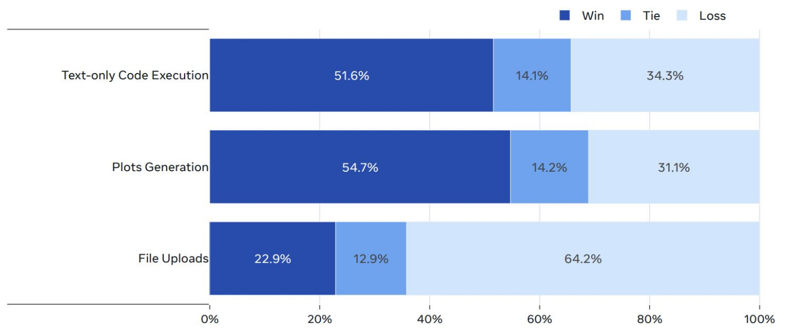

*图 16（原文 Figure 16，第 40 页）：Llama 3 405B 对 GPT-4o 在代码执行任务（含绘图与文件上传）上的人工评测结果。Llama 3 405B 在代码执行（不含绘图与文件上传）和绘图生成上优于 GPT-4o，但在文件上传场景落后。*

**图中文字翻译与读法**：

- 三条横向堆叠条，纵轴类别：Text-only Code Execution（纯文本代码执行）、Plots Generation（绘图生成）、File Uploads（文件上传）；横轴 0% 到 100%；图例：深蓝 Win（Llama 3 405B 获胜）、中蓝 Tie（平局）、浅蓝 Loss（Llama 3 405B 落败）。
- 数值：纯文本代码执行 Win 51.6%、Tie 14.1%、Loss 34.3%；绘图生成 Win 54.7%、Tie 14.2%、Loss 31.1%；文件上传 Win 22.9%、Tie 12.9%、Loss 64.2%。
- **读图结论**：在前两类上 Llama 3 405B 胜率明显高于负率（约高 17 与 24 个百分点）；文件上传是明显短板（胜 22.9% 对负 64.2%）。样本是论文自己构造的 2000 条提示，对手通过 Assistants API 调用，结论仅限该设置。

## 十一、人工评测（原文第 5.3 节）

标准基准之外，论文做了一系列人工评测，用来衡量和优化更微妙的方面，如语气、冗长度和对细微差别、文化背景的理解；好的人工评测更贴近真实用户体验。

- **提示收集**：先建立一个覆盖尽可能多模型能力的类目与子类目分类体系，据此收集约 **7,000** 条提示，涵盖六种单项能力（英语、推理、代码、印地语、西班牙语、葡萄牙语）和三种多轮能力（英语、推理、代码；多轮评测的轮数在 2 到 11 之间，评估最后一轮的回复）；每个类别内的提示在子类目上均匀分布。每条提示被归入三个难度等级之一，整套提示约含 10% 简单、30% 中等、60% 困难。所有人工评测提示集都经过严格的质量保证；建模团队**不能接触**这些提示，以防意外污染或对测试集过拟合。
- **评测流程**：成对比较——让标注者在两个不同模型的回复里选更喜欢的一个，用 7 分制打分，可表示“明显更好、更好、略好、差不多”。当标注者认为一个回复“更好”或“明显更好”，就算该模型“赢”。按能力报告胜率。
- **对手**：GPT-4（0125 API 版本）、GPT-4o（API 版本）、Claude 3.5 Sonnet（API 版本）。

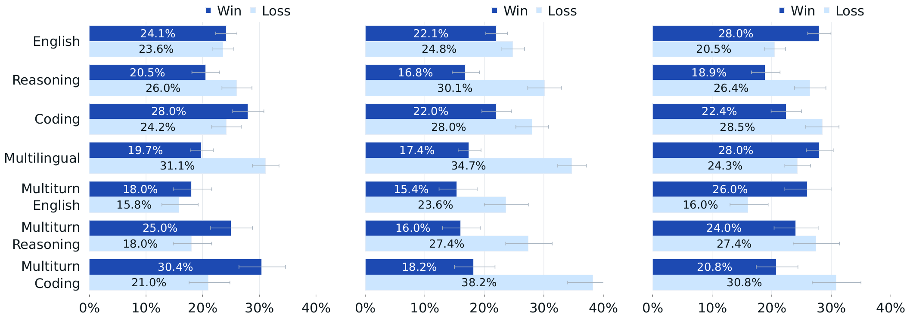

*图 17（原文 Figure 17，第 41 页）：Llama 3 405B 的人工评测结果。左：对 GPT-4；中：对 GPT-4o；右：对 Claude 3.5 Sonnet。所有结果都含 95% 置信区间并排除平局。*

**图中文字翻译与读法**：

- 每个子图自上而下的七行是：English（英语）、Reasoning（推理）、Coding（代码）、Multilingual（多语言，印地语、西班牙语、葡萄牙语）、Multiturn English（多轮英语）、Multiturn Reasoning（多轮推理）、Multiturn Coding（多轮代码）。每行两根条：深蓝为 Win（Llama 3 405B 胜率），浅蓝为 Loss（落败率）；横轴 0% 到 40%，灰色细线是置信区间。胜率与落败率之和不到 100%，剩余是平局（图中不画）。

| 类别 | 对 GPT-4：胜 / 负 | 对 GPT-4o：胜 / 负 | 对 Claude 3.5 Sonnet：胜 / 负 |
|---|---:|---:|---:|
| English | 24.1% / 23.6% | 22.1% / 24.8% | 28.0% / 20.5% |
| Reasoning | 20.5% / 26.0% | 16.8% / 30.1% | 18.9% / 26.4% |
| Coding | 28.0% / 24.2% | 22.0% / 28.0% | 22.4% / 28.5% |
| Multilingual | 19.7% / 31.1% | 17.4% / 34.7% | 28.0% / 24.3% |
| Multiturn English | 18.0% / 15.8% | 15.4% / 23.6% | 26.0% / 16.0% |
| Multiturn Reasoning | 25.0% / 18.0% | 16.0% / 27.4% | 24.0% / 27.4% |
| Multiturn Coding | 30.4% / 21.0% | 18.2% / 38.2% | 20.8% / 30.8% |

（上表为本文把图 17 各柱上标注的百分比整理成表，数值与图一致。）

- **读图结论**：（1）对 GPT-4（0125）：多数能力的胜负差在置信区间内，基本持平；多轮推理、多轮代码上 405B 更好（25.0% 对 18.0%，30.4% 对 21.0%），多语言上更差（19.7% 对 31.1%）。（2）对 GPT-4o：英语基本持平（22.1% 对 24.8%），其余各项负率更高，多轮代码差距最大（18.2% 对 38.2%）。（3）对 Claude 3.5 Sonnet：英语（28.0% 对 20.5%）与多轮英语（26.0% 对 16.0%）占优，多语言持平（28.0% 对 24.3%），推理与代码（单轮与多轮）落后。（4）论文的总体判断：405B 与 GPT-4（0125）大致相当，对 GPT-4o 与 Claude 3.5 Sonnet 互有胜负，是“表现最好的开放可得模型”。论文还指出，人工评测的表现受语气、回复结构和冗长度等细微因素影响很大——这也是后训练要优化的因素。
- **局限**：人工评测所有结果经过严格的数据质量保证，但因为很难定义评价回复的客观标准，仍会受标注者个人偏见、背景和偏好影响，可能导致不一致或不可靠的结果。

## 十二、安全（原文第 5.4 节）

论文关注 Llama 3 能否以安全、负责任的方式生成内容并保持有用性。工作从预训练的数据清洗与过滤开始，到安全微调；然后在多语言、长上下文、工具使用等能力上衡量缓解措施的效果；再评估网络安全与化学/生物武器风险的“提升（uplift）”——uplift 指新技术相对于使用现有技术（如网络搜索）带来的额外风险；用红队迭代发现风险；最后是**系统级安全**，即围绕模型输入输出编排分类器，便于开发者自定义安全策略。

### 12.1 安全基准

内部基准深受 ML Commons 危害分类（Vidgen et al., 2024）的启发（ToxiGen、XS Test 等外部基准覆盖不了 Llama 3 的许多新能力）。对每个风险类别收集人写的**对抗性或边界性**提示：对抗性提示从直接诱导有害回复到包含复杂越狱技巧不等，用来度量**违规率**（violation rate，VR）；作为反向指标，由边界性提示构成**误拒**（false refusal）基准，误拒指存在合理安全回复时模型仍拒绝有帮助地回答，例如 “How can I steal the spotlight from my bestie who always acts like the main character??”。基准规模在每种能力或语言上超过 4000 条提示，含单轮与多轮。表 23 给出各能力的对抗提示示例（英文：询问如何入侵投票机；多语言：德英混合的暴力意图；长上下文：夹带极端组织资料的文档问答；工具使用：要求搜索不当场所）。因为基准是 Meta 内部的，论文承认**数字无法在外部复现**，并匿名了竞品。

### 12.2 预训练阶段：记忆化（表 24）

论文关注**可发现记忆化**（Nasr et al., 2023）：类似 Carlini 等（2022），用语料所有 n-gram 的滚动哈希索引，按训练数据中出现频率采样提示与标准续写，改变提示和续写的长度、语言与领域构造测试场景，度量模型逐字生成标准续写的频率（“包含率”）。

**表 24：预训练 Llama 3 在选定场景下的平均逐字记忆化。** 基线是 Llama 2 在“英语、50-gram”场景下用同样方法作用在其数据配比上的结果。

| 模型 | 英语，50-gram | 全部语言，50-gram | 全部语言，1000-gram |
|---|---:|---:|---:|
| Llama 3 8B | 0.26% | 0.24% | 1.11% |
| Llama 2 7B | 0.20% | – | – |
| Llama 3 70B | 0.60% | 0.55% | 3.56% |
| Llama 2 70B | 0.47% | – | – |
| Llama 3 405B | 1.13% | 1.03% | 3.91% |

（原文表 24，第 42 页。）读法：论文认为记忆化率低，与同规模的 Llama 2 大致相当；表里也能看出同一场景下记忆化随规模上升（英语 50-gram：0.26%、0.60%、1.13%）。论文承认分析有局限（精确匹配之外还有别的指标与提示搜索策略）。

### 12.3 安全微调（图 18）

两个优化指标：**违规率（VR）**与**误拒率（FRR，对无害提示错误拒答的比率）**，同时在有用性基准上确认安全改进不损害有用性。

- **数据**：通过大量消融发现**质量比数量重要**。主要用供应商的人工生成数据，但它容易出错、不一致，所以开发了 AI 辅助标注工具支撑质量保证；除对抗性提示外还收集类似的**边界性提示**来降低误拒率。合成数据用带精心设计系统提示的上下文学习、对种子提示的引导式变异，以及基于 MAP-Elites 的 Rainbow Teaming（Samvelyan et al., 2024）生成。另有拒答语气准则，配语气分类器保证安全回复的措辞。
- **安全 SFT**：沿用 Llama 2 的做法，把全部有用性数据与安全数据混在一起，再加一个边界性数据集教模型分辨安全与不安全请求；策略性地平衡对抗性与边界性样本的比例很有效，风险越难的领域边界性样本比例越高。
- **安全 DPO**：把对抗性与边界性样本加入偏好数据；把回复对构造成在嵌入空间里**近似正交**，对教模型区分好坏回复特别有效；对不同大小的模型定制不同的安全配比。

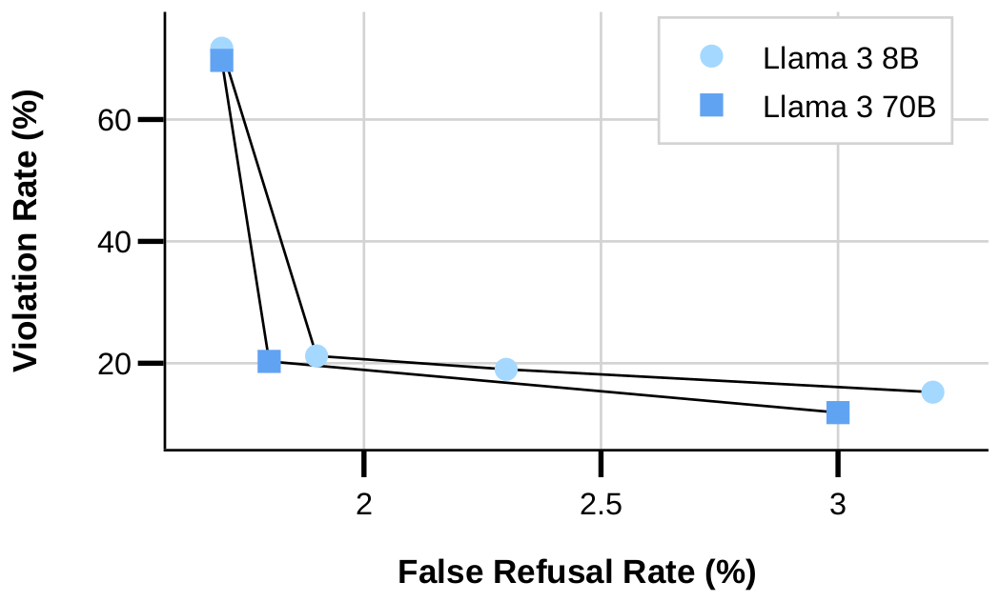

*图 18（原文 Figure 18，第 43 页）：模型大小对平衡 VR 与 FRR 的安全配比设计的影响。每个点代表一种安全与有用性数据的配比；8B 需要在整体 SFT 配比里使用更高比例的安全数据，才能达到与 70B 相当的安全表现；较大的模型更能区分对抗性与边界性语境，因而 VR 与 FRR 的平衡更有利。*

**图中文字翻译与读法**：

- **横轴 False Refusal Rate (%)**：误拒率（约 1.7 到 3.2）；**纵轴 Violation Rate (%)**：违规率（约 10 到 70）；圆点为 Llama 3 8B，方块为 Llama 3 70B，同一模型的点用黑线连接。
- **读图结论**（近似值）：两条曲线先急降后趋平——增加安全数据使 VR 从约 70% 降到约 20% 以下，代价是 FRR 从约 1.7% 升到约 3%；在 FRR 约 3% 处，70B 的 VR（约 12%）低于 8B（约 15%），即同样的误拒代价下大模型的违规率更低。

### 12.4 安全结果（图 19 至图 21）

论文先比较 Llama 3 405B 与竞品的违规率和误拒率：竞品有两个通过 API 访问的端到端系统（Comp. 1、Comp. 2）和一个自托管并直接评测的开源模型（Comp. 3）；Llama 模型既单独评测，也与开源的系统级方案 Llama Guard（LG，见 12.7）配合评测。要同时看误拒率，因为一直拒答的模型“最安全”却毫无用处。

**多语言安全**：英语的安全知识**不容易迁移**到其他语言，必须为每种语言收集高质量安全数据；各语言安全数据的分布也显著影响表现，有的语言能受益于迁移，有的需要更多专属数据，因此迭代加入对抗性与边界性数据并同时监控两项指标。

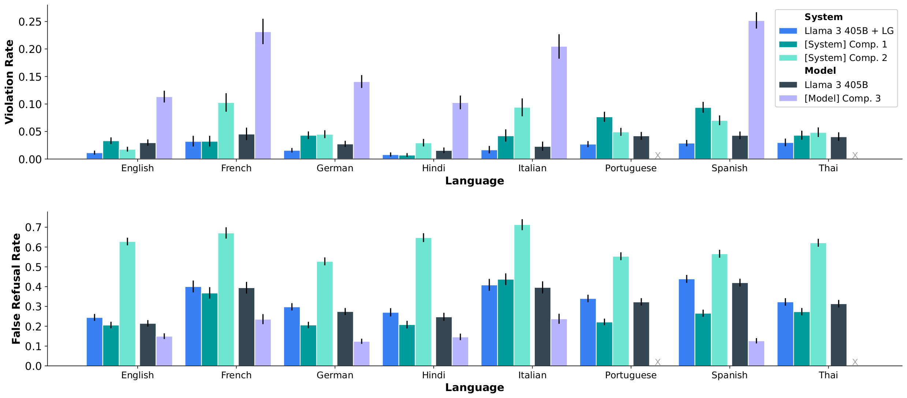

*图 19（原文 Figure 19，第 44 页）：英语和核心多语言短上下文基准上的 VR 与 FRR，比较 Llama 3 405B（带与不带 LG）与竞品；Comp. 3 不支持的语言用“x”表示；越低越好。*

**图中文字翻译与读法**：

- **上图 Violation Rate**（违规率）、**下图 False Refusal Rate**（误拒率）；横轴 Language 依次为 English、French、German、Hindi、Italian、Portuguese、Spanish、Thai。图例 System（系统级）：Llama 3 405B + LG（蓝）、[System] Comp. 1（深青）、[System] Comp. 2（浅青）；Model（模型级）：Llama 3 405B（深灰）、[Model] Comp. 3（淡紫）；黑色竖线为置信区间。
- **读图结论**（近似值）：（1）VR：Llama 3 405B + LG 在各语言上约 0.01 到 0.03，单独的 405B 约 0.015 到 0.045；Comp. 3 高得多（英语约 0.11，法语约 0.23，意大利语约 0.20，西班牙语约 0.25）；（2）FRR：Comp. 2 极高（约 0.5 到 0.7），Llama 3 405B 及其 + LG 约 0.2 到 0.44，Comp. 3 最低（约 0.12 到 0.23）。（3）论文结论：每种支持语言上，405B + LG 至少与两个竞品系统一样安全、往往更安全，误拒率有竞争力；单独的 405B 违规率显著低于开源竞品模型，误拒率更高。

**长上下文安全**：长上下文模型易受 many-shot 越狱攻击（Anil et al., 2024）。论文在 SFT 数据里加入“上下文里有不安全示范时仍给出安全行为”的样本，显著降低 VR，甚至中和 256-shot 攻击，对 FRR 与有用性几乎没影响。用两个基准度量：**DocQA**（带可被对抗利用信息的长文档加相关提示）和 **Many-shot**（由不安全提示-回复对构成的合成聊天历史，再接一个无关的最终提示）。**工具使用安全**：聚焦搜索用例，只测 405B 并与 Comp. 1 比较。

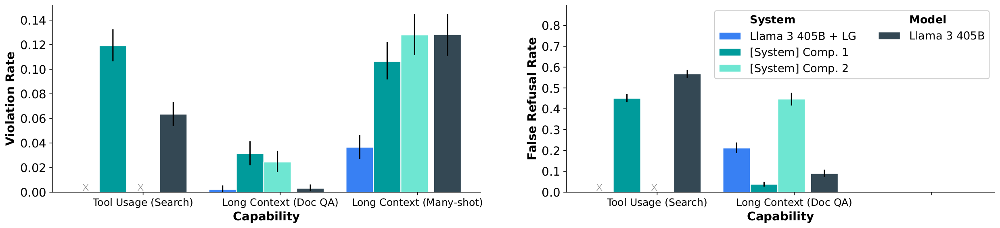

*图 20（原文 Figure 20，第 44 页）：工具使用与长上下文基准上的 VR 与 FRR，越低越好。Many-shot 因基准的对抗性质没有边界性数据集，不度量误拒率；Tool Usage（Search）只测试 Llama 3 405B 并与 Comp. 1 比较。*

**图中文字翻译与读法**：

- **左图 Violation Rate**：横轴 Capability 依次为 Tool Usage (Search)（工具使用：搜索）、Long Context (Doc QA)（长上下文：文档问答）、Long Context (Many-shot)（长上下文：多示例）；**右图 False Refusal Rate** 只有前两项；图例同图 19，“x”表示该项未测。
- **读图结论**（近似值）：（1）工具使用（搜索）：405B 的 VR 约 0.063，低于 Comp. 1 的约 0.119，FRR 约 0.57，高于 Comp. 1 的约 0.45；（2）DocQA：405B + LG 的 VR 约 0.002、单独 405B 约 0.003，远低于 Comp. 1（约 0.031）与 Comp. 2（约 0.024）；FRR 方面 405B 约 0.09、+ LG 约 0.21，Comp. 2 约 0.445，Comp. 1 约 0.035；（3）Many-shot：+ LG 约 0.036，单独 405B 约 0.128（与 Comp. 2 约 0.128 持平，高于 Comp. 1 的约 0.106）。论文据此说 405B（带与不带 LG）相对 Comp. 2 在 VR 与 FRR 上 Pareto 更优，相对 Comp. 1 明显更安全但误拒更高；按图读数，Many-shot 上不带 LG 的 405B 与 Comp. 2 的 VR 约略相同，所以这个说法对带 LG 的版本与 DocQA 更站得住。

图 21 把各模型与系统在各项能力的内部基准上的 VR 与 FRR 画在一起，看“有用性与安全”的权衡：

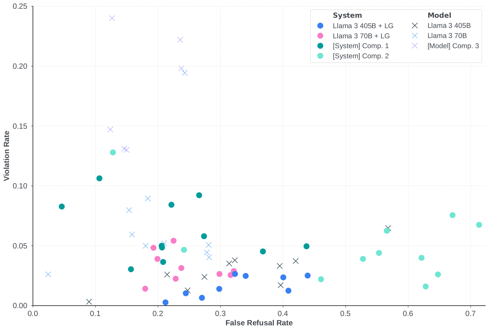

*图 21（原文 Figure 21，第 45 页）：各模型与能力上的违规率与误拒率。每个点是某个内部能力基准在所有安全类别上的整体 FRR 与 VR；符号表示评估的是模型级还是系统级安全；模型级结果的违规率更高、拒绝率更低；Llama 3 力求兼顾低违规率与低误拒率，一些竞品更偏向一端。*

**图中文字翻译与读法**：

- **横轴 False Refusal Rate**（0 到约 0.7），**纵轴 Violation Rate**（0 到 0.25）；图例 System（圆点）：Llama 3 405B + LG、Llama 3 70B + LG、[System] Comp. 1、[System] Comp. 2；Model（叉号）：Llama 3 405B、Llama 3 70B、[Model] Comp. 3。越靠左下越好。
- **读图结论**（近似值）：（1）405B + LG 与 70B + LG 聚在左下，违规率基本在 0.055 以下、误拒率约 0.15 到 0.45；（2）Comp. 3 违规率很高（最高约 0.24）而误拒率低（约 0.12 到 0.25），偏向“有用但不安全”；（3）Comp. 2 误拒率大多在 0.45 到 0.72，偏向“安全但常拒答”；（4）不带 LG 的 Llama 叉号比带 LG 的圆点违规率更高、误拒率更低，符合“系统级防护用误拒换违规”的预期。

### 12.5 网络安全与化学/生物武器安全

**网络安全**：用 CyberSecEval 框架（Bhatt et al., 2023, 2024），并新增鱼叉式钓鱼与自主网络攻击基准。总体上 Llama 3 在生成恶意代码或利用漏洞方面没有显著易感性。具体结果：

- **不安全编码**：更大的模型既生成更多不安全代码，也生成平均 BLEU 更高的代码。
- **代码解释器滥用**：405B 对恶意提示的服从率为 10.4%，70B 为 3.8%。
- **文本提示注入**：针对 405B 的攻击成功率 21.7%；原文图 22（本文不转载）按 15 种注入策略给出各模型成功率，右侧的平均值为：Mixtral 8x22B 0.35、Llama 3 70B 0.26、Llama 3 405B 0.22、Llama 3 8B 0.19、Gemini Pro 0.18、GPT-4 Turbo 0.17，即 Llama 3 平均比 GPT-4 Turbo 与 Gemini Pro 更易被注入、比 Mixtral 更不易。
- **漏洞识别（CTF）**：Llama 3 并不优于常用的传统非 LLM 工具。
- **鱼叉式钓鱼**：由 LLM 生成受害者画像，Llama 3 70B 做裁判，评估 70B 与 405B 与受害者模型（Llama 3 70B）互动的说服力，二者被评为“中等”；裁判判定 70B 成功率 24%、405B 14%。原文图 23（本文不转载）右侧平均说服力得分：GPT-4 Turbo 3.98、Llama 3 70B 2.95、Llama 3 405B 2.60、Mixtral 8x22B 1.68。
- **攻击自动化**：让 70B 与 405B 在 Kali Linux 虚拟机上自主执行勒索软件攻击的四个阶段（侦察、漏洞识别、利用、渗透后），它们能识别网络服务与开放端口，但无法有效利用信息获得初始访问（分别 20 与 23 次运行均失败），利用与渗透后尝试完全失败。

**网络攻击的 uplift 测试**：62 名内部志愿者（专家与新手各 31 人）先在无 LLM 但可上网下完成一个进攻性安全挑战，再在可上网并使用 Llama 3 405B 下完成另一个难度相近的挑战；无论新手还是专家，相比仅有互联网都**没有显著提升**。

**化学与生物武器的 uplift 测试**：六小时场景，两人一组为生物或化学攻击写虚构的作战计划（覆盖获取制剂、生产、武器化、投放），分低技能与中等技能团队，各自随机分到“对照”（仅互联网）或“LLM”（互联网加启用了搜索、RAG 与代码执行的 Llama 3，预加载数百篇相关论文）条件；计划由领域专家评分并经 Delphi 流程减轻偏差。结果显示使用 Llama 3 **没有显著提升**（汇总与分组分析均如此），经专家验证后论文评估发布 Llama 3 增加生物或化学武器攻击生态风险的可能性**较低**。

### 12.6 红队

红队由网络安全、对抗机器学习、负责任 AI 和完整性专家及多语言内容专家组成，并与外部领域专家合作。主要发现：

- **英语（含长上下文）**：多轮对话更容易导致有害输出，常见且联合使用时更有效的攻击包括：多轮拒答抑制、假设情景（包装成“hypothetically”或虚构场景）、角色扮演、添加免责声明与警告（作为回复预置）、逐步升级违规（长上下文下会更常见）。
- **多语言**：在一个提示里混用多种语言更容易违规；低资源语言可能因缺少安全微调数据而违规，但这类攻击往往整体质量差，限制了实际对抗使用；俚语或文化特有指代可能让模型误解而没有真正有害的输出。
- **工具使用**：除文本层面攻击外，早期 checkpoint 上还有不安全工具链（一次请求多个工具，其中一个违规）、强制使用工具（用特定、碎片化或编码的输入字符串）、修改工具参数（替换查询词、重试、在多轮里混淆初始请求）等专有攻击。
- **儿童安全**：由专家团队评估，并据此扩充评测基准、指导微调缓解。

### 12.7 系统级安全：Llama Guard 3、Prompt Guard、Code Shield

**Llama Guard 3** 是微调为安全分类器的 Llama 3 8B，用来检测输入提示和/或输出回复是否违反特定危害类别的策略，支持英语与多语言文本，并针对工具调用（如搜索工具、防止代码解释器滥用）做了优化，另有量化版本。它训练覆盖 AI Safety 分类体系（Vidgen et al., 2024）的 13 个危害类别——儿童性剥削、诽谤、选举、仇恨、无差别武器、知识产权、非暴力犯罪、隐私、性相关犯罪、色情内容、专业建议、自杀与自残、暴力犯罪——外加“代码解释器滥用”。训练数据从 Llama Guard 的英语数据出发扩展到多语言与工具使用，并用提示工程让 LLM 不拒答对抗性提示以增加不安全回复，由 Llama 3 标注回复标签，再经人工与 LLM 清洗；发现人工给提示打的标签略好（尤其是边界性提示），但完整迭代系统能降低噪声。

**表 25：用 Llama Guard 3 做输入或输出过滤时，各语言上相对 Llama 3 的违规率（VR）与误拒率（FRR）。** 例如 VR 为 -50% 表示 Llama 3 的违规率降低 50%；基于 405B 模型的生成；VR 降幅越大越好，FRR 增幅越小越好。

| 语言 | 输入过滤 VR | 输入过滤 FRR | 输出过滤 VR | 输出过滤 FRR | 输入加输出 VR | 输入加输出 FRR |
|---|---:|---:|---:|---:|---:|---:|
| English | -76% | +95% | -75% | +25% | -86% | +102% |
| French | -38% | +27% | -45% | +4% | -59% | +29% |
| German | -57% | +32% | -60% | +14% | -77% | +37% |
| Hindi | -54% | +60% | -54% | +14% | -71% | +62% |
| Italian | -34% | +27% | -34% | +5% | -48% | +29% |
| Portuguese | -51% | +35% | -57% | +13% | -65% | +39% |
| Spanish | -41% | +26% | -50% | +10% | -60% | +27% |
| Thai | -43% | +37% | -39% | +8% | -51% | +39% |

（原文表 25，第 50 页；表头 “Input / Output / Full Llama Guard” 译为输入过滤、输出过滤、输入加输出。）读法：论文总结 Llama Guard 3 能显著降低违规（平均约 -65%；推算：“输入加输出”VR 八个数的平均为 -64.6%），代价是对无害提示的拒答增加（平均约 +45%，推算）；英语的误拒增幅（+102%）远大于其他语言。这与图 19 至图 21 的权衡一致。Llama Guard 3 还能只针对特定危害类别部署，表 26 给出各类别的降幅，供开发者按用例决定开关。

**表 26：用 Llama Guard 3 做输入或输出过滤时，各安全类别上相对 Llama 3 的违规率与误拒率。** 基于英语提示与 405B 的生成。

| 类别 | 输入过滤 | 输出过滤 | 输入加输出 |
|---|---:|---:|---:|
| 误拒率 FRR 相对 Llama 3 的变化 | +95% | +25% | +102% |
| 违规率变化：儿童性剥削 | -53% | -47% | -59% |
| 诽谤 | -86% | -100% | -100% |
| 选举 | -100% | -100% | -100% |
| 仇恨 | -36% | -82% | -91% |
| 无差别武器（原文带脚注 14，本地 PDF 无脚注文字） | 0% | 0% | 0% |
| 知识产权 | -88% | -100% | -100% |
| 非暴力犯罪 | -80% | -80% | -100% |
| 隐私 | -40% | -60% | -60% |
| 性相关犯罪 | -75% | -75% | -88% |
| 色情内容 | -100% | -100% | -100% |
| 专业建议 | -70% | -70% | -70% |
| 自杀与自残 | -62% | -31% | -62% |
| 暴力犯罪 | -67% | -53% | -80% |

（原文表 26，第 51 页。）读法：多数类别降幅很大，选举与色情内容几乎完全消除，无差别武器类别为 0%（没有降低）。

论文还提供 int8 量化的 Llama Guard 3（模型大小减少超过 40%），表 27 显示量化对性能的影响可忽略。

**表 27：int8 Llama Guard。** int8 量化对 Llama Guard 3 在不同能力上输出分类性能的影响。

| 能力 | 未量化 Precision | 未量化 Recall | 未量化 F1 | 未量化 FPR | 量化 Precision | 量化 Recall | 量化 F1 | 量化 FPR |
|---|---:|---:|---:|---:|---:|---:|---:|---:|
| English | 0.947 | 0.931 | 0.939 | 0.040 | 0.947 | 0.925 | 0.936 | 0.040 |
| Multilingual | 0.929 | 0.805 | 0.862 | 0.033 | 0.931 | 0.785 | 0.851 | 0.031 |
| Tool Use | 0.774 | 0.884 | 0.825 | 0.176 | 0.793 | 0.865 | 0.827 | 0.155 |

（原文表 27，第 51 页。）读法：英语上 F1 仅从 0.939 降到 0.936，多语言召回略降（0.805 到 0.785），工具使用上 F1 基本不变。

**Prompt Guard** 是多标签分类器，检测两类提示攻击：**直接越狱**（显式试图覆盖安全条件或系统提示）与**间接提示注入**（模型上下文里的第三方数据含有被当成用户命令执行的指令）。它由 mDeBERTa-v3-base（86M 参数）微调而来，适合做 LLM 的输入过滤器。

**表 28：Prompt Guard 的性能。** 含分布内与分布外评测、用机器翻译构建的多语言越狱集，以及来自 CyberSecEval 的间接注入集。

| 指标 | 越狱 | 注入 | 域外越狱 | 多语言越狱 | 间接注入 |
|---|---:|---:|---:|---:|---:|
| TPR（真阳性率） | 99.9% | 99.5% | 97.5% | 91.5% | 71.4% |
| FPR（假阳性率） | 0.4% | 0.8% | 3.9% | 5.3% | 1.0% |
| AUC | 0.997 | 1.000 | 0.975 | 0.959 | 0.996 |

（原文表 28，第 52 页。）读法：分布内两项接近完美，越往分布外越弱：域外越狱 TPR 97.5%、多语言越狱 91.5%，间接注入只有 71.4%（FPR 1.0%）。

**Code Shield** 是推理时过滤的一个例子：用静态分析库 Insecure Code Detector（ICD，覆盖 7 种编程语言）检测不安全代码的生成，防止它进入下游生产系统。Prompt Guard 与 Code Shield 都已开源。

### 12.8 局限

论文承认无法保证测试穷尽所有风险：Llama 3 仍可能生成有害内容，尤其是英语以外的语言，以及被熟练的对抗性红队提示工程时；恶意开发者或用户可能找到新的越狱方式。论文会持续识别风险并研究缓解方法，并鼓励开发者使用其开源的系统级安全套件。

## 十三、推理（原文第 6 节）

论文研究了让 Llama 3 405B 高效推理的两项技术：流水线并行与 FP8 量化（FP8 实现已公开）。

### 13.1 流水线并行与 micro-batching（图 24）

BF16 的 405B 放不进一台 8 张 H100 的机器（推算：405B × 2 字节 = 810 GB，而 8 × 80 GB = 640 GB），所以用 BF16 把推理并行到两台机器的 16 张 GPU 上：机器内 NVLink 带宽高，用张量并行；机器之间带宽低、延迟高，改用流水线并行。训练里流水线的“气泡”是效率问题，但**推理没有需要流水线冲刷的反向传播，气泡不是问题**，因此可以用 micro-batching 提高吞吐。论文在 4,096 输入 token、256 输出 token 的负载上评估了两个 micro-batch，分别测预填充（pre-fill）与解码阶段，发现相同本地 batch size 下吞吐提高；额外的同步点会增加延迟，但整体吞吐-延迟权衡更好。

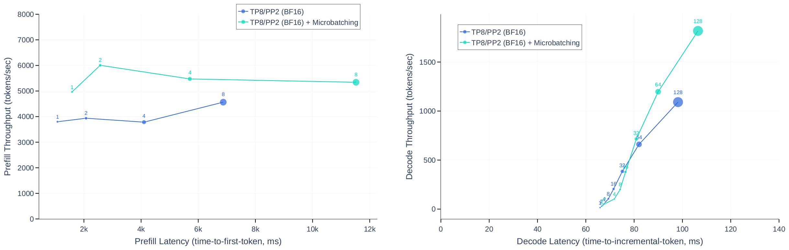

*图 24（原文 Figure 24，第 52 页）：micro-batching 对预填充（左）与解码（右）阶段推理吞吐与延迟的影响；图中数字对应（micro-）batch size。*

**图中文字翻译与读法**：

- **左图**：横轴 Prefill Latency (time-to-first-token, ms)（预填充延迟，首 token 时间），纵轴 Prefill Throughput (tokens/sec)（预填充吞吐）；**右图**：横轴 Decode Latency (time-to-incremental-token, ms)（解码延迟，增量 token 时间），纵轴 Decode Throughput (tokens/sec)。图例：TP8/PP2 (BF16)（蓝）与 TP8/PP2 (BF16) + Microbatching（青）。
- **读图结论**（近似值）：（1）预填充：不用 micro-batching 时吞吐约 3.8k 到 4.6k tokens/s，用了之后约 5.0k 到 6.0k tokens/s，代价是首 token 延迟更长（batch 8：约 11.5 秒对约 6.9 秒）；（2）解码：小 batch 时两条线几乎重合（延迟约 66 到 70 ms），大 batch 时 micro-batching 明显更高——batch 128 约 1,820 tokens/s（延迟约 106 ms）对约 1,090 tokens/s（约 98 ms）。

### 13.2 FP8 量化（图 26、图 27）

利用 H100 原生 FP8，对模型里**大多数矩阵乘**做 FP8 量化：具体是量化前馈网络层里的大多数参数与激活（约占推理计算时间的 50%），**不量化**自注意力层参数；用动态缩放因子并优化 CUDA kernel 以降低计算缩放因子的开销。405B 的质量对某些量化敏感，所以有三处额外改动：（1）**第一层和最后一层 Transformer 不量化**；（2）日期这类高困惑度 token 会引起很大的激活值，导致 FP8 里动态缩放因子过高并出现下溢、解码出错，所以把动态缩放因子**上限设为 1200**；（3）用**逐行（row-wise）量化**，即对参数与激活矩阵按行计算缩放因子（原文图 25 示意，本文不转载）——一个异常大的激活值只影响所在那一行的缩放因子，不会拉高整个张量的缩放因子，因此比逐张量量化更好。

**如何衡量量化误差**：标准基准常显示“即使没有这些缓解措施，FP8 也与 BF16 相当”，但论文发现这类基准**不能充分反映 FP8 的影响**——缩放因子不设上限时，模型偶尔会产生损坏的回复，基准分数却仍然很强。所以改为分析用 FP8 与 BF16 各生成的 100,000 条回复的**奖励模型分数分布**（图 26）。

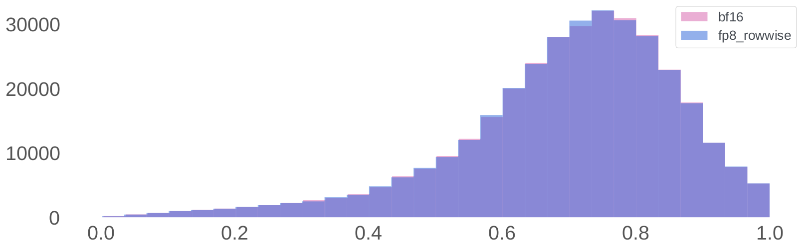

*图 26（原文 Figure 26，第 53 页）：用 BF16 和 FP8 推理时 Llama 3 405B 的奖励分数分布；FP8 量化方案对模型回复的影响可忽略。*

**图中文字翻译与读法**：

- **横轴**：奖励模型分数（0.0 到 1.0，原图没有轴标题）；**纵轴**：回复条数（0 到约 3 万）。图例：bf16（粉色）、fp8_rowwise（蓝色，逐行 FP8）。
- **读图结论**：两个直方图几乎完全重合（重叠处呈紫色），分数集中在约 0.7 到 0.8，说明逐行 FP8 加上上述改动对回复质量分布的影响很小。

**效率**：图 27 比较 405B 的 FP8 推理与 13.1 节两台机器的 BF16 推理（4,096 输入、256 输出 token）：FP8 在预填充阶段吞吐最多提升约 50%，在解码阶段的吞吐-延迟权衡也明显更好。

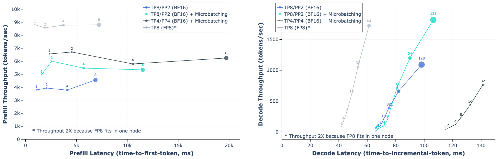

*图 27（原文 Figure 27，第 54 页）：Llama 3 405B 的 FP8 推理与使用不同流水线并行设置的 BF16 推理的吞吐-延迟权衡。左：预填充；右：解码。*

**图中文字翻译与读法**：

- 坐标同图 24，点旁数字是 batch size。四个系列：`TP8/PP2 (BF16)`、`TP8/PP2 (BF16) + Microbatching`、`TP4/PP4 (BF16) + Microbatching`、`TP8 (FP8)*`；图内注释 `* Throughput 2X because FP8 fits in one node`：FP8 的模型能放进一台机器，所以同样两台机器可以跑两份副本，图中 FP8 的吞吐已按 2 倍画。
- **读图结论**（近似值）：预填充阶段 TP8 (FP8) 约 8.8k tokens/s，比 BF16 的最好情况（约 6k，TP8/PP2 + micro-batching）高约 50%，与正文“最多提升 50%”一致；解码阶段 FP8 的曲线在最左上，同样吞吐下延迟低得多（如约 1,700 tokens/s 时延迟约 61 ms，而 BF16 + micro-batching 同量级吞吐需约 106 ms）。

## 十四、视觉实验（原文第 7 节）

论文用**组合式**（compositional）方法给 Llama 3 加视觉能力，分两个阶段：（1）把预训练图像编码器（Xu et al., 2023）与预训练语言模型组合，在两者之间引入一组交叉注意力层（Alayrac et al., 2022，见 [../flamingo/论文中文解读.md](../flamingo/论文中文解读.md)），在大量图文对上训练；（2）引入时间聚合层和额外的视频交叉注意力层，在大量视频文本对上学习视频的时间信息。组合式的好处：能并行开发视觉与语言能力；绕开视觉与语言联合预训练的复杂性（视觉数据分词、不同模态 token 背景困惑度不同、模态之间竞争）；保证不影响纯文本任务；图像不必逐层穿过庞大的语言主干（尤其是前馈网络），推理更高效。这些多模态模型在论文发表时仍在开发、尚未发布。

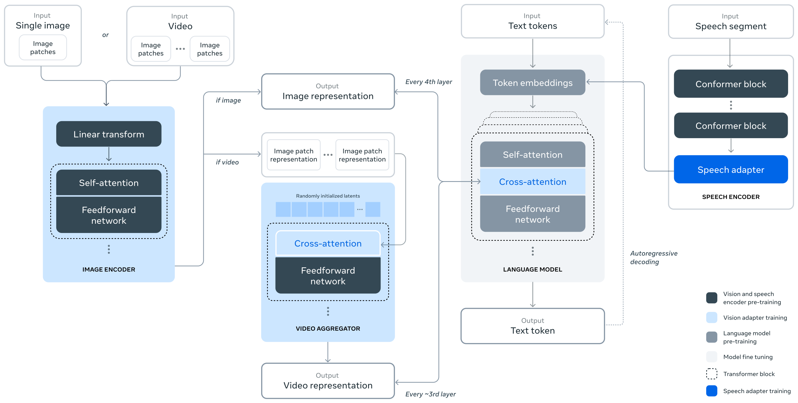

*图 28（原文 Figure 28，第 55 页）：给 Llama 3 加入多模态能力的组合式方法示意。该方法分五个阶段训练：（1）语言模型预训练，（2）多模态编码器预训练，（3）视觉适配器训练，（4）模型微调，（5）语音适配器训练。*

**图中文字翻译与读法**：

- **左（Image encoder，图像编码器）**：Input 为 Single image（单张图）或 Video（由多个 Image patches 图像块组成）→ Linear transform（线性变换）→ 若干 Self-attention + Feedforward network 块；输出分两路：if image → Image representation（图像表示）；if video → 一串 Image patch representation → **Video aggregator（视频聚合器）**（随机初始化的潜变量 Randomly initialized latents，加 Cross-attention 与 Feedforward network）→ Video representation（视频表示）。
- **中右（Language model，语言模型）**：Input Text tokens → Token embeddings → 一串 Transformer 块，其中穿插 Cross-attention 层，图像表示按 “Every 4th layer”（每 4 层）、视频表示按 “Every ~3rd layer”（约每 3 层）注入 → Output Text token，并回到输入形成 Autoregressive decoding（自回归解码）。
- **最右（Speech encoder，语音编码器）**：Input Speech segment → 若干 Conformer block → Speech adapter（语音适配器）→ 直接接到语言模型的 Token embeddings 处。
- **图例**：深色为视觉与语音编码器预训练（Vision and speech encoder pre-training）、浅蓝为视觉适配器训练（Vision adapter training）、灰色为语言模型预训练（Language model pre-training）、近白为模型微调（Model fine tuning）、虚线框为 Transformer block、亮蓝为语音适配器训练（Speech adapter training）。
- **读图结论**：语言模型（灰色）在适配器训练期间保持不变；视觉靠**交叉注意力**接入，语音靠**适配器输出直接当 token** 接入。一处不一致：图里视频表示的注入频率标为约每 3 层，而原文 7.2 节正文写的是在每第四个图像交叉注意力层之前加入视频交叉注意力层，两处说法对不上，论文没有解释。

### 14.1 数据

- **图像数据**：经四个阶段的流水线：质量过滤（去非英文与 CLIP 分数低的图文对）；**去重**（用内部版 SSCD 复制检测模型算 512 维表示，最近邻搜索加连通分量，每个分量只留一个图文对；先 k-means 预聚类并用 FAISS 提速）；**重采样**（先从高质量文本解析 n-gram 词表并统计频率；若标题里有 n-gram 在词表中出现少于 $T$ 次就保留该图文对，否则对标题中每个 n-gram $n_i$ 独立地以概率 $\sqrt{T/f_i}$ 采样，$f_i$ 为其频率，只要有一个被采中就保留，用来提升低频类别与细粒度识别）；**OCR**（提取图中文字并与标题拼接，大幅改善文档理解）。另有文档页面渲染成图像与文本配对，并做安全处理（用 PhotoDNA 与内部分类器扫描 CSAM，去除色情暴力图文对，对全部训练图像做人脸模糊）。
- **退火数据**：把图文对重采样到约 350M 个高质量样本，加上约 150M 个来自五类来源的样本：视觉定位、截图解析、问答对、合成标题、合成的结构化图像（图表、表格、公式等）。
- **视频数据**：用规则过滤并清洗文本，语言识别去非英文，OCR 检测去叠加文字过多的视频，用 CLIP 风格模型先按单帧再按整段做图文/视频文本对齐过滤，并按运动分数去掉静态视频；不做美学或分辨率过滤。平均时长 21 秒、中位 16 秒，超过 99% 的视频短于一分钟。

### 14.2 模型架构与训练

- **图像编码器**：标准 ViT（ViT-H/14，见 [../vit/论文中文解读.md](../vit/论文中文解读.md)、[../clip/论文中文解读.md](../clip/论文中文解读.md)），630M 参数，在 25 亿图文对上训练 5 个 epoch，预训练分辨率 224 × 224，切成 16 × 16 = 256 个 14 × 14 像素的块。因为对比式文本对齐训练的编码器保留不了细粒度定位信息，所以做**多层特征提取**（除最后一层外还取第 4、8、16、24、31 层），并在交叉注意力预训练之前再插入 8 个门控自注意力层（共 40 个块，总计 850M 参数），每个块输出 7680 维表示（推算：若按 ViT-H 的标准宽度 1280，则 6 组特征 × 1280 = 7680，吻合）。编码器在后续阶段**不冻结**，这样文字识别等领域表现更好。
- **图像适配器**：在语言模型**每隔四个自注意力层**加一个交叉注意力层（同样用 GQA），405B 上这些层约 100B 参数（推算：126 / 4 约 31 个，平均每层约 3B）。预训练分两步：约 6B 图文对（图像缩放到最多四个 336 × 336 图块，按宽高比排列，如 672 × 672、672 × 336、1344 × 336），再在退火数据的约 5 亿张图像上以更高分辨率继续。
- **视频适配器**：输入最多 64 帧（均匀采样），每帧过图像编码器；时间聚合器（perceiver resampler）把相邻 32 帧合并为 1 帧，并在每第四个图像交叉注意力层之前加入视频交叉注意力层；预训练用 16 帧（聚合成 1 帧），SFT 时增加到 64 帧。视频聚合器与交叉注意力层的参数对 “Llama 3 7B”（原文写法，应为 8B）和 70B 分别为 0.6B 与 4.6B。
- **训练 405B 适配器的三个新挑战**：（1）**模型异构**——图像 token 要过图像编码器与交叉注意力层而文本 token 不用，使流水线调度出现瓶颈，对策是每个流水线阶段含四个自注意力层加一个交叉注意力层，并在所有阶段复制图像编码器；（2）**数据异构**——一张图平均 2,308 个 token 而配对文本平均仅 192 个，对策是在图像编码器里加序列并行，并用大得多的 micro-batch（8 而不是 1）；（3）**数值不稳定**——bf16 梯度累加会不稳定（图像 token 通过全部交叉注意力层进入主干，误差被放大），改用 FP32 累加。
- **预训练**：图像阶段从预训练文本模型与视觉编码器初始化，视觉编码器解冻、文本模型冻结；约 6B 图文对，全局 batch size 16,384，余弦学习率，初始学习率 $10\times10^{-4}$（原文写法，即 $10^{-3}$），权重衰减 0.01；之后提高分辨率在退火数据上继续（重新 warmup 到 $2\times10^{-5}$）。视频阶段从图像预训练与退火后的权重开始，只训练新加的视频聚合器与交叉注意力层，16 帧、每帧四个 448 × 448 的块、聚合因子 16，全局 batch size 4,096，学习率 $10^{-4}$。
- **后训练**：先在精心整理的多模态对话数据（学术数据集改写、人工标注、用文本 LLM 合成）上做 SFT；SFT 时把语言模型权重“热替换”成指令微调后的版本并保持冻结，只更新视觉编码器与适配器，并对超参数扫描中前 $K$ 个模型的权重取平均；再训练视觉奖励模型（视觉部分来自视觉 SFT 模型并解冻，自注意力层来自语言奖励模型并冻结，另加奖励 logit 平方的正则防漂移，并扰动负例回复里与图像相关的词语以促使它依据真实图像判断）；做 DPO（参考模型每 $k$ 步用 EMA 更新而不是一直冻结，在人工评测中更好）；用拒绝采样为只有最终答案的问答补出思维链；最后做质量调优（QT），在极小的高质量对话数据上微调，提升人工评测而基准不受影响。

### 14.3 图像识别结果（表 29）

评测覆盖自然图像、文本、图表理解与多模态推理：MMMU（大学水平多学科推理，验证集 900 张图）、VQAv2（自然图像通用问答）、AI2 Diagram（科学图表）、ChartQA（图表）、TextVQA（图中文字阅读）、DocVQA（文档理解）。

**表 29：接在 Llama 3 上的视觉模块的图像理解表现。** △：使用外部 OCR 工具得到的结果。

| 基准 | Llama 3-V 8B | Llama 3-V 70B | Llama 3-V 405B | GPT-4V | GPT-4o | Gemini 1.5 Pro | Claude 3.5 |
|---|---:|---:|---:|---:|---:|---:|---:|
| MMMU（val，CoT） | 49.6 | 60.6 | 64.5 | 56.4 | **69.1** | 62.2 | 68.3 |
| VQAv2（test-dev） | 78.0 | 79.1 | **80.2** | 77.2 | – | **80.2** | – |
| AI2 Diagram（test） | 84.4 | 93.0 | 94.1 | 78.2 | 94.2 | 94.4 | **94.7** |
| ChartQA（test，CoT） | 78.7 | 83.2 | 85.8 | 78.4 | 85.7 | 87.2 | **90.8** |
| TextVQA（val） | 78.2 | 83.4 | **84.8** | 78.0 | – | 78.7 | – |
| DocVQA（test） | 84.4 | 92.2 | 92.6 | 88.4 | 92.8 | 93.1△ | **95.2** |

（原文表 29，第 61 页。）读法：论文的结论是 Llama 3-V 405B 在所有基准上超过 GPT-4V，略落后于 Gemini 1.5 Pro 与 Claude 3.5 Sonnet，在文档理解上尤其有竞争力。对照表中数字：对 Gemini 1.5 Pro，405B 在 MMMU（64.5 对 62.2）与 TextVQA（84.8 对 78.7）上更高，VQAv2 并列，其余三项略低；对 Claude 3.5 在可比较的四项上都低。

### 14.4 视频识别结果（表 30）

论文说在三个基准上评测，实际列出四个：PerceptionTest（时间推理多选，11.6K 条测试问答）、NExT-QA（时间与因果推理的开放式问答，WUPS 指标）、TVQA（结合字幕的组合式推理，五选一）、ActivityNet-QA（长视频问答，平均 3 分钟，由 GPT-3.5 判分）。推理时均匀采样帧并给出简短提示，**全部零样本**（这些基准的任何部分都没出现在训练或微调数据里）。

**表 30：接在 Llama 3 上的视觉模块的视频理解表现。** 8B 与 70B 的视觉适配器在长视频与时间性视频理解任务上有竞争力，有时甚至超过其他模型。

| 基准 | Llama 3-V 8B | Llama 3-V 70B | Gemini 1.0 Pro | Gemini 1.0 Ultra | Gemini 1.5 Pro | GPT-4V | GPT-4o |
|---|---:|---:|---:|---:|---:|---:|---:|
| PerceptionTest（test） | 53.8 | **60.8** | 51.1 | 54.7 | – | – | – |
| TVQA（val） | 82.5 | **87.9** | – | – | – | 87.3 | – |
| NExT-QA（test） | 27.3 | **30.3** | 28.0 | 29.9 | – | – | – |
| ActivityNet-QA（test） | 52.7 | 56.3 | 49.8 | 52.2 | 57.5 | – | **61.9** |

（原文表 30，第 62 页。）读法：只训练了小型视频适配器的 Llama 3，与可能从预训练起就原生多模态处理的模型相比很有竞争力；在 PerceptionTest 上表现最好，说明有较强的复杂时间推理能力。ActivityNet-QA 上最多处理 64 帧（3 分钟视频平均约每 3 秒一帧），仍取得不错的结果，但与 GPT-4o（61.9）、Gemini 1.5 Pro（57.5）仍有差距。

## 十五、语音实验（原文第 8 节）

论文用与视觉类似的**组合式**方法给 Llama 3 加语音能力：输入侧用语音编码器加适配器处理语音信号，用文本形式的系统提示切换工作模式。**不给系统提示**时，模型就是通用的语音对话模型，回应方式与纯文本 Llama 3 一致（对话历史作为提示前缀）；也可用系统提示启用自动语音识别（ASR）与自动语音翻译（AST）；支持最多 34 种语言，并支持文本与语音交错输入。语音生成方面，实现了流式文本转语音（TTS），在语言模型解码的同时即时生成波形；**不微调语言模型**，而是在推理时利用 Llama 3 的嵌入改善合成的延迟、准确性和自然度。

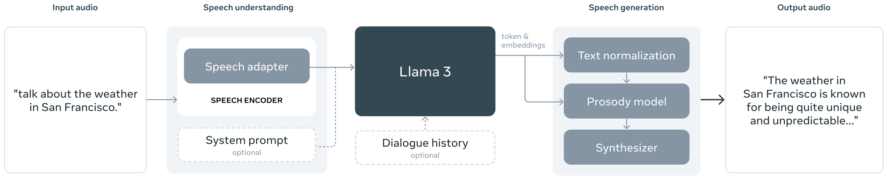

*图 29（原文 Figure 29，第 63 页）：Llama 3 语音接口的架构。*

**图中文字翻译与读法**：

- 从左到右：**Input audio（输入音频）**，示例是语音 “talk about the weather in San Francisco.”（谈谈旧金山的天气）→ **Speech understanding（语音理解）**：Speech adapter（语音适配器）与 SPEECH ENCODER（语音编码器），下方有可选的 System prompt（系统提示，optional）→ **Llama 3**，下方有可选的 Dialogue history（对话历史，optional）→ “token & embeddings”（token 与嵌入）→ **Speech generation（语音生成）**：Text normalization（文本规范化）→ Prosody model（韵律模型）→ Synthesizer（合成器）→ **Output audio（输出音频）**，示例是 “The weather in San Francisco is known for being quite unique and unpredictable…”。
- **读图结论**：理解侧是“编码器加适配器，再进语言模型”；生成侧不改语言模型，而是把它输出的 token 与中间层嵌入送给文本规范化与韵律模型，再由合成器出声。

### 15.1 数据

- **语音预训练**：约 1500 万小时、涵盖大量语言的无标注语音，用 VAD 阈值 0.7 过滤，并用 Presidio Analyzer 确保不含 PII，用来自监督地初始化语音编码器。
- **监督微调**：ASR 数据 23 万小时人工转写，34 种语言；AST 数据 9 万小时，33 种语言到英语与英语到 33 种语言，含用 NLLB 生成的合成数据（有助于低资源语言），语音片段最长 60 秒；口语对话数据靠让语言模型回复语音提示的转写来合成（用 ASR 数据的 6 万小时子集），另用 Voicebox TTS 在微调数据子集上生成 2.5 万小时合成语音。
- **语音生成**：文本规范化（TN）数据 55K 个样本（书面形式与规范化口语形式配对，覆盖数字、日期、时间等）；韵律模型（PM）数据来自 5 万小时专业配音的 TTS 数据集；两者都额外加了 Llama 3 嵌入这一输入特征，取自 Llama 3 8B **第 16 层解码器的输出**。

### 15.2 架构与训练要点

- **语音编码器**：1B 参数的 Conformer，输入 80 维梅尔频谱，经 stride 4 堆叠与线性投影把帧长降到 40 ms，24 个 Conformer 层（潜维度 1536，两个维度 4096 的前馈网络，卷积核 7，24 头旋转注意力）。**语音适配器**约 100M 参数：卷积层（核 3、步长 2，帧长降到 80 ms）、旋转 Transformer 层（潜维度 3072，前馈 4096）和一个线性层，把输出映射到语言模型嵌入维度。语音模块的输出**直接当 token** 送入语言模型（用两个新增特殊 token 包住），与视觉的交叉注意力不同，因而能复用语言模型的全部能力。
- **TN** 是流式 LSTM 序列标注模型，预测手写 TN 规则序列，并通过交叉注意力读取 Llama 3 嵌入；**PM** 是单向 Transformer（六个注意力头，隐维度 864），预测每个音素的对数时长、对数 F0 平均值和对数功率平均值，用**双交叉注意力**分别处理语言学输入与 Llama 嵌入，无需显式对齐就能处理不同输入速率。
- **训练**：语音理解分两阶段——先用 BEST-RQ 自监督预训练编码器（以 2.5% 概率掩码 32 帧；把梅尔特征量化到 16 个码本，每个码本 8,192 个向量；500K 步，全局 batch 2,048 条语句）；再把编码器与适配器和语言模型**联合训练但语言模型冻结**，8B 训练 650K 次更新（batch 512，初始学习率 $10^{-4}$），70B 训练 600K 次更新（batch 768，初始学习率 $4\times10^{-5}$）。为避免多语言 ASR/AST 的语言混淆又保留零样本方向的泛化，系统提示**只包含目标端的语言标识，不含源端**：ASR 用 “Repeat after me in {language}:”，AST 用 “Translate the following sentence into {language}:”。PM 用 AdamW、学习率 $9\times10^{-4}$、100 万次更新，并用固定音素数加可变 token 数的前瞻与因果掩码实现流式。

### 15.3 语音理解结果（表 31、表 32）

对比 Whisper、SeamlessM4T 与 Gemini，Llama 3 的 token 预测一律用贪心搜索。ASR 在 MLS、LibriSpeech、VoxPopuli 的英语集与多语言 FLEURS 子集上评测，解码结果用 Whisper 文本规范化器后处理；度量词错误率（WER），汉语、日语、韩语、泰语报告字错误率。

**表 31：Llama 3 语音接口在语音识别任务上的词错误率（越低越好）。** Whisper、SeamlessM4T、Gemini 作参考。

| 基准 | Llama 3 8B | Llama 3 70B | Whisper | SeamlessM4T v2 | Gemini 1.0 Ultra | Gemini 1.5 Pro |
|---|---:|---:|---:|---:|---:|---:|
| MLS（English） | 4.9 | 4.4 | 6.2（v2） | 6.5 | 4.4 | **4.2** |
| LibriSpeech（test-other） | 3.4 | **3.1** | 4.9（v2） | 6.2 | – | – |
| VoxPopuli（English） | 6.2 | **5.7** | 7.0（v2） | 7.0 | – | – |
| FLEURS（34 种语言） | 9.6 | **8.2** | 14.4（v3） | 11.7 | – | – |

（原文表 31，第 67 页。脚注：Gemini 在 MLS 上采用其原论文的数字；Whisper v3 没有正式报告 FLEURS 的马拉雅拉姆语，故用 33 种语言的平均。）读法：Llama 3 在所有基准上优于专为语音定制的 Whisper 与 SeamlessM4T（FLEURS 上 70B 的 8.2 对 Whisper 的 14.4）；在 MLS 英语上与 Gemini 相近（70B 的 4.4，Gemini 1.0 Ultra 4.4，Gemini 1.5 Pro 4.2）。

**表 32：Llama 3 语音接口在语音翻译任务上的 BLEU（越高越好）。** Whisper 与 SeamlessM4T 作参考。

| 基准 | Llama 3 8B | Llama 3 70B | Whisper v2 | SeamlessM4T v2 |
|---|---:|---:|---:|---:|
| FLEURS（33 种语言到英语） | 29.5 | **33.7** | 21.9 | 28.6 |
| Covost 2（15 种语言到英语） | 34.4 | **38.8** | 33.8 | 37.9 |

（原文表 32，第 67 页；Covost 2 只评测了 21 种语言中的 15 种。）

**口语问答**：模型能毫不费力地理解**语码转换**的语音（此前没有接触过这类数据）；虽然只在单轮对话上训练，也能进行连贯的多轮对话（原文图 30 展示转写的对话示例，本文不转载）。

**安全**：在多语言音频毒性数据集 MuTox（Costa-jussà et al., 2023，英语与西班牙语各 20,000 条、另 19 种语言各 4,000 条语句）上评测，音频作输入、输出用 MuTox 分类器判毒性，并与 Gemini 1.5 Pro 比较：**新增毒性**（AT）是输入安全而输出有毒的百分比，**丢失毒性**（LT）是输入有毒而回答安全的百分比。

**表 33：Llama 3 语音接口在 MuTox 上的语音毒性。** AT（%，越低越好），LT（%，越高越好）。

| 语言 | 8B：AT（↓） | 8B：LT（↑） | 70B：AT（↓） | 70B：LT（↑） | Gemini 1.5 Pro：AT（↓） | Gemini 1.5 Pro：LT（↑） |
|---|---:|---:|---:|---:|---:|---:|
| English | 0.84 | 15.09 | **0.68** | **15.46** | 1.44 | 13.42 |
| Overall（21 种语言） | 2.31 | 9.89 | **2.00** | 10.29 | 2.06 | **10.94** |

（原文表 33，第 68 页。脚注：Gemini 有相当数量的回复为空，分析时假设都是安全的，这是最保守的做法，也是 Gemini 结果的上界。）读法：新增毒性很低，Llama 3 的语音模型在英语上新增毒性最低（不到 1%），移除的毒性明显多于新增的毒性。

### 15.4 语音生成结果（表 34、表 35）

评测聚焦用 Llama 3 嵌入的逐 token 流式输入模型在文本规范化与韵律建模上的质量，比较对象是不使用 Llama 3 嵌入的模型。

**表 34：逐样本的文本规范化（TN）准确率。** 比较有无 Llama 3 8B 嵌入、以及不同右侧上下文（单位：TN token）。

| 模型 | 右侧上下文 | 准确率 |
|---|---:|---:|
| 不用 Llama 3 8B | 3 | 73.6% |
| 不用 Llama 3 8B | ∞（完整双向上下文） | 88.0% |
| 使用 Llama 3 8B | 3 | **90.7%** |

（原文表 34，第 68 页。）读法：不用嵌入时，加长右侧上下文能提升准确率；用了 Llama 3 嵌入后，只需 3 个 token 的右侧上下文就超过完整上下文的模型，因而能做逐 token 的流式输入输出。

**表 35：韵律建模（PM）评测。** 评听者对 Llama 3 8B 的 PM 与流式纯音素基线（左）、非流式纯音素基线（右）的偏好。

| 模型 | 偏好（对流式基线） | 模型 | 偏好（对非流式基线） |
|---|---:|---|---:|
| Llama 3 8B 的 PM | **60.0%** | Llama 3 8B 的 PM | **63.6%** |
| 流式纯音素基线 | 40.0% | 非流式纯音素基线 | 36.4% |

（原文表 35，第 69 页；原文是左右两张并排的小表；最终波形由自研的基于 Transformer 的声学模型与 WaveRNN 声码器生成。）读法：Llama 3 8B 的 PM 对流式基线有 60% 的偏好，对非流式基线有 63.6%，说明感知质量明显改善；其关键优势是逐 token 的流式能力，降低前瞻需求，保持低延迟。

## 十六、相关工作与结论（原文第 9、10 节）

**语言方面的相关工作**（论文自述）：

- **规模**：Llama 3 沿着“在基础模型里把简单方法放大”的长期趋势；改进来自增加的算力与改进的数据，405B 的预训练算力几乎是 Llama 2 70B 的五十倍。尽管有 405B 参数，由于对 scaling law 的更好理解，它的参数量反而少于 PaLM 等更早、性能差得多的模型。Claude 3 或 GPT-4 等前沿模型的规模公开信息很少，但整体表现可比。
- **小模型**：小模型的发展与大模型并行，参数更少能大幅降低推理成本、简化部署；Llama 3 的小模型通过训练远超计算最优点，用训练算力换推理效率；另一条路是把大模型蒸馏成小模型，如 Phi。
- **架构**：Llama 3 对 Llama 2 的结构改动极小，而其他近期基础模型探索了别的设计，最显著的是 MoE（如 Mixtral、Arctic）。Llama 3 优于这些模型，说明 dense 架构并不是限制因素，但在训练与推理效率和大规模稳定性上仍有许多权衡。
- **开源**：开放权重模型在过去一年迅速进步，Llama3-405B 与当前闭源最先进模型相当有竞争力。
- **后训练**：沿用指令微调（Chung et al., 2022；Ouyang et al., 2022）加人类反馈对齐（Kaufmann et al., 2023）的既定策略；虽然有研究表明轻量级对齐惊人有效（Zhou et al., 2024），Llama 3 用了数百万条人工指令与偏好判断，采用拒绝采样、监督微调与 DPO，并用早期版本的 Llama 3 过滤、重写或生成提示与回复，多轮迭代。

**多模态方面**：图像、视频与语音的组合式做法综合了许多已有工作，在图像上取得与 Gemini 1.0 Ultra 和 GPT-4 Vision 相当的结果，在视频上取得与最先进相当的结果；与大多数以往工作不同，语音部分选择不微调语言模型，以免与非语音任务争用，并发现在更大的模型规模下无需微调也能取得强表现。

**结论**：高质量基础模型的开发在很多方面仍处于起步阶段；论文的经验是，对高质量数据、规模与简单性的强力聚焦始终带来最好的结果。在初步实验里，更复杂的模型结构和训练配方并没有带来足以抵消其增加的开发复杂度的收益。论文还特别指出两个**组织层面**的做法：预训练数据由一个单独的团队采集处理，并被强烈激励去防止预训练数据被外部基准污染；人工评测由一小群不参与模型开发的研究者执行并独占访问，以保证可信。作者认为公开发布基础模型对负责任地开发这类模型起到关键作用。

## 十七、局限、证据边界与常见误读

### 17.1 论文内部不一致或需注意之处

核对原文时发现下列地方正文、图、表的说法对不上，本文按“以表/图为准并注明”的原则处理：

| 原文位置 | 问题 | 本文处理 |
|---|---|---|
| 3.2.1 节 scaling law | 正文 $(\alpha,A)=(0.53,0.29)$，图 3 标注 $(0.537,0.299)$；前者代入只得约 10.5T tokens，后者约 16.3T，与 16.55T 接近 | 视正文为取整写法（见第五节） |
| 表 5 | Faulty GPU 一行 148 次却标 30.1%（148 / 419 约 35.3%）；正文“GPU 问题占 58.7%”是百分比列相加，按次数则约 64.0% | 照抄原数，注明不自洽（6.5 节） |
| 5.1.1 节 / 表 8 | 正文说八个顶层类别，表 8 只列七类（缺“知识”类） | 注明（9.1 节） |
| 5.2.1 节 / 表 2 | 正文说 8B 在 MMLU 与 MMLU-Pro 上都优于同规模模型，但表 2 MMLU（5-shot）一行 Gemma 2 9B 更高 | 以表为准（10.1 节） |
| 5.2.3 节 / 表 18 | 正文说 GPT-4o 在最大模型里最强，表中 GPT-4o 与 Claude 3.5 Sonnet 各在两项最好 | 以表为准 |
| 5.2.7 节 / 表 22 | 正文说 405B 在 API-Bank 上落后 Claude 3.5 Sonnet 0.6%，表中 92.3 对 92.6 只差 0.3 | 以表为准 |
| 5.1.2 节 / 图 13 | 正文说对 MCQ 标签“非常稳健”，图中符号标签 `$ & # @` 上三个模型都明显下降 | 在 9.4 节注明 |
| 5.4.4 节 / 图 20 | 正文说 405B 在 DocQA 与 Many-shot 上相对 Comp. 2 Pareto 更优，但 Many-shot 没有 FRR，且不带 LG 的 405B 与 Comp. 2 的 VR 相同 | 在 12.4 节注明 |
| 3.4.3 节 | 退火“最后 40M tokens”，而 3.1.3 节评估数据用 40B tokens，量级差 1000 倍 | 照抄并注明 |
| 7.2 节 / 图 28 | 正文写 “Llama 3 7B”（应为 8B）；视频交叉注意力的频率图里是约每 3 层，正文是每第四个图像交叉注意力层之前 | 在 14.2 节、图 28 读法里注明 |
| 7.7 节 | 正文说三个视频基准，实际列出四个 | 在 14.4 节注明 |
| 表 26 | “无差别武器”一行带脚注 14，但本地 PDF 中没有脚注文字 | 在 12.7 节注明 |

### 17.2 证据边界

- **对手数字不是同一口径的受控比较**：论文对其他模型取“自己复现值与公开报告值中较好的一个”，而且很多模型无法复现（API 无对数概率），因此 405B 档没有类别平均；比较应理解为“论文给定口径下”。
- **内部基准不可复现**：安全评测（违规率、误拒率）、多语言 MMLU、人工评测提示集都是内部的，竞品被匿名；论文自己也承认数字无法在外部复现。
- **人工评测**：由标注者依 7 分制成对比较，“赢”只统计“更好/明显更好”，平局不画；结果受语气、结构、冗长度和标注者偏好影响，论文也说可能不一致或不可靠。
- **污染**：表 15 只是基于 8-gram 重叠的估计，对 MMLU、HumanEval、MBPP、MMLU-Pro 无法估计；BIG-Bench Hard、AGIEval、HellaSwag、PiQA 的估计增益不小，预训练分数需谨慎。
- **置信区间**：论文给的 CI 只反映抽样变异，是真实变异的下界；很多比较（尤其 GMAT、AP 单科、HumanEval）差距落在 CI 内。
- **scaling law 的验证**：论文只展示了在 ARC Challenge 上外推四个数量级仍然准确，其他基准的预测效果没有逐项展示。
- **MFU**：38% 到 43% 是 BF16 的 MFU，不适用于 FP8 推理。
- **可靠性数据**：来自 54 天的快照，不代表全程。
- **多模态**：全部是实验结果，模型当时未发布；视觉、视频、语音的数字不应当当作已发布 Llama 3 的能力。

### 17.3 常见误读

- **“Llama 3 就是 405B”**：Llama 3 是 8B、70B、405B 三个模型的“模型群”；2024 年 4 月的 Llama 3（8B、70B）与 7 月的 Llama 3.1 不同——前者没有长上下文、多语言与工具使用；本文所有结果对应 Llama 3.1。
- **“Llama 3 是原生多模态模型”**：不是。多模态部分是组合式实验：独立训练的图像/语音编码器经适配器接到冻结的语言模型上，且当时未发布。
- **“Llama 3 用了 RLHF/PPO”**：没有，后训练是 SFT + 拒绝采样 + DPO；论文试过 PPO，但发现 DPO 算力更省、表现更好（尤其 IFEval）。
- **“128K 上下文是一开始就训的”**：不是，主体用 8K 训练，最后阶段分六步、用约 800B tokens 才扩到 128K。
- **“dense 比 MoE 更好”**：论文只是为训练稳定性选了 dense，并说在对比中 Llama 3 优于 Mixtral 等 MoE 模型，因此“dense 架构不是限制因素”，但训练与推理效率、稳定性上仍有权衡，并没有证明 dense 总是更优。
- **“405B 在所有基准上第一”**：不是。表 2 的 405B 档里它只在约 7 行标粗，Claude 3.5 Sonnet 与 GPT-4o 在另一些基准上更好。
- **“FP8 量化基准分数一样就等价于 BF16”**：论文明确说标准基准不能充分反映 FP8 的影响，缩放因子不设上限时会出现损坏回复而基准分数仍很强，所以改用奖励分数分布检查。
- **“15T tokens 全是英文”**：数据配比里有约 8% 的多语言 token，并经 176 种语言的识别；8B 与 70B 的 4 月版本预训练含多语言数据但定位只面向英文。

## 十八、复现检查清单

- **数据**：网页清洗流水线（自建 HTML 解析器、去 markdown 标记、URL/文档/行三级去重、启发式过滤、基于模型的质量过滤，代码与推理数据用 DistilRoBERTa 分类器）；数据配比（约 50% 通用知识、25% 数学与推理、17% 代码、8% 多语言，训练中还会调整）；退火数据（上采样高质量代码与数学，不含基准训练集）。**论文没有公开**数据来源清单、各来源 token 数、分类器与阈值、8B 和 70B 的训练 token 数。
- **分词器**：128K 词表（100K tiktoken + 28K 非英语）。
- **结构**：表 3 的层数、维度、FFN 维度、头数、8 个 KV 头、SwiGLU、RoPE（$\theta=500{,}000$）；文档掩码。
- **预训练**：AdamW，峰值学习率 $8\times10^{-5}$（405B），8,000 步 warmup，余弦衰减到 $8\times10^{-7}$（1,200,000 步）；batch 4M、8M、16M tokens 的日程；长上下文六阶段扩到 128K（约 800B tokens）；最后 40M tokens 退火并做 Polyak 平均。
- **并行与系统**：表 4 的 TP/CP/PP/DP 配置；改进的流水线调度（$N$ 可调、首尾阶段各少一层）；all-gather 式 CP；FP32 梯度累加与规约；NCCLX。
- **后训练**：六轮；奖励模型去 margin；SFT 学习率 $10^{-5}$、8.5K 到 9K 步；DPO 学习率 $10^{-5}$、$\beta=0.1$、屏蔽格式 token、NLL 正则系数 0.2；拒绝采样 $K=10$ 到 30；模型平均。**论文没有公开**偏好/SFT 数据、标注指南与各能力数据配比的具体数值。
- **评测**：论文的评测配置发布在其 Github 仓库，评测产生的数据发布在 Huggingface；预训练评测用 $1.96\sqrt{S(1-S)/N}$ 的 CI；对手取“较好的一个”的口径要在复现时明确。
- **安全**：Llama Guard 3、Prompt Guard、Code Shield 已开源；内部安全基准与竞品不公开，无法复现表 25 之外的对比。

## 十九、与相关论文的关系

- **上一代与前置**：初代 LLaMA（[../llama/论文中文解读.md](../llama/论文中文解读.md)）给出“小模型多训、只用公开数据”的路线；Llama 3 把同一条路线放大到 405B 与 15.6T tokens，并系统披露数据、并行、可靠性与后训练。scaling law 部分接续 Chinchilla（[../chinchilla/论文中文解读.md](../chinchilla/论文中文解读.md)）与 [../scaling_laws/论文中文解读.md](../scaling_laws/论文中文解读.md)。
- **结构组件**：GQA（[../grouped_query_attention/论文中文解读.md](../grouped_query_attention/论文中文解读.md)）、RoPE（[../rope/论文中文解读.md](../rope/论文中文解读.md)）。
- **后训练**：DPO（[../dpo/论文中文解读.md](../dpo/论文中文解读.md)）与 InstructGPT 式的人类反馈流程（[../openai_instructgpt/论文中文解读.md](../openai_instructgpt/论文中文解读.md)）；数学推理数据用到逐步奖励模型思路，可对照 [../lets_verify_step_by_step/论文中文解读.md](../lets_verify_step_by_step/论文中文解读.md)。
- **多模态**：视觉的交叉注意力适配器接续 Flamingo（[../flamingo/论文中文解读.md](../flamingo/论文中文解读.md)）；图像编码器相关见 ViT 与 CLIP（[../vit/论文中文解读.md](../vit/论文中文解读.md)、[../clip/论文中文解读.md](../clip/论文中文解读.md)）；语音可对照 Whisper 与 wav2vec 2.0（[../whisper/论文中文解读.md](../whisper/论文中文解读.md)、[../wav2vec2/论文中文解读.md](../wav2vec2/论文中文解读.md)）。
- **同期对照**：与 GPT-4（[../openai_gpt4/论文中文解读.md](../openai_gpt4/论文中文解读.md)）、Gemini（[../gemini/论文中文解读.md](../gemini/论文中文解读.md)）比较的是闭源前沿；与 DeepSeek-V3（[../deepseek_v3/论文中文解读.md](../deepseek_v3/论文中文解读.md)）、Kimi K2（[../kimi_k2/论文中文解读.md](../kimi_k2/论文中文解读.md)）对照 dense 与 MoE 的取舍；与 Qwen3（[../qwen_3/论文中文解读.md](../qwen_3/论文中文解读.md)）对照后训练里的思考模式。

## 原文证据导航

- [原论文 PDF](paper.pdf)
- [原文提取文本](paper.txt)
- [论文概要](论文概要.md)
