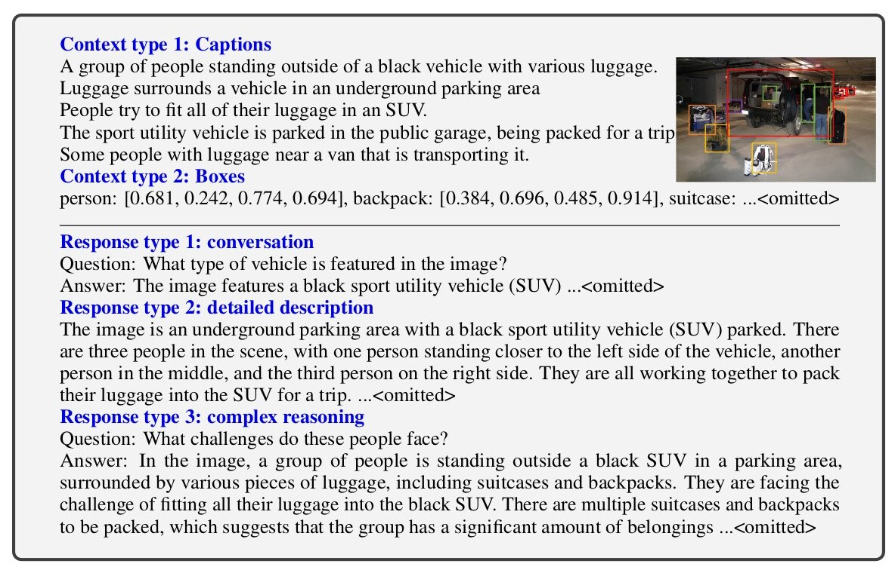
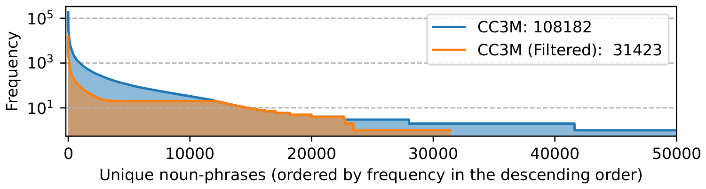
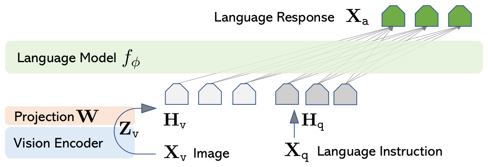
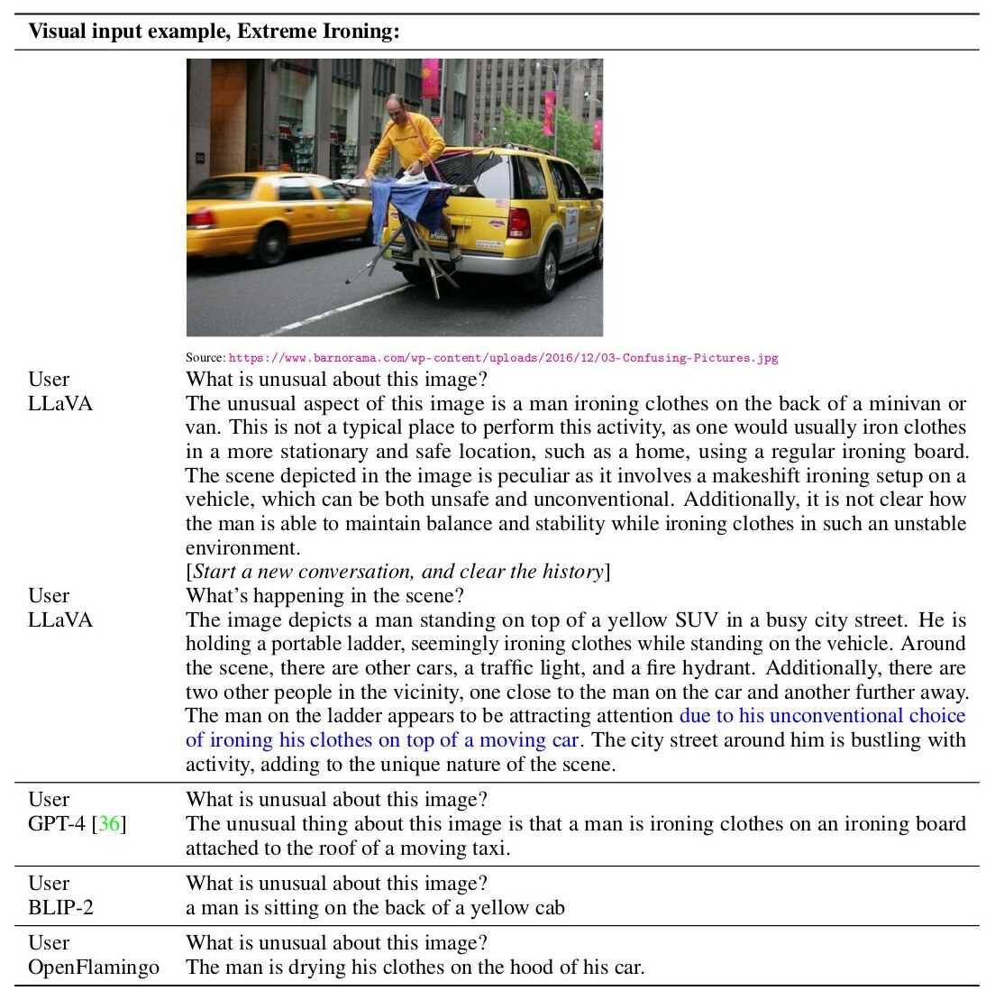
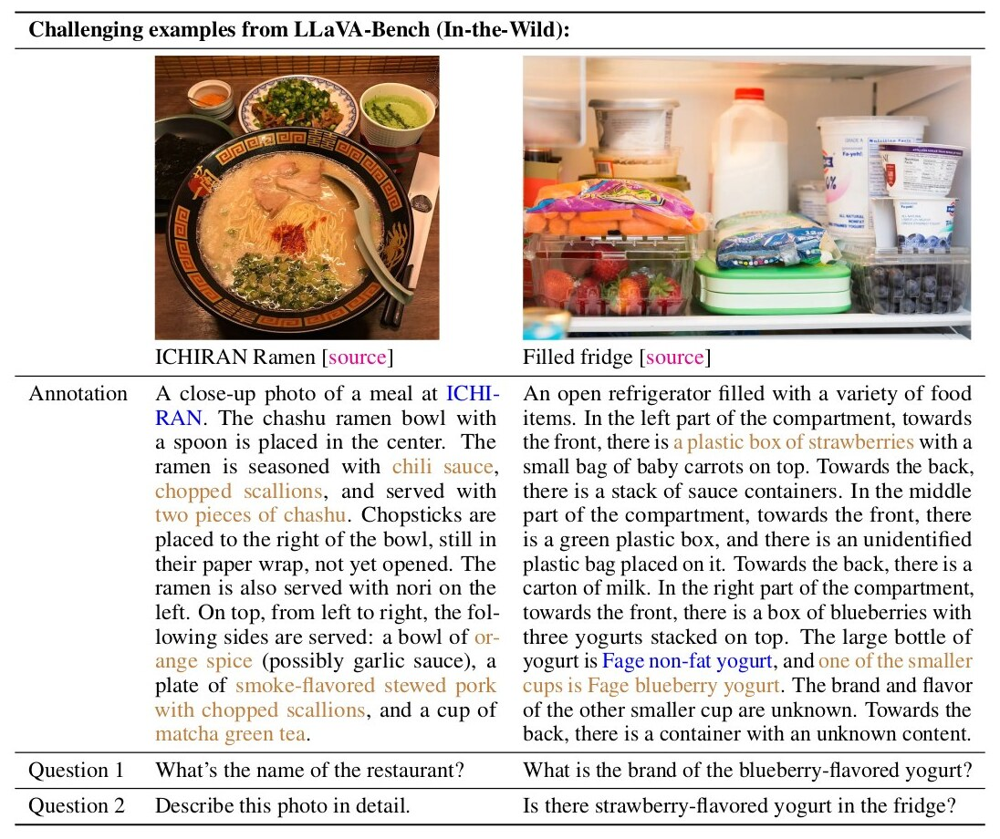
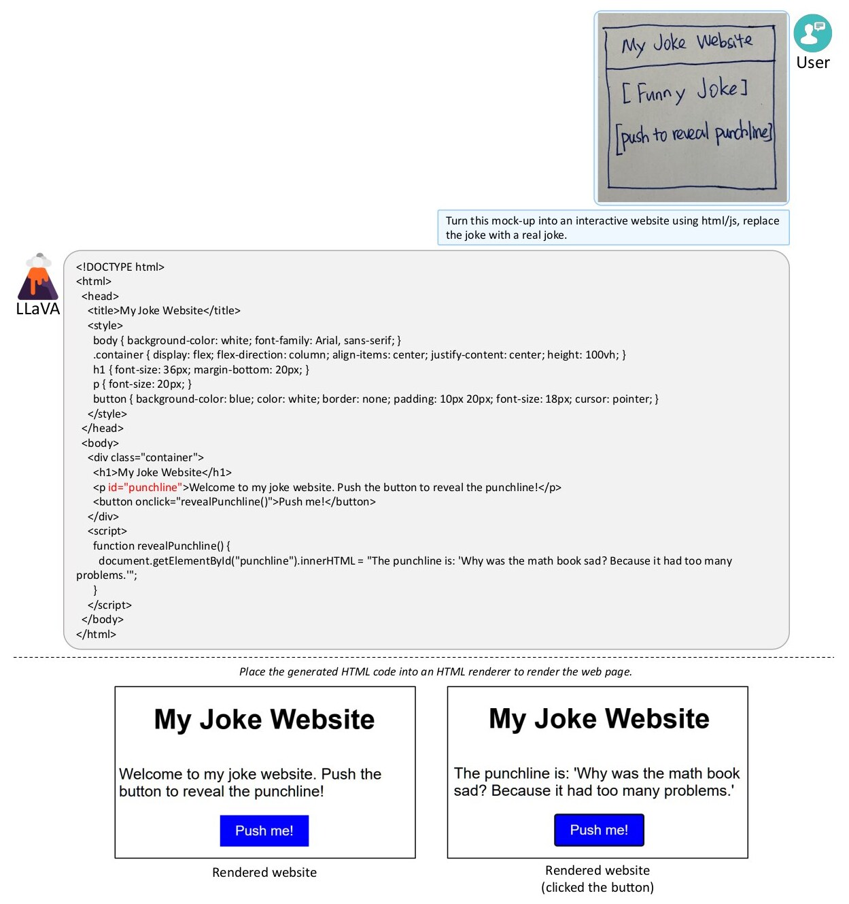

# 论文中文解读：《Visual Instruction Tuning》

> **基本信息**：Haotian Liu、Chunyuan Li（前两位为共同一作）、Qingyang Wu、Yong Jae Lee（University of Wisconsin–Madison、Microsoft Research、Columbia University），arXiv:2304.08485（v2，2023 年 12 月 11 日），NeurIPS 2023；项目主页 [llava-vl.github.io](https://llava-vl.github.io)；论文原文 [官方页面](https://arxiv.org/abs/2304.08485)。
>
> **本文的读法**：按原文章节把动机、数据生成流水线、模型与两阶段训练、实验和附录里的关键内容讲全，只读中文即可。图和示例框均从原文 PDF 裁出（带照片的示例用 jpg），并配有中文翻译和读图结论；表为逐格核对后的转录，数字与原文一致。原文没有给出的信息（如视觉 token 个数、图像分辨率）不编造，会明确写“原文未说明”。凡是我们自己的推算或提醒，都标成“按表中数字推算”或“读者提示”，以便和原文结论区分。

## 一、一句话结论

**问题**：大语言模型靠“指令微调”学会听从人类指令，但视觉领域几乎没有“图像 + 指令 + 回答”形式的数据，于是视觉模型多半是固定接口的专用模型，缺少与用户交互、按指令切换任务的能力。

**做法**：

- **数据**：让只能读文字的 GPT-4（早期实验也比较了 ChatGPT）读取 COCO 图像的 caption 和物体边界框（bounding box）这两种“图像的文字替身”，在少量人工种子样例的上下文学习下生成 **158K** 条语言-图像指令数据：对话 58K、详细描述 23K、复杂推理 77K；
- **模型 LLaVA（Large Language and Vision Assistant）**：冻结的 CLIP ViT-L/14 视觉编码器，加一层可训练的线性投影矩阵 $\mathbf{W}$，把视觉特征变成语言模型词嵌入空间里的“视觉 token”，再接 Vicuna 语言模型（主模型为 13B）；
- **两阶段训练**：阶段 1 只训练 $\mathbf{W}$（595K 图文对，1 个 epoch），使视觉特征与冻结 LLM 的词嵌入对齐；阶段 2 训练 $\mathbf{W}$ 和 LLM（158K 指令数据，3 个 epoch），视觉编码器始终冻结。8 块 A100 上分别约 4 小时和 10 小时。

**结论**：

- 在作者构造的 LLaVA-Bench（COCO）上，LLaVA 相对 text-only GPT-4 参考答案的得分为 **85.1%**；在更难的 LLaVA-Bench（In-the-Wild）上为 **67.3%**，高于 BLIP-2（38.1%）和 OpenFlamingo（19.1%）；
- 在 ScienceQA 上微调后单模型 **90.92%**（当时 SOTA 为 91.68%），与 text-only GPT-4 按“评审”方式集成后达到 **92.53%**，刷新 SOTA；
- 在 GPT-4 论文里的几个示例图上，LLaVA 的回答风格与多模态 GPT-4 相近，而 BLIP-2 和 OpenFlamingo 只是在描述图像。

**局限**：数据由 GPT-4 从文字化的图像信息生成，不是人类标注，也不是 GPT-4 真正“看过”图像；评测又由 GPT-4 打分且基准规模很小；有些问题需要高分辨率图像和广泛的知识（如辨认品牌、餐厅名），LLaVA 做不好，还会出现把图像当成“一袋 patch”的误判。

## 二、背景与动机

### 2.1 语言有指令微调，视觉缺指令数据

人类通过视觉、语言等多种通道与世界交互，人工智能的核心愿望之一，是做出一个能遵循多模态（视觉 + 语言）指令、与人类意图对齐、完成各种真实任务的通用助手。

当时的视觉基础模型已经具备很强的开放世界视觉理解能力，覆盖分类、检测、分割、描述、图像生成与编辑等。但这类工作里，**每个任务由一个大视觉模型独立解决，任务指令隐含在模型设计里**；语言通常只用来描述图像内容。这让语言在“把视觉信号映射到语义”上发挥了作用，但模型的接口固定，对用户指令的交互性和适应性有限。

大语言模型则表明，语言可以扮演更广的角色：作为通用助手的**通用接口**，各种任务指令都可以用语言显式表达，引导端到端训练的神经助手切换到目标任务。ChatGPT 和 GPT-4 展示了对齐后的 LLM 听从人类指令的能力；开源的 LLaMA 性能可比 GPT-3，Alpaca、Vicuna、GPT-4-LLM 等用机器生成的高质量指令样本提升了 LLM 的对齐能力。重要的是，**这一整条路线当时都只涉及文本**。

本文就是把指令微调推广到“语言-图像”多模态空间的第一次尝试，目标是通用的视觉助手。

### 2.2 前人工作与差距

**多模态指令跟随智能体**，原文分两类：

1. 针对具体研究主题、端到端训练的模型：视觉-语言导航（vision-language navigation）与 Habitat 要求具身智能体按自然语言指令在视觉环境里执行动作序列；InstructPix2Pix 按人类指令编辑图像；
2. 用 LangChain 或 LLM 协调各种模型的系统：Visual ChatGPT、X-GPT、MM-REACT、VisProg、ViperGPT。

本文与它们目标相同，但聚焦于一个**端到端训练、面向多任务的语言-视觉多模态模型**。

**指令微调**：NLP 里，为让 GPT-3、T5、PaLM、OPT 等 LLM 遵循自然语言指令，研究者探索了指令微调（得到 InstructGPT/ChatGPT、FLAN-T5、FLAN-PaLM、OPT-IML），这个简单的方法可以有效提高 LLM 的零样本与少样本泛化能力（可参考 [InstructGPT](../openai_instructgpt/论文中文解读.md)）。很自然就想把这个思路借到计算机视觉。更广义地，“以基础模型当老师做师生蒸馏”也在图像分类等主题里被研究过。

**多模态大模型（LMM）**：Flamingo 可以看作多模态领域的“GPT-3 时刻”，在零样本任务迁移和上下文学习上表现强（见 [Flamingo](../flamingo/论文中文解读.md)）；其他用图文对训练的 LMM 有 BLIP-2、FROMAGe、KOSMOS-1；PaLM-E 是面向具身智能的 LMM；基于“当时最好的”开源 LLM LLaMA，OpenFlamingo 和 LLaMA-Adapter 是让 LLaMA 能接收图像输入的开源尝试。这些模型迁移泛化很有前景，但**没有显式地用视觉-语言指令数据微调**，在多模态任务上的表现通常不如在纯语言任务上。本文要填补这个空白，并研究其效果。

最后，原文特别区分了：视觉指令微调（visual instruction tuning）不同于视觉提示微调（visual prompt tuning）：前者目标是提高模型遵循指令的能力，后者目标是提高模型适配的参数效率。

### 2.3 本文的四项贡献

1. **多模态指令跟随数据**：关键难点是缺少视觉-语言指令数据。本文提出一种“数据重构”的视角和流水线，用 ChatGPT/GPT-4 把图文对转成合适的指令跟随格式；
2. **大型多模态模型**：把 CLIP 的开放集视觉编码器与语言解码器 Vicuna 相连，并在生成的指令数据上端到端微调；实证表明生成数据对 LMM 指令微调有效，并给出构建通用指令跟随视觉智能体的实用建议；与 GPT-4 集成后，在 ScienceQA 多模态推理数据集上达到 SOTA；
3. **多模态指令跟随基准 LLaVA-Bench**：含两个有挑战性的基准，图像、指令与详细标注多样；
4. **开源**：生成的多模态指令数据、代码库、模型 checkpoint 和一个视觉聊天 demo。

## 三、GPT 辅助的视觉指令数据生成

### 3.1 最朴素的做法与它的缺陷

公开的多模态数据（从 CC 到 LAION 的图文对）越来越多，但**多模态指令跟随数据**很少，原因是：用人工众包来造这类数据既耗时，又不好界定（“怎样的数据才算好的视觉指令”）。受 GPT 系列在文本标注任务上成功的启发，作者提出借助 ChatGPT/GPT-4，基于现有的图文对数据来采集多模态指令数据。

对一张图像 $\mathbf{X}_v$ 及其 caption $\mathbf{X}_c$，很自然的做法是构造一组问题 $\mathbf{X}_q$，意图是让助手描述图像内容（这组问题本身也是让 GPT-4 生成再整理出来的，见 3.5 节与附录表 11）。于是图文对可以直接扩展成指令跟随的版本：

```text
Human : X_q X_v <STOP> Assistant : X_c <STOP>
```

即“人类给出问题和图像，助手回答原 caption”。这样做很便宜，但**指令和回答都缺乏多样性与深入的推理**（回答永远只是那句 caption）。这种朴素扩展后来被用在第一阶段预训练（第 4.3 节）。

### 3.2 让只读文字的 GPT 看见图像：caption + 边界框

为了得到更丰富的数据，作者让**只接受文本输入**的 GPT-4 或 ChatGPT 当强老师。要让只会读文字的 GPT 理解图像，就需要把图像编码成文字，作者用了两种符号化表示：

1. **Caption（图像描述）**：通常从各种角度描述视觉场景；
2. **Bounding box（边界框）**：通常定位场景里的物体，每个框同时编码了物体类别和空间位置。

这种符号表示把图像编码成 LLM 能识别的序列。作者使用 COCO 图像，生成三类指令跟随数据。下图（原文表 1，是附录表 14 的节选）给出了一张图对应的上下文（caption + 框）以及三类回答。



*表 1（原文 Table 1，第 3 页）：一条指令跟随数据的例子。上半块是用来提示 GPT 的上下文（caption 与框），下半块是三类回答；图像本身并没有用来提示 GPT，放在这里只是供参考。*

**图中文字翻译与读法**：

- **Context type 1: Captions（上下文类型 1：图像描述）**：5 条 caption：“一群人站在一辆黑色车辆外面，带着各种行李”“行李散落在地下停车场里的一辆车周围”“人们试图把所有行李塞进一辆 SUV”“这辆运动型多用途车停在公共车库里，正在为一次旅行装车”“几个带着行李的人站在一辆正在运载行李的厢式车旁”。
- **Context type 2: Boxes（上下文类型 2：边界框）**：每个框写成“类别: [四个 0 到 1 之间的归一化坐标]”，如 `person: [0.681, 0.242, 0.774, 0.694]`、`backpack: [0.384, 0.696, 0.485, 0.914]`，后面用 `...<omitted>` 省略。原文没有说明坐标顺序，从“高而窄的 person 框”看，应是 [x_min, y_min, x_max, y_max]（读者推测）。右上角的小图就是这张 COCO 图像，叠了彩色框，只是给读者参考。
- **Response type 1: conversation（回答类型 1：对话）**：问“图像里是什么类型的车辆？”，答“图像里是一辆黑色运动型多用途车（SUV）……”；
- **Response type 2: detailed description（回答类型 2：详细描述）**：“这张图像是一个地下停车场，停着一辆黑色 SUV。场景里有三个人，一个站得更靠近车的左侧，一个在中间，第三个在右侧。他们都在一起把行李装进 SUV 准备出行……”；
- **Response type 3: complex reasoning（回答类型 3：复杂推理）**：问“这些人面临什么挑战？”，答“图中一群人站在停车场里的一辆黑色 SUV 外面，周围放着包括手提箱和背包在内的各种行李。他们面临的挑战是把所有行李装进这辆黑色 SUV……这说明这群人有大量物品要容纳……”；
- **读图结论**：GPT-4 从头到尾**没有看到图像**，只读到 caption 和框的文字。三类回答里出现了“三个人，左边一个、中间一个、右边一个”“两个背包、两个手提箱、一辆自行车”这类位置与数量信息，来自框的坐标和类别（caption 里没有这些信息）；“可能是出行”“要考虑乘客舒适和驾驶视线”之类的推断，则来自 caption 与 GPT-4 自己的常识。

### 3.3 三类指令数据与种子样例

对每一类，作者先**人工设计少数几个样例**，它们是整个数据采集过程里**仅有的人工标注**，用作上下文学习（in-context learning）的种子示例去查询 GPT-4：

- **对话（conversation）**：设计一段助手与询问这张照片的人之间的对话，回答的语气要像助手正看着图像在回答。问题多样，涉及物体类型、物体计数、物体动作、物体位置、物体之间的相对位置，**只考虑有确定答案的问题**；
- **详细描述（detailed description）**：为得到对图像丰富而全面的描述，先让 GPT-4 生成一批带这种意图的问题并人工整理成一张列表（附录表 12，16 条，见下）。每张图随机抽一条问题，让 GPT-4 生成详细描述；
- **复杂推理（complex reasoning）**：前两类都聚焦于视觉内容本身，这一类在其基础上造深入的推理问题，回答通常需要遵循严密逻辑的逐步推理过程。

**数据规模**：总共收集了 **158K** 条独立的语言-图像指令跟随样本。

| 类型 | 条数 | 轮次 |
|---|---:|---|
| 对话（conversation） | 58K | 多轮 |
| 详细描述（detailed description） | 23K | 单轮 |
| 复杂推理（complex reasoning） | 77K | 单轮 |
| 合计 | 158K | - |

（原文第 3 节与第 4.2 节：58K + 23K + 77K = 158K；对话为多轮，其余两类为单轮。原文第 5.1 节又提到这些数据覆盖约 80K 张不同图像。）

作者在早期实验里比较了 ChatGPT 与 GPT-4，发现 **GPT-4 始终提供质量更高的指令跟随数据**，比如空间推理。

### 3.4 对话类数据的提示词与上下文学习样例（附录表 13、15、16）

原文在附录给出了生成**对话**类回答的完整提示词（表 13）。另外两类（详细描述、复杂推理）的提示词没有放在论文里，作者建议到代码库里查看。原文表 13 给出的提示构造代码骨架如下（系统提示的内容在此省略，中文翻译见下；中文注释是本文加的）：

```text
messages = [ {"role":"system", "content": f"""……（系统提示，见下文翻译）……"""} ]
# few-shot 种子样例：每个样例有输入 context 和输出 response
for sample in fewshot_samples:
    messages.append({"role":"user", "content":sample['context']})
    messages.append({"role":"assistant", "content":sample['response']})
# 最后是要生成的查询：context 即 caption 与框，用换行拼起来
messages.append({"role":"user", "content":'\n'.join(query)})
```

系统提示（system message）的中文翻译：

> 你是一个 AI 视觉助手，正在看一张图像。你得到的是描述同一张图像的五句话，你正看着那张图。请把所有问题都当作你亲眼看着图像来回答。
>
> 设计一段你与一个询问这张照片的人之间的对话。回答的语气应当像一个视觉 AI 助手在看着图像回答问题。提出多样的问题并给出相应的回答。
>
> 要包含询问图像视觉内容的问题，包括物体类型、物体计数、物体动作、物体位置、物体之间的相对位置等。只包含有确定答案的问题：（1）能在图像里看到问题所问的内容并有把握回答；（2）能有把握地从图像判断它不在图像里。不要提出任何无法有把握回答的问题。
>
> 还要包含与图像内容相关的复杂问题，例如询问图像中物体的背景知识、讨论图像中发生的事件等。同样，不要询问不确定的细节。回答复杂问题时给出详细回答，例如给出详细示例或推理步骤，使内容更有说服力、更有条理。必要时可以写多个段落。

读法：这段提示把“只问有定论的问题”“用看图的口吻”“包含需要背景知识的复杂问题”三条要求写死了，数据的风格主要由它和种子样例决定。

**两个种子样例**（附录表 15、表 16，给 GPT 用的上下文学习示例）：

**表 15：消防栓与雪**（上下文是 5 条 caption：“有一家电影院，在门上方显示放映时间”“一个红色的消防栓深陷在雪中”“消防栓在雪里，靠近一条刚被铲过雪的人行道”“这座城市度过了一个雪下得很大的严冬”“冬天雪中的一家狗旅馆”），对话为：

- 问：图像里的消防栓是什么颜色？答：红色。
- 问：消防栓是被雪完全盖住，还是部分可见？答：部分可见，相当大一部分被深雪盖住。
- 问：消防栓附近的人行道状况如何？答：刚被铲过雪，与周围相比相对清爽。
- 问：这张图像说明这座城市的冬天怎么样？答（概述）：说明冬季相当严酷。大量积雪意味着强降雪给居民带来各种困难：深雪盖住消防栓可能妨碍紧急情况下使用，带来安全问题；刚铲过雪的人行道说明市政人员在不断清雪，但降雪量太大可能跟不上；极端冬季还会影响交通（拥堵、公交延误、路滑事故）、商业和学校（通勤与上课困难）以及基础设施（屋顶和电线负担加重，可能造成结构损坏或停电）；总结为这座城市经历了特别严重的冬季。

**表 16：滑雪者**（5 条 caption：“一个男人在白雪覆盖的开阔山丘上滑雪”“一名滑雪者正在雪中前进”“一名滑雪者在一大片山脉的山麓”“一名滑雪者站在路标旁眺望群山”“一个人在一片灌木很多的地方滑雪”），对话为：

- 问：滑雪者在做什么？答：在雪山上滑雪，一边穿过积雪，一边欣赏山景，还站在一个路标旁，路标指示了他在山上的位置。
- 问：图像里还有别的人或滑雪者吗？答：没有，图里只有一个人在滑雪，周围是一片灌木较多的区域。
- 问：这个人在做哪种滑雪，越野还是高山？答：根据照片所见，无法确定是越野还是高山滑雪；但考虑到路标，以及他是在山麓滑雪，更可能是越野滑雪。高山滑雪通常在更陡的坡上、使用缆车，而越野滑雪常在相对平缓、有标记雪道的地形上。
- 问：能再解释一下越野滑雪和高山滑雪吗？答（概述）：分别介绍越野滑雪（又称北欧式：在平缓地形或缓坡上用滑雪板和雪杖，靠自身动力前进，强调耐力、平衡和有氧能力；有传统式与滑冰式两种技术；装备较轻、靴子更柔软）与高山滑雪（从斜坡高速下滑，强调速度与技术，面对陡坡、雪包甚至跳台；分回转、大回转、超级大回转、速降等项目；装备更重更硬），并小结两者体验与挑战不同。

读法：两个种子样例体现了几个设计取向：既有“答案能从 caption 与框直接看出”的问题，也有“看不出就明说无法确定”的问题（滑雪者类型），还有超出图像本身、需要背景知识的长回答（滑雪项目介绍）。（读者提示）这类长回答里有不少内容来自 GPT 的常识而非图像证据，所以“复杂推理”数据的回答并不都能由图像证实；原文没有量化这一点。

### 3.5 简述与详细描述的指令列表（附录表 11、12）与 CC3M 过滤

为了朴素扩展（3.1 节）和详细描述类数据，作者准备了两张指令列表，每张里的句子“意思相同，只是自然语言表述不同”：

**表 11：简述图像的指令（共 11 条，阶段 1 会随机抽一条当问题）**

| 编号 | 英文原句 | 中文大意 |
|---:|---|---|
| 1 | Describe the image concisely. | 简要描述这张图像。 |
| 2 | Provide a brief description of the given image. | 给出这张图像的简短描述。 |
| 3 | Offer a succinct explanation of the picture presented. | 对所示图片做简洁说明。 |
| 4 | Summarize the visual content of the image. | 概括图像的视觉内容。 |
| 5 | Give a short and clear explanation of the subsequent image. | 对随后的图像给出简短清晰的说明。 |
| 6 | Share a concise interpretation of the image provided. | 分享对所给图像的简明解读。 |
| 7 | Present a compact description of the photo’s key features. | 简明描述照片的主要特征。 |
| 8 | Relay a brief, clear account of the picture shown. | 对所示图片给出简短清楚的叙述。 |
| 9 | Render a clear and concise summary of the photo. | 对照片给出清晰简洁的总结。 |
| 10 | Write a terse but informative summary of the picture. | 写一段精炼但信息充分的图片摘要。 |
| 11 | Create a compact narrative representing the image presented. | 写一段紧凑的叙述来表现所示图像。 |

**表 12：详细描述图像的指令（共 16 条，详细描述类数据每张图随机抽一条）**

| 编号 | 英文原句 | 中文大意 |
|---:|---|---|
| 1 | Describe the following image in detail | 详细描述下面这张图像 |
| 2 | Provide a detailed description of the given image | 给出所给图像的详细描述 |
| 3 | Give an elaborate explanation of the image you see | 对你看到的图像做详尽说明 |
| 4 | Share a comprehensive rundown of the presented image | 对所示图像做全面梳理 |
| 5 | Offer a thorough analysis of the image | 对图像做透彻分析 |
| 6 | Explain the various aspects of the image before you | 解释眼前图像的各个方面 |
| 7 | Clarify the contents of the displayed image with great detail | 非常详细地阐明所示图像的内容 |
| 8 | Characterize the image using a well-detailed description | 用细致的描述刻画这张图像 |
| 9 | Break down the elements of the image in a detailed manner | 详细拆解图像中的各个元素 |
| 10 | Walk through the important details of the image | 逐一讲解图像中的重要细节 |
| 11 | Portray the image with a rich, descriptive narrative | 用丰富的描述性叙事刻画图像 |
| 12 | Narrate the contents of the image with precision | 精确叙述图像内容 |
| 13 | Analyze the image in a comprehensive and detailed manner | 全面而详细地分析图像 |
| 14 | Illustrate the image through a descriptive explanation | 通过描述性说明来阐释图像 |
| 15 | Examine the image closely and share its details | 仔细观察图像并分享其细节 |
| 16 | Write an exhaustive depiction of the given image | 为所给图像写一份详尽的刻画 |

（原文表 11 在第 20 页，表 12 在第 21 页。）

**把 CC3M 过滤成 595K**（附录 E）：阶段 1 要在“概念覆盖”和“训练效率”之间折中，于是把 CC3M 过滤成约 595K 图文对：

1. 用 Spacy 对整个 CC3M 的每条 caption 抽取名词短语，统计每个不同名词短语的出现频次；
2. 跳过频次小于 3 的名词短语（它们通常是罕见的“概念 + 属性”组合，已被其他 caption 覆盖）；
3. 从剩余里频次最低的名词短语开始，把含该短语的 caption 加进候选池；如果该短语的频次大于 100，就随机取 100 条；
4. 最终得到约 595K 图文对。



*图 7（原文附录 Figure 7，第 21 页）：CC3M 过滤前后名词短语统计的比较；图例里给出不同名词短语的总数。*

**图中文字翻译与读法**：

- **坐标轴**：横轴 Unique noun-phrases (ordered by frequency in the descending order)（不同的名词短语，按频次降序排列，0 到 50000）；纵轴 Frequency（频次，对数刻度，$10^1$ 到 $10^5$）。
- **蓝色 CC3M: 108182**：原始 CC3M 里共有 108,182 个不同名词短语，曲线从头部约 $10^5$ 量级的最高频次一路下降，尾部拖着长长的 1 到 3 次的低频段；**橙色 CC3M (Filtered): 31423**：过滤后只剩 31,423 个不同名词短语。
- **读图结论**：过滤后，高频名词短语（头部）的频次被压低了约一个数量级，中段被压平；两条曲线在约 1.2 万到 2.3 万位之间重合；不同名词短语的总数从 10.8 万降到 3.1 万，频次很低的长尾短语大量消失。原文的结论是：过滤后的数据集对频次不小于 3 的概念覆盖良好，但图文对数量更少。（曲线数值是从图上读出的近似值；这类排名曲线只比较频次分布，不能说明具体保留了哪些短语。）

## 四、模型与训练

### 4.1 架构（图 1）

目标是充分利用预训练 LLM 与预训练视觉模型的能力。语言模型选 **Vicuna**（记 $f_\phi(\cdot)$，参数为 $\phi$），理由是在公开 checkpoint（Alpaca、Vicuna、GPT-4-LLM）里它在语言任务上的指令跟随能力最好。



*图 1（原文 Figure 1，第 4 页）：LLaVA 的网络结构。*

**图中文字翻译与读法**：

- **左下**：图像 $\mathbf{X}_v$（Image）进入 Vision Encoder（视觉编码器，浅蓝色），得到视觉特征 $\mathbf{Z}_v$（弧形箭头）；经 Projection $\mathbf{W}$（投影，浅橙色）得到 $\mathbf{H}_v$（三个浅色小块，即视觉 token）；
- **右下**：Language Instruction $\mathbf{X}_q$（语言指令）经词嵌入得到 $\mathbf{H}_q$（三个灰色小块，即文本 token）；
- **上方**：Language Model $f_\phi$（语言模型，绿色长条）读入 $\mathbf{H}_v$ 与 $\mathbf{H}_q$，自回归地输出 Language Response $\mathbf{X}_a$（语言回答，三个绿色小块）；
- **读图结论**：视觉信息只通过“视觉 token”进入 LLM，视觉 token 与文本 token 一视同仁地放在同一个输入序列里；连接两个预训练模型的只有一个投影矩阵 $\mathbf{W}$。

对输入图像 $\mathbf{X}_v$，使用预训练的 **CLIP 视觉编码器 ViT-L/14**（见 [CLIP](../clip/论文中文解读.md)）得到视觉特征 $\mathbf{Z}_v=g(\mathbf{X}_v)$。原文说明：**最后一个 Transformer 层之前与之后的网格特征**（grid features）都在实验中考虑过。再用一个可训练的投影矩阵 $\mathbf{W}$，把 $\mathbf{Z}_v$ 变成语言嵌入 token $\mathbf{H}_v$，其维度与语言模型的词嵌入空间相同（原文式 (1)）：

$$
\mathbf{H}_v=\mathbf{W}\cdot\mathbf{Z}_v,\qquad \mathbf{Z}_v=g(\mathbf{X}_v).
$$

这样就得到一串视觉 token $\mathbf{H}_v$。这个简单的投影方案很轻量，使“以数据为中心”的实验可以快速迭代。更复杂的连接方案也可以考虑，如 Flamingo 的 gated cross-attention（见 [Flamingo](../flamingo/论文中文解读.md)）和 BLIP-2 的 Q-former，作者把这些留作未来工作。

原文**没有说明**输入图像的分辨率、视觉 token 的个数，也没有写 $\mathbf{W}$ 的具体维度（只说与词嵌入维度相同）。

### 4.2 训练序列与损失（式 (2)、(3)，表 2）

对每张图像 $\mathbf{X}_v$，生成多轮对话数据 $(\mathbf{X}_q^1,\mathbf{X}_a^1,\cdots,\mathbf{X}_q^T,\mathbf{X}_a^T)$，$T$ 是总轮数。把它们组织成一个序列：把所有回答都当作助手的回复，第 $t$ 轮的指令 $\mathbf{X}_{\text{instruct}}^t$ 为（原文式 (2)）：

$$
\mathbf{X}_{\text{instruct}}^{t}=
\begin{cases}
[\mathbf{X}_q^{1},\,\mathbf{X}_v]\ \text{or}\ [\mathbf{X}_v,\,\mathbf{X}_q^{1}]\ (\text{chosen at random}), & t=1,\\[2pt]
\mathbf{X}_q^{t}, & t>1.
\end{cases}
$$

也就是：第一轮里图像可以放在问题**之前或之后**（随机选一种），后面各轮只有问题。得到的统一格式如表 2：

```text
X_system-message <STOP>
Human : X_instruct^1 <STOP> Assistant: X_a^1 <STOP>
Human : X_instruct^2 <STOP> Assistant: X_a^2 <STOP> ...
```

*表 2（原文 Table 2，第 5 页）：训练用的输入序列。这里只画了两轮，实际轮数随数据而变。*

当前实现沿用 Vicuna-v0 设置系统消息 $\mathbf{X}_{\text{system-message}}$，并令 `<STOP>` 就是 `###`。模型被训练去预测助手的回答**以及在哪里停止**，所以**只有表 2 中绿色的序列或 token 参与损失计算**：图中被标成绿色的是各轮助手回答 $\mathbf{X}_a^t$ 和各个 `<STOP>`；系统消息本身、`Human :`、`Assistant:` 这些角色标记、人类指令内容 $\mathbf{X}_{\text{instruct}}^t$ 是黑色的，不参与损失。（图中系统消息之后和人类指令之后的 `<STOP>` 也画成了绿色，原文文字只说“预测助手回答以及在哪里停止”。）

用 LLM 原本的自回归训练目标，对长度为 $L$ 的序列，计算目标回答 $\mathbf{X}_a$ 的概率（原文式 (3)）：

$$
p(\mathbf{X}_a\mid\mathbf{X}_v,\mathbf{X}_{\text{instruct}})=\prod_{i=1}^{L}p_{\theta}\big(x_i\mid\mathbf{X}_v,\;\mathbf{X}_{\text{instruct},<i},\;\mathbf{X}_{a,<i}\big),
$$

其中 $\theta$ 是可训练参数，$\mathbf{X}_{\text{instruct},<i}$ 和 $\mathbf{X}_{a,<i}$ 分别是当前预测 token $x_i$ 之前所有轮的指令 token 和回答 token。式 (3) 里**显式写上 $\mathbf{X}_v$**，是为了强调所有回答都以图像为依据；为了可读，省略了 $\mathbf{X}_{\text{system-message}}$ 和之前所有的 `<STOP>`。

### 4.3 两阶段训练

**阶段 1：特征对齐的预训练（Pre-training for Feature Alignment）**。为在概念覆盖与训练效率间取得平衡，把 CC3M 过滤成 595K 图文对（见 3.5 节），再用 3.1 节的朴素扩展把它们变成指令跟随数据，每个样本是一轮对话：问题 $\mathbf{X}_q$ 从“简述图像”的指令列表（表 11）里随机抽取，真值回答 $\mathbf{X}_a$ 就是原 caption。训练时**视觉编码器和 LLM 权重都冻结**，最大化式 (3) 的似然，可训练参数只有 $\theta=\mathbf{W}$（投影矩阵）。这样视觉特征 $\mathbf{H}_v$ 就和预训练 LLM 的词嵌入对齐了。原文的理解是：这个阶段相当于**为冻结的 LLM 训练一个兼容的“视觉 tokenizer”**。

**阶段 2：端到端微调（Fine-tuning End-to-End）**。**始终冻结视觉编码器**，继续更新投影层与 LLM 的预训练权重，即可训练参数为 $\theta=\{\mathbf{W},\phi\}$。考虑两种用例：

- **多模态聊天机器人（Multimodal Chatbot）**：在 158K 语言-图像指令数据上微调。三类回答里，对话是多轮、其余两类是单轮，训练时**均匀采样**；
- **ScienceQA**：ScienceQA 是首个大规模多模态科学问题数据集，答案带详细的讲解（lecture）和解释。每个问题带有自然语言或图像形式的上下文；助手用自然语言给出推理过程，并从多个选项里选答案。训练时（式 (2)）把数据组织成单轮对话：**问题与上下文作为 $\mathbf{X}_{\text{instruct}}$，推理与答案作为 $\mathbf{X}_a$**。

### 4.4 训练设置与算力

| 项目 | 阶段 1：特征对齐 | 阶段 2：聊天机器人微调 | 阶段 2：ScienceQA 微调 |
|---|---|---|---|
| 数据 | CC-595K（CC3M 过滤后的 595K 图文对） | LLaVA-Instruct-158K | ScienceQA 训练集（12,726 题） |
| 可训练部分 | 仅投影矩阵 $\mathbf{W}$ | $\mathbf{W}$ 与 LLM | $\mathbf{W}$ 与 LLM |
| 冻结部分 | 视觉编码器、LLM | 视觉编码器 | 视觉编码器 |
| epoch | 1 | 3 | 12 |
| 学习率 | $2\times10^{-3}$ | $2\times10^{-5}$ | 原文未单独说明 |
| batch size | 128 | 32 | 原文未单独说明 |
| 耗时（8×A100） | 约 4 小时 | 约 10 小时 | 约 4 小时 |

（原文第 5 节开头与附录 C。所有模型用 8 块 A100 训练，超参数沿用 Vicuna；Adam 优化器、无权重衰减；余弦学习率调度，预热比例 3%；微调时用 FSDP（全分片数据并行）和 gradient checkpointing 省显存，不用 offloading；启用 BF16 与 TF32 以平衡速度与精度。ScienceQA 的 12 epoch 来自第 5.2 节。）

## 五、实验

实验分两个设置：多模态聊天机器人、ScienceQA，分别评估指令跟随能力和视觉推理能力。

### 5.1 多模态聊天：GPT-4 论文里的示例（表 3）

作者先做了一个聊天 demo，看 LLaVA 吃进视觉输入后的图像理解与对话能力。先用 GPT-4 原论文里那些需要深入图像理解的示例；对照时，直接引用多模态 GPT-4 在其论文中的提示和回答，并用 BLIP-2 和 OpenFlamingo 的公开 checkpoint 取它们的回答。



*表 3（原文 Table 3，第 6 页）：来自 GPT-4 论文的提示示例，用来比较视觉推理与聊天能力。*

**图中文字翻译与读法**：

- **图像**：一个男人在一辆黄色 SUV（出租车）的车尾，用一块熨衣板熨衣服，车流中还有另一辆黄色出租车。图的出处是网络图片。
- **User：这张图像有什么不寻常之处？LLaVA**：“这张图像不寻常的地方在于，一个男人在一辆小型厢式车或面包车的车尾熨衣服。这不是做这件事的典型地点，因为人们通常会在更固定、更安全的地方（如家里）用普通熨衣板熨衣服。画面古怪，因为它是在一辆车上搭起的临时熨衣装置，既可能不安全也不合常规。此外，还不清楚这个人在这种不稳定的环境里熨衣服时怎么保持平衡和稳定。”
- **[开启新对话并清除历史]**，**User：场景里发生了什么？LLaVA**：“图像描绘了一个男人站在繁忙城市街道上的一辆黄色 SUV 上。他拿着一个便携梯子，似乎正站在车上熨衣服。场景周围还有其他汽车、一个红绿灯和一个消防栓。另外附近还有两个人，一个靠近车上的男人，另一个更远。梯子上的男人似乎因为他在一辆行驶中的汽车顶上熨衣服这种不寻常的选择而引人注目。他周围的城市街道熙熙攘攘，为场景增添了独特的气质。”（原图里蓝色的字是原文强调，说明即使只是被要求“描述”，LLaVA 也指出了画面的反常之处。）
- **GPT-4（引自其论文）**：“这张图像不寻常的是，一个男人正在一块固定在行驶中的出租车车顶上的熨衣板上熨衣服。”
- **BLIP-2**：“一个男人坐在一辆黄色出租车的后部”；**OpenFlamingo**：“这个人正在他汽车的引擎盖上晾衣服。”
- **读图结论**：BLIP-2 和 OpenFlamingo 倾向于**描述图像**，没有回答“什么不寻常”；LLaVA 和 GPT-4 都按用户指令回答了。原文称 LLaVA 的回答比 GPT-4 更完整。（读者提示：LLaVA 的回答并不都准确，比如第二段回答把熨衣装置说成“便携梯子”、说人站在车顶上，红绿灯、消防栓等细节我们从图中也无法确认；原文没有评论这一点，只用此例说明 LLaVA 会遵循指令，而不是只做描述。）

作者的评价：LLaVA 只用较小的多模态指令数据集（约 80K 张不同图像）训练，就在这些示例上表现出与多模态 GPT-4 相当接近的推理结果；这些图像对 LLaVA 来说是域外的，它仍能理解场景并按问题给出合理回答。

### 5.2 定量评测协议：用 GPT-4 当评审

为系统了解 LLaVA 的指令跟随能力，作者提出一个度量，思路受 Vicuna 启发，用 GPT-4 评估生成回答的质量：

1. 构造三元组：**图像、真值文字描述、问题**；
2. 候选模型（如 LLaVA）根据问题和图像预测回答；
3. 为给出“近似的理论上界”，用只读文字的 GPT-4，根据问题和**真值文字描述**生成一个参考回答；
4. 得到两个回答之后，把问题、视觉信息（以文字描述的形式）和两位助手的回答一起交给评审（也是 text-only GPT-4），评审从有用性（helpfulness）、相关性（relevance）、准确性（accuracy）和细节程度（level of detail）几方面评价，给出 **1 到 10 分的总分**（越高越好），并给出完整的解释，便于作者理解评价；
5. 报告**相对分数**：相对于以真值文字描述为视觉输入的 text-only GPT-4。原文没有写出公式，这里按文意理解为“候选回答的评审得分 ÷ 参考回答的评审得分 × 100%”。

作者建了两个基准：

- **LLaVA-Bench (COCO)**：从 COCO-Val-2014 随机选 30 张图，每张用第 3 节的流水线生成三类问题（对话、详细描述、复杂推理），共 **90** 个问题。它考察模型在**一致的视觉输入**下的对齐行为和能力；
- **LLaVA-Bench (In-the-Wild)**：收集 **24** 张多样的图像，共 **60** 个问题，涵盖室内外场景、梗图（meme）、绘画、素描等，每张图配有**高度详细、人工整理**的描述和一组合适的问题。它考察更有挑战性的任务和对新领域的泛化能力。

### 5.3 LLaVA-Bench (COCO)：不同类型指令数据的作用（表 4）

用不同的训练数据组合训练模型，看三类指令数据各自的贡献。下表数字是相对分数（%，越大越好），括号里是与“全部数据”的差，来自原文。

**表 4：LLaVA-Bench (COCO) 上训练数据的消融（相对 text-only GPT-4 的分数）**

| 训练数据 | 对话 | 详细描述 | 复杂推理 | 全部 |
|---|---:|---:|---:|---:|
| 全部数据（Full data） | 83.1 | 75.3 | 96.5 | **85.1** |
| 详细描述 + 复杂推理（Detail + Complex） | 81.5（−1.6） | 73.3（−2.0） | 90.8（−5.7） | 81.9（−3.2） |
| 对话 + 5% 详细描述 + 10% 复杂推理 | 81.0（−2.1） | 68.4（−7.1） | 91.5（−5.0） | 80.5（−4.4） |
| 仅对话（Conversation） | 76.5（−6.6） | 59.8（−16.2） | 84.9（−12.4） | 73.8（−11.3） |
| 不做指令微调（No Instruction Tuning） | 22.0（−61.1） | 24.0（−51.3） | 18.5（−78.0） | 21.5（−63.6） |

（原文表 4，第 7 页。括号内为与“全部数据”的差。表题说明：用 text-only GPT-4 在真值 caption 和框上的回答做参考，把模型回答与参考回答一起交给 GPT-4 比较并打分。按表中数字推算，“对话 + 5% 详细 + 10% 复杂”一行的 −7.1 与 −4.4、“仅对话”一行的 −16.2 与 −12.4，与相邻数字直接相减（6.9、4.6、15.5、11.6）略有出入，原文未解释，本文照录。）

原文的结论：

1. **指令微调本身**使模型遵循用户指令的能力提高了超过 50 个点（从不做指令微调的 21.5 到仅对话的 73.8，约 +52；再到全部数据的 85.1，共 +63.6）；
2. 在对话数据里再加入**少量**详细描述和复杂推理问题，整体能力大幅改进约 7 个点（73.8 到 80.5，约 +6.7），并且**也提高了对话类问题的表现**（76.5 到 81.0），说明推理能力的提高与对话能力是互补的；
3. 三类数据**都用**时最好，达到 85.1%。
4. （按表中数字推算）去掉对话数据、只用另两类，整体仍有 81.9，与全部数据只差 3.2 分，对话类得分 81.5 也只低 1.6 分，说明详细描述和复杂推理数据对对话类问题也有较强的迁移。

### 5.4 LLaVA-Bench (In-the-Wild)：与 BLIP-2、OpenFlamingo 对比（表 5、表 6）

**表 5：LLaVA-Bench (In-the-Wild) 上的指令跟随能力对比（相对分数，均值 ± 标准差）**

| 模型 | 对话 | 详细描述 | 复杂推理 | 全部 |
|---|---:|---:|---:|---:|
| OpenFlamingo | 19.3 ± 0.5 | 19.0 ± 0.5 | 19.1 ± 0.7 | 19.1 ± 0.4 |
| BLIP-2 | 54.6 ± 1.4 | 29.1 ± 1.2 | 32.9 ± 0.7 | 38.1 ± 1.0 |
| LLaVA | 57.3 ± 1.9 | 52.5 ± 6.3 | 81.7 ± 1.8 | **67.3 ± 2.0** |
| LLaVA† | 58.8 ± 0.6 | 49.2 ± 0.8 | 81.4 ± 0.3 | 66.7 ± 0.3 |

（原文表 5，第 7 页。前三行的均值和标准差来自三次推理（decoding）；† 一行是对同一组 LLaVA 解码序列，用 GPT-4 评估三次，标准差很小，说明 GPT-4 的评价是一致的。）

读法：

- LLaVA 全部得分 67.3%，比 BLIP-2 高 29 个点（67.3−38.1），比 OpenFlamingo 高 48 个点（67.3−19.1）；原文写作 +29% 与 +48%；
- 相对于拿着真值文字标注的 text-only GPT-4，LLaVA 在**复杂推理**上达到 81.7%，整体 67.3%；
- （按表中数字推算）LLaVA 的优势主要来自详细描述（52.5 对 29.1）和复杂推理（81.7 对 32.9）；在对话类上它与 BLIP-2 只差约 2.7 分（57.3 对 54.6），而两者的标准差分别是 1.9 与 1.4，差异不大；
- 详细描述这一列 LLaVA 的标准差最大（±6.3），说明这类开放生成的评分波动大。

**挑战性样例（表 6）**：作者特意把基准做得难，以暴露模型的弱点，并为每张图提供极其详细的标注。



*表 6（原文 Table 6，第 8 页）：LLaVA-Bench (In-the-Wild) 的挑战性样例，每张图都有极其详细的标注；有些问题需要从高分辨率图像里提取细节，并需要广博的知识覆盖。*

**图中文字翻译与读法**：

- **左：ICHIRAN Ramen（一兰拉面）**：标注：“一份在 ICHIRAN 的餐食的特写照片。带勺子的叉烧拉面碗放在中央。拉面用辣椒酱、葱花调味，配有两片叉烧。筷子放在碗的右侧，还在纸套里，没有拆开。拉面左边还配了海苔。上方从左到右依次摆着这些配菜：一小碗橙色香辛料（可能是蒜蓉酱）、一盘烟熏风味的炖猪肉配葱花，以及一杯抹茶。”问题 1：“这家餐厅叫什么名字？”问题 2：“详细描述这张照片。”
- **右：Filled fridge（塞满的冰箱）**：标注：“一个打开的冰箱，里面装满各种食物。隔层左侧靠前，有一个塑料盒装的草莓，上面放着一小袋小胡萝卜；靠后有一摞调味酱容器。隔层中间靠前有一个绿色塑料盒，上面放着一个无法辨认的塑料袋；靠后有一盒牛奶。隔层右侧靠前有一盒蓝莓，上面叠着三个酸奶。那瓶大的酸奶是 Fage 脱脂酸奶，较小杯子里的一杯是 Fage 蓝莓酸奶；另一杯小杯的品牌和口味不详。靠后有一个内容不明的容器。”问题 1：“蓝莓味酸奶是什么品牌？”问题 2：“冰箱里有草莓味酸奶吗？”
- **读图结论**：拉面例子里，要答对餐厅名，需要有很大的知识覆盖和多语言理解能力，要正确描述配菜，可能需要从互联网检索相关的多模态信息；冰箱例子里，要认出酸奶品牌，需要模型处理高分辨率图像并具有广泛的知识。作者还观察到一种有趣的失败：被问到冰箱里有没有草莓味酸奶时，LLaVA 回答“有”，而冰箱里其实只有酸奶和草莓，这说明 LLaVA 有时把图像看成了一“袋 patch”（bag of patches），没能抓住图像里复杂的语义。作者希望 LLaVA 成为这些基准上的一个扎实基线。

### 5.5 ScienceQA（表 7、表 8、表 10）

**数据集**：ScienceQA 含 21K 道多模态选择题，覆盖 3 个学科、26 个主题、127 个类别、379 种技能；训练、验证、测试各有 12,726、4,241、4,241 个样本。

**对比方法**：GPT-3.5（text-davinci-002，有或没有思维链 CoT）、LLaMA-Adapter，以及当时该数据集上的 SOTA 方法多模态思维链 MM-CoT；更多基线见 ScienceQA 原论文。

**LLaVA 的设置**：用最后一层之前的视觉特征；让模型先预测理由、再给出答案；训练 12 个 epoch，得到 **90.92%**，很接近 SOTA 的 91.68%。为探索 LLM 的极限，还用 2-shot 上下文学习提示 GPT-4，得到 82.69%，比 GPT-3.5（带 CoT 的 75.17%）绝对高 7.52 个点。对相当一部分题目，GPT-4 失败只是因为它报告“缺少图像或图表之类的上下文”。

作者考虑了两种把 LLaVA 与 GPT-4 的结果合并的方案：

1. **GPT-4 补位（complement）**：只要 GPT-4 给不出答案，就用本文方法的预测。这样得到 90.97%，几乎与单用 LLaVA 一样；
2. **GPT-4 当评审（judge）**：当 GPT-4 与 LLaVA 的答案不同时，再次提示 GPT-4，让它基于问题和两个结果给出自己的最终答案。思路类似思维链，但引入了来自另一个模型的外部知识。令人意外的是，这个方案**在所有问题类别上都带来一致的提升**，达到 **92.53%** 的新 SOTA。原文说这是据其所知**第一次用 GPT-4 做模型集成**。

下面是各方法在 ScienceQA 上的准确率。列含义：NAT = 自然科学，SOC = 社会科学，LAN = 语言科学；TXT = 文本上下文，IMG = 图像上下文，NO = 无上下文；G1-6 = 1 到 6 年级，G7-12 = 7 到 12 年级。

**表 7：ScienceQA 数据集上的准确率（%，越大越好）**

| 方法 | NAT | SOC | LAN | TXT | IMG | NO | G1-6 | G7-12 | 平均 |
|---|---:|---:|---:|---:|---:|---:|---:|---:|---:|
| 人类（Human） | 90.23 | 84.97 | 87.48 | 89.60 | 87.50 | 88.10 | 91.59 | 82.42 | 88.40 |
| GPT-3.5 | 74.64 | 69.74 | 76.00 | 74.44 | 67.28 | 77.42 | 76.80 | 68.89 | 73.97 |
| GPT-3.5 w/ CoT | 75.44 | 70.87 | 78.09 | 74.68 | 67.43 | 79.93 | 78.23 | 69.68 | 75.17 |
| LLaMA-Adapter | 84.37 | 88.30 | 84.36 | 83.72 | 80.32 | 86.90 | 85.83 | 84.05 | 85.19 |
| MM-CoT Base | 87.52 | 77.17 | 85.82 | 87.88 | 82.90 | 86.83 | 84.65 | 85.37 | 84.91 |
| MM-CoT Large | 95.91 | 82.00 | 90.82 | 95.26 | 88.80 | 92.89 | 92.44 | 90.31 | 91.68 |
| GPT-4†（本文自跑，2-shot） | 84.06 | 73.45 | 87.36 | 81.87 | 70.75 | 90.73 | 84.69 | 79.10 | 82.69 |
| LLaVA | 90.36 | 95.95 | 88.00 | 89.49 | 88.00 | 90.66 | 90.93 | 90.90 | 90.92 |
| LLaVA + GPT-4†（补位 complement） | 90.36 | 95.50 | 88.55 | 89.05 | 87.80 | 91.08 | 92.22 | 88.73 | 90.97 |
| LLaVA + GPT-4†（评审 judge） | 91.56 | 96.74 | 91.09 | 90.62 | 88.99 | 93.52 | 92.73 | 92.16 | **92.53** |

（原文表 7，第 9 页。前六行是文献中报告的数字，后四行是作者自己的实验；† 表示 text-only GPT-4，由作者自己评测。原文说：与 text-only GPT-4 的新颖集成在所有类别下都稳定地提高了模型表现，创造了新的 SOTA。）

读法：

- LLaVA 单模型 90.92%，略低于 MM-CoT-Large 的 91.68%；两者各有强弱：LLaVA 在社会科学上很强（95.95 对 82.00），在自然科学（90.36 对 95.91）和文本上下文（89.49 对 95.26）上较弱；
- “评审”集成的 92.53% 在 9 列里的 7 列（SOC、LAN、IMG、NO、G1-6、G7-12 和平均）最高，但在 NAT（91.56）和 TXT（90.62）上仍低于 MM-CoT-Large（95.91、95.26）。所以“新 SOTA”指的是**平均准确率**；
- text-only GPT-4 在“图像上下文”（IMG）一列只有 70.75，在“无上下文”（NO）一列有 90.73，差别很大；但把它放进集成之后，LLaVA 在 IMG 类上也从 88.00 升到 88.99。原文的解释是：这些带图像上下文的题目里，有一些其实并不需要图像也能答对，GPT-4 评审能识别这类情况并纠正 LLaVA 的一些错误；
- （读者提示）这是微调后的结果：LLaVA、MM-CoT、LLaMA-Adapter 都在 ScienceQA 训练集上训练过，而 GPT-3.5 与 GPT-4 只靠提示，它们的数字不能当作“同等训练预算”的比较。

**一个具体的评审案例（表 10）**：

> **问题**：这把摇椅是什么材料做的？选项：(A) 木头 (B) 丝绸。
>
> **LLaVA 的回答**：LECTURE（讲解）：材料是一种物质。木头、玻璃、金属和塑料是常见的材料。有些物体只由一种材料制成。大多数钉子是金属做的。其他物体由不止一种材料制成。这把锤子是金属和木头做的。SOLUTION（解答）：看摇椅的图片。这把摇椅由两种不同的材料制成。腿是木头做的，靠背和座位是丝绸做的。答案是 B。
>
> **GPT-4（text-only）的回答**：答案是 A。原因：摇椅通常用结实的材料制成，以支撑人的重量并承受摇晃的动作。木头因其强度、耐用性和自然外观，是制作摇椅的常见材料。
>
> **GPT-4（text-only）作为评审**：由于没有上下文或图像可以参考，我无法独立分析这把摇椅。但我可以试着分析两位助手给出的推理。助手 1 声称看到了图像，提到摇椅的腿是木头做的、靠背和座位是丝绸做的，意味着是两种材料的组合。但这个回答不太可信，因为丝绸出于稳定性和耐用性的原因，不是制作摇椅的常见材料。通常，人们会预期框架、腿以及座位或靠背是木头的，垫子和衬垫用棉或聚酯等织物。助手 2 认为摇椅通常用结实的材料制成，木头因其强度、耐用性和自然外观是制作摇椅的常见材料。这个推理成立，并且基于常识。根据现有信息，最可信的答案是摇椅由木头制成，正如助手 1 所说的那样。答案是 A。

*表 10（原文 Table 10，第 19 页）：text-only GPT-4 如何当评审，集成 LLaVA 与 text-only GPT-4 的预测，并给出正确的最终答案。*

读法：LLaVA“看着图”却答错（“靠背和座位是丝绸”），text-only GPT-4 没看图、靠常识答对；评审 GPT-4 在两者分歧时，凭常识更相信后者。（原文最后一句写的是“as suggested by Assistant 1”，按上下文应指 Assistant 2，疑为原文笔误。）（读者提示）这说明在这类“图像并非必要”的题上，集成的收益来自常识纠错，而不是更强的视觉感知。

**表 8：设计选择的消融（ScienceQA 准确率 %）**

| 设置 | 视觉特征：最后一层之前（Before） | 视觉特征：最后一层（Last） |
|---|---:|---:|
| 最佳变体（Best variant） | 90.92 | 89.96（−0.96） |
| 先预测答案再给理由（Predict answer first） | - | 89.77（−1.15） |
| 不做预训练、从头训练（Training from scratch） | 85.81（−5.11） | - |
| 7B 模型（7B model size） | 89.84（−1.08） | - |

（原文表 8，第 9 页。括号内为与最佳变体的差；“-”表示原文没有该项。原文把几项不同的消融排在同一张两列表里，表头“Before/Last”只对第一项有明确含义，原文没有解释“先预测答案”一行的 89.77 为何排在“Last”列。）

逐项读法：

1. **视觉特征**：用 CLIP 视觉编码器的**最后一层特征**得到 89.96%，比用最后一层**之前**的特征低 0.96 个点。作者的假设是：最后一层特征可能更关注全局、抽象的图像属性，而前一层更关注局部属性，这对理解具体图像细节有用；
2. **思维链顺序**：为决定“答案”和“推理过程”的顺序，作者两种都跑了。原文叙述为：“答案优先”12 个 epoch 得到最好的 89.77%，而“推理优先”6 个 epoch 就能很快达到 89.77%，但更多训练没有进一步提高；训练 24 个 epoch 也没有改进。结论：类似 CoT 的“推理优先”策略可以大幅提高**收敛速度**，但对最终性能贡献相对较小。（这段话与表 8 不完全吻合：表里最佳变体是“推理优先”的 90.92，“答案优先”是 89.77；原文叙述前后矛盾，疑为笔误。本文只采用表中数字，并采用原文“CoT 主要加快收敛、对最终精度贡献较小”的结论。）
3. **预训练**：跳过阶段 1 预训练，直接在 ScienceQA 上训练（原文称 from scratch），准确率降到 85.81%，绝对下降 5.11 个点。说明预训练阶段很重要：它在**对齐多模态特征的同时保留了预训练模型的大量知识**；
4. **模型规模**：保持其余配置与最好的 13B 模型相同，只训练 7B 模型，得到 89.84%，比 90.92% 低 1.08 个点，说明模型规模的重要性。

## 六、涌现行为与更多定性结果（附录 B）

作者在附录里给出更多定性结果，分析 LLaVA 的涌现行为和观察到的弱点，并指出学术基准上更多的定量结果见后续工作“Improved baselines with visual instruction tuning”（即 LLaVA-1.5，不属于本文）。

**从草图生成网站（图 2）**：类似 GPT-4 的现场演示，LLaVA 能根据用户的简化草图，生成一个可交互笑话网站的 HTML/JS/CSS 代码（有一个小错误）。



*图 2（原文附录 Figure 2，第 16 页）：LLaVA 根据用户的草图输入生成交互式网站的 HTML/JS 代码。修正了生成输出里的一个小错误（图中红色）之后，交互界面可以工作。LLaVA 的输出仍有改进空间，例如把笑话和笑点分成两行，并且只在点击按钮时才显示笑点，才能更好地体现用户意图。*

**图中文字翻译与读法**：

- **右上（User）**：一张手绘草图，写着标题 “My Joke Website”、“[Funny Joke]”、“[push to reveal punchline]”（“[滑稽笑话]”“[点击以揭晓笑点]”）；指令：“把这个原型图变成一个用 html/js 写的交互式网站，并把笑话换成一个真实的笑话。”
- **左（LLaVA）**：生成的完整 HTML（标题、容器、一个按钮 “Push me!”、`revealPunchline()` 脚本，点击后把段落文字替换成 “The punchline is: ‘Why was the math book sad? Because it had too many problems.’”）。图中红色标出的 `id="punchline"` 是原文所说“生成输出里的一个小错误”所在处，修正后页面才能正常交互（原文没有说明具体改了什么）。
- **下方两个渲染结果**：左，初始页面 “My Joke Website / Welcome to my joke website. Push the button to reveal the punchline!” 和蓝色按钮 “Push me!”；右，点击按钮后页面显示笑点。
- **读图结论**：草图里的手写字被读出来并转成了页面标题和按钮，说明模型有 OCR 能力，而这类能力在训练数据里很少涉及。原文指出的改进空间是：应把笑话和笑点分成两行，并且只在点击按钮时才显示笑点，才能更好地体现用户意图。（读者提示：生成的页面初始显示的是一句欢迎语，笑点放在点击后的文字里，真正的“笑话”部分并没有出现。）

**其他示例**（原文附录，文字概述，未转载图像）：

- **解释梗图（表 9）**：一张用鸡块摆成世界地图形状的图，配文“有时我就看着从太空拍的地球照片，惊叹它多么美丽……”。问“能详细解释这个梗图吗？”LLaVA 能解释梗图和笑点：鸡块代表地球，图中各“地点”其实是鸡块版本，笑点在底部小字“我是说，这不是真正的地球，但它有多美啊”；GPT-4 的回答更简洁：把两件不相干的东西（太空地球照和鸡块）结合在一起，幽默来自文字与图像的意外并置；BLIP-2 只是把图上的字念了一遍；OpenFlamingo 答“这是一张国际空间站上一块鸡块的图片”。
- **图 3**：对一张塞满食物的冰箱问“用这些东西能做什么菜？”，LLaVA 给出水果沙拉、奶昔等建议；接着用户说“我想做水果沙拉，给我食谱”，LLaVA 给出食材清单和 6 个步骤。对一张湖上栈桥和群山的图，问“来这里要小心什么？”，LLaVA 提醒天气变化、栈桥结构承重、野生动物、钓鱼法规；再要求“写一篇有趣的旅行博客”，它写出了与画面内容紧密相关的游记。原文说明：LLaVA 能按用户意图识别视觉内容而无需被直接要求做视觉识别，追问时能给出详细回答。
- **图 4**：一张男女站在船上、背景是夕阳的电影场景图像，问“这部电影的结局是什么？”，LLaVA 把场景联系到《泰坦尼克号》里的杰克和罗丝，并讲述了电影的结局，说明它能把电影场景与预训练 LLM 里的文字知识联系起来。
- **图 5**：LLaVA 认出名画《蒙娜丽莎》并说明作者是达·芬奇、现藏巴黎卢浮宫；开启新对话后，对网上恶搞《蒙娜丽莎》、把人物换成穿着女装的狗的图，它能解释这幅幽默作品。
- **图 6（涌现行为）**：给 LLaVA 一张某位著名公众人物的头像照，以及把他 P 成 doge（柴犬）表情包的梗图，问“照片里这个男人叫什么名字？”（中间清除了历史），两次都答对了名字。原文的分析：这可能说明预训练的 CLIP 视觉编码器见过这个人的图像；但令人惊讶的是，这个人从未出现在 LLaVA 视觉特征对齐和视觉指令微调两阶段的训练数据里，这表明基座语言模型能泛化到未见过的视觉概念。
- **OCR**：作者还指出，LLaVA 展现出令人印象深刻的 OCR 能力（如表 9 和图 2），这种能力在训练数据里很少涉及。

原文希望这些结果展示 LLaVA 在多种应用领域的潜力，并指出未来需要更深入地研究这些涌现行为及其背后的机制，这将有助于构建更强的 LMM，包括增强鲁棒性、降低偏见、改进所学视觉-语言表示的对齐和范围。

## 七、局限、风险与证据边界

**原文承认的局限与风险**：

- **基准设计的初衷**：LLaVA-Bench (In-the-Wild) 是为暴露模型弱点而设计的难基准；失败样例包括需要高分辨率、多语言理解与广泛知识的问题，以及“bag of patches”式的误判（5.4 节）；
- **幻觉**：与 LLM 一样，LLaVA 可能生成没有事实或输入依据的输出，在关键应用（如医疗）里令人担忧；
- **偏见**：偏见可能从基础模型传递给 LLaVA，既来自视觉编码器（CLIP），也来自语言解码器（LLaMA/Vicuna）；
- **恶意输入**：发布 demo 时采取了两项预防措施：用 OpenAI Filter API 过滤用户输入文本，用 NSFW 过滤器检测并阻止用户上传的不适宜图像；
- **能耗**：由于预训练数据集较小，能耗不是主要问题；但扩大预训练数据或模型规模（如 LLaMA 65B）时可能成为问题；
- **评测的复杂性**：评估 LLaVA 既涉及语言又涉及视觉。基准覆盖准确性、概念覆盖、推理能力和创造力，但还需考虑视觉内容幻觉程度和对视觉内容的细粒度理解等方面；基于 text-only GPT-4 的多模态评估在作者的研究里是一致且准确的，但它在不同情形下的稳健性及评估其他未探索方面的能力留待未来；
- **工作定位**：作者称本文是视觉指令微调的初步尝试，主要聚焦真实生活任务。

**证据边界（读者提示，不是原文结论）**：

1. GPT-4 同时出现在三个环节：生成训练数据、给模型回答打分、在 ScienceQA 上做集成。它们互相关联，所以 GPT-4 评审下的分数反映的是“与 GPT-4 风格和判断的一致程度”，不等同于人类评价；
2. LLaVA-Bench (COCO) 的题目由与训练数据**同一条流水线**生成（COCO 图像、GPT-4 与同类提示），所以 85.1% 更多说明“指令数据把模型对齐到了这类数据的风格”，不宜解读为“达到 GPT-4 视觉能力的 85.1%”；
3. 两个基准都很小（90 个问题与 60 个问题），其中 In-the-Wild 只有 24 张图，详细描述一列的标准差达 ±6.3；
4. 与 BLIP-2、OpenFlamingo 的对比，是作者自己跑公开 checkpoint 的结果；这些模型没有做过视觉指令微调，所以差距同时包含了“指令数据”和“模型结构”的影响，不能单独归因于“线性投影优于 Q-former 或交叉注意力”；
5. ScienceQA 上 LLaVA 是**微调**结果，GPT-4 是 2-shot 提示；92.53% 是 LLaVA 与 GPT-4 的集成，不是 LLaVA 单模型（90.92%，低于 MM-CoT-Large 的 91.68%）；
6. 定性样例是作者挑选的，原文没有统计其成功率。

## 八、复现检查清单

- **数据**：只给 GPT 文字（caption 与框），不给图像；对话、详细描述、复杂推理三类各有人工种子样例做上下文学习；对话类提示词见附录表 13，另两类提示词需看代码库；最终使用 GPT-4（早期对比过 ChatGPT）；三类共 158K（58K、23K、77K），对话多轮、其余单轮，训练时均匀采样三类；
- **阶段 1 数据**：CC3M 经名词短语频次过滤成约 595K（频次小于 3 的短语跳过，频次大于 100 的随机取 100 条），问题从表 11 的 11 条简述指令里随机抽，回答是原 caption；
- **视觉特征**：CLIP ViT-L/14 的网格特征；ScienceQA 用最后一层之前的特征，聊天实验用哪一层原文未单独说明；输入分辨率、视觉 token 数、$\mathbf{W}$ 的维度细节原文未说明，需以代码或后续论文为准；
- **序列格式**：沿用 Vicuna-v0 的系统消息，`<STOP>` 是 `###`；第一轮图像放在问题前或后随机选；损失只算助手回答及 `<STOP>`；
- **两阶段**：阶段 1 冻结视觉编码器与 LLM、只训 $\mathbf{W}$，CC-595K、1 个 epoch、学习率 $2\times10^{-3}$、batch size 128；阶段 2 冻结视觉编码器，训 $\mathbf{W}$ 与 LLM，158K 数据、3 个 epoch、学习率 $2\times10^{-5}$、batch size 32；ScienceQA 微调 12 个 epoch，先理由后答案；Adam 无权重衰减，余弦调度，预热 3%，BF16 与 TF32，FSDP 与 gradient checkpointing；8×A100；
- **评测**：评审是 text-only GPT-4，输入问题、文字化的视觉信息和两份回答，按有用性、相关性、准确性、细节给 1 到 10 分，报告相对分数；In-the-Wild 的数字是三次推理的均值与标准差；公开评审提示词和原始回答；ScienceQA 集成方案（补位或评审）要写清楚；
- **资产**：作者发布源码、README、demo 启动说明、查询 GPT-4 的全部提示词与少样本示例、LLaVA-Instruct-158K、LLaVA-Bench（COCO 与 In-the-Wild）、模型 checkpoint（压缩后约 25 GB）。

## 九、常见误读

- **GPT-4 并没有“看图”造数据**：它只读到 caption 和边界框的文字；数据里的回答不是人写的，也不是看过图像后写的；
- **视觉编码器始终冻结**：原文称 LLaVA 是“end-to-end trained”，指的是阶段 2 里投影层与 LLM 联合训练，而不是从像素开始端到端预训练整个视觉语言模型；
- **阶段 1 不是在学“回答”**：它训练的是让视觉特征落到冻结 LLM 词嵌入空间里的投影，原文称其为“兼容的视觉 tokenizer”；
- **85.1% 不是“达到 GPT-4 的 85.1% 能力”**：它是 GPT-4 评审下相对 text-only GPT-4 参考回答的得分比，且基准与训练数据同源；
- **92.53% 不是 LLaVA 单模型成绩**：单模型是 90.92%，并且在自然科学与文本上下文两类上仍低于 MM-CoT-Large；
- **涌现的识别与 OCR 不是指令数据教的**：原文把它们归因于 CLIP 与语言模型的预训练知识（并指出这类能力在训练数据里很少涉及），但没有做消融来证实；
- **线性投影并不等于“比交叉注意力更好”**：原文只说简单、轻量，便于快速迭代，并把 Flamingo 的 gated cross-attention 和 BLIP-2 的 Q-former 留作未来工作，没有做受控对比。

## 十、与相关论文的关系

- 视觉端直接使用 [CLIP](../clip/论文中文解读.md) 预训练的 ViT-L/14 视觉编码器；语言端使用以 LLaMA（见 [LLaMA](../llama/论文中文解读.md)）为基础的 Vicuna；指令微调的思路来自 [InstructGPT](../openai_instructgpt/论文中文解读.md) 一类工作，数据生成与评审用的是 GPT-4（见 [GPT-4](../openai_gpt4/论文中文解读.md)）；
- 与 [Flamingo](../flamingo/论文中文解读.md) 是同一条“冻结预训练视觉与语言模型、只训练连接模块”的路线，但选择不同：

| 对比项 | Flamingo | LLaVA |
|---|---|---|
| 视觉编码器 | NFNet-F6（自己对比预训练），冻结 | CLIP ViT-L/14，冻结 |
| 连接方式 | Perceiver Resampler（64 个视觉 token）+ 插在冻结 LM 各层之间的 gated cross-attention | 一层线性投影，视觉 token 与文本 token 放在同一输入序列里 |
| 语言模型 | Chinchilla 1.4B、7B、70B，全程冻结 | Vicuna（主模型 13B），阶段 2 一起微调 |
| 训练数据 | 交错网页 M3W、图文对、视频文本对（网络抓取，无指令数据） | 595K 图文对 + 158K GPT 生成的指令数据 |
| 使用方式 | 上下文少样本：把示例拼进 prompt | 指令微调后直接对话 |

- 本文之后的发展（不属于本文内容）：原文自己指出更多学术基准上的结果见后续的 “Improved baselines with visual instruction tuning”；后续多模态模型主要沿着改进连接器、分辨率和数据的方向发展。

## 原文证据导航

- [原论文 PDF](paper.pdf)
- [原文提取文本](paper.txt)
- [论文概要](论文概要.md)

按内容定位原文页（PDF 页码与印刷页码一致）：

| 内容 | 位置 |
|---|---|
| 摘要、引言、相关工作 | [第 1–2 页](paper.pdf#page=1) |
| 数据生成（第 3 节，表 1） | [第 2–4 页](paper.pdf#page=2) |
| 模型架构、训练（第 4 节，图 1，表 2） | [第 4–5 页](paper.pdf#page=4) |
| 多模态聊天（表 3）、定量评测（表 4、表 5） | [第 5–7 页](paper.pdf#page=5) |
| LLaVA-Bench 挑战样例（表 6） | [第 8 页](paper.pdf#page=8) |
| ScienceQA（表 7、表 8）、结论 | [第 8–9 页](paper.pdf#page=8) |
| 附录 A：更广泛影响 | [第 14 页](paper.pdf#page=14) |
| 附录 B：更多结果（表 9、图 2 到图 6、表 10） | [第 14–19 页](paper.pdf#page=14) |
| 附录 C、D：训练细节、资产 | [第 20 页](paper.pdf#page=20) |
| 附录 E：数据（表 11、表 12、图 7） | [第 20–21 页](paper.pdf#page=20) |
| 附录 F：提示词与种子样例（表 13 到表 16，表 14 即表 1 的完整版） | [第 21–25 页](paper.pdf#page=21) |
