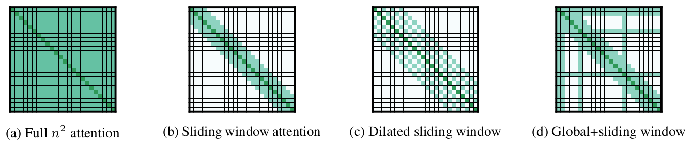
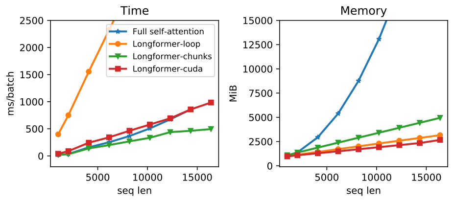
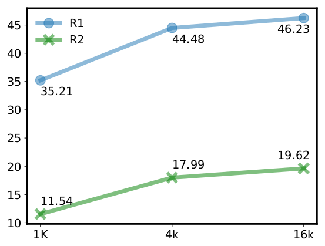

# 论文中文解读：《Longformer: The Long-Document Transformer》

> **基本信息**：Iz Beltagy、Matthew E. Peters、Arman Cohan（Allen Institute for Artificial Intelligence，Seattle），arXiv:2004.05150（本仓库的 `paper.pdf` 是 2020 年 12 月 2 日的 v2），2020 年；论文原文 [官方页面](https://arxiv.org/abs/2004.05150)，官方代码 [allenai/longformer](https://github.com/allenai/longformer)。
>
> **本文的读法**：图取自论文 PDF 的原图（按图裁出并逐张核对），表为逐格核对后的中文转录（数字、模型名、数据集名保持原样，表头和行名译成中文）。每张图、表后都有中文图题、图例翻译和读图结论，因此不必再翻英文原文。文中标注“笔者示例”“笔者算例”的内容是为帮助理解而加的，不是论文原话。

## 一、一句话结论

标准 Transformer 的 self-attention 对序列长度 $n$ 需要 $O(n^2)$ 的时间和显存，所以 BERT、RoBERTa 一类预训练模型只能读 512 个 token。Longformer 把 attention 换成**滑动窗口 + 少量全局 token** 的稀疏模式：每个 token 只看自己附近宽度为 $w$ 的窗口，再让少数由任务决定的位置（分类用的 `[CLS]`、问答里的问题 token）成为“全局 token”，它们看见全部位置，全部位置也看见它们。时间和显存随 $n$ 线性增长，并且可以直接替换已有预训练模型里的 self-attention。

论文在三种设置下验证它：

1. **字符级自回归语言模型**：41M 参数的小模型在 text8 上得到 1.10 BPC、在 enwik8 上得到 1.00 BPC（当时的最好结果）；102M 参数的大模型在 enwik8 上 0.99 BPC。
2. **从 RoBERTa 检查点继续做 MLM 预训练**，把可读长度从 512 扩到 4,096 个 token，再在六个长文档任务上微调。在同样的调参预算下，Longformer-base 在六个任务上都不低于 RoBERTa-base（例如 Hyperpartisan F1 94.8 对 87.4，WikiHop 准确率 75.0 对 72.4）；Longformer-large 在 WikiHop（81.9）和 TriviaQA（77.3）上刷新当时的最好成绩。
3. **编码器-解码器变体 LED**（Longformer-Encoder-Decoder）：在 arXiv 长文档摘要上取得 ROUGE-1/2/L 为 46.63/19.62/41.83（输入 16,384 个 token）。

读这篇论文时需要带走三件事：

- 复杂度：滑窗部分是 $O(n\times w)$，全局 token 的数量与 $n$ 无关，所以整体仍是 $O(n)$。
- 全局 attention 是**对称**的，并且由任务决定放在哪些位置，这是论文强调的“任务相关的归纳偏置”。
- 理论上的线性复杂度要靠**带状矩阵乘法**的专用实现才能兑现，论文给出了 loop、chunks、cuda（TVM）三种实现并比较了速度和显存。

## 二、背景与动机

### 2.1 self-attention 为什么读不了长文

标准 self-attention（Vaswani et al., 2017）对每个位置计算它对所有位置的注意力权重（原文式 (1)）：

$$
\mathrm{Attention}(Q,K,V)=\mathrm{softmax}\!\left(\frac{QK^\top}{\sqrt{d_k}}\right)V
$$

这里 $Q,K,V$ 是输入表示经过三组线性投影得到的矩阵，各有 $n$ 行（$n$ 是序列长度），$d_k$ 是 key 的维度。$QK^\top$ 是一个 $n\times n$ 的矩阵，第 $i$ 行第 $j$ 列是位置 $i$ 对位置 $j$ 的打分。论文指出最贵的运算就是这次矩阵乘法，因为 $Q$ 和 $K$ 各有 $n$ 个向量，所以时间和显存都是 $O(n^2)$，序列一长就不可承受。

### 2.2 绕过 512 限制的旧办法及其缺陷

BERT 一类预训练模型的位置嵌入只到 512。为了处理更长的文档，已有工作有三类做法：

1. **截断**：直接把超出的部分丢掉，常用于文本分类（Xie et al., 2019）。
2. **分块**：切成长度 512 的块（块之间可以重叠），分别过模型，再用一个任务专用模型合并各块的激活（Joshi et al., 2019）。
3. **两阶段**：多跳问答和开放域问答常用，第一阶段检索出相关文档，第二阶段从中抽取答案（Clark and Gardner, 2017；Chen et al., 2017）。

论文的评价是：这些办法要么因截断、分块而**丢失跨块的信息**，要么因两阶段而产生**级联错误**（第一阶段错了，第二阶段无法补救），为了弥补往往还要设计复杂的任务专用结构。Longformer 的主张是：把可用的上下文拼成**一条序列**一次读完，不截断、不分块，由多层 attention 在整段文本上建立表示，从而不再需要那些任务专用结构。

### 2.3 此前的长文 Transformer（表 1）

论文把相关工作按两条路线整理成表 1。第一条是**从左到右（left-to-right，ltr）**：按块从左往右处理文档，如 Transformer-XL。它们在自回归语言建模上很成功，但只能看到左边的上下文，不适合需要双向上下文的迁移学习任务。第二条是**稀疏 attention 模式**：定义某种稀疏的“谁看谁”规则，避免计算完整的二次方矩阵。Longformer 属于第二条。

**表 1：此前面向长文档的 Transformer 工作汇总**（ltr 表示从左到右；“字符级 LM”指是否在字符级语言建模上评测；“预训练”指是否采用“预训练再微调”的范式）

| 模型 | attention 矩阵 | 字符级 LM | 其他任务 | 预训练 |
|---|---|---|---|---|
| Transformer-XL (2019) | ltr | 是 | 无 | 否 |
| Adaptive Span (2019) | ltr | 是 | 无 | 否 |
| Compressive (2020) | ltr | 是 | 无 | 否 |
| Reformer (2020) | sparse（稀疏） | 是 | 无 | 否 |
| Sparse (2019) | sparse（稀疏） | 是 | 无 | 否 |
| Routing (2020) | sparse（稀疏） | 是 | 无 | 否 |
| BP-Transformer (2019) | sparse（稀疏） | 是 | MT（机器翻译） | 否 |
| Blockwise (2019) | sparse（稀疏） | 否 | QA（问答） | 是 |
| Our Longformer | sparse（稀疏） | 是 | 多种任务 | 是 |

（原文表 1，第 2 页。）读法：Longformer 是表中唯一同时满足“稀疏模式、做字符级语言建模、做多种下游任务、做预训练再微调”的方法。论文对前人的批评是：大多数工作只在自回归语言建模上评测，这会得到适用面很窄的模型；BP-Transformer 做了机器翻译但没有探索预训练—微调；Blockwise attention 做了预训练和问答，但没有语言建模评测，而且它用的问答数据集文档较短（SQuAD 的上下文通常不超过 512，MRQA 是通过丢弃长文档样本构造的），所以它在长文档任务上是否有效尚未验证。

与 Longformer 注意力模式最像的是 Sparse Transformer（Child et al., 2019），它在 BlockSparse（Gray et al., 2017）提供的 8×8 块上使用某种空洞滑窗。Longformer 也自带自定义 CUDA kernel，但论文称它比 BlockSparse（C++ 实现、绑定特定版本的 TensorFlow）更灵活、更易维护，并且额外引入了适合常见 NLP 任务的“任务相关全局 attention”。

论文还提到几项同期工作（都在 Longformer 之后发布在 arXiv 上）：

- **ETC**（Ainslie et al., 2020）：同样用“局部 + 全局” attention 替代完全 attention。区别是 ETC 使用相对位置嵌入（Longformer 只在自回归语言建模中用），在预训练中增加了额外的训练目标（CPC loss），并且以略有不同的方式配置全局 attention。
- **GMAT**（Gupta and Berant, 2020）：用输入中的少数全局位置充当全局记忆。
- **BigBird**（Zaheer et al., 2020）：在 ETC 的基础上扩展，评测了更多任务（包括摘要），并通过理论分析表明稀疏 Transformer 是序列函数的通用逼近器，保留了完全 self-attention 的这些性质。详见 [BigBird 解读](../bigbird/论文中文解读.md)。

### 2.4 论文做了哪三层验证

1. 先在**自回归字符级语言建模**上与前人公平比较（text8、enwik8），检验模型处理超长序列（最长评测序列 32K 字符）的能力。
2. 再把注意力模式作为**替换件**放进 RoBERTa，继续 MLM 预训练，微调到六个下游任务，检验“长文档 + 预训练”这一前人很少涉及的场景。
3. 最后给出**编码器-解码器版本 LED**，在长文档摘要上验证生成任务。

论文的一个核心说法是“局部 attention 主要用来构建上下文表示，全局 attention 让模型能构建整条序列的表示用于预测”，并用消融和对照实验证明两种 attention 都不可缺少（见 6.5 节的 WikiHop 消融）。

## 三、方法：Longformer 的注意力模式

### 3.1 总体思想

论文把完全 attention 矩阵按一个“attention pattern”稀疏化，pattern 规定哪些（位置对）需要互相 attend。Longformer 的 pattern 由三种成分组合：**滑动窗口**、**空洞滑动窗口**、**全局 attention**。

### 3.2 滑动窗口（sliding window）

出发点是局部上下文很重要（Kovaleva et al., 2019）。给定固定窗口大小 $w$，每个 token 只 attend 它左右各 $\tfrac12 w$ 个 token，复杂度是 $O(n\times w)$，随序列长度 $n$ 线性增长。

只看局部为什么还能得到全局信息？堆叠多层之后感受野会扩大：设共有 $\ell$ 层且所有层的 $w$ 相同，顶层的感受野大小是 $\ell\times w$，顶层因此有能力汇聚整条输入的信息，这和 CNN 逐层扩大感受野是同一个道理（Wu et al., 2019）。论文还提到，可以按应用给每一层使用不同的 $w$，在效率和表示能力之间折中（4.1 节的字符级语言模型就这么做）。

笔者算例：RoBERTa-base 有 12 层，若 $w=512$，顶层感受野 $\ell\times w=12\times512=6{,}144$，已超过 4,096，所以理论上顶层位置可以间接汇聚整条 4,096 长度的输入。

### 3.3 空洞滑动窗口（dilated sliding window）

为了在不增加计算量的前提下扩大感受野，可以让滑动窗口“有空洞”，类似空洞卷积（dilated CNN，van den Oord et al., 2016）：窗口内相邻被关注的位置之间隔着大小为 $d$ 的空隙。若所有层的 $d$ 和 $w$ 固定，顶层感受野是 $\ell\times d\times w$，即使 $d$ 很小也可以达到几万个 token。

在多头 attention 中，每个头可以有不同的 dilation。论文发现“每个头配置不同的 dilation”能提高性能：一部分不做 dilation 的头专注局部上下文，另一部分做 dilation 的头关注更远的上下文。

### 3.4 全局 attention（global attention）

在 BERT 一类模型里，最合适的输入表示随任务而变：

- 掩码语言建模（MLM）：模型用局部上下文预测被遮住的词；
- 分类：模型把整条序列的表示聚合到一个特殊 token（BERT 里的 `[CLS]`）；
- 问答：问题和文档拼在一起，模型靠 self-attention 把问题和文档做对比。

论文认为滑窗和空洞滑窗不足以学到这些任务专用的表示，因此在少数**预先选定的位置**加上全局 attention，并且让这个操作**对称**：有全局 attention 的 token 会 attend 序列中所有 token，同时序列中所有 token 也会 attend 它。例如分类时把 `[CLS]` 设为全局，问答时把所有问题 token 设为全局。因为这类 token 的个数相对 $n$ 很小，并且与 $n$ 无关，局部加全局的总复杂度仍是 $O(n)$。

“指定全局位置”是任务相关的，但论文强调它是给模型加入归纳偏置的简单办法，而且比“把输入切成小块、再用复杂结构合并各块信息”的任务专用方案简单得多。

笔者的理解（非原文）：对称性的作用是让信息能广播。例如在问答里，问题 token 可以读到文档所有位置，文档里的每个位置也能读到问题，于是文档表示可以受问题条件化，而不需要靠窗口一层层把问题的信息传过去。

### 3.5 全局 attention 的两套线性投影

回顾 Eq. (1)，Transformer 用线性投影 $Q,K,V$ 计算注意力分数。Longformer 使用**两套**投影：

- $Q_s,K_s,V_s$：用于计算滑动窗口 attention；
- $Q_g,K_g,V_g$：用于计算全局 attention。

多出来的一套投影让模型有余地对两类 attention 分别建模，论文称这对下游任务的最佳性能很关键（见表 10 的“no linear proj.”）。$Q_g,K_g,V_g$ 初始化时取与 $Q_s,K_s,V_s$ 相同的值。

### 3.6 图 2：四种注意力模式



*图 2（原文 Figure 2，第 3 页）：完全 $n^2$ attention 与 Longformer 中使用的几种 attention 配置的对比。*

**图中文字翻译与读法**：

- **(a) Full $n^2$ attention（完全 $n^2$ attention）**：整个 $n\times n$ 方阵都涂色，每个位置对所有位置打分。
- **(b) Sliding window attention（滑动窗口 attention）**：只有主对角线附近一条带状区域涂色，表示每个位置只和附近的固定数量的位置计算。
- **(c) Dilated sliding window（空洞滑动窗口）**：带状区域内被关注的格子是隔开的（棋盘状的间隔），同样多的格子覆盖更宽的范围。
- **(d) Global+sliding window（全局加滑动窗口）**：在滑窗带之外，某几行和对应的几列整行整列涂色，表示那几个位置是全局 token：它们的行（它们去看别人）和列（别人来看它们）都是满的。

图中每个小方格是一个（位置对）：深绿色的对角线是 token 自己看自己，浅绿色是其他被计算的位置对，白格表示不计算。图本身没有标坐标轴，按 attention 的惯例，行是发出查询的位置、列是被关注的位置（这是笔者的读法）。

**读图结论**：(a)→(b) 把计算量从整个方阵降到一条带；(c) 在不增加格子数的前提下把带拉宽；(d) 在 (b) 的基础上用少数全局行/列提供“短路”：任意两个位置可以经由一个全局 token，用两层 attention 交换信息（先被全局 token 读走，再被另一个位置读到；这是笔者的推论，论文并未形式化这一点）。

### 3.7 一个可以手算的小例子（笔者示例）

下面用 $n=12$、$w=4$（每侧 2 个邻居）、全局 token 取位置 0 和 6 构造一张 (d) 型的 attention 矩阵。行 $i$ 是查询位置，列 $j$ 是被关注位置，`#` 表示计算，`.` 表示不计算。规则是：$|i-j|\le w/2$，或者 $i$ 是全局 token，或者 $j$ 是全局 token。

```text
        j: 0  1  2  3  4  5  6  7  8  9 10 11
i= 0      #  #  #  #  #  #  #  #  #  #  #  #
i= 1      #  #  #  #  .  .  #  .  .  .  .  .
i= 2      #  #  #  #  #  .  #  .  .  .  .  .
i= 3      #  #  #  #  #  #  #  .  .  .  .  .
i= 4      #  .  #  #  #  #  #  .  .  .  .  .
i= 5      #  .  .  #  #  #  #  #  .  .  .  .
i= 6      #  #  #  #  #  #  #  #  #  #  #  #
i= 7      #  .  .  .  .  #  #  #  #  #  .  .
i= 8      #  .  .  .  .  .  #  #  #  #  #  .
i= 9      #  .  .  .  .  .  #  #  #  #  #  #
i=10      #  .  .  .  .  .  #  .  #  #  #  #
i=11      #  .  .  .  .  .  #  .  .  #  #  #
```

对比 (c) 型：这里把 $d$ 当作相邻被关注位置的间距来画（论文的措辞是“空隙大小为 $d$”，与间距相差 1，论文没有细说）。取 $d=2$、$w=4$ 时，位置 $i$ 关注 $j=i,\ i\pm2,\ i\pm4$（共 5 个位置，覆盖宽度 $d\times w=8$），其余位置不计算。

笔者算例：$n=4{,}096$、$w=512$ 时，完全 attention 每头每层有 $n^2=16{,}777{,}216$ 个得分，滑窗只有约 $n\times w=2{,}097{,}152$ 个，约为前者的 1/8（忽略边界和全局 token）。

### 3.8 实现：为什么需要专用 kernel，以及三种实现（图 1）

Longformer 的滑动窗口（含空洞）只需要计算 $QK^\top$ 的固定数量的几条对角线。这要求一种**带状矩阵乘法**（banded matrix multiplication，输出里除了某几条对角线以外全为 0），PyTorch、TensorFlow 等深度学习库并不直接支持。论文实现并比较了三种方式（附录 A）：

1. **Longformer-loop**：朴素实现，用循环逐条对角线单独计算。只算非零值，所以显存高效，但慢到不可用，只用来做测试。支持 dilation。
2. **Longformer-chunks**：把 $Q$ 和 $K$ 切成大小为 $w$、相邻块重叠 $\tfrac12 w$ 的块，块与块相乘，再把对角线以外的部分遮掉。它只用 PyTorch 的一次矩阵乘法，计算上很高效，但因为也算了一些零值，显存是“完美实现”的 2 倍。**只支持不带 dilation 的情形**，适合预训练/微调场景；论文没有发现多出来的显存在该场景下是问题。
3. **Longformer-cuda**：用 TVM（Chen et al., 2018，一个把函数的高层描述编译为特定设备优化代码的深度学习编译器）写成的自定义 CUDA kernel。作者用高层 Python 语法描述带状矩阵乘法，由 TVM 生成 CUDA 代码并编译到 GPU。它是完整功能的实现（不像 chunks 那样受限），显存最省，速度“与高度优化的完全 self-attention 一样快”，并且支持 dilation 和自回归模式（每个 token 只看前面的窗口），还包含与空洞滑窗兼容的相对位置嵌入。论文主要用它做自回归语言建模实验，原因是显存效率高（允许最长序列）、支持 dilation（字符级 LM 需要）。

论文在脚注里说：理论上，完美优化的 Longformer-cuda 应该比 $n^2$ 的计算更快，但达到这个水平需要底层 GPU 编程的专门知识（类似实现高度优化的矩阵乘法），目前的实现“足够快、足够实用”。



*图 1（原文 Figure 1，第 1 页）：完全 self-attention 与 Longformer 三种实现的运行时间（左）和显存（右）随序列长度的变化。*

**图中文字翻译与读法**：

- **左图 Time（运行时间）**：横轴 seq len（序列长度，约 1K 到 16K），纵轴 ms/batch（每个 batch 的毫秒数，在 2,500 处截断）。图例：Full self-attention（完全 self-attention，蓝色星形）、Longformer-loop（橙色圆点，非向量化）、Longformer-chunks（绿色倒三角，向量化）、Longformer-cuda（红色方块，自定义 CUDA kernel）。
- **右图 Memory（显存）**：纵轴 MiB（显存，截断在 15,000）。图例同左图。

**读图结论**（下列数值均为从图上读出的近似值）：

- 显存：完全 self-attention 呈二次增长，约在序列长度 4K 时 3,000 MiB 左右、10K 时 13,000 MiB 左右，约 11K 之后超出 15,000 MiB 的纵轴；论文说它在当前 GPU 上处理长序列会显存溢出。三种 Longformer 实现都是线性增长，16K 处 chunks 约 5,000 MiB，loop 约 3,200 MiB，cuda 约 2,700 MiB。
- 速度：向量化的 chunks 最快（16K 处约 500 ms/batch，论文题注也说它最快）；cuda 在 16K 处约 1,000 ms/batch，与完全 attention 的曲线相近（图中 4K 到 10K 之间完全 attention 略快，12K 到 14K 附近两者几乎重合），这与论文附录 A“与高度优化的完全 self-attention 一样快”的说法相符；loop 在约 6K 处就超出 2,500 ms/batch，慢到只能用于测试。完全 attention 在图中约 14K 之后已没有数据点。
- 论文没有给出这张图的 GPU 型号、batch 大小和 head 数等测试条件，所以不能把这些毫秒数当作可迁移的基准。

## 四、自回归字符级语言建模（第 4 节与附录 B）

### 4.1 为什么先做字符级语言模型

此前的长序列 Transformer 工作大多以自回归语言建模作为主要评测（Dai et al., 2019；Rae et al., 2020；Sukhbaatar et al., 2019），为了与它们直接比较，论文也先在**字符级**语言建模上评测，数据集是 text8 和 enwik8（Mahoney, 2009）。两者各含 1 亿（100M）个来自 Wikipedia 的字符，按 90M / 5M / 5M 划分为训练 / 开发 / 测试。评价指标是 **BPC**（bits per character，每个字符的平均负对数似然，以 2 为底，越小越好）。

### 4.2 注意力模式

自回归语言建模使用**空洞滑动窗口**，并且参考 Sukhbaatar et al. (2019) 让**不同层使用不同的窗口大小**：低层窗口小，越往高层窗口越大。这样：

- 高层可以学习关于整条序列的更高层表示，低层负责捕捉局部信息；
- 在效率（窗口小、非零值少、计算便宜）与性能（窗口大、表示能力强，通常带来提升）之间取得平衡。

论文**不在低层使用 dilation**，以便低层最大限度地学习和利用紧邻的局部上下文；高层只在 **2 个 head** 上使用逐步增大的 dilation，使模型能直接 attend 远处的 token 而不牺牲局部上下文。

### 4.3 训练：分阶段把窗口和序列拉长

理想情况下希望用 GPU 显存放得下的最大窗口和最长序列训练，但论文发现模型要先经过大量梯度更新学会局部上下文，之后才会去利用更长的上下文。因此采用**分阶段训练**：

- 第 1 阶段用较短的序列长度和较小的窗口；之后每进入下一阶段，**窗口大小和序列长度都翻倍，学习率减半**。这样训练很快，同时把最慢的部分（最长序列和最大窗口）放在最后。
- 共 5 个阶段，起始序列长度 2,048，最后一个阶段的序列长度是 23,040（受 GPU 显存限制，见表 12）。笔者按“翻倍”推算，前四个阶段依次为 2,048、4,096、8,192、16,384，最后一个阶段被显存限制在 23,040。

**评测**：按 Dai et al. (2019)，用长度 32,256 的序列评测。把数据集切成相互重叠的长度 32,256 的序列，步长 512，只报告每条序列最后 512 个位置的性能。

### 4.4 模型与超参数（表 12）

实现基于 Transformer-XL 的代码，但关闭其记忆（memory）机制；使用 Dai et al. (2019) 的带正弦权重的相对位置嵌入。有两个规模：小模型（12 层，隐层 512，同 Dai et al. 2019）和大模型（30 层，隐层 512，同 Child et al. 2019）。训练用混合精度（fp16 和 fp32，用 apex），但 attention 的计算保留 fp32，因为论文发现在 attention 里用 fp16 会在训练后期出现浮点溢出和 NaN；还使用了梯度检查点（gradient checkpointing）以省显存。实验在 48GB 的 RTX8000 GPU 上进行：小模型用 4 张卡训练 16 天，大模型用 8 张卡训练 13 天。

**表 12：字符级语言建模最佳模型的超参数**

| 参数 | 值 |
|---|---|
| 位置嵌入（Position Embeddings） | 相对位置嵌入加正弦权重，同 Dai et al. (2019) |
| 小模型配置 | 12 层，8 个 head，隐层 512，同 Dai et al. (2019) |
| 大模型配置 | 30 层，8 个 head，隐层 512，同 Child et al. (2019) |
| 优化器 | AdamW |
| Dropout | 0.2（小模型），0.4（大模型） |
| 梯度裁剪（Gradient clipping） | 0.25 |
| 权重衰减（Weight Decay） | 0.01 |
| LayerNorm 位置 | pre-layernorm（Xiong et al., 2020） |
| 激活函数 | GeLU |
| 阶段数 | 5 |
| 第 1 阶段窗口大小 | 32（最底层）到 8,192（最顶层） |
| 第 5 阶段窗口大小 | 512（最底层）到（最顶层）；原文此处顶层数值缺失 |
| 第 1 阶段序列长度 | 2,048 |
| 第 5 阶段序列长度 | 23,040（受 GPU 显存限制） |
| 第 1 阶段学习率 | 0.00025 |
| 第 5 阶段学习率 | 原文写作 000015625（笔者按“每阶段减半、共减半 4 次”推算应为 0.000015625） |
| 每阶段 batch size | 32, 32, 16, 16, 16 |
| 每阶段步数（小模型） | 430K, 50k, 50k, 35k, 5k |
| 每阶段步数（大模型） | 350K, 25k, 10k, 5k, 5k |
| Warmup | 每阶段步数的 10%，上限 10K 步 |
| 学习率调度 | 每个阶段内保持常数 |
| Dilation（小模型） | 0（第 0–5 层），1（第 6–7 层），2（第 8–9 层），3（第 10–11 层） |
| Dilation（大模型） | 0（第 0–14 层），1（第 15–19 层），2（第 20–24 层），3（第 25–29 层） |
| 做 dilation 的 head | 仅 2 个 head |

（原文表 12，第 15 页。）读法：层号从 0 开始；dilation 取 0 表示不使用空洞，越高的层取值越大。论文没有明确表中的 0/1/2/3 与正文感受野公式里的 $d$ 之间的对应关系（正文说窗口里有大小为 $d$ 的空隙），本文按表中原值转录。每阶段的训练步数是“跑到验证 BPC 不再变好为止”确定的；超参数搜索大多采用类似表 4 的做法（在 text8 上跑 150K 步），搜索过的选项包括绝对 / 可学习位置嵌入、dropout（小模型 0.1/0.2，大模型 0.1/0.4）、pre/post layernorm、第 1 阶段学习率（原文列出 2.5e-5、5e-4、1e-4）、常数 / 余弦调度，以及 dilation 的不同配置（所有 head、2 个 head、不用）。笔者注：表 12 最终采用的第 1 阶段学习率是 0.00025（2.5e-4），不在上面这个搜索列表里，推测搜索列表中的 2.5e-5 是原文笔误，原文未说明。

### 4.5 结果（表 2、表 3）

先看小模型。论文把 Longformer 与同等规模的前人模型比较：

**表 2：小模型在 text8 和 enwik8 上的 BPC**（越小越好；“-”表示原文未报告）

| 数据集 | 模型 | 参数量 | Dev | Test |
|---|---|---:|---:|---:|
| text8 | T12 (Al-Rfou et al., 2018) | 44M | - | 1.18 |
| text8 | Adaptive (Sukhbaatar et al., 2019) | 38M | 1.05 | 1.11 |
| text8 | BP-Transformer (Ye et al., 2019) | 39M | - | 1.11 |
| text8 | Our Longformer | 41M | 1.04 | **1.10** |
| enwik8 | T12 (Al-Rfou et al., 2018) | 44M | - | 1.11 |
| enwik8 | Transformer-XL (Dai et al., 2019) | 41M | - | 1.06 |
| enwik8 | Reformer (Kitaev et al., 2020) | - | - | 1.05 |
| enwik8 | Adaptive (Sukhbaatar et al., 2019) | 39M | 1.04 | 1.02 |
| enwik8 | BP-Transformer (Ye et al., 2019) | 38M | - | 1.02 |
| enwik8 | Our Longformer | 41M | 1.02 | **1.00** |

（原文表 2，第 5 页。）读法：Longformer 在两个数据集上都取得最好的 Test BPC（text8 为 1.10，enwik8 为 1.00），论文据此宣称在小模型上刷新了 text8 和 enwik8 的最好结果。需要注意领先幅度很小：text8 只比 Adaptive Span 和 BP-Transformer 低 0.01，enwik8 比它们低 0.02；论文没有报告多次运行的方差，所以这些小差距不宜过度解读。

再看大模型。由于大模型实验非常昂贵，论文参照 Kitaev et al. (2020) 和 Rae et al. (2020) 的做法，只在 enwik8 上评测：

**表 3：大模型在 enwik8 上的 Test BPC**（越小越好）

| 模型 | 参数量 | Test BPC |
|---|---:|---:|
| Transformer-XL (18 layers) | 88M | 1.03 |
| Sparse (Child et al., 2019) | ≈100M | 0.99 |
| Transformer-XL (24 layers) | 277M | 0.99 |
| Adaptive (Sukhbaatar et al., 2019) | 209M | 0.98 |
| Compressive (Rae et al., 2020) | 277M | 0.97 |
| Routing (Roy et al., 2020) | ≈223M | 0.99 |
| Our Longformer | 102M | 0.99 |

（原文表 3，第 5 页。）读法：Longformer（102M）优于可比的 Transformer-XL（18 层，88M，1.03），与可比的 Sparse Transformer（约 100M）持平；与参数量超过它两倍的新模型相比，持平或略差（Transformer-XL 24 层 277M 与 Routing 约 223M 同为 0.99，Adaptive 209M 为 0.98，Compressive 277M 为 0.97）。论文还指出 Adaptive Span 和 Compressive Transformer 并不适合“预训练—微调”范式（2 节的观点）。

### 4.6 消融：窗口怎么随层变化、dilation 有没有用（表 4）

为了便于管理消融，论文把每个配置用第 1 阶段的设置，在 text8 上训练小模型 150K 步，再报告开发集 BPC（脚注提醒：最终性能的排序不一定与第 150K 步的排序一致，这是为节省完整训练成本做的近似）。

**表 4：窗口大小随层变化与 dilation 的消融**（开发集 BPC，越小越好；上半部分是窗口配置，下半部分是有无 dilation）

| 配置 | Dev BPC |
|---|---:|
| Decreasing $w$（从 512 降到 32） | 1.24 |
| Fixed $w$（= 230） | 1.23 |
| Increasing $w$（从 32 升到 512） | **1.21** |
| No Dilation（不用 dilation） | 1.21 |
| Dilation on 2 heads（2 个 head 用 dilation） | **1.20** |

（原文表 4，第 6 页。）读法：窗口从底层到顶层逐渐增大效果最好；反过来排列（高层窗口小）效果最差；固定窗口（取另一种配置窗口大小的平均值 230）居中。给其中两个 head 加上 dilation 比完全不用略有提升（1.21 到 1.20）。注意表 4 里的窗口范围 32 到 512 是消融用的配置，与表 12 里最终模型第 1 阶段的 32 到 8,192 不同，论文没有说明两者的关系。

## 五、预训练与微调（第 5 节与附录 C）

### 5.1 目标与总体方案

论文的主要动机之一是做出适合长文档任务的、可预训练再微调的模型。因为 MLM 预训练很贵，所以不从零训练，而是**从 RoBERTa 发布的检查点继续预训练**，并且只做支持 Longformer 注意力所需的最小改动。得到的模型最长可处理 4,096 个 token（是 BERT 的 8 倍；脚注说在当前 GPU 上最长可到 16K）。

论文强调：这个 attention 模式可以插到任何预训练 Transformer 里，不需要改动模型结构。

### 5.2 三个设计选择

1. **注意力模式**：用窗口大小 512 的滑动窗口 attention，所以计算量与 RoBERTa 相当。笔者验算：处理同样数量的 token，4,096 个 token 每个看 512 个 key，等于 8 段 $512\times512$。脚注 6 指出，像 4.2 节那样在少数 head 上加 dilation 会**损害性能**，可能因为它与预训练的 RoBERTa 权重不兼容；若要这样用，也许需要从头重新训练。所以预训练—微调模型用的是**不带 dilation 的纯滑窗**。
2. **位置嵌入**：RoBERTa 使用最大位置为 512 的可学习绝对位置嵌入。为支持更长文档，论文增加额外的位置嵌入把上限扩到 4,096；为了利用 RoBERTa 的预训练权重，不随机初始化，而是把 RoBERTa 的 512 个位置嵌入**复制多次**（笔者按 4,096 除以 512 推算为 8 份）。理由是对 BERT 注意力头的分析表明它们有很强的“关注局部上下文（包括前一个或后一个 token）”的学习偏置，复制初始化让这种局部结构在除了拼接边界之外的所有地方得以保留。
3. **继续 MLM 预训练**：用 fairseq 在论文自己整理的长文档语料上训练 base 和 large 两个规模，都是 65K 次梯度更新，序列长度 4,096，batch size 64（约 $2^{18}$ 个 token），最大学习率 3e-5，线性 warmup 500 步，再做 3 次幂的多项式衰减，其余超参数同 RoBERTa。笔者估算：$65{,}000\times2^{18}\approx1.7\times10^{10}$ 个 token，约为语料总量 6.5B 的 2.6 倍。

### 5.3 预训练语料（表 13）

为了让模型在预训练中学到长依赖，论文整理了一个长文档语料。其中 Books 和英文 Wikipedia 本来也在 RoBERTa 的预训练数据里；另外加入了 Realnews 中文档长度超过 1,200 个 token 的子集的三分之一，以及 Stories 语料的三分之一。目标是同时包含长文档和短文档：既学习更长的依赖，又不忘记 RoBERTa 预训练得到的信息。

**表 13：Longformer 预训练数据**

| 来源 | Token 数 | 平均文档长度 |
|---|---:|---:|
| Books (Zhu et al., 2015) | 0.5B | 95.9K |
| English Wikipedia（英文维基百科） | 2.1B | 506 |
| Realnews (Zellers et al., 2019) | 1.8B | 1.7K |
| Stories (Trinh and Le, 2018) | 2.1B | 7.8K |

（原文表 13，第 15 页。）读法：Books 的平均文档长度近 96K，Wikipedia 平均只有 506，两者混合。四项 token 数相加约 6.5B（笔者相加）。

### 5.4 预训练效果与位置嵌入初始化的重要性（表 5）

表 5 报告 MLM 的 BPC（在论文自己语料的开发集上），用来回答“新的稀疏 attention 配上 RoBERTa 权重能不能直接用、继续预训练有多大帮助”。

**表 5：RoBERTa 与各种预训练配置 Longformer 的 MLM BPC**（越小越好）

| 模型 | base | large |
|---|---:|---:|
| RoBERTa (seqlen: 512) | 1.846 | 1.496 |
| Longformer (seqlen: 4,096)（新位置嵌入随机初始化） | 10.299 | 8.738 |
| + copy position embeddings（复制位置嵌入） | 1.957 | 1.597 |
| + 2K gradient updates（继续预训练 2K 步） | 1.753 | 1.414 |
| + 65K gradient updates（继续预训练 65K 步） | 1.705 | 1.358 |
| Longformer (train extra pos. embed. only)（只训练新增位置嵌入） | 1.850 | 1.504 |

（原文表 5，第 6 页。第二行的括号注明是笔者按正文“随机初始化位置嵌入”补充。）读法：

- 第一行 RoBERTa-base 为 1.846，与 RoBERTa 论文在其语料上报告的 1.880 接近，说明论文的训练语料与 RoBERTa 的分布相近。
- 第二、三行：随机初始化新位置嵌入时 BPC 高达 10.299，换成复制初始化后降到 1.957，仅略高于 RoBERTa 的 1.846，说明复制初始化非常重要，并且滑窗 attention 与 RoBERTa 权重配合良好。
- 第四、五行：只继续预训练 2K 步，BPC 就从 1.957 降到 1.753，65K 步后降到 1.705，已经优于 RoBERTa-512 的 1.846，表明模型在学会更好地利用滑窗 attention 和更长的上下文；large 上的趋势相同。
- 最后一行：冻结全部 RoBERTa 权重、只训练新位置嵌入（动机是完全保留 RoBERTa 在短文档上的性能），BPC 为 1.850（base）和 1.504（large），好于初始化时的 1.957，但不如所有权重都可训练的 1.705。

## 六、下游任务（第 6 节与附录 D）

### 6.1 任务、数据与总体设置

论文把 Longformer 用到 QA、共指消解（coreference resolution）和分类三类长文档任务。表 6 给出各数据集上下文长度（以 wordpiece 计），说明它们都显著超过 512。

**表 6：各数据集上下文长度（wordpieces）**。WH：WikiHop，TQA：TriviaQA，HQA：HotpotQA，ON：OntoNotes，HY：Hyperpartisan news

| wordpiece 数 | WH | TQA | HQA | ON | IMDB | HY |
|---|---:|---:|---:|---:|---:|---:|
| 平均值（avg.） | 1,535 | 6,589 | 1,316 | 506 | 300 | 705 |
| 第 95 百分位（95th pctl.） | 3,627 | 17,126 | 1,889 | 1,147 | 705 | 1,975 |

（原文表 6，第 7 页。）读法：TriviaQA 平均就有 6,589 个 wordpiece，95% 分位数 17,126，即使 4,096 也要截断（附录 D 说明 TriviaQA 的文档被截到 4,096）；IMDB 平均只有 300，但约 13.6% 的样本超过 512。

论文强调两个目标：（1）检验该 attention 能否作为 BERT 类模型里标准 self-attention 的**替换件**，并与强基线做**受控对比**；（2）检验能否用“把所有可用上下文拼成一条序列”的简单模型，取代为适应 BERT 有限上下文而设计的复杂任务专用模型。

**基线**：基于 RoBERTa 的模型，把上下文切成尽可能长的段（长度 512），逐段过 RoBERTa，再把各段的激活拼接起来做后续处理；QA 任务还会把问题拼到每一段前面，使 RoBERTa 对上下文的表示可以以问题为条件。**Longformer 版本**：把 RoBERTa 的 self-attention 换成预训练时的滑窗 attention，再加上任务相关的全局 attention（用额外的线性投影）。

### 6.2 各任务的模型和全局 attention 设置

**问答（QA）**：用三个数据集——WikiHop（Welbl et al., 2018）、TriviaQA（Joshi et al., 2017，Wikipedia 设定）、HotpotQA（Yang et al., 2018，distractor 设定）。论文使用 TriviaQA 和 HotpotQA 的**完整版**，而不是 MRQA 里的简化版。

- **WikiHop**：每个样本包含一个问题、2 到 79 个候选答案、3 到 63 段支持上下文和正确答案；数据集没有给多跳推理链的中间标注，模型只能从间接的答案监督中学。输入格式为 `[q] 问题 [/q] [ent] 候选1 [/ent] ... [ent] 候选N [/ent]`，上下文用 RoBERTa 的文档分隔符 `</s>` 连接；特殊标记 `[q]`、`[/q]`、`[ent]`、`[/ent]` 被加进 RoBERTa 词表并随机初始化。把问题和候选答案拼上尽可能多的上下文，直到模型的序列长度上限（RoBERTa 为 512，Longformer 为 4,096），过模型取输出激活，重复直到上下文用完（Longformer-large 因显存限制只取第一个 4,096 长度的序列），再把所有段的激活拼成一条长序列。预测时在每个 `[ent]` 上接一个输出单个 logit 的线性层，对同一个候选在各段上的 logit 取平均，再做 softmax 和交叉熵。**全局 attention 用于问题 token 和所有候选答案**，即整个“问题加候选答案”这段序列。
- **TriviaQA**：训练集有 10 万多个（问题，答案，文档）三元组，文档是 Wikipedia 文章，答案是文章中提到的命名实体，答案所在的片段没有标注，而是用简单文本匹配找出来。输入形如 `[s] 问题 [/s] 文档 [/s]`，文档截断到 4,096 个 wordpiece 以避免太慢。预测层输出答案的起止位置；由于是远程监督（没有金标准答案片段），采用 Clark and Gardner (2017) 的损失，它像一个“或”：模型只要答对其中一个答案片段即可，不要求全对。**全局 attention 用于所有问题 token**。
- **HotpotQA**：要从 10 个来自不同 Wikipedia 文章的段落中回答问题，其中 2 个是相关段落，其余是干扰项；包含答案片段抽取和证据句识别两个任务。论文用**两阶段**模型：第一阶段识别相关段落，第二阶段在保留下来的段落中找最终的答案片段和证据句。（附录脚注：两阶段模型相对单阶段在开发集 joint F1 上约提高 4.2 个点；原因是先去掉干扰段落能减少最终证据和片段检测的噪声。）
  - 两个阶段都把问题和全部上下文拼成一条序列、过 Longformer、再接任务专用预测层，并用多任务方式联合预测相关段落、证据句、答案片段和问题类型（是/否/片段）。
  - 输入格式：`[CLS] [q] 问题 [/q] <t> 标题1 </t> 句子1,1 [s] 句子1,2 [s] ... <t> 标题2 </t> 句子2,1 [s] 句子2,2 [s] ...`；这些特殊标记也被加入 Longformer 词表并随机初始化。
  - **全局 attention 用于问题 token、段落标题起始标记 `<t>` 和各句子标记 `[s]`**。在段落标题起始标记上接前馈层预测相关段落，在句子标记上接前馈层预测证据句。
  - 第一阶段训练好后，对训练集和开发集预测各段落的相关性分数，保留原始分数高于阈值 $-3.0$ 的至多 5 个段落，其余删除，然后在缩短后的上下文上训练第二阶段。
  - 答案片段抽取沿用 BERT 的 QA 模型，并在第一个特殊标记 `[CLS]` 上加一个问题类型（是/否/片段）的分类头；证据抽取在句子和段落标记的表示上接 2 层前馈网络，用二元交叉熵训练；推理时采用类似 Groeneveld et al. (2020) 的约束解码，保证证据句恰好来自两个段落（这是数据集的设定）。训练时把片段、问题类型、句子和段落四项损失线性组合。

**共指消解**：数据集是 OntoNotes（Pradhan et al., 2012），模型取自 Joshi et al. (2019)（Lee et al., 2018 系统的改版，用 BERT 取代 ELMo）。Longformer 系统是对基线的直接改造：把 RoBERTa 换成 Longformer，并把序列长度加长；**这个任务没有使用全局 attention**。基线 RoBERTa-base 的最大序列长度是 384（在 256、384、512 里试了三次后选定），Longformer-base 为 4,096；与原实现一样，对预训练的 RoBERTa 参数和随机初始化的任务参数使用不同的学习率（任务参数用更大的学习率，使它们能离开随机初值而不破坏预训练信息）。

**文档分类**：IMDB（Maas et al., 2011，标准的影评情感分类，多数文档较短，约 13.6% 超过 512 个 wordpiece）和 Hyperpartisan 新闻检测（Kiesel et al., 2019，文档较长，只有 645 篇文档，用来检验 Longformer 在有限数据上的适应能力）。训练数据中 Hyperpartisan 按 80/10/10 随机划分为训练/开发/测试，报告五个随机种子的平均 F1。分类沿用 BERT 的做法：在第一个 `[CLS]` 上接二元交叉熵损失，并给 `[CLS]` 加**全局 attention**。

### 6.3 训练细节与超参数（表 14）

所有 QA 和分类模型用 PyTorch-Lightning 实现；除 Hyperpartisan 外，使用各数据集官方的训练/开发/测试划分。为了公平比较，对 Longformer-base 和 RoBERTa-base 做了**同样的**超参数搜索，且搜索量很小。

**表 14：QA 模型的超参数**（所有模型使用类似的“线性 warmup + 线性衰减”调度）

| 参数 | WikiHop | TriviaQA | HotpotQA |
|---|---:|---:|---:|
| Epochs | 15 | 5 | 5 |
| LR（学习率） | 3e-5 | 3e-5 | 5e-5 |
| Warmup steps | 200 | 1000 | 1000 |
| Batch size | 32 | 32 | 32 |
| Optimizer（优化器） | Adam | Adam | Adam |

（原文表 14，第 16 页。）补充细节：

- **WikiHop**：学习率在 [2e-5, 3e-5, 5e-5]、epoch 数在 [5, 10, 15] 上做网格搜索；最佳的 Longformer-base 配置是 lr=3e-5、15 个 epoch。梯度累积到有效 batch 32，每 250 次梯度更新检查一次开发集准确率并报告最大值。Longformer-large 只试了两个配置（lr=3e-5，epoch 在 5 和 15 里选）；5 个 epoch 的模型开发集准确率更高（77.6），它是提交到公开榜单评测测试集的那个唯一模型。所有模型在单张 RTX8000 上训练，Longformer-base 训练 5 个 epoch 约一天。
- **TriviaQA**：只对 RoBERTa 基线调了学习率（[3e-5, 5e-5, 1e-4]，最佳 3e-5），之后所有实验沿用，没有再调；Longformer-large 用最佳配置只训练一次并提交榜单；实验在 32GB V100 GPU 上进行，base 模型用 4 张卡训练约 1 天，large 模型用 8 张卡训练约 1 天。
- **HotpotQA**：学习率试了 3e-5 和 5e-5、epoch 数 3 到 7；每个 epoch 在 4 张卡上约需半天；RoBERTa 基线做了同样的搜索。注意附录正文写“LR 3e-5、5 个 epoch 最好”，而表 14 里 HotpotQA 的学习率是 5e-5，论文自身在这一点上不一致，本文照录表 14，复现时需自行确认。
- **共指消解**：RoBERTa 学习率在 [1e-5, 2e-5, 3e-5]、任务学习率在 [1e-4, 2e-4, 3e-4] 上做网格搜索；Longformer-base 的最佳配置是 RoBERTa 学习率 1e-5、任务学习率 1e-4；其余超参数同原实现；单张 GPU 约训练 10 小时。论文自称实现是“superhack”：PyTorch 与 TensorFlow 在同一进程、同一块 GPU 上共享，下层 Transformer 在 PyTorch 里算，把顶层激活经 CPU 传给 TensorFlow 去做 coarse-to-fine 聚类并算损失，再把梯度反传回来，两边各有一个学习率调度相同的优化器，开销相对整体可以忽略。
- **文本分类**：Adam，batch 32，线性 warmup 和衰减（warmup 步数为总步数的 10%）；学习率在 [3e-5, 5e-5]、epoch 在 [10, 15, 20] 上搜索，最佳是 3e-5、15 个 epoch；单张 RTX8000。

### 6.4 主要结果（表 7、表 8、表 9）

**表 7：微调结果汇总**（开发集；TriviaQA 与 Hyperpartisan 用 F1，WikiHop 与 IMDB 用准确率，HotpotQA 用 joint F1，OntoNotes 用平均 F1；越大越好）

| 模型 | WikiHop（QA） | TriviaQA（QA） | HotpotQA（QA） | OntoNotes（共指） | IMDB（分类） | Hyperpartisan（分类） |
|---|---:|---:|---:|---:|---:|---:|
| RoBERTa-base | 72.4 | 74.3 | 63.5 | 78.4 | 95.3 | 87.4 |
| Longformer-base | **75.0** | **75.2** | **64.4** | **78.6** | **95.7** | **94.8** |

（原文表 7，第 8 页。）读法：Longformer-base 在六个任务上都高于 RoBERTa-base，差值依次为 +2.6、+0.9、+0.9、+0.2、+0.4、+7.4（笔者相减）。论文对差异大小的解释：

- **WikiHop 与 Hyperpartisan 提升明显**：它们真正需要长上下文。WikiHop 只有间接的推理链监督，模型必须在整段上下文里自己推理，这正是 Longformer 擅长的。
- **TriviaQA 提升较小**：局部上下文往往足以回答问题。
- **HotpotQA 提升较小**：数据集提供了“支持事实”的辅助监督，模型很容易先找到相关上下文再专注局部。
- **IMDB 与 OntoNotes 提升更小**：IMDB 的多数文档较短，所以预期提升小；OntoNotes 上论文发现任意两个指称之间的距离通常很小，分块处理的基线不考虑跨块交互也能把指称拼成共指链。

接下来是 Longformer-large 在 QA 公开榜单上的成绩（提交时间 2020 年 5 月）：

**表 8：Longformer-large 提交时的榜单结果**（原文题注：所有数字为 F1）

| 模型 | WikiHop | TriviaQA | HotpotQA |
|---|---:|---:|---:|
| Current* SOTA（当时最好） | 78.3 | 73.3 | **74.2** |
| Longformer-large | **81.9** | **77.3** | 73.2 |

（原文表 8，第 8 页。）读法：Longformer-large 在 WikiHop 上高出当时最好成绩 3.6、在 TriviaQA 上高出 4.0，在 HotpotQA 上低 1.0（当时最好是 Fang et al., 2020 的 HGN）。注意表题写“所有数字为 F1”，而表 7 的说明里 WikiHop 用准确率，原文对 WikiHop 这一列的指标说法不一致，应以表 7 的说明（准确率）为准。论文脚注 9 还说明：后来 BigBird 改进了这些榜单，但 BigBird 预训练用的算力是 Longformer 的 16 倍，这可能是混杂因素。

HotpotQA 的详细结果（distractor 设定的测试集）：

**表 9：HotpotQA 在 distractor 设定下的测试集结果**（ans. = 答案 F1，supp. = 支持句 F1，joint = 二者联合的 F1；所有数字为 F1；Quark 没有测试集结果，其行为开发集结果；† 表示同期榜单提交）

| 模型 | ans. | supp. | joint |
|---|---:|---:|---:|
| TAP 2 (ensemble) (Glaß et al., 2019) | 79.8 | 86.7 | 70.7 |
| SAE (Tu et al., 2019) | 79.6 | 86.7 | 71.4 |
| Quark (dev) (Groeneveld et al., 2020) | 81.2 | 87.0 | 72.3 |
| C2F Reader (Shao et al., 2020) | 81.2 | 87.6 | 72.8 |
| Longformer-large | 81.3 | 88.3 | 73.2 |
| ETC-large† (Ainslie et al., 2020) | 81.2 | 89.1 | 73.6 |
| GSAN-large† | 81.6 | 88.7 | 73.9 |
| HGN-large (Fang et al., 2020) | 82.2 | 88.5 | 74.2 |

（原文表 9，第 9 页；各列含义是 HotpotQA 数据集的标准指标，论文未重述。）读法：Longformer 在已发表结果中排第二，仅次于 HGN；论文说该任务上表现最好的已发表模型（Tu et al., 2019；Fang et al., 2020；Shao et al., 2020）都用了图神经网络（GNN）或实体图，这类结构似乎编码了对该任务重要的归纳偏置，可能进一步改进 Longformer 的结果；Longformer 没有用 GNN，却超过了包括近期非 GNN 方法（Glaß et al., 2019；Shao et al., 2020；Groeneveld et al., 2020）在内的其他方法。（原文对 Shao et al. (2020) 的归类前后不一致：先把它和 GNN 方法并列，后又把它列为非 GNN 方法。）ETC-large 与 GSAN-large 的 joint 更高，但属于同期榜单提交，不是已发表结果。

### 6.5 WikiHop 上的消融（表 10）

所有结果都使用 Longformer-base，微调 5 个 epoch，除特别注明外超参数相同。

**表 10：WikiHop 开发集消融**（准确率 / 相对第一行的变化 $\Delta$）

| 配置 | 准确率 / $\Delta$ |
|---|---:|
| Longformer (seqlen: 4,096) | 73.8 |
| RoBERTa-base (seqlen: 512) | 72.4 / -1.4 |
| Longformer (seqlen: 4,096, 15 epochs)（训练 15 个 epoch） | 75.0 / +1.2 |
| Longformer (seqlen: 512, attention: $n^2$)（序列长度 512，完全 attention） | 71.7 / -2.1 |
| Longformer (seqlen: 2,048) | 73.1 / -0.7 |
| Longformer (no MLM pretraining)（不做 MLM 预训练） | 73.2 / -0.6 |
| Longformer (no linear proj.)（全局 attention 不用独立投影） | 72.2 / -1.6 |
| Longformer (no linear proj. no global atten.)（既无独立投影也无全局 attention） | 65.5 / -8.3 |
| Longformer (pretrain extra position embed. only)（预训练时只训练新增位置嵌入） | 73.5 / -0.3 |

（原文表 10，第 9 页。）读法：

- **更长的序列有益**：把序列长度从 4,096 降到 2,048 掉 0.7，降到 512 掉到 71.7。
- **全局 attention 与独立投影有益**：去掉独立的全局投影掉 1.6；既去掉独立投影又去掉全局 attention 掉 8.3（65.5），是所有消融里最大的退化，说明在 WikiHop 上全局 attention 是关键。
- **MLM 预训练有益**：不做继续预训练（即只用复制位置嵌入的初始化）掉 0.6。
- **更长的训练有益**：同一模型训练 15 个 epoch 比 5 个高 1.2（75.0），这也是表 7 里 Longformer-base 的 75.0。
- **增益不是额外预训练带来的**：把 Longformer 配置成与 RoBERTa-base 一样（序列长度 512、完全 $n^2$ attention），结果 71.7 反而略低于 RoBERTa-base 的 72.4。
- 只在预训练时解冻新增位置嵌入的模型（RoBERTa 权重冻结）微调后只低 0.3，说明 Longformer 在 WikiHop 这类大训练集上可以通过任务专用微调学会利用长距离上下文。

## 七、Longformer-Encoder-Decoder（LED，第 7 节）

### 7.1 结构与初始化

原始 Transformer 是编码器-解码器结构，面向摘要、翻译等序列到序列任务；BART、T5 等预训练编码器-解码器模型在摘要上结果很强，但不能高效扩展到更长输入。为此论文提出一个 Longformer 变体：同时有编码器和解码器两个堆栈，**编码器**用 Longformer 的“局部 + 全局” attention 取代完全 self-attention，**解码器**对整条编码后的序列和之前已解码的位置使用完全 attention。这个模型称为 LED，随输入长度线性扩展。

预训练 LED 很贵，所以论文从 **BART** 初始化 LED 的参数，并严格沿用 BART 的层数和隐层大小，唯一的区别是为处理更长输入，把位置嵌入从 BART 的 1K 扩到 16K：把 BART 的 1K 位置嵌入重复复制 16 次作为新位置嵌入矩阵的初始值（同第 5 节对 RoBERTa 的做法）。与 BART 一样发布两个规模：LED-base 和 LED-large，它们的编码器和解码器各有 6 层和 12 层。

### 7.2 任务与设置

在 arXiv 摘要数据集（Cohan et al., 2018）上评测，这是科学领域的长文档摘要任务；文档长度的第 90 百分位为 14.5K 个 token，所以适合检验 LED。编码器读文档，解码器生成摘要；编码器用窗口 1,024 个 token 的局部 attention，并对第一个 `<s>` token 使用全局 attention；解码器对整个编码器输出和之前已解码的位置用完全 attention。训练用 teacher forcing 和金标准摘要，推理用 beam search。

### 7.3 结果（表 11、图 3）

**表 11：LED 在 arXiv 摘要数据集上的结果**（ROUGE-1、ROUGE-2、ROUGE-L，越大越好；论文没有在题注中说明评测所用的数据划分）

| 模型 | R-1 | R-2 | R-L |
|---|---:|---:|---:|
| Discourse-aware (2018) | 35.80 | 11.05 | 31.80 |
| Extr-Abst-TLM (2020) | 41.62 | 14.69 | 38.03 |
| Dancer (2020) | 42.70 | 16.54 | 38.44 |
| Pegasus (2020) | 44.21 | 16.95 | 38.83 |
| LED-large (seqlen: 4,096) (ours) | 44.40 | 17.94 | 39.76 |
| BigBird (seqlen: 4,096) (2020) | **46.63** | 19.02 | 41.77 |
| LED-large (seqlen: 16,384) (ours) | **46.63** | **19.62** | **41.83** |

（原文表 11，第 10 页。）读法：这个 LED-large 只是由 BART 初始化，没有任何额外预训练，却取得了最好成绩，略优于 BigBird：R-1 打平（都是 46.63），R-2 和 R-L 略高。论文提醒 BigBird 的摘要模型虽然只支持 4K token，但它是从为摘要专门设计和预训练的 Pegasus 出发继续预训练的；LED 没有预训练或任务专用初始化，但可以处理更长的输入，所以能略微超过 BigBird。论文认为对 LED 做预训练后应该还有进一步改进的空间。



*图 3（原文 Figure 3，第 10 页）：改变输入长度时 LED 的 ROUGE-1 和 ROUGE-2（arXiv 验证集）。*

**图中文字翻译与读法**：

- 横轴是输入长度（1K、4k、16k 三个点），纵轴是 ROUGE 分数；图例 R1 是 ROUGE-1（蓝色圆点），R2 是 ROUGE-2（绿色叉号）。图上标出的数值：R1 为 35.21、44.48、46.23；R2 为 11.54、17.99、19.62。
- **读图结论**：输入越长结果越好。从 1K 到 4K，R1 提高 9.27、R2 提高 6.45（笔者相减）；从 4K 到 16K，R1 再提高 1.75、R2 再提高 1.63，收益变小。论文据此说明“能处理更长输入显著提升结果”。
- 注意这张图是**验证集**数据，而表 11 的数字（例如 4K 的 44.40/17.94、16K 的 46.63/19.62）与图上的验证集数字不同，不能把两者混在一起读；论文没有说明表 11 使用的划分。

## 八、证据边界、局限与常见误读

### 8.1 证据边界

1. **字符级语言建模的领先幅度很小**：表 2 中 Longformer 比最强的同规模前人模型只低 0.01 到 0.02 BPC，论文没有给出多次运行的方差；表 3 中大模型只是与 Sparse Transformer、Transformer-XL（24 层）持平，并不超过更大的 Adaptive 和 Compressive。
2. **预训练—微调模型不用 dilation**：4.2 节的“dilation 只在 2 个 head 上”是字符级语言模型的设置；下游任务的 Longformer 是纯滑窗（窗口 512）加全局 attention，脚注 6 说明加 dilation 反而变差，可能是与 RoBERTa 预训练权重不兼容。
3. **“长上下文”与“新注意力结构”混在一起**：Longformer-base 读 4,096 个 token、RoBERTa-base 读 512 个，表 7 的差异同时包含“能读到更多上下文”“继续预训练过”“全局 attention”等因素。表 10 用多个对照拆开了一部分：去掉全局 attention 掉 8.3 点，把序列缩到 512 且用完全 attention 则略低于 RoBERTa，说明提升不是额外预训练本身带来的，但仍只是在 WikiHop 一个数据集上做的消融。
4. **榜单成绩与开发集成绩不可混比**：Longformer-large 的 WikiHop 提交模型开发集准确率为 77.6，而榜单测试成绩为 81.9（表 8），两者相差 4.3 点（笔者相减）；WikiHop 上的 Longformer-large 只试了两个超参数配置、提交其中一个，TriviaQA 的 large 模型只训练了一次，所以 large 的结果没有方差信息。
5. **与 BigBird 的对比有混杂因素**：论文自己指出 BigBird 的预训练算力是 Longformer 的 16 倍（脚注 9）；在摘要上两者的起点也不同（Pegasus 对 BART）。
6. **实验设置没有统一硬件**：图 1 没有给出 GPU、batch 和 head 数；字符级实验在 RTX8000 上，下游实验在 RTX8000 或 V100 上，所以论文中的速度、显存数据不能当作通用基准。

### 8.2 局限

- **全局位置依赖任务知识**：哪些 token 设为全局，是针对每个任务手工选择的（`[CLS]`、问题 token、候选答案、段落标题与句子标记等），不能认为任意固定的稀疏图对所有任务同样有效；共指任务就没有用全局 attention。
- **局部传播需要多层中转**：纯滑窗中相距很远的两个位置要靠逐层传递（感受野 $\ell\times w$）才能互相影响，全局 token 是“短路”。
- **理论线性复杂度要靠专用实现兑现**：带状矩阵乘法没有现成库支持；chunks 实现的显存是理想实现的约 2 倍，cuda 实现虽然显存最省但速度只与优化过的完全 attention 相当（论文承认理论上应该更快，但需要底层 GPU 编程的专门功夫）。
- **LED 没有做针对长输入的额外预训练**：它只由 BART 初始化；论文认为对 LED 做预训练应能进一步改进，并提出未来要研究其他预训练目标（尤其针对 LED）、更长的序列和其他可能受益的任务。

### 8.3 常见误读

- Longformer **不是低秩或线性核近似**：它仍是 softmax attention（只是 softmax 的归一化范围限定在被选中的位置内），改变的是“谁看谁”的连接图，而不是用低秩或核函数去近似完整的 attention 矩阵。
- “线性复杂度”指 attention 算子的时间和显存随 $n$ 线性增长（图 1），并不意味着显存是常数；整个模型的激活仍随 $n$ 增长。
- 全局 attention 是**双向**的（全局 token 看所有人，所有人也看它），不是普通窗口里的特殊位置。
- Longformer-base 的 4,096 并不是上限：脚注 5 说明当前 GPU 上最长可到 16K，字符级语言模型评测序列更是 32,256。
- 不要把 LED 当成“后来受 Longformer 启发的模型”：LED 就是这篇论文第 7 节自己提出的变体。

## 九、复现检查清单

- 明确每层窗口大小、是否使用 dilation（字符级语言模型：低层不用，高层只在 2 个 head 上用；预训练—微调：不用）、哪些 token 设为全局。
- 检查全局 attention 是对称的双向连接，且使用独立的 $Q_g,K_g,V_g$ 投影（初始化时与 $Q_s,K_s,V_s$ 相同）。
- 从短上下文检查点扩展位置嵌入时，用“复制已有位置嵌入”初始化（RoBERTa 复制 512 个位置，BART 复制 1K 个位置到 16K）。
- 字符级语言模型：分 5 个阶段，窗口与序列长度逐阶段翻倍、学习率减半；attention 内部保持 fp32；评测用 32,256 长度、步长 512、只统计最后 512 个位置。
- 继续预训练：65K 步，序列长度 4,096，batch 64，最大学习率 3e-5，500 步 warmup，3 次幂多项式衰减。
- 报告实际峰值显存和吞吐，并说明用的是 loop、chunks 还是 cuda 实现，避免只报理论复杂度。
- HotpotQA 的学习率在附录正文（3e-5）与表 14（5e-5）之间不一致；表 8 的指标说明与表 7 在 WikiHop 上也不一致，复现时需要自行核对。

## 十、与相关论文的关系

- **BigBird**（[解读](../bigbird/论文中文解读.md)）：同样是“局部 + 全局”，并加入随机 attention，附带通用逼近和图灵完备等理论分析；Longformer 论文把它视为 ETC 的扩展。
- **Transformer-XL**（[解读](../transformer_xl/论文中文解读.md)）：从左到右分块并带记忆的路线；本文的字符级实验基于它的代码，并把它作为基线。
- **Linformer / Performer**（[Linformer](../linformer/论文中文解读.md)、[Performer](../performer/论文中文解读.md)）：用低秩或核近似改变 attention 的计算方式；Longformer 保留精确 softmax，只稀疏化连接图。
- **FlashAttention**（[解读](../flash_attention/论文中文解读.md)）：保持精确的完全 attention，改进 IO 访问；与“改稀疏图”的思路互补，也呼应了本文“线性复杂度要靠专用 kernel 才能兑现”的观察。
- **BERT**（[解读](../bert/论文中文解读.md)）：被替换 self-attention 的 RoBERTa 来自 BERT 一系的预训练模型。

## 原文证据导航

- [原论文 PDF](paper.pdf)
- [原文提取文本](paper.txt)
- [论文概要](论文概要.md)
