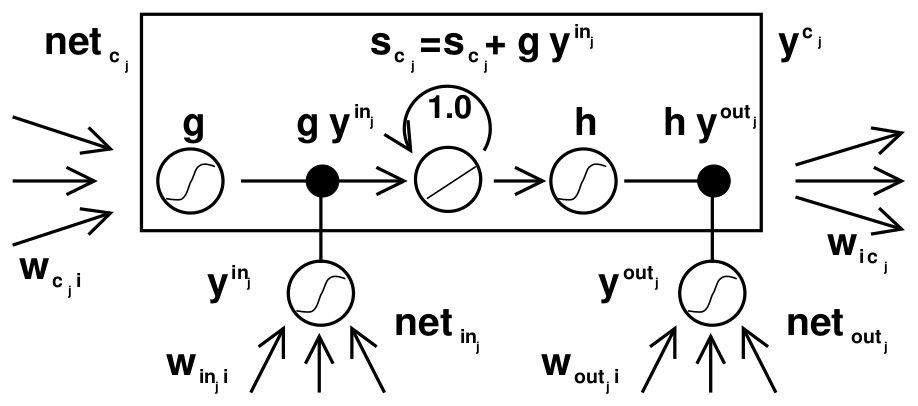
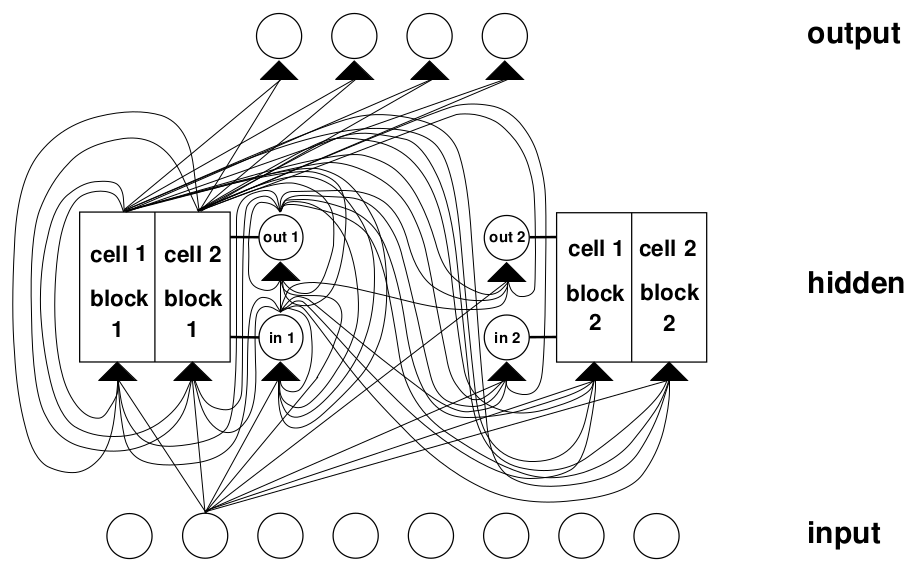
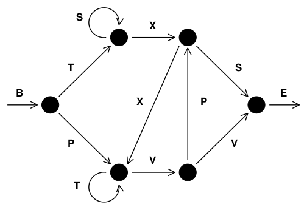
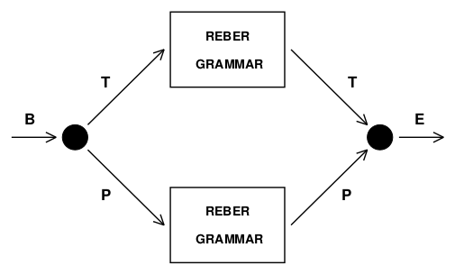

# 论文中文解读：《Long Short-Term Memory》

> **基本信息**：Sepp Hochreiter（慕尼黑工业大学信息学院）、Jürgen Schmidhuber（IDSIA，瑞士卢加诺），《Neural Computation》第 9 卷第 8 期，1735–1780 页，1997 年；[论文原文（官方 PDF）](https://www.bioinf.jku.at/publications/older/2604.pdf)。
>
> **本文的读法**：本文覆盖原文的全部 4 张图和全部 11 张表。图取自论文 PDF 的原图，表为逐格核对后的中文转录（数字、模型名、符号保持原样，表头译为中文）。每张图后有图中文字翻译和读图结论，每张表后有原文页码和读法，附录里的前向、反向公式也逐条讲解，因此不必再翻英文原文。需要提醒两点：这是 1997 年的论文，全部实验都是人工合成任务，没有语言、语音等真实数据；今天教科书里带遗忘门的 LSTM 公式与本文并不相同，第九节专门对照。

## 一、一句话结论

用 BPTT（Back-Propagation Through Time，沿时间反向传播）或 RTRL（Real-Time Recurrent Learning，实时循环学习）训练循环网络时，沿时间往回传的误差信号要么指数级爆炸，要么指数级消失，所以网络学不会“相隔很多时间步的输入与目标”之间的关系。论文先复述 Hochreiter 1991 年对这一现象的分析，再给出解法：在一个权重固定为 1.0 的线性自连接单元上让误差**恒定**地流过去（constant error carrousel，CEC，常量误差传送带），再用两个乘法门——输入门和输出门——决定什么时候往里写、什么时候往外读；学习时在记忆单元的边界处截断梯度，使每个时间步、每个权重的计算量为 $O(1)$。在人工合成的长时滞任务上，LSTM 能跨越超过 1000 个离散时间步的最小时滞（minimal time lag），并解决了此前循环网络算法从未解决过的任务；而 RTRL 在最小时滞 $p=10$ 时成功率就已是 0%（表 2）。

论文的结构：第 1 节引言；第 2 节前人工作；第 3 节常量误差反传（3.1 误差为什么指数衰减，3.2 朴素的常量误差流方案）；第 4 节 LSTM 架构；第 5 节六组实验；第 6 节讨论（局限与优点）；第 7 节结论；附录 A.1 算法细节、A.2 误差流分析。

## 二、背景：为什么循环网络学不会长程依赖

### 2.1 问题设定

循环网络可以用反馈连接把最近的输入事件存成激活值，即“短期记忆”（与慢慢改变的权重所代表的“长期记忆”相对）。这对语音处理、非马尔可夫控制、音乐创作等任务很重要。但当时最常用的学习算法要么太慢，要么根本不起作用，尤其是在输入与对应教师信号之间的**最小时滞**很长时。论文给出的症状是：用传统 BPTT 或 RTRL 时，“沿时间往回流”的误差信号要么爆炸（blow up），要么消失（vanish），其时间演化与权重大小呈指数关系（Hochreiter 1991）。爆炸会让权重振荡；消失则让“学会跨越长时滞”要么耗时过长，要么完全学不会。

### 2.2 前人工作（第 2 节）

论文逐类评述了前人的办法，结论都是“要么只适用于短时滞，要么需要外部精调，要么不通用”：

| 方法类别 | 论文对它的评价 |
|---|---|
| 梯度下降变体（Elman 1988、Fahlman 1991、Williams 1989、Schmidhuber 1992a、Pearlmutter 1989 以及 Pearlmutter 1995 综述中的多数算法） | 与 BPTT、RTRL 有同样的问题 |
| 时延网络（TDNN，Lang 等 1990；Plate 1993；NARX 网络，Lin 等 1995） | 只适用于短时滞 |
| 时间常数（Mozer 1992；de Vries 与 Principe 1991；Sun 等 1993） | 长时滞时时间常数需要外部精调（Mozer 1992）；Sun 等的做法是把旧激活加上缩放后的当前净输入，净输入会扰动已存的信息，使长期存储不实用 |
| Ring 1993 | 单元收到冲突的误差信号时就添加一个高阶单元；有时极快，但桥接 100 步的时滞可能需要新增 100 个单元，且不能泛化到没见过的时滞长度 |
| Bengio 等 1994 及 Bengio 与 Frasconi 1994 | 研究了模拟退火、多重网格随机搜索、time-weighted pseudo-Newton 优化、离散误差传播；其 latch 与 2-sequence 问题与本文问题 3a（最小时滞 100）非常相似；EM 方法有 $n$ 个“状态网络”，系统在每一时刻只能处于 $n$ 种状态之一，要解连续值问题（如本文的 adding problem）需要不可接受的状态数 |
| Kalman 滤波（Puskorius 与 Feldkamp 1994） | 使用“导数折扣因子”让过去动态导数的影响指数衰减，没有理由相信对很长的最小时滞有用 |
| 二阶网络中的乘法单元（Watrous 与 Kuhn 1992） | 也用乘法单元，但：(1) 不强制常量误差流，也不是为长时滞设计；(2) 是全连接的二阶 sigma-pi 单元，而 LSTM 的乘法单元只用来给常量误差流“开关门”；(3) 每时间步 $O(W^2)$，LSTM 只需 $O(W)$（$W$ 为权重数） |
| 简单随机权重猜测 | 作者发现随机初始化权重、直到网络碰巧把所有训练序列分类正确，就能比前人提出的算法更快地解出 Bengio 等人用过的许多问题。这并不说明猜测是好算法，只说明这些问题太简单；更现实的任务需要大量自由参数或很高的权重精度，猜测就完全不可行 |
| 自适应序列组块器（Schmidhuber 1992b、1993） | 能桥接任意时滞，但前提是造成时滞的子序列内部有局部可预测性；噪声增大、输入更难压缩时性能下降；LSTM 没有这个问题 |

这一节对读实验很重要：论文自己承认许多旧基准太简单，因此它在第 5 节专门挑“没有短时滞训练样本”“随机猜测解不了”的任务（见本文 6.0 小节）。

## 三、梯度为什么指数衰减（第 3.1 节）

### 3.1 BPTT 中的误差怎样往回传

约定（原文第 3 页）：非输入单元 $i$ 的激活 $y^i(t)=f_i(\mathrm{net}_i(t))$，净输入 $\mathrm{net}_i(t)=\sum_j w_{ij}\,y^j(t-1)$，$w_{ij}$ 是从单元 $j$ 到单元 $i$ 的连接权重，$f_i$ 是可微激活函数。用均方误差时，输出单元 $k$ 的误差信号为

$$
\vartheta_k(t)=f_k'(\mathrm{net}_k(t))\,\bigl(d_k(t)-y^k(t)\bigr),
$$

其中 $d_k(t)$ 是 $k$ 在 $t$ 时刻的目标。非输出单元 $j$ 收到的反传误差为

$$
\vartheta_j(t)=f_j'(\mathrm{net}_j(t))\sum_i w_{ij}\,\vartheta_i(t+1),
$$

它对权重 $w_{jl}$ 总更新量的贡献是 $\alpha\,\vartheta_j(t)\,y^l(t-1)$，其中 $\alpha$ 是学习率，$l$ 是任意与 $j$ 相连的单元。

### 3.2 误差往回传 $q$ 步被缩放多少（Hochreiter 1991 的分析）

考虑非输入单元编号为 $1,\dots,n$ 的全连接网络，先看从单元 $u$ 到单元 $v$ 的**局部**误差流：单元 $u$ 在时刻 $t$ 的误差，往回传 $q$ 个时间步到单元 $v$，被缩放的倍数为（原文式 (1)）

$$
\frac{\partial\vartheta_v(t-q)}{\partial\vartheta_u(t)}=
\begin{cases}
f_v'(\mathrm{net}_v(t-1))\,w_{uv}, & q=1,\\[4pt]
f_v'(\mathrm{net}_v(t-q))\displaystyle\sum_{l=1}^{n}\frac{\partial\vartheta_l(t-q+1)}{\partial\vartheta_u(t)}\,w_{lv}, & q>1.
\end{cases}
$$

令 $l_q=v$、$l_0=u$，用归纳法可得（原文式 (2)）

$$
\frac{\partial\vartheta_v(t-q)}{\partial\vartheta_u(t)}=\sum_{l_1=1}^{n}\cdots\sum_{l_{q-1}=1}^{n}\ \prod_{m=1}^{q} f'_{l_m}\bigl(\mathrm{net}_{l_m}(t-m)\bigr)\,w_{l_m l_{m-1}}.
$$

总误差回流量由这 $n^{q-1}$ 个乘积项之和决定（各项符号可能不同，所以增加单元数 $n$ 不一定增大误差流）。这就是现代教科书里“雅可比矩阵连乘”的原始形式。

**直觉解释**：

- 若对所有 $m$ 都有 $\lvert f'_{l_m}(\mathrm{net}_{l_m}(t-m))\,w_{l_m l_{m-1}}\rvert>1.0$（例如激活函数是线性的），最大的乘积随 $q$ 指数增长，误差**爆炸**，到达单元 $v$ 的冲突误差信号会使权重振荡、学习不稳定。
- 若对所有 $m$ 都有这个绝对值 $<1.0$，最大的乘积随 $q$ 指数**衰减**，误差**消失**，“在可接受的时间内什么也学不到”。

**对 logistic sigmoid 的具体结论**：

- logistic sigmoid 的导数最大值为 0.25。若 $y^{l_{m-1}}$ 为非零常数，则 $\lvert f'_{l_m}(\mathrm{net}_{l_m})\,w_{l_m l_{m-1}}\rvert$ 在 $w_{l_m l_{m-1}}=\dfrac{1}{y^{l_{m-1}}}\coth\!\bigl(\tfrac12\,\mathrm{net}_{l_m}\bigr)$ 处取最大值；当 $\lvert w_{l_m l_{m-1}}\rvert\to\infty$ 时它趋于 0；当 $\lvert w_{l_m l_{m-1}}\rvert<4.0$ 时小于 1.0（因为 $0.25\times4.0=1$）。
- 所以用传统 logistic sigmoid 时，只要权重绝对值小于 4.0（训练初期尤其如此），误差流就趋于消失。
- **增大初始权重没用**：$\lvert w\rvert\to\infty$ 时相关导数趋于 0 的速度比权重增长的速度更快；而且有些权重训练中必须穿过 0 变号。
- **增大学习率也没用**：它不改变“长程误差流 / 短程误差流”的比值。论文的话是：BPTT 对最近的干扰过于敏感。

示意（本文自行计算的数值，非原文数字）：若每一步的缩放因子恰好取上限 0.25，经过 10 步误差缩小到约 $0.25^{10}\approx9.5\times10^{-7}$，经过 100 步约 $0.25^{100}\approx6\times10^{-61}$。

**全局误差流**：对所有输出单元 $u$ 求和 $\sum_{u:\,u\text{ 为输出单元}}\partial\vartheta_v(t-q)/\partial\vartheta_u(t)$，由上面的局部分析可直接看出全局误差流同样会消失。

**一个考虑单元数 $n$ 的弱上界**（原文第 4–5 页）：对 $q>1$，式 (2) 可写成矩阵形式

$$
(W_{u^{T}})^{T}\,F'(t-1)\prod_{m=2}^{q-1}\bigl(W F'(t-m)\bigr)\,W_v\,f_v'(\mathrm{net}_v(t-q)),
$$

其中 $[W]_{ij}:=w_{ij}$；$W_v$ 是 $v$ 的出边权重向量，$[W_v]_i:=w_{iv}$；$W_{u^{T}}$ 是 $u$ 的入边权重向量，$[W_{u^{T}}]_i:=w_{ui}$；$F'(t-m)$ 是一阶导数构成的对角矩阵，对角元 $[F'(t-m)]_{ii}=f_i'(\mathrm{net}_i(t-m))$，非对角元为 0。取与向量范数 $\lVert\cdot\rVert_x$ 相容的矩阵范数 $\lVert\cdot\rVert_A$，定义 $f'_{\max}:=\max_{m=1,\dots,q}\lVert F'(t-m)\rVert_A$，利用 $\lvert x^{T}y\rvert\le n\,\lVert x\rVert_x\lVert y\rVert_x$ 以及 $\lVert W_v\rVert_x\le\lVert W\rVert_A$、$\lVert W_{u^{T}}\rVert_x\le\lVert W\rVert_A$，得到

$$
\left\lvert\frac{\partial\vartheta_v(t-q)}{\partial\vartheta_u(t)}\right\rvert\le n\,(f'_{\max})^{q}\,\lVert W_v\rVert_x\,\lVert W_{u^{T}}\rVert_x\,\lVert W\rVert_A^{\,q-2}\le n\,\bigl(f'_{\max}\,\lVert W\rVert_A\bigr)^{q}.
$$

取范数 $\lVert W\rVert_A:=\max_r\sum_s\lvert w_{rs}\rvert$、$\lVert x\rVert_x:=\max_r\lvert x_r\rvert$，logistic sigmoid 的 $f'_{\max}=0.25$。若所有 $\lvert w_{ij}\rvert\le w_{\max}<\dfrac{4.0}{n}$，则 $\lVert W\rVert_A\le n\,w_{\max}<4.0$，令 $\tau:=\dfrac{n\,w_{\max}}{4.0}<1.0$，有

$$
\left\lvert\frac{\partial\vartheta_v(t-q)}{\partial\vartheta_u(t)}\right\rvert\le n\,\tau^{\,q},
$$

即指数衰减。论文强调这是一个“弱的、极端情形的上界”：只有当所有 $\lVert F'(t-m)\rVert_A$ 都取最大值、且所有误差回流路径的贡献同号时才会达到；而较大的 $\lVert W\rVert_A$ 通常伴随较小的 $\lVert F'(t-m)\rVert_A$（Hochreiter 1991 的实验证实）。更多结果见 Hochreiter 1991 的学位论文。

## 四、常量误差流：朴素方案及其两个冲突（第 3.2 节）

**单个单元**：考虑只有一条自连接的单元 $j$，它的局部误差回流为 $\vartheta_j(t)=f_j'(\mathrm{net}_j(t))\,\vartheta_j(t+1)\,w_{jj}$。要让误差**恒定**流过，需要

$$
f_j'(\mathrm{net}_j(t))\,w_{jj}=1.0.
$$

（作者注：这类似 Mozer 1992 的固定时间常数系统，时间常数 1.0 适合可能无限长的时滞；这里并非微分意义上的“时间常数”。）对这个微分方程积分得 $f_j(\mathrm{net}_j(t))=\mathrm{net}_j(t)/w_{jj}$ 对任意 $\mathrm{net}_j(t)$ 成立，即 $f_j$ 必须是线性的，且单元 $j$ 的激活必须保持不变：

$$
y^j(t+1)=f_j(\mathrm{net}_j(t+1))=f_j\bigl(w_{jj}\,y^j(t)\bigr)=y^j(t).
$$

实验中的做法是取恒等函数 $f_j(x)=x$、令 $w_{jj}=1.0$，论文称之为 **constant error carrousel（CEC）**，它是 LSTM 的核心。

**为什么朴素方案不够**：单元 $j$ 当然还要与其他单元相连，由此产生两个相关的冲突（所有基于梯度的方法都有）：

1. **输入权重冲突**：设想总误差可通过“对某个输入打开单元 $j$ 并让它保持活跃很久，直到它对算出期望输出有用”来降低。同一个输入权重 $w_{ji}$ 既要用来**存入**某些输入，又要用来**忽略**另一些输入（防止 $j$ 被之后无关的输入关掉），于是 $w_{ji}$ 会在这期间不断收到相互冲突的更新信号。这要求有一种更依赖上下文的机制来控制“写操作”。
2. **输出权重冲突**：设 $j$ 已打开并存着以前的某个输入。同一个输出权重 $w_{kj}$ 既要在某些时刻**取出** $j$ 的内容，又要在另一些时刻**防止** $j$ 干扰 $k$。例如训练早期可以降低的“短时滞误差”，到了后期 $j$ 可能因为想参与降低更难的“长时滞误差”而突然对原本已经解决的情形造成可避免的误差。这要求有一种更依赖上下文的机制来控制“读操作”。

这两个冲突并不只在长时滞时出现，但时滞越长越突出：存入的信息要被保护更长时间，并且（尤其在学习后期）越来越多已经正确的输出也需要保护。朴素方案只对少数简单问题有效（局部的输入/输出表示、不重复的输入模式；见 Hochreiter 1991、Silva 等 1996）。下一节的门控机制就是为了正确地解决这两个冲突。

## 五、LSTM 的架构与学习算法（第 4 节与附录 A.1）

### 5.1 记忆单元和门单元

在 CEC（自连接线性单元 $j$）基础上增加两个乘法单元：**输入门**（input gate）$\mathrm{in}_j$ 保护存在 $j$ 中的内容不被无关输入扰动；**输出门**（output gate）$\mathrm{out}_j$ 保护其他单元不被当前无关的记忆内容扰动。这个更复杂的单元称为**记忆单元**（memory cell）$c_j$：以一个带固定自连接的中心线性单元（CEC）为核心，除了净输入 $\mathrm{net}_{c_j}$ 以外，还接受来自乘法单元 $\mathrm{out}_j$ 和 $\mathrm{in}_j$ 的输入。

*图 1（原文 Figure 1，第 7 页）：记忆单元 $c_j$（方框）及其门单元 $\mathrm{in}_j$、$\mathrm{out}_j$ 的结构。*

**图中文字翻译与读法**：

- **左侧三根箭头与 $\mathrm{net}_{c_j}$、$w_{c_j i}$**：记忆单元的输入，即来自其他单元 $i$ 的加权和，权重为 $w_{c_j i}$。
- **方框内从左到右**：S 形图标 $g$ 把 $\mathrm{net}_{c_j}$ 压缩；黑点 $g\,y^{\mathrm{in}_j}$ 表示乘以输入门的激活；带斜线的方块是线性单元，自环上标 1.0，表示权重为 1.0、延迟一个时间步的自连接，也就是 CEC，框顶的公式 $s_{c_j}=s_{c_j}+g\,y^{\mathrm{in}_j}$ 表示内部状态每步累加；再经 S 形图标 $h$；黑点 $h\,y^{\mathrm{out}_j}$ 表示乘以输出门的激活；得到的输出 $y^{c_j}$ 以权重 $w_{i c_j}$ 送往其他单元 $i$。
- **方框下方两个圆圈**：输入门和输出门，各自从其他单元接收加权输入（权重 $w_{\mathrm{in}_j i}$、$w_{\mathrm{out}_j i}$），得到净输入 $\mathrm{net}_{\mathrm{in}_j}$、$\mathrm{net}_{\mathrm{out}_j}$ 和激活 $y^{\mathrm{in}_j}$、$y^{\mathrm{out}_j}$；它们向上连到两个黑点，起乘法门控的作用。
- **读图结论**：信息只在中间那条“线性自环”上以恒定权重 1.0 保存，其余所有可学习的非线性都在这条通路之外；输入门决定新内容何时写入，输出门决定存着的内容何时可见。

公式（原文第 6–7 页）。门的激活为

$$
y^{\mathrm{out}_j}(t)=f_{\mathrm{out}_j}\bigl(\mathrm{net}_{\mathrm{out}_j}(t)\bigr),\qquad y^{\mathrm{in}_j}(t)=f_{\mathrm{in}_j}\bigl(\mathrm{net}_{\mathrm{in}_j}(t)\bigr),
$$

净输入分别为

$$
\mathrm{net}_{\mathrm{out}_j}(t)=\sum_u w_{\mathrm{out}_j u}\,y^u(t-1),\qquad
\mathrm{net}_{\mathrm{in}_j}(t)=\sum_u w_{\mathrm{in}_j u}\,y^u(t-1),\qquad
\mathrm{net}_{c_j}(t)=\sum_u w_{c_j u}\,y^u(t-1).
$$

求和下标 $u$ 可以是输入单元、门单元、记忆单元，或（如果有的话）传统隐藏单元；甚至可以有 $w_{c_jc_j}$ 这样的循环自连接。例如输入门（输出门）可以利用其他记忆单元的输出来决定是否存入（读取）自己的记忆。网络拓扑由使用者定义。记忆单元 $c_j$ 的输出和内部状态为

$$
y^{c_j}(t)=y^{\mathrm{out}_j}(t)\,h\bigl(s_{c_j}(t)\bigr),\qquad
s_{c_j}(0)=0,\quad s_{c_j}(t)=s_{c_j}(t-1)+y^{\mathrm{in}_j}(t)\,g\bigl(\mathrm{net}_{c_j}(t)\bigr)\ \ (t>0).
$$

可微函数 $g$ 压缩 $\mathrm{net}_{c_j}$，可微函数 $h$ 缩放由内部状态算出的记忆单元输出。实验中使用的函数（附录式 (3)–(5)）为：门单元用值域 $[0,1]$ 的 logistic sigmoid

$$
f(x)=\frac{1}{1+\exp(-x)},
$$

$h$ 的值域是 $[-1,1]$，$g$ 的值域是 $[-2,2]$：

$$
h(x)=\frac{2}{1+\exp(-x)}-1,\qquad g(x)=\frac{4}{1+\exp(-x)}-2.
$$

**一个直观的小例子**（本文的示意，非原文）：设某时刻 $g(\mathrm{net}_{c_j}(t))=1.5$。若输入门激活 $y^{\mathrm{in}_j}(t)\approx0$，则 $s_{c_j}(t)\approx s_{c_j}(t-1)$，内容被原样保留，不受当前输入干扰；若 $y^{\mathrm{in}_j}(t)\approx1$，则 $s_{c_j}$ 增加约 1.5，相当于“写入”。同样，若输出门 $y^{\mathrm{out}_j}(t)\approx0$，记忆单元对外输出 $y^{c_j}(t)\approx0$，内容留在单元里但不可见；$y^{\mathrm{out}_j}(t)\approx1$ 时内容才被读出。因为 $s_{c_j}$ 沿自环以权重 1.0 原样传递，只要输入门保持关闭，内容和误差都可以保持任意多个时间步。

**为什么要有门**：为了避免输入权重冲突，$\mathrm{in}_j$ 控制流向记忆单元输入连接 $w_{c_j i}$ 的误差流；为了回避输出权重冲突，$\mathrm{out}_j$ 控制从单元 $j$ 输出连接流出的误差流。换句话说，网络用 $\mathrm{in}_j$ 决定何时保持或覆盖记忆单元 $c_j$ 中的信息，用 $\mathrm{out}_j$ 决定何时访问 $c_j$、何时防止其他单元被 $c_j$ 扰动。困在记忆单元 CEC 里的误差信号不会改变，但在不同时刻经输出门流进来的不同误差信号可能叠加；输出门要学会“把哪些误差困进 CEC”（通过适当缩放），输入门要学会“何时放出误差”（同样通过缩放）。实质上，乘法门单元在“打开和关闭”通向常量误差流的通道。

**两种门不一定都需要**：分布式输出表示通常需要输出门，但不总是两种门都必要，有一种可能就够了。例如第 5 节的实验 2a、2b 只用输入门就行。若输出采用局部编码，输出门也可以不要——防止记忆单元扰动已学好的输出，可以靠把相应权重置零来做。即使如此输出门也有益：它能防止网络“试图存储长时滞记忆（通常难学）”这件事干扰那些容易学会的短时滞记忆的激活（这在实验 1 中很有用）。

### 5.2 网络拓扑与记忆单元块

- 网络拓扑：一个输入层、一个隐藏层、一个输出层。隐藏层是（全）自连接的，包含记忆单元和对应的门单元（为方便起见，二者都算在隐藏层里），也可以含有给门单元和记忆单元供输入的“传统”隐藏单元。除门单元外，所有层的所有单元都有指向上一层（实验 2a、2b 中是所有更高层）所有单元的有向连接。
- **记忆单元块**（memory cell block）：$S$ 个共享同一个输入门、同一个输出门的记忆单元构成“大小为 $S$ 的记忆单元块”。块有利于信息存储——和传统神经网络一样，把一个分布式输入编码进单个单元并不容易。因为每个块的门单元数（两个）与单个记忆单元一样多，块结构甚至能略微更高效。大小为 1 的块就是一个简单记忆单元。

*图 2（原文 Figure 2，第 9 页）：一个有 8 个输入单元、4 个输出单元、2 个大小为 2 的记忆单元块的网络。*

**图中文字翻译与读法**：

- 最下一行 input（输入层）为 8 个圆圈；最上一行 output（输出层）为 4 个圆圈；中间 hidden（隐藏层）由两个记忆单元块构成：block 1 含 cell 1、cell 2，带门单元 in 1、out 1；block 2 含 cell 1、cell 2，带门单元 in 2、out 2。图中 cell1/block1 的结构与图 1 相同（图 1 逆时针旋转 90 度即与图 2 的对应部分吻合）。
- 曲线表示连接。图按稠密连接绘制：每个门单元和每个记忆单元都能看到所有非输出单元；为避免混乱，每一层只画出一类单元的出边。输出单元只接收来自记忆单元的连接。
- 原文图题还说明：采用高效的截断更新规则时，误差只通过“到输出单元的连接”和“记忆单元块内部固定的自连接（图中未画出）”回流；一旦误差“想要”离开记忆单元或门单元，就被截断。因此图中除到输出单元的连接外，没有任何连接会把误差传回它的起点单元，尽管这些连接本身仍可被修改——这就是截断后的 LSTM 算法虽能桥接很长时滞却仍很高效的原因。
- 这张图实际上是实验 6a 所用的架构，只省略了非输入单元的偏置。
- **读图结论**：LSTM 在外观上仍是“输入-隐藏-输出”的三层循环网络，只是隐藏层由带门的记忆单元块组成。

### 5.3 学习算法：带截断的 RTRL 变体

论文使用的是 RTRL 的一个变体，它正确地处理了输入门和输出门带来的乘法动力学。但为了保证误差能无衰减地穿过记忆单元的内部状态，类似“截断 BPTT”（Williams 与 Peng 1990），到达“记忆单元净输入”的误差（对单元 $c_j$ 来说包括 $\mathrm{net}_{c_j}$、$\mathrm{net}_{\mathrm{in}_j}$、$\mathrm{net}_{\mathrm{out}_j}$）**不再继续往更早的时间传**（尽管它们仍会用来修改输入权重）。只有在记忆单元内部，误差才会穿过之前的内部状态 $s_{c_j}$ 往回传。直观地看：误差信号一到达记忆单元输出，先被输出门激活和 $h'$ 缩放一次；之后它进入 CEC，可以无限往回流而**永远不被缩放**；只有当它经由输入门和 $g$ 离开记忆单元时，才再被输入门激活和 $g'$ 缩放一次，然后用来修改输入权重，随即被截断。

需要特别区分：这里的“截断”**不是**“只往回传固定窗口步数”的截断 BPTT 窗口，而是“在记忆单元和门单元的边界处切断梯度路径”；沿 CEC 内部，误差可以回流任意多步。

**计算复杂度**：与 Mozer 1989 的 focused recurrent backprop 类似，只需存储并更新导数 $\partial s_{c_j}/\partial w_{il}$。因此 LSTM 的更新复杂度为 $O(W)$（$W$ 为权重数），与全连接循环网络的 BPTT 相同（RTRL 差得多）。与完整 BPTT 不同的是，LSTM 在空间和时间上都是**局部**的：不需要把序列处理过程中观察到的激活存进一个可能无限增长的栈。（原文脚注 3：若每时间步每权重的更新复杂度不依赖网络规模，称算法在空间上局部；若存储需求不依赖输入序列长度，称在时间上局部。RTRL 在时间上局部但在空间上不局部，BPTT 在空间上局部但在时间上不局部。）

### 5.4 两个训练中的实际问题及对策

**滥用问题（abuse problem）**：学习初期，不存储时间信息也可能降低误差，网络于是倾向于“滥用”记忆单元，例如当成偏置单元（让激活为常数，用输出连接充当其他单元的自适应阈值）。麻烦在于：释放被滥用的记忆单元、让它们重新可用于学习，可能需要很长时间。如果两个记忆单元存储同样的（冗余）信息，也会出现类似的滥用问题。有至少两种解决办法：(1) **逐步构造网络**（Fahlman 1991）：误差不再下降时才往网络里加一个记忆单元及其门单元（实验 2 使用）；(2) **输出门偏置**：给每个输出门一个负的初始偏置，把初始的记忆单元激活推向零；偏置越负的记忆单元自动在越晚的时候被“分配”（原文称实验 1、3、4、5、6 使用；但表 10 显示实验 4、5、6 的输出门初始偏置是随机小值，负偏置只用在输入门上，见 6.7 节）。

**内部状态漂移（internal state drift）**：如果记忆单元 $c_j$ 的输入大多为正或大多为负，其内部状态 $s_{c_j}$ 会随时间漂移。这很危险，因为此时 $h'(s_{c_j})$ 会变得很小，梯度就消失了。一种办法是选合适的 $h$，但例如 $h(x)=x$ 的缺点是记忆单元输出范围不受限。论文简单而有效的做法是：学习开始时给输入门 $\mathrm{in}_j$ 一个趋于零的偏置（即初始让输入门基本关闭）。虽然 $h'(s_j)$ 的大小与 $y^{\mathrm{in}_j}$、$f'_{\mathrm{in}_j}$ 的大小之间存在权衡，但输入门偏置的潜在负面影响比起漂移效应可忽略。用 logistic sigmoid 时，似乎无需精调初始偏置（实验 4、5 证实）。

### 5.5 附录 A.1：前向与反向算法逐条解释

记号（原文第 23 页）：下标 $k$ 遍历输出单元，$i$ 遍历隐藏单元，$c_j$ 表示第 $j$ 个记忆单元块，$c_j^v$ 表示块 $c_j$ 的第 $v$ 个单元，$u,l,m$ 表示任意单元，$t$ 遍历给定输入序列的所有时间步。

**前向传播**（式 (6)–(9)）：

- 隐藏单元 $i$：$\mathrm{net}_i(t)=\sum_u w_{iu}\,y^u(t-1)$，$y^i(t)=f_i(\mathrm{net}_i(t))$。
- 输入门 $\mathrm{in}_j$ 与输出门 $\mathrm{out}_j$：形式同上文 5.1 小节。
- 块 $c_j$ 的第 $v$ 个记忆单元：

$$
\mathrm{net}_{c_j^v}(t)=\sum_u w_{c_j^v u}\,y^u(t-1),\qquad
s_{c_j^v}(t)=s_{c_j^v}(t-1)+y^{\mathrm{in}_j}(t)\,g\bigl(\mathrm{net}_{c_j^v}(t)\bigr),\qquad
y^{c_j^v}(t)=y^{\mathrm{out}_j}(t)\,h\bigl(s_{c_j^v}(t)\bigr).
$$

- 输出单元 $k$：$\mathrm{net}_k(t)=\sum_{u:\,u\text{ 不是门}}w_{ku}\,y^u(t-1)$，$y^k(t)=f_k(\mathrm{net}_k(t))$。

**截断导数**（原文第 24–26 页）：截断版本把下面三类导数用零替换（记作 $\approx_{\mathrm{tr}}0$，对所有 $u$）：

$$
\frac{\partial\,\mathrm{net}_{\mathrm{in}_j}(t)}{\partial y^u(t-1)},\qquad
\frac{\partial\,\mathrm{net}_{\mathrm{out}_j}(t)}{\partial y^u(t-1)},\qquad
\frac{\partial\,\mathrm{net}_{c_j}(t)}{\partial y^u(t-1)}.
$$

于是 $\partial y^{\mathrm{in}_j}(t)/\partial y^u(t-1)$、$\partial y^{\mathrm{out}_j}(t)/\partial y^u(t-1)$、$\partial y^{c_j}(t)/\partial y^u(t-1)$ 都被近似为 0。这种截断保证不存在这样的环路：一个从某记忆单元经其输入或输入门离开的误差，经另一路径重新从输出或输出门进入该单元，因此保证了通过记忆单元 CEC 的常量误差流。对权重 $w_{lm}$ 的导数里，最关键的是内部状态的递推（式 (14)）：

$$
\frac{\partial s_{c_j^v}(t)}{\partial w_{lm}}\ \overset{\mathrm{tr}}{\approx}\ \bigl(\delta_{\mathrm{in}_j l}+\delta_{c_j^v l}\bigr)\frac{\partial s_{c_j^v}(t-1)}{\partial w_{lm}}
+\delta_{\mathrm{in}_j l}\,f'_{\mathrm{in}_j}\bigl(\mathrm{net}_{\mathrm{in}_j}(t)\bigr)\,g\bigl(\mathrm{net}_{c_j^v}(t)\bigr)\,y^m(t-1)
+\delta_{c_j^v l}\,y^{\mathrm{in}_j}(t)\,g'\bigl(\mathrm{net}_{c_j^v}(t)\bigr)\,y^m(t-1),
$$

其中 $\delta_{ab}$ 是 Kronecker delta（$a=b$ 时为 1，否则为 0）。含义：内部状态对“输入门权重”或“单元输入权重”的灵敏度逐步累积；只有 $l=\mathrm{in}_j$ 或 $l=c_j^v$ 的情形需要这项递推，因此 $t-1$ 时刻只需保存 $\partial s_{c_j^v}(t-1)/\partial w_{lm}$（$l=c_j^v$ 或 $l=\mathrm{in}_j$）。输出单元、普通隐藏单元、输入门、输出门的截断导数分别是式 (10)、(11)、(12)、(13)，记忆单元输出的截断导数是式 (15)；它们的形式都是标准的“局部导数乘以 $y^m(t-1)$”，这里不再逐条复述。

**反向传播**（只描述高效的截断版本，原文第 26–27 页）：$t$ 时刻的平方误差

$$
E(t)=\sum_{k:\,k\text{ 为输出单元}}\bigl(t^k(t)-y^k(t)\bigr)^2,
$$

其中 $t^k(t)$ 是输出单元 $k$ 在 $t$ 时刻的目标（原文式 (16)，没有 $\tfrac12$ 系数）。$t$ 时刻对权重 $w_{lm}$ 的更新为 $\Delta w_{lm}(t)=-\alpha\,\partial E(t)/\partial w_{lm}$（式 (17)），单元 $l$ 的误差定义为 $e_l(t):=-\partial E(t)/\partial\mathrm{net}_l(t)$（式 (18)）。用（几乎）标准的反传先算输出单元权重（$l=k$）、隐藏单元权重（$l=i$）和输出门权重（$l=\mathrm{out}_j$）：

$$
e_k(t)=f_k'(\mathrm{net}_k(t))\,\bigl(t^k(t)-y^k(t)\bigr)\quad(19),\qquad
e_i(t)=f_i'(\mathrm{net}_i(t))\sum_{k:\,k\text{ 为输出单元}}w_{ki}\,e_k(t)\quad(20),
$$

$$
e_{\mathrm{out}_j}(t)=f'_{\mathrm{out}_j}\bigl(\mathrm{net}_{\mathrm{out}_j}(t)\bigr)\Bigl(\sum_{v=1}^{S_j}h\bigl(s_{c_j^v}(t)\bigr)\sum_{k:\,k\text{ 为输出单元}}w_{kc_j^v}\,e_k(t)\Bigr)\quad(21),
$$

对所有 $l$，$t$ 时刻对 $w_{lm}$ 的更新贡献为

$$
\Delta w_{lm}(t)=\alpha\,e_l(t)\,y^m(t-1)\quad(22).
$$

输入门权重（$l=\mathrm{in}_j$）和记忆单元输入权重（$l=c_j^v$）的更新“不那么常规”。先定义内部状态 $s_{c_j^v}$ 的误差

$$
e_{s_{c_j^v}}:=-\frac{\partial E(t)}{\partial s_{c_j^v}(t)}=f_{\mathrm{out}_j}\bigl(\mathrm{net}_{\mathrm{out}_j}(t)\bigr)\,h'\bigl(s_{c_j^v}(t)\bigr)\sum_{k:\,k\text{ 为输出单元}}w_{kc_j^v}\,e_k(t)\quad(23).
$$

对 $l=\mathrm{in}_j$ 或 $l=c_j^v$（$v=1,\dots,S_j$）有 $-\partial E(t)/\partial w_{lm}=\sum_{v=1}^{S_j}e_{s_{c_j^v}}(t)\,\partial s_{c_j^v}(t)/\partial w_{lm}$（式 (24)）。内部状态对权重的导数递推为

$$
\frac{\partial s_{c_j^v}(t)}{\partial w_{\mathrm{in}_j m}}=\frac{\partial s_{c_j^v}(t-1)}{\partial w_{\mathrm{in}_j m}}+g\bigl(\mathrm{net}_{c_j^v}(t)\bigr)\,f'_{\mathrm{in}_j}\bigl(\mathrm{net}_{\mathrm{in}_j}(t)\bigr)\,y^m(t-1)\quad(25),
$$

$$
\frac{\partial s_{c_j^v}(t)}{\partial w_{c_j^v m}}=\frac{\partial s_{c_j^v}(t-1)}{\partial w_{c_j^v m}}+g'\bigl(\mathrm{net}_{c_j^v}(t)\bigr)\,f_{\mathrm{in}_j}\bigl(\mathrm{net}_{\mathrm{in}_j}(t)\bigr)\,y^m(t-1)\quad(27),
$$

相应的更新量为 $\Delta w_{\mathrm{in}_j m}(t)=\alpha\sum_{v=1}^{S_j}e_{s_{c_j^v}}(t)\,\partial s_{c_j^v}(t)/\partial w_{\mathrm{in}_j m}$（式 (26)）和 $\Delta w_{c_j^v m}(t)=\alpha\,e_{s_{c_j^v}}(t)\,\partial s_{c_j^v}(t)/\partial w_{c_j^v m}$（式 (28)）。反向传播只需实现式 (19)、(20)、(21)、(22)、(23)、(25)、(26)、(27)、(28)；每个权重的总更新量是所有时间步贡献之和。

**复杂度（式 (29)）**：每个时间步的更新复杂度为 $O(KH+KCS+HI+CSI)=O(W)$，其中 $K$ 为输出单元数，$C$ 为记忆单元块数，$S>0$ 为块大小，$H$ 为隐藏单元数，$I$ 为（最大的）前向连接到记忆单元、门单元和隐藏单元的单元数，权重数 $W=KH+KCS+CSI+2CI+HI=O(KH+KCS+CSI+HI)$。推导是逐式计数：式 (19) 需 $K$ 步；(20) 需 $KH$ 步；(21) 需 $KSC$ 步；(22) 对输出单元需 $K(H+C)$ 步，对隐藏单元需 $HI$ 步，对输出门需 $CI$ 步；(23) 需 $KCS$ 步；(25)、(26)、(27)、(28) 各需 $CSI$ 步。总计 $K+2KH+KC+2KSC+HI+CI+4CSI$ 步，即 $O(KH+KSC+HI+CSI)$。结论：LSTM 每时间步的更新复杂度与全连接循环网络的 BPTT 一样。存储方面，任一时刻只需保存最近的 $2CSI$ 个 $\partial s_{c_j^v}/\partial w_{lm}$ 值（来自式 (25) 和 (27)），因此存储复杂度也是 $O(W)$，不依赖输入序列长度。

### 5.6 附录 A.2：为什么误差流是“常量”的

原文 A.2 节证明：误差信号在记忆单元内部往回流 $q$ 步时，只在**进入单元时**和**离开单元时**各被缩放一次，两次之间（沿 CEC）不被缩放。

- 用截断规则，内部状态之间的导数 $\partial s_{c_j}(t-k)/\partial s_{c_j}(t-k-1)=1+(\text{含}\ \partial y^{\mathrm{in}_j}/\partial y^u,\ \partial\mathrm{net}_{c_j}/\partial y^u\text{ 的项})\overset{\mathrm{tr}}{\approx}1$（式 (30)）：被截断的那些项为零。
- 单元输出处的误差记为 $\vartheta_j(t):=\sum_i w_{ic_j}\,\vartheta_i(t+1)$（式 (31)）。输出门处的误差为 $\vartheta_{\mathrm{out}_j}(t)\overset{\mathrm{tr}}{\approx}\dfrac{\partial y^{\mathrm{out}_j}(t)}{\partial\mathrm{net}_{\mathrm{out}_j}(t)}\dfrac{\partial y^{c_j}(t)}{\partial y^{\mathrm{out}_j}(t)}\vartheta_j(t)$（式 (32)）；内部状态处的误差为 $\vartheta_{s_{c_j}}(t)=\dfrac{\partial s_{c_j}(t+1)}{\partial s_{c_j}(t)}\vartheta_{s_{c_j}}(t+1)+\dfrac{\partial y^{c_j}(t)}{\partial s_{c_j}(t)}\vartheta_j(t)$（式 (33)）。
- 由于采用截断，$\partial\vartheta_j(t)/\partial\vartheta_{s_{c_j}}(t+1)\overset{\mathrm{tr}}{\approx}0$（式 (34)）。结合式 (33)(34) 得到**通过内部状态的常量误差流**：

$$
\frac{\partial\vartheta_{s_{c_j}}(t)}{\partial\vartheta_{s_{c_j}}(t+1)}=\frac{\partial s_{c_j}(t+1)}{\partial s_{c_j}(t)}\ \overset{\mathrm{tr}}{\approx}\ 1\quad(35).
$$

- 记忆单元输入处的误差为 $\vartheta_{c_j}(t)=\dfrac{\partial g(\mathrm{net}_{c_j}(t))}{\partial\mathrm{net}_{c_j}(t)}\dfrac{\partial s_{c_j}(t)}{\partial g(\mathrm{net}_{c_j}(t))}\vartheta_{s_{c_j}}(t)$（式 (36)）；输入门处为 $\vartheta_{\mathrm{in}_j}(t)\overset{\mathrm{tr}}{\approx}\dfrac{\partial y^{\mathrm{in}_j}(t)}{\partial\mathrm{net}_{\mathrm{in}_j}(t)}\dfrac{\partial s_{c_j}(t)}{\partial y^{\mathrm{in}_j}(t)}\vartheta_{s_{c_j}}(t)$（式 (37)）。
- “无外部误差流”：到达记忆单元输出的误差 $\vartheta_j$ 不会通过指向 $\mathrm{in}_j$、$\mathrm{out}_j$、$c_j$ 的外部连接再传回其他单元 $v$，即 $\partial\vartheta^e_v(t-1)/\partial\vartheta_j(t)\overset{\mathrm{tr}}{\approx}0$（式 (38)(39)）。

于是，误差 $\vartheta_j(t)$ 在 $t$ 时刻到达 $c_j$ 的输出，往回传 $q$ 步到达 $\mathrm{in}_j$ 或记忆单元输入 $g(\mathrm{net}_{c_j})$ 时，被缩放的倍数为（式 (40)(41)）

$$
\begin{aligned}
\frac{\partial\vartheta_v(t-q)}{\partial\vartheta_j(t)}
&\overset{\mathrm{tr}}{\approx}\frac{\partial\vartheta_v(t-q)}{\partial\vartheta_{s_{c_j}}(t-q)}\Bigl(\prod_{m=q}^{1}\frac{\partial s_{c_j}(t-m+1)}{\partial s_{c_j}(t-m)}\Bigr)\frac{\partial y^{c_j}(t)}{\partial s_{c_j}(t)}\\[4pt]
&\overset{\mathrm{tr}}{\approx}y^{\mathrm{out}_j}(t)\,h'\bigl(s_{c_j}(t)\bigr)
\begin{cases}
g'\bigl(\mathrm{net}_{c_j}(t-q)\bigr)\,y^{\mathrm{in}_j}(t-q), & v=c_j,\\[2pt]
g\bigl(\mathrm{net}_{c_j}(t-q)\bigr)\,f'_{\mathrm{in}_j}\bigl(\mathrm{net}_{\mathrm{in}_j}(t-q)\bigr), & v=\mathrm{in}_j.
\end{cases}
\end{aligned}
$$

中间的连乘项每一项都等于 1，所以结果中**没有随 $q$ 变化的因子**。论文就最后的几个因子给出三点观察：

1. **输出门的作用**：$y^{\mathrm{out}_j}(t)$ 缩小那些在训练早期不借助记忆单元就能降低的误差，也缩小训练后期因（激活/关闭）记忆单元而产生的误差——没有输出门，记忆单元可能突然在原本已经可控的情形里制造可避免的误差（即前述“输出权重冲突”和“滥用问题”）。
2. **内部状态漂移**：若 $s_{c_j}(t)$ 因自 $t-q$ 以来的漂移而取很大的正值或负值，则 $h'(s_{c_j}(t))$ 可能很小（假设 $h$ 是 logistic sigmoid）。漂移可以靠给输入门加负偏置来抵消，而精确的偏置值不太重要。
3. **输入门的负偏置**：当输入门有负偏置时 $y^{\mathrm{in}_j}(t-q)$ 和 $f'_{\mathrm{in}_j}(\mathrm{net}_{\mathrm{in}_j}(t-q))$ 都较小（假设 $f_{\mathrm{in}_j}$ 是 logistic sigmoid），但其潜在影响与内部状态漂移相比可以忽略。

论文的总结：上面某些因子会缩小 LSTM 的整体误差流，但缩小的方式**不依赖时滞长度**；这样的误差流仍比没有记忆单元时随 $q$ 指数衰减的误差流有效得多。

## 六、实验（第 5 节）

### 6.0 实验的共同设计

**选什么任务**：作者提出两条要求：(1) 对所有训练序列，相关输入信号与对应教师信号之间的最小时滞都必须很长——真正的长时滞问题在训练集中**没有**短时滞样本（很多旧算法能从很短的训练序列泛化到很长的测试序列，如 Pollack 1991，但那不是真正的长时滞问题；Elman 训练法、BPTT、离线 RTRL、在线 RTRL 等在真正的长时滞问题上都惨败）；(2) 任务必须足够复杂，不能被随机权重猜测这样的简单策略很快解出。作者发现许多旧的长时滞任务用随机猜测比用提出的算法更快（例如猜测解 Bengio 与 Frasconi 的 parity 问题的一个变体，比 Bengio 等测试的七种方法快得多；原文脚注 4 又提到不同的输入表示和噪声类型可能使猜测表现更差）。实验 1 之外的所有实验都只有长最小时滞，而且大多数任务的解在权重空间里很稀疏，需要许多参数/输入或很高的权重精度，使随机猜测不可行。

**共同设置**：始终使用**在线学习**（而非批量学习），激活函数用 logistic sigmoid。实验 1、2 的初始权重取自 $[-0.2,0.2]$，其余实验取自 $[-0.1,0.1]$。训练序列按任务描述随机生成。实验中每个离散时间步分三个处理步骤（与附录 A.1 记号略有出入）：(1) 用当前输入设定输入单元；(2) 计算隐藏单元（含输入门、输出门、记忆单元）的激活；(3) 计算输出单元激活。除实验 1、2a、2b 外，序列元素在线随机生成，**只在序列末尾产生误差信号**。每处理完一个输入序列，网络激活被复位。

**对比对象**：与梯度下降训练的循环网络比较时，只给出 RTRL 的结果（实验 2a 还包括 BPTT）。未截断的 BPTT 计算的梯度与离线 RTRL 完全相同；在长时滞问题上，离线 RTRL（或 BPTT）与在线 RTRL（不复位激活、在线改权重）给出几乎相同的负面结果，因为它们都严重受指数误差衰减之害（Hochreiter 1991 的补充模拟证实，另见 Mozer 1992）。LSTM 的架构是“相当随意”选的；若对问题复杂度一无所知，更系统的做法是从只有一个记忆单元的极小网络开始，不行就加到两个，依此类推，或使用逐步构造网络。

**六组实验的目的**：

- 实验 1：嵌入式 Reber 语法，标准基准；有短时滞训练样本，不是长时滞问题，因此 RTRL、BPTT 没有彻底失败；用来展示输出门的好处。
- 实验 2：无噪声和有噪声的序列，大量干扰符号分散在少数重要符号之间；最难的任务 2c 有数百个随机位置的干扰符号和 1000 步的最小时滞。
- 实验 3：噪声和信号在同一条输入线上。3a、3b 是 Bengio 等 1994 年的“2-sequence 问题”，但该问题可被随机猜测快速解出，因此又加入要学习含噪实值目标的条件期望的更难版本 3c。
- 实验 4、5：分布式、连续值输入表示，需要把精确的实数存很长时间，相关输入可出现在序列的不同位置；最小时滞数百步。此前没有循环网络算法解过类似任务。
- 实验 6：另一类复杂任务（时间顺序），同样没有被其他算法解过。

### 6.1 实验 1：嵌入式 Reber 语法（第 5.1 节）

**任务**：学习“嵌入式 Reber 语法”（Smith 与 Zipser 1989；Cleeremans 等 1989；Fahlman 1991）。由于它允许短时滞训练样本（最短只有 9 步），它不是长时滞问题；选它的原因是：(1) 它是许多作者使用的流行基准，作者希望至少有一个实验是 RTRL 和 BPTT 没有彻底失败的；(2) 它很好地展示了输出门的好处。

*图 3（原文 Figure 3，第 11 页）：Reber 语法的状态转移图。*

*图 4（原文 Figure 4，第 11 页）：嵌入式 Reber 语法的状态转移图；每个方框代表图 3 中 Reber 语法的一个副本。*

**图中文字翻译与读法**：

- **图 3**：从最左边 B 出发，沿有向边走并把边上的符号依次接到当前字符串后面，到达最右边的节点后输出 E 结束。可走的边：B 后选 T（到上方左节点）或 P（到下方左节点）；上方左节点有自环 S，也可经 X 到上方右节点；下方左节点有自环 T，也可经 V 到下方右节点；上方右节点经 S 到终点，也可经 X 回到下方左节点；下方右节点经 P 回到上方右节点，也可经 V 到终点。有分叉时随机选边（概率 0.5）。例如 BTXSE、BPVVE 都是合法串。
- **图 4**：B 后选 T 或 P，进入一个完整的 Reber 语法副本（含它自己的 B 到 E），出来后再接**与开头相同**的 T 或 P，最后 E。最短的嵌入串长 9，例如 B T B T X S E T E。
- **读图结论**：网络逐符号读入字符串并时刻预测下一个符号（每个时间步都有误差信号）。为了正确预测倒数第二个符号（T 或 P），网络必须记住第二个符号——这个依赖跨越了中间那段 Reber 子串，而子串里的转移又很容易学（这正是输出门要保护的“易学短时滞转移”）。

**对比方法**：用“按 Elman 训练法训练的 Elman 网络”（ELM，结果取自 Cleeremans 等 1989）、Fahlman 的“循环级联相关”（RCC，结果取自 Fahlman 1991）和 RTRL（结果取自 Smith 与 Zipser 1989，只列出了少数成功试验）比较。需要说明：Smith 与 Zipser 通过提高短时滞样本的概率实际上把任务变容易了；LSTM 没有这样做。

**训练与测试**：局部（one-hot）输入/输出表示（7 个输入单元、7 个输出单元）。遵循 Fahlman，用 256 个训练串和 256 个独立的测试串。训练集随机生成，训练样本从训练集中随机抽取；测试序列也随机生成，但训练集中用过的序列不用于测试。每个串呈现完后所有激活重新置零。一次试验被认为成功，当且仅当训练集与测试集中所有序列的所有符号都被正确预测——即对应于可能的下一符号的输出单元始终是激活最强的。

**LSTM 架构**：使用 3（4）个记忆单元块，每块有 2（1）个记忆单元。输出层只接收来自记忆单元的连接；每个记忆单元和门单元接收来自所有记忆单元和门单元的连接（隐藏层全连接，连接更少也许也行）；输入层向隐藏层所有单元有前向连接；门单元有偏置。这些架构参数使它容易存储至少 3 个输入信号。采用 3-2 与 4-1 两种架构是为了使两者权重数相近：4-1 为 264，3-2 为 276。所有 sigmoid 都是值域 $[0,1]$ 的 logistic 函数，但 $h$ 的值域为 $[-1,1]$、$g$ 的值域为 $[-2,2]$。所有权重初始化在 $[-0.2,0.2]$，输出门偏置分别初始化为 $-1$、$-2$、$-3$（4 个块时再加 $-4$，见表 10）。学习率试了 0.1、0.2、0.5。用 3 对不同的随机生成的训练/测试集，每对做 10 次不同初始权重的试验，表 1 报告 30 次试验的平均。

表 1：实验 1 嵌入式 Reber 语法——成功试验的百分比，以及达到成功所需的序列呈现次数（越少越好）。

| 方法 | 隐藏单元 | 权重数 | 学习率 | 成功率（%） | 成功所需序列数 |
|---|---|---:|---:|---:|---:|
| RTRL | 3 | ≈ 170 | 0.05 | “some fraction”（一部分） | 173,000 |
| RTRL | 12 | ≈ 494 | 0.1 | “some fraction”（一部分） | 25,000 |
| ELM | 15 | ≈ 435 | 空 | 0 | > 200,000 |
| RCC | 7-9 | ≈ 119-198 | 空 | 50 | 182,000 |
| LSTM | 4 blocks, size 1 | 264 | 0.1 | 100 | 39,740 |
| LSTM | 3 blocks, size 2 | 276 | 0.1 | 100 | 21,730 |
| LSTM | 3 blocks, size 2 | 276 | 0.2 | 97 | 14,060 |
| LSTM | 4 blocks, size 1 | 264 | 0.5 | 97 | 9,500 |
| LSTM | 3 blocks, size 2 | 276 | 0.5 | 100 | 8,440 |

原文表 1，第 13 页。前 4 行的权重数是估计值——对应论文没有给出全部技术细节。读法：只有 LSTM 几乎总能学会（150 次试验里只失败 2 次，即两个 97% 的设置各失败 1/30）；即使忽略其他方法失败的试验，LSTM 也学得快得多（最下面一行所需训练样本数在 3,800 到 24,100 之间波动，均值 8,440）。ELM 在超过 200,000 个序列后成功率为 0。注意 RTRL、ELM、RCC 的数字取自别人的论文，隐藏单元数、权重数都不同于 LSTM，实验条件也不完全可比。

**输出门的重要性**：这个实验很好地说明了输出门确有好处。学会存储第一个 T 或 P，不应该扰乱表示原始 Reber 语法中那些更容易学的转移的激活，这正是输出门的工作。作者说，没有输出门时没有取得快速学习。

### 6.2 实验 2：无噪声和有噪声序列（第 5.2 节）

**任务 2a：无噪声、长时滞**。有 $p+1$ 个输入符号 $a_1,\dots,a_{p-1},a_p=x,a_{p+1}=y$，$a_i$ 用 $(p+1)$ 维局部向量表示（第 $i$ 个分量为 1）。网络有 $p+1$ 个输入单元和 $p+1$ 个输出单元，逐个读入符号并时刻预测下一个（每个时间步都有误差信号）。为强调“长时滞问题”，训练集只含两个非常相似的序列：$(y,a_1,a_2,\dots,a_{p-1},y)$ 和 $(x,a_1,a_2,\dots,a_{p-1},x)$，各以概率 0.5 选取。要预测最后一个元素，网络必须学会把第一个元素的表示存 $p$ 个时间步。

比较对象：全连接循环网络的 RTRL、BPTT、有时非常成功的两网络“神经序列组块器”（CH，Schmidhuber 1992b）和 LSTM。所有方法的权重初始化在 $[-0.2,0.2]$。由于计算时间有限，训练在 500 万次序列呈现后停止。成功运行的标准：训练后，在 10,000 个连续的随机输入序列上，所有输出单元的最大绝对误差始终低于 0.25。

架构：RTRL：一个自循环隐藏单元，$p+1$ 个非循环输出单元，每层与其下所有层相连，所有单元用值域 $[0,1]$ 的 logistic sigmoid；BPTT 与 RTRL 同架构；CH：两个网络的架构都同 RTRL，但其中一个多一个输出，用来预测另一个网络的隐藏单元（详见 Schmidhuber 1992b）；LSTM：同 RTRL，但把隐藏单元换成一个记忆单元加一个输入门（不需要输出门），$g$ 为 logistic sigmoid，$h$ 为恒等函数；记忆单元和输入门是在误差停止下降后才加入的（对应上文 5.4 小节“滥用问题”的解法 (1)，即原文第 4 节）。

结果：用 RTRL 且时滞很短（$p=4$）时，7/9 的试验成功；$p=10$ 时没有试验成功。长时滞时只有神经序列组块器和 LSTM 取得了成功试验，BPTT 和 RTRL 均失败。$p=100$ 时两网络序列组块器只在 1/3 的试验里解出任务；LSTM 总是学会。只比较成功试验时，LSTM 也学得快得多。作者特别指出：分层的序列组块器同样总能很快解出这个任务（Schmidhuber 1992c、1993）。

表 2：任务 2a——成功试验百分比与成功所需训练序列数（越少越好；表中数字为 18 次试验的均值）。

| 方法 | 时滞 $p$ | 学习率 | 权重数 | 成功试验（%） | 成功所需序列数 |
|---|---:|---:|---:|---:|---:|
| RTRL | 4 | 1.0 | 36 | 78 | 1,043,000 |
| RTRL | 4 | 4.0 | 36 | 56 | 892,000 |
| RTRL | 4 | 10.0 | 36 | 22 | 254,000 |
| RTRL | 10 | 1.0-10.0 | 144 | 0 | > 5,000,000 |
| RTRL | 100 | 1.0-10.0 | 10404 | 0 | > 5,000,000 |
| BPTT | 100 | 1.0-10.0 | 10404 | 0 | > 5,000,000 |
| CH | 100 | 1.0 | 10506 | 33 | 32,400 |
| LSTM | 100 | 1.0 | 10504 | 100 | 5,040 |

原文表 2，第 14 页。读法：时滞 4 时 RTRL 成功率随学习率从 78% 降到 22%；时滞 10 以上 RTRL、BPTT 为 0；CH 在 $p=100$ 只有 33% 的试验成功；LSTM 100% 成功，且只需 5,040 个序列。

**任务 2b：没有局部规律**。上面的任务里，组块器有时能预测最后一个元素，但只是因为输入流中有可预测的局部规律可以压缩序列。为去掉可压缩性，把确定性子序列 $(a_1,\dots,a_{p-1})$ 换成在 $a_1,\dots,a_{p-1}$ 上的**随机**子序列（长度 $p-1$），得到两类序列 $\{(y,a_{i_1},\dots,a_{i_{p-1}},y)\}$ 与 $\{(x,a_{i_1},\dots,a_{i_{p-1}},x)\}$，其中 $1\le i_1,\dots,i_{p-1}\le p-1$；仍要预测每个下一个元素，但唯一完全可预测的目标是序列末尾的 $x$ 和 $y$。训练样本从两类中随机选取；架构和参数同 2a。成功标准：训练后，在 10,000 个连续随机输入序列上，序列末尾所有输出单元的最大绝对误差低于 0.25。结果：如预期，组块器失败（BPTT 和 RTRL 当然也失败）；LSTM 总是成功，18 次试验均值，$p=100$ 时在 5,680 个序列呈现后成功。这说明 LSTM 不依赖序列的规律性。

**任务 2c：很长的时滞、没有局部规律**。这是本节最难的任务；据作者所知没有其他循环网络算法能解。现在有 $p+4$ 个输入符号 $a_1,\dots,a_{p-1},a_p,a_{p+1}=e,a_{p+2}=b,a_{p+3}=x,a_{p+4}=y$，其中 $a_1,\dots,a_p$ 称为**干扰符号**（distractor symbols）。同样用 $(p+4)$ 维局部向量表示；网络有 $p+4$ 个输入单元、2 个输出单元。训练序列从两个非常相似的子集的并集中随机选取：$\{(b,y,a_{i_1},\dots,a_{i_{q+k}},e,y)\}$ 与 $\{(b,x,a_{i_1},\dots,a_{i_{q+k}},e,x)\}$（原文这里把下标范围写成 $1\le i_1,\dots,i_{q+k}\le q$，按上下文应为干扰符号的个数 $p$，疑为印刷笔误）。生成一个训练序列的步骤：(1) 随机生成长度为 $q+2$ 的序列前缀；(2) 随机生成后缀，每个后缀位置以概率 $9/10$ 是另一个干扰符号（$\ne b,e,x,y$），以概率 $1/10$ 是 $e$；(3) 在后一种情形下，按第二个元素（$x$ 或 $y$）以 $x$ 或 $y$ 结束序列。对给定的 $k$，这导出长度为 $q+k+4$ 的可能序列上的均匀分布。最短序列长度为 $q+4$；原文给出期望长度 $4+\sum_{k=0}^{\infty}\frac{1}{10}\bigl(\frac{9}{10}\bigr)^k(q+k)=q+14$。（按这个求和式直接计算得 $q+13$，与原文写的 $q+14$ 差 1，是原文的小算术疏漏，不影响实验设计。）每个干扰符号 $a_i$（$1\le i\le p$）在一个序列中出现的期望次数是 $\frac{q+10}{p}\approx\frac{q}{p}$。目标是预测最后一个符号，它总是出现在“触发符号”$e$ 之后；只在序列末尾产生误差信号。为预测最后一个元素，网络必须学会把第二个元素的表示至少存 $q+1$ 个时间步（直到看到触发符号 $e$）。成功标准：在 10,000 个连续随机输入序列上，（序列末元素的）两个输出单元的预测误差始终低于 0.2。

**架构与学习**：$p+4$ 个输入单元，2 个输出单元，权重初始化在 $[-0.2,0.2]$。为避免不同权重初始化引起过大的学习时间方差，隐藏层给两个记忆单元（两个大小为 1 的块，尽管一个就够）。没有其他隐藏单元。输出层只接收来自记忆单元的连接；记忆单元和门单元接收来自输入单元、记忆单元和门单元的连接（隐藏层全连接）。**不使用偏置权重**。$h$ 和 $g$ 是 logistic sigmoid，值域分别为 $[-1,1]$ 和 $[-2,2]$。学习率 0.01。

注意最小时滞是 $q+1$——网络从未见过能帮助分类长测试序列的短训练序列。对所有测试的 $(p,q)$ 组合各做 20 次试验。

表 3：任务 2c——LSTM 在很长最小时滞 $q+1$ 与大量噪声下所需的训练序列数。$p$ 是可用干扰符号的数量（$p+4$ 是输入单元数），$q/p$ 是某个给定干扰符号在一个序列中的期望出现次数。

| $q$（时滞 $-1$） | $p$（随机输入个数） | $q/p$ | 权重数 | 成功所需序列数 |
|---:|---:|---:|---:|---:|
| 50 | 50 | 1 | 364 | 30,000 |
| 100 | 100 | 1 | 664 | 31,000 |
| 200 | 200 | 1 | 1264 | 33,000 |
| 500 | 500 | 1 | 3064 | 38,000 |
| 1,000 | 1,000 | 1 | 6064 | 49,000 |
| 1,000 | 500 | 2 | 3064 | 49,000 |
| 1,000 | 200 | 5 | 1264 | 75,000 |
| 1,000 | 100 | 10 | 664 | 135,000 |
| 1,000 | 50 | 20 | 364 | 203,000 |

原文表 3，第 15 页。读法：

- **缩放性**：上半部分让输入符号数（和权重数）与时滞成正比增长（$q/p=1$），时滞从 50 增到 1,000（20 倍），所需训练序列只从 30,000 增到 49,000（约 1.6 倍）——学习时间增长很慢。作者称这是他们所知的其他方法都不具备的性质；RTRL 和 BPTT 则远不能合理缩放，似乎呈指数增长，时滞超过 10 步就几乎无用。
- **干扰符号的影响**：下半部分固定 $q=1000$，减少干扰符号数 $p$，即增大每个干扰符号的出现频率 $q/p$（2 到 20），学习变慢（49,000 到 203,000）；原因是被频繁观察到的输入符号造成权重振荡。
- 这些数字来自 20 次试验的均值；BPTT 和 RTRL 在最小时滞 1000 的非平凡任务上没有任何机会。

### 6.3 实验 3：噪声与信号在同一通道（第 5.3 节）

该实验说明：当噪声和信号混在同一条输入线上时，LSTM 并不会遇到根本性的问题。

**任务 3a（“2-sequence 问题”，Bengio 等 1994）**：观察并分类输入序列。有两个类，各以概率 0.5 出现；只有一条输入线。只有前 $N$ 个实值序列元素携带类别信息；位置 $t>N$ 的元素由均值为 0、方差为 0.2 的高斯分布生成。$N=1$：第一个元素对类 1 为 1.0、对类 2 为 $-1.0$。$N=3$：前三个元素对类 1 为 1.0、对类 2 为 $-1.0$。序列末尾的目标对类 1 为 1.0、对类 2 为 0.0。正确分类的定义：序列末尾的绝对输出误差低于 0.2。给定常数 $T$，序列长度在 $T$ 与 $T+T/10$ 之间随机选取（与 Bengio 等的问题的区别是后者还允许长度为 $T/2$ 的更短序列）。

**猜测**：Bengio 等人用 7 种方法测试过 2-sequence 问题。但作者发现随机权重猜测轻而易举地胜过它们，因为问题太简单（原文脚注 5 同样提醒不同的输入表示和噪声类型可能使猜测表现更差）。因此这个任务并不是很好的试验台，只用来证明 LSTM 在同一通道有信号和噪声时没有根本问题。

**LSTM 架构**：3 层网络，1 个输入单元、1 个输出单元、3 个大小为 1 的记忆单元块；输出层只接收来自记忆单元的连接；记忆单元和门单元接收来自输入单元、记忆单元和门单元的输入，并有偏置权重。门单元和输出单元是 $[0,1]$ 的 logistic sigmoid，$h$ 值域 $[-1,1]$，$g$ 值域 $[-2,2]$。

**训练与测试**：除门单元的偏置权重外，所有权重随机初始化在 $[-0.1,0.1]$。第一、二、三个输入门的偏置初始化为 $-1.0$、$-3.0$、$-5.0$，第一、二、三个输出门的偏置初始化为 $-2.0$、$-4.0$、$-6.0$；补充实验证实精确的初始值几乎无关紧要。学习率 1.0。每个新序列开始时所有激活复位为零。停止训练（并判定任务已解决）的标准：**ST1**：从随机选取的测试集中的 256 个序列没有一个被误分类；**ST2**：满足 ST1，且测试集平均绝对误差低于 0.01。满足 ST2 时，再用由 2560 个随机序列组成的额外测试集来确定被误分类序列的比例。

表 4：任务 3a——Bengio 等的 2-sequence 问题。$T$ 是最小序列长度，$N$ 是序列开头携带信息的元素个数；“stop: ST1/ST2”为达到停止标准 ST1/ST2 所需的序列呈现数；最右列是 ST2 达成后，2560 个序列的测试集上被误分类（绝对误差 $>0.2$）的比例。所有数值为 10 次试验的均值。

| $T$ | $N$ | 达到 ST1 所需序列数 | 达到 ST2 所需序列数 | 权重数 | ST2 时误分类比例 |
|---:|---:|---:|---:|---:|---:|
| 100 | 3 | 27,380 | 39,850 | 102 | 0.000195 |
| 100 | 1 | 58,370 | 64,330 | 102 | 0.000117 |
| 1000 | 3 | 446,850 | 452,460 | 102 | 0.000078 |

原文表 4，第 16 页。读法：LSTM 能解这个问题，但远不如随机权重猜测快（原文表注明确这么说）；作者因此认为这个“琐碎”问题不适合比较非平凡算法。

**任务 3b**：架构、参数等同 3a，但现在给携带信息的元素（$t\le N$）也加上均值 0、方差 0.2 的高斯噪声。停止标准略有改动：**ST1**：从随机选取的测试集中的 256 个序列里被误分类的少于 6 个；**ST2**：满足 ST1，且测试集平均绝对误差低于 0.04。满足 ST2 时同样用 2560 个随机序列的额外测试集确定误分类比例。结果为 10 次试验的均值：LSTM 轻松解决。

表 5：任务 3b——修改后的 2-sequence 问题，同表 4，但携带信息的元素也受到噪声扰动。

| $T$ | $N$ | 达到 ST1 所需序列数 | 达到 ST2 所需序列数 | 权重数 | ST2 时误分类比例 |
|---:|---:|---:|---:|---:|---:|
| 100 | 3 | 41,740 | 43,250 | 102 | 0.00828 |
| 100 | 1 | 74,950 | 78,430 | 102 | 0.01500 |
| 1000 | 1 | 481,060 | 485,080 | 102 | 0.01207 |

原文表 5，第 17 页。读法：给携带信息的元素加噪声后，LSTM 仍能稳定解决，但误分类比例升到约 0.8%–1.5%（表 4 为约 0.008%–0.02%），所需序列数也略多。

**任务 3c**：架构、参数等同 3a，但做了几个关键改动使任务变得非平凡：目标对类 1 和类 2 分别是 0.2 和 0.8，且目标上有均值为 0、方差 0.1（标准差 0.32）的高斯噪声。为了最小化均方误差，系统必须学会给定输入时目标的**条件期望**。误分类的定义：输出与无噪声目标（类 1 为 0.2、类 2 为 0.8）之差的绝对值大于 0.1。若无噪声目标与输出之差的平均绝对值低于 0.015，输出就被认为可接受。由于这需要很高的权重精度，3c（与 3a、3b 不同）不能被随机猜测快速解决。学习率 0.1。停止标准：随机选取的测试集中的 256 个序列没有一个被误分类，并且无噪声目标与输出之差的平均绝对值低于 0.015；再用 2560 个随机序列的额外测试集确定误分类比例。结果为 10 次试验的均值：尽管目标有噪声，LSTM 仍能通过学习期望目标值来解决问题。

表 6：任务 3c——修改后更具挑战性的 2-sequence 问题，同表 4，但目标为含噪实值；系统必须学习给定输入时目标的条件期望。最右列是网络输出与期望目标之差的平均值。

| $T$ | $N$ | 停止所需序列数 | 权重数 | 误分类比例 | 与期望值之差的平均 |
|---:|---:|---:|---:|---:|---:|
| 100 | 3 | 269,650 | 102 | 0.00558 | 0.014 |
| 100 | 1 | 565,640 | 102 | 0.00441 | 0.012 |

原文表 6，第 17 页。读法：3c 所需序列数（26.9 万、56.6 万）远多于同为 $T=100$ 的 3a（ST1/ST2 下约 2.7–6.4 万），因为 3c 必须学到高精度的条件期望；所用的停止标准与 3a 不同，数字只能粗略对照。

### 6.4 实验 4：加法问题（第 5.4 节）

这一节最难的任务是此前没有任何循环网络算法解过的类型，用来说明 LSTM 能解决涉及**分布式、连续值表示**的长时滞问题。

**任务**：每个输入序列的每个元素是一对分量。第一个分量是从区间 $[-1,1]$ 随机选取的实数；第二个分量是 1.0、0.0 或 $-1.0$，用作标记。任务是在序列末尾输出第二个分量等于 1.0 的那些对的第一个分量之和。序列长度在最小序列长度 $T$ 与 $T+T/10$ 之间随机。每个序列恰有两个被标记的对：先在前十个对里随机选一个标记（其第一个分量记为 $X_1$）；再从前 $T/2-1$ 个尚未标记的对里随机选一个标记（第一个分量记为 $X_2$）。其余各对的第二个分量为 0，只有第一对和最后一对的第二个分量为 $-1$。（若第一对恰被标记，则令 $X_1=0$，这种情形很少。）只在序列末尾产生误差信号，目标是 $0.5+\dfrac{X_1+X_2}{4.0}$（即把 $X_1+X_2$ 缩放到区间 $[0,1]$）。当序列末尾的绝对误差低于 0.04 时，该序列被认为处理正确。

**架构**：3 层网络，2 个输入单元、1 个输出单元、2 个大小为 2 的记忆单元块。输出层只接收来自记忆单元的连接；记忆单元和门单元接收来自记忆单元和门单元的输入（隐藏层全连接，连接更少也许也行）；输入层向隐藏层所有单元有前向连接；所有非输入单元都有偏置权重。这些架构参数使它容易存储至少 2 个输入信号（块大小为 1 也行得通）。所有激活函数是 $[0,1]$ 的 logistic 函数，除了 $h$（值域 $[-1,1]$）和 $g$（值域 $[-2,2]$）。

**状态漂移与初始偏置**：该任务要求长时间存储实数的精确值，系统必须学会保护记忆单元内容不受哪怕很小的内部状态漂移的影响（见上文 5.4 小节，即原文第 4 节）。为研究漂移问题的显著性，作者通过给所有非输入单元加偏置而人为引发内部状态漂移，使任务更难。所有权重（包括偏置权重）随机初始化在 $[-0.1,0.1]$；按第 4 节的漂移补救办法，第一个输入门偏置初始化为 $-3.0$，第二个为 $-6.0$（精确值同样几乎无关紧要）。

**训练与测试**：学习率 0.5。当平均训练误差低于 0.01 且最近的 2000 个序列都处理正确时停止训练。**结果**：在由 2560 个随机序列构成的测试集上，平均测试误差始终低于 0.01，错误处理的序列从未超过 3 个。

表 7：实验 4 加法问题的结果。$T$ 是最小序列长度，$T/2$ 是最小时滞；“错误预测数”是 2560 个序列的测试集中被错误处理（误差 $>0.04$）的序列数；最右列是达到停止标准所需的训练序列数。所有值为 10 次试验的均值。

| $T$ | 最小时滞 | 权重数 | 错误预测数 | 成功所需序列数 |
|---:|---:|---:|---|---:|
| 100 | 50 | 93 | 1 out of 2560 | 74,000 |
| 500 | 250 | 93 | 0 out of 2560 | 209,000 |
| 1000 | 500 | 93 | 1 out of 2560 | 853,000 |

原文表 7，第 18 页。补充：$T=1000$ 时所需训练样本数在 370,000 到 2,020,000 之间波动，超过 700,000 的只有 3 次。

这个实验说明：(1) LSTM 能处理分布式表示；(2) LSTM 能学会涉及连续值的计算；(3) 系统能把连续值无衰减地存储至少 $T/2$ 个时间步的最小时滞，说明没有明显有害的内部状态漂移。

### 6.5 实验 5：乘法问题（第 5.5 节）

有人可能会说 LSTM 偏向加法问题这类任务：加法问题的解可以利用 CEC 内置的“积分”能力。作者认为这是特性而非缺点，但仍提出疑问：LSTM 能否解决本质上**非积分型**的任务？为此把问题改成最终目标等于被标记输入的**乘积**而不是和。

**任务**：同实验 4（6.4 小节），只是每对的第一个分量从区间 $[0,1]$ 随机选取；若序列的第一对被标记，则令 $X_1=1.0$；序列末尾的目标是乘积 $X_1\times X_2$。架构同实验 4；所有权重（含偏置）随机初始化在 $[-0.1,0.1]$。学习率 0.1。性能测试两次：当最近的 2000 个训练序列中绝对误差超过 0.04 的序列数少于 $n_{\mathrm{seq}}$ 时，取 $n_{\mathrm{seq}}=140$ 与 $n_{\mathrm{seq}}=13$。为什么选这两个值？$n_{\mathrm{seq}}=140$ 足以学会存储相关输入，但还不足以精调最终输出；$n_{\mathrm{seq}}=13$ 则得到相当令人满意的结果。

**结果**：对 $n_{\mathrm{seq}}=140$（13），在 2560 个随机序列的测试集上，平均测试误差始终低于 0.026（0.013），错误处理的序列从未超过 170（15）个。（作者补充：有额外的标准隐藏单元，或在记忆单元之上再加一个隐藏层，也许能更快学会精调部分。）

表 8：实验 5 乘法问题的结果。$T$ 是最小序列长度，$T/2$ 是最小时滞；当最近的 2000 个训练序列里误差 $>0.04$ 的少于 $n_{\mathrm{seq}}$ 时在 2560 个序列上测试；MSE 是测试集均方误差；最右列是达到停止标准所需的训练序列数。所有值为 10 次试验的均值。

| $T$ | 最小时滞 | 权重数 | $n_{\mathrm{seq}}$ | 错误预测数 | MSE | 成功所需序列数 |
|---:|---:|---:|---:|---|---:|---:|
| 100 | 50 | 93 | 140 | 139 out of 2560 | 0.0223 | 482,000 |
| 100 | 50 | 93 | 13 | 14 out of 2560 | 0.0139 | 1,273,000 |

原文表 8，第 19 页。读法：LSTM 能解决既涉及连续值表示、又需要非积分型信息处理的任务；但相比加法问题，要把乘积精调到误差 0.04 以内更费时（所需序列数 48 万到 127 万，$T$ 只有 100）。

### 6.6 实验 6：时间顺序（第 5.6 节）

此实验用 LSTM 解另外一些困难但人工的任务，此前没有循环网络算法解过。它表明 LSTM 能从相距很远的输入的**时间顺序**中提取信息。

**任务 6a：两个相关的、相距很远的符号**。目标是分类序列。元素与目标都用局部表示（输入向量只有一位非零）。序列以 E 开头、以 B（“触发符号”）结尾，中间由从集合 $\{a,b,c,d\}$ 随机选取的符号构成，只有位置 $t_1$ 和 $t_2$ 的两个元素是 X 或 Y。序列长度在 100 到 110 之间随机，$t_1$ 在 10 到 20 之间随机，$t_2$ 在 50 到 60 之间随机。有 4 个序列类 Q、R、S、U，取决于 X 与 Y 的时间顺序：X, X $\to$ Q；X, Y $\to$ R；Y, X $\to$ S；Y, Y $\to$ U。

**任务 6b：三个相关的、相距很远的符号**。同样是分类，局部表示，以 E 开头、B 结尾，中间是 $\{a,b,c,d\}$ 中随机选取的符号，只有位置 $t_1,t_2,t_3$ 的三个元素是 X 或 Y。长度在 100 到 110 之间，$t_1$ 在 10 到 20，$t_2$ 在 33 到 43，$t_3$ 在 66 到 76 之间随机。有 8 个类 Q、R、S、U、V、A、B、C：X,X,X $\to$ Q；X,X,Y $\to$ R；X,Y,X $\to$ S；X,Y,Y $\to$ U；Y,X,X $\to$ V；Y,X,Y $\to$ A；Y,Y,X $\to$ B；Y,Y,Y $\to$ C。

输出单元数与类数相同，每个类用只有一个非零分量的二进制目标向量局部表示。两个任务都只在序列末尾产生误差信号；若所有输出单元的最终绝对误差都低于 0.3，则序列被正确分类。

**架构**：3 层网络，8 个输入单元，任务 6a（6b）分别用 2（3）个大小为 2 的记忆单元块、4（8）个输出单元。所有非输入单元有偏置权重；输出层只接收来自记忆单元的连接；记忆单元和门单元接收来自输入单元、记忆单元和门单元的输入。架构参数使它容易存储至少 2（3）个输入信号。所有激活函数为 $[0,1]$ 的 logistic，除 $h$（值域 $[-1,1]$）和 $g$（值域 $[-2,2]$）。

**训练与测试**：6a（6b）的学习率为 0.5（0.1）。平均训练误差低于 0.1 且最近的 2000 个序列都被正确分类时停止训练。所有权重初始化在 $[-0.1,0.1]$；第一个输入门偏置初始化为 $-2.0$，第二个 $-4.0$，（6b）第三个 $-6.0$。**结果**：在 2560 个随机序列的测试集上，平均测试误差始终低于 0.1，错误分类的序列从未超过 3 个。

表 9：实验 6 时间顺序问题的结果。“错误预测数”是 2560 个序列测试集中被错误分类（至少一个输出单元误差 $>0.3$）的序列数；最右列是达到停止标准所需的训练序列数。任务 6a 的结果为 20 次试验的均值，6b 为 10 次试验的均值。

| 任务 | 权重数 | 错误预测数 | 成功所需序列数 |
|---|---:|---|---:|
| Task 6a | 156 | 1 out of 2560 | 31,390 |
| Task 6b | 308 | 2 out of 2560 | 571,100 |

原文表 9，第 20 页。读法：LSTM 能提取相距很远的输入的时间顺序信息；以 6a 为例，第一个与第二个相关输入之间、第二个相关输入与序列末尾之间的间隔都至少是 30 个时间步。6b 比 6a 难得多（序列数相差约 18 倍）。

**典型解**：6a 中 LSTM 怎样区分顺序 (X, Y) 和 (Y, X)？许多可能的解之一：把第一个 X 或 Y 存在记忆单元块 1，把第二个 X/Y 存在块 2。第一个 X/Y 出现之前，块 1 通过它的循环连接能看到自己还空着；第一个 X/Y 出现之后，块 1 可以关闭输入门；块 1 填满并关闭后，这个事实对块 2 可见（回忆：所有门单元和所有记忆单元都接收来自全部非输出单元的连接）。但典型的解只需要**一个**记忆单元块：它存下第一个 X 或 Y，第二个 X/Y 出现时，根据已存的第一个符号改变自己的状态。**解类型 1** 利用记忆单元输出到输入门的连接，使下面两种事件引起不同的输入门激活：“X 与已填充的块同时出现”和“X 与空块同时出现”。**解类型 2** 基于记忆单元输出到记忆单元输入之间很强的正连接：前面出现过 X（Y）表示为正（负）的内部状态；第二次输入门打开时输出门也打开，记忆单元输出被反馈到自己的输入，这使 (X, Y) 表示为正的内部状态（因为 X 通过当前内部状态和单元输出反馈对新内部状态贡献了两次），类似地 (Y, X) 表示为负的内部状态。

### 6.7 实验条件汇总（第 5.7 节，表 10 和表 11）

论文用两张表汇总了实验 1–6 中最重要的 LSTM 参数和架构细节。简单的实验 2a、2b 的条件由于历史原因与其他更系统的实验略有不同。

表 10：LSTM 实验条件汇总，第一部分。各列的含义：Task 任务编号；$p$ 最小序列长度；lag 最近一次相关输入信息到教师信号之间的最小步数；$b$ 记忆单元块数；$s$ 块大小；in 输入单元数；out 输出单元数；$w$ 权重数；$c$ 连接方式（“F”：输出层接收来自记忆单元的连接，记忆单元与门单元接收来自输入单元、记忆单元和门单元的连接；“B”：每层接收来自其下所有层的连接）；ogb 输出门初始偏置（“r”：从 $[-0.1,0.1]$ 随机选取；“no og”：不使用输出门）；igb 输入门初始偏置；bias 哪些单元有偏置权重（“b1”：所有隐藏单元；“ga”：只有门单元；“all”：所有非输入单元）；$h$、$g$ 所用函数；$\alpha$ 学习率。

| Task | $p$ | lag | $b$ | $s$ | in | out | $w$ | $c$ | ogb | igb | bias | $h$ | $g$ | $\alpha$ |
|---|---:|---:|---:|---:|---:|---:|---:|---|---|---|---|---|---|---:|
| 1-1 | 9 | 9 | 4 | 1 | 7 | 7 | 264 | F | -1,-2,-3,-4 | r | ga | h1 | g2 | 0.1 |
| 1-2 | 9 | 9 | 3 | 2 | 7 | 7 | 276 | F | -1,-2,-3 | r | ga | h1 | g2 | 0.1 |
| 1-3 | 9 | 9 | 3 | 2 | 7 | 7 | 276 | F | -1,-2,-3 | r | ga | h1 | g2 | 0.2 |
| 1-4 | 9 | 9 | 4 | 1 | 7 | 7 | 264 | F | -1,-2,-3,-4 | r | ga | h1 | g2 | 0.5 |
| 1-5 | 9 | 9 | 3 | 2 | 7 | 7 | 276 | F | -1,-2,-3 | r | ga | h1 | g2 | 0.5 |
| 2a | 100 | 100 | 1 | 1 | 101 | 101 | 10504 | B | no og | none | none | id | g1 | 1.0 |
| 2b | 100 | 100 | 1 | 1 | 101 | 101 | 10504 | B | no og | none | none | id | g1 | 1.0 |
| 2c-1 | 50 | 50 | 2 | 1 | 54 | 2 | 364 | F | none | none | none | h1 | g2 | 0.01 |
| 2c-2 | 100 | 100 | 2 | 1 | 104 | 2 | 664 | F | none | none | none | h1 | g2 | 0.01 |
| 2c-3 | 200 | 200 | 2 | 1 | 204 | 2 | 1264 | F | none | none | none | h1 | g2 | 0.01 |
| 2c-4 | 500 | 500 | 2 | 1 | 504 | 2 | 3064 | F | none | none | none | h1 | g2 | 0.01 |
| 2c-5 | 1000 | 1000 | 2 | 1 | 1004 | 2 | 6064 | F | none | none | none | h1 | g2 | 0.01 |
| 2c-6 | 1000 | 1000 | 2 | 1 | 504 | 2 | 3064 | F | none | none | none | h1 | g2 | 0.01 |
| 2c-7 | 1000 | 1000 | 2 | 1 | 204 | 2 | 1264 | F | none | none | none | h1 | g2 | 0.01 |
| 2c-8 | 1000 | 1000 | 2 | 1 | 104 | 2 | 664 | F | none | none | none | h1 | g2 | 0.01 |
| 2c-9 | 1000 | 1000 | 2 | 1 | 54 | 2 | 364 | F | none | none | none | h1 | g2 | 0.01 |
| 3a | 100 | 100 | 3 | 1 | 1 | 1 | 102 | F | -2,-4,-6 | -1,-3,-5 | b1 | h1 | g2 | 1.0 |
| 3b | 100 | 100 | 3 | 1 | 1 | 1 | 102 | F | -2,-4,-6 | -1,-3,-5 | b1 | h1 | g2 | 1.0 |
| 3c | 100 | 100 | 3 | 1 | 1 | 1 | 102 | F | -2,-4,-6 | -1,-3,-5 | b1 | h1 | g2 | 0.1 |
| 4-1 | 100 | 50 | 2 | 2 | 2 | 1 | 93 | F | r | -3,-6 | all | h1 | g2 | 0.5 |
| 4-2 | 500 | 250 | 2 | 2 | 2 | 1 | 93 | F | r | -3,-6 | all | h1 | g2 | 0.5 |
| 4-3 | 1000 | 500 | 2 | 2 | 2 | 1 | 93 | F | r | -3,-6 | all | h1 | g2 | 0.5 |
| 5 | 100 | 50 | 2 | 2 | 2 | 1 | 93 | F | r | r | all | h1 | g2 | 0.1 |
| 6a | 100 | 40 | 2 | 2 | 8 | 4 | 156 | F | r | -2,-4 | all | h1 | g2 | 0.5 |
| 6b | 100 | 24 | 3 | 2 | 8 | 8 | 308 | F | r | -2,-4,-6 | all | h1 | g2 | 0.1 |

原文表 10，第 20–21 页（前两行在第 20 页页脚，其余在第 21 页，图注在第 21 页）。读法与几点说明：

- **$h$、$g$ 两列的原文图注与正文不一致**：表 10 的原文图注写“$h$：id 为恒等函数，h1 为 $[-2,2]$ 的 logistic sigmoid；$g$：g1 为 $[0,1]$ 的 sigmoid，g2 为 $[-1,1]$ 的”，而正文（第 4、5 节）和附录式 (4)(5) 都是 $h\in[-1,1]$、$g\in[-2,2]$。这里应当以正文和附录为准（图注把两个值域写反了，疑为笔误）；本文在前面各节一律按 $h\in[-1,1]$、$g\in[-2,2]$ 叙述。2a、2b 行的 g1 是 $[0,1]$ 的 logistic sigmoid。
- 权重数可以从拓扑数出来，用来核对本表。例如实验 4 的 93：隐藏层 2 个块、每块 2 个记忆单元，共 4 个记忆单元加 4 个门单元，共 8 个隐藏单元，每个隐藏单元接收 2 个输入、4 个记忆单元、4 个门单元和 1 个偏置共 11 个连接，$8\times11=88$；输出单元接收 4 个记忆单元和 1 个偏置共 5 个连接；$88+5=93$。实验 6a 的 156：8 个隐藏单元，每个接收 8 个输入、4 个记忆单元、4 个门单元和 1 个偏置共 17 个连接（$8\times17=136$），4 个输出单元各接收 4 个记忆单元和 1 个偏置共 5 个连接（$4\times5=20$），合计 156。实验 2c 的权重数为 $6p+64$（$p=50$ 得 364，$p=1000$ 得 6064）。这些是本文的验算，与表中数字一致。
- lag 列也可以验算：6a 的 40 与“序列长度至少 100、最后一个相关符号位置 $t_2\le60$”相吻合（$100-60=40$）；6b 的 24 与 $t_3\le76$ 相吻合（$100-76=24$）。

表 11：LSTM 实验条件汇总，第二部分。各列含义：Task 任务编号；select 训练样本的选取方式（t1：从训练集中随机选取；t2：从 2 个类中随机选取；t3：在线随机生成）；interval 权重初始化区间；test set size 测试集大小；stopping criterion 停止训练标准（ST3($\beta$)：平均训练误差低于 $\beta$ 且最近的 2000 个序列都被正确处理）；success 成功（正确分类）标准（ABS($\beta$)：序列末尾所有输出单元的绝对误差低于 $\beta$）。

| Task | select | interval | test set size | stopping criterion | success |
|---|---|---|---|---|---|
| 1 | t1 | [-0.2, 0.2] | 256 | training & test correctly pred.（训练集与测试集全部预测正确） | see text（见正文） |
| 2a | t1 | [-0.2, 0.2] | no test set（无测试集） | after 5 million exemplars（500 万个样本后） | ABS(0.25) |
| 2b | t2 | [-0.2, 0.2] | 10000 | after 5 million exemplars | ABS(0.25) |
| 2c | t2 | [-0.2, 0.2] | 10000 | after 5 million exemplars | ABS(0.2) |
| 3a | t3 | [-0.1, 0.1] | 2560 | ST1 and ST2 (see text)（ST1 与 ST2，见正文） | ABS(0.2) |
| 3b | t3 | [-0.1, 0.1] | 2560 | ST1 and ST2 (see text) | ABS(0.2) |
| 3c | t3 | [-0.1, 0.1] | 2560 | ST1 and ST2 (see text) | see text |
| 4 | t3 | [-0.1, 0.1] | 2560 | ST3(0.01) | ABS(0.04) |
| 5 | t3 | [-0.1, 0.1] | 2560 | see text | ABS(0.04) |
| 6a | t3 | [-0.1, 0.1] | 2560 | ST3(0.1) | ABS(0.3) |
| 6b | t3 | [-0.1, 0.1] | 2560 | ST3(0.1) | ABS(0.3) |

原文表 11，第 21 页（图注在第 22 页）。读法：实验 1、2 的权重初始化区间为 $[-0.2,0.2]$，之后的实验都是 $[-0.1,0.1]$；实验 3 以后都是在线随机生成样本，因此没有“训练集”可言，测试集都是 2560 个序列。

## 七、讨论：局限与优点（第 6 节）与结论（第 7 节）

### 7.1 LSTM 的局限（原文列出的）

1. **截断版本解不了“强延迟 XOR”类问题**：目标是计算噪声序列中很久以前先后出现的两个输入的 XOR。原因是只存其中一个输入对降低期望误差没有帮助——任务是**不可分解**的，不可能通过先解决一个更容易的子目标来逐步降低误差。理论上用完整梯度（也许再加上从记忆单元接收输入的传统隐藏单元）可以绕开这一限制，但作者不推荐计算完整梯度：(1) 增加计算复杂度；(2) 只有对截断的 LSTM 才能证明通过 CEC 的常量误差流；(3) 他们确实做过几个未截断的 LSTM 实验，与截断的 LSTM 没有显著差别——恰恰因为在 CEC 之外误差流很快消失；同样的原因，完整 BPTT 也不比截断 BPTT 好。
2. **每个记忆单元块需要两个额外的单元（输入门和输出门）**：与标准循环网络相比，权重数增加不会超过 9 倍——每个传统隐藏单元最多被换成 LSTM 架构中的 3 个单元，全连接情形下权重数增加 $3^2=9$ 倍。作者提醒：实验里 LSTM 与对比方法的权重数是相当的。
3. **LSTM 遇到的问题类似于一次看到整个输入串的前馈网络**：例如有些任务能被随机权重猜测很快解出，但截断的 LSTM 在小的权重初始化下解不了，比如 500 步的 parity 问题——这里 LSTM 的困难类似于一个有 500 个输入、试图解 500 位 parity 的前馈网络。事实上，LSTM 的行为通常很像一个看到全部输入的、用反向传播训练的前馈网络；但这也正是它在许多有显著搜索空间的非平凡任务上明显优于以前方法的原因。
4. **“最近性（recency）”**：LSTM 在最近性概念上并不比其他方法有更多问题。但所有基于梯度的方法都实际上无法精确数离散时间步：如果信号发生在 99 步前还是 100 步前有区别，似乎需要额外的计数机制。较容易的任务，比如只需区分 3 步和 11 步的，对 LSTM 没有问题。例如，通过在记忆单元输出和输入之间产生合适的负连接，LSTM 可以更重视最近的输入并在需要时学出衰减。

### 7.2 LSTM 的优点（原文列出的）

- 记忆单元内部的常量误差反传使 LSTM 能桥接很长的时滞。
- 对于本文这类长时滞问题，LSTM 能处理噪声、分布式表示和连续值；与有限状态自动机或隐马尔可夫模型不同，它不需要预先选定有限个状态数，原则上能处理无限多个状态。
- 对于本文讨论的问题，LSTM 泛化良好——即使相隔很远的相关输入在序列中的位置不重要。与以往方法不同，它能很快学会区分某个特定元素在输入序列中的两次或多次相距很远的出现，而不依赖合适的短时滞训练样本。
- 似乎不需要参数精调：学习率、输入门偏置、输出门偏置在很宽的范围内都行。例如，有些读者可能觉得实验中的学习率偏大，但大学习率会把输出门推向零，从而自动抵消它自己的负面影响。
- LSTM 每个权重每个时间步的更新复杂度基本与 BPTT 一样，即 $O(1)$，比 RTRL 等其他方法好得多；与完整 BPTT 不同的是，它在空间和时间上都是局部的。

### 7.3 结论与未来工作（第 7 节）

只要截断反传切断试图从记忆单元“漏出”的误差流，每个记忆单元的内部结构就保证其 CEC 内的恒定误差流，这是桥接很长时滞的基础。两个门单元学习打开和关闭对每个记忆单元 CEC 内误差流的访问：乘法输入门保护 CEC 不受无关输入扰动，乘法输出门保护其他单元不受当前无关记忆内容的扰动。未来工作：为了弄清 LSTM 的实际局限，作者打算把它用到真实世界的数据上，应用领域包括 (1) 时间序列预测，(2) 音乐创作，(3) 语音处理；此外还有意思的是用 LSTM 增强序列组块器，以结合二者的优点。

## 八、证据怎么读：这篇论文证明了什么、没有证明什么

- **证明了的**：(1) 在作者给出的分析里，常规 BPTT/RTRL 中的误差随时滞指数变化（式 (2)）；(2) 在 CEC 内部，截断规则下误差流不随时滞改变（式 (35)(41)）；(3) 在六组人工任务上，LSTM 在最小时滞 100–1000 的设定下稳定成功，并且成功率、速度优于对比方法（表 1–9）。
- **没有证明的**：(1) 没有任何真实数据的实验（作者把真实数据应用列为未来工作）；(2) 对比结果的一部分来自引用别人的论文（实验 1 中 RTRL、ELM、RCC 的数字，原文都注明“results taken from”），实验条件不一定完全一致；(3) 不同实验的成功标准、停止标准不同，不能把不同表里的“成功所需序列数”横向比；(4) 作者自己指出 3a、3b 能被随机猜测更快解出，所以这两个任务不能当作 LSTM 优于其他算法的证据；(5) 对强延迟 XOR、500 位 parity 一类任务，截断 LSTM 没有优势。
- **“能桥接 1000 步”的准确含义**：是人工任务里“最小时滞”超过 1000 步（任务 2c，$q=1000$，噪声很多），不是说对任意真实序列的 1000 步依赖都能学好。

## 九、与今天通行的 LSTM 的差异

下表右列不属于本文，是后续文献中的标准做法，只用于对照，避免把现代公式倒写进 1997 论文。

| 项目 | 1997 年原文 | 后续文献中通行的写法 |
|---|---|---|
| 遗忘门 | **没有**。内部状态 $s(t)=s(t-1)+y^{\mathrm{in}}(t)\,g(\mathrm{net}_c(t))$，自连接固定为 1.0，没有任何门能把旧状态按比例衰减或清零（只能靠新的输入去抵消） | 有遗忘门，$c_t=f_t\odot c_{t-1}+i_t\odot\tilde c_t$（由后续工作 Gers 等 2000 年引入） |
| 门和单元输入的来源 | 附录中净输入来自上一时刻所有单元的激活 $y^u(t-1)$（第 5 节的实验里隐藏单元看到当前输入） | 来自当前输入 $x_t$ 与上一时刻隐状态 $h_{t-1}$ |
| 非线性函数 | $g$ 值域 $[-2,2]$，$h$ 值域 $[-1,1]$，都是缩放过的 logistic | 通常都用 tanh |
| 学习算法 | RTRL 变体加在记忆单元和门边界的梯度截断，每权重每步 $O(1)$，不需要保存激活栈 | 通常对整段序列（或截断窗口）用自动求导做完整 BPTT |
| 记忆单元块 | 多个单元共享一对输入门和输出门 | 一般每个隐维度有自己的门 |
| 防漂移的做法 | 给输入门负的初始偏置；输出门负偏置推迟“分配”记忆单元 | 常见做法是把遗忘门偏置初始化为正值（工程经验，与本文机制不同） |

## 十、局限、证据边界与常见误读

- **“原始 LSTM 没有遗忘门”**：今天教科书的 LSTM 公式比 1997 年的论文多了遗忘门；说“LSTM 论文提出了遗忘门”是错的。
- **“LSTM 彻底解决了梯度消失”**：只有在 CEC 内部、且在“截断”约定下误差流才恒定；一旦误差“想要”离开记忆单元（经输入门、记忆单元输入或门的净输入），就被截断；在 CEC 之外误差流仍然很快消失（第 6 节的说法）。
- **“LSTM 用的是标准 BPTT”**：不是。原文是带截断的 RTRL 变体，并且指出完整梯度并没有带来显著差别。
- **“截断”不是“窗口截断”**：这里的截断是切断记忆单元和门边界处的梯度路径，不是只保留最近若干步。
- **“LSTM 在所有任务上都最好”**：论文自己承认 3a、3b 能被随机猜测更快解出；强延迟 XOR 与 500 位 parity 也不是 LSTM 的强项。
- **“论文证明了 LSTM 能处理语言/语音”**：论文所有实验都是人工合成任务；语言、语音等应用是后续工作。
- **“表里的成功所需序列数可以横向比较”**：不同任务的成功标准、停止标准、学习率都不同（表 10、11）。

## 十一、复现检查清单

- 声称复现 1997 原版时，不要加入遗忘门、窥孔连接（peephole）等后续组件；$g$ 取值域 $[-2,2]$，$h$ 取 $[-1,1]$。
- 门偏置要按各实验的设置（表 10）：例如实验 3 的输入门 $-1,-3,-5$、输出门 $-2,-4,-6$；实验 4 的输入门 $-3,-6$、输出门为 $[-0.1,0.1]$ 的随机小值；并明确门/单元的净输入是否包含当前输入。
- 实现“截断”时，梯度只通过 CEC 内部的状态递推和到输出单元的连接流动；需要和“只保留最近 $k$ 步的截断 BPTT”区分，用一个已知结果（如任务 2a 的 $p=100$）验证。
- 在线学习、每个序列结束后复位激活；成功标准按表 10、11：例如 10,000 个连续随机序列上最大绝对误差低于 0.25；加法/乘法/时间顺序用 2560 个随机序列的测试集，误差阈值分别为 0.04、0.04、0.3。
- 报告多次试验的均值（实验 1 为 30 次，2a/2b 为 18 次，2c 为 20 次，3 与 4 与 5 为 10 次，6a 为 20 次、6b 为 10 次），并报告成功率，而不只是最好的一次。
- 现代的“forget-bias 初始化”等经验与原论文的机制不同，应与原论文结论分开报告。

## 十二、与相关论文的关系

LSTM 是后面几篇的“被取代对象”：[Seq2Seq](../seq2seq/论文中文解读.md) 用深层 LSTM 把整条输入序列压成一个固定向量；[Bahdanau Attention](../bahdanau_attention/论文中文解读.md) 引入动态对齐，缓解固定向量瓶颈；[Transformer](../transformer/论文中文解读.md) 完全去掉循环，用全局并行的 attention。三者展示了“固定向量、动态对齐、全局并行交互”三次关键转变。

## 原文证据导航

- [原论文 PDF](paper.pdf)：公式 (1)(2) 在第 3–4 页，弱上界在第 4–5 页，CEC 在第 5 页，LSTM 架构与图 1 在第 6–7 页，图 2 在第 9 页，实验在第 9–21 页，讨论与结论在第 22–23 页，附录算法与误差流在第 23–29 页。
- [原文提取文本](paper.txt)：PDF 抽取的文本丢失了不少数学符号（如 $\vartheta$、$\partial$、$\sum$、分数和下标），核对公式请以 PDF 为准。
- [论文概要](论文概要.md)
