# 论文中文解读：《Mamba: Linear-Time Sequence Modeling with Selective State Spaces》

> **基本信息**：Albert Gu（Carnegie Mellon University 机器学习系）、Tri Dao（Princeton University 计算机系），两位作者贡献相同（按名字字母序），arXiv:2312.00752（2023 年 12 月发布，本仓库的 `paper.pdf` 是 2024 年 5 月 31 日的 v2）；论文原文 [官方页面](https://arxiv.org/abs/2312.00752)，官方代码与预训练检查点见 [state-spaces/mamba](https://github.com/state-spaces/mamba)。
>
> **本文的读法**：图取自论文 PDF 的原图（按图裁出并逐张核对），表为逐格核对后的中文转录（数字、模型名、数据集名保持原样，表头和行名译成中文）。每张图、表后都有中文图题、图例翻译和读图结论，因此不必再翻英文原文。公式部分把离散化、选择机制、selective scan 与硬件感知实现逐步讲开。文中标注“笔者示例”“笔者推导”“笔者补充”的内容是为帮助理解而加的，不是论文原话。

## 一、一句话结论

Transformer 的 attention 靠“完全不压缩上下文”（要保存整个 KV cache）获得强大的建模能力，代价是训练二次方、推理每步成本随上下文增长。线性 attention、门控卷积、循环模型、结构化状态空间模型（SSM）等次二次方架构一直不如 attention，尤其在语言这类离散、信息密集的数据上。论文的判断是：这些模型的关键缺陷是**不能基于内容做推理**，具体说就是它们的状态空间参数是“时间不变”的，没法根据当前 token 决定“记住还是忽略”。

Mamba 做了三件事：

1. **选择机制**：让 SSM 的 $\Delta$、$B$、$C$ 成为输入的函数，模型就能沿序列方向，根据当前 token 选择性地传播或遗忘信息。
2. **硬件感知算法**：选择机制使 SSM 变成时变系统，不能再用全局卷积；作者改用递推加扫描（scan）来算，并用 kernel 融合（把放大 $N$ 倍的状态只放在片上 SRAM 里）、并行扫描和重计算三个经典技术，使训练的时间和显存随序列长度线性增长。
3. **简化架构**：把 H3 块和 MLP 块合并成一个同质堆叠的 Mamba 块，没有 attention，甚至没有单独的 MLP 块。

主要结果（均为论文设置下的数字，后文逐项给出条件）：

- **合成任务**：Selective Copying 准确率 99.8%；Induction Heads 在长度 256 上训练，外推到 1,048,576（约 4000 倍）仍然 100%，对比方法超过 2 倍就失效。
- **语言**：在 Pile 上从约 125M 到 1.3B 参数的缩放律中，Mamba 是第一个追平强 Transformer 配方（Transformer++）的无 attention 模型；Mamba-2.8B 在 6 项零样本任务上平均 63.3，高于 Pythia-2.8B（59.1）和 Pythia-6.9B（61.7）。
- **DNA 与音频**：DNA 预训练困惑度随上下文增长到 100 万而持续改善（HyenaDNA 反而变差）；在五种大猩猩科物种分类上 100 万长度准确率：同为 1.4M 参数时 Mamba 71.67%、HyenaDNA 54.87%，Mamba 7M 为 81.31%；SC09 语音生成 FID 从此前最好的 1.42 降到 0.67。
- **效率**：自研的扫描算子在序列长于 2K 后比 FlashAttention-2 更快，比 PyTorch 标准扫描最多快 20 到 40 倍；推理吞吐是同等大小 Transformer 的 4 到 5 倍。

读这篇论文需要带走的几件事：

- 理解选择性 SSM 的关键公式：离散化 $\bar A=\exp(\Delta A)$ 与时变递推 $h_t=\bar A_th_{t-1}+\bar B_tx_t$，以及 $\Delta$ 为什么等价于 RNN 的门（Theorem 1）。
- 理解为什么选择性 SSM 不能卷积、只能扫描，以及怎样用“扫描 + 融合 + 重计算”让它在 GPU 上高效。
- 记住论文的边界：实验最大只到约 3B 参数；选择机制在“连续、均匀采样”的原始音频层反而有害（没有免费午餐）。

## 二、背景与动机

### 2.1 基础模型与 attention 的利弊

基础模型（foundation model，FM）是在海量数据上预训练、再适配下游任务的大模型，主干常常是在任意输入序列（语言、图像、语音、音频、时间序列、基因组）上工作的序列模型。当前的 FM 基本都基于同一种序列模型：Transformer 及其核心的 attention 层。self-attention 的功效来自它能在一个上下文窗口内稠密地路由信息，从而建模复杂数据；但这个性质带来根本的缺点：无法建模窗口之外的任何东西，并且对窗口长度是二次方。已有大量关于更高效 attention 变体的研究，但往往牺牲了让 attention 有效的那些性质；到目前为止，没有一个变体被证明在各个领域、在大规模下都经验有效。

### 2.2 结构化状态空间模型（SSM）：公式与计算方式

结构化状态空间序列模型（S4）近来成为有前景的一类架构。它们可以解释为循环神经网络（RNN）和卷积神经网络（CNN）的结合，灵感来自经典的状态空间模型（Kalman 1960）：可以非常高效地当作递推或卷积来计算，序列长度上线性或近线性；对某些数据模态有建模长程依赖的原则性机制，并在 Long Range Arena 等基准上占优。多种 SSM 在音频、视觉等连续信号数据上很成功，但在文本这类离散、信息密集的数据上不够有效。

S4 受一个特定的连续系统启发，它把一维函数或序列 $x(t)\in\mathbb{R}$ 经过隐状态 $h(t)\in\mathbb{R}^N$ 映成 $y(t)\in\mathbb{R}$。具体地，S4 有四个参数 $(\Delta,A,B,C)$，分两个阶段定义一个序列到序列的变换：

$$
h'(t)=Ah(t)+Bx(t),\qquad y(t)=Ch(t)
$$

$$
h_t=\bar Ah_{t-1}+\bar Bx_t,\qquad y_t=Ch_t
$$

$$
\bar K=(C\bar B,\ C\bar A\bar B,\ \dots,\ C\bar A^{k}\bar B,\ \dots),\qquad y=x*\bar K
$$

以上三组依次是原文式 (1)（连续形式）、(2)（递推形式）、(3)（卷积形式）。这里 $A\in\mathbb{R}^{N\times N}$、$B\in\mathbb{R}^{N\times1}$、$C\in\mathbb{R}^{1\times N}$；$*$ 是卷积；带横线的 $\bar A,\bar B$ 是离散参数。

**第一阶段：离散化（discretization）**。把“连续参数”$(\Delta,A,B)$ 通过固定公式变成“离散参数”$(\bar A,\bar B)$：$\bar A=f_A(\Delta,A)$、$\bar B=f_B(\Delta,A,B)$，$(f_A,f_B)$ 称为离散化规则。可以用多种规则，例如零阶保持（zero-order hold，ZOH），即原文式 (4)：

$$
\bar A=\exp(\Delta A),\qquad \bar B=(\Delta A)^{-1}\big(\exp(\Delta A)-I\big)\cdot\Delta B
$$

离散化与连续时间系统有深刻联系，能赋予模型分辨率不变性等性质，并自动保证模型被恰当地归一化；它还与 RNN 的门控机制有联系（本文 3.3 节会用到）。但从机械角度看，离散化可以简单当作 SSM 前向计算图的第一步。也有 SSM 绕过离散化、直接参数化 $(\bar A,\bar B)$，可能更容易推理。

**第二阶段：计算（computation）**。参数从 $(\Delta,A,B,C)\mapsto(\bar A,\bar B,C)$ 变换后，模型可以用两种方式计算：线性递推 (2)，或全局卷积 (3)。通常训练时用卷积模式（整条输入序列预先已知，可并行），自回归推理时切换到递推模式（输入一次来一个时间步）。

笔者补充：从递推推出卷积。把 (2a) 展开，$h_t=\sum_{j\le t}\bar A^{t-j}\bar Bx_j$，于是 $y_t=\sum_{j\le t}C\bar A^{t-j}\bar Bx_j=\sum_{k\ge0}\bar K_kx_{t-k}$，其中 $\bar K_k=C\bar A^k\bar B$，这就是 (3a)。卷积核 $\bar K$ 只依赖间隔 $k$，与输入内容无关。

**线性时间不变（LTI）**：式 (1) 到 (3) 有一个重要性质：模型的动力学随时间不变，即 $(\Delta,A,B,C)$，进而 $(\bar A,\bar B)$，对所有时间步都固定。这与递推和卷积深刻相关。非正式地说，可以把 LTI SSM 当作任意线性递推 (2a) 或卷积 (3b) 的等价物，LTI 是这类模型的总称。到目前为止所有结构化 SSM 都是 LTI（例如算成卷积），原因是原文 3.3 节（本文第四节）讨论的效率限制。但本文的一个核心洞察是：LTI 模型在建模某些类型的数据上有根本局限，所以技术贡献就是去掉 LTI 限制，同时克服效率瓶颈。

**结构与维度**：结构化 SSM 之所以叫“结构化”，是因为高效计算还需要给 $A$ 矩阵加结构。最流行的是对角结构，本文也采用。这时 $A\in\mathbb{R}^{N\times N}$、$B\in\mathbb{R}^{N\times1}$、$C\in\mathbb{R}^{1\times N}$ 都可以只用 $N$ 个数表示。要处理 batch 大小为 $B$、长度为 $L$、有 $D$ 个通道的输入序列，SSM 对**每个通道独立**地应用。于是每个输入的总隐状态维度是 $DN$，在序列长度上计算它需要 $O(BLDN)$ 的时间和显存，这就是本文第四节要解决的效率瓶颈的根源。（原文把 batch 大小也写成 $B$，与矩阵 $B$ 同字母，请按上下文区分；下文形状标注里的 B 一律指 batch 大小。）

**SSM 一词的范围**：“状态空间模型”一词含义很宽，泛指任何带隐状态的循环过程，在不同学科里指很多互不相同的概念（马尔可夫决策过程、动态因果建模、卡尔曼滤波、隐马尔可夫模型、线性动力系统，以及深度学习里的循环或卷积模型）。本文全程用“SSM”专指结构化 SSM 或 S4 类模型，并按需包括只强调线性递推或全局卷积观点的衍生模型。

### 2.3 SSM 架构与基线

SSM 是独立的序列变换，可以嵌入端到端神经网络；论文有时把 SSM 架构称为 SSNN（对应 CNN 之于线性卷积层）。其中最知名的架构也是主要基线：

- **线性 attention**（Katharopoulos et al. 2020）：self-attention 的近似，含一个递推，可视为退化的线性 SSM。
- **H3**（Dao, Fu, Saab, et al. 2023）：把这个递推推广为用 S4；可视为一个 SSM 被两个门控连接夹在中间的架构（见图 3），并在主 SSM 层之前插入一个标准的局部卷积（他们把它称为 shift-SSM）。
- **Hyena**（Poli et al. 2023）：架构同 H3，但把 S4 层换成 MLP 参数化的全局卷积（Romero et al. 2021）。
- **RetNet**（Sun et al. 2023）：在架构里再加一个门，并用更简单的 SSM，允许用多头 attention 的一个变体代替卷积，提供另一条可并行的计算路径。
- **RWKV**（Peng et al. 2023）：为语言建模设计的新近 RNN，基于另一种线性 attention 近似（attention-free Transformer）。其主要的“WKV”机制涉及 LTI 递推，可以视为两个 SSM 之比。

与核心的选择性 SSM 最接近的是 S5（Smith, Warrington, and Linderman 2023）、QRNN（Bradbury et al. 2016）和 SRU（Lei et al. 2017）。更多相关工作见论文附录 B（本文第十节有概括）。

## 三、选择性状态空间模型

### 3.1 动机：选择就是压缩

论文主张序列建模的一个基本问题是**把上下文压缩进一个更小的状态**。从这个角度可以看清各类序列模型的取舍：

- attention 既有效又低效，因为它**显式地完全不压缩上下文**：自回归推理要显式存储整个上下文（即 KV cache），这直接导致 Transformer 推理慢（每步成本随上下文线性增长）、训练二次方。
- 循环模型高效，因为状态有限：推理每步常数时间、训练线性时间。但它们的效果受限于状态对上下文压缩得有多好。

为了理解这个原则，论文用了两个合成任务作为贯穿全文的例子（图 2）。

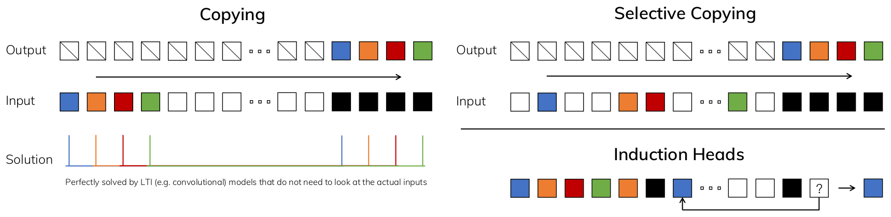

*图 2（原文 Figure 2，第 6 页）：(左) 标准 Copying 任务的输入和输出元素之间间距恒定，时间不变的模型（如线性递推和全局卷积）很容易解决；(右上) Selective Copying 任务中输入之间的间距是随机的，需要时变模型根据内容选择性地记住或忽略输入；(右下) Induction Heads 任务是联想回忆（associative recall）的一个例子，需要根据上下文检索答案，这是 LLM 的关键能力。*

**图中文字翻译与读法**：

- **Copying（复制）**：Output（输出）行前面是画了斜线的方块（笔者读法：这些位置的输出不计），最后四格依次是蓝、橙、红、绿；Input（输入）行开头四格是蓝、橙、红、绿，之后是若干白格（噪声/空位），最后是黑格（笔者读法：提示“开始输出”的标记；原文没有解释黑格）。“Solution”（解法）下方的彩色竖线表示每个输入元素对应的输出位置，**间隔固定**；英文说明：“Perfectly solved by LTI (e.g. convolutional) models that do not need to look at the actual inputs”，即时间不变（如卷积）模型完美解决，不需要看输入内容。
- **Selective Copying（选择性复制）**：Input 行里四个彩色元素散布在白格（噪声）之间、位置随机，Output 仍要在末尾按序输出这四个彩色元素。
- **Induction Heads（归纳头）**：序列里有蓝、橙、红、绿、橙、黑、蓝……最后一个黑格之后是“?”，需要输出蓝色，即回看前面“黑色之后出现的是蓝色”（图中从“?”回到蓝块的箭头），再复制它。笔者读法：黑色相当于文中举的 “Harry”，蓝色相当于 “Potter”。

**读图结论**：Copying 只需“知道时间”（固定间隔），可以用一个长度恰当的卷积核解决，因此不能区分模型有没有内容感知；Selective Copying 和 Induction Heads 才需要内容感知。

两个任务的含义：

- **Selective Copying** 在经典 Copying 任务（Arjovsky, Shah, and Bengio 2016）的基础上改变了要记忆的 token 的位置。它需要内容感知的推理：记住相关 token（有颜色的），过滤无关 token（白色的）。
- **Induction Heads** 是一个著名机制，被假设能解释 LLM 大部分上下文内学习能力（Olsson et al. 2022）。它需要上下文感知的推理：知道何时在合适的上下文（黑色）中产生正确输出。

这两个任务暴露了 LTI 模型的失败模式：

- 从**递推视角**看，它们的常数动力学（式 (2) 中的 $(\bar A,\bar B)$ 转移）不能让它们从上下文中选择正确的信息，也不能以输入相关的方式影响沿序列传递的隐状态。
- 从**卷积视角**看，已知全局卷积可以解决普通的 Copying 任务（Romero et al. 2021），因为它只需要时间感知；但它们在 Selective Copying 上有困难，因为缺乏内容感知。更具体地说，输入到输出之间的间距是变化的，不能由静态卷积核建模。

结论是：序列模型的效率与效果之间的取舍由它们压缩状态的好坏刻画：高效的模型必须状态小，有效的模型的状态必须包含上下文中所有必要的信息。因此论文提出构建序列模型的一个基本原则：**选择性（selectivity）**，即上下文感知地聚焦于或过滤进入序列状态的输入。具体地，选择机制控制信息如何沿序列维度传播或交互。

### 3.2 用选择机制改进 SSM：Algorithm 1 与 Algorithm 2

把选择机制加入模型的一种方法是：让影响序列上交互的参数（如 RNN 的循环动力学或 CNN 的卷积核）依赖输入。论文采用的做法非常简单，就是让 $\Delta$、$B$、$C$ 成为输入的函数，并相应改变各处张量形状。特别要注意，这些参数现在多了长度维度 $L$，即模型从时间不变变成了时间可变，因而丧失了与卷积 (3) 的等价，这对效率有影响（下一节讨论）。

两个算法对照如下。形状用 `(B, L, D)` 这种写法，B 是 batch 大小，L 是序列长度，D 是通道数，N 是 SSM 状态维度。

**Algorithm 1：SSM（S4，时间不变）与 Algorithm 2：SSM + Selection（S6，时变）**

| 步骤 | Algorithm 1：SSM（S4） | Algorithm 2：SSM + Selection（S6） |
|---|---|---|
| 输入 | $x$：`(B, L, D)` | $x$：`(B, L, D)` |
| 输出 | $y$：`(B, L, D)` | $y$：`(B, L, D)` |
| 1 | $A$：`(D, N)` ← Parameter（表示结构化的 $N\times N$ 矩阵） | $A$：`(D, N)` ← Parameter（同左） |
| 2 | $B$：`(D, N)` ← Parameter | $B$：`(B, L, N)` ← $s_B(x)$ |
| 3 | $C$：`(D, N)` ← Parameter | $C$：`(B, L, N)` ← $s_C(x)$ |
| 4 | $\Delta$：`(D)` ← $\tau_\Delta$(Parameter) | $\Delta$：`(B, L, D)` ← $\tau_\Delta$(Parameter + $s_\Delta(x)$) |
| 5 | $\bar A,\bar B$：`(D, N)` ← discretize($\Delta,A,B$) | $\bar A,\bar B$：`(B, L, D, N)` ← discretize($\Delta,A,B$) |
| 6 | $y\leftarrow\mathrm{SSM}(\bar A,\bar B,C)(x)$，时间不变：可用递推或卷积 | $y\leftarrow\mathrm{SSM}(\bar A,\bar B,C)(x)$，时变：只能用递推（scan） |
| 7 | return $y$ | return $y$ |

（原文 Algorithm 1 与 Algorithm 2，第 6 页。）读法：与 S4 相比，S6 的唯一区别就是第 2、3、4 行：$B$、$C$、$\Delta$ 不再是与输入无关的参数，而是由输入 $x$ 算出来的；于是第 5 行离散化得到的 $\bar A,\bar B$ 也带上了 batch 和长度维度，形状从 `(D, N)` 变成 `(B, L, D, N)`，比输入 $x$ 大 $N$ 倍，这正是本文第四节要解决的存储问题。

论文具体选择的参数化是：

$$
s_B(x)=\mathrm{Linear}_N(x),\qquad s_C(x)=\mathrm{Linear}_N(x),\qquad s_\Delta(x)=\mathrm{Broadcast}_D\big(\mathrm{Linear}_1(x)\big),\qquad \tau_\Delta=\mathrm{softplus}
$$

其中 $\mathrm{Linear}_d$ 是投影到 $d$ 维的参数化线性层。$s_\Delta$ 和 $\tau_\Delta$ 的选择来自与 RNN 门控机制的联系（本文 3.3 节）。

读法（按 Algorithm 2 的形状推出，笔者读法）：$B_t,C_t$ 由 $x_t$ 投影到 $N$ 维，在 $D$ 个通道间共享；$\Delta_t$ 先把 $x_t$ 投影到 1 维再广播到 $D$ 个通道，每个通道再加上自己的偏置（Parameter），所以输入相关的“开关”对所有通道一致，各通道的时间尺度由偏置区分。

为便于理解，把 Algorithm 2 的第 1 到 6 行逐元素展开（笔者整理的写法）。因为 $A$ 是对角的，每个（通道 $d$、状态维 $n$）的递推互相独立：

```text
对每个 batch 元素、每个通道 d = 1..D、每个状态维 n = 1..N（彼此独立）：
  h[0] = 0
  对 t = 1..L：
    Δ[t,d]   = softplus( 偏置[d] + w · x[t] )          # 先投影成标量，再广播给各通道
    Ā[t,d,n] = exp( Δ[t,d] · A[d,n] )                   # A 为负实数时，0 < Ā < 1
    B̄[t,d,n] = ((exp(Δ[t,d]·A[d,n]) - 1) / A[d,n]) · B[t,n]   # ZOH 在对角 A 下的逐元素形式
    h[t,d,n] = Ā[t,d,n] · h[t-1,d,n] + B̄[t,d,n] · x[t,d]
    y[t,d]   = Σ_n C[t,n] · h[t,d,n]
```

其中 $B[t,n]$、$C[t,n]$ 来自 $x_t$ 的线性投影。对角 $A$ 时 ZOH 的 $\bar B$ 之所以能写成这样，是因为 $(\Delta A)^{-1}\Delta=A^{-1}$ 在对角情形下逐元素成立。

### 3.3 与 RNN 门控的联系（Theorem 1）

最重要的联系是：RNN 的经典门控机制是选择机制的一个特例。RNN 门控与连续时间系统离散化之间的联系是成熟的（Funahashi and Nakamura 1993；Tallec and Ollivier 2018），本文的 Theorem 1 改进了 Gu, Johnson, Goel, et al. (2021, Lemma 3.1)，推广到 ZOH 离散化和输入相关的门。更一般地，SSM 中的 $\Delta$ 可视为扮演了 RNN 门控机制的推广角色。与前人一致，论文采取的观点是：SSM 的离散化是启发式门控机制的原则性基础。

**Theorem 1**：当 $N=1$、$A=-1$、$B=1$、$s_\Delta=\mathrm{Linear}(x)$、$\tau_\Delta=\mathrm{softplus}$ 时，选择性 SSM 递推（Algorithm 2）取如下形式（原文式 (5)）：

$$
g_t=\sigma\big(\mathrm{Linear}(x_t)\big),\qquad h_t=(1-g_t)\,h_{t-1}+g_t\,x_t .
$$

**证明（附录 C，逐步写出）**：

1. $N=1$、$A=-1$、$B=1$ 对应的连续系统是 $h'(t)=-h(t)+x(t)$，称为泄漏积分器（leaky integrator）。
2. 离散化步长为 $\Delta_t=\tau_\Delta(\mathrm{Parameter}+s_\Delta(x_t))=\mathrm{softplus}(\mathrm{Parameter}+\mathrm{Linear}(x_t))=\mathrm{softplus}(\mathrm{Linear}(x_t))$，因为 Parameter 可以视为可学习偏置并并入线性层。
3. 应用 ZOH 公式。因为 $\mathrm{softplus}(z)=\ln(1+e^z)$，所以 $\exp(-\mathrm{softplus}(z))=1/(1+e^z)=\sigma(-z)=1-\sigma(z)$。于是

$$
\bar A_t=\exp(\Delta A)=\frac{1}{1+\exp(\mathrm{Linear}(x_t))}=\sigma\big(-\mathrm{Linear}(x_t)\big)=1-\sigma\big(\mathrm{Linear}(x_t)\big),
$$

$$
\bar B_t=(\Delta A)^{-1}\big(\exp(\Delta A)-I\big)\cdot\Delta B=-\big(\exp(\Delta A)-I\big)=1-\bar A_t=\sigma\big(\mathrm{Linear}(x_t)\big).
$$

4. 因此最终的离散递推 (2a) 就是 $g_t=\sigma(\mathrm{Linear}(x_t))$、$h_t=(1-g_t)h_{t-1}+g_tx_t$，即证。

直观上：$g_t$ 是“写入多少新输入”的比例，$1-g_t$ 是“保留多少旧状态”的比例，二者之和恒为 1，这正是 GRU 一类门控 RNN 的更新形式。论文由此说明：对给定的输入 $x_t$，如果应当被完全忽略（合成任务需要如此），所有 $D$ 个通道都应该忽略它，所以先把输入投影到 1 维再与 $\Delta$ 一起广播。

### 3.4 选择机制的作用：三种效果与各参数的解读

**三种机制性效果**：

- **可变间距（Variable Spacing）**：选择性允许过滤输入之间可能出现的无关噪声 token。Selective Copying 就是例证，但在常见数据模态中无处不在，尤其是离散数据，例如语言里的 “um” 这类填充词。其机制是模型可以过滤任何特定输入 $x_t$，例如门控 RNN 情形（Theorem 1）中 $g_t\to0$ 时。
- **过滤上下文（Filtering Context）**：已有经验观察表明许多序列模型随上下文变长并不改善（F. Shi et al. 2023），尽管原则上更多上下文应带来严格更好的性能。一种解释是许多序列模型无法在需要时有效忽略无关上下文，全局卷积（以及一般的 LTI 模型）就是直观的例子。而选择性模型可以随时重置状态以去除多余的历史，因此原则上性能随上下文长度单调改善（例如原文 4.3.2 节的 DNA 实验，即本文 6.3 节）。
- **边界重置（Boundary Resetting）**：在把多条独立序列拼接在一起的场景里，Transformer 可以用特定的 attention mask 把它们分开，而 LTI 模型会在序列之间“渗漏”信息。选择性 SSM 也可以在边界重置状态（例如 $\Delta_t\to\infty$，或 Theorem 1 中 $g_t\to1$）。这类设置可能是人为的（例如把文档打包以提高硬件利用率），也可能是自然出现的（例如强化学习里的回合边界）。

**各参数的解读**：

- **$\Delta$**：总体上控制“聚焦还是忽略当前输入 $x_t$”之间的平衡。它推广了 RNN 的门（如 Theorem 1 中的 $g_t$）：机械地说，大的 $\Delta$ 重置状态 $h$ 并聚焦于当前输入 $x$，小的 $\Delta$ 保持状态并忽略当前输入。SSM (1)(2) 可以解释为用时间步 $\Delta$ 离散化的连续系统，在此语境下的直觉是：大的 $\Delta\to\infty$ 表示系统更久地聚焦于当前输入（因此“选择”它并遗忘当前状态），而小的 $\Delta\to0$ 表示短暂的输入被忽略。
- **$A$**：$A$ 也可以是选择性的，但它最终只通过与 $\Delta$ 的相互作用 $\bar A=\exp(\Delta A)$ 影响模型，所以 $\Delta$ 的选择性足以保证 $(\bar A,\bar B)$ 的选择性，而且是改进的主要来源。论文假设让 $A$ 也选择性（或取代 $\Delta$）会有相近性能，为简单起见略去。
- **$B$ 和 $C$**：选择性最重要的性质是过滤无关信息，使序列模型的上下文能被压缩成高效的状态。在 SSM 中，让 $B$ 和 $C$ 选择性可以更细粒度地控制是否让输入 $x_t$ 进入状态 $h_t$，或让状态进入输出 $y_t$。这可以解释为让模型分别基于内容（输入）和上下文（隐状态）调制循环动力学。

笔者算例（取 Theorem 1 的标量情形 $A=-1$）：$\Delta=5$ 时 $\bar A=e^{-5}\approx0.0067$、$\bar B\approx0.9933$，旧状态几乎被清空，$h_t\approx x_t$（聚焦当前输入，相当于重置）；$\Delta=0.01$ 时 $\bar A\approx0.990$、$\bar B\approx0.00995$，$h_t\approx h_{t-1}$（保持状态，忽略当前输入）。如果只用一个标量状态，让噪声 token 处 $\Delta\approx0$、关键 token 处 $\Delta$ 很大，就能把关键 token 一直保存在 $h$ 里，直到下一个关键 token 到来；这就是 Selective Copying 想要的行为。

### 3.5 其他模型细节

- **实数与复数**：多数此前的 SSM 在状态里用复数，这对感知类模态的很多任务是必要的。但经验上完全实数的 SSM 似乎也不差，在某些设定里甚至更好（Ma et al. 2023）。论文默认用实数，对除一个任务外的所有任务都有效；假设复数与实数的取舍和数据模态的连续到离散谱有关：复数对连续模态（音频、视频）有帮助，对离散模态（文本、DNA）没有。（那个例外是音频预训练，原文 4.4.1 节说明这是全文唯一改用复数参数化的实验，即本文 6.4.1 节。）
- **初始化**：多数此前的 SSM 还建议特殊初始化，尤其在复数情形，对低数据等设定有帮助。论文默认初始化在复数情形是 S4D-Lin，在实数情形是 S4D-Real（Gu, Gupta, et al. 2022），基于 HiPPO 理论（Gu, Dao, et al. 2020）。它们分别把 $A$ 的第 $n$ 个元素定义为 $-1/2+ni$ 和 $-(n+1)$。但论文预期许多初始化都会有效，尤其在大数据和实数 SSM 的情形；表 8 做了一些消融。
- **$\Delta$ 的参数化**：论文把对 $\Delta$ 的选择性调整定义为 $s_\Delta(x)=\mathrm{Broadcast}_D(\mathrm{Linear}_1(x))$，动机来自 $\Delta$ 的机理（本文 3.4 节）。它可以从维度 1 推广到更大的维度 $R$，取为 $D$ 的一个很小的比例，与块里主要线性投影相比参数量可以忽略。此外，广播操作也可以视为另一个线性投影，初始化成特定的 1 和 0 的模式；如果这个投影可训练，就得到替代形式 $s_\Delta(x)=\mathrm{Linear}_D(\mathrm{Linear}_R(x))$，可以看成一个低秩投影。
- **$\Delta$ 偏置的初始化**：实验中 $\Delta$ 参数（可视为偏置项）初始化为 $\tau_\Delta^{-1}(\mathrm{Uniform}([0.001,0.1]))$，即对 $[0.001,0.1]$ 上的均匀分布取 softplus 的反函数，遵循此前 SSM 的做法（Gu, Johnson, Timalsina, et al. 2023）。这意味着初始时 $\Delta$ 落在 0.001 到 0.1 之间。
- **S6 的简称**：论文有时把选择性 SSM 简称 S6，因为它们是带选择机制并用扫描计算的 S4 模型。

## 四、选择性 SSM 的高效实现：硬件感知的 selective scan

### 4.1 为什么此前的 SSM 都是 LTI

卷积（Krizhevsky et al. 2012）和 attention 之类的硬件友好原语应用广泛，论文也想让选择性 SSM 在现代 GPU 上高效。选择机制本身很自然，此前也有工作试过特例，例如在循环 SSM 里让 $\Delta$ 随时间变化（Gu, Dao, et al. 2020）。但如前所述，SSM 应用的核心限制是计算效率，所以 S4 及其所有衍生模型都用 LTI（非选择性）模型，最常见的形式是全局卷积。论文先重访这个动机：

- 循环模型（如 SSM）总是在表达力和速度之间取舍：隐状态维度越大应该越有效但越慢，所以希望**在不付出速度和显存代价的前提下最大化隐状态维度**。
- 递推模式比卷积模式更灵活，因为后者 (3) 是由前者 (2) 展开推出的。但直接递推需要计算并物化形状为 `(B, L, D, N)` 的隐状态 $h$，比输入 $x$ 和输出 $y$（形状 `(B, L, D)`）大 $N$ 倍（$N$ 是 SSM 状态维度）。因此引入了更高效的卷积模式：绕过状态的计算，只物化一个卷积核 (3a)，大小只有 `(B, L, D)`。
- 此前的 LTI 状态空间模型利用递推与卷积的双重形式，把有效状态维度提高 $N$ 倍（$N\approx10$ 到 100），远大于传统 RNN，且没有效率惩罚。

### 4.2 Selective scan 总览：三个经典技术

选择机制是为了克服 LTI 模型的局限，所以需要重新审视 SSM 的计算问题。论文用三个经典技术：**kernel 融合、并行扫描、重计算**。先有两个观察：

- 朴素递推计算用 $O(BLDN)$ FLOPs，而卷积计算用 $O(BLD\log L)$ FLOPs，前者常数因子更小。所以对长序列和不太大的状态维度 $N$，递推模式实际上可以用更少的 FLOPs。
- 两个挑战是递推的**顺序性**和**大显存占用**。对后者，像卷积模式一样，可以尝试不真正物化完整的状态 $h$。

主要思想是利用现代加速器（GPU）的特性，只在存储层次中更高效的层级里物化状态 $h$。具体说，除矩阵乘外，大多数运算都受内存带宽限制（Dao et al. 2022；Ivanov et al. 2021；Williams et al. 2009），包括这里的扫描运算，所以用 kernel 融合减少内存 IO，相比标准实现显著提速。

具体地，不在 GPU HBM（高带宽显存）里准备大小为 `(B, L, D, N)` 的扫描输入 $(\bar A,\bar B)$，而是把 SSM 参数 $(\Delta,A,B,C)$ 直接从慢的 HBM 载入快的 SRAM，在 SRAM 里做离散化和递推，再把大小为 `(B, L, D)` 的最终输出写回 HBM。

为避免顺序递推，论文指出这个递推“尽管不是线性的”（原文 despite not being linear），仍可以用 work-efficient 的并行扫描算法并行化（Blelloch 1990；Martin and Cundy 2018；Smith, Warrington, and Linderman 2023）。（笔者说明：严格地说，选择性 SSM 对状态 $h$ 仍是线性的递推，只是系数随时间变化；正是这一点使它可以被结合律扫描并行化，见本文 4.4 节。）

最后，还必须避免保存反向传播所需的中间状态。论文细致地运用重计算这一经典技术来降低显存需求：中间状态不保存，而在反向传播中输入从 HBM 载入 SRAM 时重新计算。结果是融合后的 selective scan 层与带 FlashAttention 的优化 Transformer 实现有相同的显存需求。

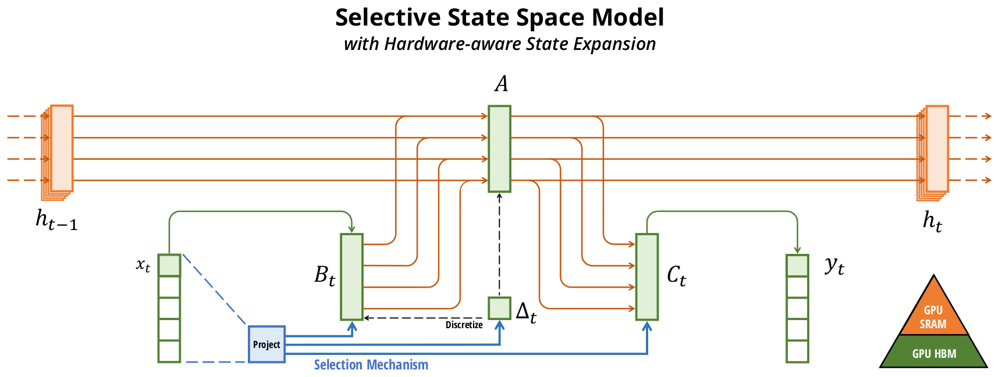

*图 1（原文 Figure 1，第 3 页）：（概览）结构化 SSM 把输入 $x$ 的每个通道（例如 $D=5$）独立地通过一个更高维的隐状态 $h$（例如 $N=4$）映成输出 $y$。此前的 SSM 靠需要时间不变的巧妙替代计算路径，避免物化这个大的有效状态（$DN$，再乘 batch 大小 $B$ 和序列长度 $L$）：$(\Delta,A,B,C)$ 参数在时间上是常数。选择机制把输入相关的动力学加回来，这也需要精心设计硬件感知算法，只在 GPU 存储层次中更高效的层级里物化扩展后的状态。*

**图中文字翻译与读法**：

- **标题**：Selective State Space Model with Hardware-aware State Expansion（带硬件感知状态扩展的选择性状态空间模型）。
- **主体**：左边 $h_{t-1}$ 和右边 $h_t$ 是隐状态（橙色的一摞矩形，对应 $D$ 个通道，每个通道 $N=4$ 行）；中间绿色长条 $A$ 作用在状态上；输入 $x_t$（绿色竖条，$D=5$ 个通道）经 “Project”（投影）框生成 $B_t$、$\Delta_t$、$C_t$（蓝色粗箭头，标注 Selection Mechanism，选择机制）；$\Delta_t$ 经 Discretize（离散化）与 $A$、$B_t$ 一起得到离散参数（虚线箭头）；$B_t$ 把输入写入状态，$C_t$ 把状态读出为 $y_t$（右侧绿色竖条）。
- **右下角三角形**：GPU SRAM（橙色，上）和 GPU HBM（绿色，下）。

**读图结论**：笔者按颜色对应的读法：橙色（隐状态及其更新）对应 SRAM，绿色（$x_t,y_t$、各参数）对应 HBM，意思是体积被放大 $N$ 倍的隐状态只在快速的 SRAM 里出现，不写回 HBM。选择机制（蓝色）使 $B_t,\Delta_t,C_t$ 依赖当前输入。

### 4.3 融合 kernel 的四步（附录 D）

没有输入相关的选择性时，SSM 可以高效地实现为卷积，用 FFT 作原语。有了选择性，SSM 不再等价于卷积，但可以利用**并行结合扫描（parallel associative scan）**。虽然 SSM 扫描在理论上是高效的（$O(BLDN)$ FLOPs，对 $L$ 线性），训练用选择性 SSM 的基础模型还要求它们在现代硬件（GPU）上高效。论文说明怎样用 kernel 融合和重计算使 SSM 扫描又快又省显存，并在原文 4.5 节（本文 6.5 节）评测了其速度：在序列长度 32K 时最多比 attention 快 7 倍，且与最好的 attention 实现（FlashAttention）一样省显存。

**速度**：在现代硬件加速器（GPU）上，除矩阵乘外大多数运算受内存带宽限制，这里的扫描运算也是，所以用 kernel 融合减少内存 IO。

- **标准实现**：先在 GPU HBM 里准备大小为 `(B, L, D, N)` 的扫描输入 $\bar A,\bar B$，调用并行结合扫描实现，把大小为 `(B, L, D, N)` 的扫描输出写回 HBM，再把扫描输出乘以 $C$ 得到大小 `(B, L, D)` 的输出。这需要 $O(BLDN)$ 量级的内存读写。
- **融合实现**：把离散化、扫描、与 $C$ 的乘法融合进一个 kernel：
  1. 把 $(\Delta,A,B,C)$ 共 $O(BLD+DN)$ 字节从慢的 HBM 读进快的 SRAM；
  2. 在 SRAM 里离散化，生成大小为 `(B, L, D, N)` 的 $\bar A,\bar B$；
  3. 在 SRAM 里做并行结合扫描，得到大小为 `(B, L, D, N)` 的中间状态；
  4. 与 $C$ 相乘并求和，生成大小为 `(B, L, D)` 的输出并写入 HBM。

  这样 IO 减少了 $O(N)$ 倍（$N$ 是状态维度），实际使这个运算提速 20 到 40 倍（原文 4.5 节，本文 6.5 节）。
- **序列太长放不进 SRAM**（SRAM 比 HBM 小得多）时：把序列切成块（chunk），在每块上做融合扫描；只要保留中间扫描状态，就能继续下一块的扫描。

### 4.4 并行扫描为什么成立（笔者补充）

论文只引用了并行扫描的文献，没有写出结合算子。这里补充它的原理。固定一个（通道，状态维）元素，递推是 $h_t=a_th_{t-1}+b_t$，其中 $a_t=\bar A_t$、$b_t=\bar B_tx_t$。把每一步看成一个仿射映射 $h\mapsto a_th+b_t$，用二元组 $(a_t,b_t)$ 表示。两个相邻的映射复合（先 1 后 2）得到

$$
(a_1,b_1)\oplus(a_2,b_2)=(a_2a_1,\ a_2b_1+b_2).
$$

这个运算满足结合律：$((a_1,b_1)\oplus(a_2,b_2))\oplus(a_3,b_3)=(a_3a_2a_1,\ a_3a_2b_1+a_3b_2+b_3)=(a_1,b_1)\oplus((a_2,b_2)\oplus(a_3,b_3))$。取 $h_0=0$，则 $h_t$ 就是前缀复合 $(a_1,b_1)\oplus\cdots\oplus(a_t,b_t)$ 的第二个分量，例如 $h_4=a_4a_3a_2b_1+a_4a_3b_2+a_4b_3+b_4$。因为运算有结合律，可以把前缀复合组织成一棵树：先两两合并 $(1,2)$、$(3,4)$，再合并两个结果，……，用 work-efficient 的并行扫描（Blelloch 1990）在 $O(L)$ 总工作量、$O(\log L)$ 的并行深度内得到全部 $h_1,\dots,h_L$，而不必从头到尾顺序递推。$A$ 对角时，每个元素的 $a_t$ 都是标量，所以每一对（通道，状态维）各自独立扫描，共 $BDN$ 条互不相关的扫描。

### 4.5 重计算与激活显存（附录 D）

**显存**：用重计算这一经典技术减少训练选择性 SSM 层所需的总显存。

- 融合前向时不保存大小 `(B, L, D, N)` 的中间状态，避免显存爆炸。但反向传播需要这些中间状态来计算梯度，所以论文在反向里**重新计算**它们。
- 输入 $\Delta,A,B,C$ 和输出梯度从 HBM 读到 SRAM 的大小是 $O(BLN+DN)$，输入梯度的大小也是 $O(BLN+DN)$；重计算避免了从 HBM 读取 $O(BLND)$ 个元素的开销。也就是说，在反向里重算 SSM 状态，比“存下来再从 HBM 读回来”更快。（原文前向写 $O(BLD+DN)$、反向写 $O(BLN+DN)$，两处写法不同，要点都是远小于 $BLDN$。）
- 除了优化扫描本身的显存，论文还用重计算优化整个选择性 SSM 块（输入投影、卷积、激活、扫描、输出投影）的显存：不保存占显存多但重算很快的中间激活（例如激活函数的输出或短卷积的输出）。
- 结果是选择性 SSM 层与带 FlashAttention 的优化 Transformer 实现有相同的显存需求。具体地，（假设用 FP16 或 BF16 混合精度训练）每个 attention 层（FlashAttention）每 token 存储约 12 字节激活，每个 MLP 层每 token 约 20 字节，合计 32 字节；每个选择性 SSM 每 token 约 16 字节。因此两层选择性 SSM 与一个 attention 层加一个 MLP 层的激活显存大致相同。

## 五、Mamba 架构

### 5.1 简化的块（图 3）

与结构化 SSM 一样，选择性 SSM 是独立的序列变换，可以灵活嵌入神经网络。H3 架构是最知名 SSM 架构的基础，它们通常由一个受线性 attention 启发的块与一个 MLP 块交错组成。论文把这两个部分合并成一个、同质地堆叠（图 3），这受门控 attention 单元（GAU，Hua et al. 2022）启发，GAU 对 attention 做了类似的事。

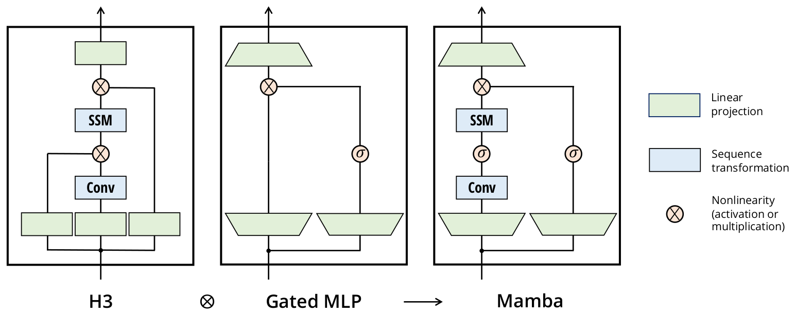

*图 3（原文 Figure 3，第 8 页）：论文简化后的块设计，把大多数 SSM 架构的基础 H3 块与现代神经网络中无处不在的 MLP 块结合。不再交错重复这两种块，而是同质地重复 Mamba 块。与 H3 块相比，Mamba 把第一个乘法门换成了一个激活函数；与 MLP 块相比，Mamba 在主分支里加了一个 SSM。$\sigma$ 取 SiLU/Swish 激活。*

**图中文字翻译与读法**：

- **左：H3 块**：底部有三个线性投影（绿色），输入分成三路；一路经 Conv（卷积）后与另一路相乘（第一个乘法门），再经 SSM，之后与第三路相乘（第二个乘法门），最后一个线性投影输出。
- **中：Gated MLP 块**：底部两个线性投影，一路经激活 $\sigma$ 作为门，与另一路相乘，再经线性投影输出。
- **右：Mamba 块**：底部两个线性投影；左路是 Conv → $\sigma$ → SSM，右路是 $\sigma$；两路相乘后经线性投影输出。图例：绿色方块 Linear projection（线性投影）、蓝色方块 Sequence transformation（序列变换）、带 ⊗ 的圆圈 Nonlinearity（activation or multiplication，激活或乘法）。

**读图结论**：Mamba 块 = Gated MLP 块 + 在主分支加入“Conv + SSM”；与 H3 相比，只保留一个乘法门（右路 $\sigma$ 的门），把第一个乘法门换成激活函数。整个网络由这一种块重复堆叠。

### 5.2 参数量与超参数

- 块里把模型维度 $D$ 按一个可控的扩展因子 $E$ 放大。每个块里大部分参数（$3ED^2$）在线性投影里（输入投影 $2ED^2$，输出投影 $ED^2$），而内部 SSM 的贡献较少；SSM 的参数（$\Delta,B,C$ 的投影和矩阵 $A$）相比小得多。
- 把这个块与标准的归一化和残差连接交错重复，构成 Mamba 架构。实验里始终取 $E=2$，并用**两个**块去匹配 Transformer 里交错的 MHA（多头 attention）和 MLP 块的 $12D^2$ 参数（笔者核算：$3ED^2=6D^2$，两个块即 $12D^2$；Transformer 的 MHA 为 $4D^2$、MLP 为 $8D^2$，合计 $12D^2$）。
- 激活函数用 SiLU/Swish（Hendrycks and Gimpel 2016；Ramachandran et al. 2017），目的是让 Gated MLP 成为流行的 “SwiGLU” 变体。
- 另外用一个可选的归一化层（选 LayerNorm，J. L. Ba et al. 2016），动机是 RetNet 在类似位置也用了归一化层。

## 六、实验

论文先用两个合成任务检验选择机制（本文 6.1 节），再在三个领域评测，每个领域都做自回归预训练和下游任务：语言模型预训练（缩放律）和零样本下游评测（6.2 节）；DNA 序列预训练和长序列分类的微调（6.3 节）；音频波形预训练与自回归生成的语音质量（6.4 节）。最后展示训练和推理的计算效率（6.5 节），并对架构和选择性 SSM 做消融（6.6 节）。

### 6.1 合成任务

#### 6.1.1 Selective Copying

Copying 任务是序列建模中研究最多的合成任务之一，最初是为检验循环模型的记忆能力而设计的。如本文 3.1 节所述，LTI SSM（线性递推和全局卷积）只需跟踪时间而不必推理数据就能轻易解决它，例如构造一个长度恰好合适的卷积核（图 2），这在全局卷积的早期工作里已被明确验证。Selective Copying 通过随机化 token 之间的间距封堵了这条捷径；这个任务此前也以 Denoising 任务之名出现过（Jing et al. 2019）。

许多前人认为在架构里加入门控（乘法交互）可以赋予模型“数据依赖”并解决相关任务。论文认为这种解释在直觉上不充分，因为这种门控不沿序列轴交互，不能影响 token 之间的间距；特别地，**架构门控不是选择机制的实例**（附录 A）。

**设置**（附录 E.1）：序列长度 4096，词表 16 个可能的 token（包括图 2 中白色的“噪声”token），要求模型记住 16 个“数据”token；用 2 层模型，模型维度 $D=64$；训练 400K 步，恒定学习率 0.0001，batch size 64。

**表 1：Selective Copying**（各架构与内部序列层的组合的准确率，单位 %；“-”表示该行是新的组合，没有独立的模型名）

| 模型 | 架构（Arch.） | 序列层（Layer） | 准确率 |
|---|---|---|---:|
| S4 | No gate（无门） | S4 | 18.3 |
| - | No gate（无门） | S6 | **97.0** |
| H3 | H3 | S4 | 57.0 |
| Hyena | H3 | Hyena | 30.1 |
| - | H3 | S6 | **99.7** |
| - | Mamba | S4 | 56.4 |
| - | Mamba | Hyena | 28.4 |
| Mamba | Mamba | S6 | **99.8** |

（原文表 1，第 11 页。）读法：带门控的架构（H3 和 Mamba）只能部分改善性能（S4 的 18.3 提高到 57.0 与 56.4），而选择机制（把 S4 改成 S6）轻松解决了这个任务（97.0、99.7、99.8），尤其在与这些更强的架构结合时。Hyena（全局卷积）在两种架构下都只有约 30%，因为它也是 LTI。

#### 6.1.2 Induction Heads

Induction heads（Olsson et al. 2022）是机制可解释性视角下的一个简单任务，出人意料地能预测 LLM 的上下文学习能力。它要求模型做联想回忆并复制：例如如果模型在序列里见过二元组 “Harry Potter”，那么下次同一序列里再出现 “Harry” 时，模型应能通过从历史里复制来预测 “Potter”。

**数据集与模型**：在序列长度 256、词表大小 16 上训练 2 层模型，与此前工作（Dao, Fu, Saab, et al. 2023）可比但序列更长；并通过测试时在 $2^6=64$ 到 $2^{20}=1048576$ 的一系列序列长度上评测，考察泛化和外推能力。遵循已有工作用 2 层模型，这使得 attention 能够机制性地解决任务。测试了多头 attention（8 个头，多种位置编码）和 SSM 变体；模型维度 $D$：Mamba 为 64，其他模型为 128。

**训练细节**（附录 E.1）：每步随机生成数据，batch size 8；“epoch”定为 8192 步，并在每个目标序列长度的固定（也是随机生成的）验证集上跟踪准确率。MHA-Abs 和 Mamba 报告第 25 个 epoch 后的结果（$8192\times25=204800$ 步）；MHA-RoPE 和 MHA-xPos 报告第 50 个 epoch 后（$8192\times50=409600$ 步）；LTI 的 H3 和 Hyena 报告第 10 个 epoch 后（81920 步），因为它们那时已收敛并且不再改善。用 Adam、无权重衰减；所有模型用恒定学习率 2e-4 和 1e-3，并为每个模型报告较好的结果（除 Mamba 外都用 2e-4）。attention 和 Hyena 模型在 1e-3 下学不会；H3 两种学习率都能学，但在较小的 2e-4 下对较短序列泛化更好；Mamba 两种都能学，但在较大的 1e-3 下外推更好。

**结果**：Mamba（更准确地说是它的选择性 SSM 层）能完美解决这个任务，因为它能选择性地记住相关 token 而忽略中间的一切。它能完美泛化到百万长度的序列，即比训练时见过的长度长约 4000 倍，而没有其他方法能超过 2 倍。位置编码变体里，为长度外推设计的 xPos 略好于其他；所有 attention 模型只测到序列长度 $2^{14}=16384$（受显存限制）；其他 SSM 中 H3 和 Hyena 相近，与 Poli et al. (2023) 的发现相反。

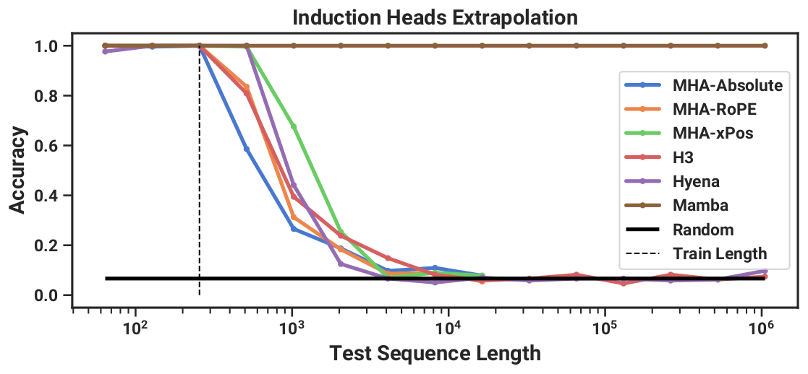

*表 2（原文 Table 2，第 11 页，这是一张曲线图）：（Induction Heads）模型在序列长度 $2^8=256$ 上训练，在 $2^6=64$ 到 $2^{20}=1048576$ 的递增序列长度上测试。完整数字见表 11。*

**图中文字翻译与读法**：

- 标题 Induction Heads Extrapolation（Induction Heads 外推）；横轴 Test Sequence Length（测试序列长度，对数刻度，约 $10^2$ 到 $10^6$），纵轴 Accuracy（准确率，0 到 1）。
- 图例：MHA-Absolute（绝对位置编码的多头 attention，蓝）、MHA-RoPE（橙）、MHA-xPos（绿）、H3（红）、Hyena（紫）、Mamba（棕）、Random（随机水平，黑色水平线，约 0.07）、Train Length（训练长度，黑色竖直虚线，位于 256）。
- **读图结论**：在训练长度（虚线）之后，所有 attention 模型和 LTI 模型的准确率很快跌到随机水平，只有 Mamba（棕色）一直保持在 1.0 直到 $10^6$。

**表 11：Induction Heads 的完整数字**（测试准确率 %；✓ 表示完美泛化准确率，✗ 表示显存溢出；Hyena 参数里大部分在可学习位置编码中）

| 模型 | 参数量 | $2^6$ | $2^7$ | $2^8$ | $2^9$ | $2^{10}$ | $2^{11}$ | $2^{12}$ | $2^{13}$ | $2^{14}$ | $2^{15}$ | $2^{16}$ | $2^{17}$ | $2^{18}$ | $2^{19}$ | $2^{20}$ |
|---|---|---|---|---|---|---|---|---|---|---|---|---|---|---|---|---|
| MHA-Abs | 137K | ✓ | 99.6 | 100.0 | 58.6 | 26.6 | 18.8 | 9.8 | 10.9 | 7.8 | ✗ | ✗ | ✗ | ✗ | ✗ | ✗ |
| MHA-RoPE | 137K | ✓ | ✓ | 100.0 | 83.6 | 31.3 | 18.4 | 8.6 | 9.0 | 5.5 | ✗ | ✗ | ✗ | ✗ | ✗ | ✗ |
| MHA-xPos | 137K | ✓ | ✓ | 100.0 | 99.6 | 67.6 | 25.4 | 7.0 | 9.0 | 7.8 | ✗ | ✗ | ✗ | ✗ | ✗ | ✗ |
| H3 | 153K | ✓ | ✓ | 100.0 | 80.9 | 39.5 | 23.8 | 14.8 | 8.2 | 5.9 | 6.6 | 8.2 | 4.7 | 8.2 | 6.3 | 7.4 |
| Hyena | 69M* | 97.7 | ✓ | 100.0 | ✓ | 44.1 | 12.5 | 6.6 | 5.1 | 7.0 | 5.9 | 6.6 | 6.6 | 5.9 | 6.3 | 9.8 |
| Mamba | 74K | ✓ | ✓ | 100.0 | ✓ | ✓ | ✓ | ✓ | ✓ | ✓ | ✓ | ✓ | ✓ | ✓ | ✓ | ✓ |

（原文表 11，第 29 页；*：大部分参数在可学习位置编码中。）读法：训练长度是 $2^8=256$。Mamba 只有 74K 参数，在所有测试长度上都完美；MHA 系列在 $2^{14}$ 之后显存溢出，在 $2^{10}$（4 倍训练长度）时已降到 67.6% 以下；H3 和 Hyena 在 $2^9$（2 倍）之后也迅速下降到随机水平附近。

### 6.2 语言建模

在标准自回归语言建模上，用预训练指标（困惑度）和零样本评测，将 Mamba 架构与其他架构比较。模型尺寸（深度和宽度）仿照 GPT-3 的规格设定。用 Pile 数据集（L. Gao, Biderman, et al. 2020），遵循 Brown et al. (2020) 描述的训练配方，细节见附录 E.2。

#### 6.2.1 缩放律

**基线**：标准 Transformer（GPT-3 架构）；论文所知最强的 Transformer 配方（记为 **Transformer++**），基于 PaLM 和 LLaMA 架构（旋转位置编码、SwiGLU MLP、RMSNorm 取代 LayerNorm、无线性偏置、更高学习率）；以及其他近期的次二次方架构（图 4）。

**图 4 的设置**：遵循标准的 Chinchilla（Hoffmann et al. 2022）协议，模型从约 125M 到约 1.3B 参数，在 Pile 上训练。

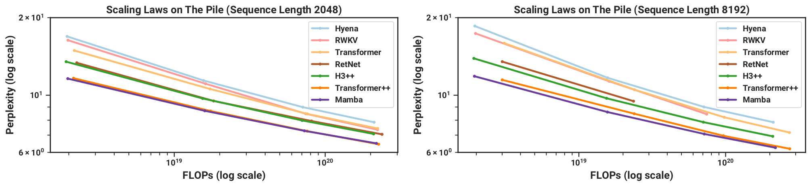

*图 4（原文 Figure 4，第 11 页）：（缩放律）在 Pile 上训练的、约 125M 到约 1.3B 参数的模型。Mamba 的缩放优于所有其他无 attention 模型，是第一个追平非常强的“Transformer++”配方（现已成为标准）的模型，尤其是随着序列长度增长。*

**图中文字翻译与读法**：

- 左图 Scaling Laws on The Pile (Sequence Length 2048)（Pile 上的缩放律，序列长度 2048），右图序列长度 8192；横轴 FLOPs (log scale)（计算量，对数刻度，约 $10^{19}$ 到 $10^{20}$），纵轴 Perplexity (log scale)（困惑度，对数刻度，越低越好）。
- 图例：Hyena（浅蓝）、RWKV（粉）、Transformer（浅橙，即 GPT-3 配方）、RetNet（棕）、H3++（绿）、Transformer++（橙）、Mamba（紫）。
- **读图结论**：两张图里，同样 FLOPs 下 Mamba（紫）与 Transformer++（橙）是最低的两条线，明显低于 Hyena、RWKV、Transformer、RetNet 和 H3++。序列长度 2048 时 Mamba 与 Transformer++ 几乎重合；序列长度 8192 时，同样 FLOPs 下 Mamba 的曲线位于 Transformer++ 下方（中等规模处差距最明显，最大规模处缩小；读图所得，未量化），这就是论文所说“尤其是随着序列长度增长”。8192 的图中 RWKV 和 RetNet 的曲线没有画完整（RetNet 只到约 $2\times10^{19}$ FLOPs，RWKV 只到约 $8\times10^{19}$），论文说明这是因为它们缺少高效实现，导致显存溢出或计算量不现实。

**结论**：Mamba 是第一个追平很强的 Transformer 配方（Transformer++）的无 attention 模型，尤其是随着序列长度增长。

**缩放律细节**（附录 E.2.1）：缩放律实验大体遵循 GPT-3 配方，所有模型在 Pile 上用 GPT-2 分词器训练。模型尺寸取自 GPT-3 规格（表 12），稍作修改：第一，把 1.3B 模型的 batch size 从 100 万 token 改成 50 万 token，因为没用到需要大 batch 的并行度；第二，改变训练步数和总 token 数，使之大致符合 Chinchilla 缩放律（训练 token 数应与模型规模成比例）。

**表 12：缩放律实验的模型尺寸**（模型维度和头数只适用于 Transformer 模型）

| 参数量 | 层数 n_layers | d_model | 头数 / 头维度 | 训练步数 | 学习率 | batch size | token 数 |
|---|---:|---:|---|---:|---|---|---|
| 125M | 12 | 768 | 12 / 64 | 4800 | 6e-4 | 0.5M tokens | 2.5B |
| 350M | 24 | 1024 | 16 / 64 | 13500 | 3e-4 | 0.5M tokens | 7B |
| 760M | 24 | 1536 | 16 / 96 | 29000 | 2.5e-4 | 0.5M tokens | 15B |
| 1.3B | 24 | 2048 | 32 / 64 | 50000 | 2e-4 | 0.5M tokens | 26B |

（原文表 12，第 30 页。）读法：训练 token 数大致是参数量的 20 倍（Chinchilla 比例）。表里 Mamba 对应的层数没有逐一给出；原文 3.4 节（本文 5.2 节）和附录 E.3.2 说明一个 Transformer“层”（MHA+MLP）需要两个 Mamba 块才能匹配参数量。

**训练配方**：所有模型用 AdamW，梯度裁剪值 1.0，权重衰减 0.1，不用 dropout，线性学习率 warmup 加余弦衰减；默认峰值学习率取 GPT-3 规格。部分模型使用“改进配方”（受 PaLM 和 LLaMA 启发）：线性 warmup 加余弦衰减到 1e-5，峰值是 GPT-3 值的 5 倍；无线性偏置项；用 RMSNorm 代替 LayerNorm；AdamW 超参数 $\beta=(0.9,0.95)$（GPT-3 的取值），而不是 PyTorch 默认的 $(0.9,0.999)$。

**各模型的架构与训练细节**：

- Transformer：基于 GPT-3 的标准 Transformer（表 12）。
- Transformer++：改进架构（旋转位置编码、SwiGLU MLP）加上述改进配方。
- Hyena：把 Hyena 块（H3 块里的 S4 换成 MLP 参数化的全局卷积）与标准 MLP 块交错。MLP 块的扩展因子为 2 而不是 4，层数相应增加 1.5 倍以保持参数量。
- H3++：带少量修改的 H3 架构：（i）用上面同样的“瘦”Hyena 维度，（ii）改进配方，（iii）线性 attention 头维度 8。
- RWKV：B. Peng et al. (2023) 的默认 RWKV 模型，包括其修改过的 MLP 块，并尽量采用其规定的训练配方，例如对某些参数把学习率提高 2 倍或 3 倍。
- RetNet：Y. Sun et al. (2023) 的默认 RetNet，同样给它改进配方。
- Mamba：标准 Mamba 架构加改进配方。

#### 6.2.2 零样本下游评测

表 3 给出 Mamba 在一系列流行的零样本下游任务上的表现。对比对象是这些尺寸下最著名的开源模型，最重要的是 Pythia（Biderman et al. 2023）和 RWKV（B. Peng et al. 2023），它们与 Mamba 用同样的分词器、数据集和训练长度（300B token）训练。（Mamba 与 Pythia 用上下文长度 2048 训练，RWKV 用 1024。）

预训练流程与缩放律协议相同，但扩展到 300B token，并用 GPT-NeoX 分词器（Black et al. 2022）而不是 GPT-2 分词器。1.3B 模型为与 GPT-3 规格一致用 100 万 token 的 batch size。Pile 验证集上的困惑度这一指标只与同样数据集、同样分词器训练的模型比较，即 Pythia 和 RWKV。下游评测用 EleutherAI 的 LM evaluation harness（L. Gao, Tow, et al. 2021），评测下面几个常识推理任务：LAMBADA、HellaSwag、PIQA、ARC-challenge、ARC-easy（ARC-challenge 的容易子集）、WinoGrande。对 LAMBADA、WinoGrande、PIQA 和 ARC-easy 报告准确率，对 HellaSwag 和 ARC-challenge 报告按序列长度归一化的准确率（因为几乎所有模型在这两个任务上归一化准确率更高）。

**表 3：零样本评测**（每个尺寸最好的结果粗体。对比的开源 LM 分词器各异，训练 token 数最多 300B。Pile 指验证集，仅与同数据集同分词器（GPT-NeoX-20B）的模型比较；“—”表示不适用。ppl 越低越好，acc 越高越好）

| 模型 | 分词器 | Pile ppl ↓ | LAMBADA ppl ↓ | LAMBADA acc ↑ | HellaSwag acc ↑ | PIQA acc ↑ | Arc-E acc ↑ | Arc-C acc ↑ | WinoGrande acc ↑ | 平均 acc ↑ |
|---|---|---:|---:|---:|---:|---:|---:|---:|---:|---:|
| Hybrid H3-130M | GPT2 | — | 89.48 | 25.77 | 31.7 | 64.2 | 44.4 | 24.2 | 50.6 | 40.1 |
| Pythia-160M | NeoX | 29.64 | 38.10 | 33.0 | 30.2 | 61.4 | 43.2 | 24.1 | **51.9** | 40.6 |
| **Mamba-130M** | NeoX | **10.56** | **16.07** | **44.3** | **35.3** | **64.5** | **48.0** | **24.3** | **51.9** | **44.7** |
| Hybrid H3-360M | GPT2 | — | 12.58 | 48.0 | 41.5 | 68.1 | 51.4 | 24.7 | 54.1 | 48.0 |
| Pythia-410M | NeoX | 9.95 | 10.84 | 51.4 | 40.6 | 66.9 | 52.1 | 24.6 | 53.8 | 48.2 |
| **Mamba-370M** | NeoX | **8.28** | **8.14** | **55.6** | **46.5** | **69.5** | **55.1** | **28.0** | **55.3** | **50.0** |
| Pythia-1B | NeoX | 7.82 | 7.92 | 56.1 | 47.2 | 70.7 | 57.0 | 27.1 | 53.5 | 51.9 |
| **Mamba-790M** | NeoX | **7.33** | **6.02** | **62.7** | **55.1** | **72.1** | **61.2** | **29.5** | **56.1** | **57.1** |
| GPT-Neo 1.3B | GPT2 | — | 7.50 | 57.2 | 48.9 | 71.1 | 56.2 | 25.9 | 54.9 | 52.4 |
| Hybrid H3-1.3B | GPT2 | — | 11.25 | 49.6 | 52.6 | 71.3 | 59.2 | 28.1 | 56.9 | 53.0 |
| OPT-1.3B | OPT | — | 6.64 | 58.0 | 53.7 | 72.4 | 56.7 | 29.6 | 59.5 | 55.0 |
| Pythia-1.4B | NeoX | 7.51 | 6.08 | 61.7 | 52.1 | 71.0 | 60.5 | 28.5 | 57.2 | 55.2 |
| RWKV-1.5B | NeoX | 7.70 | 7.04 | 56.4 | 52.5 | 72.4 | 60.5 | 29.4 | 54.6 | 54.3 |
| **Mamba-1.4B** | NeoX | **6.80** | **5.04** | **64.9** | **59.1** | **74.2** | **65.5** | **32.8** | **61.5** | **59.7** |
| GPT-Neo 2.7B | GPT2 | — | 5.63 | 62.2 | 55.8 | 72.1 | 61.1 | 30.2 | 57.6 | 56.5 |
| Hybrid H3-2.7B | GPT2 | — | 7.92 | 55.7 | 59.7 | 73.3 | 65.6 | 32.3 | 61.4 | 58.0 |
| OPT-2.7B | OPT | — | 5.12 | 63.6 | 60.6 | 74.8 | 60.8 | 31.3 | 61.0 | 58.7 |
| Pythia-2.8B | NeoX | 6.73 | 5.04 | 64.7 | 59.3 | 74.0 | 64.1 | 32.9 | 59.7 | 59.1 |
| RWKV-3B | NeoX | 7.00 | 5.24 | 63.9 | 59.6 | 73.7 | 67.8 | 33.1 | 59.6 | 59.6 |
| **Mamba-2.8B** | NeoX | **6.22** | **4.23** | **69.2** | **66.1** | **75.2** | **69.7** | **36.3** | **63.5** | **63.3** |
| GPT-J-6B | GPT2 | – | 4.10 | 68.3 | 66.3 | 75.4 | 67.0 | 36.6 | 64.1 | 63.0 |
| OPT-6.7B | OPT | – | 4.25 | 67.7 | 67.2 | 76.3 | 65.6 | 34.9 | 65.5 | 62.9 |
| Pythia-6.9B | NeoX | 6.51 | 4.45 | 67.1 | 64.0 | 75.2 | 67.3 | 35.5 | 61.3 | 61.7 |
| RWKV-7.4B | NeoX | 6.31 | 4.38 | 67.2 | 65.5 | 76.1 | 67.8 | 37.5 | 61.0 | 62.5 |

（原文表 3，第 12 页；Mamba 行的粗体沿用原文，Pythia-160M 的 WinoGrande 51.9 与 Mamba-130M 并列最好，原文也用粗体。）读法：

- 论文的结论是“每个尺寸下 Mamba 在每一项评测上都是同级最好，并且通常能追平两倍大小的基线”。表里确实如此（Mamba-130M 的 WinoGrande 与 Pythia-160M 并列）。例如 Mamba-2.8B 平均 63.3，比 Pythia-2.8B（59.1）高 4.2（笔者相减，即前言所说“比 Pythia-3B 高 4 个点”），也高于 Pythia-6.9B（61.7）、RWKV-7.4B（62.5）、GPT-J-6B（63.0）和 OPT-6.7B（62.9）。
- 控制得最严的对比是 Pythia 与 RWKV（同分词器、同数据、同样 300B token，只有上下文长度不同）；GPT-Neo、OPT、Hybrid H3 的数据、分词器和训练 token 不同，它们的差距不能完全归因于架构。Pile 困惑度只在同分词器的模型间比较（所以其他行为“—”）。
- Hybrid H3 在这张表里并不弱（例如 Hybrid H3-2.7B 的平均 58.0 接近 OPT-2.7B 的 58.7），但在 LAMBADA 困惑度上明显较差（H3-130M 89.48，H3-1.3B 11.25 比 GPT-Neo 1.3B 的 7.50 差得多）。

### 6.3 DNA 建模

受大语言模型成功的启发，近来有人探索把基础模型范式用于基因组学。DNA 与语言类似，由有限词表的离散 token 序列组成，而且以需要长程依赖著称（Avsec et al. 2021）。论文在与近期 DNA 长序列模型工作（Nguyen, Poli, et al. 2023）相同的设定下，研究 Mamba 作为 FM 主干的预训练和微调。具体做两个关于模型规模和序列长度的缩放律探索（图 5），以及一个需要长上下文的困难下游分类任务（图 6）。

预训练大体遵循标准因果语言建模（下一 token 预测）的设置。数据集主要沿用 HyenaDNA（Nguyen, Poli, et al. 2023）的设置，用 HG38 数据集预训练，它由单个人类基因组组成，训练划分约有 45 亿个 token（DNA 碱基对）。

数据与训练细节（附录 E.3.1）：

- 数据划分沿用 Enformer 基因组工作：训练划分共有 $S=34021$ 个长度 $2^{17}=131072$ 的片段覆盖整个基因组（约 4.5B 个碱基对）。
- 论文与 HyenaDNA 的不同：当训练序列长度不是 $2^{17}$ 时，HyenaDNA 总是取固定的子片段（例如片段开头或中间），所以每个 epoch 固定为 34021 个样本、不一定遍历整个基因组；论文则使用全部训练数据。
- 序列长度 $L\le2^{17}$ 时，把每个片段划分成不重叠的长度 $L$ 的子片段，每个 epoch 有 $S\times2^{17}/L$ 个样本、约 4.5B 个 token。
- 序列长度 $L>2^{17}$ 时，每个片段变成两个样本（一个以规定片段开头、一个以其结尾），每个 epoch 有 $2S$ 个条目、$2SL$ 个 token；例如序列长度 $2^{18}$ 时的 token 数是默认的 4 倍，$2^{20}$ 时是 16 倍。
- 其余训练细节与语言建模实验一致：AdamW，$(\beta_1,\beta_2)=(0.9,0.95)$，无 dropout，权重衰减 0.1，带 10% 总步数线性 warmup 的余弦学习率调度。

**模型规模缩放（4.3.1）**：训练时为了让基线占便宜，用较短的序列长度 1024（下面的上下文长度缩放实验说明在更长序列上结果会更偏向 Mamba）。全局 batch size 1024，即每个 batch $2^{20}\approx1M$ token；训练 10K 梯度步，共 10B token。对比 Transformer++ 与 HyenaDNA（Transformer++ 使用 RoPE 位置编码，论文非正式地发现它明显好于原始位置编码）。模型尺寸如下（附录 E.3.2；Mamba 的块数加倍，因为一个 Transformer“层”包含 MHA 和 MLP 两个块，需要两个 Mamba 块才能匹配参数量）：

| 块数 | 4 | 5 | 6 | 7 | 8 | 10 | 12 |
|---|---:|---:|---:|---:|---:|---:|---:|
| 模型维度 | 64 | 96 | 128 | 192 | 256 | 384 | 512 |
| 参数量（近似） | 250K | 700K | 1.4M | 3.5M | 7.0M | 19.3M | 40.7M |

（原文附录 E.3.2 的未编号表，第 32 页。）学习率在 {1e-3, 2e-3, 4e-3, 8e-3} 里扫描：Transformer 和 HyenaDNA 的最优学习率在所有尺寸上都是 2e-3，Mamba 的最优是 8e-3。论文注明：在学习率匹配（2e-3）时 Mamba 也优于基线，但在更高学习率下更稳定、改善更多（并且 8e-3 位于扫描范围的上端，结果可能仍非最优）。与标准 LM 缩放律不同，这里为简单起见学习率在各模型尺寸间保持恒定。

**上下文长度缩放（4.3.2）**：研究模型对序列长度的缩放性质。只比较 HyenaDNA 和 Mamba，因为二次方 attention 在更长序列上贵得不可承受。在序列长度 $2^{10}=1024$、$2^{12}=4096$、$2^{14}=16384$、$2^{16}=65536$、$2^{18}=262144$、$2^{20}=1048576$ 上预训练；模型尺寸固定为 6 层、宽度 128（约 1.3M 到 1.4M 参数）；训练 20K 梯度步，共约 330B token；更长序列用了类似 Nguyen, Poli, et al. (2023) 的序列长度 warmup。附录 E.3.3：每个训练步用总 batch size $2^{24}\approx16M$ token（所有序列长度相同，例如长度 $2^{20}$ 时每个 batch 16 个片段，长度 $2^{10}$ 时 16384 个）；Mamba 的学习率 0.008，HyenaDNA 为 0.001（起初试用与前一节相同的 0.002，但在最长上下文处不稳定）；序列长度 warmup 取简单的调度：从 $2^{10}$ 开始，每个 2 的幂长度训练 2 个 epoch；与 HyenaDNA 不同，始终控制每次梯度更新的 token 数，所以序列长度每翻倍，batch size 相应减半。论文备注该调度没有调优，也从没试过关闭序列长度 warmup。

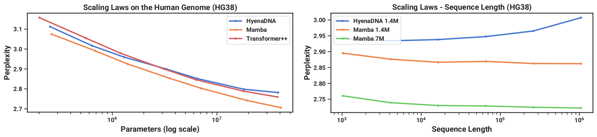

*图 5（原文 Figure 5，第 13 页）：（DNA 缩放律）在 HG38（人类基因组）数据集上预训练。（左）固定短上下文长度 $2^{10}=1024$，把模型从约 200K 增加到约 40M 参数，Mamba 的缩放优于基线。（右）固定模型大小并增加序列长度，同时保持每 batch 的 token 数和总训练 token 数不变。与基线不同，Mamba 的选择机制使性能随上下文长度增加而变好。*

**图中文字翻译与读法**：

- **左图 Scaling Laws on the Human Genome (HG38)（人类基因组上的缩放律）**：横轴 Parameters (log scale)（参数量，对数刻度，约 $2\times10^5$ 到 $4\times10^7$），纵轴 Perplexity（困惑度，越低越好）。图例：HyenaDNA（蓝）、Mamba（橙）、Transformer++（红）。
- **右图 Scaling Laws - Sequence Length (HG38)（序列长度缩放律）**：横轴 Sequence Length（序列长度，$10^3$ 到 $10^6$），纵轴 Perplexity。图例：HyenaDNA 1.4M（蓝）、Mamba 1.4M（橙）、Mamba 7M（绿）。
- **读图结论**（下列数值均为从图上读出的近似值）：左图在最大尺寸约 40M 参数处，Mamba 约 2.71，Transformer++ 约 2.76，HyenaDNA 约 2.78；论文的结论是 Mamba 的困惑度随尺寸平滑改善，在约 40M 处 Mamba 用约 3 到 4 倍更少的参数就能追平 Transformer++ 和 HyenaDNA。右图：HyenaDNA 1.4M 的困惑度随序列长度增大而变差（从约 2.94 升到约 3.01），而 Mamba 1.4M 从约 2.90 降到约 2.86，Mamba 7M 从约 2.76 降到约 2.72，即随上下文增长到 100 万仍在改善。

论文对 HyenaDNA 变差的解释（原文说“符合 3.5 节关于选择机制性质的讨论”，即本文 3.4 节）：LTI 模型不能选择性地忽略信息，从卷积的角度看，一个很长的卷积核在聚合长序列上的所有信息，这些信息可能噪声很大。论文还指出，HyenaDNA 声称随更长上下文改善，但它们的结果没有控制计算时间；附录 B.5 也说 Hyena 和 HyenaDNA 在更长上下文上用了成比例更多的数据，所以难以判断质量改善来自上下文长度还是更多的数据和计算。

**合成物种分类（4.3.3）**：在下游任务上评测，随机采样一段连续 DNA 来区分 5 个不同物种。这个任务改编自 HyenaDNA，它用的物种是 {人、狐猴、小鼠、猪、河马}。论文把任务改得明显更难：区分五种大猩猩科物种 {人类、黑猩猩、大猩猩、猩猩、倭黑猩猩}，已知它们共享 99% 的 DNA。

训练细节（附录 E.3.4）：模型是因果的，所以只用模型输出在序列长度上的最后一个元素接分类头；控制每个梯度步里损失函数中的元素总数。预训练目标覆盖序列长度上所有位置，所以保持 batch_size × sequence_length 不变，即序列越长 batch 越小；而分类任务只有最后一个位置进入损失，所以 batch size 本身保持不变（这也意味着用更长序列微调的计算成本更高）。训练 10 个 epoch，每个 epoch 1024 个梯度步，每步 batch size 64，每个样本独立随机抽取：均匀选物种，均匀选染色体，再均匀选一段连续 DNA。最大上下文超过 $2^{14}=16384$ 的模型用序列长度 warmup：在 $2^{14}$、$2^{15}$、$2^{16}$ 各 1 个 epoch，依此类推直到最大序列长度；例如上下文 $2^{20}$ 的模型先经历 6 个 epoch 的序列长度 warmup，再用最大序列长度训练 4 个 epoch。所有 Hyena 模型学习率 4e-5，所有 Mamba 模型 1e-4（在 {1e-5, 2e-5, 4e-5, 1e-4, 2e-4} 里对较小序列长度 $2^{10},2^{12},2^{14},2^{16}$ 做学习率扫描得到，在 $2^{18}$ 做了简略扫描，$2^{20}$ 只跑一次）；学习率按余弦衰减，带 5 个 epoch 线性 warmup 到最大学习率，再用 5 个 epoch 余弦衰减到 1e-6；这样不寻常的长 warmup 是因为序列长度 warmup 也很长。

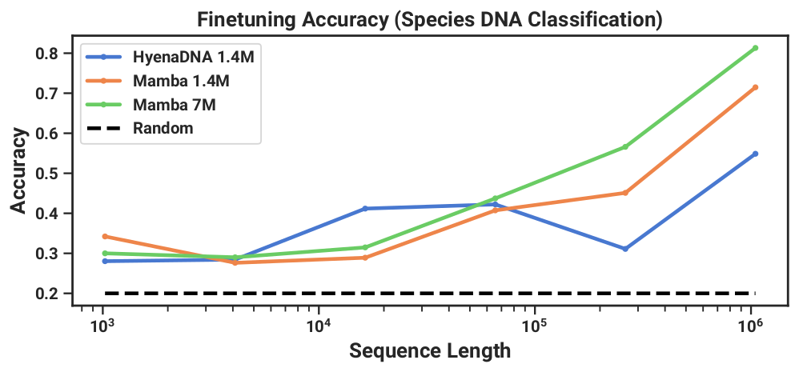

*图 6（原文 Figure 6，第 14 页）：（大猩猩科 DNA 分类）在序列长度 $2^{10}=1024$ 到 $2^{20}=1048576$ 上，用同样上下文长度的预训练模型微调之后的准确率。数字结果见表 13。*

**图中文字翻译与读法**：标题 Finetuning Accuracy (Species DNA Classification)（微调准确率，物种 DNA 分类）；横轴 Sequence Length（序列长度，$10^3$ 到 $10^6$），纵轴 Accuracy（准确率，0.2 到 0.8 以上）。图例 HyenaDNA 1.4M（蓝）、Mamba 1.4M（橙）、Mamba 7M（绿）、Random（黑色虚线，0.2，即五类随机猜测）。**读图结论**：所有模型在最短序列上只比随机水平高一点；序列越长 Mamba 提高越明显，在 $2^{20}$ 处 Mamba 7M 接近 0.81，而 HyenaDNA 在中间长度出现波动（$2^{18}$ 处下降到约 0.31）。数值见下表。

**表 13：大猩猩科 DNA 分类**（在序列长度 $2^{10}=1024$ 到 $2^{20}=1048576$ 上、用同样上下文长度的预训练模型微调之后的准确率 %；随机猜测为 20%）

| 模型 | 参数量 | $2^{10}$ | $2^{12}$ | $2^{14}$ | $2^{16}$ | $2^{18}$ | $2^{20}$ |
|---|---|---:|---:|---:|---:|---:|---:|
| HyenaDNA | 1.4M | 28.04 | 28.43 | 41.17 | 42.22 | 31.10 | 54.87 |
| Mamba | 1.4M | 31.47 | 27.50 | 27.66 | 40.72 | 42.41 | **71.67** |
| Mamba | 7M | 30.00 | 29.01 | 31.48 | 43.73 | 56.60 | **81.31** |

（原文表 13，第 34 页；原文粗体标出 $2^{20}$ 处 Mamba 的 71.67 与 81.31。）读法：在 $2^{20}$ 长度下，Mamba 1.4M 为 71.67、Mamba 7M 为 81.31，而 HyenaDNA 1.4M 只有 54.87。需要注意的是：在较短序列（$2^{14}$ 及以下）上 Mamba 并不占优，例如 $2^{14}$ 处 HyenaDNA 为 41.17，Mamba 1.4M 只有 27.66、Mamba 7M 为 31.48；$2^{16}$ 处 Mamba 1.4M（40.72）略低于 HyenaDNA（42.22）。Mamba 的优势主要出现在 $2^{18}$ 及更长的序列上。每个长度的数字都是一次微调的结果，论文没有给出方差。

### 6.4 音频建模与生成

音频波形模态主要与 SaShiMi 架构及训练协议（Goel et al. 2022）比较。该模型包含：（1）一个 U-Net 骨干，有两级以因子 $p$ 池化，每级把模型维度 $D$ 加倍；（2）每级里交替的 S4 和 MLP 块。论文考虑把 S4+MLP 块换成 Mamba 块。实验细节见附录 E.4。

#### 6.4.1 长上下文自回归预训练（YouTubeMix）

在 YouTubeMix（DeepSound 2017）上评测预训练质量（自回归的下一采样点预测），这是此前工作常用的标准钢琴音乐数据集，包含 4 小时独奏钢琴音乐，采样率 16000 Hz。预训练细节大体遵循标准语言建模设置（6.2 节）。图 7 评测训练序列长度从 $2^{13}=8192$ 增加到 $2^{20}\approx10^6$ 的影响，同时保持计算量固定。（数据整理方式有一些边界情况，可能导致缩放曲线出现拐折，例如只有一分钟长的片段可用，所以最大序列长度实际上受限于 $60\,\mathrm{s}\cdot16000\,\mathrm{Hz}=960000$。）主要指标是 bits per byte（BPB），它是其他模态预训练用的标准负对数似然（NLL）损失的一个常数因子 $\log2$。论文特别说明：这是全文唯一把实数参数化换成复数参数化的实验（原文 3.6 节，即本文 3.5 节）。

**附录 E.4.1 细节**：模型每级 3 个块（共 $3\times5=15$ 个 Mamba 块），池化因子 $p=16$，外层维度 $D=64$，约 3.5M 参数。数据用 8 位 mu-law 编码，所以模型建模的是词表大小 256 的离散 token；数据集由长达 1 分钟（长度 960000）的片段组成，被下采样并切分成任意所需序列长度的段。因为架构有两级以因子 16 的池化，并希望得到的序列长度是 8 的倍数以保证硬件效率，所以最长序列是 $468\times2048=958464$，其余序列长度由连续减半并向上取整到 2048 的倍数得到。训练 200K 步，最大学习率 0.002，20K（10%）步 warmup，权重衰减 0.1。

**表 14：YouTubeMix 长度缩放所用的序列长度与 batch size**

| 序列长度 | batch size | 每 batch 的 token 数 |
|---|---:|---:|
| $468\times2048=958464$ | 1 | 958464 |
| $234\times2048=479232$ | 2 | 958464 |
| $117\times2048=239616$ | 4 | 958464 |
| $59\times2048=120832$ | 8 | 966656 |
| $30\times2048=61440$ | 16 | 983040 |
| $15\times2048=30720$ | 32 | 983040 |
| $8\times2048=16384$ | 64 | 1048576 |
| $4\times2048=8192$ | 128 | 1048576 |

（原文表 14，第 34 页。）读法：序列越长 batch 越小，每个 batch 的 token 数基本固定在约 100 万（这就是“保持计算量固定”）。论文说明除了 batch size 变化，不同序列长度下训练集有效段数不同（每个 epoch 的训练步数不是常数），这可能造成缩放曲线的拐折。

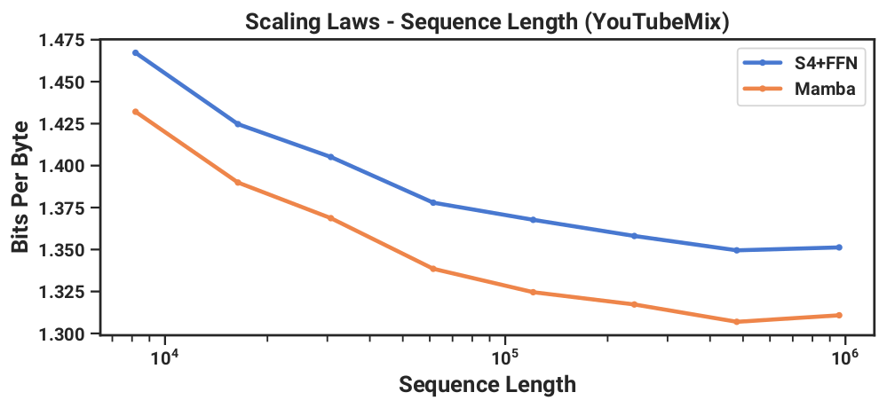

*图 7（原文 Figure 7，第 14 页）：（音频预训练）Mamba 在自回归音频建模上改进了此前的最好结果（SaShiMi），并随上下文增长到分钟级或百万长度序列而继续改善（控制了计算量）。*

**图中文字翻译与读法**：标题 Scaling Laws - Sequence Length (YouTubeMix)；横轴 Sequence Length（序列长度，约 $8\times10^3$ 到 $10^6$，对数刻度），纵轴 Bits Per Byte（越低越好）；图例 S4+FFN（蓝，即 SaShiMi 基线）和 Mamba（橙）。**读图结论**（近似值，从图上读出）：两条曲线都随序列变长而下降，Mamba 始终更低，差距在长序列处略有扩大：序列长度 8192 时 S4+FFN 约 1.467、Mamba 约 1.432；序列约 47.9 万时 S4+FFN 约 1.350、Mamba 约 1.307；最后一点（958464）两者都略有回升（论文提醒数据整理方式可能造成曲线拐折）。

**Mamba 与 SaShiMi 的消融（附录 E.4.1，图 10）**：研究长音频波形预训练下的 SSM 参数化。设置相对图 7 略作修改：用更大的模型（8 层、$D=64$，约 6M 参数，是 SaShiMi 默认），更短的序列（$2^{11}=2048$ 到 $2^{18}=262144$，而不是 $2^{13}$ 到 $2^{20}$），更低的学习率（0.001，原为 0.002），更短的训练周期（100K 步，原为 200K 步）。

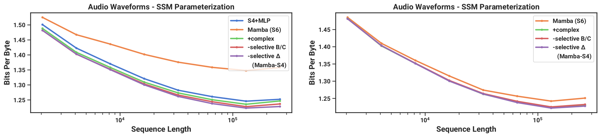

*图 10（原文 Figure 10，第 35 页）：（音频预训练（YouTubeMix）消融）作为均匀采样的“连续”信号模态，音频波形实际上受益于与之归纳偏置匹配的 LTI 模型。（左）同质模型（所有块用同样的参数化）；（右）只消融 U-Net 的中心块，外层块都是 Mamba-S4。紫线与左图相同。*

**图中文字翻译与读法**：

- 标题 Audio Waveforms - SSM Parameterization（音频波形：SSM 参数化）；横轴 Sequence Length（序列长度，约 $2\times10^3$ 到 $2.6\times10^5$），纵轴 Bits Per Byte（越低越好）。
- 图例：S4+MLP（蓝）、Mamba (S6)（橙，默认的选择性 Mamba）、+complex（绿，在去掉选择性的基础上改用复数）、-selective B/C（红，B 和 C 不选择性）、-selective Δ (Mamba-S4)（紫，Δ 也不选择性，即得到 Mamba-S4，论文用 Mamba-S4 区别于默认的 Mamba-S6）；右图没有 S4+MLP 一项。
- **读图结论**：左图中默认的 Mamba (S6)（橙）明显比去掉选择性的变体差：例如序列长度约 $1.3\times10^5$ 处，Mamba (S6) 约 1.35，而 S4+MLP 约 1.25，去掉选择性的几条线约 1.22 到 1.24（近似值，从图上读出）。也就是从 S4 变到 S6（引入选择机制）并不总是有益，在长音频波形上反而显著损害性能。论文的解释是：音频是均匀采样且很平滑的信号，受益于连续的线性时间不变（LTI）方法。右图只消融 U-Net 的中心块、外层块保持 Mamba-S4，性能差异显著缩小，论文据此认为：靠近原始音频信号的层应该是 LTI 的，而一旦被外层“token 化”并压缩，内层就不再需要是 LTI。在这个设置里，实数 SSM 仍然不如复数 SSM。

#### 6.4.2 自回归语音生成（SC09）

SC09 是一个语音生成基准数据集（Donahue, McAuley, and Puckette 2019；Warden 2018），由数字 “zero” 到 “nine” 的 1 秒、16000 Hz 采样的音频片段组成，特征高度多变。论文大体遵循 Goel et al. (2022) 的自回归训练设置和生成协议。

训练细节（附录 E.4.2）：大体遵循自回归语言建模协议：权重衰减 0.1；学习率 warmup 占总步数 10%；AdamW，$\beta=(0.9,0.95)$；梯度裁剪值 0.1；学习率 0.002，训练 200000 步，batch size 16。表 4 里的大 Mamba 模型每级 15 层、外层维度 $D=96$、池化因子 4。该数据集很小（训练过了 100 个 epoch），对这个大模型，BPB 或 NLL 出现了明显过拟合，但生成样本的自动指标在整个训练期间持续改善。

**表 4：SC09 无条件生成的自动指标**（自上而下依次为自回归基线、非自回归基线、Mamba、数据集本身的指标。NLL、FID、AM 越低越好，IS、mIS 越高越好；这些指标的定义原文未重述）

| 模型 | 参数量 | NLL ↓ | FID ↓ | IS ↑ | mIS ↑ | AM ↓ |
|---|---|---:|---:|---:|---:|---:|
| SampleRNN | 35.0M | 2.042 | 8.96 | 1.71 | 3.02 | 1.76 |
| WaveNet | 4.2M | 1.925 | 5.08 | 2.27 | 5.80 | 1.47 |
| SaShiMi | 5.8M | 1.873 | 1.99 | 5.13 | 42.57 | 0.74 |
| WaveGAN | 19.1M | - | 2.03 | 4.90 | 36.10 | 0.80 |
| DiffWave | 24.1M | - | 1.92 | 5.26 | 51.21 | 0.68 |
| + SaShiMi | 23.0M | - | 1.42 | 5.94 | 69.17 | 0.59 |
| Mamba | 6.1M | **1.852** | 0.94 | 6.26 | 88.54 | 0.52 |
| Mamba | 24.3M | 1.860 | **0.67** | **7.33** | **144.9** | **0.36** |
| Train（训练集） | - | - | 0.00 | 8.56 | 292.5 | 0.16 |
| Test（测试集） | - | - | 0.02 | 8.33 | 257.6 | 0.19 |

（原文表 4，第 15 页；原文用下划线标出了 Mamba 6.1M 的 FID、IS、mIS、AM 与 Mamba 24.3M 的 NLL，原文未解释下划线，通常表示次优，此处未标记。）读法：一个小的 Mamba 模型（6.1M）就超过了最好的（并且大得多的）基于 GAN 和扩散的模型（FID 0.94 对 DiffWave + SaShiMi 的 1.42）；与参数量匹配基线的较大 Mamba（24.3M）在保真度指标上进一步显著改善（FID 0.67、mIS 144.9）。摘要说的“把 FID 降低一半以上”对应 24.3M 模型（0.67 对 1.42，约为 47%，笔者相除）；6.1M 模型的 0.94 约为 66%。需要注意 NLL 一栏 24.3M 的 Mamba（1.860）反而比 6.1M 的（1.852）差，这与上面所说大模型过拟合 NLL 一致。

**表 5：SC09 模型消融**（6M 参数的模型。SaShiMi 的 U-Net 骨干里，8 个中心块作用在序列长度 1000 上，两侧各夹 8 个作用在长度 4000 的外层块，再两侧各夹 8 个作用在长度 16000 的外层块（共 40 个块）。8 个中心块的架构独立于其余部分做消融。注意：由于效率限制，没有在更重要的外层块里测试 Transformer（MHA+MLP））

| 外层（Outer） | 中心（Center） | NLL ↓ | FID ↓ | IS ↑ | mIS ↑ | AM ↓ |
|---|---|---:|---:|---:|---:|---:|
| S4+MLP | MHA+MLP | 1.859 | 1.45 | 5.06 | 47.03 | 0.70 |
| S4+MLP | S4+MLP | 1.867 | 1.43 | 5.42 | 53.54 | 0.65 |
| S4+MLP | Mamba | 1.859 | 1.42 | 5.71 | 56.51 | 0.64 |
| Mamba | MHA+MLP | **1.850** | 1.37 | 5.63 | 58.23 | 0.62 |
| Mamba | S4+MLP | 1.853 | 1.07 | 6.05 | 73.34 | 0.55 |
| Mamba | Mamba | 1.852 | **0.94** | **6.26** | **88.54** | **0.52** |

（原文表 5，第 15 页；原文用下划线标出的次优项未在此标记。）读法：外层块里 Mamba 一致地优于 S4+MLP；中心块里 Mamba > S4+MLP > MHA+MLP（以 FID 论：0.94 < 1.07 < 1.37）。各块参数量：S4+MLP 块约 $2D^2+4D^2$（MLP 扩展因子 2），Transformer 块 $4D^2+2D^2$（MLP 扩展因子 1），Mamba 块约 $6D^2$，所有模型总参数约 6M，表 5 的模型每级 8 层、外层维度 $D=64$、池化因子 4。

### 6.5 速度与显存基准

论文在图 8 里测了 SSM 扫描运算（状态扩展 $N=16$）的速度，以及 Mamba 的端到端推理吞吐。自研的 SSM 扫描在序列长度超过 2K 后比论文所知最好的 attention 实现（FlashAttention-2，Dao 2024）更快，且最多比 PyTorch 里标准的扫描实现快 20 到 40 倍。Mamba 的推理吞吐比同等大小的 Transformer 高 4 到 5 倍，因为没有 KV cache，可以用大得多的 batch。例如（未训练的）Mamba-6.9B 的推理吞吐比 5 倍小的 Transformer-1.3B 还高。

**测试设置**（附录 E.5）：

- **扫描算子**：在 A100 80GB PCIe GPU 上，把 selective SSM 的核心运算（并行扫描）与卷积和 attention 比较；不包含核心运算之外的其他运算的成本，例如全局卷积模型里计算卷积核，或 attention 里计算 QKV 投影。基线：PyTorch 里实现的标准并行扫描（无 kernel 融合，需要在 HBM 里物化参数 $\bar A,\bar B,C$）；卷积用 PyTorch 标准实现（对输入和滤波器分别做 FFT，在频域相乘，再做逆 FFT，理论复杂度 $O(L\log L)$）；attention 用论文所知最快的实现 FlashAttention-2，带因果 mask（因果 mask 的 FlashAttention-2 比无 mask 约快 1.7 倍，因为大约只计算一半的 attention 元素）。batch size 1，序列长度从 $2^9=512$、$2^{10}\approx1K$、$2^{11}\approx2K$ 一直增加到 $2^{19}\approx500K$（部分基线在到达 500K 之前显存溢出）；模型维度 $D=1024$，状态维度 $N=16$；用 BF16 输入，这是大规模训练最常用的数据类型。
- **端到端推理**：测 Mamba 1.4B 和一个未训练的 Mamba 6.9B 的推理吞吐，对比标准 Transformer（GPT-3 架构）1.3B 和 6.7B，用 HuggingFace transformers 库里的标准 Transformer 实现。提示长度 2048，生成长度 128；batch size 从 1、2、4、8、16、32、64 到 128，测生成 128 个 token 所需时间，吞吐（tokens/s）= batch size × 128 / 所用时间；重复测量 3 次取平均；在 A100 80GB PCIe 上测量。
- **显存**：显存用量按激活张量大小成比例增长（与多数深度序列模型一致）。在 1 块 A100 80GB 上测 125M 模型的训练显存需求，每个 batch 由长度 2048 的序列组成。对比论文所知显存效率最高的 Transformer 实现（用 torch.compile 的 kernel 融合和 FlashAttention-2）。

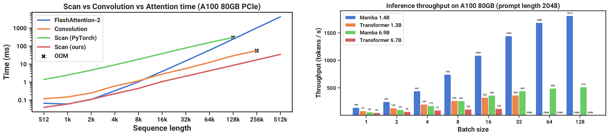

*图 8（原文 Figure 8，第 15 页）：（效率基准）（左）训练：论文的高效扫描比标准实现快 40 倍。（右）推理：作为循环模型，Mamba 的吞吐可以比 Transformer 高 5 倍。*

**图中文字翻译与读法**：

- **左图 Scan vs Convolution vs Attention time (A100 80GB PCIe)（扫描、卷积与 attention 的耗时）**：横轴 Sequence length（序列长度，512 到 512k），纵轴 Time (ms)（耗时，毫秒，对数刻度）。图例：FlashAttention-2（蓝）、Convolution（橙，FFT 卷积）、Scan (PyTorch)（绿，标准扫描实现）、Scan (ours)（红，论文的融合扫描）、OOM（黑色叉号，显存溢出）。PyTorch 扫描在 128k 处显存溢出，卷积在 256k 处显存溢出。
- **右图 Inference throughput on A100 80GB (prompt length 2048)（A100 80GB 上的推理吞吐，提示长度 2048）**：横轴 Batch size（1 到 128），纵轴 Throughput (tokens / s)（吞吐）。四种柱：Mamba 1.4B（蓝）、Transformer 1.3B（橙）、Mamba 6.9B（绿）、Transformer 6.7B（红）；柱上的数字是吞吐，OOM 表示显存溢出。

**读图结论**（从图上读出的近似值或柱上标注的数字）：

- 左图：自研扫描（红）的耗时随序列长度线性增长（每翻倍约翻倍，512 处约 0.04 ms、512k 处约 35 ms）；FlashAttention-2（蓝）二次增长（512k 处约 4000 ms）；两者在 2k 附近相交（都约 0.11 ms），之后自研扫描更快，32k 处约 2.1 ms 对约 15 ms，约 7 倍，与附录 D 的“序列长度 32K 时最多比 attention 快 7 倍”一致。PyTorch 标准扫描（绿）比自研扫描慢约 35 倍（例如 512 处约 1.4 ms 对约 0.04 ms）。
- 右图：Mamba 1.4B 的吞吐随 batch 增大持续上升，batch 128 时为 1814 tokens/s；Transformer 1.3B 在 batch 32 时只有 364，batch 64 起显存溢出；Transformer 6.7B 在 batch 16 为 120，batch 32 起溢出，而 Mamba 6.9B 在 batch 128 仍可达 515。笔者相除：同为 batch 32 时 Mamba 1.4B 对 Transformer 1.3B 约为 1445/364≈4.0 倍；各自取可达的最大 batch 时约为 1814/364≈5.0 倍，所以“4 到 5 倍”主要来自 Mamba 没有 KV cache、能用大得多的 batch（这也是论文的解释）；Mamba 6.9B 的 515 高于 Transformer 1.3B 的最高 364。

**表 15：显存基准**（125M 模型的训练显存，序列长度 2048；Mamba 的显存占用与最优化的 Transformer 相当）

| batch size | Transformer（用 FlashAttention-2） | Mamba |
|---:|---:|---:|
| 1 | 4.6GB | 4.8GB |
| 2 | 5.2GB | 5.8GB |
| 4 | 6.9GB | 7.3GB |
| 8 | 11.5GB | 12.3GB |
| 16 | 20.7GB | 23.1GB |
| 32 | 34.5GB | 38.2GB |

（原文表 15，第 36 页。）读法：Mamba 比最优化的 Transformer 多用约 4% 到 12%（笔者相除），论文预期今后 Mamba 的显存占用还会改进。

### 6.6 模型消融

消融聚焦于约 350M 大小的语言建模模型，用 Chinchilla token 数训练（与图 4 同样的设定）。

#### 6.6.1 架构与内部 SSM 层

表 6 研究架构（块）及其内部 SSM 层（图 3）的影响。

**表 6：消融：架构与 SSM 层**（语言模型困惑度，越低越好；S4 (real) 是 S4D-Real，S4 (complex) 是 S4D-Lin）

| 模型 | 架构（Arch.） | SSM 层 | 困惑度 |
|---|---|---|---:|
| Hyena | H3 | Hyena | 10.24 |
| H3 | H3 | S4 (complex) | 10.30 |
| - | H3 | S4 (real) | 10.34 |
| - | H3 | S6 | 8.95 |
| - | Mamba | Hyena | 10.75 |
| - | Mamba | S4 (complex) | 10.54 |
| - | Mamba | S4 (real) | 10.56 |
| Mamba | Mamba | S6 | **8.69** |

（原文表 6，第 16 页；原表左右两栏在此合并为上下两组。）论文的结论：

- 此前的非选择性（LTI）SSM 等价于全局卷积，各种参数化之间性能很相近。
- 把原有复数 S4 变体换成实数变体对性能影响不大，说明（至少对语言建模）考虑硬件效率时实数 SSM 可能是更好的选择。
- 把其中任何一个换成选择性 SSM（S6）都显著改善性能，验证了第三节的动机。
- Mamba 架构与 H3 架构性能相近（在使用选择性层时似乎略好）。

笔者补充数字：用 LTI 层时 Mamba 架构比 H3 架构差 0.22 到 0.51（例如 S4 (real)：10.56 对 10.34），用 S6 时则好 0.26（8.69 对 8.95）；所以 Mamba 块的优势只在配合选择性层时才出现，它的主要价值是在同样性能下更简单（把 H3 和 MLP 合成了一个块）。

论文还在附录 E.2.2 研究把 Mamba 块与其他块（MLP、MHA）交错的影响，见图 9。

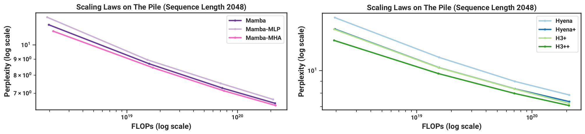

*图 9（原文 Figure 9，第 31 页）：（缩放律：额外消融）原文图题在此处不完整，只印出“(Left) Instead of (Right) Instead of”，缺失了后文。依据正文：左图比较 Mamba 与把 Mamba 块和 MLP 或 MHA 块交错的变体；右图比较 Hyena、Hyena+、H3+、H3++ 的训练配方与架构。*

**图中文字翻译与读法**：

- 两张图都是 Scaling Laws on The Pile (Sequence Length 2048)；横轴 FLOPs (log scale)，纵轴 Perplexity (log scale)。
- **左图图例**：Mamba（深紫）、Mamba-MLP（浅紫，Mamba 块与标准 MLP 块交错）、Mamba-MHA（粉，Mamba 块与 MHA 块交错）。
- **右图图例**：Hyena（浅蓝，原架构和 GPT-3 训练配方，同图 4）、Hyena+（深蓝，同架构加改进配方）、H3+（浅绿，把 Hyena 卷积核换成 S4D 卷积核）、H3++（深绿，H3+ 再把线性 attention 头维度设为 8）。
- **读图结论**：左图 Mamba-MLP 比 Mamba 略差、Mamba-MHA 比 Mamba 略好，三条线很接近；右图 Hyena 最差，Hyena+ 与 H3+ 几乎重合，H3++ 最好。正文里第一次引用“Figure 9 (Right)”讲的是 Mamba-MLP/Mamba-MHA，应是“Left”的笔误（笔者核对图后的判断）。

附录 E.2.2 的解读：Mamba 架构的“交错块”消融把 Mamba 块看成标准的 SwiGLU 块再加一条额外的 conv → SSM 路径，得到两个自然的消融：如果 Mamba 块与标准 MLP 块交错而不是同质堆叠会怎样（也可以解释成拿掉了一半的 SSM）？如果与 MHA 块交错会怎样（也可以解释成给 Transformer++ 的 MLP 块加上 SSM）？结果：两种改变都没有太大影响。Mamba-MLP 架构只是略差，仍然好于除 Transformer++ 之外的所有模型；Mamba-MHA 架构只是略好，这有点出人意料，因为许多近期工作发现把（LTI）SSM 与 attention 结合能带来大幅改进。

H3 架构的训练配方消融：（Hyena 和 H3++ 是论文除 Transformer++ 和 Mamba 之外最弱和最强的模型，用来分离训练配方的影响）约定“Model+”表示用改进训练配方的基础模型，“Model++”还允许架构改动。结论：（1）改进训练配方带来大幅改善，图 4 里的许多模型（RetNet、H3++、Transformer++、Mamba）都用了它；（2）内部 LTI SSM 的选择不重要（如 Hyena 对 S4），与全文发现一致；（3）头维度扩展提高性能，与论文的一个主题一致：扩展的状态维度提高 SSM 性能（第三节）。

#### 6.6.2 选择性 SSM 内部：哪些参数选择性、$A$ 怎么初始化、$\Delta$ 与状态维度

表 7 通过考虑选择性 $\Delta$、$B$、$C$ 的不同组合来消融选择性 SSM 层（Algorithm 2）。

**表 7：消融：选择性参数**（困惑度越低越好；✓ 表示该参数是选择性的，✗ 表示不是）

| 选择性 $\Delta$ | 选择性 $B$ | 选择性 $C$ | 困惑度 |
|:-:|:-:|:-:|---:|
| ✗ | ✗ | ✗ | 10.93 |
| ✗ | ✓ | ✗ | 10.15 |
| ✗ | ✗ | ✓ | 9.98 |
| ✓ | ✗ | ✗ | 9.81 |
| ✓ | ✓ | ✓ | 8.71 |

（原文表 7，第 16 页。）论文的结论：$\Delta$ 是最重要的参数（因为 Theorem 1 的联系），但几种选择性参数一起使用有协同效应。笔者核对：单独让 $\Delta$、$B$、$C$ 选择性分别使困惑度降低 1.12、0.78、0.95，三者之和为 2.85，而全部选择性共降低 2.22，所以组合的收益小于单项收益之和，说法应理解为“互补”（组合优于任何单项），而不是“叠加”。

表 8 研究 SSM 的不同初始化，它们在某些数据模态和设置里已被证明影响很大。

**表 8：消融：$A$ 的参数化**（SSM 为选择性时，基于 S4D-Lin 的更标准初始化比 S4D-Real 或随机初始化差）

| $A_n$ 初始化 | 域 | 困惑度 |
|---|---|---:|
| $A_n=-\tfrac12+ni$ | 复数 | 9.16 |
| $A_n=-1/2$ | 实数 | 8.85 |
| $A_n=-(n+1)$ | 实数 | 8.71 |
| $A_n\sim\exp(\mathcal{N}(0,1))$ | 实数 | 8.71 |

（原文表 8，第 16 页；最后一行原文如此写作 $\exp(\mathcal{N}(0,1))$，没有说明符号约定。）读法：语言建模上，更简单的实数对角初始化（S4D-Real，第 3 行）比更标准的复数参数化（S4D-Lin，第 1 行）更好；随机初始化也很有效，与 Mehta et al. (2023) 的发现一致。

表 9 和表 10 分别考虑改变 $\Delta$ 和 $(B,C)$ 投影的维度。把它们从静态变成选择性提供最多收益，而进一步增大维度通常只带来适度的改善，参数量略有增加。

**表 9：消融：$\Delta$ 的表达力**（$\Delta$ 的选择机制是用输入的一个投影构造它；即使投影到 1 维也带来大幅性能提升，继续增大带来进一步改善但参数量略增；状态维度固定为 $N=16$；“-”表示 $\Delta$ 不做投影）

| $\Delta$ 投影的维度 | 参数量（M） | 困惑度 |
|---|---:|---:|
| - | 358.9 | 9.12 |
| 1 | 359.1 | 8.97 |
| 2 | 359.3 | 8.97 |
| 4 | 359.7 | 8.91 |
| 8 | 360.5 | 8.83 |
| 16 | 362.1 | 8.84 |
| 32 | 365.2 | 8.80 |
| 64 | 371.5 | 8.71 |

（原文表 9，第 17 页。）

**表 10：消融：SSM 状态维度**（上半部分：$B$ 和 $C$ 为常数；下半部分：$B$ 和 $C$ 选择性。增大 SSM 状态维度 $N$（可视为循环状态维度上的扩展因子）可以在参数量/FLOPs 代价可忽略的情况下显著提升性能，但只有在 $B$ 和 $C$ 也选择性时才如此。$\Delta$ 投影大小固定为 64）

| 状态维度 $N$ | 参数量（M） | 困惑度（$B,C$ 常数） | 困惑度（$B,C$ 选择性） |
|---:|---:|---:|---:|
| 1 | 367.1 | 9.88 | 9.73 |
| 2 | 367.4 | 9.86 | 9.40 |
| 4 | 368.0 | 9.82 | 9.09 |
| 8 | 369.1 | 9.82 | 8.84 |
| 16 | 371.5 | 9.81 | 8.71 |

（原文表 10，第 17 页；原文把两部分上下排列，这里并成两列。）读法：$B,C$ 为常数时，状态从 1 增到 16 只把困惑度从 9.88 降到 9.81，几乎没用；$B,C$ 选择性时从 9.73 降到 8.71。论文特别指出：选择性 SSM 在增大状态维度 $N$ 时有显著改善，改善超过 1.0 困惑度，而代价只是约 1% 的额外参数（笔者核对：367.1M 到 371.5M 增加 1.2%，9.73 到 8.71 改善 1.02）。这验证了本文 3.1 节和第四节的核心动机：选择机制使大的状态有用，而硬件感知算法使大的状态便宜。

## 七、讨论与局限

论文自己在原文第 5 节（Discussion）指出的限制和问题：

- **没有免费午餐：连续到离散的谱**。结构化 SSM 原本被定义为连续系统的离散化，对感知信号（音频、视频）等连续时间模态有很强的归纳偏置。选择机制克服了它们在文本和 DNA 等离散模态上的弱点，但反过来可能妨碍它们在 LTI SSM 擅长的数据上的表现（图 10 的音频消融就是证据）。
- **下游功能（Downstream Affordances）**。基于 Transformer 的基础模型（尤其是 LLM）有一整套丰富的性质和交互方式：微调、适配、提示（prompting）、上下文学习、指令微调、RLHF、量化等。论文特别关心 SSM 这类 Transformer 替代品是否有类似的性质，但这篇论文没有回答。
- **规模**。实证评估限于小模型尺寸，低于多数强开源 LLM（例如 Llama）以及其他循环模型如 RWKV 和 RetNet 的尺寸（它们已在 70 亿参数及以上评测过）。Mamba 在这些更大尺寸上是否仍然更优还有待评估。论文还指出，扩展 SSM 可能涉及这篇论文没有讨论的更多工程挑战和模型调整。

## 八、证据边界与常见误读

### 8.1 证据边界

1. **模型规模小**：最大的语言模型只有 2.8B 参数，用 300B token 训练；缩放律只到约 1.3B。“追平 Transformer++”的结论限于这个规模、Pile 数据、2K 与 8K 上下文。
2. **图 4 的优势主要在长序列**：序列长度 2048 时 Mamba 与 Transformer++ 几乎重合，差异在 8192 才显现；RWKV 和 RetNet 在 8192 缺完整数据点。
3. **零样本表的对比条件不一**：只有 Pythia 和 RWKV 与 Mamba 同分词器、同数据集、同 300B token；GPT-Neo、OPT、Hybrid H3 在数据和分词器上不同；Mamba 与 Pythia 上下文 2048，RWKV 为 1024。
4. **合成任务是玩具规模**：2 层小模型、词表只有 16；“外推到百万长度”只在 Induction Heads 这个人造任务上成立，并不等于真实文本里的任意检索能力。
5. **DNA 的比较里有不对称的调参**：Mamba 的最优学习率（8e-3）与基线（2e-3）不同；论文说明匹配学习率时 Mamba 也更好，但没有给出完整结果。DNA 模型都很小（预训练 ≤40M，分类 1.4M 和 7M），分类的每个数字只来自一次微调，没有方差；并且在较短序列（$2^{14}$ 及以下）上 Mamba 并不优于 HyenaDNA。
6. **音频结果的不同面**：选择机制在原始音频层有害；YouTubeMix 的最佳结果用的是复数参数化；SC09 大模型的 NLL 过拟合。
7. **效率结论的条件**：基准在 A100 80GB PCIe 上；扫描基准只含核心算子；端到端推理里的 Transformer 基线是 HuggingFace 的标准实现，不是最优化的推理引擎；训练显存略高于带 FlashAttention-2 的 Transformer（多约 4% 到 12%）。
8. **“协同”的说法偏强**：表 7 里三个参数一起选择性的收益小于单项收益之和。
9. **论文文本里的几处小出入**：图 9 的原文图题不完整，正文把 Mamba-MLP/Mamba-MHA 的图写成“Right”；原文 4.5 节写“推理吞吐 4 到 5 倍”，摘要写“5 倍”，图 8 里 5 倍对应于 Mamba 用最大 batch 对 Transformer 的最大可用 batch。

### 8.2 常见误读

- **“Mamba 没有记忆”或“Mamba 有无限记忆”**：都不对。它把随长度增长的 KV cache 换成固定大小（每层 $ED\times N$ 量级）的循环状态，信息要被压缩；选择机制的作用正是决定哪些信息值得压进状态。
- **“选择性 = 门控乘法”**：论文附录 A 专门澄清：架构里“元素乘法的门”（如 GLU）不沿序列方向交互，不能改变 token 间距，本身不是选择机制；选择机制指模型主动选择或忽略输入，并让数据沿序列长度交互，与 RNN 的经典门控（Theorem 1）最接近。
- **“SSM 都能写成卷积”**：只有 LTI SSM 才能；选择性 SSM 只能用扫描。
- **“线性复杂度就一定更快”**：理论 $O(BLDN)$ 不自动等于实际更快；PyTorch 标准扫描比 FlashAttention-2 在长序列上还慢（图 8 左），要靠 kernel 融合和重计算才能兑现，并且在序列不超过约 2K 时两者耗时相近。
- **“推理吞吐 5 倍是因为 kernel 更快”**：论文的解释是主要因为没有 KV cache，所以可以用大得多的 batch。
- **“Mamba 证明了 attention 没用”**：论文自己的消融里，Mamba 块与 MHA 交错只略有改善；论文没有声称 attention 对所有任务多余，也没有在真实文本的长上下文检索任务上评测（只有合成的 Induction Heads 和零样本常识任务）。

## 九、复现检查清单

- 块结构：扩展因子 $E=2$；两个 Mamba 块对应一个 Transformer“层”；输入两路投影、一路 Conv→SiLU→SSM，另一路 SiLU 作门，相乘后输出投影；可选 LayerNorm；标准归一化加残差。
- SSM：对角 $A$、每通道独立的 SISO；默认实数；$A_n=-(n+1)$（S4D-Real）；状态维度 $N=16$（效率基准和表 10 的默认值）；$B_t,C_t=\mathrm{Linear}_N(x_t)$；$\Delta=\mathrm{softplus}(\text{偏置}+\mathrm{Linear}_R(x_t)\text{广播})$，$\Delta$ 偏置初始化为 $\tau_\Delta^{-1}(\mathrm{Uniform}([0.001,0.1]))$，投影维度 $R$ 见表 9（表 10 里固定为 64）。
- 数值稳定性：$A$ 取负实数（S4D-Real）使 $0<\bar A<1$，$\Delta$ 经 softplus 保证为正，初值落在 0.001 到 0.1；论文给出了这些默认值，但没有专门做稳定性分析，换参数化或初始化时要自行检查。
- 训练：AdamW，$\beta=(0.9,0.95)$，权重衰减 0.1，无 dropout，梯度裁剪 1.0，线性 warmup 加余弦衰减到 1e-5，峰值学习率为 GPT-3 规格的 5 倍，无线性偏置，RMSNorm；缩放律 batch 0.5M token，下游 1.3B 用 1M token；Chinchilla token 数。
- 评测：Pile 验证集困惑度只与同分词器同数据的模型比较；零样本用 LM evaluation harness，LAMBADA、WinoGrande、PIQA、ARC-easy 报告准确率，HellaSwag、ARC-challenge 报告按长度归一化的准确率。
- 实现：selective scan 必须融合离散化、扫描和与 $C$ 的乘法，避免把 `(B, L, D, N)` 的中间状态写回 HBM；序列超出 SRAM 时分块并传递状态；反向用重计算；整个块里便宜的激活也重算。
- 基准：训练吞吐、prefill 和单 token 解码分开测量；明确 GPU 型号、batch、提示长度和生成长度；对比 FlashAttention-2 要用因果 mask。
- 状态管理：把多个文档打包进同一序列时，在文档边界重置状态（让 $\Delta\to\infty$ 或显式清零），否则 LTI 与选择性模型都会在文档间泄漏信息。

## 十、附录 A、B 的要点与相关论文

### 10.1 附录 A、B 的要点

**附录 A：选择机制与门控、超网络、数据依赖的区别**。选择机制与“门控”“超网络”“数据依赖”等概念有关，也可以看作与“快权重”（fast weights，连接经典 RNN 与线性 attention）有关，但论文认为它是一个值得澄清的独立概念：

- 门控原指 LSTM、GRU 的门控机制，即式 (5) 的门，控制是否让输入进入 RNN 的隐状态，影响信号随时间的传播，使输入沿序列长度维度交互。后来“门控”被放宽成泛指任何乘法交互，不沿序列长度交互的逐元素乘法组件也被称为门控架构，与原意很不同。
- 超网络是参数由更小的网络生成的网络；数据依赖则泛指模型的某些参数依赖数据。
- 例子：对角线性层 $y=Dx$，若 $D=\sigma(Wx)$ 由 $x$ 线性变换生成，则 $y=\sigma(Wx)\circ x$。这个平凡的变换在技术上同时满足门控（有乘法分支）、超网络（参数由另一层生成）、数据依赖（$D$ 依赖 $x$）的常见含义，但它其实只是一个 GLU 函数，简单到常被当作激活函数而不是有意义的层。
- 所以选择机制虽可算作这些想法的特例，但任何带乘法的构造（包括标准 attention）也都可以，论文认为这样看没有信息量。论文把选择专指模型选择或忽略输入、并促进数据沿序列长度交互的机制，与传统 RNN 的门控最接近（Theorem 1），并因此不再用“gating”一词。其他例子可能还有输入相关的卷积，甚至 attention。

**附录 B.1：S4 的变体与衍生**。

- **S4**（Gu, Goel, and Ré 2022）：第一个结构化 SSM，描述了对角结构和对角加低秩（DPLR）；因与连续时间在线记忆（HiPPO）的联系而专注于 DPLR 的卷积算法。
- **DSS、S4D**：DSS 首先发现对角结构 SSM 经验上有效（通过近似 HiPPO 初始化），S4D 从理论上展开。
- **S5**（Smith, Warrington, and Linderman 2023）：独立发现对角近似，是第一个用并行扫描递推计算的 S4 模型，但为此要降低有效状态维度，做法是把 SSM 从 SISO（单输入单输出）改为 MIMO（多输入多输出）。论文的 S6 与它共享扫描，区别在于：（i）保持 SISO，得到更大的有效循环状态；（ii）用硬件感知算法克服计算问题；（iii）加入选择机制。
- **Lu et al. (2023)**：把 S5 用于元强化学习以便在回合轨迹之间重置 SSM 状态；他们的机制可看作选择机制的一个手工设定的特例（把 $A$ 人为设为 0），而不是本文可学习、依赖输入的机制。
- **Mega**：把 S4 简化为实数而非复数，赋予它指数滑动平均（EMA）的解释，并把 SSM 的离散化步与 EMA 阻尼项联系起来；是第一个表明实数 SSM 在某些设定或与不同架构部件结合时经验上有效的模型。
- **Liquid S4**：同样想给 S4 加输入相关的状态转移，与选择机制相似，但形式有限，仍用卷积计算并接近 LTI。
- **SGConv、Hyena、LongConv、MultiresConv、Toeplitz Neural Network**：只关注 S4 的卷积表示，用不同参数化创建全局或长卷积核，但不能直接做快速自回归推理。

所有这些方法以及论文所知的其他结构化 SSM 都是非选择性的，通常严格 LTI。

**附录 B.2：SSM 架构**。

- **GSS**：第一个纳入 SSM 的门控神经网络架构，受 GAU 启发，与 Mamba 块很像但多了投影；最重要的区别是它的投影把模型维度收缩以减小 SSM 状态，而 Mamba 把模型维度放大以增大状态（依据本文 3.1 节的动机）。
- **Mega**：把 EMA 简化与一个高效的 attention 近似结合成混合架构。
- **H3**：动机是把 S4 与线性 attention 结合，第一个把这种线性 attention 的形式推广到更一般的递推，也是后续架构的基础。
- **Selective S4**（J. Wang et al. 2023）：把 S4 当黑盒生成一个乘到输入上的二值 mask。名字里有“selective”，但论文认为它更接近架构门控而非选择机制，并假设它解决不了 Selective Copying，因为只是遮掉无关输入并不改变相关输入之间的间距。
- **RetNet**：基于线性 attention，与 H3 很像，但把内部 S4 层简化为状态维度 $N=1$ 的特例；主要改进来自大头维度的线性 attention（可看作另一种输入相关的状态扩展），并用多头 attention 的一个变体并行化。
- **RWKV**：基于 AFT 的 RNN，其 WKV 机制涉及 LTI 递推，可视为两个 SSM 之比。
- GAU（Hua et al. 2022）把 Transformer 的 MHA 与 MLP 块合并，是本文合并 H3 与 MLP 块的灵感来源。

**附录 B.3：与 RNN 的关系**。strongly typed RNN、QRNN、SRU 等较早的 RNN 是没有时间方向非线性的门控 RNN，由于门控与选择机制的联系，可以看作选择性 SSM 的特例，从这个意义上比 LTI 结构化 SSM 家族更强。主要区别：它们不用状态扩展（$N=1$）、不用选择性的 $B,C$，这两点对性能都重要（本文 6.6 节）；它们用启发式的门控，而本文把它推广为选择机制加离散化的结果（Theorem 1），与原则性的 SSM 理论的联系提供了更好的参数化和初始化。老 RNN 还有效率和梯度消失问题，都源于顺序性：前者可用并行扫描解决，后者在没有 SSM 理论之前很难。此外还有一大批正交 RNN（约束 $A$ 为正交或酉矩阵以控制特征值、防止梯度消失），论文认为它们同样是 LTI，所以几乎总是在 Copying 任务上评测（能完美解决），而在 Selective Copying 上举步维艰。

**附录 B.4：线性 attention**。Katharopoulos et al. (2020) 的线性 attention（LA）框架普及了核 attention，并展示它与循环自回归模型的联系。许多变体提出不同的核或其他修改：RFA 用随机傅里叶特征近似 softmax（指数特征映射）；Performer 找到只含正特征的指数核近似，因而也允许 softmax 的归一化项；TransNormer 指出 LA 的分母项可能不稳定，建议换成 LayerNorm；cosFormer 用余弦重加权引入位置信息以强调局部性；Linear Randomized Attention 从重要性采样角度推广 RFA。

**附录 B.5：长上下文模型**。论文指出不少近期模型声称能扩展到越来越长的序列，但往往只是从计算角度、没有被充分验证：Recurrent Memory Transformer（能泛化到 1M，但只在合成记忆任务上，主要结果类似本文的 Induction Heads 外推实验）；LongNet（声称 10 亿长度，实际任务只评测了不到 100K）；Hyena 与 HyenaDNA（声称利用至多 1M 上下文，但在更长上下文上训练用了成比例更多的数据，难以判断质量改善来自上下文还是数据）；Sparse Transformer（用带步长的稀疏 attention 对长度 $2^{20}$ 的音频波形建模，是概念验证，没有讨论控制计算量和模型规模后的取舍）。相比之下，论文认为本文是最早有意义地展示“随上下文变长性能持续提升”的方法之一。

### 10.2 仓库内的相关论文

- **Mamba-2**（[解读](../mamba_2/论文中文解读.md)）：用结构化状态空间对偶（SSD）揭示 SSM 与 attention 的矩阵联系，并据此重构更高效的算法；同一组作者后续的工作（不在本文内容之内）。
- **FlashAttention**（[解读](../flash_attention/论文中文解读.md)）：本文的硬件感知思路（IO 感知、kernel 融合、重计算、把大中间量留在 SRAM）与它相通：论文引用它说明大多数运算受内存带宽限制，并把融合扫描的显存与 FlashAttention 相比；两篇论文有共同作者 Tri Dao，本文的基准也以 FlashAttention-2 作为 attention 参照。
- **LSTM**（[解读](../lstm/论文中文解读.md)）：经典门控 RNN；本文的 Theorem 1 把这类门控解释为选择性 SSM 的特例。
- **Transformer**（[解读](../transformer/论文中文解读.md)）：本文的主要对照对象；Transformer++ 指采用 PaLM/LLaMA 一类配方的强 Transformer。
- **Linformer / Performer**（[Linformer](../linformer/论文中文解读.md)、[Performer](../performer/论文中文解读.md)）：同样追求次二次方，但走的是低秩或核近似线性 attention 的路线；论文把线性 attention 视为退化的线性 SSM。
- **Longformer / BigBird**（[Longformer](../longformer/论文中文解读.md)、[BigBird](../bigbird/论文中文解读.md)）：用稀疏连接图保持 attention 的计算形式；Mamba 则换成固定状态的循环，二者在“压缩上下文”这一轴上处于不同位置。

## 原文证据导航

- [原论文 PDF](paper.pdf)
- [原文提取文本](paper.txt)
- [论文概要](论文概要.md)
