# 论文中文解读：《Transformers are SSMs: Generalized Models and Efficient Algorithms Through Structured State Space Duality》

> **基本信息**：Tri Dao（Princeton University）、Albert Gu（Carnegie Mellon University），arXiv:2405.21060（v1，2024 年 5 月 31 日）。本地 PDF 即该版本，共 52 页：正文至第 36 页，其后为参考文献和附录 A–D。代码与预训练权重见 [state-spaces/mamba](https://github.com/state-spaces/mamba)；论文原文 [官方页面](https://arxiv.org/abs/2405.21060)。
>
> **本文的读法**：图是从 PDF 中按图裁出的原图，表是逐格核对后的中文转录（数字与原文一致，表头翻译为中文）；每张图后有中文图题、图中文字翻译和读图结论。理论部分（第三至六节）按“SSM → 半可分矩阵 → 结构化掩码注意力 → 状态空间对偶 → 分块算法”的顺序把推导重建一遍，读完不必再翻英文原文。公式右侧括号里的数字是原文的公式编号。原文自身的几处笔误在相应位置标出，并说明本文采用哪种写法。

## 一、一句话结论

Transformer 的注意力和 Mamba 这类状态空间模型（SSM）看上去是两条路线，论文证明它们其实是**同一类结构化矩阵（半可分矩阵）的两种计算方式**：

1. SSM 的输入到输出映射，恰好是一个**半可分矩阵**乘以输入序列（定理 3.5）；
2. 带掩码的（线性）注意力 $(L\circ QK^\top)V$ 可以写成一个 4 路张量收缩，换一种收缩顺序就得到线性时间算法；只要掩码 $L$ 是“结构化矩阵”（乘法比二次更快），就得到一族新的**结构化掩码注意力**（SMA）；
3. 两者的交集是 **SSD**（Structured State Space Duality，结构化状态空间对偶）：状态转移矩阵取“标量 × 单位阵”的 SSM，等价于掩码取“1-半可分矩阵”的注意力，同一个层既能按递推（线性）算，也能按注意力（二次）算；
4. 基于半可分矩阵的**分块分解**，得到 SSD 算法：块内用二次（注意力）形式，主要是矩阵乘；块间用线性递推只传递压缩后的状态。训练 FLOPs 为 $O(TN^2)$，且计算量主要落在矩阵乘上，可以用上 Tensor Core；
5. 据此设计 **Mamba-2**：把 Mamba 块改成并行投影并加一层归一化，核心层换成 SSD。核心层比 Mamba 的 fused scan 快 2–8 倍（状态维 $N=64$），可以用大得多的状态维；在 Pile 上的缩放律图里，同等 FLOPs 下困惑度低于 Mamba 和强化版 Transformer++；2.7B 模型的零样本平均准确率 60.2，高于 Mamba-2.8B（59.9）、Pythia-2.8B（55.7），也高于 6.9B 的 Pythia（58.3）。

## 二、背景与动机

### 2.1 为什么要把 SSM 和注意力放到一起

Transformer（尤其是 decoder-only 的 GPT、Llama）靠注意力成功，但注意力训练时随序列长度二次增长，自回归生成时要缓存与长度成正比的 KV。另一条路线是结构化 SSM（S4、Mamba 等）：训练随长度线性增长，生成时状态大小恒定；Mamba 在中小规模上已经追平甚至超过 Transformer。

问题在于两个社区各走各的：Transformer 有大量理论、算法和系统优化（FlashAttention、张量并行、序列并行……），SSM 难以享受这些成果，也难以做到和 Transformer 一样高效地训练。论文的目标就是建立 SSM 与注意力变体之间丰富的理论联系，把为 Transformer 发展出来的算法和系统优化迁移给 SSM。路线上承接 Katharopoulos 等人的线性注意力（“Transformers are RNNs”）：他们证明了二次的核注意力与某个线性递推互为“对偶形式”；本文标题是对它的致敬，并在脚注里说明这些联系只对某些类型的注意力成立。

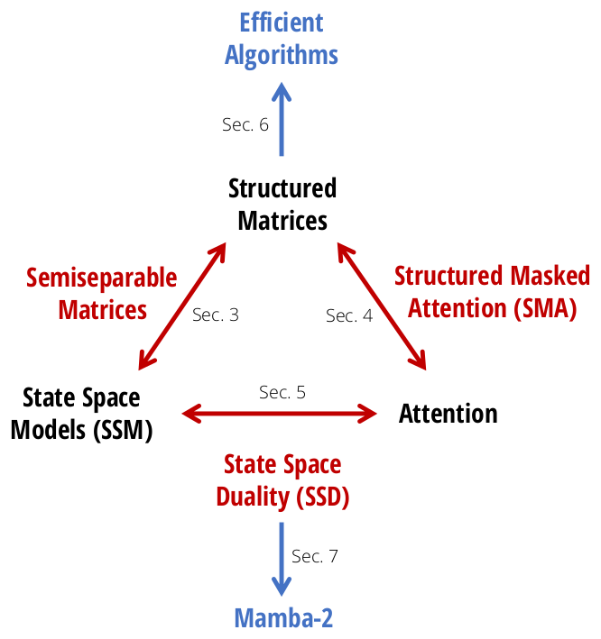

*图 1（原文 Figure 1，第 2 页）：SSM 与注意力通过“结构化矩阵”这座桥联系起来。*

**图中文字翻译与读法**：

- 三角形三个顶点：**Structured Matrices**（结构化矩阵）在上，**State Space Models (SSM)**（状态空间模型）在左下，**Attention**（注意力）在右下。
- 左边一条边 SSM ↔ 结构化矩阵，标注 **Semiseparable Matrices**（半可分矩阵）、Sec. 3：SSM 就是一种半可分矩阵。
- 右边一条边 注意力 ↔ 结构化矩阵，标注 **Structured Masked Attention (SMA)**（结构化掩码注意力）、Sec. 4：用结构化矩阵作掩码把线性注意力推广。
- 底边 SSM ↔ 注意力，标注 Sec. 5：两者的交集就是 **State Space Duality (SSD)**（状态空间对偶）；由它导出 Sec. 7 的 **Mamba-2**。
- 顶点向上的箭头 Sec. 6 指向 **Efficient Algorithms**（高效算法）：利用结构化矩阵的乘法算法得到更快的 SSM 计算方法。

**读图结论**：全文的逻辑是“SSM $\to$ 矩阵（第 3 节）；注意力 $\to$ 矩阵（第 4 节）；矩阵相同处即对偶（第 5 节）；矩阵乘法算法 $\to$ 新算法（第 6 节）；新算法 + 注意力的架构经验 $\to$ Mamba-2（第 7 节）”。

### 2.2 结构化 SSM

结构化状态空间序列模型（S4 一类）把一维序列 $x\in\mathbb{R}^T$ 经隐状态 $h\in\mathbb{R}^{(T,N)}$ 映射到 $y\in\mathbb{R}^T$。其离散形式分两种。**时不变**（LTI，参数不随时间变化）：

$$
h_t=Ah_{t-1}+Bx_t,\qquad y_t=C^\top h_t\qquad(1)
$$

**时变**（选择性 SSM，Mamba 引入）：

$$
h_t=A_th_{t-1}+B_tx_t,\qquad y_t=C_t^\top h_t\qquad(2)
$$

其中 $A\in\mathbb{R}^{(N,N)}$，$B,C\in\mathbb{R}^{(N,1)}$。$N$ 是**状态维度**，也叫**状态扩张因子**（state expansion factor），因为它把每个标量输入扩张成 $N$ 维状态，直接影响效率。“结构化”指控制时间动力学的 $A$ 必须有结构才能高效计算：最早是“对角加低秩”（DPLR，S4），后来最流行的是对角（S4D、DSS、S5）。

几点背景：

- **连续时间视角**：SSM 起源于函数 $x(t)\mapsto y(t)$ 的连续系统，离散参数 $(A,B)$ 由连续参数 $(\Delta,\tilde A,\tilde B)$ 通过固定公式（离散化规则）得到。本文沿用 Mamba 的参数化和离散化，为简化记号后文一律省略，直接用离散参数。
- **循环视角**：式 (1)(2) 对输入 $x$ 是线性递推，所以是 RNN；线性使它避免了传统 RNN 的串行计算。
- **卷积视角**：时不变 SSM 等价于卷积，核由 $(A,B,C)$ 隐式参数化且是全局的。过去的 LTI SSM 训练用卷积模式（整段输入已知），推理用递推模式（逐步输入）。
- **选择性 SSM**（式 2，参数随时间变）：模型能在每个时间步选择关注或忽略输入，在语言这类信息密集的数据上远好于 LTI，尤其随 $N$ 增大效果更明显。代价是**只能按递推计算，不能卷积**，需要精心的硬件感知实现；而且因为**不使用矩阵乘单元**（GPU/TPU 专门优化的 Tensor Core），仍不如 CNN、Transformer 对硬件友好。

### 2.3 序列变换与矩阵变换

- **定义 2.1**（序列变换）：参数化映射 $Y=f_\theta(X)$，$X,Y\in\mathbb{R}^{(T,P)}$，$T$ 是序列（时间）轴，$X_t,Y_t\in\mathbb{R}^P$。
- SSM（式 1 或 2）是 $P=1$ 的序列变换；对 $P>1$，把输入看成 $P$ 条独立序列、各自做 SSM 即可。$P$ 可以理解成**头维度**（第七节展开）。
- **定义 2.2**（SSM 算子）：$\mathrm{SSM}(A,B,C)$ 是由式 (2) 定义的从 $X$ 到 $Y$ 的序列变换。
- **定义 2.3**（矩阵变换）：若 $Y=M_\theta X$，其中 $M$ 是依赖参数 $\theta$ 的矩阵，就称它是矩阵变换，并把序列变换和矩阵 $M$ 视为一回事。注意力、Mamba 都是这类变换，区别只是矩阵 $M$ 怎么生成。

### 2.4 注意力与线性注意力

注意力给序列里每一对位置打分，让每个元素“关注”其余元素，最常见的是 softmax 自注意力：$Y=\mathrm{softmax}(QK^\top)\cdot V$，$Q,K,V\in\mathbb{R}^{(T,P)}$。显式算出 $QK^\top$ 是它二次训练成本的来源。

**线性注意力**（Katharopoulos 等，2020）把 softmax 折进核特征映射去掉，并用矩阵乘法的结合律把 $(QK^\top)V$ 改写成 $Q(K^\top V)$。对自回归（因果）情形，把因果掩码写进左边 $(L\circ QK^\top)\cdot V$（$L$ 是下三角全 1 矩阵），右边可以展开成递推。RetNet、GateLoop 等把 $L$ 推广成更一般的形式；本文的“结构化掩码注意力”会大幅推广这类想法（第四节）。

### 2.5 结构化矩阵

一般 $T\times T$ 矩阵要 $T^2$ 个参数，矩阵向量乘要 $O(T^2)$ 时间。**结构化矩阵**满足：（i）可以用次二次（最好是线性）的参数个数压缩表示；（ii）在压缩表示上有快速算法（最重要的是矩阵乘法）。最典型的是稀疏矩阵和低秩矩阵，还有 Toeplitz、Cauchy、Vandermonde、butterfly 等。本文要证明 SSM 恰好等价于另一类以前在深度学习里没用过的结构化矩阵（半可分矩阵），并借此导出高效算法。

### 2.6 SSD 一览：两种形式加一种算法

论文在 2.4 节给出了整篇的浓缩：

**线性（递推）形式**：SSD 层是选择性 SSM（式 2）的特例，用标准递推或并行扫描（parallel scan）计算，复杂度随序列长度线性。与 Mamba 相比只有两处改动：

- $A_t$ 的结构从“对角”进一步简化为“**标量乘单位阵**”，所以每个 $A_t$ 可以等同于一个标量 $a_t$；
- 头维度 $P$ 取较大值，通常 $P=64$ 或 $128$（与现代 Transformer 的习惯类似），而 Mamba 里 $P=1$。

论文把这两点看成“稍微降低表达能力，换取显著的训练效率”：新算法可以用上加速器的矩阵乘单元。

**对偶（二次）形式**：

$$
(L\circ QK^\top)\cdot V,\qquad L_{ij}=\begin{cases}a_i\times\cdots\times a_{j+1}, & i\ge j\\ 0, & i<j\end{cases}
$$

其中 $a_i$ 是依赖输入的标量，取值在 $[0,1]$。与标准 softmax 注意力相比有两点不同：去掉了 softmax；注意力矩阵按元素乘上一个额外的掩码 $L$。论文认为这两点都在修正注意力的问题：softmax 会引起“attention sink”之类现象；掩码 $L$ 则可以看成用一种**依赖数据的位置掩码**取代 Transformer 里启发式的位置编码，控制信息跨时间传递多少。

**矩阵形式与 SSD 算法**：各种形式通过统一的矩阵表示联系起来：SSM 有矩阵变换形式 $Y=MX$，$M\in\mathbb{R}^{(T,T)}$ 依赖 $\theta=(A,B,C)$。SSD 的对偶（二次）形式等价于朴素地乘 $M$，递推形式则是利用 $M$ 的结构的一种线性时间算法；介于两者之间，任何计算 $M$ 乘法的算法都可以用。论文提出的硬件高效 SSD 算法（第六节）通过对 $M$ 做分块分解，取得比纯线性或纯二次形式都更好的效率折中，实现只需几十行代码（原文 Listing 1，本文第六节逐行解释）。

### 2.7 记号约定

论文强调“记号要能映射到代码”。本文沿用：

- 矩阵、张量用大写，向量用小写；$\cdot$ 表示标量或矩阵乘法，$\circ$ 表示 Hadamard（逐元素）乘法。
- **Python 风格索引**：$i:j$ 表示范围 $(i,i+1,\dots,j-1)$（当 $i<j$）或 $(i,i-1,\dots,j+1)$（当 $i>j$）。对任意符号 $v$，当 $j\ge i$ 时，$v_{j:i}$ 表示序列 $(v_j,\dots,v_{i+1})$；$v^{\times}_{j:i}$ 表示乘积 $v_j\times\cdots\times v_{i+1}$（$j=i$ 时为空积：标量取 1，矩阵取单位阵）。例：$a_{3:0}=a_3a_2a_1$，$a_{2:2}=1$。在不会混淆时省略上标 $\times$。
- 维度用 $T,S,N,P,H,D$ 等表示张量形状，如 $M\in\mathbb{R}^{(T,T)}$（原文用打字机体）。块长在第六节记作 $\mathtt{Q}$，以区别于注意力的查询矩阵 $Q$。
- **张量收缩**（einsum）：`contract(MN,NK→MK)(X,Y)` 等价于 $X\cdot Y$，对应代码 `numpy.einsum('mn,nk->mk', X, Y)`。

| 记号 | 含义 | 出处 |
|---|---|---|
| $T$ | 时间轴（目标序列轴） | 定义 2.1 |
| $S$ | 源序列轴（注意力中 $K,V$ 的长度） | 式 (9) |
| $D$ | 模型维度 d_model | 定义 7.1 |
| $N$ | 状态维度 d_state / 核特征维度 | 式 (2)、(9) |
| $P$ | 头维度 d_head | 定义 2.1 |
| $H$ | 头数 n_head | 定义 7.1 |
| $M$ | 序列变换矩阵 | 定义 2.3 |
| $A$ | SSM 的离散状态（递推）矩阵 | 式 (2) |
| $B$ | SSM 的输入（扩张）矩阵 | 式 (2) |
| $C$ | SSM 的输出（收缩）矩阵 | 式 (2) |
| $X,Y$ | 输入、输出矩阵，形状 $(T,P)$ | 式 (2)、(9) |
| $Q,K,V$ | 注意力的查询、键、值 | 式 (9) |
| $G$ | Gram 矩阵 $QK^\top$（或 $CB^\top$） | — |
| $L$ | （结构化）掩码矩阵，因果情形下为下三角 | 定义 4.2 |

（原文表 8 术语表，第 42 页，节选；块长 $\mathtt{Q}$ 为本文补充。）

## 三、SSM 就是半可分矩阵（原文第 3 节）

### 3.1 SSM 的矩阵形式

把时变 SSM（式 2）写成矩阵乘法。由 $h_0=B_0x_0$ 起逐步展开：

$$
h_t=A_t\cdots A_1B_0x_0+A_t\cdots A_2B_1x_1+\cdots+A_tB_{t-1}x_{t-1}+B_tx_t=\sum_{s=0}^{t}A^{\times}_{t:s}B_sx_s .
$$

再乘上 $C_t^\top$ 得到 $y_t$，并对所有 $t$ 向量化：

$$
y_t=\sum_{s=0}^{t}C_t^\top A^{\times}_{t:s}B_sx_s,\qquad y=\mathrm{SSM}(A,B,C)(x)=Mx,\qquad M_{ji}:=C_j^\top A_j\cdots A_{i+1}B_i\ \ (j\ge i)\quad(3)
$$

读法：$M_{ji}$ 是“第 $i$ 个输入对第 $j$ 个输出的权重”。输入 $x_i$ 先被 $B_i$ 写入状态，之后每一步被 $A_{i+1},\dots,A_j$ 依次作用，最后由 $C_j$ 读出。$M$ 是下三角矩阵（$i>j$ 的位置为 0，即因果）。同一个头里的 $P$ 个通道共享同一个 $M$（见下图左）。

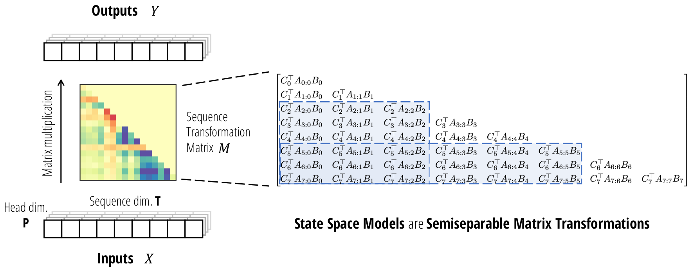

*图 2（原文 Figure 2，第 9 页）：SSM 作为序列变换，等价于对序列维 $T$ 作用一个矩阵 $M\in\mathbb{R}^{(T,T)}$；这个矩阵是半可分矩阵。*

**图中文字翻译与读法**：

- **左半**：下方 **Inputs $X$**（输入），横向是 **Sequence dim. T**（序列维），纵向叠起来的层是 **Head dim. P**（头维）；中间的热力图是 **Sequence Transformation Matrix $M$**（序列变换矩阵），只有下三角非零；向上的箭头标注 **Matrix multiplication**（矩阵乘法），得到上方的 **Outputs $Y$**（输出）。同一个头里的每个通道共用同一个 $M$。
- **右半**：把 $M$ 在 $T=8$ 时的下三角元素展开写出，第 $j$ 行第 $i$ 列为 $C_j^\top A_{j:i}B_i$（如最后一行 $C_7^\top A_{7:0}B_0,\dots,C_7^\top A_{7:7}B_7$）。蓝色虚线框标出两个落在对角线及其下方的子块（第 2–4 行 × 第 0–2 列，第 5–7 行 × 第 0–5 列）。底部标题：**State Space Models are Semiseparable Matrix Transformations**（状态空间模型是半可分矩阵变换）。
- **读图结论**：按图注，这些蓝色子块（所有落在对角线及其下方的子块）的**秩至多为 $N$**，$N$ 正是 SSM 的状态维度——这就是下一小节的“半可分”。

### 3.2 半可分矩阵

**定义 3.1**（$N$-半可分）：（下三角）矩阵 $M$ 是 $N$-半可分的，如果它下三角部分（对角线及以下）内的**每一个子矩阵**的秩都不超过 $N$；$N$ 称为半可分矩阵的阶（或秩）。

这类“用子矩阵秩来刻画”的结构也叫结构化秩矩阵。半可分矩阵有多种结构化表示（层次半可分 HSS、顺序半可分 SSS、Bruhat 形式等），本文主要用 SSS 形式。

**定义 3.2**（$N$-顺序半可分，SSS）：下三角矩阵 $M\in\mathbb{R}^{(T,T)}$ 有 $N$-SSS 表示，如果存在向量 $B_0,\dots,B_{T-1},C_0,\dots,C_{T-1}\in\mathbb{R}^N$ 和矩阵 $A_0,\dots,A_{T-1}\in\mathbb{R}^{(N,N)}$，使得

$$
M_{ji}=C_j^\top A_j\cdots A_{i+1}B_i\qquad(4)
$$

并记 $M=\mathrm{SSS}(A_{0:T},B_{0:T},C_{0:T})$。这与式 (3) 的形式完全一致，这就是 SSM 与半可分矩阵的联系。

**引理 3.3**（SSS $\Rightarrow$ 半可分）：$N$-SSS 矩阵是 $N$-半可分的。证明是构造性的：取任意落在下三角内的子块，行下标 $j,\dots,j'-1$，列下标 $i',\dots,i-1$，且 $j'>j\ge i>i'$。则

$$
\begin{bmatrix}
C_j^\top A^{\times}_{j:i'}B_{i'} & \cdots & C_j^\top A^{\times}_{j:i-1}B_{i-1}\\
\vdots & & \vdots\\
C_{j'-1}^\top A^{\times}_{j'-1:i'}B_{i'} & \cdots & C_{j'-1}^\top A^{\times}_{j'-1:i-1}B_{i-1}
\end{bmatrix}
=
\begin{bmatrix}
C_j^\top A^{\times}_{j:j}\\ \vdots\\ C_{j'-1}^\top A^{\times}_{j'-1:j}
\end{bmatrix}
A^{\times}_{j:i-1}
\begin{bmatrix}
A^{\times}_{i-1:i'}B_{i'} & \cdots & A^{\times}_{i-1:i-1}B_{i-1}
\end{bmatrix}
\qquad(5)
$$

右边是“（行数 $\times N$）乘（$N\times N$）乘（$N\times$ 列数）”，所以秩至多为 $N$。直观地说：这个子块描述“较早的一段输入 $x_{i':i}$ 如何影响较晚的一段输出 $y_{j:j'}$”，而这种影响必须经过 $N$ 维的状态，瓶颈维度就是 $N$。式 (5) 之后会被反复使用，它正是第六节分块算法里“左因子 × 中因子 × 右因子”的来源。

**命题 3.4**（反方向）：每个 $N$-半可分矩阵都有 $N$-SSS 表示（半可分矩阵文献里已知）。因此“半可分矩阵”和“有 SSS 表示的矩阵”是同一类东西。

**参数个数**：定义 3.2 的表示要存 $A_t$，似乎要 $O(N^2T)$ 个参数，但实际可以压缩到 $O(NT)$（渐近紧）。本文后面把“结构化矩阵类”和“SSS 这个具体表示”混用，写 $N$-SS 指 SSS 形式的 $N$-半可分矩阵。

**Remark 2**：半可分的定义在文献里有很多略有差别的版本；本文只关心因果（自回归）情形，所以限制为三角形，定义 3.1 在有些作者那里应称为 $(N,0)$-半可分，也有人称之为“拟可分”（quasiseparable）。

### 3.3 1-半可分矩阵：标量 SSM 递推

最特殊的情形是 **1-SS 矩阵**：此时 $C_j,B_i$ 都是标量，可以从 SSS 表示里提出来（用小写表示标量）：

$$
\mathrm{SSS}(a,b,c)=\mathrm{diag}(c)\cdot M\cdot\mathrm{diag}(b),\qquad M_{ji}=a^{\times}_{j:i}.
$$

对角矩阵乘法只是逐元素缩放，可以忽略，所以 1-SS 矩阵的基本形式是 $M_{ji}=a_{j:i}$，即

$$
M=\mathrm{1SS}(a_{0:T})=
\begin{bmatrix}
1 & & & & \\
a_1 & 1 & & & \\
a_2a_1 & a_2 & 1 & & \\
\vdots & \vdots & \ddots & \ddots & \\
a_{T-1}\cdots a_1 & a_{T-1}\cdots a_2 & \cdots & a_{T-1} & 1
\end{bmatrix}\qquad(6)
$$

它等价于最小的标量递推——状态维 $N=1$ 且没有 $(B,C)$ 投影的退化 SSM。乘法 $y=Mx$ 可由递推算出：

$$
y_t=a_{t:0}x_0+\cdots+a_{t:t}x_t=a_t\,(a_{t-1:0}x_0+\cdots+a_{t-1:t-1}x_{t-1})+a_{t:t}x_t=a_ty_{t-1}+x_t\qquad(7)
$$

因此“用 1-SS 矩阵做乘法”又叫**标量 SSM 递推**或 **cumprodsum**（累积乘积和：$a\equiv1$ 时退化为 cumsum，$b\equiv0$ 时退化为 cumprod）。它是本文主要算法的基本构件，论文反复强调的主题是：**序列模型的许多算法，可以归约成结构化矩阵的乘法算法**；计算 cumprodsum 有很多快速算法，它们对应 1-SS 矩阵的不同结构化分解（附录 B，见第十三节）。

### 3.4 定理 3.5：SSM = 半可分矩阵乘法

**定理 3.5**：状态维为 $N$ 的 SSM 变换 $y=\mathrm{SSM}(A,B,C)(x)$，与乘以一个 SSS 表示的 $N$-SS 矩阵 $y=\mathrm{SSS}(A,B,C)\cdot x$ 完全相同。

换言之，序列变换算子 SSM（定义 2.2）与矩阵构造算子 SSS（定义 3.2）是同一个东西（论文还半开玩笑地指出：structured state space model 与 sequentially semiseparable 的缩写恰好都是 SSM/SSS）。这个定理的重要性在于：**把 SSM 的高效计算问题，归约成了结构化矩阵乘法的高效算法问题**。

### 3.5 由此得到的计算方式

半可分（秩结构）矩阵是经典的结构化矩阵：（i）有压缩表示（SSS 形式只有 $O(T)$ 而非 $O(T^2)$ 个参数）；（ii）在压缩表示上有快速算法。而且参数个数和乘法代价对半可分阶数 $N$ 是紧的：

**命题 3.6**：大小为 $T$ 的 $N$-SS 矩阵可以用 $O(NT)$ 个参数表示，矩阵向量乘的时间和空间都是 $O(NT)$。

以 1-SS 为例：$M=\mathrm{1SS}(a)$ 恰好由 $T-1$ 个参数 $a_1,\dots,a_{T-1}$ 决定，按标量递推 (7) 只需 $O(T)$ 时间。

**线性（递推）模式**。对对角结构的 SSM（S4D），只要展开递推就能看出命题 3.6。论文给出形式化的张量收缩算法（式 8，其中 $S$ 等于 $T$，只是收缩记号里需要另一个符号）：

$$
\begin{aligned}
Z&=\mathrm{contract}(\mathtt{SP},\mathtt{SN}\to\mathtt{SPN})(X,B) &&(S,P,N)\quad\text{(8a)}\\
H&=\mathrm{contract}(\mathtt{TSN},\mathtt{SPN}\to\mathtt{TPN})(L,Z) &&(T,P,N)\quad\text{(8b)}\\
Y&=\mathrm{contract}(\mathtt{TN},\mathtt{TPN}\to\mathtt{TP})(C,H) &&(T,P)\quad\text{(8c)}
\end{aligned}
$$

其中 $L=\mathrm{1SS}(A)$，对 $N$ 个状态维各取一条标量递推（因为 $A$ 是对角矩阵，每个对角元素各自构成一个 1-SS 矩阵）。三步分别是：（i）用输入矩阵 $B$ 把输入 $X$ **扩张** $N$ 倍；（ii）展开 $N\times P$ 个相互独立的标量 SSM 递推（用到“标量 SSM = 1-SS 矩阵”）；（iii）用输出矩阵 $C$ 把隐状态 $H$ **收缩**回来。这是 Mamba（S6）的特例；但朴素实现要物化大小为 $(T,P,N)$ 的 $Z,H$，很慢，所以 Mamba 用了硬件感知实现来避免物化（Remark 3）。

**定理 3.7**：任何状态维为 $N$、序列长度为 $T$ 的 SSM（定义 2.2），都可以在 $O(TN)$ 时间内算出（不计可能的预处理）。

这个结论对结构化 SSM 文献是新的。给定稠密无结构的 $A_t$，仅表示本身看上去就要 $O(TN^2)$，而定理 3.7 说明：经过一个预处理步骤，即使无结构的 SSM 也能做到最优效率，上界与 $B,C$ 的大小所给出的下界 $O(TN)$ 吻合。Remark 4 指出：几乎所有稠密实矩阵在复数域上都可对角化，所以几乎所有稠密实 SSM 都等价于某个对角复 SSM，这是对角 SSM 最流行的原因；定理 3.7 则对所有实 SSM 都成立。但实际中，高效可计算的 SSM 仍需要对 $A$ 加额外结构，以避免昂贵的预处理（需要额外的 $N$ 阶 FLOPs，还涉及奇异值分解等不友好的运算）。当对 $A$ 施加稍强的结构时，就可以通过对 $M=\mathrm{SSS}(A,B,C)$ 做分块分解设计硬件非常友好的算法（第六节）。

**二次（朴素）模式**。矩阵视角还给出另一种算法：直接把序列变换矩阵 $M=\mathrm{SSS}(A,B,C)$ 物化出来（$(T,T)$ 的矩阵）再乘。这与序列长度成二次关系，但序列短时，因为常数因子小、能用矩阵乘，反而可能比线性算法更快；对一类特殊的结构化 SSM，它看起来就是二次注意力（第五节）。

**小结**：任何计算 SSM 前向的方法都可以看成半可分矩阵上的某个乘法算法。SSD 里的“对偶”，在半可分矩阵这一视角下就是：**线性时间的半可分矩阵乘法算法 vs 二次时间的朴素矩阵乘法**。

## 四、结构化掩码注意力：推广线性注意力（原文第 4 节）

这一节从注意力出发，重新推导线性注意力，再把它推广。它可以完全独立于第三节阅读，两条路最后在第五节会合。

### 4.1 注意力框架

单头注意力是三个向量序列到一个序列的映射 $(Q,K,V)\mapsto Y$，下面括号里是张量形状：

$$
\begin{aligned}
&Q:(T,N),\qquad K:(S,N),\qquad V:(S,P)\\
&G=QK^\top\ \ (T,S),\qquad M=f(G)\ \ (T,S),\qquad Y=MV\ \ (T,P)
\end{aligned}\qquad(9)
$$

$S$、$T$ 分别是源、目标序列长度，$N$ 是特征维度，$P$ 是头维度；softmax 注意力取 $f=\mathrm{softmax}$，对 $G$ 按行归一化。（原文式 (9) 最后一式印作 $Y=GV$，与前一行的 $M=f(G)$ 对不上，疑为笔误；后文式 (11)(13c) 都是 $Y=MV$，本文按此写。）

**自注意力**是本文的运行例子：（i）源、目标序列相同，$S=T$；（ii）特征维与头维通常相同，$N=P$；（iii）$Q,K,V$ 由同一个输入的线性投影生成。论文把一般形式（$S\ne T$、$N\ne P$）写出来，一是涵盖交叉注意力等变体，二是区分 $S$ 与 $T$ 的符号能让后面的张量收缩证明更清楚。Remark 6 指出：虽然注意力常被看成对称地处理 $Q,K,V$ 三个输入，但特征维 $N$ 不出现在输出里；所以在 $S=T$ 时应把 $V$ 看成主要输入，这样式 (9) 才是定义 2.1 意义下的序列变换 $V\mapsto Y$。

**核注意力**：softmax 可以拆成两步：对 $G$ 取指数，再沿 $S$ 轴归一化。先忽略归一化项（它等于把 $V$ 取成全 1 再相除，7.3 节再回头讲）。取指数可以看成核变换：存在（无穷维）特征映射 $\varphi$ 使 $\exp(QK^\top)=\varphi(Q)\varphi(K)^\top$。把 $\varphi$ 吸收进 $Q,K$ 的定义，就可以不再考虑 softmax，并假定 $Q,K$ 是由核特征映射任意生成的（此时 $N$ 可以不等于 $P$）。已有的实例包括：原始线性注意力（逐点激活如 $x\mapsto1+\mathrm{elu}(x)$）、Random Feature Attention（随机傅里叶特征近似高斯核）、Performer（FAVOR+，正随机特征）、cosFormer（加余弦重加权以强调局部）、Linear Randomized Attention（从重要性采样角度推广 RFA）；Linformer、Nyströmformer 则用低秩近似注意力矩阵。

### 4.2 带掩码的注意力与张量收缩

设 $L$ 是形状 $(T,S)$ 的掩码。自回归自注意力中 $L$ 常取下三角全 1 矩阵（因果掩码）；也可以是带状、膨胀、块对角等稀疏模式。带掩码的注意力通常写成

$$
Y=(L\circ(QK^\top))\cdot V\qquad(10)
$$

拆成逐步计算（带形状）：

$$
G=QK^\top\ \ (T,S),\qquad M=G\circ L\ \ (T,S),\qquad Y=MV\ \ (T,P)\qquad(11)
$$

论文的关键观察是：它可以写成**一个张量收缩**：

$$
Y=\mathrm{contract}(\mathtt{TN},\mathtt{SN},\mathtt{SP},\mathtt{TS}\to\mathtt{TP})(Q,K,V,L)\qquad(12)
$$

式 (11) 只是用某个特定的两两收缩顺序去算它：

$$
G=\mathrm{contract}(\mathtt{TN},\mathtt{SN}\to\mathtt{TS})(Q,K),\quad M=\mathrm{contract}(\mathtt{TS},\mathtt{TS}\to\mathtt{TS})(G,L),\quad Y=\mathrm{contract}(\mathtt{TS},\mathtt{SP}\to\mathtt{TP})(M,V)\qquad(13)
$$

### 4.3 线性注意力的张量收缩证明

线性注意力通常的动机是换矩阵乘法的结合顺序 $(QK^\top)V=Q(K^\top V)$。但一加上掩码，推导就没那么直接了：原始论文和后续变体（如 RetNet）都是直接给出公式、没有证明。通常声称的公式是

$$
Y=Q\cdot\mathrm{cumsum}(K^\top V)\qquad(14)
$$

要和式 (10) 对上，必须小心展开求和、追踪下标。

**命题 4.1**（Katharopoulos 等）：自回归核注意力（带因果掩码的掩码核注意力）可以用每步常数时间的递推在 $O(T)$ 时间内算出。

论文用张量收缩给出简单而严格的推导：对式 (12) 换一个收缩顺序。

$$
\begin{aligned}
Z&=\mathrm{contract}(\mathtt{SP},\mathtt{SN}\to\mathtt{SPN})(V,K) &&(S,P,N)\quad\text{(15a)}\\
H&=\mathrm{contract}(\mathtt{TS},\mathtt{SPN}\to\mathtt{TPN})(L,Z) &&(T,P,N)\quad\text{(15b)}\\
Y&=\mathrm{contract}(\mathtt{TN},\mathtt{TPN}\to\mathtt{TP})(Q,H) &&(T,P)\quad\text{(15c)}
\end{aligned}
$$

逐步读法（逐元素写出就是：$Z_{s,p,n}=V_{s,p}K_{s,n}$，$H_{t,p,n}=\sum_sL_{t,s}Z_{s,p,n}$，$Y_{t,p}=\sum_nQ_{t,n}H_{t,p,n}$）：

- (15a) 是**扩张**：每个位置的 $v_s$（$P$ 维）和 $k_s$（$N$ 维）做外积，得到 $P\times N$ 的“特征”，维度扩大了 $N$ 倍；
- (15c) 是**收缩**：用 $q_t$ 把扩张出来的 $N$ 维收缩掉。若把 $K$ 看成输入（Remark 6），$V$ 和 $Q$ 就分别负责扩张和收缩；
- (15b) 最关键，它解释了线性注意力里的“线性”：它就是一次对 $L$ 的直接矩阵乘法（$(P,N)$ 两个轴可以拉平），而且是唯一同时含 $T$ 轴和 $S$ 轴的一步，因此本该有 $\Omega(TS)$ 即序列长度二次的复杂度。**但当 $L$ 是标准因果掩码（下三角全 1）时，乘以 $L$ 就等于逐特征做累积和**：$y_0=x_0$，$y_t=y_{t-1}+x_t$，复杂度线性。

### 4.4 结构化掩码注意力（SMA）

由此可见，原始线性注意力的关键只是“乘以因果掩码等价于累积和”。但掩码并不必须是全 1：只要 $L$ 是一个**结构化矩阵**（按定义就是有次二次、最好是线性的矩阵向量乘法），就能通过加速瓶颈步骤 (15b)，得到和标准线性注意力同样的复杂度。

**定义 4.2**（结构化掩码注意力，SMA）：对查询、键、值 $Q,K,V$ 和任意结构化矩阵 $L$（即具有次二次矩阵乘法），SMA 定义为 4 路张量收缩

$$
Y=\mathrm{contract}(\mathtt{TN},\mathtt{SN},\mathtt{SP},\mathtt{TS}\to\mathtt{TP})(Q,K,V,L).
$$

- **二次模式算法**：按式 (13) 的两两收缩顺序，对应标准的（掩码）注意力计算；
- **线性模式算法**：按式 (15) 的顺序，其中 (15b) 用次二次的结构化矩阵乘法加速。

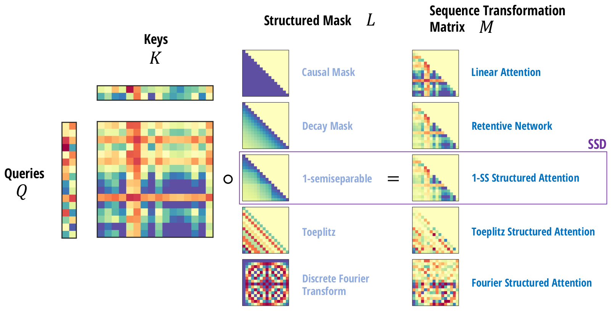

*图 3（原文 Figure 3，第 15 页）：SMA 对任意结构化矩阵 $L$ 构造掩码注意力矩阵 $M=QK^\top\circ L$，由此定义矩阵序列变换 $Y=MV$。*

**图中文字翻译与读法**：

- **左侧**：**Queries $Q$**（查询）竖条、**Keys $K$**（键）横条，以及它们相乘得到的 $QK^\top$ 热力图；中间的圆圈 $\circ$ 是逐元素乘。
- **中间一列 Structured Mask $L$**（结构化掩码），自上而下五种：**Causal Mask**（因果掩码）、**Decay Mask**（衰减掩码）、**1-semiseparable**（1-半可分）、**Toeplitz**、**Discrete Fourier Transform**（离散傅里叶变换）。
- **右侧一列 Sequence Transformation Matrix $M$**（序列变换矩阵），与左边掩码一一对应：**Linear Attention**（线性注意力）、**Retentive Network**（RetNet）、**1-SS Structured Attention**（1-SS 结构化注意力；这一行外面套着标注 **SSD** 的紫色框，并用“=”连接左边的掩码与右边的结果）、**Toeplitz Structured Attention**、**Fourier Structured Attention**。
- **读图结论**：每换一种掩码 $L$，就得到一种注意力变体；所有 SMA 实例都有由不同收缩顺序诱导的次二次对偶形式，再配合 $L$ 的快速结构化乘法。本文的主角 SSD 就是 1-半可分这一行。

图中各行对应的掩码：

| 变体 | 掩码 $L$ | 说明 |
|---|---|---|
| 线性注意力 | 因果掩码（下三角全 1） | $L=\mathrm{SS}(1_T)$，即 1-SS 掩码取 $a_t\equiv1$ |
| RetNet | 衰减掩码 $L_{ij}=\gamma^{i-j}\,\mathbb{I}[i\ge j]$，$\gamma\in[0,1]$ | 原文印作 $\mathbb{I}[j\ge i]$，与因果性矛盾，疑为笔误，此处按因果写 |
| SSD（1-SS 结构化注意力） | 1-半可分矩阵 $L=\mathrm{1SS}(a)$ | $a_t$ 依赖输入，是一种带数据依赖衰减的掩码 |
| Toeplitz 结构化注意力 | $L_{ij}=\alpha_{i-j}$，$\alpha\in\mathbb{R}^T$ 可学习或依赖输入 | 可视为相对位置编码，类似 ALiBi 但是乘性而非加性 |
| Fourier 结构化注意力 | 傅里叶矩阵 $L_{ij}=\omega^{ij/T}$ | 用另一种方式编码位置结构 |

**一个函数、两种算法**：标准的（掩码核）注意力常把“函数”和“算法”混为一谈。论文把它们分开：掩码注意力是一个特定函数——四项上的一次收缩（式 12）；标准的二次注意力计算（式 13）是计算这个函数的一种算法，线性注意力（式 15）是计算同一个函数的另一种算法；两者只是两两收缩的**顺序**不同。收缩顺序能对复杂度造成巨大影响，这就是二次与线性之分。正如 SSM 是一个可以用线性或二次两种方式计算的变换（3.5 节），线性注意力的对偶性来自两种收缩顺序；下一节说明它们其实是同一个对偶的两个侧面。

## 五、状态空间对偶 SSD（原文第 5 节）

### 5.1 标量-单位阵 SSM 的二次形式就是核注意力

第三节说明 SSM 等价于半可分矩阵变换，既有线性递推形式，也有二次的朴素形式。现在把 $A_t$ 取成极简结构：标量乘单位阵 $A_t=a_tI$（$a_t$ 是标量）。则 $A_{j:i}=a_{j:i}I$，式 (3) 的矩阵元可以重排为

$$
M_{ji}=a_{j:i}\cdot(C_j^\top B_i).
$$

向量化后就是 $L:=\mathrm{1SS}(a)$，$M=L\circ(CB^\top)$，其中 $B,C\in\mathbb{R}^{(T,N)}$。

用它计算输出 $Y=MX$ 的步骤是

$$
G=\mathrm{contract}(\mathtt{TN},\mathtt{SN}\to\mathtt{TS})(C,B),\quad M=\mathrm{contract}(\mathtt{TS},\mathtt{TS}\to\mathtt{TS})(G,L),\quad Y=\mathrm{contract}(\mathtt{TS},\mathtt{SP}\to\mathtt{TP})(M,X)\qquad(16)
$$

其中 $S=T$。这和掩码核注意力的定义 (13) **一模一样**，只是换了名字：$C\leftrightarrow Q$，$B\leftrightarrow K$，$X\leftrightarrow V$，掩码 $L$ 是 1-半可分矩阵。因此：**对标量-单位阵 SSM，朴素地把半可分矩阵 $M$ 物化出来再做二次矩阵乘，就是二次的掩码核注意力。**

### 5.2 1-半可分结构化掩码注意力

SMA 允许任意结构化掩码。$L$ 取因果掩码就是标准线性注意力；因果掩码恰好是 $L=\mathrm{SS}(1_T)$，即由式 (6) 中 $a_t\equiv1$ 生成的 1-SS 矩阵。这启发我们把 $L$ 推广到**1-半可分掩码**（1-SS SMA）：线性注意力递推里的累积和，换成更一般的递推——标量 SSM 扫描，也就是 1-半可分矩阵乘法（3.3 节）。

考虑 1-SS SMA 的最重要原因是：它的线性形式正好是一类对角 SSM 的特例。SMA 的线性形式是算法 (15)，瓶颈步骤 (15b) 是乘以 1-SS 掩码；3.5 节对对角 SSM 写出的计算 (8) 里，瓶颈步骤 (8b) 是标量 SSM 递推，等价于 1-SS 乘法。唯一区别是 (8b) 里的 $L$ 多一个 $N$ 维，因为 $A$ 是 $N\times N$ 的对角矩阵；如果 $A$ 的所有对角元素都相同，这个 $N$ 维就消失了。由此得到：

**推论 5.1**：1-SS SMA（掩码为 1-半可分结构化矩阵 $L$ 的掩码注意力）是对角 SSM 的特例，其中对角矩阵是单位阵的标量倍。

反方向的结果刻画“哪些 SMA 有高效的自回归”：

**定理 5.2**：对任何作为“有界阶自回归过程”的结构化掩码注意力，其结构化掩码 $L$ 必须是半可分矩阵。

即：高效的自回归注意力就是一般的半可分 SMA（定理在附录 C.2 证明，见第十三节）。论文的 **Remark 7** 补充：1-SS SMA 是 SSM 的特例，而一般半可分 SMA 的表达能力严格强于 1-SS SMA，无法用标准 SSM 描述；不过对 $L$ 的半可分乘法与 SMA 线性形式 (15a) 各含一次扩张和收缩，它们可以并进一个有更大（单次）扩张的 1-SS SMA 里。

总结一下，1-SS 结构化注意力是 SMA 中最重要的情形，因为它：

- 是线性注意力的自然推广，带有依赖输入的递推；
- 是一般半可分注意力（即高效自回归注意力）的最简单情形；
- 是对角状态空间模型的特例。

### 5.3 对偶性小结与图 4

- 结构化 SSM（第三节）通常由线性时间递推定义；但展开它的矩阵形式就能导出二次形式。
- 注意力变体（第四节）由二次时间的成对交互定义；但把它看成 4 路张量收缩并换一种顺序约化，就能导出线性形式。
- 各自的一个自然特例——更准确地说，$A$ 具有标量-单位阵结构的状态空间模型，和掩码 $L$ 具有 1-半可分结构的结构化掩码注意力——**互为对偶，具有完全相同的线性形式和二次形式**。

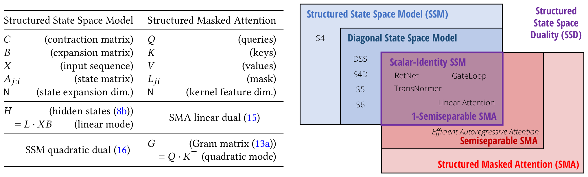

*图 4（原文 Figure 4，第 18 页）：状态空间对偶描述状态空间模型与掩码注意力之间的紧密关系。*

**图中文字翻译与读法**：

- **左：对照表**。左列 **Structured State Space Model**（结构化 SSM），右列 **Structured Masked Attention**（结构化掩码注意力）。逐行对应关系：$C$（contraction matrix，收缩矩阵）$\leftrightarrow Q$（queries，查询）；$B$（expansion matrix，扩张矩阵）$\leftrightarrow K$（keys，键）；$X$（input sequence，输入序列）$\leftrightarrow V$（values，值）；$A_{j:i}$（state matrix，状态矩阵）$\leftrightarrow L_{ji}$（mask，掩码）；$N$（state expansion dim.，状态扩张维）$\leftrightarrow N$（kernel feature dim.，核特征维）。下面两行是两种算法：**线性模式**在 SSM 里是 $H=L\cdot XB$（隐状态，式 8b），在 SMA 里是“SMA linear dual（线性对偶，式 15）”；**二次模式**在 SSM 里是“SSM quadratic dual（二次对偶，式 16）”，在 SMA 里是 Gram 矩阵 $G=Q\cdot K^\top$（式 13a）。
- **右：嵌套方框**。外层蓝色大框 **Structured State Space Model (SSM)**，其中 S4 在其内；其中的蓝色中框 **Diagonal State Space Model**（对角 SSM）含 DSS、S4D、S5、S6；红色大框 **Structured Masked Attention (SMA)** 内含 **Semiseparable SMA**（半可分 SMA；也标为 *Efficient Autoregressive Attention*，高效自回归注意力）。两者重叠处的紫色框是 **Scalar-Identity SSM（标量-单位阵 SSM）= 1-Semiseparable SMA**，里面放着 RetNet、GateLoop、TransNormer、Linear Attention，右上角标注整个交集为 **Structured State Space Duality (SSD)**。
- **读图结论**：SSM 与 SMA 在一大类“状态空间对偶模型”上相交，线性注意力、RetNet、GateLoop 等都是它的特例；Mamba（S6）属于对角 SSM，但不在标量-单位阵之内；Mamba-2 的 SSD 层位于交集内部。

### 5.4 一个手算的小例子（$T=3$）

取 $A_t=a_tI$，$T=3$，则

$$
M=L\circ(CB^\top)=
\begin{bmatrix}
C_0^\top B_0 & & \\
a_1C_1^\top B_0 & C_1^\top B_1 & \\
a_2a_1C_2^\top B_0 & a_2C_2^\top B_1 & C_2^\top B_2
\end{bmatrix}.
$$

用递推：$h_0=B_0x_0$，$h_1=a_1h_0+B_1x_1$，$h_2=a_2h_1+B_2x_2$，所以

$$
y_2=C_2^\top h_2=a_2a_1\,(C_2^\top B_0)\,x_0+a_2\,(C_2^\top B_1)\,x_1+(C_2^\top B_2)\,x_2,
$$

正好是 $M$ 的第三行乘以 $x$。线性形式只要保存一个 $N$ 维状态（$P>1$ 时是 $N\times P$ 的状态矩阵），二次形式要先算出 $T\times T$ 的 $M$。撰写本文时用 numpy 对随机生成的 $a_t,B_t,C_t,X$（$T=12$、$N=4$、$P=3$、块长 4）做过数值检查：递推、二次对偶形式、下一节的分块算法三者的输出相差在 $10^{-15}$ 量级（浮点误差），且 $M$ 的非对角块的秩不超过 $N$（$N=2$ 时观察到秩 2）。

### 5.5 SSD 与 Mamba 的两处差别

| | Mamba（S6） | SSD（Mamba-2 的核心层） |
|---|---|---|
| 状态转移 $A_t$ | 对角矩阵（每个状态维一个衰减） | 标量乘单位阵（一个头一个标量 $a_t$） |
| 头维度 $P$ | 1：每个通道各有自己的 SSM 动力学 | 64 或 128：一个头内的通道共享 $a_t,B_t,C_t$ |
| 主要算法 | 硬件感知的选择性扫描，不用矩阵乘单元 | 分块：块内矩阵乘，块间递推传状态 |
| 二次对偶形式 | 无注意力式的解释 | $(L\circ QK^\top)V$，$L$ 为 1-半可分掩码 |

（依据原文 2.4 节与第 10.1 节。）论文也坦率地说，更一般的对角 $A_t$ 在理论上与 SSD 效率相同，但对硬件不友好——对偶二次形式会失去类似注意力的解释，也更难计算，所以 SSD 是用一点表达力换硬件效率。

## 六、硬件友好的 SSD 分块算法（原文第 6 节）

### 6.1 目标

**定理 6.1**：设 SSD 模型的状态扩张因子为 $N$，头维度 $P=N$。存在一个算法，对任意输入 $X\in\mathbb{R}^{(T,P)}$，只需 $O(TN^2)$ 训练 FLOPs，工作量主要由矩阵乘主导。

原文还写“$O(TN)$ 推理 FLOPs，$O(N^2)$ 推理显存”；但紧随其后的下界说明（状态总大小为 $N^2$，输入本身有 $TN$ 个元素）以及 6.3 节末尾的对比表给出的是**推理每步 $O(N^2)$ FLOPs、显存下界 $O(TN)$**，两处互换了，疑为原文笔误，本文按后者引用。这些界都是紧的。

算法的主要想法仍然是把计算 SSM 看成半可分矩阵乘法，但用新的方式利用它的结构：**不整个按递推模式或整个按注意力模式算，而是对矩阵做分块分解**。对角块可以用对偶的注意力模式算，这能高效地通过矩阵乘完成；非对角块利用半可分矩阵的秩结构做因式分解，约化成一个更小的递推。这个算法的实现只需很短的代码（原文 Listing 1），相对 Mamba 的通用选择性 SSM 实现简单得多，即使纯 PyTorch 也相对高效，不需要特殊的底层 kernel。

### 6.2 块分解

把 $M$ 分成 $\frac{T}{\mathtt{Q}}\times\frac{T}{\mathtt{Q}}$ 个 $\mathtt{Q}\times\mathtt{Q}$ 的子块（$\mathtt{Q}$ 是块长；原文脚注说明块分解对不等长分块也成立，只是为简单假设整除）。由半可分矩阵的定义（定义 3.1），**非对角块都是低秩的**：

$$
\begin{aligned}
\text{(Block Decomposition)}\quad & M=\begin{bmatrix}M^{(0,0)} & & & \\ M^{(1,0)} & M^{(1,1)} & & \\ \vdots & \vdots & \ddots & \\ M^{(T/\mathtt{Q}-1,0)} & M^{(T/\mathtt{Q}-1,1)} & \cdots & M^{(T/\mathtt{Q}-1,T/\mathtt{Q}-1)}\end{bmatrix}\\[2mm]
\text{(Diagonal Block)}\quad & M^{(j,j)}=\mathrm{SSM}\big(A_{j\mathtt{Q}:(j+1)\mathtt{Q}},\,B_{j\mathtt{Q}:(j+1)\mathtt{Q}},\,C_{j\mathtt{Q}:(j+1)\mathtt{Q}}\big)\\[2mm]
\text{(Low-Rank Block)}\quad & M^{(j,i)}=\begin{bmatrix}C_{j\mathtt{Q}}^\top A_{j\mathtt{Q}:j\mathtt{Q}-1}\\ \vdots\\ C_{(j+1)\mathtt{Q}-1}^\top A_{(j+1)\mathtt{Q}-1:j\mathtt{Q}-1}\end{bmatrix}A_{j\mathtt{Q}-1:(i+1)\mathtt{Q}-1}\begin{bmatrix}B_{i\mathtt{Q}}^\top A_{(i+1)\mathtt{Q}-1:i\mathtt{Q}}\\ \vdots\\ B_{(i+1)\mathtt{Q}-1}^\top A_{(i+1)\mathtt{Q}-1:(i+1)\mathtt{Q}-1}\end{bmatrix}^\top\quad(j>i)
\end{aligned}
$$

低秩块的三个因子就是式 (5) 的“左因子 × 中因子 × 右因子”。对 SSD（$A_t$ 是标量乘单位阵）来说，转置和乘法顺序的差别都消失了，中间因子是一个标量。

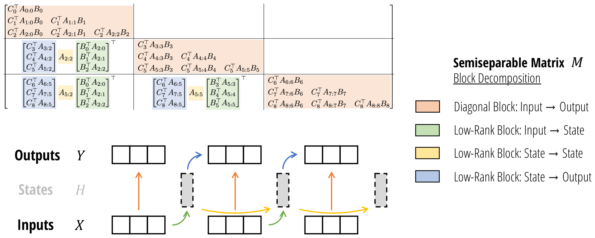

*图 5（原文 Figure 5，第 20 页）：$T=9$、块长 $\mathtt{Q}=3$ 的例子。上方是半可分矩阵 $M$ 的分块分解，下方是对应的“状态传递”示意。*

**图中文字翻译与读法**：

- **上半部分**：把 $9\times9$ 的 $M$ 分成 $3\times3$ 个 $3\times3$ 的子块，每个元素是 $C_j^\top A_{j:i}B_i$。右侧图例 **Semiseparable Matrix $M$ Block Decomposition**（半可分矩阵 $M$ 的块分解）：橙色 **Diagonal Block: Input $\to$ Output**（对角块：输入到输出）；绿色 **Low-Rank Block: Input $\to$ State**（低秩块：输入到状态）；黄色 **Low-Rank Block: State $\to$ State**（低秩块：状态到状态）；蓝色 **Low-Rank Block: State $\to$ Output**（低秩块：状态到输出）。每个低秩块被写成 蓝色（左因子）× 黄色（中因子）× 绿色（右因子，带转置）的乘积，例如第 1 行块、第 0 列块为 $[C_3^\top A_{3:2};C_4^\top A_{4:2};C_5^\top A_{5:2}]\cdot A_{2:2}\cdot[B_0^\top A_{2:0};B_1^\top A_{2:1};B_2^\top A_{2:2}]^\top$。
- **下半部分**：纵向三层依次是 **Outputs $Y$**（输出）、**States $H$**（状态）、**Inputs $X$**（输入），每个方框是一个块（3 个 token）。橙色箭头：块内输入直接到块内输出（对角块）；绿色箭头：输入汇成块末尾的状态（右因子）；黄色箭头：状态在块与块之间传递（中因子）；蓝色箭头：状态再作用到后一个块的输出上（左因子）。灰色虚线方框是块边界处的状态。
- **读图结论**：同一个半可分矩阵的“块间”部分被分解成“输入 $\to$ 状态 $\to$ 状态 $\to$ 输出”的 SSM 递推，只在块与块之间传递压缩后的状态（大小 $N\times P$）；“块内”部分用二次形式算。对角块表示块内计算，非对角块表示通过 SSM 隐状态传递的块间计算。

### 6.3 四步计算及其含义

可以把每个块 $j$ 的输出 $y_{j\mathtt{Q}:(j+1)\mathtt{Q}}$ 拆成两部分之和：**块内输入的影响**（对角块）和**块之前输入的影响**（低秩块）。低秩块的三个因子对应三步：

1. **对角块**（块内，Input $\to$ Output）。每个对角块是同类问题的缩小版：对范围 $R=j\mathtt{Q}:(j+1)\mathtt{Q}$ 计算 $\mathrm{SSM}(A_R,B_R,C_R)(x_R)$。可以用任何方法算；块长 $\mathtt{Q}$ 小时用对偶的二次（SMA）形式最高效，并且各块可以并行。含义：**假设该块的初始状态为 0 时，每块的输出**，即只考虑块内输入 $x_{j\mathtt{Q}:(j+1)\mathtt{Q}}$ 的正确输出。
2. **右因子**（B-块因子，Input $\to$ State）。对每个块，是一个 $(N,\mathtt{Q})$ 乘 $(\mathtt{Q},P)$ 的矩阵乘，结果是每块一个 $(N,P)$ 张量，与隐状态 $h$ 同维。含义：**假设初始状态为 0 时，每块末尾的状态**，即假设 $x_{0:j\mathtt{Q}}=0$ 时的 $h_{j\mathtt{Q}+\mathtt{Q}-1}$。
3. **中因子**（A-块因子，State $\to$ State）。上一步得到的各块末状态形状为 $(T/\mathtt{Q},N,P)$，现在乘以由 $A^{\times}_{2\mathtt{Q}-1:\mathtt{Q}-1},A^{\times}_{3\mathtt{Q}-1:2\mathtt{Q}-1},\dots,A^{\times}_{T-1:T-\mathtt{Q}-1}$ 生成的 1-SS 矩阵。这一步用任何 1-SS 乘法（标量 SSM 扫描，即 cumprodsum）算法都行。含义：**考虑此前所有输入之后，每块末尾真正的状态**。
4. **左因子**（C-块因子，State $\to$ Output）。对每个块是一次矩阵乘 `contract(QN,NP→QP)`。含义：**取正确的块初始状态、并假设块内输入全为 0 时，每块的输出**，即只考虑块之前输入 $x_{0:j\mathtt{Q}}$ 的贡献。

最后把对角块输出（块内）与低秩块输出（块外，经状态传递）相加得到 $Y$。把块长取 $\mathtt{Q}=1$，就退化成纯递推；取 $\mathtt{Q}=T$，就只有一个对角块，即纯二次形式；中间值给出两者的折中。（这是读者容易验证的推论，不是原文的原话。）

### 6.4 计算代价

记 $\mathrm{BMM}(\mathtt{B},\mathtt{M},\mathtt{N},\mathtt{K})$ 为带批维 $\mathtt{B}$ 的批量矩阵乘 `contract(MK,KN→MN)`，则计算量为 $O(\mathtt{BMNK})$ FLOPs，显存为 $O(\mathtt{B}(\mathtt{MK}+\mathtt{KN}+\mathtt{MN}))$；$\mathtt{M},\mathtt{N},\mathtt{K}$ 越大越能用上加速器的矩阵乘单元。各步代价：

| 步骤 | 代价 |
|---|---|
| 对角块（二次 SMA 形式）：核矩阵 $C^\top B$ | $\mathrm{BMM}(T/\mathtt{Q},\mathtt{Q},\mathtt{Q},N)$ |
| 对角块：乘掩码矩阵 | 形状 $(T/\mathtt{Q},\mathtt{Q},\mathtt{Q})$ 张量上的逐元素运算 |
| 对角块：乘 $X$ | $\mathrm{BMM}(T/\mathtt{Q},\mathtt{Q},P,N)$（原文如此；严格说内维应为 $\mathtt{Q}$，$N=\mathtt{Q}$ 时相同） |
| 低秩块：右因子 | $\mathrm{BMM}(T/\mathtt{Q},N,P,\mathtt{Q})$ |
| 低秩块：中因子 | 长度 $T/\mathtt{Q}$、$(N,P)$ 个独立通道的标量 SSM 扫描，工作量 $TNP/\mathtt{Q}$，相比其他项可忽略 |
| 低秩块：左因子 | $\mathrm{BMM}(T/\mathtt{Q},\mathtt{Q},P,N)$ |

（原文第 6.3 节，第 21–22 页。）中因子这一步因为分块把序列从 $T$ 缩短到 $T/\mathtt{Q}$，扫描成本比纯 SSM 扫描（如 Mamba 的选择性扫描）小 $\mathtt{Q}$ 倍；所以在多数序列长度下，附录 B 里别的算法可能更高效、或更易实现而没有明显减速。例如朴素地通过 1-SS 矩阵乘法实现，代价是 $\mathrm{BMM}(1,T/\mathtt{Q},NP,T/\mathtt{Q})$，比朴素递推/扫描更易实现，还可能更快（论文参考代码就是这么做的）。

**总代价**：令 $N=P=\mathtt{Q}$（状态维、头维、块长相等），所有 BMM 项都变成 $\mathrm{BMM}(T/N,N,N,N)$，于是：

- 总 FLOPs 为 $O(TN^2)$；总显存为 $O(TN)$；
- 工作量主要是形状为 $(N,N)$ 的矩阵乘；
- 显存消耗是紧的：输入输出 $x,y$ 的形状就是 $(T,P)=(T,N)$；FLOPs 里多出的因子 $N$ 是自回归状态大小带来的成本，所有模型都有；
- 除矩阵乘外还有一个对 $NP=N^2$ 个特征、长度 $T/\mathtt{Q}$ 的标量 SSM 扫描，FLOPs 为 $O(T/\mathtt{Q}\cdot N^2)$、深度为 $O(\log(T/\mathtt{Q}))$；它虽不用矩阵乘，但可并行且总工作量相比其他步骤可忽略，在作者的 GPU 实现里成本可忽略。

**与纯 SSM 和注意力的对比**：二次注意力也很硬件友好（只用矩阵乘），但总 FLOPs 是 $T^2N$；它在训练和推理上都更慢，可以直接归因于更大的状态：标准注意力要缓存历史、不压缩状态，状态大小随序列长度 $T$ 增长。线性 SSM 的总 FLOPs 是 $TNP=TN^2$，与 SSD 相同，但朴素实现需要物化状态扩张 (15a) 占额外显存，以及不能用矩阵乘的标量运算 (15b)。

| | 注意力 | SSM | SSD |
|---|---|---|---|
| 状态大小 | $T$ | $N$ | $N$ |
| 训练 FLOPs | $T^2N$ | $TN^2$ | $TN^2$ |
| 推理 FLOPs（每步） | $TN$ | $N^2$ | $N^2$ |
| （朴素）显存 | $T^2$ | $TN^2$ | $TN$ |
| 能用矩阵乘 | 是 | 否 | 是 |

（原文第 6.3 节末尾的无编号对比表，第 22 页。）论文还指出，存在很多其他矩阵分解方式（附录 B 汇总了 1-SS 乘法的不同分解），可能给出适用于特定场合的更好 SSD 算法。

### 6.5 参考实现（原文 Listing 1）逐行解释

下面是原文 Listing 1 的 PyTorch 代码（英文注释译成中文；代码本身与原文一致，仅统一了缩进和个别多余的空格）：

```python
def segsum(x):
    """朴素的分段和。exp(segsum(A)) 生成一个 1-SS 矩阵，等价于标量 SSM。"""
    T = x.size(-1)
    x_cumsum = torch.cumsum(x, dim=-1)
    x_segsum = x_cumsum[..., :, None] - x_cumsum[..., None, :]
    mask = torch.tril(torch.ones(T, T, device=x.device, dtype=bool), diagonal=0)
    x_segsum = x_segsum.masked_fill(~mask, -torch.inf)
    return x_segsum

def ssd(X, A, B, C, block_len=64, initial_states=None):
    """
    参数:
        X: (batch, length, n_heads, d_head)
        A: (batch, length, n_heads)
        B: (batch, length, n_heads, d_state)
        C: (batch, length, n_heads, d_state)
    返回:
        Y: (batch, length, n_heads, d_head)
    """
    assert X.dtype == A.dtype == B.dtype == C.dtype
    assert X.shape[1] % block_len == 0

    # 重排成块
    X, A, B, C = [rearrange(x, "b (c l) ... -> b c l ...", l=block_len) for x in (X, A, B, C)]

    A = rearrange(A, "b c l h -> b h c l")
    A_cumsum = torch.cumsum(A, dim=-1)

    # 1. 计算每个块内的输出（对角块）
    L = torch.exp(segsum(A))
    Y_diag = torch.einsum("bclhn,bcshn,bhcls,bcshp->bclhp", C, B, L, X)

    # 2. 计算每个块内的状态
    # （非对角块低秩分解的右因子；B 项）
    decay_states = torch.exp((A_cumsum[:, :, :, -1:] - A_cumsum))
    states = torch.einsum("bclhn,bhcl,bclhp->bchpn", B, decay_states, X)

    # 3. 计算块间的 SSM 递推；得到块边界处正确的 SSM 状态
    # （非对角块分解的中间因子；A 项）
    if initial_states is None:
        initial_states = torch.zeros_like(states[:, :1])
    states = torch.cat([initial_states, states], dim=1)
    decay_chunk = torch.exp(segsum(F.pad(A_cumsum[:, :, :, -1], (1, 0))))
    new_states = torch.einsum("bhzc,bchpn->bzhpn", decay_chunk, states)
    states, final_state = new_states[:, :-1], new_states[:, -1]

    # 4. 计算每个块内“状态 -> 输出”的转换
    # （非对角块低秩分解的左因子；C 项）
    state_decay_out = torch.exp(A_cumsum)
    Y_off = torch.einsum('bclhn,bchpn,bhcl->bclhp', C, states, state_decay_out)

    # 把块内项和块间项（对角块和非对角块）的输出相加
    Y = rearrange(Y_diag + Y_off, "b c l h p -> b (c l) h p")
    return Y, final_state
```

读法：

- **`A` 在代码里是对数衰减**：$a_t=\exp(A_t)$（论文设定 $a_t\in[0,1]$，对应 $A_t\le0$）。连乘 $a_{j:i}=a_j\cdots a_{i+1}$ 变成 `cumsum` 的差再 `exp`：`segsum(x)[i, j]` 等于 $\sum_{k=j+1}^{i}x_k$，上三角填 $-\infty$，取 `exp` 后上三角为 0（因果），对角线为 $1$。因此 `exp(segsum(A))` 就是 1-SS 掩码 $L$（块内）。
- **形状**：`X` 是 $(B, T, H, P)$，`A` 是 $(B,T,H)$，`B`、`C` 是 $(B,T,H,N)$（此处按“每头一份”写，分组/共享是特例）；`rearrange` 把长度 $T$ 拆成 `c = T/block_len` 个块、每块 `l = block_len`（即 $\mathtt{Q}$，默认 64）。
- **第 1 步**（对角块）：`einsum("bclhn,bcshn,bhcls,bcshp->bclhp", C, B, L, X)` 对每块、每个头算 $(L\circ CB^\top)X$：$\sum_s\big(\sum_nC_{l,n}B_{s,n}\big)L_{l,s}X_{s,p}$。这是块内的二次（注意力）形式。
- **第 2 步**（右因子）：`decay_states` 是每个位置衰减到块末尾的因子 $a_{\text{块末}:s}$（`A_cumsum[..., -1:] - A_cumsum`）；`states` 把 $B_s\,x_s^\top$ 按此因子加权求和，得到每块的“零初始状态下的末状态”，形状 $(b,c,h,p,n)$。
- **第 3 步**（中因子）：先把 `initial_states`（默认全 0）拼在最前，再用 `decay_chunk = exp(segsum(pad(每块总衰减)))` 构造一个 $(c+1)\times(c+1)$ 的 1-SS 矩阵，乘到各块末状态上（这就是“块间递推”，用朴素的 1-SS 矩阵乘法实现，对应上文的 $\mathrm{BMM}(1,T/\mathtt{Q},NP,T/\mathtt{Q})$）。输出的 `new_states[:, :-1]` 是**进入每个块时**的真实状态，`new_states[:, -1]` 是整段序列的最终状态（可用于接着推理或做序列并行）。
- **第 4 步**（左因子）：`state_decay_out = exp(A_cumsum)` 是从块起点衰减到每个位置的因子；`Y_off` 用 $C$ 读出这个衰减后的入块状态。
- 最后 `Y = Y_diag + Y_off`。

## 七、Mamba-2 架构（原文第 7 节）

SSD 把 SSM 和注意力联系起来，就可以借用注意力的架构经验（块设计、多头模式等）来设计和改进 SSM 层。第十一节（原文第 9.4 节）会对这些设计选择做消融。

### 7.1 块设计：并行投影与额外归一化

这一类修改独立于内部序列混合层（SSD 核心层之外）。

**并行参数投影**。Mamba-1 以 SSM 为中心：选择性 SSM 层是 $X\mapsto Y$ 的映射，SSM 参数 $A,B,C$ 是依赖 $X$ 的附属物，所以先做一次线性投影得到 $X$，再由 $X$ 做线性投影得到 $(A,B,C)$（串行）。Mamba-2 把 SSD 层看成 $A,X,B,C\mapsto Y$ 的映射，因此在块的开头用**一个投影并行地**产生 $A,X,B,C$——类似标准注意力里 $Q,K,V$ 是并行产生的。这样做稍微减少参数，更重要的是更适合张量并行（可以用标准的 Megatron 切分方式）。

**额外归一化**。初步实验中，较大的模型容易出现不稳定；在块里最终输出投影之前加一层额外的归一化（LayerNorm、GroupNorm 或 RMSNorm）可以缓解。这与 NormFormer（在 MLP 和多头注意力块末尾加归一化）最直接相关；也和一些从线性注意力出发的相关模型类似：原始线性注意力用分母项模拟 softmax 的归一化，TransNormerLLM 和 RetNet 发现这种归一化不稳定，改在线性注意力层之后加 LayerNorm 或 GroupNorm。Mamba-2 的归一化略有不同：它发生在乘性门控分支**之后**，而不是之前。

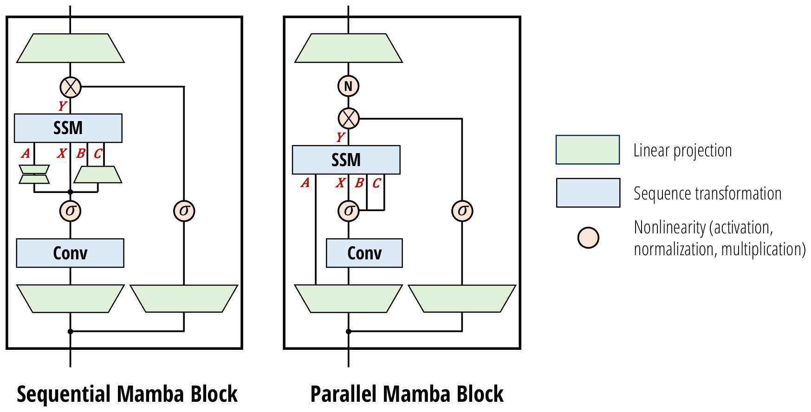

*图 6（原文 Figure 6，第 23 页）：Mamba-2 块去掉了串行线性投影，SSM 参数 $A,B,C$ 在块的开头产生，而不是作为 SSM 输入 $X$ 的函数；额外加入归一化层以改进稳定性。$B$、$C$ 的投影只有单个头、被 $X$ 的各个头共享，类似多值注意力（MVA）。*

**图中文字翻译与读法**：

- **左：Sequential Mamba Block**（串行 Mamba 块，即 Mamba-1）。底部梯形是输入线性投影，分出两条支路：右支路是门控 $z$（经 $\sigma$ 激活），左支路经 **Conv**（卷积）和 $\sigma$ 后得到 $X$；$A$、$B$、$C$ 是在这之后再由 $X$ 经线性投影得到的（图中 $A$ 对应的是一个更窄的低秩投影）；然后进入 **SSM**，输出 $Y$ 与门控支路相乘（$\otimes$），再经顶部梯形的输出线性投影。
- **右：Parallel Mamba Block**（并行 Mamba 块，即 Mamba-2）。同一个输入投影同时产生 $A$、$X$、$B$、$C$ 和门控 $z$；$A$ 直接送入 SSM，$X,B,C$ 一起经 Conv 与 $\sigma$；SSM 输出 $Y$ 与门控支路相乘后，经标有 **N** 的圆圈（额外归一化）再进输出投影。
- **图例**：绿色梯形 **Linear projection**（线性投影）；蓝色方框 **Sequence transformation**（序列变换）；圆圈 **Nonlinearity (activation, normalization, multiplication)**（非线性：激活、归一化、乘法）。
- **读图结论**：两个块的区别只有两点——$A,B,C,X$ 是否从一个投影并行产生，以及右图多出一个归一化圆圈 N。它们都与内部序列混合层无关，所以消融可以用 SSD 作内部层来做（表 4）。

### 7.2 序列变换的多头模式

回忆：SSM 是定义 2.1 的序列变换，$A,B,C$ 有状态维 $N$；它定义 $\mathbb{R}^T\to\mathbb{R}^T$ 的变换（可表示为 $M\in\mathbb{R}^{(T,T)}$），并对输入 $X\in\mathbb{R}^{(T,P)}$ 沿 $P$ 轴独立作用——这相当于定义了一个**头**。

**定义 7.1**（多头模式）：多头序列变换由 $H$ 个独立的头组成，总模型维度 $D=\text{d\_model}$；参数可以在头之间绑定，形成一种头模式。

状态维 $N$ 和头维 $P$ 类似注意力的 $QK$ 头维和 $V$ 头维。像现代 Transformer 一样，Mamba-2 中通常取它们为 64 或 128 左右的常数；模型维度 $D$ 增大时，增加头数而保持 $N,P$ 不变。借助对偶性，可以把多头注意力的各种头模式搬到 SSM（或任何序列变换）上。下表对应原文式 (17)–(20)，形状为（时间，头，维度）：

| SSM 头模式 | 对应的注意力 | $X$ | $A$ | $B$ | $C$ |
|---|---|---|---|---|---|
| Multi-head SSM（MHS，多头） | Multi-head Attn.（MHA） | $(T,H,P)$ | $(T,H)$ | $(T,H,N)$ | $(T,H,N)$ |
| Multi-contract SSM（MCS，多收缩） | Multi-query Attn.（MQA） | $(T,1,P)$ | $(T,H)$ | $(T,1,N)$ | $(T,H,N)$ |
| Multi-expand SSM（MES，多扩张） | Multi-key Attn.（MKA） | $(T,1,P)$ | $(T,H)$ | $(T,H,N)$ | $(T,1,N)$ |
| Multi-input SSM（MIS，多输入） | Multi-value Attn.（MVA） | $(T,H,P)$ | $(T,H)$ | $(T,1,N)$ | $(T,1,N)$ |

（原文第 24 页。）对应关系是 $C\leftrightarrow Q$、$B\leftrightarrow K$、$X\leftrightarrow V$：

- **MHS/MHA**：经典多头，每个参数各有 $H$ 份，头数 $H=D/P$。
- **MCS/MQA**：多查询注意力（Shazeer 2019）原本用来加速自回归推理（要缓存 $K,V$），做法是 $K,V$ 不设头维，一个头广播给所有 $Q$ 头。SSM 版本是 $X$、$B$（对应 $V$、$K$）在 $H$ 个头之间共享，只有控制状态**收缩**的 $C$ 每头独立，所以叫多收缩。
- **MES/MKA**：对称地，控制**扩张**的 $B$ 每头独立，$C$、$X$ 共享。
- **MIS/MVA**：MQA 对注意力有意义（KV cache），但对 SSM 不自然。Mamba 里 $X$ 是 SSM 的主要输入，$B$、$C$ 是在输入通道间共享的参数；这就是多值注意力的 SSM 版本。

**命题 7.2**：Mamba 的选择性 SSM（S6）层可以看作：头维度 $P=1$（每个通道有独立的 SSM 动力学 $A$）；多输入 SSM（MIS）/多值注意力（MVA）的头结构（$B,C$ 对应 $K,Q$，在输入 $X$（对应 $V$）的所有通道间共享）。

**分组头模式**：多查询可以推广为分组查询注意力（GQA）：不用 1 个 $K,V$ 头，而用 $G$ 个（$1<G$，$G$ 整除 $H$）；既弥合 MQA 与 MHA 的性能差，也让张量并行更高效（取 $G$ 为分片数的倍数）。Mamba-2 采用的多输入头模式同样可以扩展成**分组输入 SSM**（GIS），等价于分组值注意力（GVA）。

### 7.3 从线性注意力借来的扩展

这些扩展在 11.3 节（原文第 9.4.3 节）作为“负面结果”做了消融：它们并没有显著提升性能，所以不作为默认设置；但它们说明了庞大的注意力文献如何用来定义 SSD 的变体。

- **核特征映射**：线性注意力常把注意力分数 $\mathrm{softmax}(QK^\top)$ 看成两部分：指数核 $Z=\exp(QK^\top)$（可用 $Z=\psi(Q)\psi(K)^\top$ 近似）；以及用 $M=G/G\mathbf{1}\mathbf{1}^\top$ 把每行归一化。Mamba-2 引入灵活的核特征映射 $\psi$，作用在 $B$、$C$ 分支（原文写作对应注意力里的 $K$、$V$ 分支；按图 4 的对应关系 $B\leftrightarrow K$、$C\leftrightarrow Q$，这里的 $V$ 应为 $Q$）；为简单对称，也可选择性地作用在 $X$（$V$）分支。图 6 中的任意非线性即是它。默认取逐元素的 Swish/SiLU。
- **归一化（分母）项**：要得到分母项只需计算 $M\mathbf{1}$。而模型最终输出是 $Y=MX$，所以只要给 $X$ 增加一列全 1，使其形状为 $(T,P+1)$ 即可求得归一化项。此时核特征映射 $\psi$ 必须为正，才能保证和为正。

## 八、系统优化（原文第 8 节）

SSD 把 SSM 和 Transformer 联系起来，就能借用为 Transformer 发展出来的系统优化。论文讨论三件事：张量并行、序列并行、变长序列。

### 8.1 张量并行（Tensor Parallelism，TP）

TP（Megatron 风格）把每一层（注意力、MLP）切开放到多块加速器上，在节点内 4–8 块 GPU、有 NVLink 的集群上广泛使用。它为 Transformer 而生，改到别的架构上并不直接。

**Mamba（Mamba-1）块的 TP 难点**。设单个输入 $u\in\mathbb{R}^{L\times d}$（不含批维），输入投影 $W^{(x)},W^{(z)}\in\mathbb{R}^{d\times ed}$（$e$ 是扩张因子，通常为 2），输出投影 $W^{(o)}\in\mathbb{R}^{ed\times d}$：

$$
\begin{aligned}
x&=uW^{(x)\top},\qquad z=uW^{(z)\top}\qquad&&\in\mathbb{R}^{L\times ed}\\
x_c&=\mathrm{conv1d}(x)&&\in\mathbb{R}^{L\times ed}\\
\Delta,B,C&=\text{low-rank projection}(x_c)&&\\
y&=\mathrm{SSM}_{A,B,C,\Delta}(x_c)&&\in\mathbb{R}^{L\times ed}\\
y_g&=y\cdot\phi(z)&&\\
\mathrm{out}&=y_gW^{(o)\top}&&\in\mathbb{R}^{L\times d}
\end{aligned}
$$

在 2 块 GPU 上切分：把 $W^{(x)},W^{(z)}$ 各切成两份（每份 $d\times\frac{ed}{2}$）很容易，每块 GPU 持有一半 $x_c$（$L\times\frac{ed}{2}$）。但 $\Delta,B,C$ 是整个 $x_c$ 的函数，所以必须先做一次 **all-reduce** 拿到完整的 $x_c$，再算 $\Delta,B,C$；之后两块 GPU 各自算 SSM（沿 $d$ 独立）；最后把 $W^{(o)}$ 切成两份（每份 $\frac{ed}{2}\times d$）再做一次 all-reduce。相比 Transformer 每个块一次 all-reduce，这里是**两次**，通信时间翻倍。大规模 Transformer 训练里通信可能已占一成到两成时间（原文写 10–20%），再翻倍会让 Mamba 在大规模训练里不够高效。

**Mamba-2 的做法**：目标是每个块只做一次 all-reduce，与 Transformer 的注意力/MLP 块一致。办法是让 $\Delta,B,C$ **直接从 $u$ 投影出来**，而不是从 $x_c$，于是这些投影矩阵也可以切分。这意味着不同 GPU 上有不同的 $\Delta,B,C$，相当于在一块更大的“逻辑 GPU”上有若干“组”的 $\Delta,B,C$。另外块内用 **GroupNorm**，且组数能被 TP 度整除，这样 TP 组里的 GPU 在块内不需要通信：

$$
\begin{aligned}
x&=uW^{(x)\top},\qquad z=uW^{(z)\top},\qquad \Delta,B,C=\mathrm{projection}(u)\\
x_c&=\mathrm{conv1d}(x),\qquad y=\mathrm{SSM}_{A,B,C,\Delta}(x_c),\qquad y_g=y\cdot\phi(z)\\
y_n&=\mathrm{groupnorm}(y_g),\qquad \mathrm{out}=y_gW^{(o)\top}
\end{aligned}
$$

（原文最后一式写的是 $y_g$，按上下文应作用在归一化后的 $y_n$ 上，疑为笔误；TP 度为 2 的展开式里同样的位置也是 $y_g^{(i)}$。）TP 度为 2 时，把 $W^{(x)}=[W^{(x)}_1,W^{(x)}_2]$、$W^{(z)}=[W^{(z)}_1,W^{(z)}_2]$（每份 $d\times ed/2$）和 $W^{(o)}=\begin{bmatrix}W^{(o)}_1\\W^{(o)}_2\end{bmatrix}$（每份 $ed/2\times d$）分到两块 GPU，第 $i$ 块 GPU 算出 $\mathrm{out}^{(i)}$，最后 $\mathrm{out}=\sum_i\mathrm{out}^{(i)}$（一次 all-reduce）。

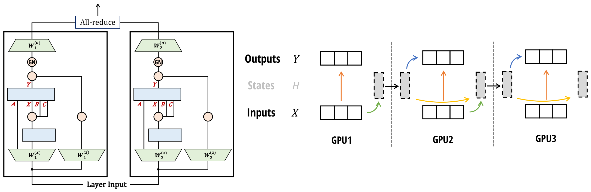

*图 7（原文 Figure 7，第 27 页）：左，张量并行；右，序列/上下文并行。*

**图中文字翻译与读法**：

- **左：张量并行**（Tensor Parallelism）。两个方框各是一块 GPU 上的 Mamba-2 块的一半：输入投影 $W^{(x)}_i$、$W^{(z)}_i$，中间是 $A,X,B,C\to$ SSM $\to Y$，经门控后接 **GN**（GroupNorm），再经输出投影 $W^{(o)}_i$；两块的输出在顶部做一次 **All-reduce**；底部 **Layer Input**（层输入）同时送给两块 GPU。图注：把输入投影矩阵 $W^{(x)},W^{(z)}$ 和输出投影矩阵 $W^{(o)}$ 切开；每个 SSM 头 $(A,B,C,X)\mapsto Y$ 落在单个设备上；最终归一化用 GroupNorm 就避免了额外通信；每层只需一次 all-reduce，与 Transformer 的 MLP 或注意力块相同。
- **右：序列/上下文并行**（Sequence/Context Parallelism）。三块 GPU（**GPU1、GPU2、GPU3**）各持有序列的一段；纵向三层 **Outputs $Y$**、**States $H$**、**Inputs $X$**，箭头含义同图 5：橙色为块内输入到输出，绿色为输入到状态，黄色为状态到状态，蓝色为状态到输出；GPU 之间的黑色箭头表示把末状态传给下一块 GPU。图注：与 SSD 算法类似，可以沿序列维拆到多个设备，每个设备算出自己那段序列的状态，再把这个状态传给下一块 GPU。
- **读图结论**：Mamba-2 的块在头的粒度上天然可切；序列并行则可以直接复用 SSD 的块分解，设备间只需传递固定大小的状态。

### 8.2 序列并行（Sequence Parallelism）

序列特别长、激活放不进一个设备时，需要沿序列长度维把输入和激活切到不同 GPU。有两类技术：

1. **残差和归一化的序列并行**（SP）：由 Korthikanti 等人提出，把 TP 里的 all-reduce 分解成 reduce-scatter 加 all-gather。注意到残差和归一化运算在同一 TP 组的所有 GPU 上对相同的输入重复，SP 就沿序列长度切分激活：reduce-scatter、做残差和归一化、再 all-gather。Mamba-2 的残差和归一化结构相同，所以 SP 无需修改直接适用。
2. **token 混合运算（注意力或 SSM）的序列并行**，又称“上下文并行”（CP）。注意力有 Ring Attention 等方案，辅以复杂的负载均衡技术；困难在于注意力里可以把 query 和 key 切成块，但每个 query 块都要和 key 块交互，通信带宽随 worker 数**二次**增长。SSM 的切法很简单：每个 worker 拿一个初始状态，对自己的输入计算 SSM，返回最终状态，并把最终状态传给下一个 worker；通信带宽随 worker 数**线性**增长。这种分解与 SSD 算法里的块分解（图 5）完全相同。

### 8.3 变长序列

预训练通常用相同长度的序列，但微调或推理时一个 batch 里的序列长度可能差别很大。朴素做法是向右补齐（padding）到最长，序列长度悬殊时很低效。Transformer 有复杂的技术来避免 padding 并做 GPU 间负载均衡，或把多个序列打包进同一个 batch 并调整注意力掩码。对 SSM（尤其 Mamba）则很简单：**把整个 batch 当成一条长序列，只要避免在各序列之间传递状态**；等价于在每条序列末尾的 token $t$ 处令 $A_t=0$，阻止它把信息传给属于另一条序列的 $t+1$。这样不需要任何 padding。

## 九、训练与评测设置（原文第 9 节开头与附录 D）

- **数据与基本设置**：语言建模在 Pile 上预训练；模型的深度、宽度遵循 GPT-3 的规格（125M 到 2.7B），训练配方遵循 GPT-3（Brown 等，2020），与 Mamba 论文设置相同。
- **缩放律实验**：用 GPT-2 分词器；模型规格、学习率、训练量见下表（原文表 9）。相对 GPT-3 的规格有两处改动：把 1.3B 模型的 batch 从 1M tokens 改成 0.5M tokens（为统一）；把训练步数和总 token 数调整到大致符合 Chinchilla 缩放律（训练 token 数应与模型大小成正比）。

| 参数量 | 层数 n_layers | 宽度 d_model | 头数 / 头维 n_heads / d_head | 训练步数 | 学习率 | batch | 训练 token 数 |
|---|---:|---:|---|---:|---|---|---:|
| 125M | 12 | 768 | 12 / 64 | 4800 | 6e-4 | 0.5M tokens | 2.5B |
| 350M | 24 | 1024 | 16 / 64 | 13500 | 3e-4 | 0.5M tokens | 7B |
| 760M | 24 | 1536 | 16 / 96 | 29000 | 2.5e-4 | 0.5M tokens | 15B |
| 1.3B | 24 | 2048 | 32 / 64 | 50000 | 2e-4 | 0.5M tokens | 26B |

（原文表 9，第 51 页。表题说明：模型维度和头数只适用于 Transformer 模型。）

- **训练配方**：所有模型用 AdamW，梯度裁剪值 1.0，权重衰减 0.1，不用 dropout，线性学习率预热 + 余弦衰减。默认峰值学习率取 GPT-3 规格；但论文使用受 PaLM、LLaMA 启发的“改进配方”：余弦衰减到 $1\mathrm{e}{-5}$，峰值为 GPT-3 值的 5 倍；去掉线性偏置项；用 RMSNorm 代替 LayerNorm；AdamW 的 $\beta=(0.9,0.95)$（GPT-3 的值），而非 PyTorch 默认的 $(0.9,0.999)$。
- **基线**：Mamba，以及 Transformer++（Mamba 论文里基于 PaLM 和 LLaMA 的配方：旋转位置编码、SwiGLU MLP、RMSNorm 代替 LayerNorm、无线性偏置、更高学习率）。Mamba 已被证明优于标准 Transformer（GPT-3 架构）和 H3、Hyena、RWKV-4、RetNet 等次二次架构，所以缩放律图里为清晰起见省略它们。
- **下游评测模型**：在 Pile 上训练 300B token，用 GPT-NeoX 分词器；超参与缩放律实验相同，只是 1.3B 和 2.7B 模型的 batch 为 1M；2.7B 还遵循 GPT-3 规格（32 层，维度 2560）；所有模型的学习率取对应 GPT-3 模型的 5 倍。评测用 EleutherAI 的 LM evaluation harness，任务为 LAMBADA、HellaSwag、PIQA、ARC-challenge、ARC-easy、WinoGrande、OpenBookQA（原文说比 Mamba 论文多一个任务，没有指明是哪一个）。
- **MQAR 设置**（附录 D.1）：见 10.1 节。
- **消融设置**：见第十一节。

## 十、实验结果（原文第 9 节）

### 10.1 合成任务：联想回忆（MQAR）

联想回忆任务常被用来测试语言模型在上下文里查找信息的能力：喂给自回归模型若干键值对，再展示一个先前见过的键，要求模型给出正确的值。**多查询联想回忆**（MQAR）要求模型同时记住多组关联，对 SSM 这类必须把全部相关信息压进循环状态的模型很有挑战（也与有限状态容量下的“电话簿查找”任务有关）。Mamba 原文做过 Selective Copying 和 Induction Heads，可以看作更容易的联想回忆。

论文用了一个更难的 MQAR 版本（来自 Based 论文的设置）：不是查询/键/值的 token 用随机 token 替换；键值对更多、序列更长、模型更小。基线包括标准多头 softmax 注意力，以及结合卷积、局部注意力和一种线性注意力变体的 Based 架构。**具体设置**（附录 D.1）：序列长度 $T\in\{256,512,1024\}$，每个设置用 $T/4$ 个键值对；总词表大小 8192；采用课程式训练，依次在 $(T/32,T/16,T/8,T/4)$ 个键值对的数据集上训练，每个数据集有 $2^{18}\approx250000$ 个样本、各过 8 个 epoch；总 batch 大小为 $2^{18}\approx0.25$M token（如 $T=1024$ 时 batch 为 256）；所有方法用 2 层、默认设置，注意力基线额外加位置嵌入；对每种方法扫描模型维度 $D\in\{32,64,128,256\}$ 和学习率 $\{10^{-3.5},10^{-2},10^{-2.5}\}$；线性衰减的学习率每个 epoch 下降一次（最后一个 epoch 的学习率是最大学习率的 1/8）。（原文还写“总计 $2^{28}\approx270$M 个样本”，但按“4 个数据集 $\times$ 每个 $2^{18}$ 个样本 $\times$ 8 个 epoch”只有 $2^{23}$ 个，两处不一致，本文不引用该总数。）

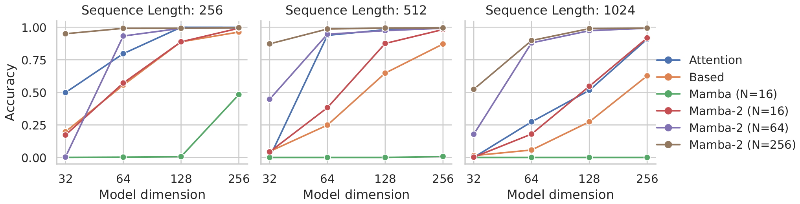

*图 8（原文 Figure 8，第 28 页）：联想回忆任务对 SSM 很有挑战，因为它们必须把所有相关信息记进循环状态；SSD 层加上改进的架构允许 Mamba-2 使用大得多的状态，表现明显好于 Mamba-1，甚至好于普通注意力。*

**图中文字翻译与读法**：

- 三个子图依次是 **Sequence Length: 256 / 512 / 1024**（序列长度）；横轴 **Model dimension**（模型维度）取 32、64、128、256，纵轴 **Accuracy**（准确率）0 到 1。图例：**Attention**（注意力，蓝）、**Based**（橙）、**Mamba (N=16)**（绿）、**Mamba-2 (N=16)**（红）、**Mamba-2 (N=64)**（紫）、**Mamba-2 (N=256)**（棕）。
- 从图上读出的近似值（原文只在文字里给出定性结论）：Mamba（$N=16$）几乎在所有设置里都接近 0，只有长度 256、模型维度 256 时约 0.5；Mamba-2 $N=256$ 在长度 256 与 512 时模型维度 32 就已约 0.95 与 0.87，在长度 1024 时模型维度 32 约 0.5、维度 64 起约 0.9 以上；长度 1024、模型维度 64 时，注意力约 0.27，而 Mamba-2 $N=64$ 约 0.88。
- **读图结论**：（1）Mamba-1 在这个任务上表现很差；原文称 Mamba-2 在所有设置下都表现良好，不过从图上看，$N=16$ 的 Mamba-2 在模型维度 32 时同样很低（长度 1024 时接近 0），好的表现主要体现在更大的状态（$N=64,256$）和更大的模型维度上；（2）即使把状态大小控制为相同（$N=16$），Mamba-2 也明显优于 Mamba-1，论文承认不确定架构的哪一部分是主因，留作未来工作；（3）状态大小很重要：$N$ 从 16 增大到 64、256 持续提升 MQAR 准确率，因为更大的状态能记住更多键值对。

### 10.2 语言建模：缩放律

按 Chinchilla 协议，在约 125M 到约 1.3B 参数的模型上画出缩放律（图 9），基线是 Mamba 和 Transformer++。

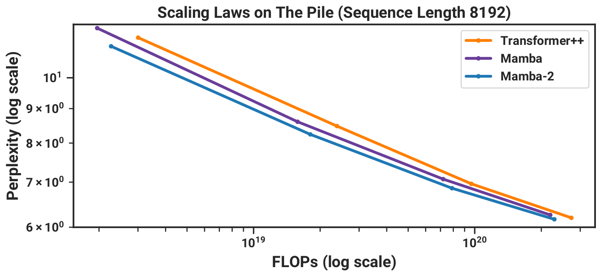

*图 9（原文 Figure 9，第 29 页）：参数量约 125M 到约 1.3B 的模型，在 Pile 上训练。Mamba-2 的表现与 Mamba 以及强劲的“Transformer++”配方持平或更好；相对于作者的 Transformer 基线，Mamba-2 在性能（困惑度）、理论 FLOPs 和实际墙钟时间上帕累托占优。*

**图中文字翻译与读法**：

- 标题 **Scaling Laws on The Pile (Sequence Length 8192)**（Pile 上的缩放律，序列长度 8192）；横轴 **FLOPs (log scale)**（对数刻度），从约 $2\times10^{18}$ 到约 $3\times10^{20}$；纵轴 **Perplexity (log scale)**（困惑度，对数刻度），约 6 到 11；三条曲线：**Transformer++**（橙）、**Mamba**（紫）、**Mamba-2**（蓝），每条曲线上的点对应四个模型尺寸。
- **读图结论**：相同 FLOPs 下 Mamba-2 的困惑度最低，其次是 Mamba，最高是 Transformer++；FLOPs 越大三条线越接近（从图上读出）。注意：图注说 Mamba-2 在“性能、理论 FLOPs 和实际墙钟时间”上帕累托占优，但这张图只画了 FLOPs 一个横轴；墙钟时间方面论文给出的证据是图 10 的单层 kernel 速度，不是端到端的训练时间。

### 10.3 零样本下游评测

论文把 Mamba-2 与最知名的开源模型比较，最主要的是 Pythia——它与本文模型使用相同的分词器、数据集和训练长度（300B token）。

**表 1：零样本评测。** 设置：各规模模型均训练至多 300B token；Pile 列是验证集，只在同一数据集和同一分词器（GPT-NeoX-20B）训练的模型之间比较，否则记 —；困惑度越小越好（↓），准确率越大越好（↑）；粗体为该规模组内的最好结果（并列时都加粗），原文还用下划线标次好，这里不再转录。

| 模型 | 分词器 | Pile 困惑度↓ | LAMBADA 困惑度↓ | LAMBADA 准确率↑ | HellaSwag 准确率↑ | PIQA 准确率↑ | Arc-E 准确率↑ | Arc-C 准确率↑ | WinoGrande 准确率↑ | OpenbookQA 准确率↑ | 平均准确率↑ |
|---|---|---:|---:|---:|---:|---:|---:|---:|---:|---:|---:|
| Pythia-1B | NeoX | 7.82 | 7.92 | 56.1 | 47.2 | 70.7 | 57.0 | 27.1 | 53.5 | 31.4 | 49.0 |
| Mamba-790M | NeoX | 7.33 | 6.02 | **62.7** | **55.1** | **72.1** | **61.2** | **29.5** | 56.1 | 34.2 | 53.0 |
| Mamba-2-780M | NeoX | **7.26** | **5.86** | 61.7 | 54.9 | 72.0 | 61.0 | 28.5 | **60.2** | **36.2** | **53.5** |
| Hybrid H3-1.3B | GPT2 | — | 11.25 | 49.6 | 52.6 | 71.3 | 59.2 | 28.1 | 56.9 | 34.4 | 50.3 |
| Pythia-1.4B | NeoX | 7.51 | 6.08 | 61.7 | 52.1 | 71.0 | 60.5 | 28.5 | 57.2 | 30.8 | 51.7 |
| RWKV4-1.5B | NeoX | 7.70 | 7.04 | 56.4 | 52.5 | 72.4 | 60.5 | 29.4 | 54.6 | 34.0 | 51.4 |
| Mamba-1.4B | NeoX | 6.80 | 5.04 | 65.0 | 59.1 | **74.2** | **65.5** | 32.8 | **61.5** | 36.4 | **56.4** |
| Mamba-2-1.3B | NeoX | **6.66** | **5.02** | **65.7** | **59.9** | 73.2 | 64.3 | **33.3** | 60.9 | **37.8** | **56.4** |
| Hybrid H3-2.7B | GPT2 | — | 7.92 | 55.7 | 59.7 | 73.3 | 65.6 | 32.3 | 61.4 | 33.6 | 54.5 |
| Pythia-2.8B | NeoX | 6.73 | 5.04 | 64.7 | 59.3 | 74.0 | 64.1 | 32.9 | 59.7 | 35.2 | 55.7 |
| RWKV4-3B | NeoX | 7.00 | 5.24 | 63.9 | 59.6 | 73.7 | 67.8 | 33.1 | 59.6 | 37.0 | 56.4 |
| Mamba-2.8B | NeoX | 6.22 | 4.23 | 69.2 | 66.1 | 75.2 | **69.7** | 36.3 | 63.5 | **39.6** | 59.9 |
| Mamba-2-2.7B | NeoX | **6.09** | **4.10** | **69.7** | **66.6** | **76.4** | 69.6 | **36.4** | **64.0** | 38.8 | **60.2** |

（原文表 1，第 29 页。）读法：

- Pile 困惑度：每个规模 Mamba-2 都低于对应的 Mamba（10.48 对 10.56 等，差 0.07–0.14，见下面补充表）。平均准确率：780M 组 53.5 对 53.0、2.7B 组 60.2 对 59.9；**1.3B 组两者都是 56.4，打平**，所以原文题注里“每个规模 Mamba-2 都优于 Mamba”在平均准确率上并非严格成立，差别都在零点几个点以内；逐项看，Mamba-2 并非每一项都赢（如 780M 的 LAMBADA 准确率 61.7 对 62.7）。
- Mamba-2 的参数略少（780M 对 790M，1.3B 对 1.4B，2.7B 对 2.8B，按模型名）。
- 与 Pythia 比：Mamba-2-1.3B（平均 56.4）高于 Pythia-2.8B（55.7）；Mamba-2-2.7B（60.2）高于 Pythia-6.9B（58.3，见下表）。这就是题注里“大体与两倍大的 Pythia 相当”的依据。
- 带 — 的模型（Hybrid H3，GPT-2 分词器）因分词器不同，不能比较 Pile 困惑度。

表 1 只是附录表 10 的子集。表 10 共 29 行，行数太多，这里放原图，并把表 1 里没有的 16 行转录为 Markdown。

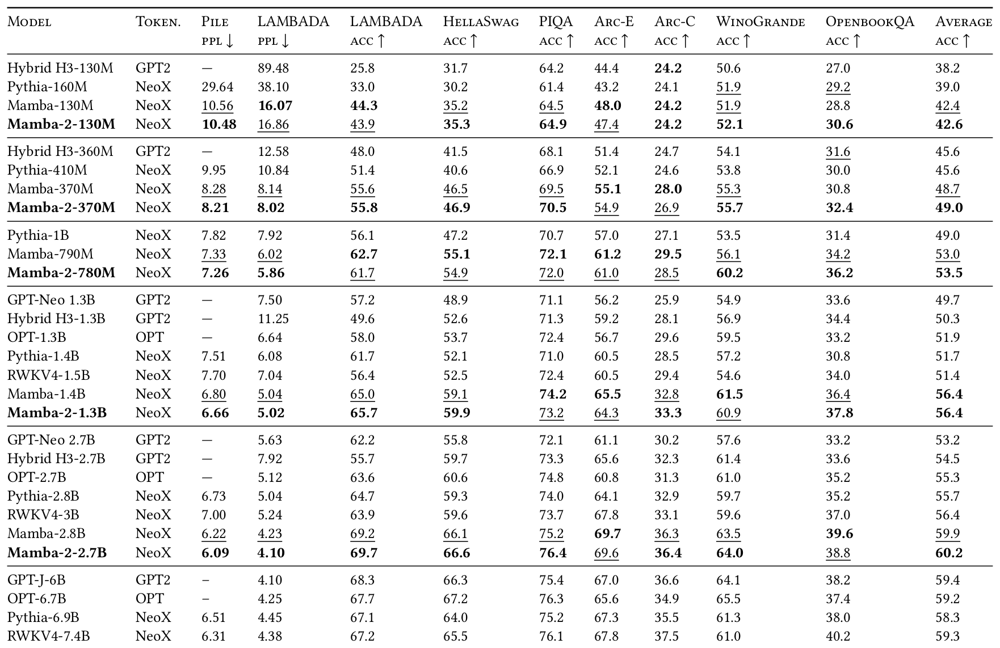

*表 10（原文 Table 10，第 52 页）：零样本评测的完整结果。粗体为各规模组内最好，下划线为次好；比较对象是用各种分词器训练、至多 300B token 的开源语言模型；Pile 指验证集，只比较同数据集、同分词器（GPT-NeoX-20B）的模型；每个规模下 Mamba-2 优于 Mamba，且大体与两倍大的 Pythia 相当。*

**表 10 补充**（表 1 中没有的 16 行）：列含义同表 1，数字逐格转录；“规模组”一列沿用原表的分组。

| 规模组 | 模型 | 分词器 | Pile 困惑度↓ | LAMBADA 困惑度↓ | LAMBADA 准确率↑ | HellaSwag 准确率↑ | PIQA 准确率↑ | Arc-E 准确率↑ | Arc-C 准确率↑ | WinoGrande 准确率↑ | OpenbookQA 准确率↑ | 平均准确率↑ |
|---|---|---|---:|---:|---:|---:|---:|---:|---:|---:|---:|---:|
| 130M | Hybrid H3-130M | GPT2 | — | 89.48 | 25.8 | 31.7 | 64.2 | 44.4 | 24.2 | 50.6 | 27.0 | 38.2 |
| 130M | Pythia-160M | NeoX | 29.64 | 38.10 | 33.0 | 30.2 | 61.4 | 43.2 | 24.1 | 51.9 | 29.2 | 39.0 |
| 130M | Mamba-130M | NeoX | 10.56 | 16.07 | 44.3 | 35.2 | 64.5 | 48.0 | 24.2 | 51.9 | 28.8 | 42.4 |
| 130M | Mamba-2-130M | NeoX | 10.48 | 16.86 | 43.9 | 35.3 | 64.9 | 47.4 | 24.2 | 52.1 | 30.6 | 42.6 |
| 370M | Hybrid H3-360M | GPT2 | — | 12.58 | 48.0 | 41.5 | 68.1 | 51.4 | 24.7 | 54.1 | 31.6 | 45.6 |
| 370M | Pythia-410M | NeoX | 9.95 | 10.84 | 51.4 | 40.6 | 66.9 | 52.1 | 24.6 | 53.8 | 30.0 | 45.6 |
| 370M | Mamba-370M | NeoX | 8.28 | 8.14 | 55.6 | 46.5 | 69.5 | 55.1 | 28.0 | 55.3 | 30.8 | 48.7 |
| 370M | Mamba-2-370M | NeoX | 8.21 | 8.02 | 55.8 | 46.9 | 70.5 | 54.9 | 26.9 | 55.7 | 32.4 | 49.0 |
| 1.3B | GPT-Neo 1.3B | GPT2 | — | 7.50 | 57.2 | 48.9 | 71.1 | 56.2 | 25.9 | 54.9 | 33.6 | 49.7 |
| 1.3B | OPT-1.3B | OPT | — | 6.64 | 58.0 | 53.7 | 72.4 | 56.7 | 29.6 | 59.5 | 33.2 | 51.9 |
| 2.7B | GPT-Neo 2.7B | GPT2 | — | 5.63 | 62.2 | 55.8 | 72.1 | 61.1 | 30.2 | 57.6 | 33.2 | 53.2 |
| 2.7B | OPT-2.7B | OPT | — | 5.12 | 63.6 | 60.6 | 74.8 | 60.8 | 31.3 | 61.0 | 35.2 | 55.3 |
| 6–7B | GPT-J-6B | GPT2 | — | 4.10 | 68.3 | 66.3 | 75.4 | 67.0 | 36.6 | 64.1 | 38.2 | 59.4 |
| 6–7B | OPT-6.7B | OPT | — | 4.25 | 67.7 | 67.2 | 76.3 | 65.6 | 34.9 | 65.5 | 37.4 | 59.2 |
| 6–7B | Pythia-6.9B | NeoX | 6.51 | 4.45 | 67.1 | 64.0 | 75.2 | 67.3 | 35.5 | 61.3 | 38.0 | 58.3 |
| 6–7B | RWKV4-7.4B | NeoX | 6.31 | 4.38 | 67.2 | 65.5 | 76.1 | 67.8 | 37.5 | 61.0 | 40.2 | 59.3 |

（原文表 10，第 52 页；原表里 GPT-J-6B、OPT-6.7B 的 Pile 列用短横线 –，这里统一写 —。）读法：

- 小规模下 Mamba-2 与 Mamba 的差距很小：130M 平均 42.6 对 42.4，370M 平均 49.0 对 48.7，个别项甚至 Mamba 更好（130M 的 LAMBADA 困惑度 16.86 对 16.07，370M 的 Arc-C 26.9 对 28.0）。
- 论文引言中“Mamba-2-2.7B 超过 Mamba-2.8B、Pythia-2.8B，甚至 Pythia-6.9B”的依据：Mamba-2-2.7B 平均 60.2，Mamba-2.8B 为 59.9，Pythia-2.8B 为 55.7，Pythia-6.9B 为 58.3；但 GPT-J-6B（59.4）、RWKV4-7.4B（59.3）、OPT-6.7B（59.2）也在 59 以上，Mamba-2-2.7B 比它们高约 0.8–1.0 个点。这些模型的训练数据和分词器各不相同（表中分词器列：GPT-J 为 GPT2，OPT 为 OPT，RWKV4 为 NeoX），只有 Pythia 与本文设置完全一致（相同分词器、数据集和训练长度）。

### 10.4 混合模型：SSD 层与 MLP、注意力层的组合

近期工作表明，同时有 SSM 层和注意力层的混合架构，可能比 Transformer 或纯 SSM 模型质量更好，尤其在上下文学习方面。论文探索 SSD 层与注意力、MLP 的不同组合。经验上，**注意力层约占总层数的 10% 时最好**；SSD、注意力、MLP 混合也比纯 Transformer++ 或纯 Mamba-2 好。

**SSD 与注意力**：二者互补——单独看（Mamba-2 对 Transformer++）困惑度几乎相同，但混合后优于任何一个纯架构。表 2 是 350M、48 层、训练到 7B token 的模型（Pile，GPT-2 分词器；参数量、超参、训练集和验证集全部相同）。作者的假设：SSM 层是通用的序列到序列映射，注意力层充当检索机制，能快速回看序列里的先前 token，而不必逼着模型把全部上下文压进记忆（SSM 状态）。

**表 2：SSD 与注意力块的组合。** 设置：350M 模型、48 层，改变注意力层数量；指标为 Pile 验证困惑度，越小越好。

| 注意力层数 | 0（Mamba-2） | 1 | 2 | 3 | 4 | 5 | 6 | 7 | 9 | 11 | 15 | 24 | Transformer++ |
|---|---:|---:|---:|---:|---:|---:|---:|---:|---:|---:|---:|---:|---:|
| 困惑度↓ | 8.60 | 8.38 | 8.32 | 8.29 | 8.29 | 8.28 | **8.26** | 8.27 | 8.28 | 8.30 | 8.34 | 8.50 | 8.68 |

（原文表 2，第 31 页。）读法：只加 1 层注意力就把困惑度从 8.60 降到 8.38；6 层（占 48 层的 12.5%）最好，为 8.26；4–9 层区间都在 8.26–8.29，之后随注意力层增多回升，24 层（一半）时 8.50 已与纯 Mamba-2 接近；纯 Transformer++ 为 8.68，比纯 Mamba-2 略差。这是单次训练、小规模（350M、7B token）的结果，论文没有报告方差；正文里只说“约 10%”，并给出脚注：只要注意力层间隔分布、不在最开头或最末尾，具体位置对质量影响不大。

**与 MLP 的组合**（2.7B 规模、64 层、训练到 300B token，Pile；参数量、超参、训练/验证集、数据顺序都相同）。比较五种设计：

1. Transformer++：32 个注意力层与 32 个门控 MLP 层交错；
2. Mamba-2：64 个 SSD 层；
3. Mamba-2-MLP：32 个 SSD 层与 32 个门控 MLP 层交错；
4. Mamba-2-Attention：58 个 SSD 层加 6 个注意力层（位于第 9、18、27、36、45、56 层）；
5. Mamba-2-MLP-Attention：28 个 SSD 层、4 个注意力层，与 32 个门控 MLP 层交错。

**表 3：零样本评测（2.7B 规模、训练到 300B token 的 Pile）。** 指标含义同表 1；粗体为该表内最好。

| 模型 | 分词器 | Pile 困惑度↓ | LAMBADA 困惑度↓ | LAMBADA 准确率↑ | HellaSwag 准确率↑ | PIQA 准确率↑ | Arc-E 准确率↑ | Arc-C 准确率↑ | WinoGrande 准确率↑ | OpenbookQA 准确率↑ | 平均准确率↑ |
|---|---|---:|---:|---:|---:|---:|---:|---:|---:|---:|---:|
| Transformer++ | NeoX | 6.13 | 3.99 | 70.3 | 66.4 | 75.2 | 67.7 | 37.8 | 63.9 | **40.4** | 60.2 |
| Mamba-2 | NeoX | 6.09 | 4.10 | 69.7 | 66.6 | **76.4** | 69.6 | 36.4 | 64.0 | 38.8 | 60.2 |
| Mamba-2-MLP | NeoX | 6.13 | 4.18 | 69.3 | 65.0 | **76.4** | 68.1 | 37.0 | 63.1 | 38.2 | 59.6 |
| Mamba-2-Attention | NeoX | **5.95** | **3.85** | **71.1** | **67.8** | 75.8 | 69.9 | 37.8 | **65.3** | 39.0 | **61.0** |
| Mamba-2-MLP-Attention | NeoX | 6.00 | 3.95 | 70.0 | 66.6 | 75.4 | **70.6** | **38.6** | 64.6 | 39.2 | 60.7 |

（原文表 3，第 31 页。）读法：Transformer++ 与 Mamba-2 质量大体相同（平均都是 60.2）；**只加 6 个注意力层**（Mamba-2-Attention）就明显优于纯 Mamba-2 和 Transformer++（困惑度 5.95，平均 61.0）；加 MLP 层会降低质量（Mamba-2-MLP 平均 59.6），但换来两点好处：MLP 层简单、硬件效率高，可加速训练和推理；也更容易通过把 MLP 换成混合专家（MoE）来“升级复用”。

### 10.5 速度基准

论文把 SSD 算法与 Mamba 的扫描实现和 FlashAttention-2 比较（图 10）。因为 SSD 重新表述成以矩阵乘为子程序，可以利用 GPU 上专门的矩阵乘单元（Tensor Core），所以比不使用矩阵乘单元的 Mamba 融合关联扫描快 2–8 倍；又因为随序列长度线性增长，在序列长度 2K 及以上比 FlashAttention-2 更快（引言里说 16K 时快 6 倍）。

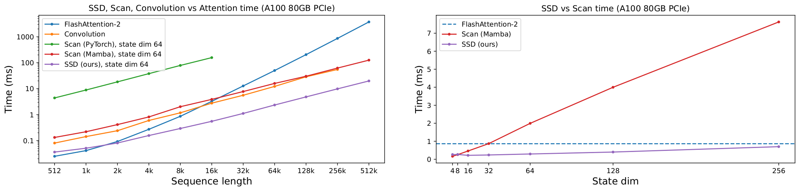

*图 10（原文 Figure 10，第 29 页）：（左）在大状态扩张（$N=64$）下，SSD 比 Mamba 的融合扫描快 2–8 倍，并且在序列长度 2k 及以上比 FlashAttention-2 快；（右）增大状态扩张会使 Mamba 优化过的扫描实现线性变慢，SSD 可以处理大得多的状态扩张而几乎不减速。测试硬件为 A100 80GB PCIe。*

**图中文字翻译与读法**：

- **左图 SSD, Scan, Convolution vs Attention time**（A100 80GB PCIe）：横轴 **Sequence length**（序列长度）从 512 到 512k，纵轴 **Time (ms)**（时间，毫秒），均为对数刻度。曲线：**FlashAttention-2**（蓝）、**Convolution**（卷积，橙，原文未详述）、**Scan (PyTorch), state dim 64**（PyTorch 扫描，绿，只画到 16k）、**Scan (Mamba), state dim 64**（Mamba 扫描，红）、**SSD (ours), state dim 64**（本文 SSD，紫）。
- **右图 SSD vs Scan time**（A100 80GB PCIe）：横轴 **State dim**（状态维）取 4、8、16、32、64、128、256，纵轴 **Time (ms)**（线性刻度）。曲线：**FlashAttention-2**（蓝色水平虚线，与状态维无关）、**Scan (Mamba)**（红）、**SSD (ours)**（紫）。
- **读图结论**：（1）FlashAttention-2 的曲线最陡（二次增长），在 512k 处比 SSD 高出两个数量级以上（从图上读出）；短序列时它更快，SSD 与它在约 2k 处交叉；（2）SSD 的曲线在整个范围内比 Mamba 扫描低，倍数约 3–7 倍（从图上读出，与图注“2–8 倍”一致）；（3）右图中 Mamba 扫描的耗时随 $N$ 近似线性上升（从 $N=16$ 到 $N=256$ 约 16 倍），SSD 只增长约 3 倍（从图上读出），在 $N=64$ 附近已明显低于 FlashAttention-2。引言据此写“可用 8 倍于 Mamba 的状态大小甚至更大而减速很小”。
- **注意**：图注说右图序列长度为 4K，但右图 $N=64$ 处的读数（Scan 约 2 ms、SSD 约 0.3 ms、FlashAttention-2 约 0.85 ms）与左图 8k 处的读数更接近（左图 4k 处约为 0.8、0.16、0.27 ms）。图注与数据可能有出入，原文未说明，所以本文只引用右图的趋势，不引用它的绝对数值。

论文也提醒：这是单个层的速度。**整个 Mamba-2 模型在短序列（如 2K）下训练可能不如 Transformer 高效**，因为同样参数量下，$L$ 层的 Transformer 有 $L/2$ 个 MLP 层和 $L/2$ 个注意力层，而 Mamba-2 有 $L$ 个 SSD 层；MLP 层只是简单的矩阵乘加逐点非线性，硬件效率很高。10.4 节的结果表明，也可以组合 $L/2$ 个 SSD 层和 $L/2$ 个 MLP 层来在短序列下加速训练。

## 十一、消融（原文第 9.4 节）

### 11.1 块设计

第七节引入的 Mamba-2 块相对 Mamba-1 块有小改动，部分源于与注意力的联系，也为了提升可扩展性。表 4 消融这些发生在 SSM 核心层之外的改动（这里内部 SSM 层统一用 SSD，不同于 Mamba-1 的 S6 层）。

**表 4：Mamba-2 块的消融。** 指标：困惑度（越小越好）；参数量 126.5M–129.3M，属于约 125M 的规模（原文表题没有注明训练 token 数）。

| 块 | $A,B,C,X$ 投影 | 额外归一化 | 参数量 | 困惑度↓ |
|---|---|---|---:|---:|
| Mamba-1 | 串行 | ✗ | 129.3M | 11.76 |
| | 串行 | ✓ | 129.3M | 11.54 |
| | 并行 | ✗ | 126.5M | 11.66 |
| Mamba-2 | 并行 | ✓ | 126.5M | 11.49 |

（原文表 4，第 32 页。）读法：并行投影少约 2.8M 参数（129.3M 对 126.5M），困惑度还略好（11.76 到 11.66）；加归一化再好一点（11.66 到 11.49）；两者叠加就是 Mamba-2 块。并行投影更重要的好处是便于张量并行；额外归一化在更大规模的初步实验中还帮助训练稳定。差距都很小（零点几），论文没有给出方差。

### 11.2 头结构

第 7.2 节说明 $B,C,X$ 投影的维度可以看成类似多头注意力、多查询注意力的超参。Mamba 原有架构类似多值注意力（命题 7.2），这是从状态空间模型视角自然得出、此前没被消融过的选择。

**表 5：多头结构的消融。** 设置：状态扩张因子 $N=64$、头大小 $P=64$，按 Chinchilla 缩放律的 token 数训练；$A$ 头数总是等于总头数 $H$，即每个头有独立的依赖输入的 $A$ 衰减因子。上半：125M 模型、2.5B token；下半：360M 模型、7B token。

| SSM 头模式 | 注意力类比 | $A$ 头数 | $B$ 头数 | $C$ 头数 | $X$ 头数 | 层数 | 参数量 | 困惑度↓ |
|---|---|---:|---:|---:|---:|---:|---:|---:|
| Multi-input（MIS） | Multi-value（MVA） | 24 | 1 | 1 | 24 | 24 | 126.5M | **11.66** |
| Multi-contract（MCS） | Multi-query（MQA） | 24 | 1 | 24 | 1 | 24 | 126.5M | 12.62 |
| Multi-expand（MES） | Multi-key（MKA） | 24 | 24 | 1 | 1 | 24 | 126.5M | 12.59 |
| Multi-head（MHS） | Multi-head（MHA） | 24 | 24 | 24 | 24 | 15 | 127.6M | 12.06 |
| Multi-state（MSS） | - | 24 | 1 | 1 | 1 | 36 | 129.6M | 12.00 |
| Multi-input（MIS） | Multi-value（MVA） | 32 | 1 | 1 | 32 | 48 | 361.8M | **8.73** |
| Multi-contract（MCS） | Multi-query（MQA） | 32 | 1 | 32 | 1 | 48 | 361.8M | 9.33 |
| Multi-expand（MES） | Multi-key（MKA） | 32 | 32 | 1 | 1 | 48 | 361.8M | 9.36 |
| Multi-head（MHS） | Multi-head（MHA） | 32 | 1 | 1 | 1 | 70 | 361.3M | 9.01 |
| Multi-state（MSS） | - | 32 | 32 | 32 | 32 | 29 | 357.3M | 9.04 |

（原文表 5，第 33 页；粗体为原文标出的最好值。）读法与注意事项：

- **多值（MVA）模式远好于多查询（MQA）和多键（MKA）**（125M：11.66 对 12.62、12.59；360M：8.73 对 9.33、9.36），尽管它们看上去很相似；而且这不能用总状态大小解释，因为它们的总状态大小相同（都等于 $HPN$，即头数、头维、状态维的乘积）。
- 论文还比较了 $C,B,X$（对应 $Q,K,V$）头数相等的模式：标准多头，以及“激进共享”（它们都只有 1 个头；此时模型仍有 $H$ 个不同的序列混合器 $M$，因为每个头有不同的 $A$）。参数匹配后，这两种多头模式表现相近，介于 MVA 和 MQA/MKA 之间。
- **表中下半部分的 MHS 与 MSS 两行看起来标反了**：上半部分里 MHS 是 24/24/24 个头、15 层，MSS 是 24/1/1/1 个头、36 层；下半部分却是 MHS 的 $B,C,X$ 为 1/1/1 个头、70 层，MSS 为 32/32/32 个头、29 层。参数匹配时，每层头越多则层数越少，所以 70 层对应的应是 1 个头的那种模式。原文没有解释，本文按原文转录，引用这两行时请留意。
- 头数 24 和 32 与 $H=e\cdot d_{\text{model}}/P$（$e=2$、$P=64$）对应 $d_{\text{model}}=768$ 和 1024（本文的推算，原文没有写）。

### 11.3 注意力核近似

第 7.3 节说过，SSD 可以结合线性注意力文献里的各种核近似。表 6 消融了前人提出的若干方案：cosFormer、Random Feature Attention（RFA）、正随机特征（Performer）。论文还消融了增加类似 softmax 分母的归一化项：发现对大多数变体它会带来不稳定，但对 ReLU 激活函数 $\psi$ 略有提升。表 7 则测试了更近期的、通过扩大特征维度来改进线性注意力的方案（Based 和 ReBased）：它们用二次函数近似 exp 核；ReBased 还提议把 $QK$ 的激活函数换成层归一化，从 SSM 视角就是在 $(B,C)$ 上先做归一化再进 SSM 函数（这一技术也曾被独立提出：softmax 注意力里的 “QK-Norm”，以及 Jamba 里 Mamba 的 “internal normalization”）。

**表 6：核近似的消融。** 设置：检验核激活函数 $\psi$ 的各种方案，包括旨在逼近标准 softmax 注意力中指数核的线性注意力变体；指标为困惑度（越小越好）。原文表题未注明模型规模；其 Swish 行 11.66 与表 4、表 5 的 125M 基线（并行投影、无额外归一化）一致，应是同一设置（本文的推断）。

| 核激活函数 $\psi$ | 困惑度↓ |
|---|---:|
| none（无） | 11.58 |
| Swish | 11.66 |
| Exp | 11.62 |
| ReLU | 11.73 |
| ReLU + normalization（归一化） | 11.64 |
| cosFormer | 11.97 |
| Random Feature Attention（RFA） | 11.57 |
| Positive Random Features（Performer） | 12.21 |

（原文表 6，第 33 页。表中前五行与后三行之间原文有分隔线。）

**表 7：核近似的消融（扩大特征维度的 Based / ReBased）。** 设置：上半 130M 模型（$N=64$），下半 380M 模型（$N=256$）；原文表题把两处都写成 “Top”，按内容应为上、下。Based 用二次泰勒展开 $\exp(x)\approx1+x+x^2/2$ 近似指数核，特征映射为 $\psi_{\text{Taylor}}(x)=\mathrm{concatenate}(1,x,\tfrac{1}{\sqrt2}\,x\otimes x)$；ReBased 用更简单的 $\psi_{\text{Quadratic}}(x)=x\otimes x$（对应核 $x^2$），并在前面加层归一化。因为它们会扩大特征维度，要先把 $B,C$ 投影到更小的维度（130M 模型投影到 8 维，380M 投影到 16 维，因此 ReBased 的总状态大小为 $8^2=64$，Based 为 $1+8+8^2=73$）；$B,C$ 投影变小，这些方法参数更少，所以相应调整了层数。

| 规模 | 核激活函数 $\psi$ | 困惑度↓ |
|---|---|---:|
| 130M | Swish | 11.67 |
| 130M | Swish + Taylor（Based） | 12.19 |
| 130M | LayerNorm | 11.50 |
| 130M | LayerNorm + Square（ReBased） | 11.84 |
| 380M | Swish | 8.58 |
| 380M | Swish + Taylor（Based） | 8.71 |
| 380M | LayerNorm | 8.61 |
| 380M | LayerNorm + Square（ReBased） | 8.63 |

（原文表 7，第 33 页；规模列为本文依据表题与附录 D.4 补充。）读法与结论：所试的核近似方法都没有比简单的逐点非线性激活函数更好，所以 Mamba-2 默认取 $\psi(x)=\mathrm{Swish}(x)$（沿用 Mamba-1），但论文建议“干脆去掉这个激活”可能是更简单的选择（没有被广泛测试）。数字上也看得出没有稳定的赢家：130M 时 LayerNorm（11.50）比 Swish（11.67）好 0.17，380M 时反而 Swish（8.58）略好于 LayerNorm（8.61）。论文也强调：SSD 与普通线性注意力的区别在于是否含 1-半可分掩码 $L$，而文献里的各种线性注意力方法是为了近似 softmax 注意力、没有这一项而设计的，所以这些负面结果并不意外。

## 十二、相关工作与讨论（原文第 10–11 节）

### 12.1 与状态空间模型的关系

结构化 SSM 可以沿三个轴来刻画：（i）时不变还是时变；（ii）系统的维度；（iii）循环转移 $A$ 上的结构。SSD 是一个**SISO（单输入单输出）维度、标量-单位阵结构的时变（选择性）SSM**。

- **时变性**（选择性）：最初的 S4 是线性时不变（LTI）系统，动机是连续时间的在线记忆（HiPPO 等）；之后有很多变体，其中一些丢掉循环、只用 LTI SSM 的卷积表示。SSD 是时变的，即 Mamba 引入的选择性 SSM。选择性 SSM 与 RNN 的门控机制（LSTM、GRU，以及 QRNN、SRU、RWKV、HGRN、Griffin 等）关系密切；这些 RNN 参数化各有不同，最主要的区别是**没有状态扩张**。
- **维度与状态扩张**：SSD 和它的前辈（S4、H3、Mamba）一样是 SISO 系统，输入通道独立处理，因此有效状态大小为 $ND$（$N$ 是 SSM 状态大小即状态扩张因子，$D$ 是模型维度）。传统 RNN 要么 $N=1$，要么是带稠密 $B,C$ 的多输入多输出（MIMO），状态都更小。MIMO SSM 在某些领域表现不错，但 Mamba 表明状态扩张对语言这类信息密集领域至关重要；SSD 的一个主要优势是允许更大的状态扩张因子而不拖慢模型，后续不少工作已采用状态扩张。
- **结构**：与之前的结构化 SSM 相比，SSD 的主要限制在状态转移 $A_t$ 的表达力。更一般的对角 $A_t$ 理论效率与 SSD 相同，但对硬件不友好：对偶二次形式失去注意力式的解释而更难计算。所以相对 Mamba，SSD 只是 $A_t$ 稍受限的对角形式，用这点表达力换硬件效率和易实现性。作者假设可以改进结构化矩阵算法，推广到一般对角 SSM。

### 12.2 与结构化矩阵的关系

第一个视角把这些模型看成矩阵序列变换，即“矩阵混合器”（matrix mixers）：沿序列维 $T$ 乘以一个 $T\times T$ 矩阵的序列变换。已有的矩阵混合器主要差别在矩阵的表示：MLP-Mixer（无结构矩阵）、FNet（傅里叶变换矩阵）、M2（butterfly/Monarch 矩阵）、Toeplitz 矩阵（Hyena 等）以及更奇特的结构。论文提出一个刻画：**高效（次二次）的矩阵序列变换恰好就是具有结构化矩阵混合器的那些**；SSD 的核心结果是把 SSM 看成具有特定结构（半可分矩阵）的矩阵混合器，线性与二次的对偶就是结构化矩阵乘法与朴素矩阵乘法。这些结构化矩阵表示带来了 SSD 的分块算法。半可分矩阵在科学计算文献里已有深入研究，引入这些想法可能进一步改进 SSM。论文还建议：从矩阵混合器视角出发，也许能设计有原则的非因果 Mamba 变体，或通过分析矩阵变换的结构，刻画并弥合 softmax 注意力与次二次模型之间的差距。

### 12.3 与（线性）注意力的关系

与标准（因果）注意力相比，SSD 只有两处主要差别：

- 第一，SSD **不用 softmax**。softmax 正是注意力二次复杂度的来源；去掉 softmax 后，序列可以通过线性注意力框架线性地计算。
- 第二，SSD 把 logits 矩阵乘上一个**依赖输入的 1-半可分掩码**，这个掩码可以看成取代了 softmax。它还能理解成提供位置信息：元素 $a_t$ 在 RNN 意义上是“门”，或者说“选择”机制，它们的累积乘积 $a_{j:i}$ 控制位置 $i$ 和 $j$ 之间允许多少交互。位置编码（正弦、ALiBi、RoPE）是 Transformer 的重要组成部分但常被视为启发式，SSD 的 1-SS 掩码可以看成一种更有原则的相对位置编码（GateLoop 同时期也提出了这个观点）。

第二个视角（SMA）说明对偶是一个简单 4 路张量收缩的不同收缩顺序，它是线性注意力的强推广，比 SSD 更一般：其他形式的结构化掩码可能带来性质不同的高效注意力变体。由这些联系还可以引出别的研究方向，例如 Mamba 里是否也存在注意力 sink 现象，可解释性技术能否迁移到 SSM。

论文也**明确强调**：SSD 不推广标准 softmax 注意力，也不推广任何作用在注意力核矩阵上、而没有有限特征映射 $\psi$ 的变换。相比一般注意力，SSD 的优势在于有可控的状态扩张因子 $N$ 去压缩历史，而二次注意力要缓存整段历史（随 $T\gg N$ 增长）。同期工作已经开始研究这些表示的权衡（例如复制和上下文学习任务）；Mamba-2 在某些能力上显著优于 Mamba（如 MQAR），但仍有很多需要理解。

### 12.4 相关模型

- **RetNet、TransNormerLLM**：用衰减项代替累积和来推广线性注意力，提出对偶的并行/循环算法以及混合的“分块（chunkwise）”模式。可看作 $A_t$ 时不变（对所有 $t$ 为常数）的 SSD 实例；在 SMA 解释下，掩码是衰减矩阵 $L_{ij}=\gamma^{i-j}$。它们从注意力视角导出，保留多头注意力（MHA）模式；Mamba-2 从 SSM 视角导出，保留多值注意力（MVA）模式，第十一节表明后者更好。
- **GateLoop**：同期提出依赖输入的衰减因子 $A_t$，并导出与 SSD 相同的对偶二次形式，称为“surrogate attention”形式。
- **Gated Linear Attention**（GLA）：带数据依赖门的线性注意力变体，有分块模式的高效算法和硬件感知实现。
- **HGRN / HGRN2**：带输入依赖门的 RNN；HGRN2 引入了状态扩张。
- **Griffin、RecurrentGemma**：带输入依赖门控的 RNN 配合局部注意力，可以与强力的现代 Transformer 竞争。**Jamba** 表明在 Mamba 中混入少数注意力层，在语言建模上表现很好。
- **xLSTM**：在 LSTM 基础上采用状态扩张和门控、归一化、稳定化等技术。
- **RWKV-4**：基于另一种线性注意力近似（attention-free Transformer）的 RNN；后来的 RWKV-5/6（Eagle 和 Finch）引入了选择性和状态扩张的想法。

### 12.5 结论

论文提出了一个基于结构化矩阵的理论框架，弥合了 SSM 与注意力变体的概念鸿沟；它解释了 Mamba 等近期 SSM 为什么能在语言建模上与 Transformer 持平，并提供新思路，通过联通两边的算法和系统进展来改进 SSM（以及可能的 Transformer）。作为演示，该框架指导了位于 SSM 与结构化注意力交叉处的新架构 Mamba-2 的设计。

## 十三、附录要点

### 13.1 附录 B：标量 SSM 扫描（1-SS 乘法）的算法族

这一节的目的，是支撑论文的中心主题：**序列模型的高效算法可以看成结构化矩阵乘法算法**。标量 SSM 扫描定义为：对标量序列 $a,b$，

$$
h_t=a_th_{t-1}+b_t\qquad(21)
$$

$h_{-1}$ 默认为 0。式 (21) 也叫 cumprodsum：$b=0$ 时退化为 cumprod，$a=1$ 时退化为 cumsum。向量化后就是 $h=Mb$，$M=\mathrm{1SS}(a)$。所以这个基本运算有三种等价的看法：（标量）SSM 扫描、cumprodsum、1-SS 矩阵向量乘。S5、S6（Mamba）等对角结构 SSM 的计算都归约到这个运算。

**经典算法**：（1）顺序递推，一步一步算；（2）并行关联扫描：把多项递推改写成大小为 2 的隐状态上的单项递推

$$
\begin{bmatrix}h_t\\1\end{bmatrix}=\begin{bmatrix}a_t&b_t\\0&1\end{bmatrix}\begin{bmatrix}h_{t-1}\\1\end{bmatrix},
$$

于是计算所有 $h_t$ 等于对这些 $2\times2$ 矩阵做累积乘积；矩阵乘法满足结合律，所以可以用关联扫描。二元算子就是这类矩阵的乘法，取第一行得到 S5 所定义的算子 $(a_t,b_t)\otimes(a_s,b_s)=(a_ta_s,\;a_tb_s+b_t)$（式 22）。关联扫描可以用分治算法并行化。

**通过结构化矩阵分解得到的算法**（B.3）：

| 模式 | 做法 | 工作量 / 深度 |
|---|---|---|
| 膨胀模式（dilated） | 把 $M$ 分解成步长为 1, 2, 4, 8, … 的因子，类似膨胀卷积；说明 1-SS 矩阵是 butterfly 矩阵的特例 | $O(T\log T)$ 次运算；深度约为工作高效关联扫描的一半 |
| 状态传递（分块）模式 | 以任意块长 $k$ 分块：先算左半段，取其末状态 $h_{k-1}$，更新一步（修改 $b_k$），再算右半段；左下块 $M_C$ 是秩 1 矩阵 | 线性工作量，但是串行 |
| 完全递推模式 | 状态传递模式在块长 $k=1$ 时的特例 | 线性工作量，串行 |
| 并行块分解模式 | 同样的分解，但左右两个子问题并行递归，再用秩 1 的左下块做合并；递归可在任意处停下，用别的方式算子问题 | 深度 $O(\log T)$，合并步需要线性工作量，总工作量 $O(T\log T)$ |
| 关联扫描模式 | 三阶段分解：（1）算各 $2\times2$ 对角块；（2）左下角的秩 1 因子化约成一个规模减半的同类问题；（3）把结果广播回去 | $O(T)$ 工作量、$O(\log T)$ 深度；计算图与上面的关联扫描完全相同（Remark 10） |

要点：**SSD 算法用的正是“并行块分解”这条线**——递归可以随时停止，在小的子问题上换用对偶二次（注意力）形式（原文 B.3.4）。另外 Remark 9 说明：这里的“状态传递”与 RetNet、GLA 等相关模型提出的“chunkwise”算法有联系。

### 13.2 附录 C：理论细节

**C.1 半可分矩阵的闭包性质**（命题 C.1，对 SSM 的灵活性有说明作用，不影响核心结果）：

- 加法：$N$-SS 与 $P$-SS 矩阵之和至多是 $(N+P)$-SS；
- 乘法：$N$-SS 与 $P$-SS 矩阵之积是 $(N+P)$-SS；
- 求逆：$N$-SS 矩阵的逆至多是 $(N+1)$-SS（可由 Woodbury 恒等式得到）。

对 SSM 的含义：两个并行 SSM 之和仍是 SSM；两个 SSM 串联（先后复合）仍可看成一个 SSM，总状态大小相加（这是个不那么平凡的事实）；带状矩阵是半可分的，所以它们的逆也是半可分的（半可分结构常常就是由带状矩阵的逆引出的），半可分矩阵的快速递推性质可以看成其逆为带状的结果。**Remark 11**：1-SS 矩阵对应简单递推 (7)，这等价于它的逆是 2-带状矩阵：$M^{-1}$ 对角线上是 1、次对角线上是 $-a_t$，即 $y=Mx\Leftrightarrow M^{-1}y=x$，逐元素就是 $y_t-a_ty_{t-1}=x_t$。

**C.2 自回归掩码注意力就是半可分结构化注意力**（定理 5.2 的证明）。除了高效，标准线性注意力还有两个重要性质：因果；自回归生成高效（看到 $x_T$ 后算出 $y_T$ 的增量成本是常数）。在 SMA 框架里，因果等价于 $L$ 是下三角。论文用一个狭义的自回归定义：

**定义 C.2**：阶为 $k$ 的自回归变换 $x\mapsto y$ 指每个输出只依赖当前输入和最近 $k$ 个输出：

$$
y_t=\mu_tx_t+\ell_{t1}y_{t-1}+\cdots+\ell_{tk}y_{t-k}\qquad(23)
$$

（$L$ 是累积和矩阵时是 $k=1$ 的特例：$y_t=x_t+y_{t-1}$。）

**定理 C.3**：设 $L\in\mathbb{R}^{T\times T}$ 是阶为 $k$ 的高效自回归变换，则 $L$ 是阶为 $k+1$ 的状态空间模型。

证明思路：把定义改写成 $y_t-\ell_{t1}y_{t-1}-\cdots-\ell_{tk}y_{t-k}=\mu_tx_t$，对 $t$ 向量化后左边是一个下三角的 $(k+1)$-带矩阵乘 $y$；把对角矩阵 $\mu$ 并进系数矩阵，它仍是 $(k+1)$-带下三角矩阵，而且 $L^{-1}y=x$，所以 $L$ 是这个带状矩阵的逆。$(k+1)$-带矩阵按秩的刻画是 $(k+1)$-半可分的；由命题 C.1，逆 $L$ 至多是 $(k+2)$-半可分，利用带状矩阵的额外结构可得 $k+1$ 的更紧界；最后由定理 3.5，它是阶为 $k+1$ 的 SSM。因此：**高效的自回归注意力就是半可分 SMA**。

### 13.3 附录 D：实验细节

已在第九节（训练与评测设置）、10.1 节（MQAR 设置）、11.3 节（Based/ReBased 设置）中并入对应位置。

## 十四、局限、证据边界与常见误读

**论文自己承认的局限与开放问题**：

- SSD 用标量-单位阵 $A_t$ 换硬件效率，表达力比 Mamba 的对角 $A_t$ 受限；原文没有给出对角与标量 $A_t$ 在同一设置下的质量消融（据本文所读版本），把算法推广到一般对角 SSM 是未来方向。
- 整个 Mamba-2 模型在短序列（如 2K）下训练可能不如 Transformer 高效。
- MQAR 上 Mamba-2 即使在 $N=16$ 时也明显优于 Mamba，论文不知道是架构的哪一部分起了主要作用。
- 核近似方法的负面结果也许不意外（它们是为没有 $L$ 的情形设计的）。
- Mamba 里是否有注意力 sink、可解释性方法能否迁移，都是开放问题。

**证据边界**（读数字时要注意）：

- **规模**：语言建模实验最大到 2.7B 参数、300B token（Pile）；混合模型的层数比例消融只在 350M、7B token 上做；没有更大规模的证据；质量评测里最长的序列是缩放律图里的 8192，更长的序列只有速度测试（图 10）。
- **只有单次结果**：论文不报告随机种子方差。表 4–7 中许多差异只有零点几，应当谨慎解读；表 1 里 Mamba-2 对 Mamba 的平均准确率优势只有 0–0.5 个点。
- **可比性**：只有 Pythia 与本文模型用相同分词器、数据集和训练长度；GPT-Neo、OPT、GPT-J 等的训练数据与分词器各异，Pile 困惑度也无法比较。
- **速度**：图 10 是单个 SSD 层在 A100 80GB PCIe 上的 kernel 时间，不是端到端训练吞吐；图 9 只在 FLOPs 轴上展示了困惑度，“墙钟时间帕累托占优”没有对应的训练时间曲线。右图的序列长度标注与数据可能不一致（见 10.5 节）。
- **合成任务**：MQAR 是小模型（2 层）上的合成任务，结论是“状态越大越好、Mamba-2 好于 Mamba”，不能直接外推到真实检索场景。
- **原文笔误**（本文已在正文标出并说明处理方式）：式 (9) 的 $Y=GV$；RetNet 衰减掩码的指示函数方向；定理 6.1 里推理 FLOPs 与显存的写法；TP 公式里最后一行的 $y_g$；表 5 下半部分 MHS/MSS 两行；图 10 图注的序列长度；MQAR 附录里的总样本数；7.3 节把 $B,C$ 分支对应到注意力的 $K,V$ 分支（按图 4 应为 $K,Q$）。

**常见误读**：

- “SSD 证明 Transformer 与 Mamba 完全等价”：错。对偶只发生在**标量-单位阵 SSM**与**掩码为 1-半可分矩阵的（线性）注意力**之间；论文明确说 SSD 不推广 softmax 注意力，标题里的“Transformers”只对某些类型的注意力成立（脚注 1）。Mamba-1 的对角 $A_t$ 也不在 SSD 内。
- “Mamba-2 只是把 Mamba-1 做大”：错。它同时改了核心层（标量 $A_t$、头维 $P=64/128$、分块算法）、块结构（并行投影、额外归一化）和头模式（多值 MVA/分组 GVA，而非标准多头）。
- “2–8 倍是端到端训练加速”：错。那是 SSD 层相对 Mamba 融合扫描、在状态维 $N=64$ 附近的 kernel 速度；整个模型的收益取决于层结构与序列长度。
- “Mamba-2 更接近多头注意力”：错。它用的是多输入（MVA）模式——$B,C$ 跨头共享，$X$ 和 $A$ 每头独立；消融中标准多头（MHS）比 MVA 差（125M：12.06 对 11.66）。
- “大状态是免费的”：SSD 让大 $N$ 的速度惩罚很小，但训练 FLOPs 仍是 $TN^2$，状态显存仍随 $N$ 增加。
- “SSM 靠状态足以替代注意力的检索能力”：论文的混合结果（约 10% 注意力层最好）以及对 SSM 与 Transformer 在复制、上下文学习上权衡的引用，都说明这仍是开放问题。

## 十五、复现检查清单

- 先实现三个版本并互相对拍：逐步递推 $h_t=a_th_{t-1}+B_tx_t^\top$、$y_t=C_t^\top h_t$；二次对偶形式 $(L\circ CB^\top)X$；分块 SSD 算法。三者应在浮点误差内一致（原文 Listing 1 的 `ssd` 就是最小参考实现）。
- 块长 $\mathtt{Q}$ 要整除序列长度（原文代码里有 `assert`；块分解本身对不等长分块也成立）；把 $\mathtt{Q}$ 当作硬件相关的超参去扫描（论文没有给出块长的消融）。
- 连乘用对数域的 `cumsum` 差再 `exp`（`segsum`），上三角填 $-\infty$；`A` 是对数衰减；按论文设定 $a_t\in[0,1]$，`A` 应非正，若出现正值，`exp` 可能上溢。
- 变长序列：在序列边界处令 $a_t=0$（或重置状态），不要在拼接的序列间泄漏状态。
- 张量并行：$\Delta,B,C$ 直接从块输入 $u$ 投影；GroupNorm 的组数须能被 TP 度整除；每个块只做一次 all-reduce。
- 序列并行：每个 worker 保存块边界状态，把最终状态传给下一个 worker。
- 评测：零样本用 lm-evaluation-harness 与 Mamba 论文相同的任务；Pile 困惑度只在同数据集、同分词器的模型之间比较；比较速度时分开单层 kernel、预填充（prefill）、训练和自回归解码。
- 头模式：默认用多输入（MVA）；开启 TP 时用分组（GVA），让组数是分片数的倍数。

## 十六、与相关论文的关系

- **Mamba**（[../mamba/论文中文解读.md](../mamba/论文中文解读.md)）：本文的 SSD 层是选择性 SSM 的特例，Mamba-1（S6）是对角 $A_t$、$P=1$；先读 Mamba 再读本文。
- **线性注意力与核近似**：[Performer](../performer/论文中文解读.md)（随机特征近似 softmax 核）和 [Linformer](../linformer/论文中文解读.md)（低秩近似）是本文第 4 节列举的核/低秩注意力实例；本文表 6 把 Performer 的正随机特征等核激活搬到 SSD 里做了消融。
- **分块思路相近的线性注意力实现**：[MiniMax-01](../minimax_01/论文中文解读.md) 里的 Lightning Attention 同样把序列切块，块内用左乘、块间传递状态；与本文的区别（对角块用二次形式，是否有衰减掩码等）读该文时可对照。
- **FlashAttention**：[FlashAttention](../flash_attention/论文中文解读.md)、[FlashAttention-2](../flash_attention_2/论文中文解读.md) 是本文速度对比的基线（交叉点约 2K）；二者思路也相通——分块、尽量用矩阵乘单元。
- **多查询/分组查询注意力**：[Multi-Query Attention](../multi_query_attention/论文中文解读.md)、[GQA](../grouped_query_attention/论文中文解读.md) 是本文第 7.2 节头模式的来源（MQA $\to$ MCS，GQA $\to$ GIS/GVA）。
- **位置编码**：[RoPE](../rope/论文中文解读.md)、[ALiBi](../alibi/论文中文解读.md) 是论文讨论的“启发式位置编码”；1-SS 掩码被视为一种依赖数据的相对位置编码。
- **缩放律协议**：[Chinchilla](../chinchilla/论文中文解读.md) 是图 9、表 9 所遵循的训练 token 数与模型大小的配比。
- **Transformer**：[Transformer](../transformer/论文中文解读.md) 提出的缩放点积注意力，是第 2.4 节 $\mathrm{softmax}(QK^\top)V$ 的来源。

## 原文证据导航

- [原论文 PDF](paper.pdf)
- [原文提取文本](paper.txt)
- [论文概要](论文概要.md)
