# 论文中文解读：《Mechanistic Interpretability for AI Safety: A Review》

> **基本信息**：Leonard Bereska、Efstratios Gavves（University of Amsterdam），TMLR 投稿中，arXiv:2404.14082（v3，2024 年 8 月 23 日）；论文原文 [官方页面](https://arxiv.org/abs/2404.14082)，作者另有 [HTML 版本](https://leonardbereska.github.io/blog/2024/mechinterpreview/)。
>
> **本文的读法**：这是一篇综述，正文几乎没有实验表格（全文只有 1 张表），论证主要靠对概念、假设和方法的系统梳理。图 1 到图 12 全部取自 PDF 原图，按原文的 12 幅图逐一裁出；表 1（方法分类）逐格转录为中文表头的 Markdown 表。原文用彩色方框标出的“Definition”（定义）与“Hypothesis”（假设）编号框，本文保留编号并译成中文，因为它们是全文术语体系的锚点。

## 术语对照

| 英文 | 中文 | 含义 |
|---|---|---|
| mechanistic interpretability（MI） | 机制可解释性 | 把神经网络学到的计算机制和表示逆向工程成人类可理解的算法 |
| feature | 特征 | 神经网络表示的基本单位，不能再分解为更简单的独立因素 |
| polysemantic / monosemantic | 多义的 / 单义的 | 一个神经元对应多个不相关概念，还是只对应一个语义概念 |
| privileged basis | 特权基 | 架构上使某组坐标轴（如神经元）在功能上区别于其他方向的基 |
| superposition | 叠加 | 网络用比神经元数更多的近似正交方向编码特征，牺牲一定干扰换取容量 |
| linear representation hypothesis | 线性表征假设 | 高层特征是激活空间里的线性方向（神经元的线性组合） |
| sparse dictionary learning / sparse autoencoder（SAE） | 稀疏字典学习 / 稀疏自编码器 | 把激活分解为过完备稀疏向量字典的线性组合，以解开叠加 |
| circuit | 回路 | 网络的子图，由特征和连接它们的权重组成 |
| motif | 计算基元 | 跨模型、跨任务重复出现的回路或特征模式 |
| universality hypothesis | 普适性假设 | 不同模型是否会收敛到相似的特征和回路（弱版本/强版本） |
| world model / simulator | 世界模型 / 模拟器 | 以预测为目标训练的模型（如 GPT）内部可能形成的环境因果模型 |
| simulacra | 拟像体 | 模拟器内部被模拟出来的、可能带有自身目标的“智能体” |
| activation patching | 激活修补 | 把一次运行的中间激活替换进另一次运行，观察输出变化以推断因果作用 |
| causal abstraction | 因果抽象 | 把神经网络和其解释都当作因果模型，用交换干预检验解释是否成立 |
| causal scrubbing | 因果洗涤 | 用假设认为等价的激活互相替换，检验假设的因果充分性 |
| probing | 探针 | 用模型激活训练分类器，推断某信息是否可被线性或非线性读出 |
| logit lens | logit 透镜 | 用最终的解嵌入层把中间层残差流直接投影成词表 logits |
| intrinsic / developmental / post-hoc interpretability | 内生 / 发展性 / 事后可解释性 | 分别在训练前通过架构设计、训练中跟踪形成过程、训练后分析已有模型 |
| deceptive alignment | 欺骗性对齐 | 模型为了在足够强大后夺取更多权力，故意表现得像是对齐的 |
| mesa-optimization | 元优化 | 模型内部涌现出未被设计者预期的子优化过程（子智能体） |

## 一、一句话结论

只看输入输出或做归因分析，都不足以确认一个模型在安全攸关的情形下到底在计算什么；机制可解释性试图把神经网络的内部计算逆向工程成人类可读、可因果验证的算法，以更细粒度、更因果的方式理解模型。这篇综述系统梳理了这一领域的核心概念（特征、叠加、线性表征、回路、普适性、世界模型/模拟器）、方法（观察类与干预类，含稀疏自编码器与激活修补）、当前四条研究路线（内生、发展性、事后、自动化）、与 AI 安全的关系（既可能帮助发现欺骗和危险知识，也可能加速能力、被双重用途滥用），以及尚未解决的挑战（可扩展性、缺少标准、对抗压力下的鲁棒性）。作者的立场不是宣称问题已解决，而是主张澄清概念、建立标准、扩大规模、拓展到视觉和强化学习等新领域。

## 二、背景：解释范式的谱系（第 2 节，图 1）

作者把可解释性领域的演变类比为心理学从行为主义走向认知神经科学：早期心理学缺少内省工具，只能把心智当黑盒、只看可观察的行为；可解释性研究也长期主要依赖黑盒技术，分析输入输出关系，或用归因方法往深处看一点，却依然忽视模型的内部架构。随着工具进步，领域正转向更细粒度的方法，聚焦深度神经网络的内部机制，这个转变被称为向“内生可解释性”（inner interpretability）过渡。机制可解释性是内生可解释性的一种，目标是尽可能完整地刻画神经网络的计算，理想情况下精确到类似伪代码的程度（也称“逆向工程”），它的特点是追求全面的逆向工程，并且以 AI 安全为强烈动机。

为什么看这张图：图 1 把四种范式并排放在同一个简化任务上对比，一眼看出它们分别在“看什么”。

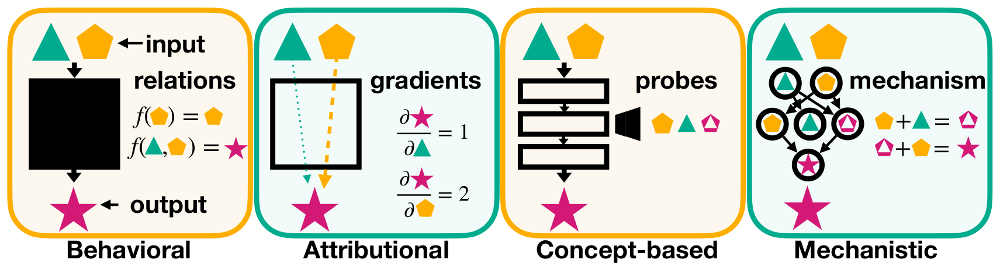

*图 1（原文 Figure 1，第 2 页）：可解释性范式为理解神经网络提供了不同的视角：行为式分析输入输出关系；归因式量化单个输入特征的影响；概念式识别支配行为的高层表示；机制式揭示从输入到输出的精确因果机制。*

**图中文字翻译与读法**：

- 共同的玩具场景：输入是绿色三角形和橙色五边形，输出是粉色五角星；
- **Behavioral（行为式，橙框）**：模型是一个看不透的黑盒（黑色方块），只记录 input relations（输入关系）：$f(\text{五边形})=\text{五边形}$，$f(\text{三角形},\text{五边形})=\text{五角星}$，即只刻画“给定输入得到什么输出”的规律，不解释黑盒内部；
- **Attributional（归因式，青框）**：在同一个黑盒上叠加 gradients（梯度），用虚线箭头表示输出对每个输入的梯度大小：$\partial\text{星}/\partial\text{三角形}=1$，$\partial\text{星}/\partial\text{五边形}=2$，即只回答“每个输入对输出的贡献有多大”，依然不解释内部怎么计算；
- **Concept-based（概念式，橙框）**：黑盒换成一摞方框表示的 probes（探针），从中“读出”高层概念（五边形、三角形、变形的五角星图案），即通过探测中间表示里是否存在某些概念来解释模型，但探针读出信息不等于模型真的在用这份信息；
- **Mechanistic（机制式，青框）**：黑盒被拆成一组互相连接的圆圈组成的 mechanism（机制图），并给出具体的组合规则：五边形 + 三角形 = 空心三角，空心三角 + 五边形 = 五角星，即直接给出能解释输出如何从输入逐步算出来的因果计算图。

**读图结论**：四种范式在“看得多深”上依次递进，但不是单纯的优劣排序——黑盒方法成本低、覆盖面广，机制方法因果性最强却通常只能用在较小的模型或较窄的行为上；真正做安全评估时往往需要组合使用。

### 2.1 四类范式逐一展开

- **行为可解释性（Behavioral interpretability）**：把模型当黑盒，分析输入输出关系。常见技术包括最小对比分析（minimal pair analysis）、敏感性与扰动分析。它与模型无关（model-agnostic），适合复杂或专有模型，但缺乏对内部决策过程和因果深度的洞察。
- **归因可解释性（Attributional interpretability）**：用梯度把输出的变化追溯到单个输入的贡献。原始梯度可能不连续或对微小扰动敏感，因此 SmoothGrad、积分梯度（Integrated Gradients）等技术通过对梯度取平均来改善；层级相关性传播（layer-wise relevance propagation）、DeepLIFT、GradCAM 也是常见方法。归因不需要理解内部结构就能提升透明度，可用于决策验证、合规和偏见检测，但也有本质局限。
- **概念式可解释性（Concept-based interpretability）**：自顶向下，探测学到的表示里是否存在高层概念和支配行为的模式。做法包括训练监督的辅助分类器、用无监督的对比与结构化探针（见第 4.2 节）挖掘潜在知识，以及用神经表示相似度分析比较不同网络学到的内部表示有多相似。概念式可解释性还可以进一步操纵这些表示（也叫表示工程，representation engineering），例如上调诚实、无害、道德等概念，以此增强安全性。
- **机制可解释性（Mechanistic interpretability）**：自底向上，通过对特征、神经元、层和连接的细粒度分析来研究模型的基本组件，力图揭示从输入到输出的因果关系和精确计算，往往能定位到驱动某行为的具体神经回路。这种逆向工程方法借鉴了物理学、神经科学和系统生物学等跨学科领域的思路，用以指导透明、价值对齐的 AI 系统开发。机制可解释性是本综述的主要焦点。

## 三、核心概念与假设（第 3 节，图 2）

为什么看这张图：全文第 3 节的内容都是在给图 2 里的每个方框下定义或提假设，先看这张概念地图，再逐块展开能更容易跟上。

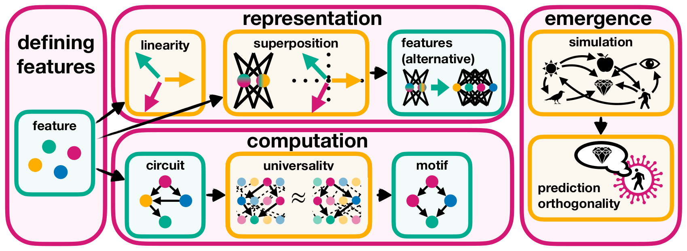

*图 2（原文 Figure 2，第 3 页）：机制可解释性中核心概念与假设的总览，分为四个粉色子版块：定义特征（3.1 节）、表示（3.2 节）、计算（3.3 节）、涌现（3.4 节）。青色标出的是定义，如特征、回路、模体；橙色标出的是假设，如线性表征、叠加、普适性、模拟、预测正交性。箭头表示关系，例如叠加支撑了特征的另一种定义，或普适性连接了回路与模体。*

**图中文字翻译与读法**：

- **defining features（定义特征，左侧青色竖条）**：feature（特征）是起点，用五个彩色小圆点示意——它既指向 representation（表示）子版块，也指向 computation（计算）子版块；
- **representation（表示，粉色大框）**：linearity（线性，用三个方向不同的彩色箭头示意）、superposition（叠加，用交叉的黑线网格加几个彩色箭头示意，表示多个方向挤在同一组基里）、features (alternative)（特征的另一种定义，用两张交叉网格图对比示意，强调把叠加“解开”后的样子）；
- **computation（计算，粉色大框）**：circuit（回路，用几个彩色圆点加箭头连成的小图示意）、universality（普适性，用两张几乎相同的回路图并排加约等号“≈”示意）、motif（模体，用一个更小的菱形回路示意，代表反复出现的那部分结构）；
- **emergence（涌现，右侧青色竖条）**：simulation（模拟，用太阳、苹果、眼睛、钻石、鸟、人等图标互相指向的箭头网络示意，象征模型对世界各种实体和它们关系的模拟）向下指向 prediction orthogonality（预测正交性，用一个头顶钻石形状思维气泡的人形图标示意，呼应“被模拟出的拟像体可以有和模拟器本身不同的目标”）。

**读图结论**：这张图给出了全文第 3 节的目录——先定义“特征”是什么，再问特征在表示层面是不是线性的、是不是叠加编码的，再问由特征组成的计算单元（回路）会不会在不同模型间普遍出现，最后讨论这些表示和计算涌现出什么（世界模型、被模拟的智能体）。青色是相对确立的定义，橙色大多是仍在验证中的假设，阅读时要分清楚两者。

### 3.1 特征：表示的基本单位

“特征”这个概念在神经网络领域中心却模糊，这本身反映了机制可解释性目前处在前范式阶段。本文采用的定义是：特征是神经网络表示的基本单位，不能再被分解为更简单、独立的因素，类似细胞是生物体的基本单位。

> **定义 1（特征）**：特征是神经网络表示的基本单位，不能再被分解为更简单的独立因素。

世界由可以按共同属性归类成概念的各种实体组成，这些概念形成诸如“树”“速度”这样的高层摘要，让世界表示更紧凑。神经网络通过学到的特征捕捉并表示这类自然抽象，这些特征是其内部表示的构件。传统机器学习里，特征通常被理解为直接从输入数据流中提取出来的特性，这对以感知为主的系统（特征紧贴输入数据）比较贴切；但在能做抽象推理的更高级系统里，特征可能在模型内部作为表示模式涌现，即使处理的信息与输入无关——此时把特征理解成“某种现象的可测量属性或特性”更合适，它编码的是抽象概念而不仅仅是反映输入属性。

特征的一个关键性质是不可约性：不能被分解或表示成更简单的独立因素的组合。针对输入相关的特征，Engels 等人（2024）把“可约”定义为：某种变换能揭示出它的底层模式，这个模式可以被拆成相互独立的共现模式，或是永不共现的模式混合；本文把这个不可约性的概念推广到不直接对应输入模式的、编码抽象概念的特征上——即这些特征不能被归约为模型表示里其他独立成分的组合或混合。

特征也不一定要人类可解释：虽然认知系统可能收敛到相似的自然抽象，但这未必和人类可解释的概念对齐。对抗样本可以被理解为“对模型有意义、对人类没有意义”的非可解释特征的一个例子——微小到人类察觉不到的扰动就能让网络判错，暗示网络依赖某种人类不熟悉的表示模式。随着模型能力超过人类，它们学到的特征可能越来越抽象，以和人类直觉不一致的方式编码信息。机制可解释性的目标是发现模型实际学到的表示，哪怕它和人类概念不一致；虽然人类可解释的概念能提供指引，但一个不以人类为中心、把特征定义为独立模型成分（无论是否与人类概念对齐）的视角，是更全面、更面向未来的做法。

### 3.2 特征的本质：从单义神经元到非线性表示（图 3、图 4、图 5）

**神经元是计算单元吗？** 在神经网络架构里，神经元是天然的计算单元，可能代表单个特征。对一个表示 $h\in\mathbb{R}^n$，这 $n$ 个基方向被称为神经元。要让“神经元”这个概念有意义，这些基方向必须在功能上区别于表示空间里的其他任意方向，形成一个**特权基（privileged basis）**——即这组基向量在神经网络层内被架构上特殊对待，区别于激活空间里的任意方向。典型的非线性激活函数会让神经元构成的基方向成为特权基，这使得分析单个神经元变得有意义。

为什么看这张图：它用四个并排的小例子，把“特权基 / 非特权基”和“单义 / 多义”这两对概念直接对应起来，比文字定义更直观。

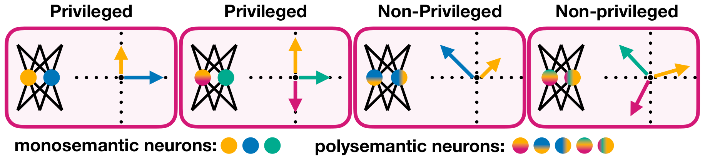

*图 3（原文 Figure 3，第 5 页）：特权基与非特权基的对比。在非特权基中，没有理由期待特征会与基对齐——把基的维度称为“神经元”没有意义。在特权基中，架构会区别对待不同的基方向——特征可以、但不必与神经元对齐。最左：特权基；各个特征（箭头）与基方向对齐，形成单义神经元（彩色圆点）。中左：特权基，尽管特征数多于神经元数，仍有一些神经元是单义的、各自代表一个特征，另一些是多义的（渐变重叠），编码了多个特征的叠加。中右：非特权基，即便特征数等于神经元数，由于特征方向和基方向不对齐，依然导致多义神经元编码着特征的组合。最右：非特权基，多义神经元，因为特征方向本就不与神经元基对齐。*

**图中文字翻译与读法**：每个小面板里，黑色的网格状图案代表同一个二维（或更高维）表示空间，上方标出该面板是 Privileged（特权）还是 Non-Privileged / Non-privileged（非特权）；几个彩色圆点贴在网格上表示神经元，从圆点引出的彩色箭头表示特征方向，虚线是辅助的坐标参考线。底部用图例区分 monosemantic neurons（单义神经元，几个纯色圆点）和 polysemantic neurons（多义神经元，几个渐变重叠色的圆点）。四个面板从左到右，特征箭头与基方向（虚线）的对齐程度依次变差：最左两个面板里箭头和虚线方向重合或部分重合（特权基，至少一部分神经元能单义地对应一个特征）；右边两个面板里箭头明显偏离虚线方向（非特权基，神经元普遍是多义的）。

**读图结论**：“一个神经元是否单义”不是神经元本身决定的，而是取决于特征方向是否恰好和这组基对齐。只有在特权基、且特征恰好与基对齐时，逐神经元地解读才自然；一旦基不被架构特殊对待（非特权基），抽出某个坐标轴单独命名为“某概念神经元”就没有理论依据。这正是第 3.2 节后文反复强调“多义性不一定意味着信息混乱，而可能是表示没有和你选的那组坐标对齐”的几何直觉来源。

**单义神经元与多义神经元**。对应单一语义概念的神经元称为单义（monosemantic）；这个说法来自分析哪些输入会激活某个给定神经元，从而揭示它关联的语义含义。如果神经元就是神经网络的表示基本单位，所有神经元都应是单义的，神经元和特征之间是一一对应，全面的可解释性就会像刻画所有神经元及其连接那样容易处理。但经验上，尤其在 Transformer 模型里，神经元常被观察到是多义的，即同时关联多个不相关的概念——例如同一个神经元可能既被猫的图像激活，也被车的图像激活，说明它编码了多个不相关概念。多义性与“神经元是表示基本单位”的解读相矛盾，也在实践中让理解神经网络的信息处理变得困难。

为理解多义性为何普遍存在，有三种假设：

1. **特征方向正交但不与基方向对齐**：在非特权基中没有理由假设特征会与神经元对齐；即使在由神经元构成的特权基中，网络也可能不用标准基表示特征，而是用神经元的线性组合来表示（见图 3 中间偏右）；
2. **训练噪声导致的冗余**：训练过程中引入的噪声（如随机 dropout）可能导致冗余表示，进而产生多义神经元——这个过程把单个特征分布到多个神经元上，而不是把它独立到单个神经元里，从而助长多义性；
3. **叠加假设**：针对网络表示容量的限制——神经元数量相对于重要概念的庞大数量而言——这个假设认为有限的神经元数量相对海量的重要概念，需要某种形式的压缩。于是一个 $n$ 维表示编码特征时，用的可能不是 $n$ 个基方向（神经元），而是数量约为 $\propto\exp(n)$ 的近似正交方向，从而导致多义性。

> **假设 1（叠加，Superposition）**：神经网络通过把特征编码进神经元的重叠组合，用比神经元数更多的特征来表示信息。

**叠加假设**认为神经网络可以利用高维空间，通过把特征编码进近似正交的方向，表示比实际神经元数更多的特征。非正交意味着特征会相互干扰，但当概念是稀疏的、且非线性激活函数能纠错噪声时，表示远多于神经元数的特征所带来的好处，可能超过干扰的代价。玩具模型可以展示叠加发生的条件。神经网络通过叠加，实质上可能用比自己拥有的神经元更多的“虚拟神经元”来模拟计算，做法是把每个特征分配到神经元的一个线性组合上，在表示空间里形成所谓的过完备线性基。按这个视角，多义模型可被看作一个假设中更大的神经网络的压缩版本，在那个更大的网络里每个神经元代表单一概念（见图 5），由此引出另一种特征定义。

关于叠加的研究大多在简化模型上进行，但理解真实 Transformer 场景下的叠加对实际应用至关重要，这方面的开创性工作来自 Gurnee 等人（2023）。为了在多义性存在的情况下依然理解网络，出现了几类思路：一是训练不产生叠加的模型，例如用 softmax 线性单元作为激活函数，以经验方式增加单义神经元的数量，但代价是让其他神经元变得更不可解释；从能力角度看，多义性可能是可取的，因为它让模型能用有限的计算表示更多概念，使训练更便宜。总体而言，工程化地实现单义性被证明很有挑战性，在计算量再提升几个数量级之前可能都不太现实。

> **玩具叠加模型（Toy Model of Superposition）**
>
> 一个玩具模型考察这样的假设：神经网络能以压缩方式编码真实世界概念，从而表示比神经元数更多的特征。模型考虑一个高维向量 $x$，每个分量 $x_i$ 对应一个捕捉真实世界概念的特征，表示为一个随机向量，重要性由权重 $a_i$ 决定。这些特征被假设具有以下性质：
>
> 1. **概念稀疏**：真实世界的概念是稀疏出现的；
> 2. **概念数多于神经元数**：潜在概念的数量远超可用神经元数；
> 3. **概念重要性不同**：对当前任务而言，有些概念比其他概念更重要。
>
> 输入向量 $x$ 表示捕捉这些概念的特征，由稀疏度 $S$ 和每个特征 $x_i$ 的重要性 $a_i$ 定义。模型把 $x$ 变换成一个更低维的隐藏表示 $h$，再重构为 $x'$：
>
> $$
> h=Wx,\qquad x'=\mathrm{ReLU}(W^\top h+b).
> $$
>
> 网络性能用按特征重要性 $a_i$ 加权的损失函数 $L$ 衡量：
>
> $$
> L=\sum_x\sum_i a_i(x_i-x_i')^2.
> $$
>
> 这个玩具模型说明了神经网络把大量代表真实世界概念的特征编码进压缩表示的能力，为理解在真实数据上训练的神经网络里观察到的叠加现象提供了直觉。

为什么看这张图：它把上面这段抽象描述画成了具体的架构图和几何直觉图。

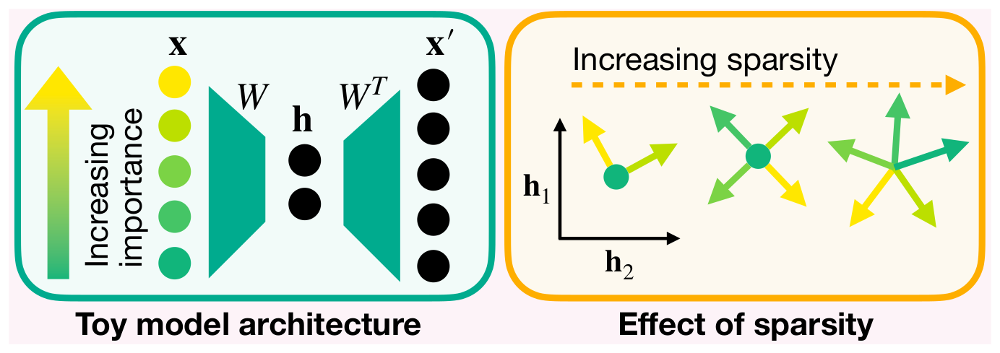

*图 4（原文 Figure 4，第 7 页）：玩具模型架构与稀疏度影响的示意。(左) 一个五特征输入向量 $x$ 变换成二维隐藏表示 $h$，再用权重矩阵 $W$ 及其转置重构为 $x'$，特征重要性用从黄到绿的颜色渐变表示。(右) 增大特征稀疏度 $S$ 对网络编码容量的影响：随着稀疏度从 0 增加到 0.9，网络以叠加方式表示特征的能力增强，激活空间 $h$ 中的箭头对应矩阵 $W$ 的列。*

**图中文字翻译与读法**：

- **左：Toy model architecture（玩具模型架构）**：从上到下是渐变色的输入圆点 $x$（颜色从黄到绿表示重要性递增，Increasing importance），经过梯形的编码权重 $W$ 压缩成只有两个黑点的隐藏层 $h$，再经过梯形的 $W^\top$ 解压重构出 $x'$（同样渐变色的圆点）。这是只有 2 个隐藏单元、却要表示 5 个特征的玩具瓶颈网络；
- **右：Effect of sparsity（稀疏度的影响）**：三个小图依次对应稀疏度从左到右递增（Increasing sparsity），坐标轴是隐藏层的两个维度 $h_1,h_2$。每个小图里，从一个绿色圆点出发的黄、绿箭头代表各个特征在二维隐藏空间里的方向：稀疏度低时只有 2 条箭头（接近“一个神经元挤不下太多特征，就别硬挤”），稀疏度升高后箭头数越来越多、越来越接近均匀分布在圆周上（近似正交），说明网络能在同一个二维空间里塞进更多方向各异的特征。

**读图结论**：左图展示的是“输入维度数 > 隐藏维度数”的压缩—重构结构本身；右图是这个结构训练完以后、在不同稀疏度下学到的权重列向量的朝向——越稀疏，越多特征能挤进同一个低维空间而不严重互相干扰，这正是叠加假设的几何直觉。但这只是一个几个特征、二维隐藏层的玩具例子，不能证明真实大模型里所有语义都按同样方式组织。

**从玩具模型到“特征的另一种定义”**。若把多义模型看作一个假设中更大、更稀疏网络的压缩版，就能给出一个新的特征定义：

> **定义 2（特征，替代定义）**：如果神经元数量不是限制因素，网络理想情况下会把特征分配给单个神经元。换句话说，特征对应的是一个更大、容量更充分的更稀疏网络本应学会用单个神经元表示的那些解缠概念。

为什么看这张图：它把“观察到的（压缩）模型”和“假设中的（解缠）更大模型”画在一起，直观解释替代定义里“压缩”到底指什么。

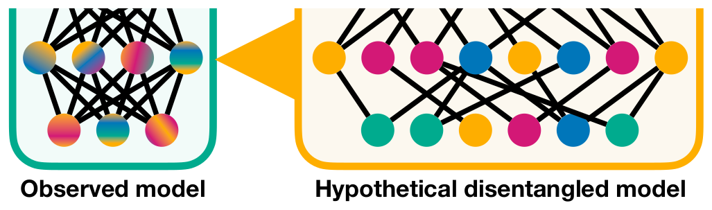

*图 5（原文 Figure 5，第 6 页，图改编自 Bricken 等 2023）：观察到的神经网络（左）可以被看作更大、更稀疏网络（右）的压缩模拟，在右边的网络里每个神经元代表一个独立特征。一个“近似正交”的投影压缩了高维稀疏表示，在维度更低的观察模型里表现为同时牵涉多个特征的多义神经元，反映了这种压缩编码。*

**图中文字翻译与读法**：左边 Observed model（观察模型，青色框）里，每个节点的颜色都是渐变色（混合色），表示它是多义的，同时编码了多个特征；右边 Hypothetical disentangled model（假设解缠模型，橙色框）节点更多、每个节点是单一纯色，表示每个神经元只对应一个特征；中间橙色箭头指示从右边的大网络到左边的小网络是一个压缩投影的关系。

**读图结论**：这张图把“叠加”翻译成一句话：观察到的（较小、多义的）网络，可以理解成一个更大、每个神经元都单义的网络经过近似正交投影压缩之后的样子。

**另一条路径**：先按标准方式训练网络（产生多义性），再做事后分析，在激活空间里找出特征方向，例如用稀疏自编码器（SAE）。SAE 试图通过学习一个稀疏过完备基，在未压缩表示中找出真实的、解缠的特征（第 4.2 节详细展开）。

**如果不是神经元，那特征是什么？** 我们想找到神经网络的基本单位，称之为特征。最初神经元似乎是合适的候选，但这个看法并不成立，尤其在 Transformer 模型里，神经元常常代表多个概念，即多义性。叠加假设对此的解释是：由于表示容量有限，神经网络把大量特征压缩进狭小的神经元空间，使解释变得复杂。这带来一个问题：如果不是以离散神经元为单位，特征是怎样被编码的？虽然先验上特征可以被编码成任意复杂的非线性结构，越来越多的理论论证和经验证据支持这样一个假设：特征通常被线性地表示，即作为神经元的线性组合——也就是表示空间里的方向。这个视角有望通过提供一个更可解释、更可操纵的框架，来提升我们对神经网络内部表示的理解。

> **假设 2（线性表征，Linear Representation）**：特征是激活空间中的方向，即神经元的线性组合。

线性表征假设认为神经网络经常把高层特征表示为激活空间中的线性方向。这个假设能简化对神经网络表示的理解和操纵。神经网络架构中线性层的普遍存在，有利于线性特征：这类层里的矩阵乘法最容易处理线性特征，而更复杂的非线性编码则需要多层才能解码。

不过，Engels 等人（2024）的近期工作为严格形式的线性表征假设提供了反例：他们发现了表示一周中的天数和一年中的月份的**环形特征**。这些多维、非线性的表示被证明用于求解天数和月份的模运算问题。干预实验证实，这些环形特征是完成这些任务的基本计算单位，作者还开发了方法来分解隐藏状态、揭示这种环形表示。

确立非线性有时很有挑战。例如，Li 等人（2023a）最初发现，在一个训练于 Othello 棋局的 GPT 模型中，棋盘状态只有在用“黑子/白子”表示时才能被非线性探针解码出来，这看似违背了线性假设；但 Nanda（2023c）及 Nanda 等人（2023b）后来证明，如果改用“己方棋子/对方棋子”来表示棋盘状态，线性探针就足够了，从而在这个案例里重新确认了线性表征假设。相比之下，Engels 等人（2024）的工作为语言模型中存在非线性、多维表示提供了清晰、有说服力的存在性证明。

线性表征假设仍是一个有用的简化，但也要认识到它的局限性，以及非线性表示可能起到的作用；随着神经网络不断演化，尤其考虑到为可解释性优化可能带来非线性特征的涌现，持续重新评估这个假设很重要。另一种视角，比如 Black 等人（2022）提出的“多面体透镜”（polytope lens），强调非线性激活函数的影响，以及由分段线性激活构成的离散多面体可能才是神经网络表示的基本单位。

尽管有这些例外，经验证据在许多场景下仍largely 支持线性表征假设，尤其是对带 ReLU 激活的前馈网络。词嵌入中的语义向量运算、成功的线性探测、稀疏字典学习，以及在大语言模型中对概念、任务、函数、情感、拒绝行为和关系的线性解码，都指向线性表征的普遍性。此外，用于模型转向（steering）的线性加法技术和表示工程，也凸显了线性特征表示的实际应用价值。

在线性表征假设的基础上，近期工作进一步研究了这些线性特征在激活空间中的结构组织。Park 等人（2024）揭示了大语言模型中类别概念与层级概念的几何框架：简单的类别概念（如哺乳动物、鸟类）在激活空间中被表示为单形（simplices），而具有层级关系的概念则相互正交。这个几何分析与关于神经网络中特征聚类与分裂的早期观察一致，说明线性特征不只是散乱的方向，而是被组织起来以反映语义关系和层级结构。

### 3.3 回路：计算的基本单位；模体：普适的回路模式（图 6）

既然已经把特征定义为激活空间中的方向、是神经网络表示的基本单位，接下来探讨它们的计算方式。神经网络可以被概念化为计算图，其中**回路（circuit）** 是由相连特征及连接它们的权重组成的子图。正如特征是表示的基本单位，回路则是计算的基本单位，也是这些网络的主要构件。

> **定义 3（回路）**：回路是网络的子图，由特征及连接它们的权重组成。

把神经网络分解为回路以求可解释性，已在小型、针对特定任务（如加法）训练的模型上展现出可观的潜力。把这种全面的回路分析扩展到大语言模型里更广泛的行为仍然充满挑战，不过在把窄行为的回路分析扩展到更大回路和更大模型方面已有显著进展，例如 GPT-2 中的间接宾语识别（indirect object identification）和“大于”计算（greater-than computation），以及多项选择问答中的回路分析。

在寻找普遍、通用回路的过程中，研究者尤其关注更一般、可迁移的行为：对 GPT-2 注意力头中“复制抑制”（copy suppression）的研究揭示了模型校准和自我修复机制；还有研究聚焦大语言模型如何通过变量绑定和实体—属性绑定来表示符号知识；另一些工作探索事实性回忆的机制，揭示回路如何动态平衡预训练知识与新的上下文信息；也有工作把回路分析扩展到序列延续任务，发现了跨语义相关序列共享的计算结构。

更有希望的是，一些重复出现的模式已经在不同模型和任务间展现出普适性。这些普适模式被称为**模体（motif）**，它们不仅可以表现为具体的回路或特征，也可以表现为由多个组件交互涌现出的更高层行为。例子包括在视觉模型中发现的曲线检测器（curve detector）、支撑上下文学习的归纳回路（induction circuit），以及神经网络中的“分支特化”（branch specialization）现象。模体也可能捕捉模型如何把 token 用作工作记忆，或以分治方式在表示间并行化计算。模体的意义在于，它揭示了不同神经架构中自然涌现出的共同结构、机制和策略，为理解智能的基本构件提供线索。

> **定义 4（模体）**：模体是网络内重复出现的模式，涵盖在不同模型和任务中涌现出的特征或回路。

**普适性假设**。基于模体的证据，可以就神经网络模型间特征与回路的收敛提出两个版本的普适性假设：

> **假设 3（弱普适性）**：存在支配神经网络如何学会解决某些任务的底层原则，模型通常会收敛到遵循这些共同底层原则的类似解；但实现这些原则的具体特征和回路，会因超参数、随机种子和架构选择等因素而在不同模型间有所不同。

普适性假设认为不同模型和任务在形成特征与回路上会趋同，这如果成立，将大大减轻 AI 可解释性的工作量。它提出人工与生物神经网络可能共享相似的特征和回路，暗示存在某种标准的底层结构；这或许源于神经网络内置的归纳偏置，或是自然抽象——即任何认知系统都会自然倾向于的、被自然世界所青睐的概念。

> **假设 4（强普适性）**：在相似任务、相似数据分布、使用相似技术训练的所有神经网络模型中，同样的核心特征和回路都会普遍且一致地涌现，反映出神经网络在学习时内在趋向的一组基本计算模体。

支持这一假设的证据，一是来自神经科学中跨物种的神经结构——在不同物种中发现相似的神经结构与功能；二是机器学习模型（包括神经网络）在不同任务和架构下往往收敛到相似的特征、表示和分类。也有工作为涌现的普适特征提供了数学支持。尽管多项研究支持普适性假设，不同模型、不同任务间特征与回路相似程度几何仍有待厘清；在机制可解释性语境下，这一假设已针对神经元、群组合回路和模块化任务处理做过检验，结果支持弱版本而非强版本。

为什么看这张图：它用一对“观察模型 vs. 假设解缠模型”的对照，具体展示“模体”和“普适性”是什么意思。

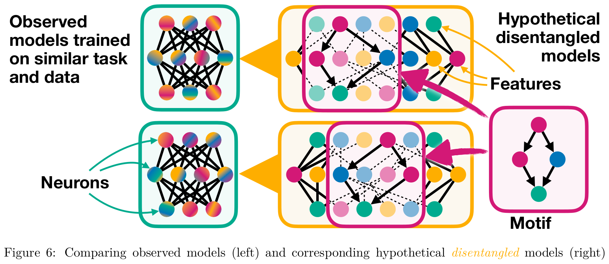

*图 6（原文 Figure 6，第 9 页）：比较在相似任务和数据上训练的观察模型（左）与对应的假设解缠模型（右）。观察模型表现出不同的神经元激活模式，而拆解到特征级回路后会显露出一个模体——一种在不同模型间共享的回路模式，暗示了普适性：模型基于共同的底层原则收敛到相似的解。*

**图中文字翻译与读法**：

- 左侧 **Observed models trained on similar task and data（在相似任务和数据上训练的观察模型）**：两个青色框，每个框里是一个全连接的小网络，节点是多义（渐变色）的，用绿色箭头标出 Neurons（神经元）；
- 中间两组橙色框代表对应的 **Hypothetical disentangled models（假设解缠模型）**：节点更多、每个节点是单一纯色，代表 Features（特征，用粉色箭头标出）；每组橙色框内部又用一个粉色细框圈出一小部分节点和它们之间的连接；
- 最右 **Motif（模体）**：把两组被圈出的小结构单独画出来，呈现为同一个由四个彩色节点、三条箭头连成的菱形回路——两组假设解缠模型里都能找到这个相同的子结构；
- 橙色箭头把每组观察模型指向对应的假设解缠模型，表示“观察到的多义网络”和“假设中的解缠网络”之间的对应关系。

**读图结论**：上下两行分别代表两个在相似任务和数据上训练、但具体参数不同的模型。观察模型本身（左）看起来不同（节点颜色、连接各异），但把它们都投影到假设的解缠空间（中）后，两者里都能找到同一个菱形回路（右侧 Motif）。这正是“普适性”的图解：不同模型可能用不同的神经元实现，但在特征—回路层面收敛到相同的计算模式。注意这仍是一个示意图，不是对真实大模型普适性的证明。

### 3.4 涌现：世界模型与被模拟的智能体

**内部世界模型**。世界模型是神经网络内部形成的、关于环境的内部因果模型。传统上这与强化学习相关：模型被显式训练，以在训练环境的内部幻觉上训练，发展出压缩的时空表示，从而提升下游任务表现和样本效率。但本综述关注的是另一种世界模型——它可能是训练过程的隐式副产品，尤其是在以下一个词预测为目标训练的大语言模型（也称 GPT）中形成的世界模型。

大语言模型有时被称为“随机鹦鹉”（stochastic parrots）。这个说法源于它们的基本运作机制是预测序列中的下一个词，被认为高度依赖记忆。按这种观点，大语言模型被认为只是基于观测数据形成复杂的相关性，而由于缺少干预数据的访问，无法发展出世界的因果模型。

另一种看待大语言模型的视角来自主动推理框架（active inference），这是一个植根于认知科学和神经科学的理论。主动推理认为，只要有足够的表示容量，最小化预测误差这一目标，就足以让一个学习系统发展出复杂的世界表示、行为和抽象。由于语言内在地映照着世界，这些模型可能隐式地构建出语言学意义上以及更广义上的世界模型。

**模拟假设**提出：像大语言模型这样以预测为目标设计的模型，若被充分优化，最终会模拟数据生成背后的因果过程。这被看作是模型追求高效压缩这一驱动力的延伸，暗示像 GPT 这样训练充分的模型，可能会作为其预测训练的自然结果，发展出内部世界模型。

> **假设 5（模拟，Simulation）**：如果优化得足够强，一个以文本预测为目标的模型会模拟文本生成背后的因果过程。

除了对涌现因果世界模型的理论考量，机制可解释性正开始为大语言模型中可能涌现的内部世界模型类型提供经验证据：模型能在棋类游戏（国际象棋、黑白棋）中内部表示棋盘状态，为空间和时间数据创建线性抽象，构造复杂的迷宫表示（展现出对迷宫拓扑和路径的理解），这些都凸显了大语言模型日益增长的抽象能力。还有工作发现上下文词表示能起到实体和情境模型的作用，随着话语展开而演化，类似动态语义学中的语言模型；也有工作证明，只需给出少量示例，大语言模型就能把概念域（如方向、颜色）映射到有具体依托的世界表示，说明它们学到了反映非语言世界的丰富概念空间。

**预测正交性假设**进一步扩展了这个想法：它认为像 GPT 这样以预测为目标的模型，可能模拟出具有各种目标、各种最优程度的智能体。在这个意义上，GPT 是模拟器（simulator），模拟着被称为“拟像体”（simulacra）的实体，这些实体可以是能动的或非能动的，拥有与模拟器自身不同的目标。模拟假设与预测正交性假设对 AI 安全与对齐的影响在第 6 节讨论。

> **假设 6（预测正交性，Prediction Orthogonality）**：一个以预测为目标的模型，可以模拟出以任意目标、以任意最优化程度去优化的智能体。

总之，大语言模型从简单的预测模型演化为可能拥有复杂内部世界模型的实体——这一点由模拟假设提出、并得到机制可解释性研究的支持——代表着我们对这些系统理解的一次重大转变，促使我们重新审视大语言模型的能力及其在更广泛 AI 发展格局中的未来走向。
## 四、方法（第 4 节，图 7、表 1）

机制可解释性使用一系列工具，从观察性分析到因果干预都有。为什么先看这张图：它把第 4 节要讲的全部方法按“观察 / 干预”两大类列出来，相当于方法论的目录。

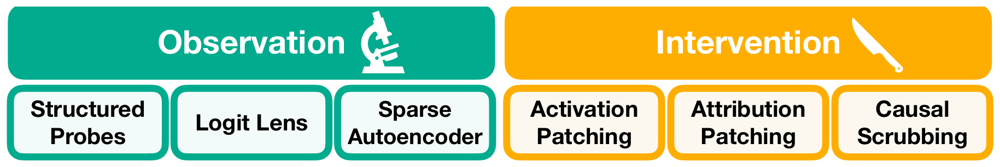

*图 7（原文 Figure 7，第 12 页）：机制可解释性研究中关键方法与技术总览。观察类方法包括结构化探针、logit 透镜变体和稀疏自编码器（SAE）；干预类方法聚焦因果理解，包含用于揭示因果机制的激活修补变体，以及用于假设评估的因果洗涤。*

**图中文字翻译与读法**：左侧青色大框 **Observation（观察）**，配一个显微镜图标，下设三个小框：Structured Probes（结构化探针）、Logit Lens（logit 透镜）、Sparse Autoencoder（稀疏自编码器）；右侧橙色大框 **Intervention（干预）**，配一把手术刀图标，下设三个小框：Activation Patching（激活修补）、Attribution Patching（归因修补）、Causal Scrubbing（因果洗涤）。

### 4.1 方法分类（表 1）

作者提出一个基于四个关键维度的分类法：**因果性质**（causal nature）、**学习阶段**（learning phase）、**局部性**（locality）、**全面性**（comprehensiveness）。因果性质从纯观察（分析已有表示、不直接操纵）到干预（主动扰动模型组件以建立因果关系）；学习阶段区分应用于已训练模型的事后技术（post-hoc）和在训练过程本身就增强可解释性的内生方法（intrinsic）；局部性指分析范围，从单个神经元（如特征可视化）到整个模型架构（如因果抽象）；全面性从对特定组件的局部洞察到对模型行为的整体解释。

为什么看这张表：它是全文唯一一张表，把第 4、5 节要讲的十一类方法按上述四个维度和代表性文献排好，后文逐一展开时可以随时回看定位。

| 方法 | 因果性质 | 阶段 | 局部性 | 全面性 | 代表文献 |
|---|---|---|---|---|---|
| 特征可视化（Feature Visualization） | 观察 | 事后 | 局部 | 局部 | Zeiler & Fergus (2014)；Zimmermann et al. (2021) |
| 样例法（Exemplar methods） | 观察 | 事后 | 局部 | 局部 | Grosse et al. (2023)；Garde et al. (2023) |
| 探针技术（Probing Techniques） | 观察 | 事后 | 均可 | 均可 | McGrath et al. (2022)；Gurnee et al. (2023) |
| 结构化探针（Structured Probes） | 观察 | 事后 | 均可 | 均可 | Burns et al. (2023) |
| logit 透镜变体（Logit Lens Variants） | 观察 | 事后 | 全局 | 局部 | nostalgebraist (2020)；Belrose et al. (2023) |
| 稀疏自编码器（Sparse Autoencoders） | 观察 | 事后 | 均可 | 全面 | Cunningham et al. (2024)；Bricken et al. (2023) |
| 激活修补（Activation Patching） | 干预 | 事后 | 局部 | 局部 | Meng et al. (2022a)；Wang et al. (2023) |
| 路径修补（Path Patching） | 干预 | 事后 | 均可 | 均可 | Goldowsky-Dill et al. (2023) |
| 因果抽象（Causal Abstraction） | 干预 | 事后 | 全局 | 全面 | Geiger et al. (2023a; 2023b)；Wu et al. (2023a) |
| 假设检验（Hypothesis Testing） | 干预 | 事后 | 全局 | 全面 | Chan et al. (2022)；Jenner et al. (2023) |
| 内生方法（Intrinsic Methods） | — | 训练前/中 | 全局 | 全面 | Elhage et al. (2022a)；Liu et al. (2023a) |

（原文表 1，第 13 页。“局部性”“全面性”原文用 Local/Global/Both 与 Partial/Comprehensive/Both 标注，这里把 Both 统一译为“均可”。）

分类依据的是各方法的一般倾向，部分方法依分析范围和应用场景的不同，既可以是局部的也可以是全局的，既可以是局部的也可以是全面的解释：探针技术可以从局部到全局、从局部到全面——简单线性探针可能只对单个特征提供局部洞察，更复杂的结构化探针则能揭示全局模式；稀疏自编码器分解的是单个神经元的激活（局部），目标却是在全模型范围内解开特征（全局）；路径修补把局部干预扩展到对全模型的理解，通过追踪跨层的信息流，说明局部扰动如何带来更广泛的洞察。在实践中，机制可解释性研究既涉及方法开发，也涉及方法应用；在应用方法理解一个模型时，组合来自多个类别的技术往往是必要且有益的（见第 4.4 节）。

### 4.2 观察类方法

机制可解释性所用的观察性方法，许多早于这个领域本身就已存在。两类主要方法：

- **样例法（Exemplar methods）**：找出能让特定神经元或层强烈激活的真实输入样例，帮助定位使神经元激活最大化的关键数据点；
- **特征可视化（Feature visualization）**：生成能最大化神经元激活的合成输入，这些可视化结果揭示神经元对哪些刺激有响应，从而帮助假设该神经元编码了哪些特征。

**探针（Probing for Features）**：探针指用模型的激活训练一个分类器，再通过观察分类器的表现来推断模型行为和内部表示的性质。但探针的表现可能更多反映的是探针自身的学习能力，而不是模型表示本身的特性，这促使研究者去寻找探针复杂度与其准确刻画模型特征能力之间的理想平衡。线性表征假设为这个两难提供了一种解法：在这一假设下，简单线性探针探测失败，就说明该特征不存在于模型表示中；反过来，如果更复杂的探针成功而更简单的探针失败，就说明模型里存在能被某个复杂函数组合成目标特征的成分，但目标特征本身并未被显式表示。因此，这个假设意味着多数情形下用线性探针就够了，不必陷入一般意义上探针复杂度的争论。

McGrath 等人（2022）分析了 AlphaZero 中国际象棋知识的获取过程，揭示了训练中战略概念的涌现。在语言模型方面，Gurnee 等人（2023）提出稀疏探测，解码内部神经元激活以理解特征表示与稀疏性：他们发现早期层用神经元的稀疏组合以叠加方式表示大量特征，而中间层似乎有专门的单义神经元用于更高层的上下文特征。探针在得出因果或行为结论方面能力有限——它本质上是观察性的，关注信息是如何被编码的，而不是如何被使用的（参见图 1），因此需要与干预技术（第 4.3 节）或其他方法谨慎结合分析。

**结构化探针（Structured Probes）**：在聚焦自底向上的机制可解释性方法之外，也可以考虑把自顶向下、概念式的结构化探针与机制可解释性结合。结构化探针辅助概念层面的可解释性，探测语言模型中诸如真值表示这样的复杂特征；其中 Burns 等人（2023）的对比一致搜索（contrast-consistent search）能在隐藏状态中找出对陈述句及其否定句展现逻辑一致性的线性投影，用以对比真值。然而结构化探针在无监督探测场景下面临重大挑战：Farquhar 等人（2023）发现，不只是与知识相关的特征，任意特征都能同样满足对比一致性，这对方法的可扩展性提出质疑；例如损失可能捕捉的是某个假设出的拟像体对知识的模拟，而不是模型的真实知识。此外，自监督探测方法（如 Burns 等人的方法）常常检测到数据中突出但并非目标所指的干扰特征，发现的特征对提示词的选择也高度敏感，目前也没有一个原则性的方法来选择能可靠呈现模型真实知识的提示词。

**logit 透镜（Logit Lens）**：logit 透镜把最终的分类层（把残差流激活投影到 logits/词表空间的那一层）应用到残差流的中间激活上，从而揭示预测置信度在各计算阶段如何演化，提供了一扇观察模型预测过程的窗口；这之所以可行，是因为 Transformer 往往是逐层迭代地构建其预测的。这个方法的扩展包括调优透镜（tuned lens，训练仿射探针把隐藏状态解码成词表上的概率分布）以及未来透镜（Future Lens，探究单个隐藏状态能在多大程度上编码后续 token 的信息）。还有研究探索绕过中间计算、直接探测表示的技术：用线性变换近似不同层隐藏状态的做法，发现语言模型常常在较早的层就已经预测出最终输出；也有工作提出把 Transformer 参数投影到嵌入空间的理论框架，用于模型对齐和跨架构的参数迁移。另有技术聚焦特定模型组件或子模块：DecoderLens 让解码器交叉注意编码器的中间表示，从而分析编码器—解码器 Transformer 内部的信息流；Attention Lens 通过学到的变换把注意力头的输出翻译成词表 token，阐明不同注意力头的专门角色。

**通过稀疏字典学习解开特征**：近期工作认为，神经网络的核心要素是以叠加方式表示特征的神经元线性组合。为了把这些特征解开，研究者开发了**稀疏自编码器（SAE）**，把神经网络激活分解为单个的成分特征，这个过程称为稀疏字典学习，把激活向量重构为激活空间内方向向量的稀疏线性组合。

> **稀疏字典学习（Sparse Dictionary Learning）**
>
> 稀疏自编码器被提出作为应对多义神经元的解法。叠加问题被数学化为稀疏字典学习问题，用以把神经网络激活分解成解缠的成分特征。目标是学习一个向量字典 $\{f_k\}_{k=1}^{n_{\text{feat}}}\subset\mathbb{R}^d$，用稀疏线性组合表示未知的、真实的网络特征。如果学习成功，学到的字典里会包含对应特征的单义神经元。自编码器架构由一个编码器和一个 ReLU 激活函数组成，把输入维度从 $d_{\text{in}}$ 扩展到更高的 $d_{\text{hid}}>d_{\text{in}}$。编码器的输出为：
>
> $$
> h=\mathrm{ReLU}(W_{\text{enc}}x+b),
> $$
>
> $$
> x'=W_{\text{dec}}h=\sum_{i=0}^{d_{\text{hid}}-1}h_if_i,
> $$
>
> 其中 $W_{\text{enc}},W_{\text{dec}}^\top\in\mathbb{R}^{d_{\text{hid}}\times d_{\text{in}}}$，$b\in\mathbb{R}^{d_{\text{hid}}}$。参数矩阵 $W_{\text{dec}}$ 构成特征字典，其每一行 $f_i$ 就是一个字典特征。自编码器的训练目标是最小化损失，其中对 $h$ 施加的 $L_1$ 惩罚鼓励用字典特征做出稀疏的重构：
>
> $$
> L(x)=\lVert x-x'\rVert_2^2+\alpha\lVert h\rVert_1.
> $$

为什么看这张图：它把上面的公式画成了具体的网络位置和数据流向。

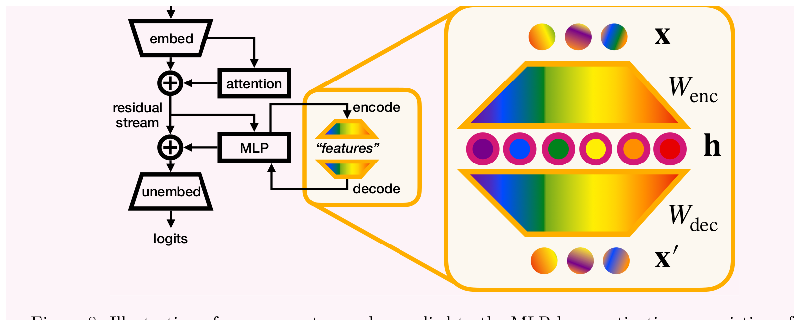

*图 8（原文 Figure 8，第 16 页）：稀疏自编码器应用于 MLP 层激活的示意，由一个提高维度、同时强调稀疏表示的编码器，和一个用学到的特征字典重构原始激活的解码器组成。*

**图中文字翻译与读法**：

- **左半 Transformer**：自下而上是 tokens（token）经过 embed（嵌入）、不断加到 residual stream（残差流，用圆圈加号表示逐层累加）上的 attention（注意力层）和 MLP（多层感知机层）输出，最后经过 unembed（解嵌入）得到 logits（预测概率）；
- **中间小图**：把 MLP 层拆出一个局部的小沙漏图，标注 encode（编码）与 decode（解码）两个方向，中间写着 "features"（特征）；
- **右半（橙色放大框）**：把这个沙漏具体化为稀疏自编码器架构——顶部是原始激活 $x$（3 个渐变色圆点，表示多义），经过 $W_{\text{enc}}$（橙色梯形，升维）得到中间的稀疏潜变量 $h$（6 个带描边的纯色圆点，比 $x$ 更多、每个更单义），再经过 $W_{\text{dec}}$（橙色梯形，降维）重构出 $x'$（3 个渐变色圆点，应尽量接近原始的 $x$）。

**读图结论**：SAE 的核心操作是先把低维、多义的激活 $x$ 投影到一个更高维、但大部分维度为零（稀疏）的空间 $h$，希望 $h$ 里每个非零维度都对应一个更单义的“特征”，再用同一个方向字典把 $h$ 投影回去重构 $x$。重构误差小、潜变量稀疏，只是必要条件，不是充分条件——还要看这些潜变量是否忠实、稳定、具因果性。

SAE 的理论基础植根于关于解缠表示的研究：有研究证明，在特征满足稀疏性和非负性的条件下，自编码器能够恢复出真实的特征；也有研究为稀疏表示字典的唯一性与稳定性（即便存在噪声）提供了理论保证。这些理论基础支持了 SAE 揭示数据分布背后真实、解缠特征的能力。

实践上，SAE 因其简单和可扩展性而突出，它们通过稀疏性正则化鼓励学到稀疏而有意义的数据表示，隐藏激活上稀疏惩罚项的精确调节，对决定自编码器的稀疏程度至关重要。SAE 字典里的特征在自动可解释性指标上得分更高、单义性也更强，能扩展到最先进的模型上，并能检测与安全相关的特征、测量特征稀疏度，以及解释基于强化学习的语言模型中的奖励模型。由于缺少真值可解释特征，评估 SAE 质量仍然充满挑战：有研究提出用训练在国际象棋和黑白棋记谱上的语言模型作为测试平台，提供天然的可解释特征集合；也有工作构造带有可追踪特征的玩具模型，或将 SAE 的结果与大语言模型中的监督特征做比较以证明其可行性。

SAE 的适用性延伸到多种神经网络架构：已被成功应用于 Transformer 的注意力层，也应用于卷积神经网络，其中一项工作把 SAE 用在 InceptionV1 的早期视觉层上，发现了新的可解释特征，包括从单个神经元分析中看不出来的额外曲线检测器。在回路发现方面，SAE 也展现出特别的潜力（另见第 4.4 节）：有工作提出一种替代激活修补（见第 4.3.1 节）的回路发现框架，利用从所有写入残差流的模块分解出的字典特征；也有工作用离散稀疏自编码器在大语言模型中发现可解释回路。

近期进展聚焦于提升 SAE 性能、解决其局限：有工作引入门控机制，把“决定用哪些方向”和“估计这些方向的大小”这两个功能分开，以缓解收缩（shrinkage，即对特征激活值的系统性低估）问题；另一种方法用“转码器”（transcoder），用一个更宽、稀疏激活的 MLP 层去忠实近似一个密集激活的 MLP 层，为可解释特征发现提供了另一条路径，这是一种稀疏蒸馏。

### 4.3 干预类方法

**因果性作为理论基础**。因果性理论为机制可解释性提供了数学上精确的框架，为理解神经表示中的高层语义提供了严谨方法。把神经网络看作因果模型，它们的计算图就是因果图，研究者可以据此执行精确干预，检验单个参数的作用。这种因果视角催生了一系列干预技术，包括激活修补（4.3.1 节）、因果抽象（4.3.2 节）和假设检验方法（4.3.3 节）。

#### 4.3.1 激活修补（Activation Patching）

为什么看这张图：它用一个具体例子（把“罗马”说成“巴黎”）演示修补怎么操作，并区分两种修补方向对应的逻辑含义。

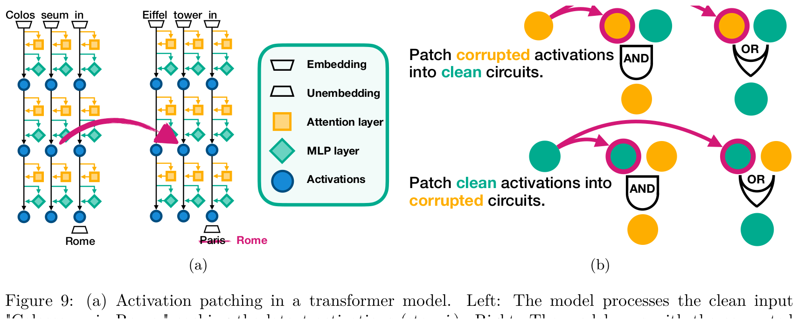

*图 9（原文 Figure 9，第 17 页）：(a) Transformer 模型中的激活修补。左：模型处理干净输入“罗马的斗兽场”，缓存其隐藏激活（步骤 i）。右：模型用被污染的输入“巴黎的埃菲尔铁塔”运行（步骤 ii）。粉色箭头表示把干净运行里某个 MLP 层的激活（绿色菱形）修补进被污染的运行（步骤 iii），这使预测从“巴黎”变为“罗马”，从而确定了被修补组件的重要性（步骤 iv）。通过精心挑选这些输入对，研究者可以控制混淆回路，分离出真正负责该位置预测行为的回路。(b) 激活修补的方向：上：把污染激活（橙色）修补进干净回路（青色），揭示的是“足以”恢复行为的组件，对应 OR 逻辑；下：把干净激活（绿色）修补进被污染回路（橙色），揭示的是“必要”的组件，对应 AND 逻辑。AND 门和 OR 门示意了这两种修补方向如何揭示模型组件之间不同的逻辑关系。*

**图中文字翻译与读法**：

- **(a) 左右两组竖直结构**：每组是 Embedding（嵌入，梯形）→ 若干层交替的 Attention layer（注意力层，橙色方块）与 MLP layer（MLP 层，青色菱形）→ Activations（激活，蓝色圆点）→ 最后 Unembedding（解嵌入，梯形）输出一个词。左边输入 “Colosseum in”（斗兽场在……）对应输出 Rome（罗马）；右边输入 “Eiffel tower in”（埃菲尔铁塔在……）本应输出 Paris（巴黎），图中用删除线划掉 Paris、改成了粉色的 Rome——这就是被修补之后的新预测；
- 中间图例框：Embedding（嵌入）、Unembedding（解嵌入）、Attention layer（注意力层）、MLP layer（MLP 层）、Activations（激活）分别对应五种图形/颜色标记；
- 粉色箭头从左边干净运行中间某层的激活，指向右边污染运行里对应位置，表示“把这一个激活值搬过去”；
- **(b) 两行示意**：上方 “Patch corrupted activations into clean circuits.”（把被污染的激活修补进干净回路）配一个 AND 门和一个 OR 门图标，强调这种方向揭示的是 **OR 逻辑**场景下“足够”的组件；下方 “Patch clean activations into corrupted circuits.”（把干净的激活修补进被污染回路），同样配 AND/OR 门图标，强调这种方向揭示的是 **AND 逻辑**场景下“必要”的组件。

**读图结论**：激活修补的核心操作只有一句话——运行一次干净输入、缓存激活，运行一次污染输入，再把干净激活的某一处“贴”进污染运行里，看输出是否被拉回干净时的结果。图 (a) 用“斗兽场在罗马 / 埃菲尔铁塔在巴黎”这对最小对比输入，把某个 MLP 层的激活从干净运行搬进污染运行，污染运行的输出就从巴黎变回了罗马，说明这个位置携带了“应该输出哪座城市”的关键信息。图 (b) 提醒读者：修补的方向决定了你测的是“必要性”还是“充分性”，不能混着解读。

激活修补是一组因果干预技术的统称，包括因果追踪（causal tracing）、交换干预（interchange intervention）、因果中介分析（causal mediation analysis）、因果消融（causal ablation），它们共同的目标是通过把特定激活替换成别的值（如零、样本间的均值、随机噪声，或来自另一次前向传播的激活）来操纵神经模型的内部状态。激活修补的主要目的是通过观察激活变化如何影响模型输出，分离并理解特定组件或回路的作用，从而推断这些组件的功能和重要性。关键应用包括：通过识别关键激活来定位行为（例如理解事实信息是如何被存储和处理的），以及通过回路分析理解组件间的相互作用（在模型计算图中找出实现特定行为的子网络）。

激活修补的标准流程（图 9a）包括：

1. 用干净输入运行模型，缓存其隐藏激活；
2. 用被污染的输入执行模型；
3. 用被污染的输入重新运行模型，但把特定激活替换成干净缓存中的对应值；
4. 通过观察第 3 步中模型输出的变化来判定重要性，从而凸显被替换组件的重要程度。

这个过程依赖于成对比较：一个能触发目标行为的干净输入，和一个与干净输入几乎相同、但关键之处不同、以致无法触发该行为的被污染输入。通过精心选择这类输入对，研究者可以控制混淆回路，分离出真正负责该行为的具体回路。

修补方向的差异——从干净到污染（因果追踪）相对于从污染到干净（重采样消融）——揭示的是组件对给定行为“充分”还是“必要”的不同信息。干净到污染的修补找出能恢复干净表现的、**充分**的激活（即便它们因为存在冗余而并非必要），这在 OR 逻辑场景下特别有信息量（图 9b，OR 门）；相反，污染到干净的修补确定的是实现干净表现所**必需**的激活，这在 AND 逻辑场景下有用（图 9b，AND 门）。

激活修补可以采用多种污染方式，包括零消融、均值消融、随机消融或重采样消融，各自以不同方式调制模型的内部状态。重采样消融因为不会让数据分布变化太大，在保持模型行为一致性方面表现突出。但解读修补结果时要小心：把模型推离分布而破坏行为，对找出真正相关的回路而言没有意义。

**路径修补与子空间激活修补**。路径修补把激活修补方法扩展到计算图中的多条边，支持对组件间相互作用更细粒度的分析——例如可以用它来估计注意力头对输出 logits 的直接效应和间接效应。子空间激活修补（也叫分布式交换干预）旨在只干预表示空间中假设承载特征的线性子空间，为更有针对性的干预提供了工具。近期有工作提出 patchscopes 框架，统一并扩展了激活修补技术：利用模型自身的文本生成来解释内部表示，使更灵活的干预能应用到各种可解释性任务中，改进了对早期层的检视，并支持跨模型分析。

**局限与进展**。激活修补有若干局限，包括设计输入模板和反事实数据集所需的工作量、需要人工检查来分离出重要子图、可能存在使结果解读复杂化的二阶效应，以及“九头蛇效应”（hydra effect，详见第 7.2 节讨论）。近期进展试图解决这些局限，例如自动化回路发现算法、基于梯度的可扩展组件重要性估计方法（如归因修补），以及用于缓解分析过程中自我修复干扰的技术。

#### 4.3.2 因果抽象（Causal Abstraction）

因果抽象为机制可解释性提供了一个数学框架，把神经网络及其解释都当作因果模型。这种方法通过在网络激活上执行交换干预来验证解释，统一了 LIME、因果效应估计、因果中介分析、迭代零空间投影和基于回路的解释等多种可解释性方法。

为克服计算上的限制，分布式对齐搜索引入了基于梯度的分布式交换干预，把因果抽象扩展到了更大的模型上。进一步的进展包括因果代理模型（causal proxy models），用以应对反事实观测的挑战。

因果抽象的应用范围很广，从语言现象分析、可解释性方法的评估，到通过表示微调提升性能，再到通过模型蒸馏提升效率。

#### 4.3.3 假设检验（Hypothesis Testing）

除因果抽象框架外，还发展出了几种用于严格检验神经网络行为假设的方法，目标是把“神经网络如何实现某个具体行为”这类解释形式化并用经验方式验证。

**因果洗涤（Causal scrubbing）** 把假设形式化为一个三元组 $(G,I,c)$，其中 $G$ 是模型的计算图，$I$ 是被假设用来解释该行为的可解释计算图，$c$ 是把 $I$ 中的节点映射到 $G$ 中节点的映射。这个方法把 $G$ 中的激活替换为按假设应当等价的其他激活，再测量被“洗涤”后的模型表现，以此检验假设。

**局部一致抽象（Locally consistent abstractions）** 提供了一种更宽松的方法，只在干预节点一步之内检验神经网络和解释之间的一致性，是完整因果抽象的严格性与因果洗涤的灵活性之间的一种折中。

这些方法形成了一个严格性的层级：完整因果抽象最严格，其次是局部一致抽象，因果洗涤最宽松。这个层级凸显了选择更严格或更宽松概念之间的权衡，会影响能否找到可接受的解释、泛化能力以及机制异常检测的效果。

### 4.4 观察与干预的整合

要全面理解神经网络的内部机制，结合观察性方法和干预性方法至关重要。例如，可以先用稀疏自编码器解开叠加的特征，再用有针对性的激活修补检验这些特征的因果重要性；同样，logit 透镜可以追踪预测在各层的形成过程，再用后续干预确认关键节点处的因果关系；探针技术可以识别出被编码的信息，再用因果抽象去理解这些信息是如何被使用的。这种迭代精炼的过程——广泛的观察性方法指导有针对性的干预，干预结果又反过来指导进一步的观察——支持跨不同抽象层级的多层次分析，从而建立起整体性的理解。近期工作展示了把稀疏自编码器与自动化回路发现相结合的潜力，把特征层面的分析和回路层面的干预结合起来，揭示表示与机制之间的相互作用。
## 五、当前研究：四条路线（第 5 节，图 10）

为什么看这张图：第 5 节按“模型在训练流程中的什么阶段被解释”把研究分成三大块（图里又把事后研究进一步细分出自动化），图 10 把每一块各自追求的“愿望清单”并排列出，方便之后对照看每条路线做到了哪一步、还差哪一步。

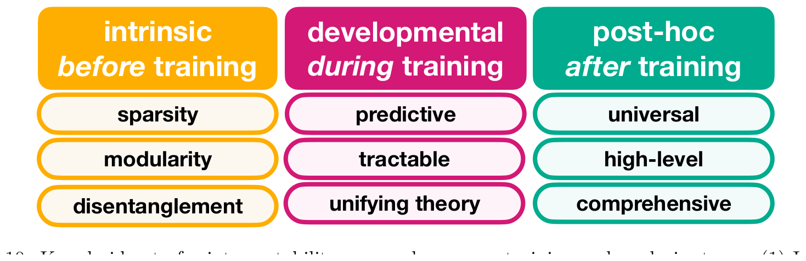

*图 10（原文 Figure 10，第 20 页）：跨训练与分析阶段、各类可解释性方法的关键愿望：(1) 内生：架构上偏向稀疏性、模块性和解缠表示；(2) 发展性：能预测相变、相变数量可控、有一个把观测与奇点几何联系起来的统一理论；(3) 事后：全局、全面、自动化地发现关键回路，找出可跨模型/任务迁移的原则，并提取高层因果机制。*

**图中文字翻译与读法**：三栏并排。**intrinsic / before training（内生 / 训练前，橙色）** 下设 sparsity（稀疏性）、modularity（模块性）、disentanglement（解缠）；**developmental / during training（发展性 / 训练中，粉色）** 下设 predictive（可预测）、tractable（可处理）、unifying theory（统一理论）；**post-hoc / after training（事后 / 训练后，青色）** 下设 universal（普适）、high-level（高层）、comprehensive（全面）。

**读图结论**：这不是三条互斥的路线，而是互补的：内生方法想让“可解释性”在设计阶段就被内置进架构；发展性方法想搞清楚可解释的结构是在训练的哪个阶段、以什么方式出现的；事后方法（目前最成熟）想在已训练好的模型上尽量自动化、全面地抠出可解释的回路。只在训练后对少量样本做手工分析，覆盖不了前沿模型。

### 5.1 内生可解释性（Intrinsic Interpretability）

内生方法为设计“更易被逆向工程、同时不牺牲性能”的神经网络提供了一条有前景的路径。通过架构选择和训练过程鼓励稀疏性、模块性和单义性，这些方法试图让逆向工程过程更容易处理。内生可解释性方法试图约束训练过程，使学到的程序更可解释，这与神经符号学习密切相关，也可能涉及类似人脑信息组织方式的、带空间结构的正则化技术。

近期工作探索了多种架构选择和训练流程以提升神经网络的可解释性：有研究证明架构选择会影响单义性，说明模型可以被工程化得更单义；也有工作提出用双线性层代替线性层，以在语言模型中鼓励单义性。还有工作提出一种受生物启发的空间正则化方案，称为“脑启发式模块化训练”（brain-inspired modular training），用于在训练过程中形成模块：它们展示了这种方法如何能让 RNN 在不损害性能的前提下展现出类似大脑的解剖模块性，这与那些简单地用稀疏性来降低每层更多神经元所带来成本的朴素做法形成对比。

在机制可解释性文献之前，已有多种技术致力于提升可解释性，例如稀疏注意力、给神经元激活加 $L_1$ 惩罚、剪枝神经元，这些技术已被证明能促进稀疏性、模块性和解缠，而这些正是内生可解释性的核心要素。

### 5.2 发展性可解释性（Developmental Interpretability）

发展性可解释性考察神经网络学习动态以及内部结构随时间的涌现，聚焦特征和回路的形成过程。这种方法通过研究对应模型行为或能力重大变化的关键相变，来补充静态分析。虽然主要是一个独立领域，发展性可解释性常常与机制可解释性有交集，典型例子是对上下文学习涌现如何与具体训练相变相关联的研究：这项研究扎根于机制可解释性，展示了上下文学习的涌现如何与特定的训练阶段转变相关，把微观层面的变化（归纳头的形成）与宏观可观测量（训练损失）联系起来。

发展性可解释性的一个重要动机，是研究“安全攸关模式的普适性”——理解诸如欺骗这类能力有多根深蒂固，因而对安全微调有多大的抵抗力。此外，研究者假设涌现能力对应训练过程中突然的回路形成，这或许能让人提前预测或控制这些能力的发展。

由 Watanabe 提出的**奇异学习理论（Singular Learning Theory, SLT）** 为理解过参数化模型的行为和泛化提供了一个严谨框架。通过用局部学习系数量化模型复杂度，SLT 为学习阶段的相变和模型内部结构的涌现提供了洞察。近期工作把这个系数用于识别 Transformer 模型中的发展阶段，另有工作推进了 SLT 的可扩展性，并将其应用于叠加玩具模型（即前文图 4）。

虽然对泛化、学习复杂度递增的函数、以及从记忆到泛化的转变（grokking）等现象的直接应用还有限，但这些方向连同神经网络的标度律（它们可以与机制层面的洞察联系起来）代表着有前景的未来研究方向。

总之，发展性可解释性为神经网络提供了一个类似“演化理论”的视角，为结构和行为随时间涌现提供洞察。借鉴系统生物学的思路，这种方法可以把网络模体、鲁棒性、模块性等概念应用到神经网络的发展过程中，解释功能性能力是如何涌现的——有时候，理解一个结构是如何形成的，比直接分析最终产物更容易，就像生物学家常常更容易用进化史来解释生物体的某些特征。通过研究神经网络训练的时间维度，研究者或许能发现仅靠检视静态的、已训练好的模型所无法发现的、关于学习和表示的基本原则。

### 5.3 事后可解释性（Post-Hoc Interpretability）

在应用层面的机制可解释性研究中，研究者从多个角度和方法论切入神经网络的内部运作。几组关键区分包括：全局与局部可解释性、全面与局部可解释性。全局可解释性旨在揭示模型的一般模式和行为，提供能广泛适用于许多实例的洞察；局部可解释性相对地解释模型对特定实例做出某个决策的原因，关注单次预测或行为。全面可解释性追求对模型行为深入、详尽的理解，提供其内部运作的整体视图；局部可解释性（原文此处的 partial interpretability）则常用于更大、更复杂的模型，聚焦解释模型行为的特定方面或子集，集中在应用中最相关或最关键的部分。

**大模型——窄行为**。回路式的机制可解释性旨在通过逆向工程单个神经元或子图层面的底层机制来解释神经网络，这种方法假设神经向量表示编码了高层概念，而由模型权重定义的回路编码了有意义的算法。对深度网络的研究支持这些说法，识别出了负责检测曲线或物体朝向的回路。

这个范式已被应用于语言模型，以发现负责特定能力的子网络（回路）。回路分析在模型计算图中定位并理解负责特定行为的子图。对大语言模型而言，这通常意味着对诸如多项选择推理、间接宾语识别或计算操作这类较窄行为的研究。其他例子包括分析 Python 文档字符串、“an”与“a”用法、价格标注等场景下的回路。案例研究常常用模板加占位值构造数据集，以便为因果干预提供精确控制。

**玩具模型——全面分析**。在专门的数学或算法任务上训练的小模型，让对所学算法做更全面的逆向工程成为可能。即使是简单的算术运算，也可能涉及复杂的策略和多种算法解法。刻画这些算法有助于检验诸如变量绑定、算术推理这类可泛化机制的假设。在分析模加法上训练的 Transformer 的工作基础上，有研究从回路效率的角度解释了 grokking 现象，说明对一个玩具模型的全面理解能在其基础上支持怎样有趣的分析。

**走向普适性**。终极目标是发现能跨模型、跨任务迁移的一般原则，例如支撑上下文学习的归纳头、变量绑定机制、算术推理，或检索任务。尽管有不少有希望的结果，围绕普适性假设——不同模型在相似任务上训练会学到相似特征和回路——仍存在争论：有研究发现群组合（group composition）任务中关于普适性的证据好坏参半，说明虽然可以刻画出回路和特征的“家族”，但精确的回路本身及其形成顺序可能是任意的。

**走向高层机制**。因果干预能从大语言模型学到的计算和表示中提取出高层理解。近期工作聚焦于对内部表示做干预，以研究被编码的高层概念和计算：例如有工作通过修补残差流向量来迁移任务表示，也有工作通过对残差流做干预，论证模型生成 ID 来把实体绑定到属性上。表示工程技术从模型激活中提取“读出向量”，用来激发或抑制特定概念。虽然这些干预并不针对具体机制运作，它们为提取高层因果理解、沟通自底向上与自顶向下的可解释性方法，提供了有前景的途径。

### 5.4 自动化：扩展事后可解释性

随着模型日益复杂，自动化可解释性工作流程的关键环节变得越来越重要。追踪模型的计算路径非常耗费人力，随着模型规模增大很快变得不可行。把发现相关回路及其功能解释的过程自动化，是迈向可扩展、全面模型理解的关键一步。

**把模型拆解成可解释回路**。自动化面临的第一个重大挑战，是针对给定任务识别出支撑模型行为的关键计算子回路或组件。一条开创性的工作路线试图通过高效的掩码或修补流程来实现这一点：诸如自动化回路发现和归因修补这类方法，通过迭代地敲除模型激活，定位出移除后对性能影响最大的组件；这种掩码方法已被证明可以扩展到大模型上。还有一些技术采用更自顶向下的方式：先指定解决目标子任务的组件应当满足的高层因果属性（desiderata），再学习二值掩码以暴露出满足这些属性的组件子集；另有工作通过追踪归因流构造信息流图，突出关键节点和操作，从而在不同预测任务间提取一般化的信息路由模式。

显式的架构偏置（如模块性）能进一步提升自动化效率：有研究发现，用脑启发式模块化训练训练出的模型，相比标准训练产生的回路更容易被识别；随着模型变得越来越庞大和单体化，这类受领域启发的归纳偏置可能会愈发重要。

**解释被提取出的回路**。一旦关键的回路组件被分离出来，剩下的关键步骤就是解释这些组件在执行什么计算。稀疏自编码器是解释被提取回路的一种突出方法，正如第 4.2 节讨论的那样，它通过把神经网络激活分解为单个成分特征来实现。

一种新颖范式是用大语言模型本身作为解释工具：有工作展示了通过提示 GPT-4 这样的语言模型去解释激活某神经元的一组输入，从而生成对单个神经元功能的自然语言描述；也有工作类似地用语言模型为通过层级聚类识别出的无监督神经元簇做标注；还有工作用多模态模型描述视觉网络中神经元的角色。这些方法未来能很容易地利用能力更强的通用模型。还有互补的基于图的方法，在它们的“神经元到图”（neuron-to-graph）工具中，自动从训练数据里提取出每个神经元的行为模式，表示为适合可视化、程序化比较和属性搜索的结构化图。这类表示可以与基于语言模型的标注协同，为神经元的角色提供描述。

然而，用自动化技术稳健地解释最大的、拥有万亿参数的模型，仍是一个未解决的难题。另一种新颖方法是“基于机制可解释性的程序合成”，完全绕开了这种复杂度：它把一个已训练模型学到的算法自动蒸馏成人类可读的 Python 代码，不依赖进一步的可解释性分析，也不依赖模型架构知识。随着模型越来越庞大和不透明，这类协同方法的组合——发现回路、为回路做标注，或干脆把回路转录成可执行代码——在扩大模型规模的同时维持洞察力和监督，可能会变得至关重要。

## 六、与 AI 安全的关系（第 6 节，图 11）

为什么看这张图：这张图把第 6 节要分别展开的“可解释性如何促进安全”和“可解释性如何可能有害”各自拆成四个子项，先看图能快速建立整体框架。

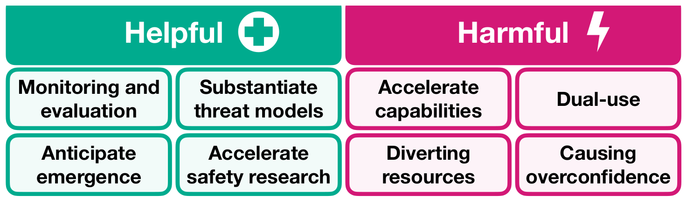

*图 11（原文 Figure 11，第 23 页）：机制可解释性对 AI 安全的潜在收益与风险。*

**图中文字翻译与读法**：左侧青色大框 **Helpful（有益，配十字图标）**，下设四项：Monitoring and evaluation（监控与评估）、Substantiate threat models（证实威胁模型）、Anticipate emergence（预判能力涌现）、Accelerate safety research（加速安全研究）；右侧粉色大框 **Harmful（有害，配闪电图标）**，下设四项：Accelerate capabilities（加速能力提升）、Dual-use（双重用途）、Diverting resources（转移研究资源）、Causing overconfidence（造成虚假自信）。

**读图结论**：机制可解释性对安全不是单向的“越多越好”，收益和风险是同一种能力的两面：能帮助发现危险模式的同一套工具，往往也能被用来加速能力或被误用。

### 6.1 可解释性如何促进 AI 安全

随着开发越来越强大的模型，对 AI 系统获得机制层面的洞察，对于应对 AI 安全问题至关重要。可解释性工具能提供对“人工认知”的理解——AI 系统处理信息、做出决策的方式——这带来若干潜在收益：

机制可解释性可以通过提供更丰富的反馈回路和模型评估基础，加速 AI 安全研究；也可能帮助预判涌现能力，即在模型新技能或新行为完全显现之前就提前察觉，这与研究模型学习过程中内部结构与表示的渐进发展相关（第 5.2 节）。此外，可解释性可以用具体证据来证实理论化的风险模型，例如展示内部不对齐（模型行为偏离其预期目标）或元优化（模型内部涌现出未被预期的子智能体）的具体证据；它也可能通过揭示潜在风险或令人担忧的行为，推动 AI 社区在规范层面转向更严格的安全协议。

针对具体的 AI 风险：可解释性可能通过定位并擦除模型中存储的敏感信息来预防恶意滥用；它可以通过证实潜在威胁、促进组织安全文化、通过更好的监控与评估来支持 AI 对齐（确保 AI 系统追求预期目标），从而降低竞争压力。可解释性可以在训练的每个阶段提供安全过滤：训练前通过刻意的设计，训练中通过检测不对齐的早期迹象并有可能把分布推向对齐方向，训练后通过对人工认知做诚实性的严格评估、筛查欺骗行为。

大语言模型中涌现的内部世界模型（如模拟假设所提出的）可能对 AI 对齐研究有重大意义：找到人类价值观的内部表示，并将 AI 系统的目标对准它，可能是实现对齐的一条相对简单的路径，尤其是当世界模型在内部与目标和能动性的概念相分离时。在这种情况下，仅凭对世界模型的可解释性或许就足以实现对齐。

以条件化方式使用预训练模型，被认为是通向通用智能相对安全的路径，因为它避免直接创造带有内在目标或议程的智能体。然而，提示模型去模拟一个真正的智能体——例如“你是 2035 年的一个超级智能，正在写下一个对齐方案”——可能会无意中导致内部智能体的形成。相比之下，强化学习默认倾向于创造出智能体。

预测正交性假设暗示，像 GPT 这样以预测为核心目标的模型可以模拟出目标可能不对齐的智能体。尽管 GPT 可能缺乏真正的能动性或意图，它仍可能产生模拟出这些特质的输出。这凸显了需要谨慎监督的必要性，更好的做法是用机制可解释性去搜寻内部智能体或其构成要素，例如优化或搜索过程——这被称为“寻找搜索”（searching for search）。

机制可解释性能很好地融入多种 AI 对齐议程，例如理解已有模型、控制模型、让 AI 系统帮助解决对齐问题、发展对齐理论。它可以增强检测欺骗性对齐（模型假装自己对齐，以在不引起怀疑的前提下追求不对齐目标）的策略，从模型中引出潜在知识，并支持更好的可扩展监督，例如迭代蒸馏与放大。高度的理解甚至可能让“有充分根基的 AI”（带可证明保证的 AI 系统）或“显微镜 AI”（从模型中提取世界知识，而不让模型自己采取行动）成为可能。此外，如果我们能识别出人类价值观的内部表示，并通过重新定向某个内部搜索过程来引导模型追求这些价值观，全面的可解释性本身也可能成为一种对齐策略。归根结底，理解与控制是相互交织的，更深入的理解能让我们更可靠地控制 AI 系统。

然而，潜在的不对齐风险有一个谱系，从急性的、以模型为中心的问题，到渐进的、系统性的担忧都有。机制可解释性或许能应对直接源于模型内部的风险——比如欺骗性对齐或能力的突然跃升——但对更广泛的系统性风险，例如不对齐的经济结构或新型演化动态的涌现，它的帮助可能有限。这种多尺度的风险图景呼唤一个更均衡的研究组合，以最小化风险，需要治理、复杂系统和多智能体仿真方面的研究来补充机制层面的洞察和模型评估。机制可解释性对 AI 安全的实际效用，在很大程度上取决于研究者对这些不同风险场景可能性的先验判断。

### 6.2 机制层面的洞察可能有何危害

机制可解释性研究可能加速 AI 能力的发展，从而可能催生出与人类价值观不对齐、却十分强大的 AI 系统，带来重大风险。虽然历史上可解释性研究对 AI 能力的影响不大，但近期的一些例外——例如关于标度律的发现、受归纳头研究启发的架构改进、受 logit 透镜技术启发的效率提升——证明了它增强能力的潜力。扩大可解释性研究的规模可能需要自动化，这有可能让 AI 系统实现快速的自我改进。一些研究者建议选择性发布成果、专注于风险较低的领域，以缓解这些风险。

机制可解释性还带来双重用途的风险，同一套技术既可能用于有益目的，也可能用于有害目的。可解释性带来的细粒度编辑能力可用于机器遗忘（移除模型中的隐私数据或危险知识），但也可能被滥用于审查；同样，可解释性或许有助于提升对抗鲁棒性，但也可能助长更强的对抗性攻击的开发。

误解或高估可解释性技术的能力，可能把资源从关键的安全领域转移开，或导致对 AI 系统产生过度自信和错位的信任。稳健的评估与基准测试（第 8.2 节）对于验证可解释性方面的主张、降低过度解读或误解的风险至关重要。

## 七、挑战（第 7 节）

### 7.1 研究层面的问题

**需要全面、多管齐下的方法**。当前的可解释性研究常常只聚焦单一技术，而不是组合互补方法。要达到对神经网络的整体理解，作者建议采用一个多元化的可解释性工具箱，整合多种方法（另见第 4.4 节）：(i) 协调观察性方法（如探针、logit 透镜）与干预性方法（如激活修补）以建立因果关系；(ii) 把特征层面的分析（如稀疏自编码器）与回路层面的干预（如路径修补）结合，以揭示表示与机制之间的相互作用；(iii) 把内生可解释性方法与事后分析整合，以获得稳健的理解。

例如，协调式的方法可以用于逆向工程被植入木马的行为：观察性技术识别出可疑的激活，干预性方法分离出相关回路，内生方法指导设计更鲁棒的架构。

**挑剔式举例与“路灯式”可解释性**。另一个令人担忧的模式，是倾向于“挑剔式举例”：仅依赖少数几个有说服力的例子或可视化结果作为论证基础，而没有做全面评估。这相当于一种发表偏倚，展示的是不切实际的、最佳情形的精选集锦。相关地，许多可解释性技术主要在小型玩具模型和任务上评估，有可能错过只在更现实、更多样的场景中才会出现的关键现象。这种只关注玩具模型上挑选出的结果的做法，是一种“路灯式可解释性”（streetlight interpretability）——只在最有利于可解释性的理想条件下检视 AI 系统。

### 7.2 技术层面的限制

**可扩展性挑战与对人力的依赖风险**。一个关键障碍是证明机制可解释性能在模型规模、任务复杂度、行为覆盖面和分析效率等方面扩展到真实世界的 AI 系统上。要在所有情境下对一个模型的能力取得真正全面的理解，是一项艰巨的任务，所需的时间和算力必须能可处理地扩展。自动化可解释性技术至关重要，因为随着模型增大，人工分析很快变得不可行。当前可解释性研究对人力的高度依赖，也引发了对人工生成的模型解释在可扩展性和有效性上的担忧：主观、不一致的人工评估，以及缺少真值基准，是已知的问题。随着模型规模扩大，继续依赖人类手动提出模型机制假设将变得越来越不可持续。需要更多工作来自动化发现机制解释的过程，并把模型权重翻译成人类可读的计算图；但这方面的进展也可能来自这个领域之外。

**自底向上可解释性的障碍**。关于能否从底层完全逆向工程神经网络，存在一些根本性的问题，尤其随着模型变得越来越复杂。模型可能学到的内部表示和算法无法干净地映射到人类可理解的概念上，这使得即便拥有完全的透明度，也依然难以解释。这种人类本体论和模型本体论之间的鸿沟，可能随着架构演化而扩大，使模型愈发不透明。反过来，随着能力提升，模型表示也可能自然收敛到对人类更友好的形式。

**分析嵌入在环境中的模型**。真实世界中嵌入在丰富、交互式环境里的 AI 系统，表现出两种形式的上下文相关行为，这些行为在仅仅孤立地理解模型之外，带来了重大的可解释性挑战。对外，模型可能通过与外部环境的交互和反馈回路做上下文学习，动态适应并重塑它们的环境。对内，“九头蛇效应”（hydra effect）展示了一种上下文内的内部重组：即便关键组件被消融，模型也会以依赖上下文的方式灵活重组其内部表示，以维持其能力。这两种上下文行为——对外适应环境、对内自我重组——都削弱了那些假设回路固定不变的可解释性方法。对于深度嵌入在丰富真实世界场景中的模型，它们与外部世界的动态耦合（通过上下文环境学习）以及内部的上下文表示重组，使得仅靠分析初始模型就想获得强有力的可解释性保证变得十分困难。

**针对可解释性的对抗压力**。随着模型通过更多的训练和优化变得更强大，存在它们学会欺骗性行为、主动混淆或误导旨在理解它们的可解释性技术的风险。模型可能发展出对抗性的“读心”组件，预测并反制用来解释其内部运作的具体分析方法。通过梯度下降这类技术优化模型，也可能无意中让其内部表示对外部观察者而言变得更难解释。在极端情形下，一个高度先进、一心只想保住自身核心目标的 AI 系统，可能会直接破坏使可解释性方法得以成立的基本假设。

这些对抗性的动态——模型的能力与理解它的努力相互对抗——凸显了可解释性研究需要优先考虑最坏情形下的鲁棒性，而不只是平均情形。当前的技术即便在模型没有被对抗性优化的情况下也常常失效。要对完全理解极其强大的 AI 模型建立高度信心，可能需要让可解释性框架对一个智能系统主动的欺骗努力具备韧性，这需要根本性的进展。

## 八、未来方向（第 8 节，图 12）

鉴于当前的局限与挑战，若干关键研究问题成为推进机制可解释性的重点，分属四大方面：强调概念清晰性（8.1 节）、建立严谨标准（8.2 节）、提升可解释性技术的可扩展性（8.3 节）、拓展研究范围（8.4 节）。

为什么看这张图：它把这四大方面各自拆成两到三条具体的研究问题，是全文给出的、最接近“行动清单”的一张图。

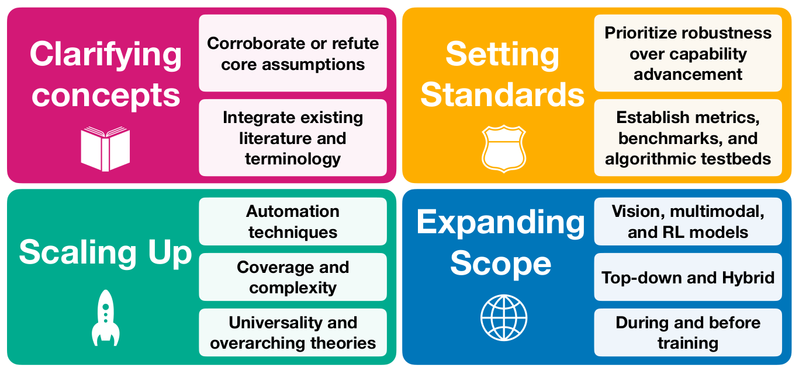

*图 12（原文 Figure 12，第 27 页）：推进机制可解释性研究的路线图，标出几条关键的战略方向。*

**图中文字翻译与读法**：四个象限。左上 **Clarifying concepts（澄清概念，粉色，配一本打开的书图标）**：Corroborate or refute core assumptions（证实或证伪核心假设）、Integrate existing literature and terminology（整合既有文献与术语）；右上 **Setting Standards（建立标准，橙色，配一面盾牌图标）**：Prioritize robustness over capability advancement（把鲁棒性置于能力提升之前）、Establish metrics, benchmarks, and algorithmic testbeds（建立指标、基准与算法测试平台）；左下 **Scaling Up（扩大规模，青色，配一枚火箭图标）**：Automation techniques（自动化技术）、Coverage and complexity（覆盖面与复杂度）、Universality and overarching theories（普适性与总体理论）；右下 **Expanding Scope（拓展范围，蓝色，配一个地球图标）**：Vision, multimodal, and RL models（视觉、多模态与强化学习模型）、Top-down and Hybrid（自顶向下与混合方法）、During and before training（训练中与训练前）。

### 8.1 澄清概念

**与既有文献整合**。要走向成熟，机制可解释性应当拥抱既有工作，使用已确立的术语，而不是重新发明一套。术语发散会妨碍跨学科协作。目前，机制可解释性所用的术语与主流 AI 研究部分脱节：例如主流研究谈论“分布式表示”（distributed representations）和“解缠”（disentangled）这一目标，机制可解释性文献则把同样的现象称为“多义性”（polysemanticity）和“叠加”（superposition）。使用共通语言能促使“意外的”跨界贡献，并避免机制可解释性与更广泛的 AI 研究相互隔绝。

机制可解释性与 AI 研究的其他领域也有关联，包括压缩感知、模块性、对抗鲁棒性、持续学习、网络压缩、神经符号推理、木马检测和因果表征学习。这些关联能帮助发展新的方法、指标、基准和理论框架。例如：

1. **神经符号推理与程序合成**：机制可解释性的目标是通过把网络权重转译为人类可读的算法来做逆向工程，这一追求可以从神经符号推理中获得启发，借鉴用特定领域语言生成程序、从神经网络中提取决策树或符号因果图等技术，用以拓展逆向工程 AI 系统的工具箱；
2. **因果表征学习（Causal Representation Learning，CRL）**：旨在从数据中发现并解开底层的因果因素，补充了机制可解释性理解神经网络内部因果结构的目标。机制可解释性通常检视单个的特征和回路，CRL 则提供了一个理解高层因果结构的框架：CRL 的技术可以通过识别神经元或层之间的因果关系来增强可解释性，有可能揭示模型的推理过程；它对干预和反事实的关注，可以启发探测模型内部的新方法；它对学习不变表示的重视，可以指导对鲁棒特征的搜索；它在迁移学习上的做法，也可以为研究模型泛化提供思路；
3. **木马检测（Trojan Detection）**：检测欺骗性对齐模型是审视模型内部的一个关键动机，因为按定义，欺骗仅凭观察行为是不会显现出来的。但由于目前模型中缺少欺骗作为一种涌现能力的证据（谄媚行为和欺骗性夸大行为的理论证据除外），量化这方面的进展很有挑战。检测通过数据投毒植入的木马（后门）可以作为一个代理目标和概念验证：这些木马模拟的是外部不对齐（模型行为因奖励信号定义不当或错误而偏离指定目标），而不是欺骗性对齐这种内部不对齐（模型表面上符合指定目标，内部却在追求不同的、不对齐的目标）；此外，激活木马通常会导致行为的即时变化，而欺骗可能是微妙、渐进、起初完全停留在内部的。尽管如此，木马检测仍可以为可解释性方法的基准测试提供一个实用的测试平台；
4. **对抗鲁棒性（Adversarial Robustness）**：可解释性与对抗鲁棒性之间存在一种对偶关系——更可解释的模型往往对对抗攻击更鲁棒，反过来，经过对抗训练的模型往往也更可解释。例如，输入梯度正则化这类技术已被证明能同时提升显著图的可解释性和对抗鲁棒性。此外，可解释性工具有助于构造更复杂的对抗样本，从而加深我们对模型内部的理解；把对抗样本看作神经网络固有的特征而非 bug，也暗示了存在人类感知之外的“异质特征”。把机制可解释性与对抗鲁棒性联系起来，有望带来理论洞察、衡量进展的方式、设计内在更鲁棒架构的方法，以及用可解释性指导识别（并缓解）对抗性脆弱点的方法。

关于可解释性、鲁棒性、模块性、持续学习、网络压缩与人类视觉系统之间相互作用的更多细节，可参见 Räuker 等人（2023）的综述。

**证实或证伪核心假设**。特征是定义神经表示、支撑机制可解释性自底向上方法的基本单位，但定义特征涉及一些需要审视的假设，因为它们会塑造解释和研究方向。通过寻找更多证据或反例来质疑这些假设，至关重要。

线性表征假设把激活方向当作特征，但线性的涌现与必要性尚不清楚——它究竟是一种架构偏置，还是内在固有的？需要更强的理论来证成线性的必要性，或者需要找到反例，比如在不相关数据上训练、且没有中间线性层的自编码器。另一种视角把特征看作由分段线性激活构成的多面体，这对“方向简化是否足够”“增加的多面体复杂度是否真的有助于可解释性”提出了疑问。

叠加假设认为多义神经元源于网络把大量特征压缩进有限的神经元集合，但多义性也可能是因冗余而偶然产生的。理解叠加的作用，可以为通过正则化缓解多义性提供信息。叠加也带来了一些悬而未决的问题，例如如何把“叠加中的计算”形式化、注意力头是否存在叠加、如何表示特征簇、与对抗鲁棒性的联系、反相关特征的组织方式，以及架构选择带来的影响。

### 8.2 建立标准

**把鲁棒性置于能力提升之前**。随着机制可解释性社区的扩张，必须在建立该领域进步所需指标的同时，坚持不推进 AI 能力这一规范。研究者应优先开发用于分析 AI 系统最坏情形表现的全面工具，确保在关键应用中的鲁棒性和可靠性，包括聚焦后门检测与清除这类对抗性任务，以及评估解释在构造对抗样本方面的准确性。

**建立指标、基准和算法测试平台**。机制可解释性面临的一个核心挑战是缺少严谨的评估方法。仅凭直觉容易把假设和结论混为一谈，导致挑剔式举例、为最佳情形（而不是平均或最坏情形）表现做优化。当前的临时做法和代理指标有过优化的风险（古德哈特定律——当一个指标变成目标，它就不再是一个好指标）。区分相关性和因果性至关重要，因为“可解释性幻象”说明可视化结果若没有因果链接，可能毫无意义。

要推进这个领域，需要严谨的评估方法，应当包括：(i) 评估分布外输入的表现，因为当前多数方法只对特定样例或数据集有效；(ii) 通过编辑来控制系统，例如植入或移除木马，或做有针对性的编辑；(iii) 用更简单的、经逆向工程得到的替代品替换组件；(iv) 通过用假设的回路替换组件来做全面评估。

算法测试平台对评估忠实性和可证伪性至关重要。像 Tracr 这样的工具能为搜索方法的基准测试提供真值标签；研究计算中叠加现象的玩具模型，以及在算法任务上训练的 Transformer，可以量化稀疏度并检验内生方法。近期也有工作引入了带已知回路的 Transformer 权重数据集，用于评估机制可解释性技术。

### 8.3 扩大规模

**对复杂模型与行为更广、更深的覆盖**。扩大机制可解释性规模的一个主要目标，是推动模型与任务复杂度同可解释性技术覆盖面之间的帕累托前沿。虽然已有不少努力聚焦更大的模型，但同样重要的是扩展到更复杂的任务，并提供可证明安全性和枚举式安全性所必需的全面解释——即确保模型不会从事欺骗等危险行为。未来工作应追求彻底的逆向工程，把已验证的模块整合进更大的网络，并捕捉隐藏状态中编码的、超出即时预测范围的序列信息。加深分析的复杂度同样关键：验证玩具模型的真实性，并把路径修补等技术扩展到更大的语言模型上。这个领域必须超越在算法任务上训练的小型 Transformer 和有限场景，去处理更复杂、更真实的情形。

**走向普适性**。随着机制可解释性走向成熟，这个领域必须从孤立的经验发现，过渡到发展出超越具体回路的总体理论和普适推理原语，以求对 AI 能力获得全面理解。虽然收集经验数据仍然有价值，但建立能捕捉模型行为普适方面的模体、经验规律和理论至关重要。这可能涉及发现更多回路/特征、把回路作为理解记忆/泛化的透镜、识别基本的通用推理技能、把具体发现泛化为与模型无关的现象，以及研究不同类别神经网络间涌现出的模型通用性。识别普适的推理模式并建立统一理论，是推进可解释性的关键。

**自动化**。要在规模、任务复杂度、行为覆盖面和分析时间上，把可解释性扩展到真实世界最先进的模型上，实施自动化方法至关重要。人工识别回路非常耗费人力，因此像回路发现和稀疏自编码器这样的自动化技术能提升效率。未来工作应当自动创建不同的数据集以理解回路功能，开发自动化的假设搜索方法，并研究注意力头与 MLP 之间的相互作用。为前沿模型扩展稀疏自编码器以自动提取高质量特征至关重要，但也需要对潜在的弊端保持谨慎，例如 AI 迭代速度超过训练速度，以及工具复杂度增加导致人类可解释性的丧失。

### 8.4 拓展研究范围

**跨训练阶段的可解释性**。虽然对最终训练好的模型做机制可解释性是前提，这个领域也应当通过研究学习动态，推进训练前和训练中的可解释性。这包括跟踪神经元的发展过程、分析神经元集合随规模变化的情况，以及研究涌现计算。研究相变可能为奖励黑客这类风险带来安全层面的洞察。

**多层次分析**。作为对当前占主导的自底向上方法的补充，机制可解释性应当探索自顶向下和混合方法，这是一个有前景却被忽视的方向。自顶向下的分析为研究大模型提供了一条可处理的路径，并能用宏观观测指导微观研究。其计算效率可以支持对多样模型做广泛的“比较解剖”，揭示支撑各种能力的高层模体。这些模体可以作为分析单元，用于理解指令微调、基于人类反馈的强化学习等技术带来的内部改变。

**新前沿：视觉、多模态与强化学习模型**。虽然已有一些机制可解释性工作探索了用于视觉的卷积神经网络、视觉—语言模型，以及多模态神经元，但针对视觉 Transformer 的工作还很少。未来的努力可以在视觉—语言模型中识别机制，呼应单模态语言模型中已取得的进展。

强化学习（RL）也是一个关键前沿，因为它在诸如基于人类反馈的强化学习（RLHF）这类先进 AI 训练技术中扮演着重要角色，尽管它也可能带来重大的安全风险。对 RL 的可解释性研究应当调查奖励/目标表示，研究对齐算法带来的回路变化，并探索涌现的子目标或代理（proxy）——例如内部奖励模型。虽然当前以预测训练为主的大语言模型这类最先进 AI 系统被认为相对安全，但在解释 RL 系统方面取得进展，可能对守护下一个范式至关重要。

## 九、局限、证据边界与常见误读

### 9.1 这篇综述本身的性质

它几乎没有新实验：正文唯一一张表（表 1）是方法分类，不是实验结果；全部 12 张图都是概念示意图或玩具模型示意，不是真实大模型上的实验曲线。综述的价值在于把分散在博客、讲座、列表里的研究系统化，给出统一的术语和因果方法地图，而不是报告新的量化结果。阅读时不应把图 4、图 5、图 6 里的玩具模型示意当成对真实前沿大模型的实证证明——作者自己反复强调这些图是在展示“假设在什么条件下可能成立”，不是“已经在 GPT 级别模型上验证过”。

### 9.2 证据强度的阶梯

把全文的证据力度粗略排一个序（这是据全文内容整理的阅读提示，原文没有给出这样的排序）：

1. 最弱：某个危险提示词与某个激活相关（观察性、单样例，容易挑剔式举例）；
2. 稍强：一个线性或非线性探针能跨分布泛化地读出某信息（仍是观察性，第 4.2 节强调“探针读出不等于模型使用”）；
3. 更强：激活修补、消融或转向（steering）能稳定地、可重复地改变目标行为（第 4.3 节的干预类方法）；
4. 更强：多个局部干预能组合成一个可预测未见输入和反事实结果的回路（因果抽象、假设检验，第 4.3.2–4.3.3 节）；
5. 部署级：在低误报率、能抵抗分布变化和一定程度的自适应规避、满足实时性和成本约束下用于监控（第 7.2 节讨论了对抗压力下现有技术大多会失效，说明这一级别目前基本没有被满足）。

第 6 节里列出的许多安全收益（检测欺骗性对齐、审计危险知识等）目前的经验支撑大多停留在第 2、3 级，离第 5 级的“可部署安全监控”还有明显距离；作者在第 7 节也明确承认这一点。

### 9.3 常见误读

- “找到了一个‘欺骗特征’/‘世界模型’方向，说明模型正在欺骗/确实有世界模型”：不对。第 3.4 节与第 6 节都强调，探针或某个方向上的相关性只是观察性证据；要支持这类主张，需要证明该方向对模型输出有因果驱动作用，而不仅仅是“可以被读出”；
- “叠加/多义性问题已经被稀疏自编码器解决了”：不对。第 4.2 节明确说，评估 SAE 质量仍然充满挑战，因为缺少真值可解释特征；“看起来有语义标签”只是第一关，还要看重构、跨种子/宽度的稳定性、潜变量干预是否按预测改变行为、能否组成忠实的回路；
- “普适性假设已被证实”：不对。第 3.3、5.3 节都提到，现有证据总体支持弱版本（不同模型收敛到遵循共同原则的类似解），而不是强版本（完全相同的回路必然涌现）；
- “机制可解释性已经能给前沿模型做安全认证”：不对。第 7 节专门讨论可扩展性、自底向上可解释性的障碍、模型嵌入环境中的上下文行为（九头蛇效应）、以及对抗压力下可解释性工具可能失效这几类尚未解决的挑战；
- “可解释性研究只有好处、没有风险”：不对。第 6.2 节专门讨论了它可能加速能力提升、带来双重用途风险（如编辑能力既可用于遗忘隐私数据也可用于审查），以及可能造成资源错配和虚假的安全信心。

## 十、复现 / 评估检查清单

综合全文反复强调的几条方法论要求，审查任何一项机制可解释性的具体结论时，应当确认：

- **因果性而非相关性**：结论是靠观察（探针、可视化、logit 透镜）还是靠干预（激活修补、因果洗涤、因果抽象）得到的？只有后者才更接近“该组件参与了计算”（第 2 节、图 1）；
- **是否报告了负例和覆盖率**：是不是只展示了几个“讲得通”的例子（挑剔式举例、路灯式可解释性，第 7.1 节）？
- **SAE 类方法是否报告了**：重构损失与模型行为的保真度、激活稀疏度与死特征比例、不同随机种子/宽度下的稳定性、自动标签在人工盲评中的准确率、对潜变量做干预是否按预测改变了行为、能否组成忠实的回路（第 4.2 节、图 8）；
- **激活修补类方法是否说明了**：污染方式（零/均值/随机/重采样消融）、修补方向（干净→污染对应充分性、污染→干净对应必要性）、度量指标，以及是否检查过模型是否被推到了分布外、是否存在“九头蛇效应”式的自我修复（第 4.3.1 节、第 7.2 节）；
- **是否在分布外输入、不同模型、不同任务上复测过**：是否只在一个玩具模型或一个任务模板上验证（第 7.1、8.2 节）？
- **是否区分了“模型会做”和“模型被设计/训练去做”**：涉及世界模型、模拟器、拟像体的主张，是否混淆了“探针能读出某信息”和“模型实际在用这份信息驱动输出”（第 3.4 节）？
- **是否说明了方法的分类坐标**：该方法在表 1 的四个维度（因果性质、学习阶段、局部性、全面性）上处于什么位置，以免把一个局部、局部性的结论当成全局、全面性的结论。

## 原文证据导航

- 页码对应（原文页码均为 PDF 页码）：第 1–2 页第 1 节引言；第 2–3 页第 2 节解释范式（图 1）；第 3–11 页第 3 节核心概念（图 2–6）；第 12–19 页第 4 节方法（图 7–9，表 1）；第 19–23 页第 5 节当前研究（图 10）；第 23–25 页第 6 节与 AI 安全的关系（图 11）；第 25–27 页第 7 节挑战；第 27–31 页第 8 节未来方向（图 12）；第 31 页之后为致谢与术语表（Glossary）；
- [原论文 PDF](paper.pdf)
- [原文提取文本](paper.txt)
- [论文概要](论文概要.md)
