# 论文中文解读：《Medusa: Simple LLM Inference Acceleration Framework with Multiple Decoding Heads》

> **基本信息**：Tianle Cai\*、Yuhong Li\*、Zhengyang Geng、Hongwu Peng、Jason D. Lee、Deming Chen、Tri Dao（Princeton University、Together AI、UIUC、Carnegie Mellon University、University of Connecticut；\* 为共同第一作者），arXiv:2401.10774（本文依据 2024 年 6 月的 v3），ICML 2024（PMLR 235）；论文原文 [官方页面](https://arxiv.org/abs/2401.10774)。
>
> **本文的读法**：图取自论文原文（从 PDF 中按图裁出的原图），表为逐格核对后的中文转录（数字与原文一致，表头翻译为中文）。每张图后有中文图题、图中文字翻译和读图结论，因此不必再翻英文版。图中的具体数值若不是正文给出的，是整理者从 PDF 矢量图坐标反算出的近似值，文中写“约”。凡标明“整理者补充”“整理者核算”的内容，是为了帮助理解而加的，不是论文自带的数字。

## 一、一句话结论

大模型自回归解码的每一步都要把全部参数从显存搬到加速器缓存，却只产出一个 token，算力大量闲置。推测解码（speculative decoding）用一个小的草稿模型一次猜多个 token，但合适的草稿模型很难获得和维护。**Medusa** 的做法是：在原模型最后一层隐藏状态上**加几个轻量的解码头（Medusa heads）**，让它们并行预测后面的多个 token；把各个头的 top 预测组合成多条候选，用**树注意力（tree attention）** 在一次前向里同时验证，再用拒绝采样或论文提出的**典型接受（typical acceptance）** 选出可接受的最长前缀。训练有两档：**Medusa-1** 冻结骨干、只训练 heads，可以无损加速（论文摘要：超过 2.2 倍）；**Medusa-2** 把 heads 与骨干联合训练，速度更高（摘要：2.3–2.8 倍），但需要专门的训练配方来保住模型能力。没有训练数据时用**自蒸馏（self-distillation）** 生成数据。实验以 batch size 1 为主，在 Vicuna-7B/13B/33B 和 Zephyr-7B 上用 MT-Bench 测速度并用 GPT-4 评质量。

## 二、背景与动机

### 2.1 自回归解码为什么慢

- LLM 推理主要**受显存带宽限制**（memory-bandwidth-bound）：延迟的主要瓶颈是加速器的显存带宽，而不是算术运算；
- 这个瓶颈来自自回归解码的串行性：每次前向都要把完整的模型参数从高带宽显存（HBM）传到加速器缓存，却只生成一个 token，没有用到现代加速器的算力；
- 加速思路之一是提高解码的算术强度（总 FLOPs 与总数据搬运量之比）并减少解码步数。传统做法是增大 batch，但模型参数和 KV cache 都占很多显存，限制了 batch 大小（附录 A.1）。

### 2.2 推测解码的痛点

推测解码（Leviathan 等、Chen 等、Xia 等、Miao 等）用较小的草稿模型生成一段 token，再由原模型一次性检验。论文指出它的问题是：

1. **草稿模型难找**：它必须小而有效，才能生成原模型愿意接受的续写；现有做法常常要单独预训练一个小模型。论文举例，SpecInfer（Miao 等）报告为此用了 275 个 NVIDIA A100 GPU 小时；
2. 单独预训练可能带来草稿模型与原模型之间的**分布偏移**，使续写不被原模型偏好；
3. 在**分布式系统**里同时服务两个模型更复杂（Chen 等已指出）。

### 2.3 Medusa 的思路

Medusa 重新审视并改进 Stern 等（2018）的“在骨干模型之上加多个解码头”的想法：不另找草稿模型，而是在原模型最后一层隐藏状态上加解码头，这些头用参数高效的方式微调，可以加到任何现有模型上，因此能无缝融入现有的 LLM 系统（包括分布式环境）。论文的实验主要关注 **batch size 为 1** 的场景，也就是 LLM 部署在本地供个人使用的情形。

论文强调两个关键点：

- 只生成一条候选续写会浪费算力，所以用多个头生成**多条候选续写**，通过对注意力掩码的一个简单修改并行验证；
- 可以复用推测解码里的拒绝采样来得到与原模型同分布的回复，但它无法进一步提高加速比；于是论文另提**典型接受**方案，从 Medusa 头的输出里挑出“合理”的候选，用温度作阈值控制与原模型预测的偏离。

## 三、方法

### 3.1 总览（图 1）

Medusa 沿用推测解码的框架，每个解码步包含三个子步骤：(1) 生成候选，(2) 处理候选，(3) 接受候选。在 Medusa 里，(1) 由 Medusa 头完成，(2) 由树注意力实现，(3) 可以是拒绝采样或典型接受。由于 Medusa 头就在原模型之上，(2) 中算出的 logits 还能直接用于下一个解码步的 (1)。

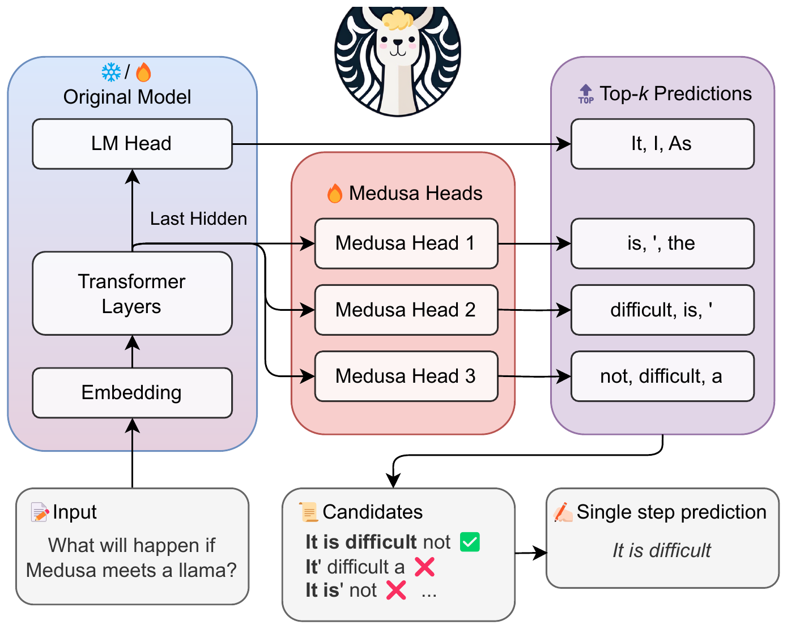

*图 1（原文 Figure 1，第 2 页）：Medusa 在 LLM 的最后一层隐藏状态上增加多个头，并行预测后续的多个 token；各头为各自位置给出多个 top 预测，组合成候选，用树式注意力并行处理；最后验证候选并接受一条续写。*

**图中文字翻译与读法**：

- **左：Original Model（原模型）**：自下而上是 Embedding（词嵌入）、Transformer Layers（Transformer 层）、LM Head（原语言模型头）。框上方的雪花/火焰图标表示这部分既可以冻结（Medusa-1）也可以训练（Medusa-2）。Transformer Layers 输出的 **Last Hidden（最后一层隐藏状态）** 同时送给 LM Head 和多个 Medusa Heads。
- **中：Medusa Heads（Medusa 头）**：Medusa Head 1、2、3（火焰图标表示这些新增的头需要训练）。
- **右：Top-$k$ Predictions（每个头的 top-$k$ 预测）**：LM Head 给出 “It, I, As”；Medusa Head 1 给出 “is, ', the”；Medusa Head 2 给出 “difficult, is, '”；Medusa Head 3 给出 “not, difficult, a”。
- **下：** Input（输入）“What will happen if Medusa meets a llama?” → Candidates（候选）：`It is difficult not`（打 ✅，其中加粗的 `It is difficult` 被接受）、`It' difficult a`（❌）、`It is' not`（❌）…… → Single step prediction（单步预测）`It is difficult`。
- **读图结论**：一次前向就能同时给出第 1、2、3、4 个位置的 top 候选；把它们组合成多条候选序列并行验证，取**最长被接受的前缀**作为这一步的输出（这里一步前进了 3 个 token）。

### 3.2 Medusa 头

给定原模型在位置 $t$ 的最后一层隐藏状态 $h_t$，Medusa 增加 $K$ 个解码头。**原 LM head 预测第 $t+1$ 个位置的 token，第 $k$ 个 Medusa 头预测第 $t+k+1$ 个位置的 token**。第 $k$ 个头的输出分布记作 $p_t^{(k)}$，原模型的预测记作 $p_t^{(0)}$。参照 Stern 等，每个头用**一层前馈网络加残差连接**：

$$
p_t^{(k)}=\mathrm{softmax}\Big(W_2^{(k)}\cdot\big(\mathrm{SiLU}(W_1^{(k)}\cdot h_t)+h_t\big)\Big),\qquad W_2^{(k)}\in\mathbb{R}^{d\times V},\quad W_1^{(k)}\in\mathbb{R}^{d\times d}.
$$

其中 $d$ 是原模型最后一层隐藏状态的维度，$V$ 是词表大小（原文把 $W_2$ 写成 $d\times V$，按行向量记号理解，作用是把 $d$ 维向量映射成 $V$ 维 logits）。初始化：**$W_2^{(k)}$ 与原 LM head 完全相同，$W_1^{(k)}$ 置零**，这样训练开始时 Medusa 头的预测与原模型一致。激活函数 SiLU 沿用 Llama 系列。

论文强调的好处：

- 与独立的草稿模型不同，Medusa 头与原骨干模型一起训练（骨干可以冻结，即 Medusa-1，也可以一起训练，即 Medusa-2），因此可以在单块 GPU 上微调大模型，并利用强大的基座模型已学到的表示；
- 保证 Medusa 头的分布与原模型对齐，缓解分布偏移；
- 新增的头只有一层，与原语言模型头类似，不增加服务系统设计的复杂度，对分布式环境友好。

整理者补充：每个头只看到同一个 $h_t$，并没有看到“它前面那个未来位置上已经选了什么 token”，所以越远的位置不确定性越大（这正是 EAGLE 后来要解决的问题）。另外，每个头的参数量主要来自 $W_2$：按 $d=4096$、$V=32000$ 估算，每个头约 $d^2+dV\approx1.48\times10^8$ 个参数，5 个头约 $7.4\times10^8$，约为 7B 模型的 10%（整理者核算，不是论文数字；论文把它称为“参数高效”，指的是可以只训练这些头）。

### 3.3 候选与树注意力（图 2）

通过 Medusa 头，可以得到后续 $K+1$ 个位置的概率预测（含原 LM head），据此构造长度为 $K+1$ 的续写作为候选。推测解码的前作主张只采样一条续写；论文指出利用**多条候选**能提高一个解码步内的期望接受长度，但候选越多计算量也越大。为了折中，Medusa 用**树结构注意力**并行处理多条候选：只有同一条续写里的 token 才被视为历史，这背离了传统的因果注意力；参照图神经网络里“把图结构嵌入注意力”的做法（Ying 等 2021），把树结构编进注意力掩码。

**怎样构造树**：对第 $k$ 个头，取它的 top-$s_k$ 预测作为候选基础，$s_k$ 是超参数；候选由各头 top-$s_k$ 预测的**笛卡尔积**构成。例如 $s_1=2$、$s_2=3$ 时，第一个头的每个预测之后都可以接第二个头的任一预测。这得到一棵树：第 $k$ 层的每个节点都有 $s_k$ 个分支（把虚拟根看作第 0 层；实际上第 0 层对应原模型 LM head 的预测，可以独立采样）。在这棵树里，一个 token 只把它的祖先当作历史，注意力掩码保证只对祖先做注意力；再配合恰当的位置索引（按树结构调整位置编码的 position id），就能在**不扩大 batch** 的情况下同时处理大量候选。**新增 token 的累计数目**为

$$
\sum_{k=1}^{K}\prod_{i=1}^{k}s_i .
$$

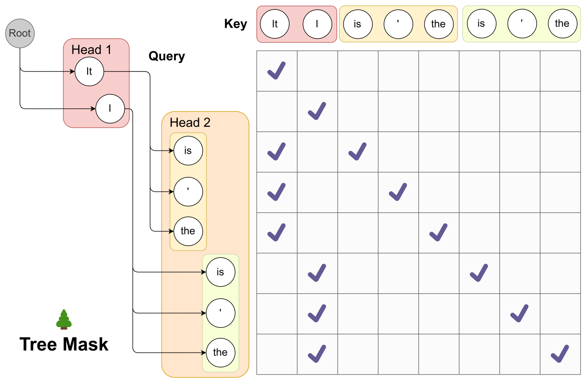

*图 2（原文 Figure 2，第 4 页）：用树注意力并行处理多条候选。头 1 的 top-2 预测与头 2 的 top-3 预测共得到 $2\times3=6$ 条候选，每条对应树里一条分支。为保证每个 token 只能访问它的前驱，设计了只允许“从当前 token 回到其祖先”的注意力掩码；位置编码用的位置索引也按树结构调整。*

**图中文字翻译与读法**：

- **左：树**。灰色圆圈 Root（根）是虚拟根；Head 1 里有两个节点 `It`、`I`；Head 2 里对每个 Head 1 节点各有三个孩子 `is`、`'`、`the`（左侧一组挂在 `It` 下，下方一组挂在 `I` 下）。图中的 Head 1、Head 2 就是第 1、2 个 Medusa 头（对应树的第 1、2 层），Root 是原 LM head 给出的 token（第 0 层）。
- **右：Tree Mask（树掩码）**。顶部 **Key（键）** 一行列出 8 个候选 token（`It`、`I`、`is`、`'`、`the`、`is`、`'`、`the`），左侧 **Query（查询）** 一列是同样 8 个 token；打勾表示“允许这一行的 token 去关注这一列的 token”。
- **读图结论**：每一行的勾恰好是该 token 自己加上它在树里的祖先，例如第 3 行（挂在 `It` 下的 `is`）勾在 `It` 和它自己，没有 `I`。
- 整理者补充：这个例子里新增 token 数是 $2+2\times3=8$，掩码里共 14 个允许位置；所有节点当然还能看到已缓存的前缀和根节点，图中只画了新加入的 8 个候选。

整理者核算：若 4 个头都取 top-10，笛卡尔积需要 $10+10^2+10^3+10^4=11110$ 个节点，而论文最终用的稀疏树只有 64 个节点（见 5.4 节），所以论文在 2.3.3 节另用“按准确率挑节点”的办法构造稀疏树。

### 3.4 训练策略

训练 Medusa 头的最基本做法是冻结骨干、只微调头；把骨干和头一起训练能显著提高头的准确率，但需要特别的配方。论文假设有一个与目标模型输出分布一致的训练集（例如目标模型做 SFT 用的数据集），没有时用自蒸馏（3.6 节）。

**Medusa-1：冻结骨干**。用 Medusa 头预测与真值之间的交叉熵：给定位置 $t+k+1$ 的真值 token $y_{t+k+1}$，第 $k$ 个头的损失是 $\mathcal{L}_k=-\log p_t^{(k)}(y_{t+k+1})$。论文观察到 $k$ 越大 $\mathcal{L}_k$ 越大（预测越远越不确定），所以给各头加权重 $\lambda_k$ 来平衡，总损失为

$$
\mathcal{L}_{\text{Medusa-1}}=\sum_{k=1}^{K}-\lambda_k\log p_t^{(k)}(y_{t+k+1}).
$$

这是论文的式 (1)。

实践中 $\lambda_k$ 取一个常数（如 0.8）的 $k$ 次幂，即 $\lambda_k=0.8^{k}$（附录 B.2），依次为 0.8、0.64、0.512、0.4096、0.32768（整理者核算）。因为骨干只提供隐藏状态，可以用**量化**后的骨干来省显存，因此可以像 QLoRA 那样在单块消费级 GPU 上训练大模型。训练只要几个小时：Vicuna-7B 在 60k 条 ShareGPT 样本上训练 Medusa-1，用单块 NVIDIA A100 PCIE 约 5 小时。

**Medusa-2：联合训练**。为了不损害骨干自身的下一 token 预测能力和输出质量，论文提出三个策略：

1. **组合损失**：把骨干的交叉熵 $\mathcal{L}_{\text{LM}}=-\log p_t^{(0)}(y_{t+1})$ 加进来，并用权重 $\lambda_0$ 平衡：

$$
\mathcal{L}_{\text{Medusa-2}}=\mathcal{L}_{\text{LM}}+\lambda_0\,\mathcal{L}_{\text{Medusa-1}}.
$$

这是论文的式 (2)。

2. **差异化学习率**：骨干已经训练得很好，而 Medusa 头需要更多训练，所以给两者不同的学习率，让头收敛更快同时保住骨干能力；
3. **头预热（heads warmup）**：训练开始时 Medusa 头的损失很大、梯度很大，可能扭曲骨干参数。参照 Kumar 等（2022）用两阶段训练：第一阶段只训练 Medusa 头（即 Medusa-1）；第二阶段把骨干和头一起训练，并带预热——先单独训练骨干几个 epoch 再一起训练头，或者逐步增大骨干损失的权重 $\lambda_0$。两种都有效。

把这几个策略合在一起，可以训练出不损害骨干能力的 Medusa-2；这套配方也可以与 SFT 一起使用，直接得到原生支持 Medusa 的模型。

### 3.5 用几个头

经验上**最多五个头就足够**，所以论文建议训练五个头，再用 3.6 节的方法确定最优的树注意力配置；有了优化后的树，有时三四个头就够用，此时可以直接忽略多余的头，没有额外开销。

### 3.6 扩展：典型接受、自蒸馏、优化的树

#### 典型接受（Typical Acceptance）

推测解码论文用拒绝采样得到与原模型分布一致的多样化输出，但后续实现（Gante 2023、Spector 和 Ré 2023）发现这种采样**随采样温度升高效率下降**。直观上，考虑极端情形——草稿模型与原模型完全相同：若用贪心解码，草稿的所有输出都会被接受，效率最高；而拒绝采样由于草稿模型与原模型是**独立采样**的，即使两者分布完全一致，草稿的输出仍可能被拒绝。

论文的看法是：实际中从语言模型采样主要是为了产生多样的回复，温度只是用来调节“创造性”，所以温度越高，原模型应当有越多机会接受草稿的输出；通常也没必要严格匹配原模型的分布。因此提出**典型接受**：从候选里挑选“合理”的而不是做拒绝采样。它受截断采样（Hewitt 等 2022）的启发，目标是选出“典型”的候选，也就是不至于“原模型几乎不可能产生”的候选。用原模型自己预测的概率来衡量，并据预测分布设阈值。具体地，给定上下文 $x_1,\dots,x_n$，检验候选序列 $(x_{n+1},\dots,x_{n+K+1})$（由原 LM head 与 Medusa 头的 top 预测组成）时，对第 $k$ 个位置要求

$$
p_{\text{original}}(x_{n+k}\mid x_1,\dots,x_{n+k-1})>\min\Big(\epsilon,\ \delta\exp\big(-H(p_{\text{original}}(\cdot\mid x_1,\dots,x_{n+k-1}))\big)\Big),
$$

其中 $H(\cdot)$ 是熵，$\epsilon$ 是硬阈值，$\delta$ 是与熵相关的阈值。这个判据改编自 Hewitt 等，基于两点观察：(1) 概率相对较高的 token 是有意义的；(2) 分布的熵较高时，多种续写都可能是合理的。解码时对每条候选用该判据检验，满足条件的**前缀**被接受。为了保证每步至少生成一个 token，**第一个 token 用贪心解码并无条件接受**，后面的 token 才用典型接受；这一步的最终预测是**所有候选中最长的被接受前缀**。

几点性质：温度为 0 时退化为贪心解码（只有概率最大的 token 概率非零）；温度大于 0 时，贪心解码的结果在合适的 $\epsilon,\delta$ 下总会被接受（它们概率最大），速度最大；一般情形下温度升高对应更长的被接受序列，论文的实验印证了这一点。论文的实证结论是：典型接受能在保持相近生成质量的同时取得更好的加速（图 5）。

**整理者补充的小数值例子（不是论文数字）**：取 $\epsilon=0.09$、$\delta=\sqrt{\epsilon}=0.3$（论文沿用 Hewitt 等的 $\alpha=\sqrt{\epsilon}$ 设定，原文未定义 $\alpha$，这里理解为 $\delta$）。某个分布取 4 个 token，对应概率与阈值如下（熵用自然对数）：

| 位置 | 原模型分布（概率） | 熵 $H$ | $\delta e^{-H}$ | 阈值 $\min(\epsilon,\delta e^{-H})$ |
|---|---|---:|---:|---:|
| 位置 1（在 `It` 之后） | is 0.45，' 0.25，was 0.20，the 0.10 | 1.258 | 0.0853 | 0.0853 |
| 位置 2（在 `It is` 之后） | difficult 0.70，hard 0.20，not 0.07，a 0.03 | 0.863 | 0.1266 | 0.09 |
| 位置 3（在 `It is difficult` 之后） | to 0.55，for 0.30，. 0.11，not 0.04 | 1.062 | 0.1038 | 0.09 |

候选序列 `It is difficult not`：第一个 token `It` 由 LM head 贪心给出，**无条件接受**；`is` 的概率 0.45 大于阈值 0.0853，接受；`difficult` 的概率 0.70 大于 0.09，接受；`not` 的概率只有 0.04，小于 0.09，**拒绝**。所以这一步接受前缀 `It is difficult`，前进 3 个 token，对应图 1 的例子。如果位置 3 的候选是 `for`（0.30）或 `.`（0.11），也会被接受。再看熵的作用：分布很尖锐（0.97、0.01、0.01、0.01）时 $\delta e^{-H}=0.2537$，阈值取 $\epsilon=0.09$，只有最高概率的 token 能过；分布很平（四个 0.25）时 $\delta e^{-H}=0.075$，阈值降到 0.075，更多 token 能过。

#### 自蒸馏（Self-Distillation）

3.4 节假设存在与目标模型输出分布一致的训练集，但并不总是如此：模型所有者可能只发布了模型而没有训练数据，或者模型经历过 RLHF，使输出分布与训练集不同。论文提出一条自动化的自蒸馏流水线：**让模型自己生成训练集**，使数据分布与模型输出一致。

- **生成方式**：取一个与目标模型领域相近的公开种子数据集（如聊天模型用 ShareGPT），取出其中的 prompt，让模型回复。要得到多轮对话样本，可以依次把种子里的 prompt 喂给模型；对于像 Zephyr-7B 这样两个角色都训练过的模型，它们能自问自答，只要喂第一个 prompt 就能生成多轮对话；
- **Medusa-1** 只需要这个数据集就够了；
- **Medusa-2**：只用这个数据集训练骨干和头，通常会使生成质量下降。事实上即使不训练 Medusa 头，只用该数据集训练骨干也会让性能下降。这说明还需要用**原模型的概率预测**而不是真值 token 作为骨干的标签，类似经典知识蒸馏（Kim 和 Rush 2016）。骨干的损失为

$$
\mathcal{L}_{\text{LLM-distill}}=\mathrm{KL}\big(p_{\text{original},t}^{(0)}\,\big\|\,p_t^{(0)}\big),
$$

其中 $p_{\text{original},t}^{(0)}$ 是原模型在位置 $t$ 的预测分布。朴素做法要在训练时同时保留两个模型，显存翻倍；论文用**参数高效的适配器（如 LoRA）** 微调骨干：关掉适配器就是原模型，所以蒸馏不需要额外显存。一个小提示：这里最好用不量化的 LoRA，否则老师模型就变成量化模型，可能导致生成质量下降。

#### 搜索优化的树结构

3.3 节用笛卡尔积构造的规则树，在节点总数固定的预算下未必最优。直观上，由不同头的 top 预测组成的候选，准确率各不相同，可以用对准确率的估计来构造树。具体做法：

1. 用一个**校准数据集**，统计各头 top 预测的准确率。记 $a_k^{(i)}$ 为第 $k$ 个头第 $i$ 名预测的准确率（定义为“单个第 $i$ 名 token”的准确率，即 top-$i$ 准确率减 top-$(i-1)$ 准确率）；
2. 假设各准确率相互独立，则由各头 top-$[i_1,i_2,\dots,i_k]$ 预测组成的候选序列的准确率估计为 $\prod_{j=1}^{k}a_j^{(i_j)}$。令 $I$ 为所有可能的 $[i_1,\dots,i_k]$ 组合的集合，其中每个元素对应树的一个节点（不只是叶子，所有节点都算），则一条候选序列的**期望接受长度**为

$$
\sum_{[i_1,\dots,i_k]\in I}\ \prod_{j=1}^{k}a_j^{(i_j)}.
$$

3. 逐个往树里添加节点，新增节点对期望的贡献恰好是该节点对应的准确率，所以可以**贪心地**每次添加“与当前树相连、准确率最高”的节点，直到节点总数达到预定数目；这样构造的树最大化期望接受长度。

**整理者补充的小数值例子（不是论文数字，准确率为假设值）**：设头 1 的 top-1/2/3 准确率为 0.60/0.15/0.08，头 2 的为 0.45/0.12/0.06。路径 (头 1 第 $i$ 名, 头 2 第 $j$ 名) 的准确率是 $a_1^{(i)}a_2^{(j)}$。预算 6 个节点时，贪心依次选：

| 步 | 选中的节点 | 节点准确率 | 累计期望新增 token | 期望接受长度（含根）|
|---:|---|---:|---:|---:|
| 1 | 头 1 第 1 名 | 0.60 | 0.600 | 1.600 |
| 2 | 头 1 第 1 名 → 头 2 第 1 名 | $0.60\times0.45=0.27$ | 0.870 | 1.870 |
| 3 | 头 1 第 2 名 | 0.15 | 1.020 | 2.020 |
| 4 | 头 1 第 3 名 | 0.08 | 1.100 | 2.100 |
| 5 | 头 1 第 1 名 → 头 2 第 2 名 | $0.60\times0.12=0.072$ | 1.172 | 2.172 |
| 6 | 头 1 第 2 名 → 头 2 第 1 名 | $0.15\times0.45=0.0675$ | 1.2395 | 2.2395 |

对比同样 6 个节点的规则（笛卡尔积）树：$s=(2,2)$ 的期望接受长度是 $1+1.1775=2.1775$，$s=(3,1)$ 是 $1+1.2035=2.2035$，都低于贪心稀疏树的 2.2395；而稀疏树只用 5 个节点（2.172）就几乎追平了规则树 $s=(2,2)$ 的 6 个节点（2.1775）。

## 四、实验设置与训练细节（附录 B）

- **三个常用术语**：**加速率（acceleration rate）** 指平均每个解码步解码出的 token 数（标准自回归为 1.0）；**开销（overhead）** 指每个解码步相对经典解码的额外延迟，用 Medusa 模型的平均每步延迟除以原模型的平均每步延迟；**加速比（speedup）** 是墙钟加速。三者关系：**加速比 = 加速率 ÷ 开销**。例如 Vicuna-7B 的 Medusa-2：$3.47/1.22\approx2.84$，表中为 2.83。
- **共同设置**：用 Axolotl 框架训练；带预热的余弦学习率调度、8-bit AdamW 优化器；训练 5 个单层 Medusa 头，式 (1) 里 $\lambda_k=0.8^{k}$。Medusa-2 用 LoRA 或 QLoRA 微调骨干，Medusa 头的学习率是骨干的 4 倍；LoRA 作用于骨干所有线性层（含语言模型头），秩 32，$\alpha=16$，dropout 0.05。
- **Vicuna-7B/13B 的 Medusa-1 与 Medusa-2**：全局 batch size 64，骨干峰值学习率 $5\times10^{-4}$，Medusa 头 $2\times10^{-3}$（恰好是 4 倍），预热 40 步，两个模型都用 4 位量化的骨干。先训练 Medusa-1，再用它作初始化训练 Medusa-2；Medusa-2 用 QLoRA，式 (2) 里 $\lambda_0=0.2$。训练数据是 ShareGPT，训练 2 个 epoch；使用 Vicuna v1.5（基于 Llama-2，序列长度 4096）；对比基线是 HuggingFace 默认实现。
- **自蒸馏的 Vicuna-33B 与 Zephyr-7B**：两者都用 Medusa-2，但不用两阶段训练；骨干损失权重 $\lambda_0$ 用正弦（sine）调度从小逐步增大到训练结束时的峰值，论文发现这同样有效；骨干 LoRA 适配器峰值学习率 $1\times10^{-4}$，预热 20 步（因为自蒸馏损失相对较小），$\lambda_0=0.01$。以 ShareGPT 和 UltraChat 作种子数据集，两种情形各收集约 100k 条样本；Vicuna-33B 的多轮对话是依次喂入多轮种子对话里的 prompt、用温度 0.3 的随机采样生成的；两者都用序列长度 2048、batch size 128 训练。
- **评测**：MT-Bench（Zheng 等 2023），多轮、对话形式的基准，质量由 GPT-4 作评判，给出 0–10 的分数；论文报告 Medusa 相对原模型的质量差。

## 五、实验结果

### 5.1 Vicuna-7B 与 13B：Medusa-1 对 Medusa-2（图 3）

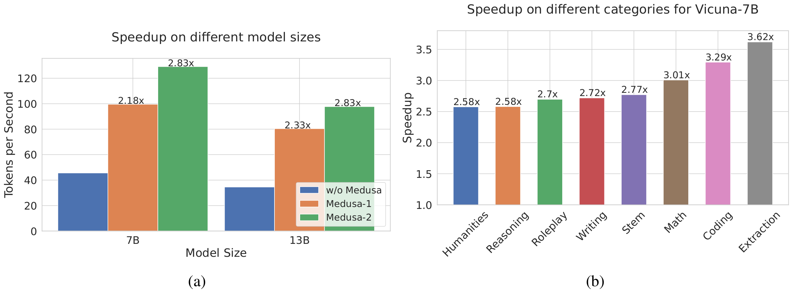

*图 3（原文 Figure 3，第 7 页）：左，基线、Medusa-1、Medusa-2 在 Vicuna-7B/13B 上的速度对比；右，Vicuna-7B 的 Medusa-2 在 MT-Bench 8 个类别上的详细加速。*

**图中文字翻译与读法**：

- **(a) Speedup on different model sizes（不同模型大小上的加速）**：横轴 Model Size（模型大小，7B 与 13B），纵轴 Tokens per Second（每秒 token 数）；蓝色 w/o Medusa（不用 Medusa 的基线）、橙色 Medusa-1、绿色 Medusa-2，柱上标注加速比。整理者从矢量图坐标反算柱高（tokens/s，约）：

| 模型 | 基线（w/o Medusa） | Medusa-1 | Medusa-2 |
|---|---:|---:|---:|
| Vicuna-7B | 约 45.6 | 约 99.5（2.18×） | 约 129.1（2.83×） |
| Vicuna-13B | 约 34.5 | 约 80.4（2.33×） | 约 97.7（2.83×） |

- **(b) Speedup on different categories for Vicuna-7B（Vicuna-7B 在不同类别上的加速）**：横轴是 MT-Bench 的 8 个类别，纵轴 Speedup（加速比）。从左到右依次是：Humanities（人文）2.58×、Reasoning（推理）2.58×、Roleplay（角色扮演）2.7×、Writing（写作）2.72×、Stem（STEM）2.77×、Math（数学）3.01×、Coding（代码）3.29×、Extraction（信息抽取）3.62×。
- **读图结论**：Medusa-1 在 7B 与 13B 上分别达到 2.18× 与 2.33× 的墙钟加速（均超过 2×），Medusa-2 把两者都进一步提高到 2.83×。论文指出代码类受益 3.29×，说明在这个领域特别有效，这提示了优化代码 LLM 的潜力；**Extraction 类最高，达 3.62×**，表明这类任务被 Medusa 特别好地优化。注意 3.62× 只是单个类别的最大值，不是整体加速；论文整体报告的 Medusa-2 加速是 2.3–2.8×。

### 5.2 自蒸馏：Vicuna-33B 与 Zephyr-7B（表 1、图 8、表 4）

这一节考察必须用自蒸馏的场景：Vicuna-33B（训练数据是私有数据集，论文脚注说明这是个实验性版本）和 Zephyr-7B（用 RLHF 之类的对齐方法训练过）。

**表 1：不同 Medusa-2 模型的对比**。第一部分报告 Medusa-2 的加速率、开销和质量（质量是 MT-Bench 上 GPT-4 评分的平均分，括号里是相对原模型的差）；第二部分列出推测解码（SpecDecoding）和 Medusa 的加速比（$S$）。

| 项目 | Vicuna-7B | Zephyr-7B | Vicuna-13B | Vicuna-33B |
|---|---:|---:|---:|---:|
| 加速率（Acc. rate） | 3.47 | 3.14 | 3.51 | 3.01 |
| 开销（Overhead） | 1.22 | 1.18 | 1.23 | 1.27 |
| 质量（Quality） | 6.18 (+0.01) | 7.25 (-0.07) | 6.43 (-0.14) | 7.18 (+0.05) |
| $S_{\text{SpecDecoding}}$ | 1.47 | - | 1.56 | 1.60 |
| $S_{\text{Medusa}}$ | 2.83 | 2.66 | 2.83 | 2.35 |

（原文表 1，第 8 页。）读法：

- 加速比 ≈ 加速率 ÷ 开销：$3.47/1.22\approx2.84$、$3.14/1.18\approx2.66$、$3.51/1.23\approx2.85$、$3.01/1.27\approx2.37$（整理者核算，与表中 2.83、2.66、2.83、2.35 吻合）。也就是说每个解码步比原模型慢约 18%–27%，但一步平均产出 3.0–3.5 个 token。
- 质量差都在 $\pm0.14$ 以内：由括号里的差值可反推原模型的 MT-Bench 分数分别约为 6.17、7.32、6.57、7.13（整理者核算）。
- 论文指出，Vicuna-33B 上的 Medusa-2 加速率较低但质量相当；假设原因是**不公开的训练数据集与用于自蒸馏的数据集不匹配**，所以模型的生成质量可以靠自蒸馏对齐，但 Medusa 头学到的分布来自自蒸馏数据，可能偏离训练集。结论是速度与质量之间存在复杂的相互作用。

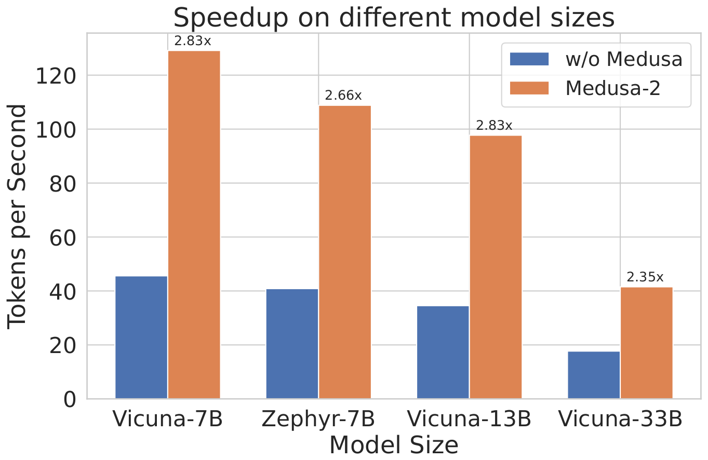

*图 8（原文 Figure 8，第 16 页）：Medusa-2 在各模型上的加速。Medusa-2 对所有模型都显著加速；经过自蒸馏训练的模型（Zephyr-7B、Vicuna-13B/33B）因为要在保持质量与提高速度之间权衡，加速较弱。*

**图中文字翻译与读法**：横轴是四个模型（Vicuna-7B、Zephyr-7B、Vicuna-13B、Vicuna-33B），纵轴 Tokens per Second；蓝色 w/o Medusa，橙色 Medusa-2，柱上标注加速比 2.83×、2.66×、2.83×、2.35×，与表 1 一致。整理者从矢量图反算的柱高（tokens/s，约）：Vicuna-7B 45.6 → 129.1；Zephyr-7B 40.9 → 108.8；Vicuna-13B 34.6 → 97.7；Vicuna-33B 17.7 → 41.5。（注意原文这张图的题注把 Vicuna-13B 也列为“自蒸馏”，但 3.1 节说 13B 用 ShareGPT 训练，二者不一致，应是题注笔误，未解决。）

**表 4：AlpacaEval 数据集上的加速结果**（附录 F；Medusa-2 在 AlpacaEval 上获得与 MT-Bench 类似的稳定加速）

| 模型 | 基线速度（tokens/s） | Medusa 速度（tokens/s） | 加速率（Acc. rate） | 加速比（Speedup） |
|---|---:|---:|---:|---:|
| Vicuna-7b | 37.07 | 106.76 | 3.23 | 2.88 |
| Vicuna-13b | 29.01 | 91.54 | 3.28 | 3.16 |
| Vicuna-33b | 17.87 | 40.43 | 2.85 | 2.26 |
| Zephyr-7b | 34.21 | 99.50 | 3.08 | 2.91 |

（原文表 4，第 16 页。）读法：加速比等于 Medusa 速度除以基线速度（$106.76/37.07=2.88$ 等，整理者核算一致）；同一模型在 AlpacaEval 上的基线速度（如 Vicuna-7b 的 37.07）比在 MT-Bench 上（约 45.6）低，这可能与数据集的输出长度分布等因素有关（整理者推测，论文未解释），不同数据集的绝对数不能直接比。

### 5.3 与推测解码的对照（图 7）

论文也在 Vicuna 系列上跑了推测解码（Chen 等、Leviathan 等）：因为这些方法的实现不公开，用了开源替代实现（LLMSpeculativeSampling），并对草稿模型用 `torch.compile()` 加速。草稿模型包括 Llama-68M 和 Llama-160M（Miao 等）、Tiny-Llama（Llama-1B）以及用 Vicuna 风格指令微调的 Tiny-Vicuna（Vicuna-1B）。

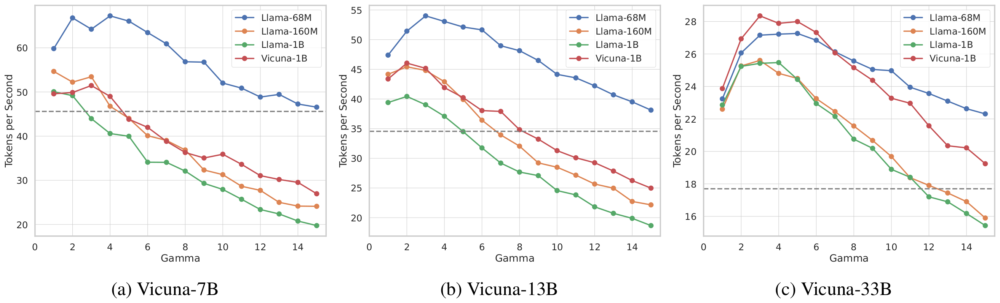

*图 7（原文 Figure 7，第 15 页）：在 MT-Bench 上用推测解码时各模型的推理速度。灰色虚线是基线模型的速度；$\gamma$ 是草稿 token 数。*

**图中文字翻译与读法**：三个子图依次是 (a) Vicuna-7B、(b) Vicuna-13B、(c) Vicuna-33B；横轴 Gamma（草稿 token 数 $\gamma$，1 到 15），纵轴 Tokens per Second；四条曲线是不同的草稿模型 Llama-68M、Llama-160M、Llama-1B、Vicuna-1B；灰色虚线是不用推测解码的基线速度（整理者读数：约 45.6、34.6、17.7 tokens/s）。

- **读图结论**：最优的草稿模型与 $\gamma$ 随目标模型大小而变——Vicuna-7B 上 Llama-68M 配 $\gamma=4$ 最好（约 67 tokens/s），Vicuna-13B 上同一个草稿模型配 $\gamma=3$ 最好（约 54 tokens/s），Vicuna-33B 上 Tiny-Vicuna（Vicuna-1B）配 $\gamma=3$ 加速最大（约 28 tokens/s）。论文据此说明草稿模型的选择与设置要随 LLM 大小调整。这三个最优点相对基线的比值约为 1.47、1.56、1.60，正是表 1 里的 $S_{\text{SpecDecoding}}$，而同样的模型上 Medusa-2 达到 2.83、2.83、2.35。

### 5.4 消融

#### 树注意力的配置（图 4、图 6）

在 MT-Bench 的 writing 与 roleplay 类别上，用 Medusa-2 的 Vicuna-7B 研究树注意力。

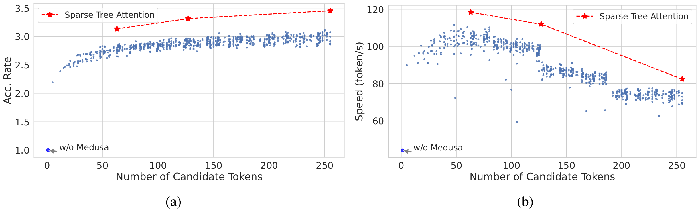

*图 4（原文 Figure 4，第 8 页）：解码时候选 token 数（由树引入）的影响（使用 KV cache 时默认候选 token 数为 1）。左：随机采样的稠密树（蓝点）和优化后的稀疏树（红星）的加速率；右：两种设置的速度（tokens/s）。趋势线说明：稀疏树的加速率保持相对稳定，但随候选 token 数增加速度明显下降。*

**图中文字翻译与读法**：

- **(a) 左图**：横轴 Number of Candidate Tokens（候选 token 数，0 到 250 多），纵轴 Acc. Rate（加速率）。蓝点是随机采样出的稠密树配置（规则的笛卡尔积树），红色虚线和星号 Sparse Tree Attention（稀疏树注意力）是 2.3.3 节优化后的稀疏树，左下角 “w/o Medusa” 是不用 Medusa 的基线（加速率 1.0）。
- **(b) 右图**：纵轴 Speed (token/s)（速度），其余相同；基线约 45 tokens/s。
- 整理者从矢量图读出稀疏树三个点（候选 token 数 63、127、255）：加速率约 3.1、3.3、3.4，速度约 117.5、111、82 tokens/s。
- **读图结论**：稀疏树**只用 64 个节点就比稠密树 256 个节点有更高的加速率**。稠密树的加速率随树变大按对数趋势增长、增长越来越慢（约从 2.4 涨到 3.0），而速度在 50–80 个候选 token 附近达到约 105–110 tokens/s 后就逐级下降，到 250 个时只有约 73 tokens/s：原因是计算开销增加，线性层和自注意力的矩阵乘变得密集，逐渐进入计算受限。如果加速率的增益小于开销，整体反而会变慢；但初始的收益很大，所以 Medusa 能取得显著加速。更多细节见附录 G（本文 5.5 节）。

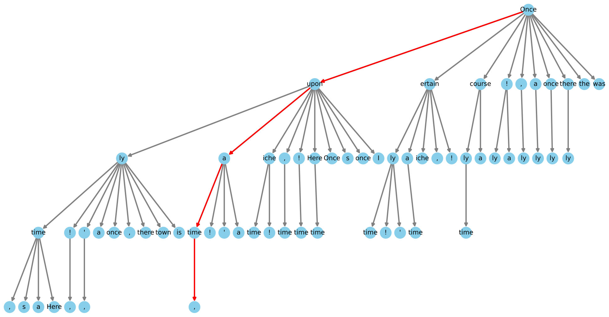

*图 6（原文 Figure 6，第 15 页）：Medusa-2 Vicuna-7B 的稀疏树设置可视化。树有 64 个表示候选 token 的节点，深度为 4，表示有 4 个 Medusa 头参与计算。每个节点是某个 Medusa 头 top-$k$ 预测里的一个 token，边表示它们的连接，红线标出正确预测了后续 token 的那条路径。*

**图中文字翻译与读法**：根节点是 `Once`；红色路径是 `Once → upon → a → time → ,`，即这一步一次预测对了 `Once upon a time ,`。树明显向左倾斜，反映算法偏爱每个头上概率更高的节点。这棵树最初由笛卡尔积形成，随后根据每个 Medusa 头 top-$k$ 预测在 Alpaca-eval 数据集上测得的统计期望做剪枝（附录 C）。整理者数得各层节点数依次为 1（根）、10、23、23、7，共 64 个。

#### 典型接受的阈值（图 5）

用 Medusa-2 的 Vicuna-7B 在 writing 与 roleplay 类别上研究典型接受的阈值。采用 Hewitt 等的做法（原文写作 $\alpha=\sqrt{\epsilon}$），阈值 $\epsilon$ 从 0.01 起以 0.01 为步长增加到 0.25。

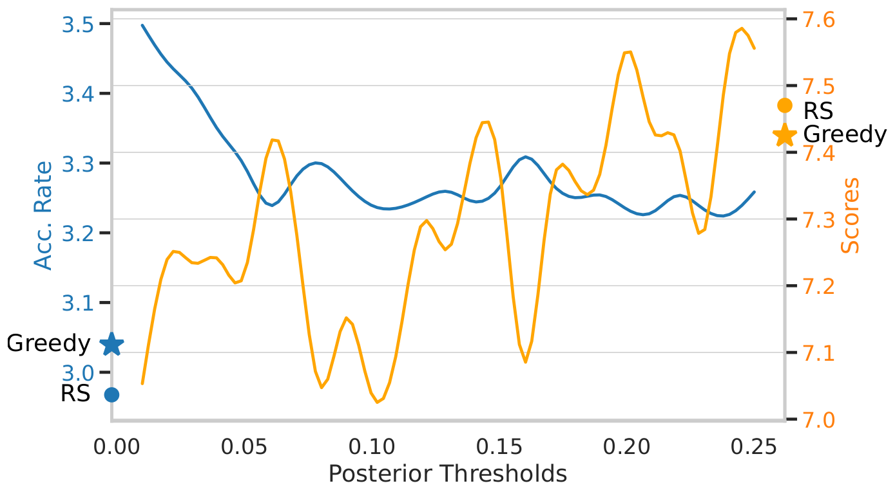

*图 5（原文 Figure 5，第 8 页）：用所提典型采样的 Medusa 的性能对比。模型是从 Vicuna-7B 全量微调得到的。图中是在 MT-Bench 的 writing 与 roleplay 类别上、固定温度 0.7 时的加速率和平均得分，对比三种设置：贪心采样与随机采样（RS，分别画成星与点）以及不同阈值下的典型采样曲线。*

**图中文字翻译与读法**：

- 横轴 Posterior Thresholds（后验阈值，即 $\epsilon$，0.00 到 0.25）；**左纵轴（蓝色）Acc. Rate（加速率）**，**右纵轴（橙色）Scores（MT-Bench 得分）**。蓝色曲线是典型接受的加速率，橙色曲线是它的得分；横轴 0 处的蓝色星/点是贪心（Greedy）与随机采样（RS）的加速率，右侧的橙色星/点是它们的得分。
- 整理者从矢量图读出：加速率从 $\epsilon=0.01$ 时的约 3.49 降到 $\epsilon\ge0.1$ 时的约 3.2–3.3；得分从 $\epsilon=0.01$ 时的约 7.05 升到 $\epsilon=0.2$–0.25 时的约 7.55；贪心的加速率约 3.04、得分约 7.42；随机采样的加速率约 2.96、得分约 7.46。
- **读图结论**：论文观察到明显的权衡：$\epsilon$ 增大，质量上升而加速率下降；对于需要创造性的任务，默认的随机采样优于贪心，而所提典型采样在 $\epsilon$ 增大时与随机采样相当。典型接受在所有阈值下的加速率（约 3.2–3.5）都高于贪心与随机采样（约 3.0）。整理者提醒：得分曲线上下抖动很大（约 7.0 到 7.6，且不单调），这个子集（writing、roleplay）样本少、GPT-4 评分有噪声，只能当作定性趋势。

#### 两阶段微调的有效性（表 2）

**表 2：Vicuna-7B 不同设置的对比**（质量是在 MT-Bench 上用 GPT-4 作评判得到的分数，越高越好）

| 项目 | 基线（Baseline） | 直接微调（Direct Fine-tuning） | Medusa-1 | Medusa-2 |
|---|---:|---:|---:|---:|
| 质量（Quality） | 6.17 | 5.925 | 6.23 | 6.18 |
| 加速比（Speedup） | N/A | N/A | 2.18 | 2.83 |

（原文表 2，第 9 页。）读法：只微调 Medusa 头的 Medusa-1 在不损害生成质量的情况下取得 2.18× 加速；用两阶段微调的 Medusa-2 保持了生成质量，并取得更大的 2.83× 加速；相反，**直接用 Medusa 头一起微调整个模型会使生成质量下降**（5.925，比基线低 0.245）。整理者提醒：6.17、6.23、6.18 的差别远小于 GPT-4 评分的噪声，只能解读为“没有明显变差”，而不能说 Medusa-1 比基线更好。

#### 各技术对速度的贡献（表 3）

**表 3：各项技术对加速比的影响**

| 技术 | 加速比（Speedup） |
|---|---:|
| 无树注意力的 Medusa-1 头 | ∼1.5× |
| 加上树注意力 | ∼1.9× |
| 使用优化的树配置 | ∼2.2× |
| 用 Medusa-2 训练头 | ∼2.8× |

（原文表 3，第 9 页。）读法：加速不是“多加几个头”这一个因素的贡献，而是提案（多头）、树覆盖（树注意力与优化的树）和训练一致性（Medusa-2）的逐级叠加。

### 5.5 硬件约束建模（附录 G）

附录 G 用 Llama 系列的简化模型分析显存带宽受限对 Medusa 式并行解码的影响，分三步：(1) 在多种 GPU（A100-80GB-PCIe、A40、A6000）上剖析各类算子的 FLOP/s 与**算术强度（Operational Intensity，FLOP/Byte）** 的关系（roofline 模型）；(2) 看用 Medusa 时各算子如何变化；(3) 用简单的解析模型算加速率，并与硬件测得的数据结合，预测不同模型大小、序列长度、batch 下的效果。

**G.1 算子的 roofline**：论文看了三类矩阵乘算子：产生 query/key/value 的线性层（`qkv mlp`）、注意力里的两个矩阵乘（`qk/pv`）、注意力后的 up/gate/down 线性层。

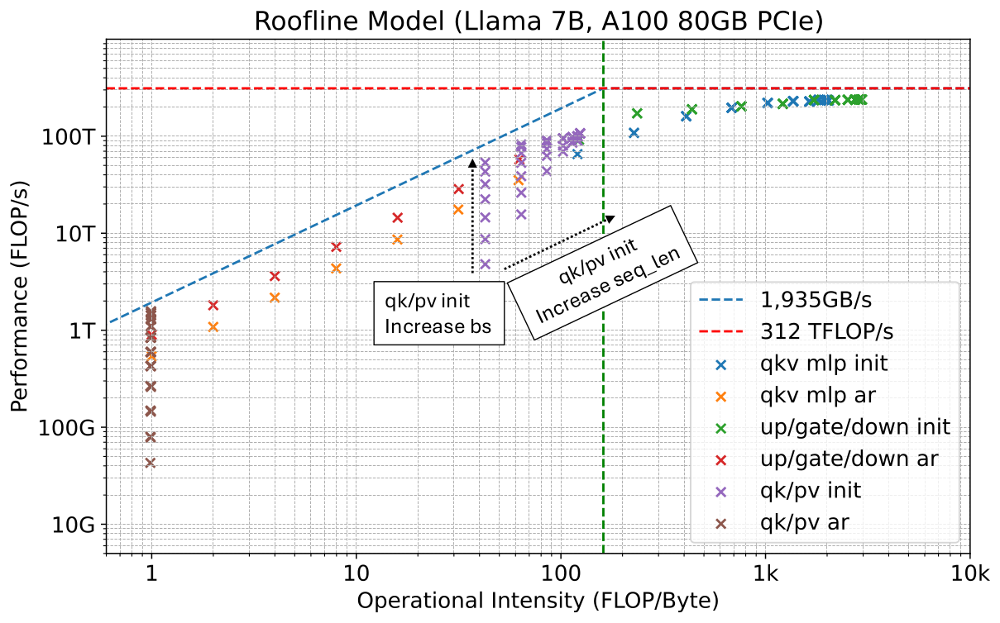

*图 9（原文 Figure 9，第 18 页）：Llama-7B 在 A100-80GB-PCIe 上所有基准测试数据点的 FLOP/s 与算术强度的关系。虚线是 HBM 带宽上限（1,935GB/s）和峰值性能上限（312 TFLOP/s）。`qkv mlp` 指把隐藏特征投影成 query/key/value 特征的线性层，`up/gate/down` 指注意力块之后的线性层，`qk/pv` 指注意力的两步矩阵乘，`ar` 表示解码（自回归），`init` 表示预填充（prefill）阶段。*

**图中文字翻译与读法**：横轴 Operational Intensity (FLOP/Byte)（算术强度，对数轴），纵轴 Performance (FLOP/s)（性能，对数轴）。蓝色斜虚线（1,935GB/s）是带宽屋顶，红色水平虚线（312 TFLOP/s）是算力屋顶，绿色竖虚线是两者交点（约 160 FLOP/Byte 处）。右上角的 `qkv mlp init`、`up/gate/down init`（预填充的线性层）贴着算力屋顶，是计算受限；左边的 `qkv mlp ar`、`up/gate/down ar`（解码的线性层）沿着带宽斜线排成一行，是显存带宽受限，增大 batch 能提高 FLOP/s 和算术强度；最左下角的 `qk/pv ar`（解码的注意力矩阵乘）算术强度几乎恒为 1 FLOP/Byte、FLOP/s 很低，说明解码阶段的自注意力资源利用很差。图中箭头标注：预填充时增大 batch 只抬高 FLOP/s、不改变算术强度，增大序列长度则同时改变两者。**读图结论**：解码阶段的线性层和注意力都远离算力屋顶，所以一次多算几个 token 几乎“免费”；这正是 Medusa 能加速的硬件基础。

**G.2 Medusa 如何改变 FLOP/s 与算术强度**（以 A100 上的 Llama-33B 为例；表 6–8 摘录）：

- **注意力矩阵乘**（batch 16、序列长度 1024）：候选 token 从 1 个增加到 64 个，FLOP/s 从 1.24 增到 54.8 TFLOP/s，算术强度从 0.99 增到 40.96 FLOP/Byte，也就是论文所说的**约 44 倍的 FLOP/s 和 41 倍的算术强度**（整理者核算 $54.8/1.24=44.2$、$40.96/0.99=41.4$）。batch 增大并不能在这种情形下提高算术强度（表 7）。
- **线性层（up/gate/down）**：解码阶段线性层只处理新 token，与序列长度无关，所以只改变 batch：随着 Medusa 的候选 token 数与 batch 一起增大，线性层从带宽受限区域转入计算受限区域。表 8 摘录（每格是 TFLOP/s 与算术强度）：

| batch size | 候选数 1 | 候选数 16 | 候选数 64 | 候选数 112 |
|---:|---:|---:|---:|---:|
| 1 | 1.26 与 1.0 | 19.95 与 15.95 | 76.57 与 63.17 | 128.64 与 109.47 |
| 8 | 10.06 与 7.99 | 145.72 与 124.71 | 221.11 与 463.14 | 227.8 与 756.36 |
| 64 | 76.57 与 63.17 | 225.19 与 845.59 | 246.16 与 2221.31 | 246.14 与 2893.91 |

（原文表 8 摘录，第 25 页。）读法：batch 1 时候选数增到 112 仍在上升（约 129 TFLOP/s，尚未触顶）；batch 8 时候选数到 48 就已接近平台（约 208–237 TFLOP/s 上下波动）；batch 64 时只要 16 个候选就到了约 225 TFLOP/s，随后基本持平在约 246 TFLOP/s（这是该 A100 实测能达到的上限，低于 312 的标称值）。平台之后再多算 token 就是线性增加延迟。

**G.3 预测 Medusa 的性能**：论文用一个简单的解析模型：从图 4a 的结果把加速率拟合成 $\text{acc rate}=0.477\log(\text{num candidate})$，再模拟简化后的 Llama-7B 一个块（依次处理 $XW_Q,XW_K,XW_V$、$QK^\top$、$PV$、$XW_u,XW_g,XW_d$）的延迟：batch 1、序列长度 1024，候选 token 按 2.1.2 节的树注意力并行处理，忽略验证与接受这类后处理的延迟（它们的开销很小）。整理者核对：原文的公式没写截距和对数底数；按图 21 的模拟数据，加速率约为 $1.07+0.477\ln(\text{候选数})$（自然对数），$n=64$ 时得 3.05。

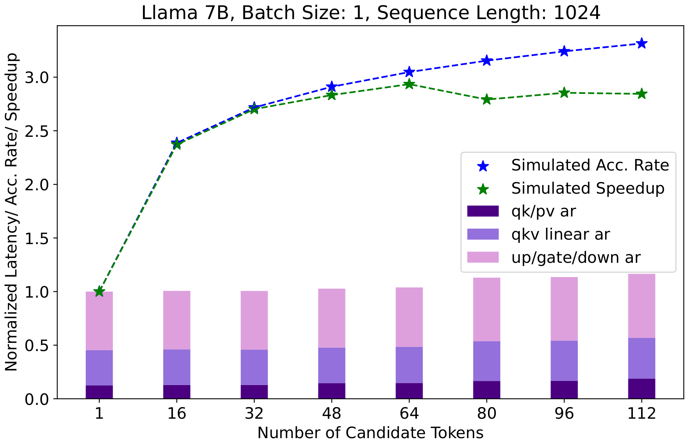

*图 21（原文 Figure 21，第 26 页）：在 batch size 1、序列长度 1024、A100 80GB PCIe 上的 Llama-7B，使用不同候选 token 数时的模拟加速率、加速比和归一化延迟。*

**图中文字翻译与读法**：标题 Llama 7B, Batch Size: 1, Sequence Length: 1024。横轴 Number of Candidate Tokens（候选 token 数：1、16、32、48、64、80、96、112），纵轴 Normalized Latency/ Acc. Rate/ Speedup（归一化延迟／加速率／加速比）。蓝色星号 Simulated Acc. Rate（模拟加速率）、绿色星号 Simulated Speedup（模拟加速比）；堆叠柱是归一化的每步延迟，三层从下到上是 `qk/pv ar`（注意力矩阵乘）、`qkv linear ar`（qkv 线性层）、`up/gate/down ar`（up/gate/down 线性层）。整理者从矢量图反算的数据：

| 候选 token 数 | 1 | 16 | 32 | 48 | 64 | 80 | 96 | 112 |
|---|---:|---:|---:|---:|---:|---:|---:|---:|
| 模拟加速率 | 1.00 | 2.39 | 2.72 | 2.91 | 3.05 | 3.15 | 3.24 | 3.32 |
| 归一化每步延迟 | 1.000 | 1.007 | 1.006 | 1.027 | 1.038 | 1.130 | 1.135 | 1.165 |
| 模拟加速比 | 1.00 | 2.37 | 2.70 | 2.83 | 2.94 | 2.79 | 2.85 | 2.84 |

**读图结论**：候选 token 数增加时加速率持续上升，而每步延迟在 64 个候选以内几乎不变（最多增加约 4%），所以加速比也随之上升；**超过 64 个候选后延迟上升（80 个时跳到 1.13），加速比开始回落**，说明存在一个最优的候选数范围，与图 4b 的实验结果吻合。（加速比 = 加速率 ÷ 归一化延迟，如 $3.05/1.038=2.94$。）

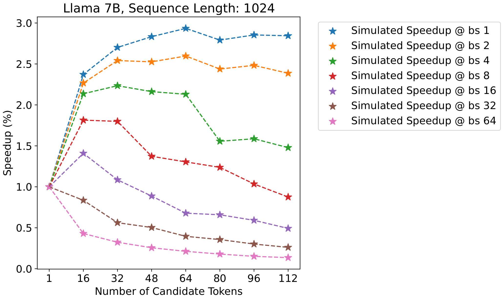

*图 22（原文 Figure 22，第 27 页）：序列长度 1024 时 Llama-7B 的模拟加速比（不同 batch size）。*

**图中文字翻译与读法**：横轴是候选 token 数（1 到 112），纵轴标成 Speedup (%)（实际数值是倍数，1.0 表示无加速）；七条曲线对应 batch size 1、2、4、8、16、32、64。整理者从矢量图反算的加速比如下：

| batch size | 候选 16 | 候选 32 | 候选 48 | 候选 64 | 候选 80 | 候选 96 | 候选 112 |
|---:|---:|---:|---:|---:|---:|---:|---:|
| 1 | 2.37 | 2.70 | 2.83 | 2.94 | 2.79 | 2.85 | 2.84 |
| 2 | 2.27 | 2.54 | 2.53 | 2.60 | 2.44 | 2.48 | 2.39 |
| 4 | 2.14 | 2.23 | 2.16 | 2.13 | 1.56 | 1.59 | 1.48 |
| 8 | 1.81 | 1.80 | 1.37 | 1.30 | 1.24 | 1.03 | 0.88 |
| 16 | 1.41 | 1.09 | 0.89 | 0.68 | 0.66 | 0.59 | 0.49 |
| 32 | 0.84 | 0.56 | 0.50 | 0.40 | 0.36 | 0.30 | 0.26 |
| 64 | 0.43 | 0.32 | 0.26 | 0.21 | 0.18 | 0.15 | 0.14 |

**读图结论**：batch 越大，Medusa 的收益越小，甚至为负：batch 1 时最高约 2.9×，batch 8 时最多约 1.8×，batch 16 时只有候选数不超过 32 才大于 1（约 1.4、1.1），到 48 个及以上就变慢；batch ≥ 32 时全面低于 1。论文的解释是线性层从显存带宽受限转为计算受限。这也说明论文把重点放在 batch size 为 1 的场景是有硬件依据的。

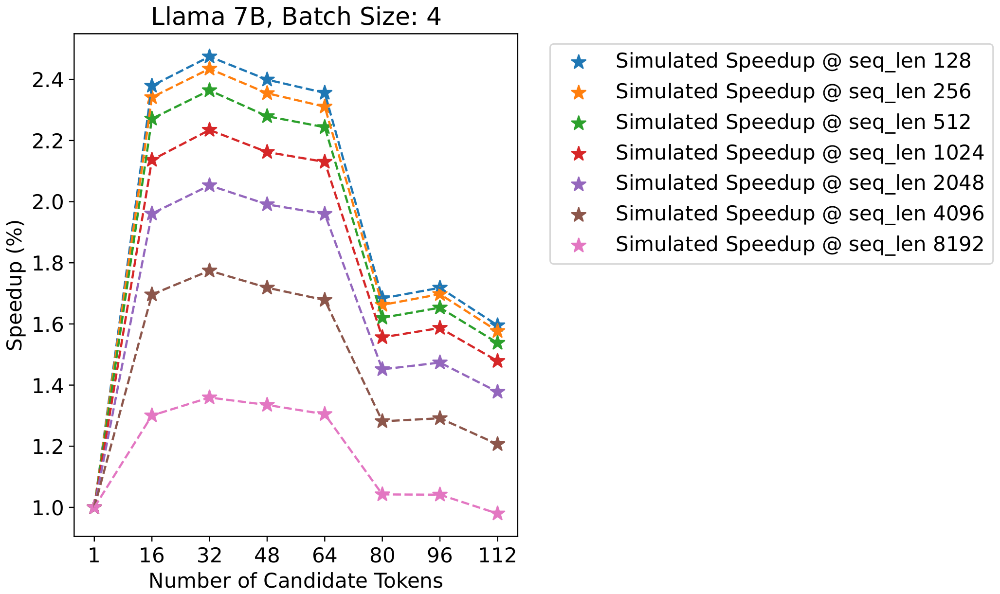

*图 23（原文 Figure 23，第 27 页）：batch size 为 4 时 Llama-7B 的模拟加速比（不同序列长度）。*

**图中文字翻译与读法**：横轴为候选 token 数，纵轴 Speedup (%)（实际是倍数），七条曲线对应序列长度 128、256、512、1024、2048、4096、8192。整理者从矢量图反算：候选 32 时，序列长度 128 为 2.47×、1024 为 2.23×、8192 为 1.36×；候选从 64 增到 80 时所有曲线都明显下跌（序列长度 128：2.36 → 1.68；8192：1.30 → 1.04）；序列长度 8192、候选 112 时降到 0.98×。**读图结论**：各序列长度下最优候选数相对一致（这里约为 32），但序列越长整体性能越低，主要是因为注意力矩阵乘的开销（线性层的计算与序列长度无关）。论文总结：最优的候选数是 Medusa 扩展模型规模的关键；batch 增大先带来并行收益，过大又会使线性层变成计算受限；序列更长会增加注意力开销，需要优化注意力机制。

## 六、局限、证据边界与常见误读

**论文自己的说明**：Medusa 在本文中以 batch size 1 为主；论文强调思路可以推广到更大 batch，并指出 TensorRT 和 Huggingface TGI 等库在此论文之后已支持更大 batch 的设置。论文还提到 Medusa 可能降低能耗与成本，并讨论了偏见与公平、可解释性、被滥用于大规模生成虚假信息等伦理问题（影响声明）。

**证据边界（整理者归纳）**：

- **主结果的接受方案没有逐项说明**：图 3、表 1、表 2 的速度和质量用的是拒绝采样、典型接受还是贪心、温度与阈值各取多少，论文正文没有给出；只有典型接受的阈值研究（图 5：温度 0.7，$\epsilon$ 从 0.01 到 0.25）才交代了设置。因此“Medusa-1 无损”只在配合精确拒绝采样（或贪心）时成立，主表没有单独验证它；论文也没有说明 top-$s_k$ 笛卡尔积（确定性）候选与拒绝采样怎样配合。
- **Medusa-2 修改了骨干**：它的“质量保持”来自 MT-Bench 等基准的实证，不是分布不变的数学结论；MT-Bench 用 GPT-4 评分，6.17/6.23/6.18 这样的差别在评分噪声内，没有置信区间。安全、对齐行为、通用能力等维度没有被测。
- **自蒸馏模型的加速更弱**：Vicuna-33B 的加速只有 2.35×（表 1），论文只给出“数据集不匹配”的假设，没有对照实验。
- **与推测解码的比较有局限**：推测解码一侧用的是开源替代实现，草稿模型只试了几种现成小模型（附录 D），没有为这些目标模型专门训练草稿。
- **batch 与序列长度**：实验以 batch size 1 为主；附录 G 的模拟显示 batch 增大会使收益消失，但那是解析模型加简化块的模拟，不是端到端实测。
- **数据集差异**：同一模型在 AlpacaEval 与 MT-Bench 上的基线速度和加速比不同（表 4 对图 3），不能跨数据集比较。

**常见误读**：

- 不要把 Medusa-1 与 Medusa-2 混为一谈：Medusa-1 冻结骨干、用精确拒绝采样时输出分布不变；Medusa-2 改了骨干，典型接受也不再严格保持分布。
- “2.3–3.6×”是错误引用：论文整体报告的 Medusa-2 加速是 2.3–2.8×，3.62× 只是 Vicuna-7B 在 Extraction 一个类别上的最大值（图 3b）。
- Medusa **不是**“免费”的：每步比原模型慢约 18%–27%（表 1 的开销），换来每步 3.0–3.5 个 token；树越大，每步越慢（图 4b、图 21）。
- Medusa 头不是自回归的：每个头只看同一个 $h_t$，彼此之间没有条件依赖，树验证只能纠正、不能消除这种误差。

## 七、复现检查清单

- 先明确是 Medusa-1 还是 Medusa-2，以及接受方案（精确拒绝采样、贪心还是典型接受，对应的温度与 $\epsilon,\delta$）。
- 报告头数、每头的 top-$s_k$、树的节点总数（或稀疏树的构造方法与校准数据集）、平均接受长度（加速率）、每步开销和最终加速比。
- 基线与方法要用相同的目标模型检查点、batch size、温度和 kernel；论文的基线是 HuggingFace 默认实现，换成更强的推理框架，倍数会变。
- 除平均速度外，报告验证延迟、头的开销、P99 与吞吐；用不同 batch 与序列长度扫描候选数，找到最优的树大小（图 21–23 的现象应能复现）。
- Medusa-2 要做通用能力、安全和域外回归，不只做 MT-Bench；自蒸馏要记录种子数据、生成温度、数据量与过滤方法，避免把老师输出当真实标签。
- 训练要点：5 个头、$\lambda_k=0.8^k$、头学习率为骨干的 4 倍、$\lambda_0$ 的取值（普通情形 0.2，自蒸馏 0.01）、LoRA 秩 32。

## 八、与相关论文的关系

- [Speculative Decoding](../speculative_decoding/论文中文解读.md) 与 [Speculative Sampling](../speculative_sampling/论文中文解读.md) 提出推测解码和拒绝采样校正；Medusa 保留“生成候选—验证—接受”的框架，但用目标模型自己的头代替独立草稿模型。
- [SpecInfer](../specinfer/论文中文解读.md) 与 Spector 和 Ré 同期提出树式注意力，它们**自底向上**：把草稿模型产生的多条候选合并成树；Medusa 则**自顶向下**：按各头 top-$s_k$ 的结构直接构造静态稀疏树，不需要自回归地产生草稿。
- [EAGLE](../eagle_speculative/论文中文解读.md) 指出 Medusa 的各个头只看同一个特征、彼此独立地预测未来 token，存在“采样不确定性”（同一个特征之后接哪个 token 是随机的）；它还称 Medusa 的草稿准确率约 0.6（该数字在 EAGLE 论文里没有给出出处），所以改用自回归的特征级草稿，并把前移一位的已采样 token 一起输入。[EAGLE-2](../eagle_2/论文中文解读.md) 指出 Medusa 与 EAGLE 都用静态草稿树（每一步加几个候选事先固定），并按草稿模型的置信度动态调整草稿树；它还说 Medusa 在非贪心设置下放宽接受条件，不保证无损。

## 原文证据导航

- 图 1、第 2 节：生成候选、处理候选、接受候选的流程；2.1 节：Medusa 头与树注意力（图 2）
- 第 2.2 节：Medusa-1 与 Medusa-2（式 (1)、(2)）；2.3 节：典型接受、自蒸馏、优化树构造
- 第 3 节：图 3、表 1、图 4、图 5、表 2、表 3
- 附录 B：实验设置；附录 C：优化树可视化（图 6）；附录 D：推测解码结果（图 7）；附录 E、F：图 8、表 4；附录 G：硬件建模（图 9、表 6–8、图 21–23）
- [原论文 PDF](paper.pdf)
- [原文提取文本](paper.txt)
- [论文概要](论文概要.md)
