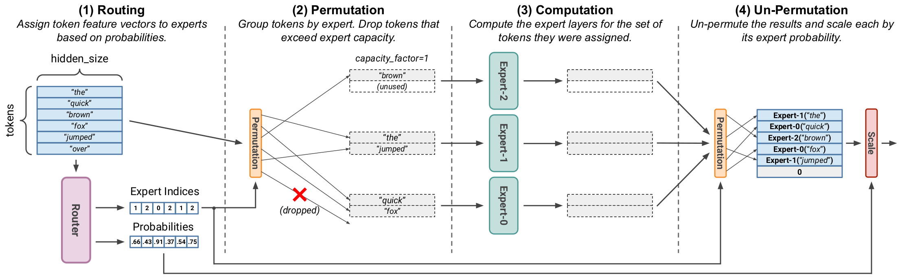
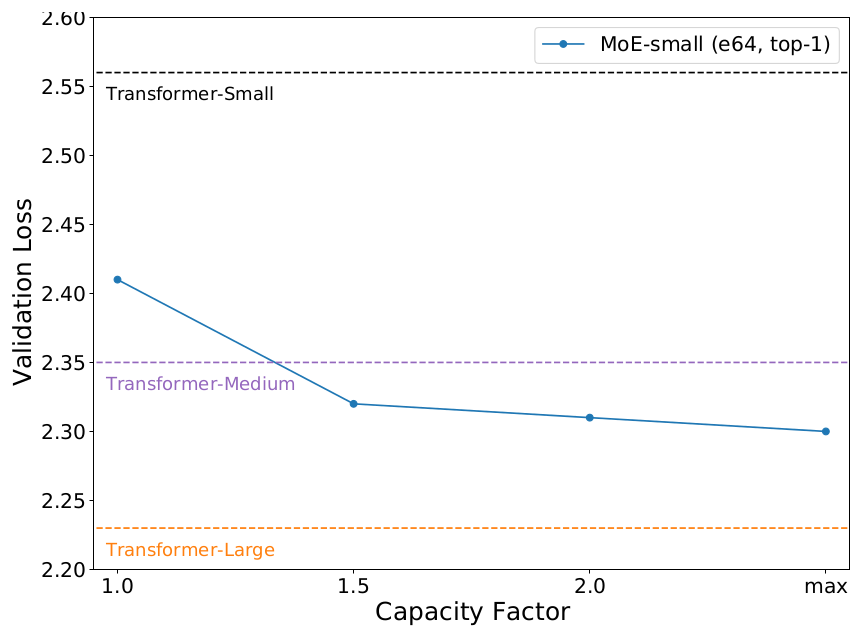
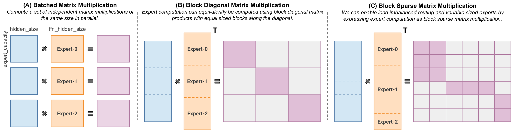
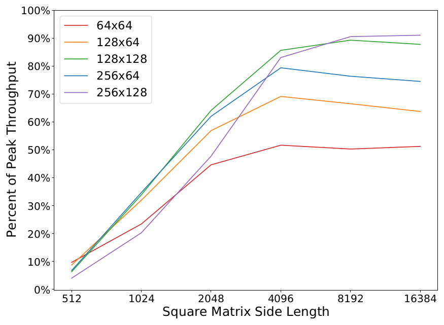
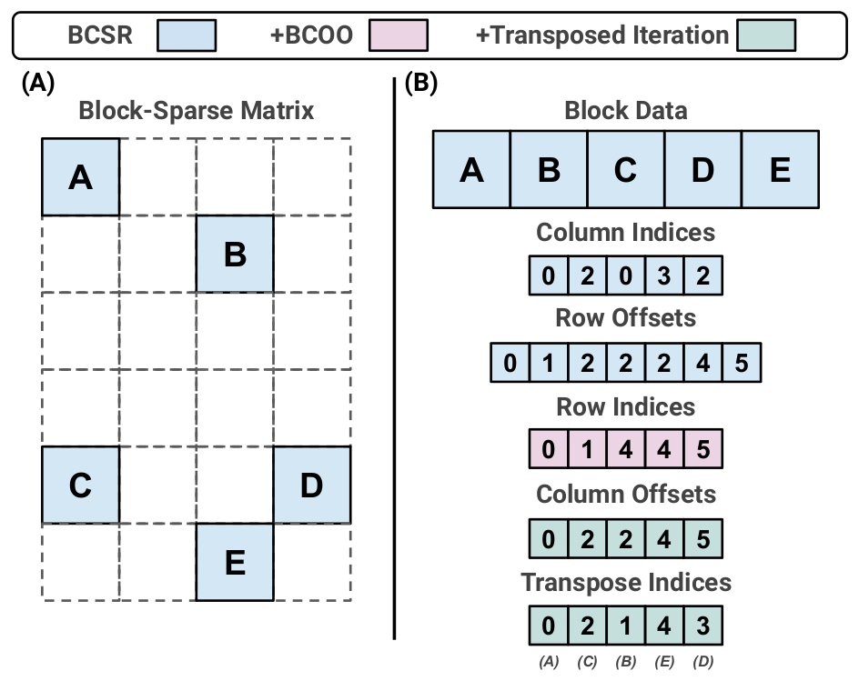
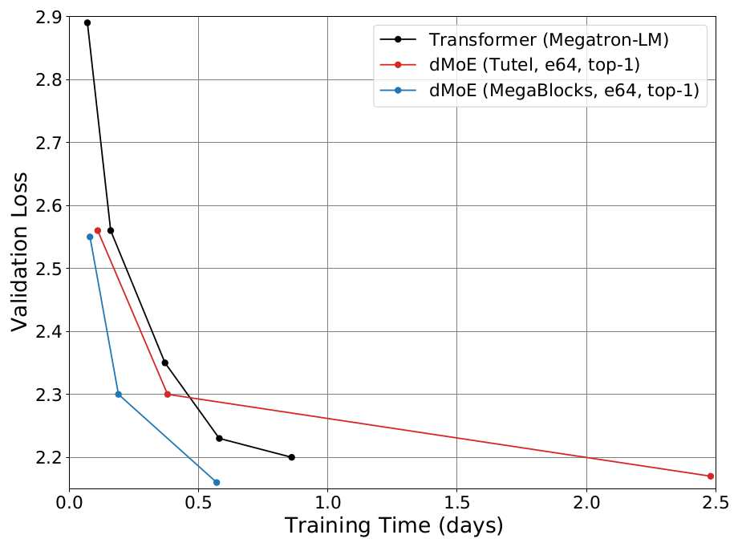
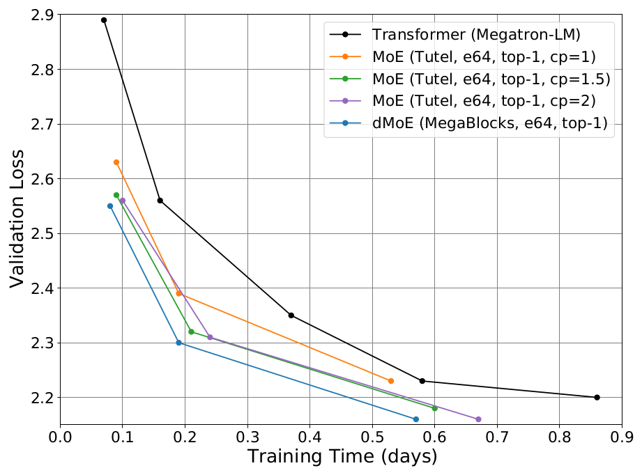
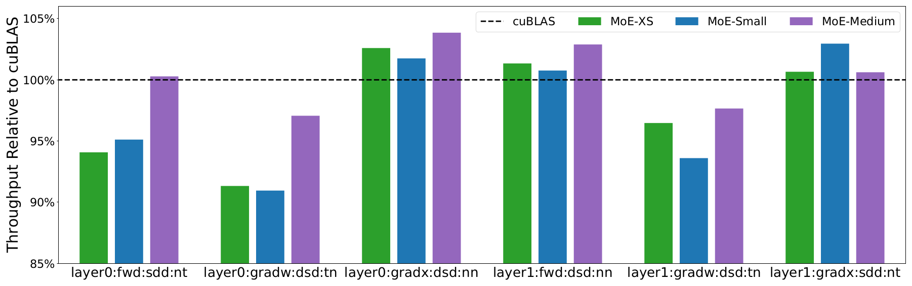
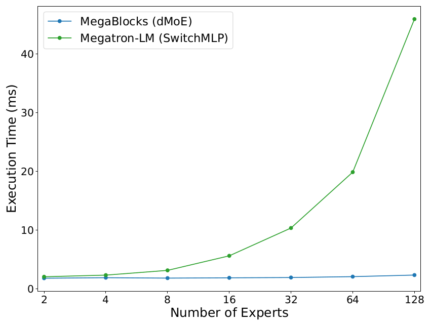
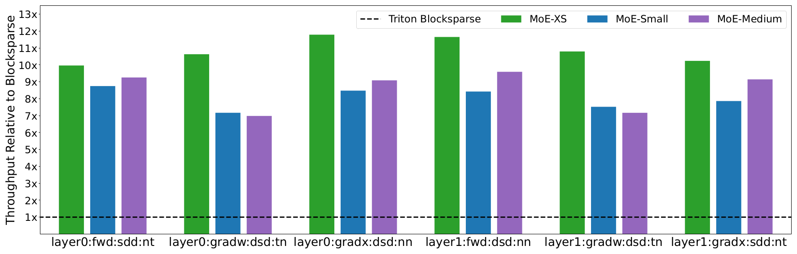

# 论文中文解读：《MegaBlocks: Efficient Sparse Training with Mixture-of-Experts》

> **基本信息**：Trevor Gale（Stanford）、Deepak Narayanan（Microsoft Research）、Cliff Young（Google Research）、Matei Zaharia（Stanford），Proceedings of the 6th MLSys Conference，Miami Beach, FL, USA，2023；论文原文 [官方页面](https://proceedings.mlsys.org/paper_files/paper/2023/hash/5a54f79333768effe7e8927bcccffe40-Abstract-mlsys2023.html)；开源代码 [github.com/stanford-futuredata/megablocks](https://github.com/stanford-futuredata/megablocks)（Apache-2.0）。
>
> **本文的读法**：图均为从论文 PDF 中按图裁出的原图，表为逐格核对后的中文转录（数字与原文一致，表头和行名译成中文，模型名保持原样）；论文中的伪代码（图 4、图 11、图 12）逐行转录成代码块并翻译注释。每张图后有中文图题、图例与坐标轴翻译和读图结论；“约”表示从图上读出的近似值，正文给出的数字优先使用原文数字。凡是笔者自己推导、举的例子或发现的原文不一致之处，都会明确标注。

## 一、一句话结论

MoE（Mixture of Experts，专家混合）层里，每个 token 被路由到少数几个专家，各专家分到的 token 数天然不相等。而 GPU/TPU 上的主力原语 batched matmul（批量矩阵乘）要求每个矩阵形状相同，所以现有框架（如 Tutel、Switch Transformer 的实现）给每个专家设一个固定容量：超出的 token 被丢弃，不足的用 padding 补齐，用户只能在“丢 token（损害模型质量）”和“为 padding 浪费计算与显存”之间权衡。

MegaBlocks 的做法：把一层里所有专家的计算重写成一次**块稀疏（block-sparse）矩阵乘**：按专家分组后的 token 矩阵乘以所有专家权重拼成的大矩阵，输出是一个“块对角、每个对角块的行数可以不同”的稀疏矩阵，用 128×128 的小块去拼，因此专家分到多少 token 都能算，不丢 token，padding 只补到 128 的倍数。为此作者写了专门的 GPU kernel（SDD、DSD、DDS），并提出两个关键技术：**blocked-CSR-COO 混合编码**（让稀疏输出的 SDD 能并行定位输出块）与**转置索引 transpose indices**（不拷贝数值就能按转置顺序遍历稀疏矩阵，用于反向传播）。

主要结果（The Pile，8 张 A100，64 个专家、top-1 路由）：

- 相对 Tutel 的“动态容量因子 + padding”无丢 token 方案，MoE-XS / Small / Medium 的端到端训练分别加速 1.38×、2.0×、4.35×；
- 相对为 Tutel 调好容量因子的“丢 token”MoE，达到同样验证损失的训练时间减少 1.38×、1.37×、1.18×（摘要里的“最高 40%”与这一组的最大值 1.38× 对应，这是笔者按数字的对应，摘要没有明说）；
- 相对用 Megatron-LM 训练的稠密 Transformer，达到同样验证损失快 1.8×–2.4×；
- 核心块稀疏 kernel 在训练形状上平均达到 cuBLAS batched matmul 吞吐的 98.6%。

## 二、背景：MoE 层怎么算

### 2.1 MoE 层与路由

MoE 层由许多专家组成，专家本身是小型神经网络，通常是小的多层感知机（MLP）。每个 token 根据路由器（router）算出的分数被动态路由到专家的一个子集，通常是 1 到 4 个（Fedus 等人 2022）。在 Transformer 里，MoE 层最常用来取代前馈网络（FFN）层，注意力层保持不变。这种混合架构在自然语言和视觉任务上都有很强的结果；一般猜测其收益来自专家专门化处理数据分布的不同部分（Shazeer 等人 2017）。

最常见的路由器是 Shazeer 等人（2017）的可学习路由器：用一个与模型参数一起学习的权重矩阵把 token 从 `hidden_size` 维投影到 `num_experts` 个分数，用 softmax 归一化，再贪心地为每个 token 选分数最高的 `top_k` 个专家。路由器除专家分配外，还为每次分配产生反映分配置信度的概率，编码成每个 token-专家对的分数矩阵，用来线性组合每个 token 的 `top_k` 个专家输出。

### 2.2 四个步骤（图 1）



*图 1（原文 Figure 1，第 2 页）：一个 MoE 层，示意 `num_experts=3`、`top_k=1`、`capacity_factor=1`，采用主流的丢 token 方案。第一步（1），路由器把 token 映射到专家，同时给出反映分配置信度的概率；第二步（2），特征向量被重排以按专家分配分组；如果分给某专家的 token 数超过其容量，多出的 token 被丢弃；第三步（3），对各专家被分到的 token 以及为填满未用容量所需的任何 padding 计算专家层；最后（4），专家计算的结果被还原顺序并按路由概率加权。被丢弃 token 的输出在这里记为零。*

**图中文字翻译与读法**：

- 图自左向右四栏：（1）Routing（路由）：Assign token feature vectors to experts based on probabilities（按概率把 token 特征向量分配给专家）；（2）Permutation（重排）：Group tokens by expert. Drop tokens that exceed expert capacity（按专家分组，丢弃超出专家容量的 token）；（3）Computation（计算）：Compute the expert layers for the set of tokens they were assigned（对分配给各专家的 token 计算专家层）；（4）Un-Permutation（还原顺序）：Un-permute the results and scale each by its expert probability（还原顺序并乘以各自的专家概率）。
- **例子**：6 个 token “the、quick、brown、fox、jumped、over”（每个是 `hidden_size` 维向量）。路由器给出 Expert Indices（专家编号）`1 2 0 2 1 2` 与 Probabilities（概率）`.66 .43 .91 .37 .54 .75`。`capacity_factor=1`，容量 $=6/3\times1=2$。
- **重排**：编号 1 的组是 “the”“jumped”；编号 0 的组只有 “brown”，另一个槽位标为 “(unused)”，要补 padding；编号 2 的组有 “quick”“fox”“over” 三个 token，超过容量 2，最后一个 “over” 被丢弃（红叉与 “(dropped)”）。
- **计算与还原**：三个专家各自处理 2 个槽位（含 padding 槽位）；还原顺序后，被丢弃的 “over” 对应输出为 `0`，其余各行乘以自己的概率。
- **笔者注**：图中第三、四栏的专家标号（上方 Expert-2、下方 Expert-0）与路由器给出的编号行（“brown” 是 0、“quick”“fox” 是 2）在 0 与 2 上对调了；这只是图内标号不一致，不影响含义（按组理解即可）。
- **读图结论**：在这套流程里，“不丢 token”只能靠加大容量（更多 padding），“少算 padding”只能靠减小容量（丢更多 token），二者无法兼得。

### 2.3 为什么必须有固定容量

State-of-the-art 的 MoE 实现并行计算所有专家层，以充分利用 GPU/TPU 的并行度；标准原语是**批量矩阵乘**（batched matmul）：一次计算一组形状相同的矩阵乘积（图 3A）。要映射到它，专家的权重矩阵必须形状相同，且分给每个专家的 token 数必须相等。后者尤其麻烦：学习得到的路由算法不保证负载均衡。为满足该约束，已有工作定义了**固定的专家容量**（Lepikhin 等人 2020；Fedus 等人 2022）：每个专家最多被分配的 token 数，超出的 token 被丢弃，即不传给任何专家计算，模型依靠残差连接在 MoE 层之后重新引入被丢弃 token 的表示。如果某专家没分到足够 token 填满容量，就补 padding。容量通常用超参数**容量因子**（capacity factor）指定，它是在“完全均匀分布时每个专家应得 token 数”上的乘数：

$$
\text{expert\_capacity}=\frac{\text{num\_tokens}}{\text{num\_experts}}\times\text{capacity\_factor}
$$

容量因子可以理解为降低丢 token 概率的参数，代表额外计算与模型质量之间的权衡。因此要尽量减少 token 在专家间分配的不均衡（第三节）。常见办法是辅助负载均衡损失（Shazeer 等人 2017；Lepikhin 等人 2020；Fedus 等人 2022），它们激励路由器产生均衡的分配，也帮助保证所有专家在训练中看到相近数量的 token；这被认为对避免退化状态很重要，退化状态指某些专家一个 token 也没分到、因而不再接收梯度更新（Zhou 等人 2022）。除了让专家层可以批量计算，这些约束还使所有张量形状都能静态已知，这正是 TPU 与 XLA 所要求的。

另外两步：**计算**（computation）：重排之后，专家可以并行计算。专家是 MLP 时，就是用批量矩阵乘对所有专家一起计算每一层；卷积专家则可以用分组卷积。**还原顺序**（un-permutation）：专家算完后，把结果特征向量还原成与层输入相同的顺序；最后一步是把输出 token 乘以它们被分给各专家时的分数；如果 token 被路由到不止一个专家，这些加权结果要相加，作为每个 token 的最终层输出。

### 2.4 术语速查

| 术语 | 含义 |
|---|---|
| token 丢弃（token dropping） | 分给某专家的 token 超过其容量时，多出的 token 不经过任何专家，MoE 层对它的输出为 0，只靠残差连接前进 |
| padding | 专家分到的 token 少于容量时补零行，补出的行也要参与矩阵乘，白白消耗计算和显存 |
| dMoE（dropless MoE） | 不丢 token 的 MoE。Tutel 的做法是把容量因子动态设为刚好不丢 token 的最小值；MegaBlocks 的做法是块稀疏计算 |
| SDD / DSD / DDS | 三字符记号，依次是输出、左输入、右输入，S 为稀疏、D 为稠密；上标 T 表示该输入转置。如 SDD 是两个稠密输入、稀疏输出的乘积，也称 SDDMM（sampled dense-dense matmul） |
| tile / threadblock | GPU 矩阵乘把输出矩阵切成固定大小的二维小块（tile），一组线程（threadblock）负责一个 tile |
| BCSR / BCOO | 分块压缩稀疏行（blocked compressed sparse row）/ 分块坐标格式（blocked coordinate format）；“块”指 128×128 的非零数据块 |
| micro_batch_size | 微批大小：每次前向、反向处理的序列数（按 Megatron-LM 的惯例是每个数据并行副本一次处理的序列数，论文未单独定义）；通过梯度累积凑成全局 512 个序列 |

## 三、动机：token 丢弃有多伤质量（图 2）

尽管用了负载均衡损失，已有工作表明 token 路由仍然高度不均衡（Hwang 等人 2022）。为量化 token 丢弃对模型质量的影响，论文在 The Pile（Gao 等人 2020）上用一系列容量因子训练 MoE 语言模型。

**设置**：模型类似 Fedus 等人（2022）的 Transformer MoE：每个 FFN 层换成 64 个专家的 MoE 层，每个专家是与原 FFN 维度相同的 2 层 MLP；使用 top-1 路由；模型维度基于表 1 的 Transformer-Small。所有模型用 GPT-2 的分词，训练 10B token，序列长度 1024，Adam 优化器，学习率与梯度裁剪设置取自 Shoeybi 等人（2019），在单张 A100 上以 512 个序列的 batch 训练。训练了容量因子 1、1.5、2 的 MoE，以及 Tutel（Hwang 等人 2022）提出的动态容量因子技术（容量因子被动态设为刚好避免丢 token 的最小值，图中记为 “max”）。基线是一系列大小的标准 Transformer。所有 Transformer 与 MoE 的词表大小 51200、序列长度 1024、注意力 head 维度 64。



*图 2（原文 Figure 2，第 3 页）：在 The Pile 上用不同容量因子训练的 MoE。MoE 模型达到的损失随专家容量增大而显著下降，但代价是额外的计算。最低损失来自 “max” 容量因子模型，它通过 Hwang 等人（2022）提出的动态容量因子机制避免丢 token。*

**图中文字翻译与读法**：

- 横轴 Capacity Factor（容量因子：1.0、1.5、2.0、max），纵轴 Validation Loss（验证损失，越低越好，约 2.20 到 2.60）。蓝色折线是 MoE-small（e64，top-1，即 64 个专家、每 token 选 1 个）；三条虚线是稠密基线：Transformer-Small（黑，约 2.56）、Transformer-Medium（紫，约 2.35）、Transformer-Large（橙，约 2.23）。
- 折线上的点（图上读出的近似值）：容量因子 1.0 约 2.41，1.5 约 2.32，2.0 约 2.31，max 约 2.30。
- **读图结论**：容量因子 1 的 MoE 比 Transformer-Small 的验证损失低 0.15；避免丢 token 的 MoE 低 0.26，是前者增益的 1.73 倍，足以超过 Transformer-Medium 的质量（原文数字）。丢 token 明显伤害质量。

另一方面，加大容量因子是用额外计算与显存换质量：在这个例子里，为避免丢 token，MoE 层的数学运算量增加了 2 倍以上。Hwang 等人（2022）显示有些 MoE 需要高达 11 的容量因子才不丢 token，而且避免丢 token 所需的容量因子在训练中会不可预测地飙升。除计算开销外，多调一个超参数会显著增加针对一个目标任务需要训练的模型数量，对大型网络尤其麻烦：训练一个模型的成本可高达数十万美元（MosaicML 2022）。可能因此，一些大型 MoE 研究干脆没有探索不同的容量因子（Artetxe 等人 2021；Clark 等人 2022）。

## 四、方法：用块稀疏表达专家计算

本节的名字 “No-Token-Left-Behind with Block Sparsity” 借用了 Fedus 等人（2022）简要讨论过的 No-Token-Left-Behind 技术（把溢出 token 重新路由到次优专家，是一次试图找回丢 token 损失的质量、但没有成功的尝试，见 [Switch Transformer](../switch_transformers/论文中文解读.md) 附录 B）；MegaBlocks 的思路不同：不改路由，而让计算接受不均衡的分配。

用块稀疏原语表达 MoE 计算有四点动机：（1）块稀疏矩阵是描述 MoE 里动态、负载不均计算的自然而灵活的方式；（2）块稀疏能高效映射到基于脉动阵列矩阵乘法器的加速器（GPU、TPU）；MoE 专家的粒度很粗，因此可以选一个足够大的块大小，使计算达到设备峰值吞吐的高比例；（3）块稀疏的矩阵乘与卷积是通用原语，在很多应用中有用，因此对高性能 kernel 的投入可以摊销到其他任务（而专门针对可变大小批量矩阵乘的 kernel 只能用于今天设计的 MoE 架构）；（4）块稀疏形式让人把 MoE 看成一种动态、结构化的激活稀疏，可以借鉴稀疏训练文献中的经验。

### 4.1 把批量矩阵乘改写成块稀疏矩阵乘（图 3）



*图 3（原文 Figure 3，第 4 页）：MoE 层里的专家计算，示意 3 个专家。（A）主流 MoE 实现用批量矩阵乘并行计算一层里的所有专家；这带来约束：所有专家被分到相同数量的 token，且所有专家形状相同。（B）专家计算可以类似地表示为块对角矩阵乘，对角线上是大小相同的块。（C）为放宽这些约束，可以构造一个由许多更小的块组成、各对角块大小可变的块对角矩阵，并用块稀疏矩阵乘高效计算它。*

**图中文字翻译与读法**：

- **(A) Batched Matrix Multiplication（批量矩阵乘）**：Compute a set of independent matrix multiplications of the same size in parallel（并行计算一组大小相同的独立矩阵乘）。三个浅蓝色块是三个专家各自的输入（`expert_capacity` 行、`hidden_size` 列），分别乘以橙色的专家权重 Expert-0/1/2（`hidden_size` × `ffn_hidden_size`），得到三个大小相同的输出（粉色）。每个专家的行数（容量）必须相同。
- **(B) Block Diagonal Matrix Multiplication（块对角矩阵乘）**：Expert computation can equivalently be computed using block diagonal matrix products with equal sized blocks along the diagonal（专家计算等价于对角线上块大小相同的块对角矩阵乘积）。浅蓝色输入是一个把三个专家的 token 竖向堆叠起来的高矩阵（虚线分隔），右乘三个专家权重竖向堆叠（橙色，上方的 T 表示以转置形式参与乘法）；输出是一个 3×3 的块网格，只有对角线上的三个块（深粉色）有非零，灰色块不需要计算。这就是一个**稀疏输出**的乘法，即 SDD。
- **(C) Block Sparse Matrix Multiplication（块稀疏矩阵乘）**：We can enable load imbalanced routing and variable sized experts by expressing expert computation as block sparse matrix multiplication（把专家计算表达成块稀疏矩阵乘，就能支持负载不均的路由和可变大小的专家）。输入被虚线划成大小不等的三段（对应三个专家被分到的 token 数不同），输出网格由许多小块组成，三个专家对应的深粉色区域形状各不相同（行数、列数都可以不同）。
- **读图结论**：关键洞察是：不用批量矩阵乘，而是把各专家计算等价地写成输出为块对角结构的 SDD 乘积；允许负载不均衡的分配，就等价于允许块对角矩阵里的各个块有不同的行数。为此，把每个大块拆成许多更小的、大小固定的块，用块稀疏矩阵乘来算。要构造多层专家，就在 SDD 与 DSD 之间迭代（见图 4）。论文还指出，同样可以放宽每个块的列数限制，构造大小可变的专家（图 3C 的列数也不同），但这是有趣的未来方向，论文没有探索。

**为什么块可以取得这么大**：粗粒度的稀疏性正适合这一要求。在使用 MoE FFN 层的 Transformer 里，图 3B 中块的列数对应 `ffn_hidden_size`，通常在 1024 到 8192 之间（Vaswani 等人 2017；Radford 等人 2019；Brown 等人 2020）；块的行数对应分给每个专家的 token 数，均匀分布下等于 token 总数除以专家数，范围可从几千到几万个 token（Lepikhin 等人 2020；Artetxe 等人 2021；Fedus 等人 2022）。这些粗粒度的块比稠密矩阵乘 kernel 使用的最大 tile 维度还要大很多倍，所以可以任选一个能匹配稠密 kernel 吞吐的块大小。有了足够大的块，块稀疏矩阵乘能在现代 GPU 上达到峰值吞吐的高比例。

### 4.2 数学写法与六个块稀疏乘积（笔者按论文文字整理）

设专家数为 $E$，隐层大小 $d=$ `hidden_size`，专家 FFN 宽度 $f=$ `ffn_hidden_size`，专家 $e$ 分到的 token 数为 $n_e$（$\sum_e n_e$ 为总 token 数），补到 128 的倍数后为 $\tilde n_e=128\lceil n_e/128\rceil$，$\tilde N=\sum_e\tilde n_e$。把 token 按专家分组并补零后得到 $X\in\mathbb{R}^{\tilde N\times d}$（第 $e$ 组为 $X^{(e)}\in\mathbb{R}^{\tilde n_e\times d}$）。把所有专家第一层权重横向拼接、第二层权重纵向拼接：

$$
W_1=\big[W_1^{(1)}\ \cdots\ W_1^{(E)}\big]\in\mathbb{R}^{d\times Ef},\qquad
W_2=\begin{bmatrix}W_2^{(1)}\\ \vdots\\ W_2^{(E)}\end{bmatrix}\in\mathbb{R}^{Ef\times d}
$$

这里 $Ef$ 就是图 4 伪代码里的 `inner_dim = ffn_hidden_size * num_experts`。前向传播：

$$
H=\operatorname{SDD}(X,W_1,\mathcal{T}),\qquad Y=\operatorname{DSD}(H,W_2)
$$

其中拓扑 $\mathcal{T}$ 规定 $H$ 的哪些 128×128 块非零：第 $e$ 组的块行与第 $e$ 组的块列相交处非零，其余全零。所以 $H$ 的第 $e$ 个对角块就是 $H^{(e)}=X^{(e)}W_1^{(e)}$，即专家 $e$ 的第一层；DSD 里 $H$ 是块对角的，每个输出行只会与自己专家那一段 $W_2^{(e)}$ 相乘，得到 $Y^{(e)}=H^{(e)}W_2^{(e)}$（两层之间逐元素的激活函数只作用于 $H$ 的非零块，论文伪代码没有写出，这里不展开）。

反向传播需要的乘积，论文原文是这样给出的：第二层的数据梯度与权重梯度分别是 SDD$^{T}$ 与 DS$^{T}$D，第一层的数据梯度与权重梯度分别是 DSD$^{T}$ 与 DD$^{T}$S。下表是笔者据链式法则的对应（记 $dY$ 为输出梯度，$dH$ 为 $H$ 的梯度）：

| 阶段 | 数学形式 | 论文记号 | 稀疏矩阵是哪个 |
|---|---|---|---|
| 前向，第 1 层 | $H=XW_1$，只算拓扑内的块 | SDD | 输出 $H$ |
| 前向，第 2 层 | $Y=HW_2$ | DSD | 左输入 $H$ |
| 反向，第 2 层数据梯度 | $dH=dY\,W_2^{\top}$，只算拓扑内的块 | SDD$^{T}$ | 输出 $dH$ |
| 反向，第 2 层权重梯度 | $dW_2=H^{\top}dY$ | DS$^{T}$D | 左输入 $H$（转置） |
| 反向，第 1 层数据梯度 | $dX=dH\,W_1^{\top}$ | DSD$^{T}$ | 左输入 $dH$ |
| 反向，第 1 层权重梯度 | $dW_1=X^{\top}dH$ | DD$^{T}$S | 右输入 $dH$ |

读法：一个 MoE FFN 层的前向加反向共有 6 个块稀疏乘积，其中稀疏矩阵有时在输出、有时在输入，而且需要按转置顺序遍历稀疏矩阵。这正是下一节两项关键技术（BCOO 与转置索引）要解决的问题。论文还说，他们实现了 SDD、DSD、DDS 三类操作，支持转置与非转置输入的全部组合。

### 4.3 dMoE 层的前向（图 4）

论文用 `dmoe_forward` 伪代码说明 dMoE 与标准 MoE 的差别（原文图 4，下面译注）：

```python
# x.shape: (num_tokens, hidden_size)
def dmoe_forward(self, x):
  # (1) 把 token 分配给专家。
  #
  # indices.shape: (num_tokens)
  # weights.shape: (num_tokens)
  indices, weights = router(x)

  # (2) 创建稀疏矩阵的拓扑（topology）。
  #
  # 它描述图 3C 里的那个矩阵。
  topology = make_topology(indices)

  # (3) 把 token 重排成按专家分组。
  x = padded_gather(x, indices)

  # (4)：计算专家层。
  #
  # inner_dim = ffn_hidden_size * num_experts
  # self.w1.shape: (hidden_size, inner_dim)
  # self.w2.shape: (inner_dim, hidden_size)
  x = sdd(x, self.w1, topology)
  x = dsd(x, self.w2)

  # (5) 还原 token 顺序并按路由概率缩放。
  x = padded_scatter(x, indices)
  return x * weights
```

与图 1 相比，有三处改动：（1）第 2 步由专家分配构造图 3C 的稀疏矩阵拓扑；（2）重排时把每个专家的 batch 补到块大小的倍数（`padded_gather`，见 5.6）；（3）第 4 步用 SDD 与 DSD 的迭代并行计算各专家，取代批量矩阵乘。第 1、3、5 步与标准 MoE 实现相同。构造稀疏矩阵的实现见 5.6，块稀疏矩阵乘的实现见 5.1 到 5.5。

### 4.4 一个玩具例子：padding 浪费对比（笔者举例，不是论文数据）

设 3 个专家分到的 token 数为 $(200,384,130)$，总计 714。

- **主流“动态容量因子”方案（Tutel dMoE）**：容量取最忙专家的 384，三个专家都补到 384，共 $3\times384=1152$ 行参与计算，其中 $1152-714=438$ 行是 padding，约占 38%；
- **MegaBlocks**：每个专家补到 128 的倍数，得到 $(256,384,256)$，共 896 行，padding 为 182 行，约占 20%；
- 玩具例子的 token 数很少，所以 128 对齐的浪费显得大。真实训练中每个专家有几千到几万个 token（见 4.1），每个专家最多浪费 127 行（这一上界由“补到最近的 128 的倍数”推出），占比通常是个位数百分比或更低。而容量因子方案的浪费由“最忙专家”决定，会随负载偏斜增长（论文引用的最坏情形容量因子达到 11，即只有约 1/11 的槽位是有用的，这一换算为笔者推出）。

## 五、MegaBlocks 系统与 kernel 设计（第 5 节）

MegaBlocks 基于 Megatron-LM（Shoeybi 等人 2019）和 PyTorch（Paszke 等人 2019）实现。除了高性能 dMoE 层，系统支持 MoE 的数据并行与专家模型并行的分布式训练（Fedus 等人 2022）。

**先备知识：GPU 上的矩阵乘**。GPU 的矩阵乘 kernel 利用分块（tiling）：把输出矩阵切成静态大小的二维数值块（tile）；各 tile 的计算可以并行，tile 的大小可以在算术强度与并行度之间权衡；分给一个 tile 的一组线程叫 threadblock。

### 5.1 现有的块稀疏原语为什么不够用

论文考察了两个现有的 GPU 块稀疏矩阵乘库：

- **NVIDIA cuSPARSE**：支持 blocked-ELL 稀疏格式的 DSD；但截至 CUDA 11.8，该操作不支持稀疏输入的转置；也没有 blocked-ELL 矩阵的 SDD 原语；此外 blocked-ELL 格式要求稀疏矩阵所有行的非零个数相同，这与“支持负载不均的矩阵”的目标相悖。
- **Triton Blocksparse**（Tillet 等人 2019）：支持 SDD、DSD、DDS 以及转置与非转置输入的全部组合；但这些原语假设稀疏矩阵的拓扑在调用之间不变（脚注 6：这可能是因为它们是为稀疏注意力这类拓扑在训练前就确定的应用编写的）。库的 API 接收一个描述稀疏操作数的位掩码，然后预计算查找表和块分组来加速计算。而在 MoE 里，稀疏矩阵的拓扑在每次训练迭代、每个 MoE 层都不同，用 Blocksparse 就要反复支付这些预处理的代价。

基于这一分析，作者决定自己写块稀疏原语，为 MoE 专家计算量身定制：实现了面向 NVIDIA GPU 的 SDD、DSD、DDS，并支持转置与非转置输入的所有组合。

### 5.2 选择块大小（图 5）

为了高效使用现代 GPU，希望稀疏块有足够的算术强度来让矩阵乘单元保持忙碌；大块还有利于摊销存储与操作稀疏矩阵元数据的成本，因为像列索引这样的元数据只需对每个非零块保存一份。

为选目标块大小，论文研究了 NVIDIA CUTLASS 里稠密矩阵乘 kernel 在不同 tile 维度下的性能：在 A100 SXM4 80GB、CUDA 11.5、CUTLASS 2.5 上，对边长为 2 的幂（512 到 16384）的方阵做混合精度（FP16 加 FP32 累加）矩阵乘，覆盖 CUTLASS 支持的每一组 tile 维度；对矩形 tile 只展示第一个维度更大的配置，因为发现它们略优于相反的顺序。



*图 5（原文 Figure 5，第 6 页）：不同 tile 维度的矩阵乘吞吐。在 A100 SXM4 80GB、CUDA 11.5 上，覆盖 CUTLASS 2.5 支持的所有 tile 维度进行基准测试。观察到 128x128 的 tile 始终与其他配置持平或更好。*

**图中文字翻译与读法**：

- 横轴 Square Matrix Side Length（方阵边长，512 到 16384），纵轴 Percent of Peak Throughput（占峰值吞吐的百分比）。图例是 tile 维度：64x64（红）、128x64（橙）、128x128（绿）、256x64（蓝）、256x128（紫）。
- 读出的近似值：边长 4096 时，128x128 约 86%、256x128 约 83%、256x64 约 79%、128x64 约 69%、64x64 约 52%；边长 16384 时，256x128 约 91%、128x128 约 88%、256x64 约 74%、128x64 约 64%、64x64 约 51%；边长 512 时所有配置都很低（约 4%–10%）。
- **读图结论**：所有配置都随矩阵变大而吞吐上升。论文的结论是 128x128 始终与其他配置持平或更好；从图上读，在最小尺寸（512，64x64 约 10% 对 128x128 约 6%）和最大两档尺寸（16384 处 256x128 约 91% 对 128x128 约 88%）上个别配置略高于 128x128，原文没有对此展开，在中间尺寸（1024 到 4096）上 128x128 最高或接近最高。论文据此选定 **128x128 的块稀疏**；另外，经验上 NVIDIA cuBLAS 在论文研究的稠密 Transformer 模型上也常选这一配置；虽然 tile 维度与稀疏矩阵的块大小不必相等，但对 128x128 的块，在其工作负载里表现最好的 tile 维度恰好也是 128x128。实现上是扩展 CUTLASS 以支持块稀疏矩阵，并复用它在不同数据类型和 GPU 架构上高性能矩阵乘的机制。

### 5.3 稀疏输出的难点与 blocked-CSR-COO 混合编码（图 6）

**BCSR 是主格式**。论文用分块压缩稀疏行（BCSR）作为主要稀疏矩阵格式：它使得遍历一行里的非零块很简单，而这是 DSD、DDS$^{T}$ 这类操作需要的；遍历块的开销也很小，因为确定一个块在矩阵中的位置只需要加载它的列索引一次。

**问题出在 SDD**。BCSR 里 SDD 的并行有一个难点：kernel 启动时，每个 threadblock 要知道自己的输出块的行和列，才知道需要输入矩阵的哪些行和列来计算它。但 BCSR 只编码了每个块的列索引，要找出一个非零块的行索引，必须在行偏移数组里搜索。一种解法是按“若输出完全稠密，每行最多需要的 threadblock 数”启动 threadblock，启动时每个 threadblock 检查自己的列偏移是否超出本行非零个数，若没有活干就直接返回。Gale 等人（2020）表明，对中等稀疏（50%–90% 为零）的矩阵，启动额外 threadblock 的开销可以忽略。论文试过这种做法，但发现对 MoE，启动这些没用的 threadblock 的代价很显著，尤其是专家数很多、块稀疏矩阵稀疏度极高的模型。

**解法：额外存每个非零块的行索引**。为高效并行 SDD，论文额外物化每个非零块的行索引，让 threadblock 能直接查到输出矩阵中稀疏块的坐标。这份额外元数据的存储可以忽略：在 128x128 的块里，每 16384 个非零值只需存一个索引。即使有这份额外元数据，也保持非零块按行排序，因此矩阵既可以按 BCSR 操作，也可以按分块坐标格式（BCOO）操作。这就是“混合 blocked-CSR-COO 编码”。



*图 6（原文 Figure 6，第 7 页）：MegaBlocks 使用的块稀疏矩阵格式。(B) 是 (A) 中稀疏矩阵的编码。我们编码里的索引和偏移都是按块计的。用分块压缩稀疏行（BCSR）作为主要稀疏矩阵格式；另外还存每个非零块的行索引（5.3），以及一份转置索引的二级索引（5.4）。*

**图中文字翻译与读法**：

- 顶部图例：BCSR（蓝色）是主格式；+BCOO（粉色）是额外存的行索引；+Transposed Iteration（绿色）是为转置遍历再额外存的数组。
- **(A) Block-Sparse Matrix**：一个 6 行 4 列的块网格（虚线格，每格代表一个 128x128 块），其中有 5 个非零块 A、B、C、D、E：A 在（块行 0，块列 0），B 在（1，2），C 在（4，0），D 在（4，3），E 在（5，2）。
- **(B) 编码**：
  - Block Data（块数据）：`A B C D E`，按行优先顺序连续存放 5 个块的数值；
  - Column Indices（列索引）：`0 2 0 3 2`，每个非零块所在的块列；
  - Row Offsets（行偏移）：`0 1 2 2 2 4 5`，第 $i$ 个块行的非零块在块数据里的起止位置（6 行共 7 个数：第 0 行 1 个块、第 1 行 1 个、第 2、3 行没有、第 4 行 2 个、第 5 行 1 个）；
  - Row Indices（行索引，粉色，BCOO）：`0 1 4 4 5`，每个非零块所在的块行；
  - Column Offsets（列偏移，绿色）：`0 2 2 4 5`，按列看，第 $j$ 个块列的非零块的起止位置（4 列共 5 个数：第 0 列有 A、C 两个，第 1 列没有，第 2 列有 B、E 两个，第 3 列有 D 一个）；
  - Transpose Indices（转置索引，绿色）：`0 2 1 4 3`，下面标注 (A) (C) (B) (E) (D)：按“先列后行”的顺序列出各块在块数据里的位置。
- **读图结论**：蓝色数组构成标准 BCSR；粉色的行索引让 SDD 的每个 threadblock 直接读到自己输出块的行和列；绿色的两个数组留给转置遍历（5.4）。

### 5.4 转置索引：不拷贝数值就能按转置顺序遍历

计算训练的前向与反向，需要稀疏矩阵转置。但按转置顺序遍历 BCSR 矩阵，需要在每一行里搜索目标列上的块是否非零（Buluç 等人 2009）。可以显式物化一份转置后的稀疏矩阵，但这要付出运行时间和存储代价，因为矩阵里所有非零值都要复制一遍。

为此论文为转置矩阵构造元数据：转置后的元数据等价于该矩阵的分块压缩稀疏列（BCSC）编码，包括每个稀疏块的行索引以及列偏移（编码每个压缩列的非零块在内存里的偏移）。BCOO 编码已经物化了非零块的行索引，所以列偏移是该编码唯一需要额外存的元数据。论文**不显式转置非零值**：而是为每个非零块构造一个索引数组，它按转置顺序存放，内容是每个非零块在内存里的偏移（即图 6 的 Transpose Indices）。这份额外元数据使得可以通过一层间接寻址，按转置顺序高效遍历矩阵。

**用图 6 走一遍“按列遍历”**（笔者对图 6 的演示）：要遍历第 2 列的非零块：列偏移给出第 2 列对应的转置索引区间 $[\text{col\_off}[2],\text{col\_off}[3])=[2,4)$，转置索引的第 2、3 项是 `1`、`4`，表示块数据里第 1 号块（B）和第 4 号块（E）；它们的块行从行索引取：`row_idx[1]=1`、`row_idx[4]=5`。于是得到第 2 列的两个块 B（行 1）、E（行 5），数值始终留在原处，没有任何拷贝。

这个想法类似数据库里的二级索引：允许以不同于主索引的顺序高效访问条目。和混合 BCSR-COO 编码一样，这个技术依赖于一个事实：由于块很大，存储和计算元数据的成本比对非零值便宜得多。总的来说，编码元数据的额外内存占用 $<0.1\%$（得益于 128x128 的块大小）。

> 笔者的粗略验算：每个非零块的元数据是列索引、行索引、转置索引三个整数，若按 32 位整数计共 12 字节；而一个 128x128 的 FP16 块有 $16384\times2=32768$ 字节，比例约 0.04%，与论文的“<0.1%”一致（假设索引为 int32、数值为 FP16，论文未给出这些细节）。

**笔者补充：一个 MoE 形状的编码例子**。设 3 个专家分到 $(200,384,130)$ 个 token，补齐后是 $(256,384,256)$，即 $(2,3,2)$ 个块行；每个专家的 FFN 宽度为 256，即每个专家占 2 个块列，则整个稀疏矩阵为 7 个块行 × 6 个块列，共 14 个非零块（约占 33%）：

| 数组 | 内容 |
|---|---|
| Column Indices | `0 1 0 1 2 3 2 3 2 3 4 5 4 5` |
| Row Offsets | `0 2 4 6 8 10 12 14` |
| Row Indices | `0 0 1 1 2 2 3 3 4 4 5 5 6 6` |
| Column Offsets | `0 2 4 7 10 12 14` |
| Transpose Indices | `0 2 1 3 4 6 8 5 7 9 10 12 11 13` |

可以看到 MoE 的拓扑是“块对角、每段高度由 token 数决定”，每个块行恰好有 $f/128$ 个非零块，所以 Row Offsets 是等差的；而转置遍历（按块列读）需要的列偏移与转置索引则不规则，这正是需要转置索引的原因。（上表由笔者用脚本按图 6 的编码规则生成，并用同一脚本复现了图 6 的五个数组。）

### 5.5 SDD 与 DSD kernel 的结构（附录 B，图 11、图 12）

论文给出 SDD 与 DSD kernel 的 CUDA 伪代码。DDS 与 DSD 非常接近，只是两个输入互换。两张图都是两个输入矩阵都不转置的情形；稀疏矩阵转置输入的处理就是 5.4 的转置索引：相对图 12，它在从矩阵 `a` 加载 tile 的主循环里多一层间接：在加载块计算之前，先从图 6 的转置索引里读出 threadblock 所在行的下一个非零块的偏移。

**SDD kernel（图 11）**：每个稀疏输出里的非零块启动一个 threadblock。

```cpp
/** Sparse = Dense x Dense.
 *
 * Arguments:
 *  a: Dense, left input with shape (m, k).
 *  b: Dense, right input with shape (k, n).
 *  c: Sparse, output with shape (m, n).
 */
__global__ void sdd(Matrix a, Matrix b,
    SparseMatrix c) {
  // (1) 读取行和列索引。
  //
  // 它们指示该 threadblock 要计算的非零块的位置。
  int row = c.row_idxs[blockIdx.x];
  int column = c.column_idxs[blockIdx.x];

  // (2) 把累加器 tile 清零。
  Tile<128, 128> tile_c(/*init_to=*/0);

  // (3) 主循环。
  //
  // 从 a 和 b 加载 tile 并计算。
  int k = a.shape[1];
  for (int i = 0; i < k; i += 128) {
    Tile<128, 128> tile_a = LoadTile(
      a, /*row=*/row, /*column=*/i);
    Tile<128, 128> tile_b = LoadTile(
      b, /*row=*/i, /*column=*/column);
    tile_c += tile_a * tile_b;
  }

  // (4) 写出这个非零块的输出。
  StoreTile(tile_c, c);
}
```

图 11 说明：（1）启动时每个 threadblock 读取自己要算的那个非零输出块的行、列索引，5.3 所述的行索引使这一步变得很简单；（2）每个 threadblock 把累加器 tile 设为零；（3）threadblock 沿 $k$ 维逐步遍历 `a` 与 `b`，计算从输入矩阵加载的二维 tile 的乘积并累加；（4）最后把累加好的结果存到稀疏输出矩阵。

**DSD kernel（图 12）**：每个稠密输出里的 tile 启动一个 threadblock。

```cpp
/** Dense = Sparse x Dense.
 *
 * Arguments:
 *  a: Sparse, left input with shape (m, k).
 *  b: Dense, right input with shape (k, n).
 *  c: Dense, output with shape (m, n).
 */
__global__ void dsd(SparseMatrix a, Matrix b,
    Matrix c) {
  // (1) 计算行和列索引。
  //
  // 每个 threadblock 计算 'c' 的一个 tile。
  int row = blockIdx.x;
  int column = blockIdx.y;

  // (2) 读取 'a' 里的偏移，并计算这个 threadblock 所在行的非零块个数。
  int offset_a = a.row_offsets[blockIdx.x];
  int nnz = a.row_offsets[blockIdx.x + 1] -
    offset_a;

  // (3) 把累加器 tile 清零。
  Tile<128, 128> tile_c(/*init_to=*/0);

  // (4) 主循环。
  //
  // 从 a 和 b 加载 tile 并计算。
  for (int i = 0; i < nnz; ++i) {
    Tile<128, 128> tile_a = LoadTile(
      a, /*row=*/offset_a, /*column=*/i);

    // (5) 读取 'a' 中这个非零块的列索引。
    //
    // 它指示我们需要从 'b' 加载哪一行。
    int row_b = a.column_idxs[offset_a + i];
    Tile<128, 128> tile_b = LoadTile(
      b, /*row=*/row_b, /*column=*/column);
    tile_c += tile_a * tile_b;
  }

  // (4) 写出输出。
  StoreTile(tile_c, c);
}
```

图 12 说明：（1）启动时每个 threadblock 计算自己在输出里的 tile 的行与列索引；（2）每个 threadblock 读取 `a` 中本行非零块的偏移，并算出本行非零块的个数；（3）清零累加器；（4）沿本行的非零块循环，加载并累加二维 tile 的乘积；（5）从 `b` 加载的 tile 的行索引取决于从 `a` 读到的非零块的列索引，所以要先加载它再加载 `b`；（6）最后把累加结果存入输出。（原文伪代码里最后一步的注释编号写作 (4)，而图注写作 (6)，这是原文笔误。）

对比两个 kernel 就能看出稀疏性的作用：SDD 的循环沿完整的 $k$ 维（稠密乘），但只对“非零输出块”启动 threadblock；DSD 的循环只沿本块行的非零块（`nnz` 次），每步由列索引决定去 `b` 的哪一行取数。

### 5.6 路由与重排（论文第 5.2 节）

现有的块稀疏乘法 kernel 要求分给每个专家的 token 数是块大小的倍数。为此论文把每组 token 补零到最近的 128 的倍数，并把这个操作融合进自定义的重排 kernel（`padded_gather` 与 `padded_scatter`）。论文提到，可以通过像普通矩阵乘处理不能被 tile 维度整除的矩阵那样支持边缘的部分块来取消这个约束，但这一特性对性能的影响很小，因为预计分给每个专家的 token 数是几千到几万个。

路由器算出专家分配之后，用一个自定义 CUDA kernel 创建块稀疏矩阵的元数据（拓扑）；同时构造转置元数据，以便把成本摊销到前向和反向计算中使用它的多个块稀疏矩阵乘上（一个 FFN 层有 6 个这样的乘积，见 4.2）。

### 5.7 数据并行与专家模型并行（论文第 5.3 节）

一种常见的跨设备并行化 MoE 训练的技术是**专家模型并行**：把 MoE 层划分，让每个设备只存一部分专家（Shazeer 等人 2017；Lepikhin 等人 2020；Fedus 等人 2022；Hwang 等人 2022）。这种方案下，MoE 层的重排与还原顺序成为跨设备操作，通常用 MPI 标准的 all-to-all 原语实现（Message Passing Interface Forum 2021）。这种训练方式通过减少需要存储的大型 MoE 层权重矩阵的副本数量，来降低有限的片上显存的使用。因为每个设备要汇总来自其他专家模型并行设备分给自己专家的 token，所以专家层计算的 batch 比单设备大，倍数等于 MoE 层所划分的设备数；这有助于在需要大量算术强度和并行工作才能发挥算力的加速器上保持计算吞吐。

MegaBlocks 同时支持数据并行与专家模型并行。MoE 与 dMoE 层的数据并行训练与标准神经网络层相同，直接复用 Megatron-LM 的数据并行实现。专家模型并行的实现遵循 Fedus 等人（2022）与 Hwang 等人（2022），但**先通信每个设备将收到多少 token**，从而避免 all-to-all 通信步骤里丢弃或填充 token。

## 六、实验

### 6.1 设置与配置（表 1、表 2、表 3）

论文对比 Microsoft Tutel（Hwang 等人 2022，用于 Transformer MoE）与 NVIDIA Megatron-LM（Shoeybi 等人 2019，用于标准 Transformer）；为保证公平比较，作者扩展了 Megatron-LM，让它同样支持用 Tutel 的 MoE 层训练 MoE。所有实验在 NVIDIA A100 SXM4 80GB GPU、CUDA 11.5、CUTLASS 2.5 上进行，使用 Megatron-LM 实现的混合精度训练（Micikevicius 等人 2018）。分析分三个部分：6.2 比较 dMoE 与现有避免丢 token 的技术；6.3 比较与调好容量因子的 MoE；6.4 比较块稀疏矩阵乘 kernel 与 cuBLAS 批量矩阵乘。因为 dMoE 与 MoE 层的主要区别就是用块稀疏矩阵乘代替批量矩阵乘，6.2、6.3 的对比相当于一个消融实验，展示 dMoE 与 MoE 在不考虑模型质量时的性能差异。

**训练设置**：在 The Pile 上训练仅解码器的 Transformer 语言模型，超参数同第三节；MoE 模型由 XS、Small、Medium 三个 Transformer 扩展而来，每个 FFN 层换成 64 个专家的 MoE 层，使用 top-1 路由；另外训练 46M 到 1.3B 参数的标准 Transformer 作为稠密基线（相当于 Transformer-Base 到 GPT3-XL）。所有模型在 8 张 A100 SXM4 80GB 上训练，MoE 层用 8 路专家模型并行，其余层用数据并行；使用梯度累积，batch 为 512 个序列，micro_batch_size 取不会显存溢出的最大值（Narayanan 等人 2021a）。

表 1 设置：稠密 Transformer 的配置，基于 Vaswani 等人（2017）与 Brown 等人（2020）；FLOPs 按 Narayanan 等人（2021b）的表达式、以单个 1024 token 的序列计算；所有模型的 `ffn_hidden_size`$=4\times$`hidden_size`。

| Transformer | hidden_size | num_layers | 权重量（M） | GFLOPs |
|---|---:|---:|---:|---:|
| XS | 512 | 6 | 46 | 316 |
| Small | 768 | 12 | 125 | 879 |
| Medium | 1024 | 24 | 356 | 2487 |
| Large | 1536 | 24 | 760 | 5122 |
| XL | 2048 | 24 | 1316 | 8684 |

（原文表 1，第 3 页。）

表 2 设置：MoE 的配置。每个模型对应同样大小的 Transformer 配置，但每个 FFN 层换成 64 个专家的 MoE 层。

| MoE | num_experts | top_k | 权重量（M） | GFLOPs |
|---|---:|---:|---:|---:|
| XS | 64 | 1 | 839 | 316 |
| Small | 64 | 1 | 3,693 | 879 |
| Medium | 64 | 1 | 13,041 | 2487 |

（原文表 2，第 8 页。）读法：因为 top-1，MoE 与同名 Transformer 的 GFLOPs 完全相同（316、879、2487），权重量却是 18 倍（839 对 46）、约 30 倍（3,693 对 125）、约 37 倍（13,041 对 356）（倍数为笔者按表中数字相除）。笔者用 XS 验算：把 6 个 FFN（每个 $2\times512\times2048\approx2.1$M 参数）各复制到 64 份，$46+63\times6\times2.1\approx839$（百万），与表一致。

表 3 设置：模型训练使用的 micro batch size（取显存放得下的最大值，所有实验）。

| 框架 | 模型 | micro_batch_size |
|---|---|---:|
| Megatron-LM | Transformer-XS | 64 |
| Megatron-LM | Transformer-Small | 32 |
| Megatron-LM | Transformer-Medium | 16 |
| Megatron-LM | Transformer-Large | 16 |
| Megatron-LM | Transformer-XL | 8 |
| MegaBlocks | dMoE-XS | 64 |
| MegaBlocks | dMoE-Small | 32 |
| MegaBlocks | dMoE-Medium | 8 |
| Tutel | dMoE-XS | 32 |
| Tutel | dMoE-Small | 8 |
| Tutel | dMoE-Medium | 1 |

（原文表 3，第 8 页。）读法：Tutel 的 padding 方案显著增加了 MoE 层存储激活所需的显存，而 MoE 本来就比标准 Transformer 需要多得多的权重存储；所以 Tutel 能用的最大 micro_batch_size 比 MegaBlocks 小 2 倍、4 倍、8 倍（32 对 64，8 对 32，1 对 8）。MegaBlocks 的 dMoE-Medium 又比 Transformer-Medium 小 2 倍（8 对 16），这是权重显存增加的结果。

> 笔者估算（论文没有给出）：8 路专家并行时，8 张卡的 token 汇聚到各专家上，平均每个专家每步收到约 $8\times\text{micro\_batch\_size}\times1024/64=128\times\text{micro\_batch\_size}$ 个 token：MegaBlocks 的 dMoE-Small（32）约 4096，dMoE-Medium（8）约 1024；Tutel 的 dMoE-Medium（micro_batch_size 为 1）只有约 128，此时每个专家的矩阵乘都很小，GPU 利用率会很差。

### 6.2 不丢 token 的 MoE 训练：对比 Tutel 的 dMoE 与 Megatron-LM（图 7）

为评估避免丢 token 的技术的效率，论文与 Hwang 等人（2022）提出的 dMoE 方法比较：容量因子被动态设为刚好避免丢 token 的最小值。对每个模型，报告端到端训练时间和在验证集上的最终损失。



*图 7（原文 Figure 7，第 9 页）：在 The Pile 上训练的 MegaBlocks dMoE、Tutel dMoE 与 Megatron-LM Transformer。MegaBlocks 用块稀疏运算处理 MoE 里动态且负载不均的计算，相对 Tutel 采用的基于 padding 的方法，使 MoE-XS、MoE-Small、MoE-Medium 的端到端训练分别加速 1.38 倍、2.0 倍、4.35 倍。随着模型变大，我们方法的优势增加，因为 padding 专家 batch 的显存需求迫使 Tutel 使用更小的 micro_batch_size，从而降低硬件效率。与稠密 Transformer 语言模型相比，MegaBlocks 在这些模型上达到同样验证损失的端到端训练加速为 1.8 倍到 2.4 倍。*

**图中文字翻译与读法**：

- 横轴 Training Time (days)（训练时间，天，0 到 2.5），纵轴 Validation Loss（验证损失，约 2.15 到 2.9）。三条折线：黑色 Transformer (Megatron-LM)（5 个点，对应 XS 到 XL）；红色 dMoE (Tutel, e64, top-1)；蓝色 dMoE (MegaBlocks, e64, top-1)（后两者各 3 个点，对应 XS、Small、Medium）。越靠左下越好（又快又好）。
- 从图上读出的近似值：稠密 Transformer 的 5 个点约为（0.07 天，2.89）、（0.16，2.56）、（0.37，2.35）、（0.58，2.23）、（0.86，2.20）；Tutel dMoE 约（0.11，2.56）、（0.38，2.30）、（2.47，2.17）；MegaBlocks dMoE 约（0.08，2.55）、（0.19，2.30）、（0.57，2.16）。同一损失下用时之比（Tutel/MegaBlocks）约 1.4、2.0、4.3，与原文给出的 1.38×、2.0×、4.35× 一致。
- **读图结论**：同样的 MoE 模型（同样损失），MegaBlocks 用时短得多，且差距随模型变大迅速拉开（MoE-Medium 的 Tutel 点几乎在 2.5 天处，而 MegaBlocks 仅约 0.57 天）；论文给出的原因是：除了 padding 带来的额外计算，Tutel 的 padding 方案还使 MoE 层存储激活的显存大增，迫使 micro_batch_size 变小（表 3：1 对 8），降低了硬件效率（两部分各占多少，论文没有拆分）。

**结果小结**：对比基于 padding 的主流避免丢 token 方法，块稀疏的自适应 MoE 计算带来 1.38 倍、2.0 倍、4.35 倍的端到端训练加速；MegaBlocks 的优势随模型增大而增大。与用 Megatron-LM 训练的稠密 Transformer 相比，dMoE 达到同样验证损失所需的训练时间减少 1.8 倍到 2.4 倍；这个范围的变化主要来自 MoE 模型权重显存增加，使 MegaBlocks 在 MoE-Medium 上只能用比对应 Transformer 小 2 倍的 micro_batch_size。这凸显了把降低 MoE 显存占用作为未来工作的重要性。另外，Megatron-LM 在这些 Transformer 上维持了这套 8 卡系统 2.5 petaFLOP 峰值吞吐的 21% 到 48%，且效率随模型增大而提高，说明 MegaBlocks 所对比的稠密基线本身已经是很高效的框架。除显著缩短端到端训练时间外，系统通过减少每个模型和任务需要重新调的超参数（容量因子）来降低使用 MoE 的成本，这些节省的算力还可以用来探索其他参数以进一步提升模型质量。

### 6.3 允许丢 token 的 MoE：对比调好容量因子的 Tutel（图 8）

论文还把 dMoE 与 Tutel 训练的丢 token MoE 比较。为找到最高效的配置，对 MoE-XS、Small、Medium 各训练容量因子 1、1.5、2 的模型，共 9 个额外模型；这些丢 token 的 MoE 都能使用与对应 dMoE 相同的 micro_batch_size 而不显存溢出。

比较“同样精度”的 MoE 与 dMoE 并不容易，因为丢 token 会降低模型质量。对每个 dMoE，论文通过与 MoE 帕累托前沿上“损失相当的点”比较，估计能达到同样验证损失的 MoE 的运行时间。



*图 8（原文 Figure 8，第 9 页）：在 The Pile 上训练的 MegaBlocks dMoE、Tutel MoE 与 Megatron-LM Transformer。即使取每个 MoE 最高效的 capacity_factor，MegaBlocks 达到给定验证损失所需的训练时间，对 MoE-XS、MoE-Small、MoE-Medium 分别减少 1.38 倍、1.37 倍、1.18 倍。除了这些加速，我们的方法还通过减少每个模型和任务需要重新调的超参数数量来降低使用 MoE 的成本。*

**图中文字翻译与读法**：

- 坐标轴同图 7，横轴范围 0 到 0.9 天。图例：黑色 Transformer (Megatron-LM)；橙、绿、紫三条线分别是 MoE (Tutel, e64, top-1) 在 cp（capacity factor 的缩写）$=1$、$1.5$、$2$ 时的结果；蓝色是 dMoE (MegaBlocks, e64, top-1)。每条 MoE 线有三个点（XS、Small、Medium）。
- 从图上读出的近似值（天，损失）：cp=1：（0.09，2.63）、（0.19，2.39）、（0.53，2.23）；cp=1.5：（0.09，2.57）、（0.21，2.32）、（0.60，2.18）；cp=2：（0.10，2.56）、（0.24，2.31）、（0.67，2.16）；MegaBlocks dMoE：（0.08，2.55）、（0.19，2.30）、（0.57，2.16）。
- **读图结论**：容量因子越大，各模型的损失越低但训练时间越长（以 Medium 为例：cp=1 约 2.23，0.53 天；cp=2 约 2.16，0.67 天），这是第三节“质量与计算的权衡”的直接体现；蓝色 dMoE 点位于所有丢 token 的 MoE 点的左下方，也就是说即使挑出最好的容量因子，dMoE 仍然更快（MoE-Medium 上同为约 2.16 的损失，0.57 天对 0.67 天，约 1.18 倍，与原文一致）。

**结果**：MegaBlocks 的 dMoE 相对每个 MoE 最高效的容量因子，减少达到给定验证损失所需的训练时间 1.38 倍、1.37 倍、1.18 倍（MoE-XS、MoE-Small、MoE-Medium）。对 MoE-Medium，论文观察到其实现有一定效率损失，因为在有限的 GPU 显存里只能用相对很小的 micro_batch_size；对小 batch，块稀疏 kernel 里更小的 tile 维度（如 64x128 或 64x64）可以减少问题维度不能被 128 整除时的浪费计算，从而提升性能；另一个提升效率的方向是降低每个设备的显存使用，使能用更大的 batch，办法包括在更多设备上并行，或选择性重计算（Korthikanti 等人 2022）等技术。

### 6.4 块稀疏矩阵乘的性能（图 9）

为评估块稀疏 kernel 的质量，论文对训练 MoE-XS、Small、Medium 时用到的问题配置做基准，并与 cuBLAS 批量矩阵乘比较。包括每个 FFN 层里两层的前向、反向权重（backward weights）和反向数据（backward data）操作，共 18 个问题（每个模型 6 个）。为便于和批量矩阵乘比较，每个问题都用 token 在专家间的**均匀分布**与表 3 的 micro_batch_size 做基准；每个问题在 100 次执行上平均吞吐；基准不包含构造稀疏矩阵元数据的时间，因为这些操作在一个 FFN 层的 6 个问题里摊销。



*图 9（原文 Figure 9，第 10 页）：块稀疏矩阵乘吞吐与 cuBLAS 批量矩阵乘的对比。基准用的是训练 MoE-XS、MoE-Small、MoE-Medium 的问题配置。在这些问题上，我们的块稀疏矩阵乘 kernel 平均达到 cuBLAS 吞吐的 98.6%，标准差 4%，最大与最小相对吞吐分别为 104% 和 91%。*

**图中文字翻译与读法**：

- 纵轴 Throughput Relative to cuBLAS（相对 cuBLAS 的吞吐，约 85% 到 105% 以上），黑色虚线是 cuBLAS（100%）。横轴六组标签是同一个 FFN 层里的六个乘积：`layer0:fwd:sdd:nt`（第一层前向，SDD）、`layer0:gradw:dsd:tn`、`layer0:gradx:dsd:nn`（第一层的权重梯度与数据梯度）、`layer1:fwd:dsd:nn`（第二层前向，DSD）、`layer1:gradw:dsd:tn`、`layer1:gradx:sdd:nt`（第二层的权重梯度与数据梯度）。每组三根柱依次是绿色 MoE-XS、蓝色 MoE-Small、紫色 MoE-Medium。
- 标签格式（笔者的解读）：层号:阶段（fwd 前向 / gradw 权重梯度 / gradx 数据梯度）:操作（sdd 或 dsd）:左、右输入是否转置（n 不转置、t 转置）。这六个标签对应一个 FFN 层里的六个块稀疏乘积（前向 2 个、反向 4 个），但转置标记与 DDS/DSD 的写法同 4.2 节正文的记号不完全一致（例如第一层的权重梯度，图中写作 dsd:tn，正文写作 DD$^{T}$S；可能与权重在内存里的存放方向有关，论文没有解释）。
- 柱高（图上读出的近似值）：`layer0:fwd` 约 94%、95%、100%；`layer0:gradw` 约 91%、91%、97%；`layer0:gradx` 约 103%、102%、104%；`layer1:fwd` 约 101%、101%、103%；`layer1:gradw` 约 96%、94%、98%；`layer1:gradx` 约 101%、103%、101%。这 18 个读数的平均约 98.6%，与原文一致。
- **读图结论**：论文称，kernel 平均达到 cuBLAS 的 98.6%（标准差 4%，最大 104%，最小 91%）；总体上略胜 cuBLAS 的问题约占一半，略逊的约占另一半（图上约 10 个高于、8 个低于 100%，笔者数）。这表明支持不规则分配并没有付出明显的稠密 kernel 吞吐损失。

**论文对差异的解释**：在 benchmark CUTLASS 时发现，改变输出矩阵 tile 的计算顺序可以因 L2 缓存效应使吞吐变化多达 10%；论文认为这些结果里的大部分性能差异可归因于块稀疏矩阵带来的计算重排，但需要进一步调查。一个有额外开销的情形是用于计算权重梯度的 DS$^{T}$D 操作：因为用二级索引按转置顺序遍历稀疏操作数，遍历这个矩阵时访问模式几乎没有空间局部性，降低了整个操作的吞吐（图中即 `gradw` 两组偏低）。论文指出这有进一步研究的价值，但对模型性能的总体影响很小，因为改进空间有限（<10%），且这两个操作只占端到端运行时间的很小一部分。

### 6.5 附录实验：与顺序 MoE 实现、与 Triton Blocksparse 的对比

**与顺序 MoE 实现比较（附录 A，图 10）**：Megatron-LM 里的 SwitchMLP 是一个 MoE 层实现，专家用标准（非批量）矩阵乘按顺序逐个计算。它也能避免丢 token，但随专家数增加性能迅速下降：token 计算分散到更多专家，每个矩阵乘变小，直到单个专家的计算不能充分利用 GPU；而现代 GPU 同时调度的独立 kernel 数量很有限，所以各专家计算被串行化，执行时间随专家数线性增长，尽管理论数学运算量并没有增加。



*图 10（原文 Figure 10，第 15 页）：dMoE 与 Megatron-LM SwitchMLP 的对比。MoE 层的前向传播在 A100 SXM4 80GB、CUDA 11.5、batch_size=16、sequence_length=1024、hidden_size=768 下做基准。SwitchMLP 也能通过顺序计算专家来避免丢 token，但专家数增多时性能迅速下降。num_experts=2 时 dMoE 快 15%；这一优势在 num_experts=128 时增长到 20 倍。*

**图中文字翻译与读法**：横轴 Number of Experts（专家数：2、4、8、16、32、64、128），纵轴 Execution Time (ms)（执行时间，毫秒）。蓝线 MegaBlocks (dMoE) 几乎是平的，约 1.8 到 2.3 ms；绿线 Megatron-LM (SwitchMLP) 约从 2 ms（2 个专家）起上升，到 128 个专家时约 46 ms（读出的近似值）。**读图结论**：顺序实现的耗时随专家数近似线性增长，块稀疏实现几乎不变；在 128 个专家时快约 20 倍（原文数字）。

**与 Triton Blocksparse 比较（附录 C，图 13）**：用与 6.3 相同的设置和 Triton 2.1 做基准；这里**包含**每次调用时预处理稀疏矩阵拓扑的时间，因为 dMoE 层里稀疏矩阵的拓扑每次训练迭代都会变。若不计 Blocksparse 的这部分预处理成本，论文的 kernel 平均仍比 Triton Blocksparse 快 1.17 倍；原文随后写 “This advantage, despite no preprocessing of the sparse matrix, highlights the efficiency of our kernels for this workload”，字面是“尽管没有稀疏矩阵预处理”，语义上应指“即便不计对方的预处理时间，论文的 kernel 仍更快”（笔者对这句歧义表述的理解）。



*图 13（原文 Figure 13，第 17 页）：块稀疏矩阵乘吞吐与 Triton Blocksparse 的对比。基准用的是训练 MoE-XS、MoE-Small、MoE-Medium 的问题配置。在这些问题上，由于稀疏矩阵预处理的开销，我们的块稀疏矩阵乘 kernel 平均达到 Blocksparse 吞吐的 9 倍以上。*

**图中文字翻译与读法**：纵轴 Throughput Relative to Blocksparse（相对 Blocksparse 的吞吐，1x 到 13x），黑色虚线是 Triton Blocksparse（1x）；横轴与图 9 相同的六个乘积，每组三根柱是 MoE-XS（绿）、MoE-Small（蓝）、MoE-Medium（紫）。柱高约在 7 倍到 12 倍之间（读出的近似值），平均约 9 倍，与原文“over 9×”一致。**读图结论**：这个倍数主要不是 kernel 内部更快，而是 Triton Blocksparse 每次都要重做拓扑预处理（5.1）；如果去掉预处理，差距缩小为约 1.17 倍。

## 七、相关工作、局限与常见误读

### 7.1 相关工作（第 7 节）

- **MoE 路由**：BASE layers（Lewis 等人 2021）把 MoE 路由表述为线性分配问题，在“分配完全均衡”的约束下最大化总的 token-专家亲和度；它通过必要时把 token 重新路由到别的专家来保证不丢 token。Clark 等人（2022）发现 BASE layers 会带来显著的运行时开销，并提出用 Sinkhorn 算法的近似版本；由于近似不再保证不丢 token，Clark 等人在所有实验里使用容量因子 2。还有用哈希函数事先静态决定 token 到专家映射的技术（Roller 等人 2021），但 Clark 等人观察到它的表现不如其他路由算法。更近的 Zhou 等人（2022）反过来让每个专家选自己分数最高的 `top_k` 个 token：这保证专家间负载均衡，但仍有 token 丢弃问题，因为同一个 token 可能被多个专家选中（笔者理解：于是另一些 token 不被任何专家选中）。论文预期更好的路由算法与自己的高效灵活专家计算互补，探索二者结合是未来研究方向。
- **高性能 MoE**：Tutel 实现了为 MoE 优化的分布式通信原语，以及隐藏专家模型并行通信开销的技术（Hwang 等人 2022）；FasterMoE（He 等人 2022）基于高效通信策略与改变 MoE 路由算法以避免网络拥塞；Shen 等人（2022）引入通信预取与融合优化以把 MoE 扩展到大规模分布式系统。论文的实现可以进一步受益于这些技术，尤其是大规模分布式训练。
- **稀疏 kernel**：允许高效转置访问的稀疏矩阵格式已有大量研究（Buluç 等人 2009；Smith 与 Karypis 2015；Li 等人 2018）；探索如何把这些格式适配到现代 GPU 上的大块稀疏是有趣的未来方向。
- **大规模 MoE**：Du 等人（2021）与 Fedus 等人（2022）展示了极大规模下 MoE 相对稠密网络的显著效率优势；研究论文的方法如何在这一体制中发挥作用是未来方向。

### 7.2 局限与证据边界

1. **实验规模与设置有限**：8 张 A100 SXM4 80GB、CUDA 11.5、CUTLASS 2.5；64 个专家、top-1；最大的 MoE 模型（Medium）权重量 13,041M；只在 The Pile 上训练 10B token，以验证损失为指标，没有下游评测。换 GPU 代际、专家数、top-$k$ 或推理的 shape，需要重新评估。
2. **4.35× 不是纯 kernel 倍数**：论文把 MegaBlocks 的优势随模型变大而增大，归因于 Tutel 因 padding 的显存占用而被迫使用更小的 micro_batch_size（表 3：dMoE-Medium 为 1 对 8），并没有把 4.35× 拆成 kernel 效率与 micro_batch_size 两部分。若有更大显存、更多设备或选择性重计算，这个差距可能缩小（笔者推断）；论文自己也把降低 MoE 显存作为未来工作。
3. **与丢 token MoE 的对比是估计值**：图 8 里“相同损失下的训练时间”是通过与 MoE 帕累托前沿上损失相当的点比较来估计的，容量因子只测了 1、1.5、2 三档。
4. **kernel 基准用的是均匀分布**：为了和批量矩阵乘可比，18 个问题都按 token 均匀分配测量，并且不含元数据构造时间；真实的不均衡拓扑下的 kernel 吞吐没有在这个基准里单独报告（块稀疏 kernel 的开销只取决于非零块数，但这是笔者的推断，论文没有单独验证）。
5. **仍然 pad 到 128 的倍数**：论文的 kernel 要求每个专家的 token 数是块大小的倍数；token 很少（如专家很多、batch 很小）时浪费会变显著，论文建议用更小 tile（如 64x128、64x64）改善小 batch，但没有实现或评估。
6. **没有探索的方向**：可变大小的专家（图 3C 的列数可变）、top-$k>1$ 的实验、推理场景、与更好路由算法的结合。
7. **论文自身的小不一致**：图 1 里 Expert-0 与 Expert-2 的标号与路由编号行相反；图 12 伪代码最后一步的注释编号写作 (4) 而图注为 (6)；图 9、图 13 的操作标签与正文记号的转置写法不完全一致。

**这篇论文没有消除什么**：路由器仍可能负载不均甚至塌缩（“dropless” 只表示不因容量约束丢 token）；token 重排（permutation/un-permutation）仍然存在；专家并行里的 all-to-all 仍然存在；全部专家权重仍占显存；块内尾部（128 对齐）仍有粒度内浪费；推理时的小 batch、decode 形状与训练不同。

### 7.3 常见误读

- **“Sparse 一定比 dense 慢。”** 非结构化细粒度稀疏常常如此；MegaBlocks 利用的是较大的、规则的块和已知的专家结构。
- **“98.6% cuBLAS 意味着端到端只慢 1.4%。”** 该数字只针对核心块稀疏矩阵乘，且是均匀分布、不含元数据构造；端到端还有路由、重排、通信和其他层。
- **“4.35× 都来自 kernel。”** 论文解释大模型上差距变大的原因是 padding 激活迫使 Tutel 的 micro-batch 更小（表 3），并没有把倍数拆成 kernel 与 micro-batch 两部分。
- **“dropless 就是没有 padding。”** 不是：只是补到 128 的倍数；对比的是 Tutel 补到最忙专家的做法。
- **“dropless 解决了负载不均。”** 不是：它让不均衡的负载不再导致丢 token 或补大量 padding，但最忙专家依然决定通信与同步的尾部，路由塌缩依然可能发生。
- **“MegaBlocks 比稠密快 1.8×–2.4× 完全来自 kernel。”** 这个对比同时包含 MoE 本身的收益与 kernel 的效率；kernel 的贡献要看与 Tutel 的对比。
- **“BCOO 是为转置遍历设计的。”** 不是：BCOO 的行索引是为了让稀疏输出的 SDD 能直接定位输出块；转置遍历靠的是另外的转置索引（5.3 与 5.4）。

## 八、复现检查清单

- 固定 A100、CUDA（11.5）、CUTLASS（2.5）版本、块大小（128x128）与混合精度设置；记录 micro_batch_size 是否因显存而改变（表 3）。
- 同时 benchmark 6 个块稀疏乘积（SDD、DSD 的前向，以及两层的权重梯度与数据梯度），不要只测前向；区分含与不含元数据构造时间。
- 报告 token/专家分布、空专家与每个专家的尾块（补到 128 的倍数）利用率；不仅测均匀分布，也测偏斜分布。
- 将 permutation（`padded_gather`、`padded_scatter`）、元数据构造、专家并行 all-to-all（含先通信每设备 token 数）都计入端到端。
- 比较时保持最终验证损失或训练 token 数一致（论文的 10B token、batch 512 个序列、序列长度 1024），不能只比 steps/s；对丢 token 的 MoE 要扫容量因子（至少 1、1.5、2）并构造帕累托前沿。
- 论文的开源仓库带有测试：在 Docker 里运行 `python megablocks/layers/dmoe_test.py`（附录 D，约 30 秒），通过会打印 “OK”；代码归档在 doi.org/10.5281/zenodo.7883726（附录 D 给出）。

## 九、与相关论文的关系

- [Sparsely-Gated MoE](../sparsely_gated_moe/论文中文解读.md)：本文背景里的路由器、top-$k$ 与负载均衡损失来自它；它指出专家数增多时每个专家的 batch 会变小（shrinking batch problem），并用辅助损失平衡负载；MegaBlocks 面对的是“各专家 batch 不等且动态变化”这一根源在 GPU kernel 层面的后果。
- [Switch Transformer](../switch_transformers/论文中文解读.md)：Switch 用固定容量让专家矩阵规则化，系统容易实现，却把溢出变成了算法语义（丢 token 或 padding）；MegaBlocks 用块稀疏 kernel 恢复动态的专家 batch。关系可以概括为：固定容量得到规则的批量矩阵乘，但需要丢 token 或 padding；块稀疏保留动态专家 batch，但需要更复杂的 kernel 与元数据。
- [DeepSeekMoE](../deepseek_moe/论文中文解读.md)：细粒度专家把专家切得更小、更多，每个专家的 token 数和 FFN 宽度都会变小，对本文“块可以取到 128x128”的前提是个新的压力（笔者推断，两篇论文没有直接讨论）。
- [MPK](../mirage_persistent_kernel/论文中文解读.md)：在 megakernel 内进一步融合 MoE 的 routing、dispatch、expert compute 与 combine。
- [Event Tensor](../event_tensor/论文中文解读.md)：用运行时 event 依赖表示数据相关的专家任务。

## 原文证据导航

- [原论文 PDF](paper.pdf)
- [原文提取文本](paper.txt)
- [论文概要](论文概要.md)
