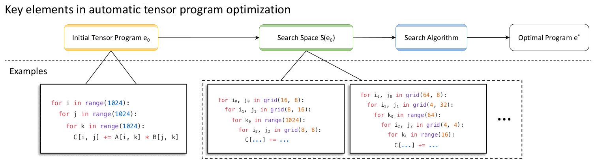
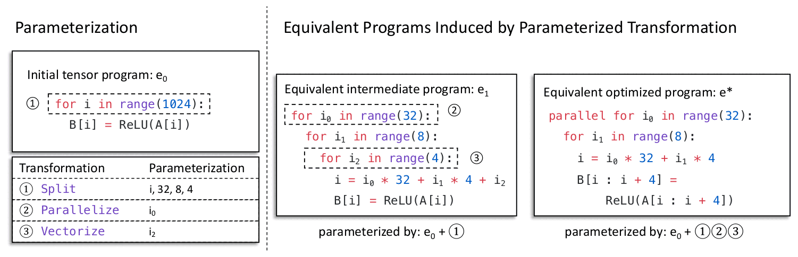
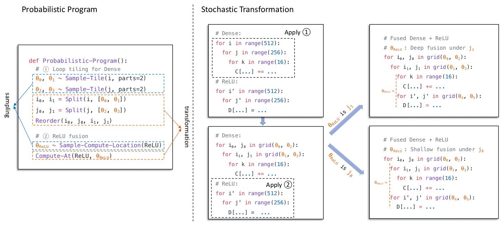
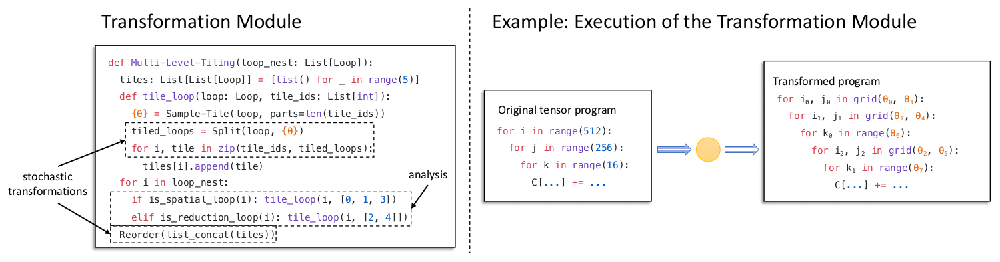
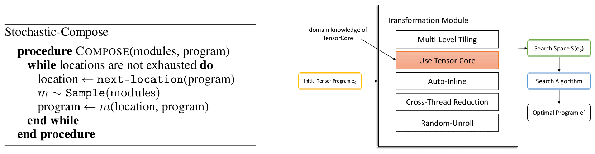
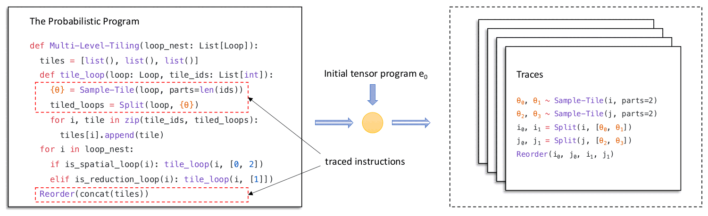
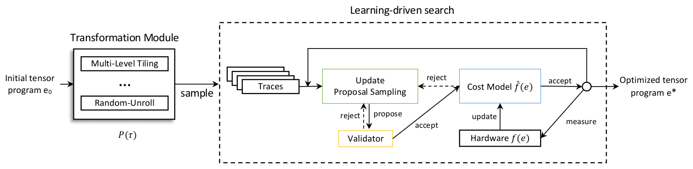
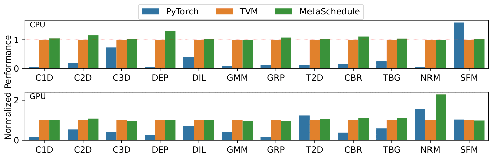
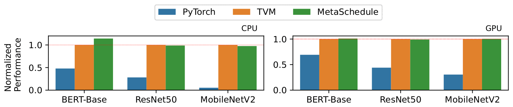
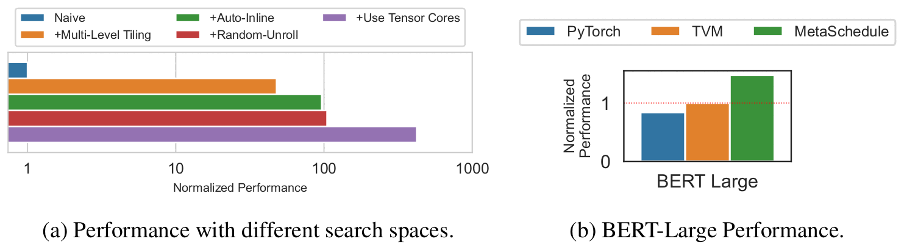

# 论文中文解读：《Tensor Program Optimization with Probabilistic Programs》

> **基本信息**：Junru Shao、Xiyou Zhou、Siyuan Feng、Bohan Hou、Ruihang Lai、Hongyi Jin、Wuwei Lin、Masahiro Masuda、Cody Hao Yu、Tianqi Chen（OctoML / 上海交通大学 / Carnegie Mellon University / Amazon Web Services），NeurIPS 2022，arXiv:2205.13603（本地 PDF 为 v2，2022 年 10 月版）；论文原文 [官方页面](https://arxiv.org/abs/2205.13603)。
>
> **本文的读法**：图均为从论文 PDF 中按图裁出的原图，表和代码为逐项核对后的中文转录（数字、代码与原文一致，表头翻译为中文）。每张图后有中文图题、图例/坐标轴翻译和读图结论，因此不必再翻英文版。图中读出的近似数值都写作“约”，原文正文给出的数字优先。

## 一、一句话结论

自动张量程序优化由两部分组成：**搜索空间** $S(e_0)$（与初始程序 $e_0$ 语义等价的候选程序集合）和**搜索算法**。已有系统（AutoTVM、Ansor 等）把搜索空间写死在框架里，想扩展搜索空间需要对框架做“外科手术式”的修改。

MetaSchedule 的核心主张是：把**搜索空间的构造**从**搜索**中解耦出来，并给领域专家一个可编程、可组合的抽象——一种**领域专用概率编程语言**：

1. 一个优化后的程序 = 初始程序 + 一串带参数的变换（split、parallelize、vectorize 等）；
2. 变换里难以手工确定的参数（tile 大小、融合位置等）由**随机变量**表示（`Sample-Tile`、`Sample-Compute-Location` 等），于是每个变换都成为**随机变换**，一段 MetaSchedule 概率程序就定义了一族优化程序；
3. 把一段有意义的“分析 + 采样 + 随机变换”打包成**变换模块**（transformation module），模块可以层次化地组合，形成通用搜索空间；
4. 在这个空间上做**学习驱动的搜索**：执行追踪（trace）把程序线性化，evolutionary search 在 trace 上变异随机变量，用 cost model 做接受/拒绝，验证器剔除非法 trace。

结论（作者实验）：MetaSchedule 在 CPU 与 GPU 上对一组算子/子图和三个端到端模型，性能不低于 TVM（取 AutoTVM 与 Ansor 中较好者），大多明显优于 PyTorch；并且新增一个硬件专用的 `Use-Tensor-Core` 模块（一名研究生用 2 天写成 82 行 Python）后，BERT-Large 比 TVM 快 48%。

## 二、背景与问题

### 2.1 自动张量程序优化：搜索空间 + 搜索算法

深度学习被部署到各种硬件和设备上，框架通常依赖手工优化的库（cuDNN、MKL-DNN）加速。工程师要在许多**逻辑上等价但性能差别很大**的张量程序之间选择，差异来自访存、线程和专用硬件原语的使用。随着模型和硬件后端增多，这项工程成为机器学习部署的瓶颈。自动程序优化的思路是用机器学习解决它，有两个要素：

1. 定义**搜索空间**：给出一组语义等价的候选张量程序；
2. 用基于学习的**搜索算法**，借助部署环境的反馈，在空间中找到优化后的程序。

图 1 画出了典型流程：对给定程序 $e_0$，框架从预定义的搜索空间 $S(e_0)$ 生成候选，找到延迟最小的 $e^*\in S(e_0)$。



*图 1（原文 Figure 1，第 2 页）：自动张量程序优化包含两个关键要素：搜索空间 $S(e_0)$ 和寻找最优张量程序 $e^*$ 的搜索算法。搜索空间通常包含对循环变换、向量化、线程模式和硬件加速的选择。*

**图中文字翻译与读法**：

- 图内标题 Key elements in automatic tensor program optimization（自动张量程序优化的关键要素）。上方流程：Initial Tensor Program $e_0$（初始张量程序，黄色）→ Search Space $S(e_0)$（搜索空间，绿色）→ Search Algorithm（搜索算法，蓝色）→ Optimal Program $e^*$（最优程序）。
- 下方 Examples（例子）：初始程序是 $1024^3$ 的矩阵乘 `for i in range(1024): for j in range(1024): for k in range(1024): C[i, j] += A[i, k] * B[j, k]`。搜索空间里有许多等价的、已分块的变体，图中画了两个：`for i0, j0 in grid(16, 8)`、`for i1, j1 in grid(8, 16)`、`for k0 in range(1024)`、`for i2, j2 in grid(8, 8)`；以及 `grid(64, 8)`、`grid(4, 32)`、`range(64)`、`grid(4, 4)`、`range(16)`。可以验算两个变体都保持循环范围的乘积不变：$16\times8\times8=1024$、$8\times16\times8=1024$；$64\times4\times4=1024$、$8\times32\times4=1024$，$k$ 方向 $64\times16=1024$。

**读图结论**：搜索空间决定了“能找到的最好程序”；搜索算法只负责在其中找。

### 2.2 现有做法的问题与论文的问题

多数现有方法（AutoTVM、Ansor、Halide auto-scheduler、AdaTune 等）使用**预定义**的搜索空间，把作者的领域知识一次性地编码进去，精力放在设计高效的搜索算法上。但搜索空间本身从根本上限制了搜索能找到的最好性能：

- 构造好的搜索空间，领域专家要在循环变换、向量化、线程模式、硬件加速等方面做大量选择；
- 最优的搜索空间还会随新的优化技术（如 Winograd 一类快速卷积算法）和新的硬件原语（如 Tensor Core）演进；
- 现状是：任何对搜索空间构造的修改都需要对自动优化框架做“外科手术式”的改动。

论文因此问：**能否把搜索空间构造与搜索解耦，并提供合适的抽象，让领域专家与学习系统在搜索空间构造上协作？** 答案基于两个观察：

1. 可以用“初始程序 + 对程序的一串变换”来**参数化**一个优化搜索空间；
2. 有了这个参数化，领域专家可以在查看程序状态之后，给出表示“可能的变换”的**概率选择**。

这两点导出一个简单而强大的抽象：通过领域专用概率语言构造搜索空间，并且把多种可能的概率变换**组合**起来形成丰富的搜索空间。

**贡献**：（1）提出用于张量程序搜索空间构造的概率语言抽象；（2）构建学习驱动的框架，在该抽象定义的搜索空间里寻找优化程序；（3）构建端到端系统，能吸收领域专家的先验知识来构造搜索空间，在多个平台上优化深度学习部署。

### 2.3 三个设计目标

构造 $S(e_0)$ 并不容易：

- $S(e_0)$ 高度依赖 $e_0$：计算密集的程序（如 Dense）要考虑的配置，比通信密集的程序（如 ReLU）多得多；
- 不同硬件域差别很大：CPU 上涉及多核并行和向量化，GPU 上涉及线程绑定和 tensorization（张量化）；
- 硬件和模型设置变化时，需要新的领域专家来更新 $S(e_0)$ 以利用最新改进。

所以论文给出三个目标：**表达力**（Expressiveness，要能构造出覆盖领域专家所写优化程序的丰富搜索空间）、**模块化**（Modularity，不同专家在不同时期的输入应能以可组合、模块化的方式结合）、**为学习而设计**（Designed for learning，要有通用的基于学习的框架，支持对该抽象所定义的搜索空间使用不同的 cost model 和搜索）。后两节分别回答前两点和第三点。

## 三、方法：用随机变换构造搜索空间

### 3.1 搜索空间 = 初始程序 + 带参数的变换序列（图 2）

传统程序优化可以表示成一串变换 $\tau$：第 $i$ 步把程序 $e_{i-1}$ 变成语义等价的 $e_i$，最终得到优化程序 $e_n$。MetaSchedule 的推广是：**允许对 $\tau$ 中的每个变换步骤进一步参数化**。



*图 2（原文 Figure 2，第 3 页）：用初始程序加变换序列来参数化程序。张量程序 $e_1$ 由初始程序 $e_0$ 加上步骤 ① 参数化，而步骤 ① 又由循环 `i` 和拆分后的各层循环长度 32、8、4 参数化。*

**图中文字翻译与读法**：

- **左半 Parameterization（参数化）**：Initial tensor program $e_0$（初始张量程序）：`for i in range(1024): B[i] = ReLU(A[i])`。下面的表（Transformation / Parameterization，变换 / 参数化）列出三个变换：① Split（拆分），参数为 `i, 32, 8, 4`；② Parallelize（并行化），参数为 `i0`；③ Vectorize（向量化），参数为 `i2`。
- **右半 Equivalent Programs Induced by Parameterized Transformation（由参数化变换诱导出的等价程序）**：Equivalent intermediate program（等价的中间程序）$e_1$：把 `i` 拆成 `i0 in range(32)`、`i1 in range(8)`、`i2 in range(4)`，下标 `i = i0 * 32 + i1 * 4 + i2`，由 $e_0+$ ① 参数化；Equivalent optimized program（等价的优化程序）$e^*$：对 `i0` 加 `parallel`，对 `i2` 向量化后写成 `B[i : i + 4] = ReLU(A[i : i + 4])`，由 $e_0+$ ①②③ 参数化。

**读图结论**：每个程序都能由“初始程序 + 一串参数化变换”唯一刻画。于是搜索空间 $S(e_0)$ 就是 $e_0$ 加上所有可能的参数化变换序列。

**为什么需要随机变量**：光有参数化还不够，因为实践中很难手工确定变换里各参数的最佳组合。例如图 2 中，在支持 AVX-512（一条 x86 指令，一个 CPU 周期内完成 512 位向量的计算）的 Intel CPU 上，通常对内层循环用 512 位向量化最有效；否则别的向量长度可能更好。要枚举“合理的参数组合”以控制空间大小又不漏掉最优程序，就必须对目标硬件有深入了解。

### 3.2 随机变量与 MetaSchedule 概率程序（图 3）

为了让使用者定义参数化变换时不必操心候选值，MetaSchedule 引入由**分析**和**采样**得到的**随机变量**。变换被随机变量参数化之后，自然变成**随机变换**，其背后的概率空间就反映了可能变换的空间。

图 3 的例子是 Dense（矩阵乘）后接 ReLU：



*图 3（原文 Figure 3，第 4 页）：MetaSchedule 概率语言。该语言包含两个关键要素：（1）随机变量采样；（2）基于随机变量的程序变换。示例执行：步骤 ① 抽取 tile 大小并把循环组织成两层 tiling 结构；步骤 ② 决定 ReLU 算子融合到哪里。*

**图中文字翻译与读法**：

- **左 Probabilistic Program（概率程序）**：蓝色虚线框是采样语句（箭头标注 sampling，采样），橙色虚线框是变换语句（箭头标注 transformation，变换）。代码如下：

```python
def Probabilistic-Program():
  # ① Loop tiling for Dense
  θ0, θ1 ~ Sample-Tile(i, parts=2)
  θ2, θ3 ~ Sample-Tile(j, parts=2)
  i0, i1 = Split(i, [θ0, θ1])
  j0, j1 = Split(j, [θ2, θ3])
  Reorder(i0, j0, i1, j1)
  # ② ReLU fusion
  θReLU ~ Sample-Compute-Location(ReLU)
  Compute-At(ReLU, θReLU)
```

- **右 Stochastic Transformation（随机变换）**：初始程序是 `# Dense: for i in range(512): for j in range(256): for k in range(16): C[...] += ...`，之后是 `# ReLU: for i' in range(512): for j' in range(256): D[...] = ...`。Apply ①（应用步骤 ①）把 Dense 变成两层 tile 的 `for i0, j0 in grid(θ0, θ2): for i1, j1 in grid(θ1, θ3): for k in range(16)`；Apply ②（应用步骤 ②）再决定 ReLU 挂在哪一层。两种结果：**θReLU 是 j1** 时为 Deep fusion under j1（深融合，ReLU 的 `for i', j' in grid(θ4, θ5)` 紧跟 `k` 循环，位于 `j1` 循环内部）；**θReLU 是 j0** 时为 Shallow fusion under j0（浅融合，ReLU 位于 `j0` 内、整个 `i1, j1` 循环嵌套之后）。（原文没有解释 `θ4`、`θ5`；按图意，它们是挂载后 ReLU 循环的长度，由挂载位置决定。）

**读图结论**：

- 在 Dense 上做循环 tiling 时，tile 大小由 `Sample-Tile` 定义的随机变量 $\theta_0\sim\theta_3$ 抽取，于是 `Split` 变成随机变换；同样用 `Sample-Compute-Location` 枚举 Dense 拆分后合法的循环，让 ReLU 融合到其中某一个。
- 总共 **7 行** MetaSchedule 程序就覆盖了“Dense-ReLU”这个 $e_0$ 的搜索空间 $S(e_0)$ 里的一族优化程序。
- **与超参数调优里的正交网格不同**：MetaSchedule 能刻画随机变量与被变换的程序 $e_i$ 之间**长程的结构和算术依赖**。图 3 的步骤 ② 说明：`Sample-Compute-Location` 的采样分布取决于最新的程序 $e_5$，而 $e_5$ 的结构又取决于前面所有的随机变量。也就是说，某个随机变量有哪些合法取值，要看“之前的采样把程序变成了什么样”。

### 3.3 变换模块与组合（图 4、图 5）

只靠随机变换构造的搜索空间虽然高效，也能覆盖最优张量程序，但别的开发者很难通过阅读一长串变换来理解空间是怎样构造的，为某个工作负载设计的变换也难以被其他工作负载复用。同时论文观察到：可以很自然地把一段**子序列**的变换归并起来，服务于某个细粒度优化，例如：

- 一些变换实现 multi-level tiling（多级分块），改善 Conv2d、Dense 等计算密集算子的访存局部性；
- 另一些变换把激活函数这类逐元素算子折叠/内联到其前驱或后继，改善内存带宽效率。

为此引入**变换模块**（transformation module）：就像 ResNet 里由 Conv2D、BiasAdd、ReLU 组成的卷积模块一样，MetaSchedule 中的变换模块被定义为一个**原子随机变换**，或者**程序分析、采样及更小变换的组合**。每个变换模块可以有一个有意义的名字，方便被许多工作负载采用并层次化地构造搜索空间。



*图 4（原文 Figure 4，第 5 页）：变换模块。一个变换模块由张量程序分析、采样和随机变换组成。图中以 Multi-Level-Tiling 为例，其中分析是交互式地完成的：先识别空间（数据并行）循环与归约循环，再用从 Sample-Tile 抽取的 tiling 因子做 Split；最后一次 Reorder 把循环组织成合适的 tile。*

**图中文字翻译与读法**：

- **左 Transformation Module（变换模块）**：`Multi-Level-Tiling` 的代码如下。`tiles` 有 5 个列表，对应 5 层 tile；`tile_loop` 对一个循环用 `Sample-Tile` 抽取各部分长度并 `Split`，把得到的各段按 `tile_ids` 放入相应层；然后遍历 `loop_nest`：空间循环放到第 0、1、3 层，归约循环放到第 2、4 层；最后 `Reorder` 把各层连接起来。图中标注：`Split` 与 `Reorder` 属于 stochastic transformations（随机变换），`is_spatial_loop`/`is_reduction_loop` 的判断属于 analysis（分析）。

```python
def Multi-Level-Tiling(loop_nest: List[Loop]):
  tiles: List[List[Loop]] = [list() for _ in range(5)]
  def tile_loop(loop: Loop, tile_ids: List[int]):
    {θ} = Sample-Tile(loop, parts=len(tile_ids))
    tiled_loops = Split(loop, {θ})
    for i, tile in zip(tile_ids, tiled_loops):
      tiles[i].append(tile)
  for i in loop_nest:
    if is_spatial_loop(i): tile_loop(i, [0, 1, 3])
    elif is_reduction_loop(i): tile_loop(i, [2, 4]])
  Reorder(list_concat(tiles))
```

（原文代码在最后一条 `tile_loop(i, [2, 4]])` 处多了一个右括号，属于排版笔误，此处按原样转录。）

- **右 Example: Execution of the Transformation Module（变换模块的执行示例）**：Original tensor program（原始张量程序）`for i in range(512): for j in range(256): for k in range(16): C[...] += ...` 经过模块，变成 Transformed program（变换后的程序）：`for i0, j0 in grid(θ0, θ3): for i1, j1 in grid(θ1, θ4): for k0 in range(θ6): for i2, j2 in grid(θ2, θ5): for k1 in range(θ7): C[...] += ...`。

**读图结论**：这个模块把原始程序组织成 **5 层 tiling 结构**——空间循环 3 层、归约循环 2 层，即 S-S-R-S-R 的次序（$i_0,j_0$ 最外，其次 $i_1,j_1$，再 $k_0$，再 $i_2,j_2$，最内 $k_1$）。模块对张量程序是**通用**的，可用于 conv1d、conv3d、matmul 等多种算子；同一个模块内“程序分析（识别空间/归约循环）”与“随机 tiling”是交织在一起的。

**如何把模块组合成搜索空间**：图 5 左边是组合算法 `Stochastic-Compose`，右边是层次化组合示意。



*图 5（原文 Figure 5，第 5 页）：左，组合变换模块的示例算法：一串变换模块被组合成一个单独的变换模块。右，变换模块的层次化组合给出通用的搜索空间。这个例子里，硬件专用模块 Use-Tensor-Core 与其他通用模块一起被组合成一个能为任意张量程序生成搜索空间的模块。*

**图中文字翻译与读法**：

- **左 Stochastic-Compose（随机组合）**：

```text
procedure COMPOSE(modules, program)
  while locations are not exhausted do
    location <- next-location(program)
    m ~ Sample(modules)
    program <- m(location, program)
  end while
end procedure
```

  含义：只要程序里还有没处理的“位置”（如每个算子/每个循环嵌套），就取下一个位置，从模块集合里**随机抽一个模块** $m$，把它作用到该位置，得到新程序。
- **右**：Initial Tensor Program $e_0$ 进入一个大的 Transformation Module（变换模块），里面按层次放着 Multi-Level Tiling、Use Tensor-Core（橙色高亮，标注 domain knowledge of TensorCore，即 TensorCore 领域知识）、Auto-Inline、Cross-Thread Reduction、Random-Unroll；其输出是 Search Space $S(e_0)$，再交给 Search Algorithm（搜索算法）得到 Optimal Program $e^*$。

**读图结论**：这个简单例子里，实践者预先实现好带有领域先验的一组变换模块，把它们应用到张量程序的每个可用位置，就形成搜索空间；因此所形成的空间覆盖了不同硬件上的常见优化。硬件专用的 Use-Tensor-Core 只是一个新增的模块，其他模块不用改。

### 3.4 与已有方法的关系

论文论证许多已有方法都能被 MetaSchedule 框架覆盖：

- **程序变换的领域专用语言**（Halide、TVM、Tiramisu、TACO 的调度语言）：让开发者手工优化程序。当程序里没有随机变量采样时，MetaSchedule 退化为确定性程序变换的 DSL，功能相同。
- **模板引导的自动调优**（AutoTVM 等）：完全依赖开发者定义搜索空间。在 MetaSchedule 里，这相当于搜索空间中所有随机变量都在变换之前定义好，因此程序分析与后续基于程序状态的随机采样选择之间没有交互。
- **auto-scheduling**（Ansor、Halide auto-scheduler、FlexTensor、ProTuner）：要求开发者实现与工作负载无关的变换规则。MetaSchedule 通过对应搜索空间生成规则的特定概率变换模块，获得同样的可编程性和功能。

这些方法在张量程序优化中各有用例，取决于特定场景想注入多少领域知识；把搜索空间构造与搜索解耦，就能用**同一个框架**覆盖所有用例，并且进一步定制时不必对系统做外科手术式的改动。

## 四、方法：学习驱动的搜索

有了模块化的搜索空间抽象，还需要有效的搜索找到最优程序。

### 4.1 目标形式化

对一个给定的概率程序 $e_0$，用 $\tau$ 表示作用在 $e_0$ 上的变换序列；$\tau$ 可以从概率程序指定的**先验分布**中采样。记 $g(e_0,\tau)$ 为对 $e_0$ 施加变换 $\tau$ 之后的张量程序，$f(e)$ 为程序 $e$ 在硬件环境上的延迟。定义“优化程序”的后验概率：

$$
P(\tau\mid e_0)\ \propto\ e^{-f(g(e_0,\tau))}\cdot P(\tau).
\tag{1}
$$

直观上，想给性能好（延迟低）的程序更高的概率。最终目标是通过最大后验估计（MAP）求使后验最大的 $\tau^\star=\operatorname*{arg\,max}_{\tau}P(\tau\mid e_0)$。

**读法**：先验 $P(\tau)$ 由领域专家写的概率程序决定（哪些变换、每个随机变量怎么取值）；$e^{-f(\cdot)}$ 把延迟变成“越低越好”的权重；$f$ 只能真机测量，没有解析形式，所以这是一个**黑盒的** MAP 问题，需要用代理模型（cost model）加采样/搜索来求解。

### 4.2 执行追踪（图 6）

为了让领域专家高效地用变换模块表达知识，MetaSchedule 被嵌入到 Python 中。重复地重新执行 Python 程序代价很高，于是引入**执行追踪**（execution tracing）：程序执行过程中，系统记录所有采样和变换，而忽略宿主语言的控制流和其他构造。得到的 **trace** 是只含采样指令和变换指令的 MetaSchedule 原语序列，可以像普通 MetaSchedule 程序一样重新执行。之后就可以对给定的一批初始 trace 继续探索不同的采样选择。概念上，这等价于把支撑集（support set）划分开，再在“程序的执行序列”给定的条件下采样。



*图 6（原文 Figure 6，第 6 页）：MetaSchedule 中的执行追踪。左边的概率语言定义了整个搜索空间 $S(e_0)$。跨多次运行追踪程序执行，得到右边一组线性化的概率程序。只追踪采样和变换指令，宿主语言中的所有其他构造和控制流都被忽略。*

**图中文字翻译与读法**：

- **左 The Probabilistic Program（概率程序）**：一个 `Multi-Level-Tiling`，其中 `tiles` 有 3 个列表，空间循环 `tile_loop(i, [0, 2])`、归约循环 `tile_loop(i, [1])`，末尾 `Reorder(concat(tiles))`。红色虚线框标出“被追踪的指令”（traced instructions）：`Sample-Tile` 与 `Split` 那两行、以及 `Reorder`；其他部分（`for`、`if`、`zip`、`append`、`is_spatial_loop` 等）不被记录。
- **中**：Initial tensor program $e_0$ 进入执行（黄色圆点）。
- **右 Traces（追踪）**：得到若干 trace，每个都是线性程序：`θ0, θ1 ~ Sample-Tile(i, parts=2)`、`θ2, θ3 ~ Sample-Tile(j, parts=2)`、`i0, i1 = Split(i, [θ0, θ1])`、`j0, j1 = Split(j, [θ2, θ3])`、`Reorder(i0, j0, i1, j1)`。

**读图结论**：这个初始程序只有空间循环 $i,j$，因此执行时没有走到归约循环的分支，trace 里就没有归约相关指令；换一个有归约循环的工作负载，同一个模块会追踪出不同的线性程序。trace 把“带 Python 控制流的程序”变成“只含采样和变换的直线程序”，之后改变采样结果就不必再重复执行 Python 控制流。

### 4.3 端到端搜索（图 7）、cost model 与 trace 验证



*图 7（原文 Figure 7，第 7 页）：学习驱动的搜索。基于 MetaSchedule 执行得到的 trace，通过变异 trace 里的采样决策来提出候选张量程序，其中非法的会被验证器拒绝。每次迭代中，提出的候选通过带退火的 Metropolis-Hastings（annealed Metropolis-Hastings）并借助学习到的 cost model $\hat f$ 的预测来接受或拒绝；而 cost model $\hat f$ 则根据真机上测得的张量程序延迟 $f$ 增量更新。*

**图中文字翻译与读法**：

- 左：Initial tensor program $e_0$ 经 Transformation Module（变换模块，含 Multi-Level Tiling、…、Random-Unroll；其先验记作 $P(\tau)$）sample（采样）出一批 Traces。
- 虚线框 Learning-driven search（学习驱动的搜索）：Traces 进入“Update Proposal Sampling”（更新提议采样），propose（提出）新 trace 交给 Validator（验证器，黄色）；验证器 reject（拒绝）非法 trace（虚线回到提议环节）或 accept（接受）后送入 Cost Model $\hat f(e)$（代理 cost model，蓝色）；cost model 再 accept（接受，实线）/ reject（拒绝，虚线回到提议环节），被接受的送向右侧输出 Optimized tensor program $e^*$（优化后的张量程序）；同时被选中的候选 measure（测量）到 Hardware $f(e)$（硬件，真实延迟），测量结果 update（更新）cost model。外层的大回环表示整个过程迭代进行。

**文字说明的流程**：

1. 搜索算法先对 MetaSchedule 程序采样，得到一批 trace；
2. 然后以这些 trace 为条件继续探索空间；
3. 直接在硬件上测量 $f(e)$ 的代价高得多，所以引入代理 cost model $\hat f(e)$，并在整个过程中不断更新，与已有的张量程序优化工作类似；
4. 每次迭代用 evolutionary search 算法**通过变异随机变量提出 trace 的新变体**，再根据 cost model 接受或拒绝提议。论文指出 evolutionary search 可以看作并行链 MCMC；系统也足够模块化，可以换成别的方式（如贝叶斯优化、强化学习）选择概率选择。

**说明**：论文没有给出接受概率的公式。作为理解辅助，Metropolis–Hastings 的通用形式是：对提议的新 trace $\tau'$，以 $\min\{1,\ \pi(\tau')/\pi(\tau)\}$（对称提议下）的概率接受，其中 $\pi$ 正比于式 (1) 的右端、延迟由 $\hat f$ 预测；“退火”指随迭代逐步降低“温度”使接受越来越挑剔。这是通用算法形式，不是原文细节。

**Cost model**：该方法允许使用多种 cost model，因此可以提供从已有数据集（TenSet）预训练的模型。默认选择基于树提升（tree-boosting）的 cost model $\hat f(\cdot)$，使用与先前工作（Ansor）相同的一组通用特征。

**Trace 验证**（trace validation）：提出更新时可能出现**非法 trace**，例如某些随机变量的选择超出了物理硬件的限制，或者某个变量引起执行序列的变化。与其强制采用保守的提议，不如引入一个验证器来校验 trace 的正确性。trace 验证让搜索可以更自由地在空间里移动，同时仍确保采样结果落在正确的支撑集上。

## 五、实验

### 5.1 设置

- **硬件**（附录 A.1）：所有 CPU 实验在 AWS C5.9xlarge 实例（Intel Xeon Platinum 8124M CPU）上进行；所有 GPU 实验用 NVIDIA GeForce RTX 3070。
- **基线**：PyTorch v1.11.0（代表厂商库）；TVM（commit 8d4f4dd73f），其中包含 AutoTVM 和 Ansor，在每个设置下取两者中最好的一个作为 TVM 的结果。
- **工作负载**：见本文 6.1 节的附录表（附录 A.2，所有算子 batch=1）。
- **误差条**：论文在清单中说明没有报告误差条，理由是张量程序运行时间的方差在多次运行间可以忽略。
- 算子配置和 evolutionary search 的超参数，论文清单中称在附录里给出，但附录实际只给了算子配置；搜索的轮数、测量预算等没有给出（见第九节）。

### 5.2 算子与子图层面：能否覆盖已有优化技术（图 8）

本节回答：**MetaSchedule 的表达力够不够，能否捕获最先进优化技术所用的搜索空间？** 在从常见深度学习模型中抽取的一批算子和子图上评估，包括卷积的各种变体、Dense 和归一化。



*图 8（原文 Figure 8，第 8 页）：算子和子图层面的性能。MetaSchedule 总是取得与 TVM（Ansor）相近或更好的性能，并且在多数手工优化得很好的工作负载上显著超过 PyTorch。*

**图中文字翻译与读法**：上下两个子图分别为 CPU 与 GPU；横轴是 12 个工作负载 C1D、C2D、C3D、DEP、DIL、GMM、GRP、T2D、CBR、TBG、NRM、SFM（含义见本文 6.1 节）；纵轴 Normalized Performance（归一化性能）；图例 PyTorch（蓝）、TVM（橙）、MetaSchedule（绿）；红色虚线标出 1。从图上看，TVM 柱恒为 1，即以 TVM 为基准归一化。

**结果**：在 CPU 与 GPU 的所有情形下，MetaSchedule 的性能与 TVM 相当或更好，由此论文推断 MetaSchedule 能在多样的工作负载上表达与 TVM 相当的优化技术。此外，在大多数情形下 MetaSchedule 大幅领先 PyTorch，**例外是 SFM**（softmax），它在 PyTorch 里被高度手工优化。

**从图上读出的近似数值**（以 TVM 为 1）：

- CPU 上 MetaSchedule 约 0.98 到 1.32：最高的是 DEP（约 1.32）和 C2D（约 1.17），GMM 约 0.98，略低于 1；PyTorch 在多数负载上只有约 0.04 到 0.4，C3D 约 0.73，SFM 约 1.6（高于 MetaSchedule）。
- GPU 上 MetaSchedule 多在约 0.94 到 1.1，最突出的是 NRM（约 2.3，PyTorch 约 1.55）；C3D、GMM、GRP、SFM 略低于 1（约 0.94 到 0.97）。PyTorch 在 GPU 的 T2D 上约 1.25，高于 MetaSchedule（约 1.05），NRM 上也高于 TVM；这些是正文“大多数情形”之外的例外，正文只明确提到 SFM。

### 5.3 端到端模型（图 9）

算子性能并不总能直接转化为整个模型的优化效果，所以本节问：**MetaSchedule 在端到端模型上能否达到有竞争力的性能？** 比较 MetaSchedule 与 TVM 在 BERT-Base、ResNet-50、MobileNet-v2 上（CPU 与 GPU 都测）。



*图 9（原文 Figure 9，第 8 页）：优化端到端深度学习模型。MetaSchedule 在所有模型上都达到与 TVM（Ansor）接近或更好的性能。*

**图中文字翻译与读法**：左为 CPU、右为 GPU；横轴三个模型 BERT-Base、ResNet50、MobileNetV2；纵轴 Normalized Performance（归一化性能，TVM 为 1，红色虚线）；图例 PyTorch（蓝）、TVM（橙）、MetaSchedule（绿）。

**结果**：MetaSchedule 与 TVM 性能持平，并在所有情形下超过 PyTorch，说明 MetaSchedule 框架能交付端到端性能。调优时间见附录 A.5（本文表 1）。

从图上读出：CPU 上 BERT-Base 的 MetaSchedule 约 1.14（比 TVM 快约 14%），ResNet50、MobileNetV2 约 0.98 到 0.99，PyTorch 分别约 0.48、0.28、0.05；GPU 上三个模型 MetaSchedule 约 1.0，PyTorch 约 0.69、0.44、0.31。

### 5.4 搜索空间组合与硬件专用模块（图 10）

除了性能持平，本节展示**模块化搜索空间组合**的额外价值：组合变换模块有多方便，又怎样转化为性能？论文设计了一个变换模块组合的消融实验。



*图 10（原文 Figure 10，第 9 页）：左，在 BERT 的一个代表性子图 fused-dense 上进行的搜索空间组合。逐步组合更多变换模块，搜索空间覆盖了更多优化后的程序。右，引入硬件专用的 Use-Tensor-Core 模块并与已有搜索空间组合，比 TVM（AutoTVM）快 48%。*

**图中文字翻译与读法**：

- **(a) Performance with different search spaces（不同搜索空间下的性能）**：横轴 Normalized Performance（归一化性能，**对数坐标**，1 到 1000）；五根条形自上而下为 Naive（朴素）、+Multi-Level Tiling、+Auto-Inline、+Random-Unroll、+Use Tensor Cores，“+”表示逐步累加模块。（Tensor Core 只存在于 GPU；附录 A.1 说明论文所有 GPU 实验用 RTX 3070，但图本身没有标明硬件。）
- **(b) BERT-Large Performance（BERT-Large 性能）**：纵轴 Normalized Performance（归一化性能，TVM 为 1，红色虚线）；三根条形 PyTorch（蓝）、TVM（橙）、MetaSchedule（绿）。

**结果**：通过逐步丰富搜索空间，优化出的张量程序性能单调上升；与硬件专用模块 Use-Tensor-Core 组合后，MetaSchedule 的性能显著好于通用搜索空间。自定义规则带来的收益确实转化为端到端模型性能：在 BERT-Large 上，带 Use-Tensor-Core 的 MetaSchedule 比 TVM 快 **48%**。

**从图上读出的近似数值**：(a) 为对数坐标：Naive 为 1，+Multi-Level Tiling 约 48，+Auto-Inline 约 95，+Random-Unroll 约 105，+Use Tensor Cores 约 430；(b) 中 PyTorch 约 0.83，MetaSchedule 约 1.48（与文字 48% 一致）。图 10b 的 TVM 是 AutoTVM，因为按附录 A.4，TVM 里的 Ansor 不支持 TensorCore，AutoTVM 虽支持有限的 tensor intrinsic（如 WMMA），也无法在不大幅重新设计其调度树的前提下给出可比的 TensorCore 性能。

**便利性证据**：一名研究生只用 **2 天**就用 Python 写成 **82 行**的 `Use-Tensor-Core` 模块（完整代码在补充材料中），这是定制和组合便利性的有力证据。

### 5.5 附录 A.3：Use-Tensor-Core 模块生成的变换序列

附录 A.3 给出 Use-Tensor-Core 搜索空间的定义代码。从代码里的 `decision=` 字段可以看出，这是一份带有具体采样结果的 trace 形式（与图 6 的“只含采样和变换指令”一致）；原文称完整的 82 行 Python 模块在补充材料中。下面按原文逐行转录并分组（`#` 行为本文加的分组说明，其余为原文）：

```python
# 取出各个 block：b0 是矩阵乘（T_dense），b1~b8 是后续融合的逐元素计算（bias add、乘法、cast、erf 等），b9 是 root
b0 = sch.get_block(name="T_dense", func_name="main")
b1 = sch.get_block(name="T_add", func_name="main")
b2 = sch.get_block(name="T_multiply", func_name="main")
b3 = sch.get_block(name="T_cast", func_name="main")
b4 = sch.get_block(name="T_erf", func_name="main")
b5 = sch.get_block(name="T_cast_1", func_name="main")
b6 = sch.get_block(name="T_multiply_1", func_name="main")
b7 = sch.get_block(name="T_add_1", func_name="main")
b8 = sch.get_block(name="T_multiply_2", func_name="main")
b9 = sch.get_block(name="root", func_name="main")
# 声明 GPU 上的 tile 结构，与 Ansor 的 GPU 结构 SSSRRSRS 同名
sch.annotate(block_or_loop=b0, ann_key="tiling_structure", ann_val="SSSRRSRS")
# 重新索引并把 block/缓冲区布局规整成 (i, j, k) 等标准形式，为 tensorize 做准备
b10 = sch.reindex(block=b0, buffer_index=0, is_write_index=True)
b11 = sch.reindex(block=b0, buffer_index=0, is_write_index=False)
b12 = sch.reindex(block=b0, buffer_index=1, is_write_index=False)
sch.transform_block_layout(block=b10, index_map=lambda i_l, j_l, k_l: (i_l, j_l, k_l, ))
sch.transform_block_layout(block=b11, index_map=lambda i_l, j_l, k_l: (i_l, j_l, k_l, ))
sch.transform_block_layout(block=b12, index_map=lambda i_l, j_l, k_l: (i_l, j_l, k_l, ))
sch.transform_block_layout(block=b0, index_map=lambda i_l, j_l, k_l: (i_l, j_l, k_l, ))
sch.transform_layout(block=b0, buffer_index=0, buffer_index_type=write, index_map=lambda i_l, j_l: (i_l, j_l, ))
sch.transform_layout(block=b0, buffer_index=1, buffer_index_type=read, index_map=lambda j_l, k_l: (j_l, k_l, ))
sch.transform_layout(block=b0, buffer_index=0, buffer_index_type=read, index_map=lambda i_l, k_l: (i_l, k_l, ))
# 把三个循环各拆出最内层 16，重排后 blockize 成一个 block，供 WMMA 指令使用
l13, l14, l15 = sch.get_loops(block=b0)
l16, l17 = sch.split(loop=l15, factors=[64, 16])
l18, l19 = sch.split(loop=l14, factors=[256, 16])
l20, l21 = sch.split(loop=l13, factors=[64, 16])
l22, l23, l24, l25, l26, l27 = sch.get_loops(block=b0)
sch.reorder(l24, l26, l21, l19, l17)
b28 = sch.blockize(loop=l21)
# 标注要自动 tensorize 成哪些 WMMA 内建函数，并开启 Tensor Core 与 warp 执行
sch.annotate(block_or_loop=b0, ann_key="auto_tensorize", ann_val="wmma_sync")
sch.annotate(block_or_loop=b28, ann_key="auto_tensorize", ann_val="wmma_fill")
b29 = sch.get_block(name="root", func_name="main")
sch.annotate(block_or_loop=b29, ann_key="tensor_core_enabled", ann_val="1")
b30 = sch.get_block(name="root", func_name="main")
sch.annotate(block_or_loop=b30, ann_key="warp_execution", ann_val=1)
# 对 blockize 之后的外层三个循环做随机 tile：n=5 / 5 / 3，decision 是该次追踪中采到的因子
l31, l32, l33 = sch.get_loops(block=b28)
v34, v35, v36, v37, v38 = sch.sample_perfect_tile(loop=l31, n=5, max_innermost_factor=4, decision=[8, 1, 2, 2, 2])
l39, l40, l41, l42, l43 = sch.split(loop=l31, factors=[v34, v35, v36, v37, v38])
v44, v45, v46, v47, v48 = sch.sample_perfect_tile(loop=l32, n=5, max_innermost_factor=4, decision=[1, 32, 4, 2, 1])
l49, l50, l51, l52, l53 = sch.split(loop=l32, factors=[v44, v45, v46, v47, v48])
v54, v55, v56 = sch.sample_perfect_tile(loop=l33, n=3, max_innermost_factor=4, decision=[32, 2, 1])
l57, l58, l59 = sch.split(loop=l33, factors=[v54, v55, v56])
# 重排、融合并绑定到 blockIdx.x / blockIdx.y / threadIdx.y，限制线程数在 32 到 1024
sch.reorder(l39, l49, l40, l50, l41, l51, l57, l58, l42, l52, l59, l43, l53)
l60 = sch.fuse(l39, l49)
sch.bind(loop=l60, thread_axis="blockIdx.x")
l61 = sch.fuse(l40, l50)
sch.bind(loop=l61, thread_axis="blockIdx.y")
l62 = sch.fuse(l41, l51)
sch.bind(loop=l62, thread_axis="threadIdx.y")
sch.annotate(block_or_loop=b28, ann_key="thread_extent_low_inclusive", ann_val=32)
sch.annotate(block_or_loop=b28, ann_key="thread_extent_high_inclusive", ann_val=1024)
# 输出先写入 wmma.accumulator，再按采样的向量化字节数写回
b63 = sch.write_at(loop=l62, block=b28, write_buffer_index=0, storage_scope="wmma.accumulator")
sch.reverse_compute_inline(block=b10)
v64 = sch.sample_categorical(candidates=[4, 8, 16], probs=[0.0.33, 0.0.33, 0.0.33], decision=0)
sch.annotate(block_or_loop=b63, ann_key="vector_bytes", ann_val=v64)
# A、B 两个输入先读到共享内存 shared.dyn（带采样的向量化字节数、local stage、double buffer 标注）
b65 = sch.read_at(loop=l57, block=b28, read_buffer_index=0, storage_scope="shared.dyn")
v66 = sch.sample_categorical(candidates=[4, 8, 16], probs=[0.0.33, 0.0.33, 0.0.33], decision=2)
sch.annotate(block_or_loop=b65, ann_key="vector_bytes", ann_val=v66)
sch.annotate(block_or_loop=b65, ann_key="local_stage", ann_val=1)
sch.annotate(block_or_loop=b65, ann_key="double_buffer_scope", ann_val=0)
b67 = sch.read_at(loop=l57, block=b28, read_buffer_index=1, storage_scope="shared.dyn")
v68 = sch.sample_categorical(candidates=[4, 8, 16], probs=[0.0.33, 0.0.33, 0.0.33], decision=2)
sch.annotate(block_or_loop=b67, ann_key="vector_bytes", ann_val=v68)
sch.annotate(block_or_loop=b67, ann_key="local_stage", ann_val=1)
sch.annotate(block_or_loop=b67, ann_key="double_buffer_scope", ann_val=0)
# 再从共享内存读到 wmma.matrix_a / wmma.matrix_b 片段
b69 = sch.read_at(loop=l58, block=b28, read_buffer_index=0, storage_scope="wmma.matrix_a")
b70 = sch.read_at(loop=l58, block=b28, read_buffer_index=1, storage_scope="wmma.matrix_b")
sch.compute_inline(block=b11)
sch.compute_inline(block=b12)
# 软件流水线的 stage 与 order 标注
sch.annotate(block_or_loop=l58, ann_key="software_pipeline_stage", ann_val=[0, 0, 1])
sch.annotate(block_or_loop=l58, ann_key="software_pipeline_order", ann_val=[0, 1, 2])
sch.annotate(block_or_loop=l57, ann_key="software_pipeline_stage", ann_val=[0, 0, 0, 0, 0, 1, 1])
sch.annotate(block_or_loop=l57, ann_key="software_pipeline_order", ann_val=[0, 3, 1, 4, 5, 2, 6])
# 把后面的逐元素 block 内联掉
sch.compute_inline(block=b7)
sch.compute_inline(block=b6)
sch.compute_inline(block=b5)
sch.compute_inline(block=b4)
sch.compute_inline(block=b3)
sch.compute_inline(block=b2)
sch.compute_inline(block=b1)
sch.reverse_compute_inline(block=b8)
# 采样展开策略（unroll_explicit）
v71 = sch.sample_categorical(candidates=[0, 16, 64, 512, 1024], probs=[0.2, 0.2, 0.2, 0.2, 0.2], decision=3)
sch.annotate(block_or_loop=b9, ann_key="unroll_explicit", ann_val=v71)
```

**读法**（要点；`decision=` 的解释按 TVM 实现的约定，原文未单独说明）：

- `sample_perfect_tile(...)` 给出 $n$ 个乘积等于循环长度的因子：i 方向 $8\times1\times2\times2\times2=64$，j 方向 $1\times32\times4\times2\times1=256$，k 方向 $32\times2\times1=64$，与前面 `split` 的 `[64, 16]`、`[256, 16]`、`[64, 16]`（外层 tile 数 × 内层 16）吻合；`max_innermost_factor=4` 限制最内层因子不超过 4。
- `sample_categorical(candidates, probs, decision)` 按给定概率从候选里采样：向量化字节数 $\{4,8,16\}$（概率为 0.33，原文写作 `0.0.33`，应为排版笔误），展开步数 $\{0,16,64,512,1024\}$（各 0.2）。`decision` 是候选列表的下标，如最后一行 `decision=3` 对应取 512。
- 变换序列里既有**随机变量**（3 次 `sample_perfect_tile`、4 次 `sample_categorical`），也有**确定的硬件知识**（WMMA、共享内存、双缓冲、软件流水），说明“专家知识”和“采样的自由度”是写在同一个模块里的。

### 5.6 调优时间（附录 A.5，表 1）

论文强调 MetaSchedule 的贡献与调优速度**正交**——它是用于可组合搜索空间构造的概率语言，而不是用来加速调优的。为了公平比较调优速度，论文在 MetaSchedule 概率语言中**重现了 Ansor 的搜索空间**，比较调优时间。

**调优时间对比（单位：分钟）**

| 模型 | TVM Ansor | MetaSchedule | MetaSchedule 用时占 Ansor 的比例（本文相除） |
|---|---:|---:|---:|
| ResNet-50 | 287.17 | 220.66 | 约 77% |
| BERT-base | 292.45 | 288.4644 | 约 99% |
| MobileNet-v2 | 280.53 | 251.8831 | 约 90% |
| GPT-2 | 270.97 | 214.1358 | 约 79% |
| Inception-v1 | 295.766 | 290.3632 | 约 98% |

（原文表 1，第 17 页。数字按原文保留小数位；第四列是本文把后两列相除得到，不是原文给出的。）

**读法**：在重现 Ansor 搜索空间的前提下，MetaSchedule 的调优时间与 Ansor 相当或略短（约 1% 到 23%）；原文没有写明这个比较所用的硬件、测量次数和搜索设置。

### 5.7 附录 A.6：与深度学习框架的集成流程

待优化的张量程序从前端框架（TensorFlow、PyTorch、JAX 等）的计算图生成；生成过程对张量的形状和秩是通用的。MetaSchedule 程序由得到的张量程序生成，搜索算法在此基础上运行。

## 六、附录表

### 6.1 工作负载配置（附录 A.2）

| 简称 | 工作负载 | 配置（batch 均为 1） |
|---|---|---|
| C1D | 1D 卷积 | length=256，输入通道 64，输出通道 128，kernel size 3，stride 2，padding 1 |
| C2D | 2D 卷积 | height=width=224，输入通道 3，输出通道 64，kernel size 7，stride 2，padding 3 |
| C3D | 3D 卷积 | depth=16，height=width=224，输入通道 3，输出通道 64，kernel size 7，stride 2，padding 3 |
| DEP | depthwise 卷积 | height=width=112，channel=32，kernel size 3，stride 1，padding 1 |
| DIL | 空洞卷积 | height=width=224，输入通道 3，输出通道 64，kernel size 7，stride 2，padding 3，dilation 2 |
| GMM | 矩阵乘 | N=M=K=128 |
| GRP | 分组卷积 | height=width=56，输入通道 64，输出通道 128，kernel size 3，stride 2，padding 1，groups 4 |
| T2D | 转置 2D 卷积 | height=width=4，输入通道 512，输出通道 256，kernel size 4，stride 2，padding 1 |
| CBR | 2D 卷积 + Batch Norm + ReLU | height=width=224，输入通道 3，输出通道 64，kernel size 7，stride 2，padding 3 |
| TBG | 转置 + 矩阵乘 | seq=128，head=12，dim=64 |
| NRM | Norm（归一化） | m=256，n=256 |
| SFM | Softmax | m=256，n=256 |

（原文附录 A.2，第 15 页；原文 CBR 一项印作 “RuLU”，此处按含义写作 ReLU。）

### 6.2 全部可用的变换原语（附录 A.7，表 2）

下表逐项翻译。其中前 26 项是确定性的变换原语，最后 3 项（sample-*）是采样原语，也就是产生随机变量的原语。

| 变换原语 | 含义 |
|---|---|
| split | 把一个循环拆成一串连续的循环 |
| fuse | 把一串连续的循环融合成一个 |
| reorder | 重排一串循环的顺序 |
| parallel | 把一个循环并行化到 CPU 多个核上 |
| vectorize | 用 SIMD 向量化一个循环 |
| unroll | 展开一个循环 |
| bind | 把一个循环绑定到 GPU 线程 |
| cache-read | 创建一个把缓冲区某个区域读入读缓存的 block |
| cache-write | 创建一个把缓冲区某个区域写入写缓存的 block |
| compute-at | 把生产者 block 移到指定循环之下 |
| compute-inline | 把一个 block 内联进它的消费者 |
| rfactor | 沿指定循环对一个满足结合律的归约 block 做因子分解 |
| storage-align | 为缓冲区的某个维度设置对齐要求 |
| set-scope | 设置缓冲区的存储作用域 |
| add-unit-loop | 在指定 block 之上新建一个长度为 1 的循环 |
| re-index | 创建一个 block，经重新索引把缓冲区区域读/写到读/写缓存 |
| reverse-compute-at | 把消费者 block 移到指定循环之下 |
| reverse-compute-inline | 把一个 block 内联进它唯一的生产者 |
| decompose-reduction | 把一个归约 block 分解为两个独立的 block |
| blockize | 把以指定循环为根的子树转换成一个 block |
| tensorize | 用指定的 tensor intrinsic 把该循环所包围的计算张量化 |
| annotate | 给 block 或循环加一个键值对标注 |
| unannotate | 移除 block 或循环上的标注（原文此行句子不完整） |
| transform-layout | 对缓冲区布局施加一个变换，用索引映射（index map）表示 |
| transform-block-layout | 对 block 布局施加一个变换，用索引映射表示 |
| decompose-padding | 把 padding block 分解为填充常量值的 block 和写入范围内数值的 block |
| sample-categorical | 按给定概率分布采样一个整数 |
| sample-perfect-tile | 采样能“完美切分”指定循环的各因子 |
| sample-compute-location | 为给定 block 采样一个 compute-at 位置 |

（原文表 2，第 18 页。）

**读法**：这张表对应论文的核心思想：绝大多数是 TVM/TensorIR 风格的确定性调度原语；MetaSchedule 在其上只加了三个**采样**原语，就把“调度”变成了“概率程序”。

## 七、相关工作（论文第 5 节要点）

- **张量程序变换**：Halide、TVM、Tiramisu、TACO 等的变换语言都是**确定性**的，不能直接用来构造搜索空间，必须另引入一套编程模型来表达搜索空间。MetaSchedule 把它们推广成领域专用概率语言，统一了“确定性变换”和“搜索空间构造”。
- **黑盒优化**：高性能计算库中已有（ATLAS、FFTW 等）；近来自动张量程序优化带来了更好的 cost model 和基于学习的搜索，这些都可以被纳入 MetaSchedule 的搜索；各种预定义搜索空间（AutoTVM、Ansor、Halide auto-scheduler）以及多面体模型（Tensor Comprehensions、Tiramisu）也是构造丰富预定义空间的途径。本文聚焦于模块化的搜索空间构造，与这些工作正交。
- **概率编程语言**：Church、Stan、Pyro、NumPyro、PyMC3、Edward 等是通用概率语言。本文提出的是面向张量程序优化的领域专用概率语言，带有张量程序分析等特化功能，这些对以往系统是不透明的。学习驱动的搜索可视为已有工作（利用追踪把程序划分成支撑集固定的子程序）的应用；这里关注的是 MAP 推断，且后验依赖未知的代价函数，通过 cost model 驱动的、对 trace 的 evolutionary search 加验证来求解。
- **自动神经程序合成**：AlphaCode 等系统生成抽象语法树（AST），可能出错，需要用输入输出对过滤；编译器场景要求保证所有变换的正确性，但“创建之后再验证”的想法或许可以复用。

## 八、局限、证据边界与常见误读

**论文自己交代的**：结论部分说未来会为各种硬件环境探索并模块化声明式 API，并计划开源。清单中说明提交时没有放代码链接（匿名原因），评审后发布。

**读证据时应注意的边界**（以下是对论文内容的核对，不是论文自己列的局限）：

1. **“覆盖已有搜索空间”是从性能推断的**：论文自己写的是“由此可以推断 MetaSchedule 能表达与 TVM 相当的优化技术”，不是对搜索空间包含关系的形式化证明；图 8 以 TVM 中 AutoTVM 与 Ansor 的较好者为基线。
2. **48% 的适用范围**：它是 BERT-Large 在 GPU 上，加了 Use-Tensor-Core 之后对 TVM（AutoTVM）的结果，而 Ansor 本身不支持 TensorCore；这衡量的是“新模块带来的新能力”，不是 MetaSchedule 抽象本身比 Ansor 快。摘要中的“端到端 48%”只对应这一个模型。
3. **没有收敛曲线**：论文没有给出相同测量预算下的性能随试验次数的变化曲线（旧稿提到过“anytime curve”，原文并没有）；调优时间只有附录表 1，而且是在重现 Ansor 空间的前提下，未写明硬件和搜索设置。
4. **没有误差条**：只有一次性能比较，论文以“运行时间方差可忽略”为由不报告。
5. **硬件与规模有限**：CPU 为一种 AWS 实例，GPU 为 RTX 3070；三个端到端模型加一个 BERT-Large；算子配置均为 batch=1 的单个形状。
6. **搜索超参数缺失**：evolutionary search 的种群大小、迭代轮数、每个任务的测量预算等，在正文和附录中均未给出，尽管清单说在附录中。复现时需要自行补齐。
7. **概率不等于结果随机**：“概率程序”描述的是搜索阶段的采样分布；最终部署的是一个确定的程序。
8. **不保证找到全局最优**：概率程序改善的是可组合性和探索接口；性能仍取决于模块质量、搜索预算、cost model 和后端代码生成。模块越丰富，模块之间的交互与调参越复杂（这是对方法的一般性提醒，论文没有实验讨论）。

## 九、复现检查清单

- 记录每个工作负载的 trace（采样指令 + 变换指令 + 各随机变量取值）和模块的组合顺序；
- 搜索预算（测量次数、种群大小、迭代数）、cost model 类型（默认 tree-boosting）及特征要显式写出；
- 记录验证器拒绝率、编译失败率和有效候选率；
- 比较时分别报告“相对 TVM 的归一化性能”和“绝对延迟”，写明 TVM 取 AutoTVM 与 Ansor 中哪个；
- 区分“重现 Ansor 空间”的调优时间比较和“加入新模块”的性能比较；
- PyTorch v1.11.0、TVM commit 8d4f4dd73f、AWS C5.9xlarge（Xeon Platinum 8124M）、RTX 3070 是论文实验的环境，换环境后倍数会变。

## 十、与相关论文的关系

- **Ansor**：自动生成 sketch 的 auto-scheduling 方法，其“搜索空间构造规则”是写死在系统里的；MetaSchedule 把这类规则变成可编程的变换模块（见 [Ansor 解读](../ansor/论文中文解读.md)）；
- **TensorIR**：MetaSchedule 的变换原语（`blockize`、`tensorize`、`reindex`、`transform-layout` 等）作用在 block 抽象的 IR 上；论文本身没有提 TensorIR 这个名字，连读 [TensorIR 解读](../tensorir/论文中文解读.md) 可理解“搜索空间作用在哪种 IR 上”；
- **TVM**：论文的基线与实现基础，AutoTVM 的模板路线是它的对立面（见 [TVM 解读](../tvm_compiler/论文中文解读.md)）；
- **Roller、Bolt**：从“用 tile 构造替代搜索”和“回到硬件原生模板”降低搜索成本（见 [Roller 解读](../roller/论文中文解读.md)、[Bolt 解读](../bolt/论文中文解读.md)）。

（补充说明：TVM 开源实现中与本文各概念对应的类名是 ScheduleRule、Postproc、Mutator 等，这是实现层的命名；本文所依据的论文使用的是“变换模块、验证器、变异随机变量”这些说法。）

## 原文证据导航

- [原论文 PDF](paper.pdf)
- [原文提取文本](paper.txt)
- [论文概要](论文概要.md)
