# 论文中文解读：《MiniMax-01: Scaling Foundation Models with Lightning Attention》

> **基本信息**：MiniMax（技术报告，署名“MiniMax”，附录按字母序列出贡献者），arXiv:2501.08313v1，2025 年 1 月 14 日；论文原文 [官方页面](https://arxiv.org/abs/2501.08313)，开源仓库 [MiniMax-AI](https://github.com/MiniMax-AI)。报告同时介绍语言模型 MiniMax-Text-01 与视觉语言模型 MiniMax-VL-01。
>
> **本文的读法**：图为从论文 PDF 中按图裁出的原图，表为逐格核对后的中文转录（模型名、数据集名、数字与原文一致，表头与行名翻译为中文）。每张图后有中文图题、图中文字翻译和读图结论，因此不必再翻英文版。从图上读出的数值都写“约”；论文没有给出、由本文根据论文已有数字自行推算的内容，都明确标注“自行估算”，不能当作论文结论引用。

## 一、一句话结论

MiniMax-01 的核心做法是：**把 softmax attention 的绝大部分层换成线性 attention（lightning attention），只保留 1/8 的 softmax 层**，再用 MoE 扩大模型容量，从而在质量对标 GPT-4o、Claude-3.5-Sonnet 的同时，把上下文窗口推到训练时 1M token、推理时外推到 4M token。

- **架构**：80 层，hidden size 6144；每 7 层 lightning attention 后接 1 层 softmax attention（使用 GQA）；每层 32 个专家、top-2 路由；总参数 456B，每个 token 激活 45.9B。
- **证据链**：先在 70M–7B 的小模型上做缩放定律与下游评测，发现纯线性 attention 的语言建模能力接近 softmax，但检索能力（NIAH）很差；混合结构的检索与外推反而超过纯 softmax。再在 MoE 规模上验证“混合 vs 纯 softmax”和“PostNorm vs PreNorm”。
- **系统**：专家并行 EP 与专家张量并行 ETP 的通信重叠、Varlen Ring Attention（softmax 层）、LASP+（lightning 层）、一整套 lightning attention 推理 kernel；报告称在 H20 上端到端推理 MFU 超过 75%。
- **结果**：核心学术基准上与 GPT-4o、Claude-3.5-Sonnet 等处于同一档（有强有弱）；长上下文明显领先，例如 RULER 在 1M 长度仍为 0.910；视觉语言模型 MiniMax-VL-01 在同一语言骨干上加 303M 参数的 ViT 和两层 MLP 适配器。
- **边界**：4M 只由最简单的 NIAH 检索压力测试支持，训练最长只到 1M；论文自己承认保留了 1/8 的 softmax 层、长上下文评测偏合成任务、复杂编程能力有待提升。

摘要里“上下文窗口比 GPT-4o 和 Claude-3.5-Sonnet 长 20–32 倍”的说法，大致是 4M（即 4096K）除以 Claude-3.5-Sonnet 的 200K 约 20 倍，除以 GPT-4o 的 128K 为 32 倍；这两个窗口大小是公开资料，不是论文给出的数字。

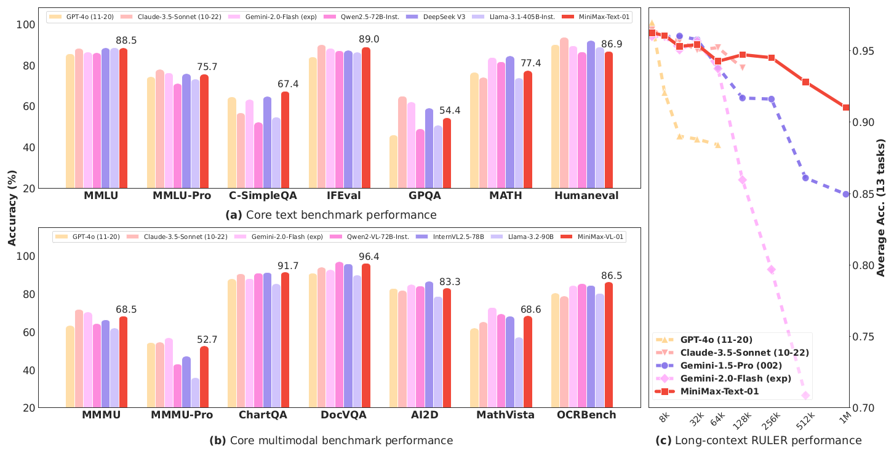

*图 1（原文 Figure 1，第 1 页）：论文开篇的成绩总览。(a) 核心文本基准，(b) 核心多模态基准，(c) 长上下文 RULER 基准。*

**图中文字翻译与读法**：

- **(a) Core text benchmark performance（核心文本基准）**：纵轴 Accuracy (%)；七组基准 MMLU、MMLU-Pro、C-SimpleQA、IFEval、GPQA、MATH、Humaneval；每组七根柱子依次为 GPT-4o (11-20)、Claude-3.5-Sonnet (10-22)、Gemini-2.0-Flash (exp)、Qwen2.5-72B-Inst.、DeepSeek V3、Llama-3.1-405B-Inst.、MiniMax-Text-01（最右，红色）。红柱顶标出的数值为 88.5、75.7、67.4、89.0、54.4、77.4、86.9。
- **(b) Core multimodal benchmark performance（核心多模态基准）**：七组基准 MMMU、MMMU-Pro、ChartQA、DocVQA、AI2D、MathVista、OCRBench；对比 GPT-4o (11-20)、Claude-3.5-Sonnet (10-22)、Gemini-2.0-Flash (exp)、Qwen2-VL-72B-Inst.、InternVL2.5-78B、Llama-3.2-90B 与 MiniMax-VL-01（最右，红色），红柱顶数值为 68.5、52.7、91.7、96.4、83.3、68.6、86.5（OCRBench 原始分为 865，图中按百分制画成 86.5）。
- **(c) Long-context RULER performance（长上下文 RULER 表现）**：横轴为上下文长度（4k 到 1M，按 2 的幂排列的 9 个长度），右侧纵轴 Average Acc. (13 tasks) 为 13 个任务的平均准确率；红色方块实线是 MiniMax-Text-01，其余虚线为 GPT-4o、Claude-3.5-Sonnet、Gemini-1.5-Pro、Gemini-2.0-Flash。各模型的曲线在其支持的最大长度处中断。
- **读图结论**：(a)(b) 说明 MiniMax 与同类顶级模型处在同一档，有的任务领先、有的落后（精确数字见表 8、表 13）；(c) 才是它的特色：长度超过 128k 之后，Gemini-2.0-Flash 与 Gemini-1.5-Pro 的曲线明显下滑，而红线到 1M 仍有 0.910（精确数字见表 9）。顺带一提，图 1(a) 中 IFEval 标为 89.0，而表 8 中为 89.1，原文自身有这个 0.1 的出入。

## 二、背景与动机

### 2.1 问题：上下文窗口为什么长不上去

原文引言（第 1 节）指出，主流模型的上下文窗口在 32K–256K 之间，而读一本专业书、辅助整个代码工程、用大量示例做 many-shot in-context learning，都需要更长的上下文。过去两年窗口变长，主要靠更强的 GPU 和 I/O-aware 的 softmax attention 实现（FlashAttention、Ring Attention）。但 softmax attention 的计算量随序列长度二次增长，继续加长，需求增速会超过硬件增速。

学界提出过稀疏 attention、线性 attention、长卷积、状态空间模型（Mamba 系列）和线性 RNN 等降低复杂度的办法，理论上都有吸引力，但在商用规模的模型里几乎没有被采用。

### 2.2 论文的目标与技术路线

目标：质量上对标顶级商用模型，同时上下文窗口长一个数量级。路线分三步：

1. **选架构**：要的是“不仅理论上线性、而且在长上下文下实际很高效”的线性 attention。经过大量实验，选定以 lightning attention（TransNormer 线性 attention 的 I/O-aware 实现）为主的混合结构：每 7 个使用 lightning attention 的 transnormer block 之后，放 1 个使用 softmax attention 的 transformer block。
2. **定规模**：以一个实际约束来确定总参数——能在一台最多 8 张 GPU、640 GB 显存的机器上，用 8-bit 量化处理超过 100 万 token。用 MoE 提高参数与计算容量；权衡训练资源、推理资源与最终性能后，实验把规格定在 456B 总参数、45.9B 激活参数、32 个专家。
3. **重做系统**：现有分布式训练和推理框架主要为 softmax attention 优化，而这个架构同时包含 lightning attention、softmax attention 与 MoE，需要重新设计：MoE 的 all-to-all 通信使用 EP 与 ETP 重叠，长序列使用 varlen ring attention 与改进的 LASP，推理侧实现整套 lightning attention CUDA kernel。

在此基础上依次做数据、预训练、三阶段长上下文扩展与对齐，最后接入轻量 ViT 得到 MiniMax-VL-01。

### 2.3 论文自称的四点贡献

1. 得到一个在标准学术基准上可与顶级闭源模型比肩的模型，并支持最长 4M token 的输入。
2. 首次大规模成功落地线性 attention（“first successful large-scale implementation”是作者自己的说法），并公开算法设计与工程优化细节。
3. 给出探索模型、数据、评测与算法的实用方法论（缩放定律实验、数据实验范式等）。
4. 公开权重并提供低价 API。

### 2.4 读下去需要的前置知识

**softmax attention 的开销**。对 $n$ 个 token，$\mathbf{Q},\mathbf{K},\mathbf{V}\in\mathbb{R}^{n\times d}$，标准 attention 为 $\mathbf{O}=\mathrm{softmax}(\mathbf{Q}\mathbf{K}^\top/\sqrt d)\,\mathbf{V}$，需要形成 $n\times n$ 的得分矩阵，计算量为 $O(n^2d)$。自回归解码时，每生成一个新 token，要和已有的所有 $K,V$ 做 attention，所以必须保存随长度线性增长的 KV cache。

**线性 attention 的核心恒等式**。如果把 softmax 去掉（TransNormer 的 NormAttention 就是这样），矩阵乘法满足结合律：$(\mathbf{Q}\mathbf{K}^\top)\mathbf{V}=\mathbf{Q}(\mathbf{K}^\top\mathbf{V})$。右边先算 $d\times d$ 的 $\mathbf{K}^\top\mathbf{V}$，再让每个 query 去乘它，计算量降为 $O(nd^2)$，且 $\mathbf{K}^\top\mathbf{V}$ 可以随新 token 递推更新，解码时每个 token 的开销与长度无关。第四节详细讲。

**MoE（混合专家）**。把每层的 FFN 换成多个并行的 FFN“专家”，路由器为每个 token 选出得分最高的 $k$ 个专家，只有这些专家参与计算。于是总参数大、每 token 激活参数小。第五节详细讲。

## 三、整体架构

### 3.1 模型规格

下表为本文根据原文第 2 节正文及第 4 节整理的规格汇总（原文没有这张表，数字均来自正文）。

| 项目 | 取值 |
|---|---|
| 层数 | 80；每 8 层为一个单元，含 7 层 lightning attention 和 1 层 softmax attention，共 10 个单元（70 层 lightning + 10 层 softmax，层数为按 7:1 推算） |
| hidden size | 6144 |
| 注意力头 | 每个 attention 模块 64 个头，head 维度 128 |
| softmax 层 | Group Query Attention（GQA），group size 为 8 |
| 位置编码 | RoPE 只作用在一半的 head 维度上；预训练起始基频 10,000，长上下文扩展时改为 5M 和 10M（见表 6） |
| MoE | 每层 32 个专家，top-2 路由；每个专家的 FFN 隐层维度 9216 |
| 归一化 | DeepNorm（后归一化）；$\alpha=(2N)^{0.25}$、$\beta=(8N)^{-0.25}$，$N$ 为层数 |
| 参数量 | 总计 456B，每个 token 激活 45.9B |
| 词表 | 200K（byte-level BPE） |
| 序列长度 | 预训练 8192，长上下文扩展到 1M，推理外推到 4M |

按 $N=80$ 代入，$\alpha\approx3.56$、$\beta\approx0.199$（自行估算）。

### 3.2 读图 3：每个块长什么样

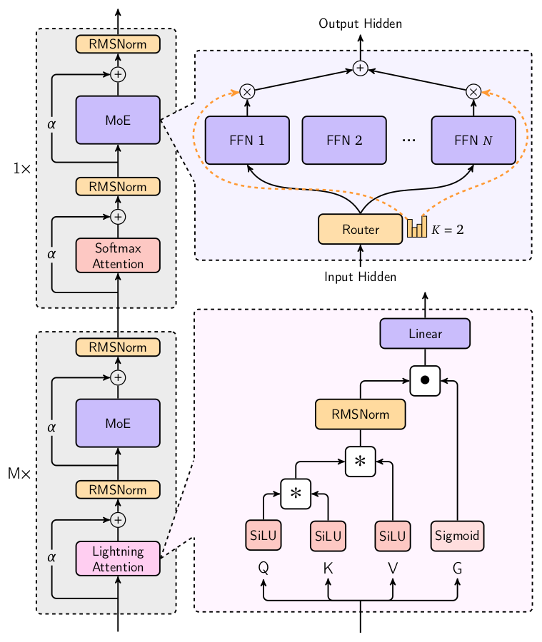

*图 3（原文 Figure 3，第 4 页）：左边是层的堆叠方式，右上放大 MoE，右下放大 lightning attention。*

**图中文字翻译与读法**：

- **左侧两个灰色框**：下方标有“M×”的框是 lightning attention 块，上方标有“1×”的框是 softmax attention 块。$M=7$，二者合成一个 8 层单元，重复 10 次得到 80 层。每个块的结构相同：attention（Lightning Attention 或 Softmax Attention）→ 与残差相加（残差分支乘系数 $\alpha$，即 DeepNorm 的缩放）→ RMSNorm → MoE → 与残差相加（残差分支乘 $\alpha$）→ RMSNorm。注意归一化放在残差相加之后，这是 PostNorm 结构。
- **右上（紫色虚线框）MoE**：Input Hidden（输入隐状态）→ Router（路由器；旁边的小柱状图表示各专家的得分，$K=2$ 表示取 top-2）→ 选中的 FFN（FFN 1、FFN 2、…、FFN $N$ 为全部专家）→ 乘上路由权重（⊗）→ 求和（⊕）→ Output Hidden（输出隐状态）。橙色虚线表示路由权重的流向。
- **右下（粉色虚线框）Lightning Attention 内部**：输入同时投影出 Q、K、V、G 四路。Q、K、V 各过一个 SiLU，G 过 Sigmoid（作门）；Q、K、V 之间做线性 attention 运算（图中两个 * 号合起来表示第四节的运算，先后次序只是示意），结果经 RMSNorm，与门 G 逐元素相乘（● 号），最后经 Linear（输出投影）。
- **读图结论**：这个模型在“每一层”里都有 MoE，所以 FFN 部分每层都是稀疏的；attention 部分则是 7:1 的线性/softmax 混合。随序列长度增长的成本主要来自那 10 层 softmax attention（lightning 层每个 token 的开销与长度无关）。

论文的说法：每个 Transformer 风格的块由一个 channel mixer（attention 块）和一个 feature mixer（MLP 块）组成；channel mixer 有 lightning attention 和 softmax attention 两种，feature mixer 是包含多个 FFN 的 MoE；为了在 MoE 里保持负载均衡，作者提出受 GShard 启发的 global router；并整合 DeepNorm 来提升整体性能。

### 3.3 一个自行估算：KV cache 到底省多少

论文没有给出 KV cache 的数字。下面根据论文给出的结构参数（64 个头、head 维度 128、softmax 层的 GQA group size 为 8，即 64 个 query 头对应 8 个 KV 头、共 10 层 softmax 层）做一个粗略估算，用来理解“只保留 1/8 softmax 层”的意义：

- 每个 softmax 层，每个 token 要缓存的元素数为 $2\times8\times128=2048$（K 和 V 各 8 个头、每头 128 维）；10 层共 20,480 个元素。
- 序列长度 1M 时约为 $2.05\times10^{10}$ 个元素；按 16-bit 存储约 41 GB，按 8-bit 约 20.5 GB。如果 80 层都是 softmax 层（同样的 GQA），则是它的 8 倍，约 328 GB（16-bit）。
- 每个 lightning 层的状态是每头一个 $128\times128$ 的矩阵，共 $64\times128\times128=1{,}048{,}576$ 个元素，与序列长度无关；70 层合计约 $7.3\times10^{7}$ 个元素，约 0.15 GB（16-bit）。序列长度超过 $1{,}048{,}576/2048=512$ 个 token 之后，一个 softmax 层的 KV cache 就比一个 lightning 层的状态更大。

这只是 KV cache 与状态本身，不含 456B 权重、激活和其他开销；是否以 8-bit 缓存 KV，论文没有说明。

## 四、Lightning Attention 如何做到线性复杂度

### 4.1 线性 attention 与“右乘技巧”

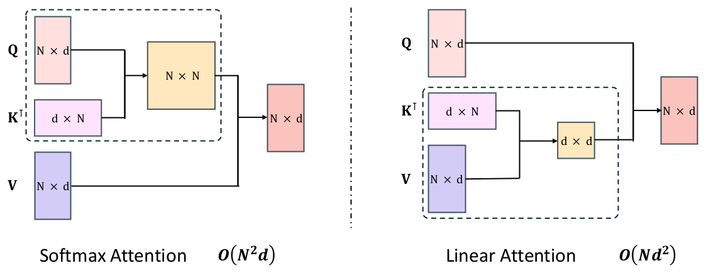

*图 5（原文 Figure 5，第 6 页）：左，softmax attention；右，线性 attention。输入长度为 $N$，特征维度为 $d$，$d\ll N$。*

**图中文字翻译与读法**：

- **左图 Softmax Attention，$O(N^2d)$**：虚线框内先把 Q（$N\times d$）与 $\mathbf{K}^\top$（$d\times N$）相乘，得到橙色的 $N\times N$ 矩阵；再与 V（$N\times d$）相乘，得到输出（$N\times d$）。中间的 $N\times N$ 矩阵是平方复杂度的来源。
- **右图 Linear Attention，$O(Nd^2)$**：虚线框内先把 $\mathbf{K}^\top$（$d\times N$）与 V（$N\times d$）相乘，得到橙色的 $d\times d$ 小矩阵；再让 Q（$N\times d$）与它相乘，得到输出（$N\times d$）。图注说同一个虚线框内的张量是一起参与计算的，线性化的写法使时间与空间复杂度都是 $O(N)$。
- **读图结论**：两种写法在没有 softmax 的情况下数学上等价，区别只是矩阵乘法的结合顺序；$d\ll N$ 时右边便宜得多。

以 TransNormer 为例，论文给出 NormAttention：

$$
\mathbf{O}=\mathrm{Norm}\big((\mathbf{Q}\mathbf{K}^\top)\mathbf{V}\big),\qquad(2)
$$

用右乘改写为线性形式：

$$
\mathbf{O}=\mathrm{Norm}\big(\mathbf{Q}(\mathbf{K}^\top\mathbf{V})\big).\qquad(3)
$$

其中 $\mathbf{Q},\mathbf{K},\mathbf{V}\in\mathbb{R}^{n\times d}$，$n$ 为序列长度，$d$ 为特征维度。线性形式的训练复杂度是 $O(nd^2)$，而且可以用递推方式更新 $\mathbf{K}^\top\mathbf{V}$，因此推理时每个新 token 的开销是与长度无关的 $O(d^2)$，不必重复计算整个 attention 矩阵。论文在这里对比说 softmax attention 推理时的复杂度是 $O(nd^2)$；按标准分析，带 KV cache 的解码每个新 token 的开销是 $O(nd)$，原文这一写法与标准分析不一致，疑为笔误，但不影响“softmax 随长度增长、线性 attention 不随长度增长”的结论。

### 4.2 因果语言建模里右乘为什么失效

语言模型要求因果掩码：第 $t$ 个 token 只能看到 $s\le t$ 的 token。有掩码时，每一行 query 需要的是不同长度前缀上的 $\sum_{s\le t}\mathbf{k}_s\mathbf{v}_s^\top$，不能再把整个 $\mathbf{K}^\top\mathbf{V}$ 一次算好，需要做 cumsum（前缀累加）。这个操作难以高效并行，论文认为这很可能就是线性 attention 虽然在 2016 年就有人提出（de Brébisson 与 Vincent），LLaMA3、Qwen2.5、DeepSeek-V3、Mistral 等主流开源 LLM 却都没有采用它的原因。lightning attention 针对的正是这个瓶颈：用一种新的分块（tiling）技术绕开 cumsum。

带因果掩码的“左乘”写法和“右乘”递推写法分别是：

$$
\mathbf{O}=\big[(\mathbf{Q}\mathbf{K}^\top)\odot\mathbf{M}\big]\mathbf{V},\qquad(4)
$$

$$
\mathbf{kv}_0=\mathbf{0},\qquad \mathbf{kv}_t=\mathbf{kv}_{t-1}+\mathbf{k}_t\mathbf{v}_t^\top,\qquad \mathbf{o}_t^\top=\mathbf{q}_t^\top\mathbf{kv}_t.\qquad(5)
$$

式 (4) 中掩码 $\mathbf{M}_{ts}=1$ 当 $t\ge s$，否则为 0；$\odot$ 是逐元素乘。式 (5) 中 $\mathbf{kv}_t\in\mathbb{R}^{d\times d}$ 是到第 $t$ 个 token 为止的累计状态。式 (4) 要形成 $n\times n$ 矩阵，复杂度是平方；式 (5) 是线性的，但第 $t$ 步依赖第 $t-1$ 步，天然不可并行。lightning attention 要的是二者的折中。

为了便于推导，论文刻意略去了归一化、SiLU 激活和门控；图 12 中出现的衰减矩阵 $D$（init diag with decay）说明实际实现里还有衰减因子，正文没有展开。

### 4.3 分块推导：块内用左乘，块间用右乘

把 $\mathbf{Q},\mathbf{K},\mathbf{V}$ 沿序列维度切成两块：

$$
\mathbf{X}=\begin{bmatrix}\mathbf{X}_1\\ \mathbf{X}_2\end{bmatrix},\quad \mathbf{X}_1\in\mathbb{R}^{m\times d},\ \mathbf{X}_2\in\mathbb{R}^{(n-m)\times d},\quad \mathbf{X}\in\{\mathbf{Q},\mathbf{K},\mathbf{V}\}.
$$

对第一块内的位置 $s=1,\dots,m$，展开递推：

$$
\mathbf{kv}_s=\mathbf{kv}_0+\sum_{j=1}^{s}\mathbf{k}_j\mathbf{v}_j^\top,\qquad
\mathbf{o}_s^\top=\mathbf{q}_s^\top\mathbf{kv}_s=\mathbf{q}_s^\top\mathbf{kv}_0+\mathbf{q}_s^\top\sum_{j=1}^{s}\mathbf{k}_j\mathbf{v}_j^\top.\qquad(6)
$$

写成块形式，第一块的输出为：

$$
\mathbf{O}_1=\mathbf{Q}_1\mathbf{kv}_0+\big[(\mathbf{Q}_1\mathbf{K}_1^\top)\odot\mathbf{M}\big]\mathbf{V}_1\ \triangleq\ \mathbf{Q}_1\mathbf{KV}_0+\big[(\mathbf{Q}_1\mathbf{K}_1^\top)\odot\mathbf{M}\big]\mathbf{V}_1.\qquad(7)
$$

这里第一项是**块间**（inter-block）部分：块外所有历史 token 对当前块的贡献，被压缩成一个 $d\times d$ 的状态 $\mathbf{KV}_0$，所有 query 共用，可以用右乘；第二项是**块内**（intra-block）部分：块内部仍然需要因果掩码，用左乘。第二块同理：

$$
\mathbf{kv}_{m+t}=\mathbf{kv}_m+\sum_{j=m+1}^{m+t}\mathbf{k}_j\mathbf{v}_j^\top,\quad t=1,\dots,n-m,\qquad \mathbf{o}_{m+t}^\top=\mathbf{q}_{m+t}^\top\mathbf{kv}_{m+t},
$$

$$
\mathbf{O}_2=\mathbf{Q}_2\mathbf{kv}_m+\big[(\mathbf{Q}_2\mathbf{K}_2^\top)\odot\mathbf{M}\big]\mathbf{V}_2\ \triangleq\ \mathbf{Q}_2\mathbf{KV}_1+\big[(\mathbf{Q}_2\mathbf{K}_2^\top)\odot\mathbf{M}\big]\mathbf{V}_2.\qquad(8)
$$

第二块要用的状态 $\mathbf{KV}_1=\mathbf{kv}_m$ 由上一个状态累加本块 $\mathbf{K}_1^\top\mathbf{V}_1$ 得到：

$$
\mathbf{KV}_1=\mathbf{KV}_0+\sum_{j=1}^{m}\mathbf{k}_j\mathbf{v}_j^\top=\mathbf{KV}_0+\mathbf{K}_1^\top\mathbf{V}_1.\qquad(9)
$$

递归地对序列继续分块，每块大小为 $B$，总复杂度为 $O(nd^2+nBd)$：块间项和状态更新每块 $O(Bd^2)$，共 $n/B$ 块，合计 $O(nd^2)$；块内项每块 $O(B^2d)$，合计 $O(nBd)$。$B$ 取得小（论文实现里训练用 256），块内的平方项就可忽略，整体保持线性。

一个 4 个 token、块大小 2 的例子：前两个 token 的输出只有块内项 $\mathbf{O}_1=[(\mathbf{Q}_1\mathbf{K}_1^\top)\odot\mathbf{M}]\mathbf{V}_1$（此时 $\mathbf{KV}_0=\mathbf{0}$）；后两个 token 的输出是 $\mathbf{O}_2=\mathbf{Q}_2(\mathbf{K}_1^\top\mathbf{V}_1)+[(\mathbf{Q}_2\mathbf{K}_2^\top)\odot\mathbf{M}]\mathbf{V}_2$。后两个 token 对前两个 token 的全部依赖，都通过 $d\times d$ 的小矩阵 $\mathbf{K}_1^\top\mathbf{V}_1$ 传递。

### 4.4 Algorithm 1：lightning attention 前向（原文第 8 页）

输入 $\mathbf{Q},\mathbf{K},\mathbf{V}\in\mathbb{R}^{n\times d}$ 与块大小 $B$。

1. 把 $\mathbf{Q},\mathbf{K},\mathbf{V},\mathbf{O}$ 各切成 $T=n/B$ 块，每块 $B\times d$。
2. 初始化掩码 $\mathbf{M}\in\mathbb{R}^{B\times B}$（$\mathbf{M}_{ts}=1$ 当 $t\ge s$，否则 0）和状态 $\mathbf{KV}=\mathbf{0}\in\mathbb{R}^{d\times d}$。
3. 对 $t=1,\dots,T$ 循环：
   1. 把 $\mathbf{Q}_t,\mathbf{K}_t,\mathbf{V}_t$ 从 HBM 读入片上 SRAM；
   2. 片上计算块内项 $\mathbf{O}_{\text{intra}}=[(\mathbf{Q}_t\mathbf{K}_t^\top)\odot\mathbf{M}]\mathbf{V}_t$；
   3. 片上计算块间项 $\mathbf{O}_{\text{inter}}=\mathbf{Q}_t\mathbf{KV}$（此时 $\mathbf{KV}$ 还是前面所有块的累计）；
   4. 片上更新状态 $\mathbf{KV}\leftarrow\mathbf{KV}+\mathbf{K}_t^\top\mathbf{V}_t$；
   5. 把 $\mathbf{O}_t=\mathbf{O}_{\text{intra}}+\mathbf{O}_{\text{inter}}$ 写回 HBM。
4. 返回 $\mathbf{O}$。

和 FlashAttention 一样，它是 I/O-aware 的：每个块只从 HBM 读一次输入、写一次输出，中间的块内得分矩阵只存在于片上。区别是：它不需要 $n\times n$ 的得分矩阵，也不需要 softmax 的在线归一化统计量，因为没有 softmax。

注意顺序：第 3.3 步用的是更新之前的 $\mathbf{KV}$，也就是只包含该块之前的 token，这与因果性一致。

## 五、MoE 与负载均衡（原文第 2.1 节）

### 5.1 MoE 公式与 token-drop

对输入 token $\mathbf{x}_t$，MoE 层输出的隐状态为：

$$
\mathbf{h}_t=\sum_{i=1}^{E}\mathrm{Softmax}_i\big(\mathrm{TopK}(\mathbf{x}_t\cdot\mathbf{W}_g)\big)\cdot\mathrm{FFN}_i(\mathbf{x}_t),\qquad(1)
$$

$E$ 是专家总数，$\mathbf{W}_g$ 是门控（路由器）权重，$\mathrm{FFN}_i$ 是第 $i$ 个专家，$\mathrm{TopK}(\cdot)$ 保留 $E$ 个得分中最大的 $k$ 个、其余置为 $-\infty$。所以经过 softmax 之后，未被选中的专家权重为 0，被选中的 $k$ 个专家权重之和为 1。本模型 $E=32$、$k=2$。

MoE 训练可分为 token-drop 与 dropless 两类。论文为了训练效率采用 **token-drop**：给每个专家设一个容量上限（最多处理多少个 token）；达到上限后，再被路由到该专家的 token 就被丢弃。论文没有给出具体的容量系数。

### 5.2 为什么用 MoE：图 4

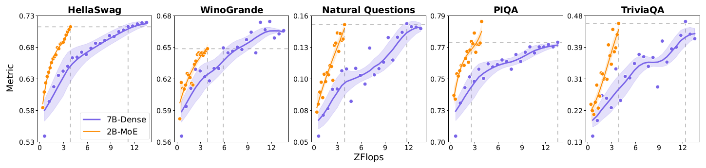

*图 4（原文 Figure 4，第 5 页）：Isoflop 比较，MoE 对稠密模型，两者都训练 1T token。*

**图中文字翻译与读法**：

- **比较对象**：7B-Dense（7B 参数的稠密模型，紫色）与 2B-MoE（激活 2B、总计 24B 参数的 MoE，橙色）。
- **五个子图**：HellaSwag、WinoGrande、Natural Questions、PIQA、TriviaQA。横轴 ZFlops 为训练累计算力，纵轴 Metric 为对应指标；散点为各次评测的实测值，实线与浅色带为平滑曲线及其范围（图注未说明其具体含义）。
- **灰色虚线**：横向虚线表示 MoE 训练结束时达到的指标水平，纵向虚线读出 MoE 与稠密模型各自达到该水平所需的算力，两条纵向虚线的间距就是算力差距。
- **读图结论**：五个基准上，橙色曲线都在紫色曲线左上方，即同等算力下 MoE 指标更高。从图上读出的近似数值：HellaSwag 上 MoE 约 4 ZFlops 达到的水平，稠密模型约需 11 ZFlops；WinoGrande 差距最小，约 4 对约 6 ZFlops。

### 5.3 路由坍塌、辅助损失与 global router

模型变大后，作者遇到了**路由坍塌**（routing collapse）：分配给各专家的 token 分布过于集中。对策是在 GShard 辅助损失的基础上加一个简单的全局路由策略。

**辅助损失**。为保证可微，定义

$$
L_{\mathrm{aux}}=\alpha_{\mathrm{aux}}\cdot\frac1E\sum_{i=1}^{E}f_i\cdot m_i,
$$

其中 $\alpha_{\mathrm{aux}}$ 为系数（预训练中取 0.01，见第 4.2 节），$f_i$ 是分配给第 $i$ 个专家的 token 比例，$m_i$ 是专家 $i$ 的平均路由概率。$f_i$ 本身不可导，梯度经 $m_i$ 传回，因此同时被大量 token 选中且概率高的专家会被惩罚。

**Global router（全局路由）**。显存限制了 micro batch 的大小，使得单个专家并行（EP）组内的 token 分布波动很大；不同 EP 组之间的 token 分布也不同，可能出现一个 EP 组内专家过载、另一组内专家闲置。论文的做法是跨 EP 组做全局的 token 调度：在把 token 派发到不同 EP 组之前，多加一次 allgather 通信，同步各专家待处理的 token 数。在同样的容量约束下，这一机制能降低整体的 token 丢弃率，保证训练稳定。原文只描述了这一步，容量如何据此重新分配没有展开。

**与 DeepSeek-V3 的对比**（后者的做法见 [DeepSeek-V3 中文解读](../deepseek_v3/论文中文解读.md)）：DeepSeek-V3 用“无辅助损失”的动态偏置做负载均衡（偏置按每步整个 batch 的专家负载调整，另加一个很小的序列级辅助损失作补充），训练和推理都不丢 token；MiniMax-01 接受 token-drop，用辅助损失加上全局调度来压低丢弃率，代价是多一次全局通信。

## 六、缩放定律与混合结构的实验验证（原文第 2.2.2–2.4 节）

这一部分回答两个问题：lightning attention 放大到大模型之后还好用吗？为什么最终选的是“混合”而不是纯 lightning？

### 6.1 实验设置

- **三种结构**：softmax（使用 FlashAttention-2）、lightning attention、hybrid-lightning（每隔 8 层把 lightning 层换成 softmax 层）。
- **规模**：70M、160M、410M、1B、3B、7B 参数。每个模型最多训练 300B token，上下文长度 8192。
- **训练方式**：沿用 Chinchilla 的做法，用训练损失直接作为测试性能的指标。对每种结构和训练序列长度，全局 batch size 统一为 400 万 token；Adam 优化器，学习率 3e-4，权重衰减 0.1；因算力受限，所有实验使用固定的学习率调度。
- **评测基准**：BoolQ、PIQA、SIQA、HellaSwag、WinoGrande、ARC（easy 与 challenge）、OpenBookQA、NIAH（大海捞针）和 SCROLLS（长文本理解），分别考察不同能力。

作者在这些实验里观察到 lightning attention 的检索能力有限，于是尝试了把其中部分层换回 softmax 的混合结构。

### 6.2 表 1：参数量与 FLOPs 公式

符号：$l$ 层数，$d$ 模型维度，$h$ 头数，$b$ batch size，$n$ 序列长度；FLOPs 沿用 Kaplan 等（2020）的算法。为使缩放定律拟合更贴近实测，表中参数量不含 embedding 与其他次要项。

| 结构 | 参数量 | FLOPs |
|---|---|---|
| Softmax Attention | $12ld^2$ | $72bnld^2\left(1+\frac{n}{6d}+\frac{5}{18d}\right)$ |
| Lightning Attention | $12ld^2+\frac{2ld^2}{h}$ | $72bnld^2\left(1+\frac{1}{2h}+\frac{5}{18d}\right)$ |
| Hybrid-lightning | $12ld^2+\frac{7ld^2}{4h}$ | $72bnld^2\left(1+\frac{n}{48d}+\frac{7}{16h}+\frac{5}{18d}\right)$ |

（原文表 1，第 8 页。）读法：括号中的 1 对应参数相关的矩阵乘，$\frac{n}{6d}$ 是 softmax attention 的平方项，随 $n$ 增长；lightning 的对应项 $\frac1{2h}$ 与 $n$ 无关。hybrid 恰好是 1/8 softmax 加 7/8 lightning 的加权：$\frac18\cdot\frac{n}{6d}=\frac{n}{48d}$，$\frac78\cdot\frac1{2h}=\frac{7}{16h}$，参数额外项 $\frac78\cdot\frac{2ld^2}{h}=\frac{7ld^2}{4h}$。lightning 比 softmax 多出的参数 $2ld^2/h$，原文没有说明来源。

### 6.3 表 2 与图 6：缩放定律

方法：对每种结构，改变模型规模 $N$ 和数据规模 $D$，在不同算力预算 $C$ 下记录训练损失 $L$；先按 Chinchilla 的方法拟合 $L$ 与 $C$ 的幂律，再据此导出最优模型规模 $N_{opt}\propto C^{a}$ 和最优数据规模 $D_{opt}\propto C^{b}$。原始缩放定律（Kaplan）用 $L(X)=(X_0/X)^{\alpha_X}$，后续工作加入不可约损失 $\epsilon$ 写成 $L(X)=\epsilon+(X_0/X)^{\alpha_X}$ 以便更好拟合；为了直接比较，论文把它们统一写成 $L(X)=\beta_X X^{\alpha_X}$。

| 结构 | $L(C)$ | $N_{opt}(C)$ | $D_{opt}(C)$ |
|---|---|---|---|
| Softmax Attention | $3.7087\,C^{-0.0798}$ | $(1.82\times10^{8})\,C^{0.7118}$ | $(2.56\times10^{10})\,C^{0.5102}$ |
| Lightning Attention | $3.5391\,C^{-0.0768}$ | $(2.74\times10^{8})\,C^{0.6470}$ | $(4.43\times10^{10})\,C^{0.4684}$ |
| Hybrid-lightning | $3.4797\,C^{-0.0763}$ | $(2.57\times10^{8})\,C^{0.6670}$ | $(3.70\times10^{10})\,C^{0.4707}$ |

（原文表 2，第 9 页。$C$ 的单位见图 6 横轴，为 PFLOP/s-days。）读法：同等算力预算下，lightning 与 hybrid 的拟合损失都更低（系数 $\beta$ 更小：3.5391、3.4797 对 3.7087），并且使用更多的参数和 token。

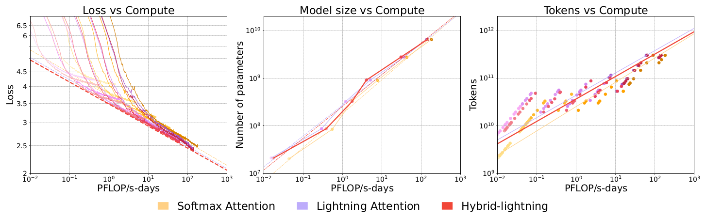

*图 6（原文 Figure 6，第 9 页）：缩放定律汇总。左，训练曲线（涵盖 70M 到 7B 参数的模型）；中，按给定算力预算估计的最优模型规模；右，最优训练 token 数。*

**图中文字翻译与读法**：

- **左图 Loss vs Compute（损失对算力）**：横轴 PFLOP/s-days（$10^{-2}$ 到 $10^{3}$，对数刻度），纵轴 Loss（对数刻度）。许多细曲线是不同规模、不同结构的单次训练曲线；粗虚线是各结构的幂律拟合，最下方的红色虚线是 hybrid-lightning。
- **中图 Model size vs Compute（最优模型规模对算力）**：纵轴 Number of parameters（$10^{7}$ 到 $10^{10}$）。
- **右图 Tokens vs Compute（最优 token 数对算力）**：纵轴 Tokens（$10^{9}$ 到 $10^{12}$）；直线为拟合，散点为各次实验。
- **图例**：Softmax Attention（浅橙）、Lightning Attention（浅紫）、Hybrid-lightning（红）。
- **读图结论**：左图中 hybrid 的拟合线位于 softmax 之下；中、右图中，在拟合区间的大部分范围内，hybrid 与 lightning 的最优规模线和最优 token 线位于 softmax 之上（算力较大处几条线逐渐靠拢），与表 2 一致。

**自行估算（代入表 2 的拟合式）**：取 $C=10^{3}$ PFLOP/s-days，softmax、lightning、hybrid 的拟合损失约为 2.137、2.082、2.054；最优参数量约为 $2.49\times10^{10}$、$2.39\times10^{10}$、$2.58\times10^{10}$。也就是说损失的优势稳定存在，但“用更多参数”的优势在 $C\approx10^{3}$ 附近已基本消失（hybrid 与 softmax 的 $N_{opt}$ 曲线在 $C\approx2\times10^{3}$ 处相交，$D_{opt}$ 约在 $10^{4}$ 处相交，都已超出图 6 的横轴范围）。表 2 的结论只应在拟合区间内理解，外推要谨慎。

### 6.4 图 7：下游任务表现

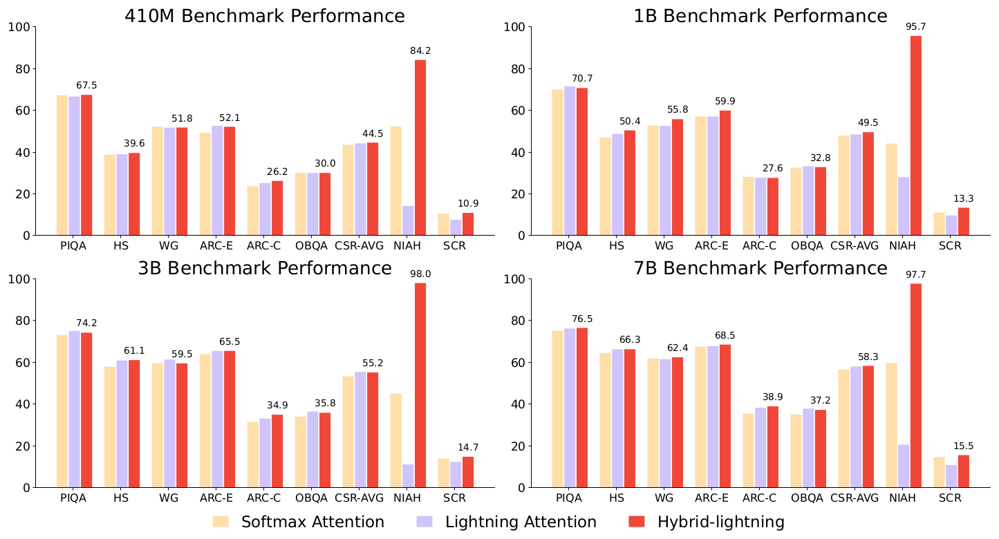

*图 7（原文 Figure 7，第 10 页）：410M、1B、3B、7B 参数模型上，softmax、lightning 与 hybrid-lightning 的下游表现。*

**图中文字翻译与读法**：

- **四个子图**：410M、1B、3B、7B Benchmark Performance。纵轴为分数（0–100）。每个子图有九组：PIQA、HS（HellaSwag）、WG（WinoGrande）、ARC-E、ARC-C、OBQA（OpenBookQA）、CSR-AVG（上述六项的平均，即常识推理平均分）、NIAH（大海捞针）、SCR（SCROLLS 平均分）。
- **三色柱**：浅橙 Softmax Attention、浅紫 Lightning Attention、红色 Hybrid-lightning；只有红柱标了数值。
- **红柱的标注值**（410M / 1B / 3B / 7B）：NIAH 为 84.2 / 95.7 / 98.0 / 97.7；SCR 为 10.9 / 13.3 / 14.7 / 15.5；CSR-AVG 为 44.5 / 49.5 / 55.2 / 58.3。
- **从柱高读出的近似值（误差约 ±2）**：NIAH 上 softmax 约 53 / 44 / 45 / 60，lightning 约 14 / 28 / 11 / 20（同样按 410M / 1B / 3B / 7B 顺序）。
- **读图结论**：在 PIQA、HS、WG、ARC、OBQA 和 CSR 平均上，三种结构的差距很小；NIAH 上 lightning 远落后于 softmax，而 hybrid 反而远超 softmax。论文据此得出：线性 attention 的语言建模能力与 Transformer 相近，但检索能力不足，不适合单独用于 LLM；hybrid-lightning 不仅追平、还超过 softmax 的检索与外推能力，适合 LLM 的上下文学习。

### 6.5 图 8：训练速度

作者用 3B 参数模型测端到端训练速度，指标 TGS（每张 GPU 每秒处理的 token 数）。为完整起见，还加入了流行的线性模型 HGRN2 与 Mamba2。测速时训练上下文长度逐渐增大，直到单节点 H800 显存溢出。

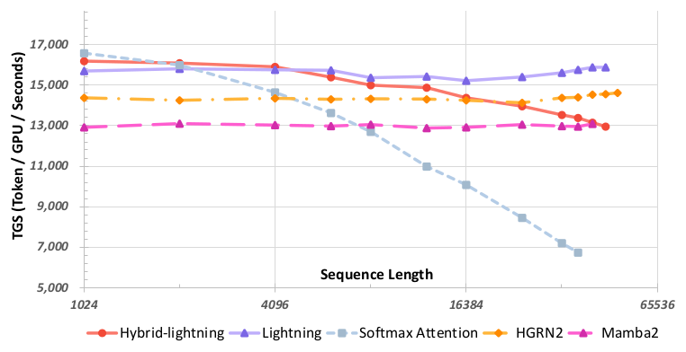

*图 8（原文 Figure 8，第 10 页）：softmax、lightning、hybrid-lightning、HGRN2、Mamba2 在序列长度 1,024 到 65,536 上的训练速度。*

**图中文字翻译与读法**：

- **横轴 Sequence Length（序列长度）**：1024、4096、16384、65536（对数刻度）；**纵轴 TGS (Token / GPU / Seconds)**：每 GPU 每秒处理的 token 数，刻度 5,000 到 17,000。
- **图例**：Hybrid-lightning（红色圆点）、Lightning（紫色三角）、Softmax Attention（灰蓝方块虚线）、HGRN2（橙色菱形）、Mamba2（粉色三角）。
- **从图上读出的近似值**：softmax 从序列长度 1024 时约 1.66 万降到曲线终点处约 0.67 万，且曲线比其他模型更早结束；lightning 基本平稳在约 1.5–1.6 万；hybrid-lightning 从约 1.6 万缓降到约 1.3 万；HGRN2 约 1.4–1.5 万；Mamba2 约 1.3 万。
- **读图结论**：lightning 的训练速度几乎不随序列长度变化；论文称它是“唯一一个跑赢 FlashAttention-2 的线性模型”（原文字面）。从图上看，HGRN2 与 Mamba2 在更长的序列处同样高于 softmax 曲线，所以这句话的口径（大概是指在 softmax 仍然很快的中短序列上，lightning 也不输）原文没有说明。在最短序列处 softmax 与 lightning 速度接近（softmax 略高），长度增大后 softmax 迅速变慢；hybrid 因为保留了 1/8 的 softmax 层，速度随长度缓慢下降。

### 6.6 表 3 与表 4：哪种混合方式最好

**表 3：1B 参数的几种“线性 + softmax”混合**。除 lightning 外，还试了 hybrid-cosformer2（把 cosformer2 架构里每隔 8 层的线性层换成 softmax）和 hybrid-hgrn2（HGRN2 同样处理）。指标越高越好；TGS 为每 GPU 每秒 token 数；CSR 为前六项平均；NIAH 为加权平均准确率；SCR 为 SCROLLS 平均分。

| 混合架构 | TGS | PIQA | HS | WG | ARC-E | ARC-C | OBQA | CSR | NIAH | SCR |
|---|---:|---:|---:|---:|---:|---:|---:|---:|---:|---:|
| Hybrid-cosformer2 | 23.3K | 70.29 | 45.63 | 51.46 | 55.77 | 26.11 | 30.60 | 46.64 | 43.6 | 10.9 |
| Hybrid-hgrn2 | 29.5K | **70.89** | **51.23** | **56.51** | 59.68 | **28.50** | 32.40 | **49.87** | 91.8 | 10.8 |
| Hybrid-lightning | **33.4K** | 70.73 | 50.41 | 55.80 | **59.93** | 27.65 | **32.80** | 49.55 | **95.7** | **13.3** |

（原文表 3，第 11 页；粗体为原文标出的该列最佳值。）读法：hybrid-lightning 在速度、NIAH、SCROLLS 上最好，常识推理平均分（CSR）上 hybrid-hgrn2 略高 0.32 分。论文的结论是 hybrid-lightning 整体最佳，但从表里看，说它在所有指标上最优并不准确，更准确的说法是“速度与检索最优、常识推理基本持平”。

**表 4：hybrid-lightning 与 hybrid-window**。滑动窗口注意力（SWA）调整窗口大小后同样是线性复杂度，是个稳健的基线；hybrid-window 是每隔 8 层把 SWA 层换成全 softmax 层。W.S. 为 SWA 窗口大小，PS 为参数量（单位 B）。作者评测了 256 到 1024 的窗口；更大的窗口训练更慢，为了在同等速度下比较没有再考虑。

| 参数量 | 结构 | 窗口 | TGS | PIQA | HS | WG | ARC-E | ARC-C | OBQA | CSR | NIAH | SCR |
|---|---|---:|---:|---:|---:|---:|---:|---:|---:|---:|---:|---:|
| 1B | Hybrid-window | 256 | **35.6K** | 70.29 | 48.68 | 53.35 | 57.95 | **28.75** | 32.60 | 48.61 | 46.8 | 10.6 |
| 1B | Hybrid-window | 512 | 35.1K | **70.95** | 48.19 | 52.33 | 57.53 | 27.22 | 30.00 | 47.70 | 25.7 | 11.9 |
| 1B | Hybrid-window | 1024 | 33.6K | 69.75 | 47.80 | 53.12 | 57.53 | 28.33 | 31.60 | 48.02 | 53.9 | 10.6 |
| 1B | Hybrid-lightning | - | 33.4K | 70.73 | **50.41** | **55.80** | **59.93** | 27.65 | **32.80** | **49.55** | **95.7** | **13.3** |
| 3B | Hybrid-window | 256 | **16.1K** | 73.83 | 59.70 | **59.59** | 64.10 | 33.62 | 35.00 | 54.31 | 40.9 | 14.2 |
| 3B | Hybrid-window | 512 | 15.8K | 73.29 | 60.00 | 59.04 | 62.96 | 32.51 | **36.00** | 53.97 | 57.9 | 14.2 |
| 3B | Hybrid-window | 1024 | 15.4K | **74.27** | 59.02 | 57.85 | 64.56 | 31.91 | 33.00 | 53.44 | 41.6 | 13.3 |
| 3B | Hybrid-lightning | - | 15.1K | 74.21 | **61.06** | 59.51 | **65.49** | **34.90** | 35.80 | **55.16** | **98.0** | **14.7** |

（原文表 4，第 11 页；粗体为原文标出的各参数量内该列最佳值。）读法：hybrid-lightning 的速度与窗口注意力混合模型相当（略慢），NIAH 差距巨大（95.7、98.0，对窗口模型的 25.7–57.9），其余指标多数更好，但并非“全部指标”：例如 3B 下窗口 1024 的 PIQA（74.27）、窗口 512 的 OBQA（36.00）和窗口 256 的 WG（59.59）略高于 hybrid-lightning。

### 6.7 讨论：为什么混合反而比纯 softmax 检索更强

论文用一个线性 RNN 视角解释这个“有点反直觉”的现象。softmax attention 可以写成：

$$
\mathbf{O}=\mathrm{Softmax}\big(\mathbf{Q}\mathbf{K}^\top/\sqrt d\big)\mathbf{V}.\qquad(10)
$$

对某个查询位置 $t$，它也可以写成对 $j=1,\dots,t$ 的线性递推：

$$
s_t^0=0,\quad s_t^j=s_t^{j-1}+\exp\big(\mathbf{q}_t\mathbf{k}_j^\top/\sqrt d\big),\quad
\mathbf{o}_t^j=\frac{s_t^{j-1}}{s_t^j}\,\mathbf{o}_t^{j-1}+\Big(1-\frac{s_t^{j-1}}{s_t^j}\Big)\mathbf{v}_j,\quad
\mathbf{o}_t=\mathbf{o}_t^t.\qquad(11)
$$

这里 $s_t^j$ 是累计的 softmax 分母，$\mathbf{o}_t^j$ 是对前 $j$ 个 value 的加权平均，递推等价于“边读边更新加权平均”。lightning attention 的递推则是：

$$
\mathbf{kv}_0=\mathbf{0},\quad \mathbf{kv}_j=\mathbf{kv}_{j-1}+\mathbf{k}_j\mathbf{v}_j^\top,\quad \mathbf{o}_j=\mathbf{kv}_j^\top\mathbf{q}_j,\quad j=1,\dots,t.\qquad(12)
$$

论文的论述（原文第 2.2.4 节）：

- softmax attention 可以看成一个线性 RNN，但**每个时间步 $t$ 都要从初始位置 $t_0=1$ 起重新计算隐状态**，作者形象地称为“Going Through a Book”（翻书）：对每个查询把整本书从头再读一遍，所以能较准确地保留输入信息。线性模型没有这个重算过程，难以有效保留输入。
- 把 RNN 的**容量**定义为递推状态的大小：式 (11) 的状态是 $O(d)$，式 (12) 的状态是 $O(d^2/h)$。因为 $d>h$，lightning attention 的容量比 softmax attention 大。作者据此认为 hybrid 的检索与外推能力优于纯 softmax。

这只是作者的启发式解释，并没有用实验把“容量”这个因素单独隔离出来。纯 lightning 的容量最大而检索最差，说明容量不是唯一因素；论文真正的证据是图 7、表 3、表 4 的实测，而不是这段推导。

### 6.8 表 5：MoE 规模下的模块消融

在 MoE 上再验证两个模块选择（原文第 2.3 节）：

1. **hybrid-lightning 对 softmax**：以 280 亿总参数、50 亿激活参数、使用 softmax attention 的 MoE 为基础模型；每连续 8 层中，把前 7 层的 softmax 换成 lightning。基础模型与修改后的模型都训练 1T token。
2. **PreNorm 对 PostNorm**：模型为 600 亿总参数、93 亿激活参数、48 层；两个模型都训练 500B token；PostNorm 使用 DeepNorm 以保证训练稳定。动机是混合结构里“有效深度”很重要：PreNorm 让梯度更直接地绕过子层流向输入，相当于降低了有效深度，PostNorm 保留有效深度，但容易梯度消失或爆炸。

| 对比 | 结构 | BBH | DROP | MMLU | CMMLU | MATH | GSM8k | ARC-C | WG |
|---|---|---:|---:|---:|---:|---:|---:|---:|---:|
| attention 类型 | Softmax | 28.2 | 27.4 | 49.3 | **47.3** | 4.6 | **18.8** | 46.4 | 65.6 |
| attention 类型 | Hybrid-lightning | **32.2** | **29.0** | **49.5** | 46.0 | **6.8** | 18.5 | **47.4** | **67.5** |
| 归一化 | Pre Layer Norm | 29.9 | 26.8 | 43.9 | 41.8 | 4.8 | 12.2 | 43.5 | **65.5** |
| 归一化 | Post Layer Norm | **32.6** | **27.6** | **50.2** | **49.2** | **5.7** | **16.8** | **46.2** | 65.4 |

（原文表 5，第 13 页；指标均为越高越好，粗体为原文标出的每组内更优值。）读法：把 7/8 的 softmax 层换成 lightning 后，8 项里 6 项更高（CMMLU、GSM8k 略低），说明混合并没有牺牲通用能力；PostNorm 在 8 项里 7 项更高，仅 WinoGrande 低 0.1（65.4 对 65.5）。论文正文写的是“PostNorm 在所有指标上一致优于 PreNorm”，从表看应为“8 项中的 7 项”。注意上下两组实验的基础模型、规模和 token 数都不同，不能互相比较。

### 6.9 确定最终规格：式 (13) 与式 (14)

确定了模块之后，要放大。作者的目标是兼顾性能与推理效率：单机推理比多机推理高效（省去跨机通信），所以总参数限制在 500B，使得 8 卡、每卡 80 GB 的单机能在 8-bit 量化下处理到 1M token 的序列。给定训练预算，求解的优化问题是：

$$
\min_{P_{\mathrm{all}},P_{\mathrm{act}}}L(P_{\mathrm{all}},P_{\mathrm{act}},T)\quad\text{s.t.}\quad C_{\mathrm{compute}}(P_{\mathrm{all}},P_{\mathrm{act}},T)<C\ \text{and}\ P_{\mathrm{all}}<500B.\qquad(13)
$$

$L$ 为损失，$P_{\mathrm{all}}$、$P_{\mathrm{act}}$ 分别为总参数与激活参数，$T$ 为训练 token 数，$C_{\mathrm{compute}}$ 为计算成本（取决于参数量与数据量），$C$ 为预算。

在小规模模型上，作者先通过对比实验确定了几个关键变量的最优范围：（1）softmax 与线性 attention 的混合比例；（2）模型的深宽比；（3）线性 attention 记忆大小与 hidden size 的比；（4）激活 FFN 与 attention 的比；（5）softmax attention 里使用 RoPE 的维度比例。论文只给出了定性结论：

- 混合架构对层数很敏感，更深的模型一致地优于更浅的；浅模型需要多得多的 softmax 层才能达到相当的性能；
- 增大线性 attention 的记忆大小，性能显著提升；
- 只对 softmax attention 的一半维度加 RoPE，可以在不损失性能的情况下实现长度外推。

这些对比实验的具体数据，包括不同混合比例（为什么是 7:1）的对比，论文没有给出。

随后用已有缩放定律（Clark 等，2022；Hoffmann 等，2022）确定最优规模：训练激活参数从 44M 到 1.2B、500B token、专家数分别为 16、32、64 的一批模型。但这些预测外推到 9.3B 激活参数的模型时变得不可靠。为此作者提出了一个以专家数 $E$ 为条件的拟合式：

$$
L(P_{\mathrm{act}},T\mid E)=d+a\,P_{\mathrm{act}}^{\alpha}+b\,T^{\beta}+c\,(P_{\mathrm{act}}T)^{\gamma},\qquad(14)
$$

其中 $a,b,c,d,\alpha,\beta,\gamma$ 是随专家数拟合的参数。结合式 (13) 与式 (14)，得到候选的最优配置：45.9B 激活参数、456B 总参数。

## 七、计算优化：训练与推理系统（原文第 3 节）

论文说，项目使用的 H800 GPU 集群是动态变化的，数量在 1500 到 2500 张之间。新架构需要扎实的实现优化才能发挥效率，作者归纳了三个挑战：

1. **MoE 的 all-to-all（a2a）通信开销**。所选的专家配置（大专家）对显存要求高，难点在于显存占用、计算效率与 a2a 通信开销三者之间取得平衡。
2. **百万级上下文的 token 切分**。训练和推理都要支持至少 1M token 的窗口，如何把这么长的上下文准确分布到不同 GPU 上，同时尽量减少额外通信，在混合架构下尤其有挑战。
3. **lightning attention 的推理实现**。现有实现主要为训练优化，推理里要处理真实的批输入：长度不一，还带前缀缓存（prefix caching）。

作者认为业界现有的开源框架没有成熟的技术支持来解决这些挑战，因此自行重新设计了分布式训练与推理框架。

### 7.1 MoE 优化：EP 重叠与 ETP

**基本做法：基于 token 分组的重叠（图 9）**。把 token 分成若干组，a2a 通信在专家并行（EP）通信组内进行，并与不同 token 组的专家计算重叠。为保证通信结果正确，每个 ProcessGroup 内的通信算子被限制为顺序执行，所以不同组之间的 a2a 通信不能互相重叠，会产生空闲时间。

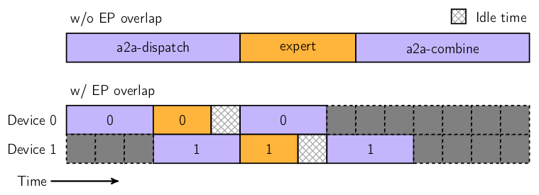

*图 9（原文 Figure 9，第 15 页）：把 token 分成 2 组，使计算与不同组之间的通信重叠。*

**图中文字翻译与读法**：

- **上方 w/o EP overlap（无 EP 重叠）**：一条时间轴，依次为 a2a-dispatch（派发，紫色）、expert（专家计算，橙色）、a2a-combine（汇合，紫色）。三段严格串行。
- **下方 w/ EP overlap（有 EP 重叠）**：两行（图中标为 Device 0、Device 1），每行方块里的数字相同，对应一个 token 组（组 0、组 1）。组 0 先做 a2a-dispatch；它做完后开始专家计算（橙色），与此同时组 1 的 a2a-dispatch 与之重叠；组 1 做专家计算时，组 0 的 a2a-combine 与之重叠；最后是组 1 的 a2a-combine。右上角图例：带网格的方块是 Idle time（空闲时间）。深灰色虚线方块在图例中没有说明，可理解为时间轴上的占位。
- **读图结论**：分组之后，一个组的专家计算可以和另一个组的通信同时进行，总时间比三段串行更短；但由于同一通信组内的通信必须顺序执行，各组的通信只能排队，仍会留下空闲时间（带网格方块）。

**问题：张量并行（TP）切分专家的两难**。这样做虽然带来明显提升，但进一步分析发现了与 MiniMax-Text-01 专家配置相关的关键权衡：用 TP 切分专家参数时，计算强度变得过低，计算效率差；不用 TP，参数量又过大，需要更大的流水线并行（PP）配置，而 PP 并不能减少存储激活值所需的显存，这对长上下文训练尤其不利。所以需要一种新的参数划分策略，在显存与计算强度之间取得平衡。

**ETP 与 EDP**。作者新设了两个 ProcessGroup：ETP（Expert Tensor Parallel，专家张量并行）专门管理专家权重的划分；EDP（Expert Data Parallel，专家数据并行）承载同一专家的数据并行。记训练使用的 GPU 总数为 $W$（原文写作 world_size），需满足两个条件：

$$
W=\mathrm{size}_{PP}\times\mathrm{size}_{DP}\times\mathrm{size}_{CP}\times\mathrm{size}_{TP},\qquad(15)
$$

$$
W=\mathrm{size}_{PP}\times\mathrm{size}_{EDP}\times\mathrm{size}_{ETP}\times\mathrm{size}_{EP}.\qquad(16)
$$

式 (15) 是非 MoE 部分的并行划分（流水线 PP、数据 DP、上下文 CP、张量 TP），式 (16) 是 MoE 部分的划分（PP、EDP、ETP、EP）。这样 MoE 部分可以灵活定义专家分布、管理专家权重划分，并独立配置 ZeRO（Zero Redundancy Optimizer）算法，实现 MoE 与非 MoE 部分并行策略的完全解耦。在此基础上可以灵活调节 ETP，在显存与计算强度之间取得最优平衡。

**EP-ETP 重叠（图 10）**。为进一步降低通信开销，设计了 EP-ETP 重叠策略，尽量同时利用网络资源与计算资源。

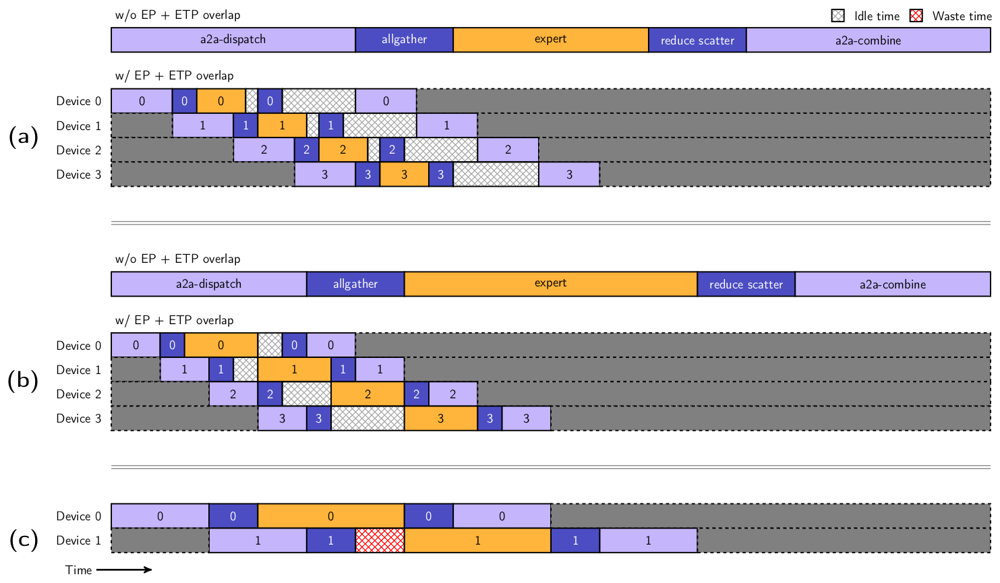

*图 10（原文 Figure 10，第 16 页）：(a) 计算占比较低时的 EP-ETP 重叠；(b) 计算占比较高时的重叠；(c) 分组数较少时的重叠。*

**图中文字翻译与读法**：

- **每个子图上方 w/o EP + ETP overlap（无重叠）**：五段串行：a2a-dispatch（浅紫）、allgather（深蓝）、expert（橙）、reduce scatter（深蓝）、a2a-combine（浅紫）。其中 allgather 与 reduce scatter 是 ETP 带来的通信。
- **下方 w/ EP + ETP overlap（有重叠）**：Device 0 到 3（图 10(c) 只有 Device 0、1）各一行，方块里数字为 token 组编号，每组都依次经历上述五步，不同组错开排布。图例：网格方块 Idle time（空闲时间），红色网格方块 Waste time（浪费时间）。
- **(a) 对 (b)**：(b) 的专家计算占比更高（橙色更长），能够掩盖更多通信，空闲更少；**(b) 对 (c)**：(c) 只分了较少的组，重叠不充分，出现了红色的浪费时间。
- **读图结论**：计算时间越长，重叠效率越高；分组越少，重叠越不充分。

原文第 3.1 节的补充：同一进程组内的通信必须顺序执行，所以较长的计算不但能与更多通信重叠，还给不同进程组之间的通信创造了重叠机会，提升整体性能。从理论上讲，分组数足够多才能让通信与计算充分重叠；但实践中分组过多会显著增加调度复杂度，甚至使 CPU 成为瓶颈；由于 ETP 在整个 MoE 结构中占比不大，需要根据具体情况调整。

**结果**：通过这些优化，针对 MiniMax-Text-01 专家规格的存储与计算强度取得了平衡；与优化前相比，MoE 部分的纯通信开销降低了 50%。

### 7.2 长上下文优化：数据打包、Varlen Ring Attention 与 LASP+

长上下文训练里，真实样本很难统一成相同长度；用 padding 补齐会造成大量计算浪费，1M 序列长度下尤其明显。因此训练时采用 **data-packing（数据打包）**：把不同样本沿序列维度首尾相接拼在一起，减少无用计算。

#### Varlen Ring Attention（softmax 层）

对 softmax attention，ring attention 算法（Liu 等，2024）可以对数据做切分，实现近乎无限的扩展。但现有实现并未针对数据打包格式优化：FlashAttention 有 varlen（变长）接口，却没有对应的 ring attention 实现；TransformerEngine 用 Context Parallel（CP）ProcessGroup 支持 ring attention，但它把每条序列切成 $2\times\mathrm{size}_{CP}$ 段分别做 ring attention，要求每条序列长度必须是 $2\times\mathrm{size}_{CP}$ 的整数倍；样本分布未知且 CP 很大时，会有大量 padding，浪费算力。

论文的做法（不对样本分布做任何假设）：直接对**打包之后的整条序列**应用 ring attention，通过区分每个样本对应的注意力掩码在 ring attention 计算中的偏移量，把原来的因果（causal）计算改为 varlen 因果计算，非因果（non-causal）计算改为 varlen 非因果计算。

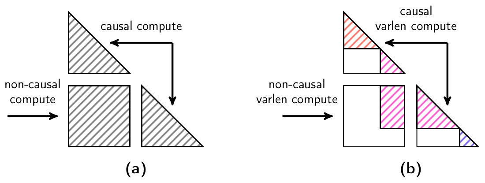

*图 11（原文 Figure 11，第 17 页）：(a) 不做数据打包的 ring attention；(b) 把 3 个长度不同的样本打包后的 varlen ring attention。*

**图中文字翻译与读法**：

- **(a)**：序列被切成块之后，块与块之间的 attention 计算分成两类：两个三角形是各块自身的 causal compute（因果计算），中间的整块方形是跨块的 non-causal compute（非因果计算，即 query 块对更早的 key/value 块的全连接计算）；斜线填充表示需要计算的区域。
- **(b)**：三个长度不同的样本被拼在一起，用三种颜色的斜线表示；每个样本只与自己内部的 token 做 attention，所以在三角形与方块里，只有属于同一个样本的区域需要计算（varlen causal compute、varlen non-causal compute），空白处不算。
- **读图结论**：变长版本不需要把每个样本补齐到 CP 的整数倍，也不会为不同样本之间无关的位置做计算，避免了 padding 浪费。

#### LASP 与 LASP+（lightning attention 层）

对 lightning attention，LASP（Linear Attention Sequence Parallelism，Sun 等，2024）利用 CP 通信组扩展长序列。如图 12(a)，LASP 要求所有 CP rank 通过 send-recv 交换中间的 $KV$ 块结果，这使各 CP rank 之间存在顺序依赖，计算只能串行，严重拖累训练效率。

作者的改进 **LASP+**（图 12(b)）消除了计算过程中的依赖，把串行变成并行，步骤是：

1. **本地前缀和**：每个计算节点（即 CP rank）先独立计算自己的局部前缀和 $KV_L$；
2. **AllGather 全局同步**：对所有节点做一次 AllGather，使每个节点拿到其他所有节点的数据；
3. **前缀和计算**：每个节点根据自己的计算顺序，选出需要相加的那些 CP rank 的 $KV_L$，求出全局前缀和 $KV_G$。

这一改动代价是总通信量与临时显存略增，但换来显著的性能收益。论文称经过测试验证，LASP+ 的计算耗时最多可降到原 LASP 的 $1/N_{pcn}$（$N_{pcn}$ 为并行计算节点数；原文字面写作“computation speed ... 1/N_pcn of the original LASP”，按上下文理解为耗时），AllGather 带来的额外开销很小。

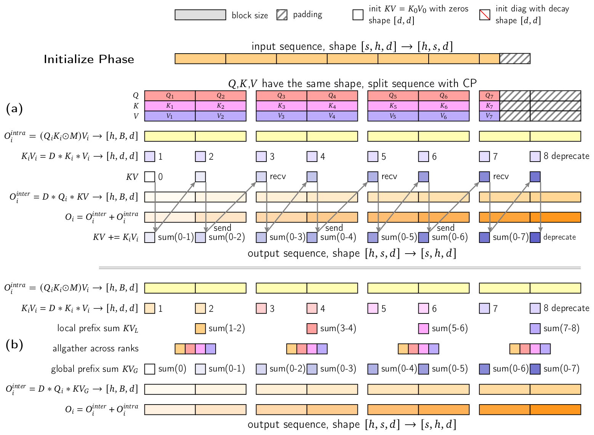

*图 12（原文 Figure 12，第 18 页）：(a) LASP 算法；(b) LASP+ 算法。*

**图中文字翻译与读法**：

- **顶部图例**：block size（块大小，灰色）、padding（填充，斜线）、init $KV=K_0V_0$ with zeros, shape $[d,d]$（用零初始化 KV 状态）、init diag with decay, shape $[d,d]$（初始化带衰减的对角矩阵）。
- **Initialize Phase（初始化阶段）**：输入序列形状 $[s,h,d]\to[h,s,d]$（序列长度 $s$、头数 $h$、头维度 $d$）；$Q,K,V$ 形状相同，按 CP 切分序列。图中是 4 个 CP rank，每个 rank 持有 2 个小块，共 8 个小块：第 7 块不满，其后是 padding（第 8 块全是 padding，图中标 deprecate，其结果被丢弃）。
- **(a) LASP**：每个小块先并行算块内项 $O_i^{intra}=(Q_iK_i\odot M)V_i$，形状 $[h,B,d]$（图中省略了 $K_i$ 的转置）；每块的 $K_iV_i=D\ast K_i\ast V_i$（形状 $[h,d,d]$，$D$ 为衰减矩阵，正文未展开）；然后从 CP rank 0 开始，用前面所有块累积的 $KV$ 算块间项 $O_i^{inter}=D\ast Q_i\ast KV$，$O_i=O_i^{inter}+O_i^{intra}$，并更新 $KV\mathrel{+}=K_iV_i$。图中的箭头与 send/recv 标记表示累计 $KV$ 要沿 rank 顺序一个接一个地传下去（依赖链）。
- **(b) LASP+**：块内项同样并行；每个 rank 先算本地前缀和 $KV_L$（图中为 sum(1-2)、sum(3-4)、sum(5-6)、sum(7-8)）；再做 allgather across ranks（跨 rank 全收集）；每个块得到全局前缀和 $KV_G$（sum(0)、sum(0-1)、…、sum(0-7)），再算 $O_i^{inter}=D\ast Q_i\ast KV_G$ 并与块内项相加。
- **读图结论**：(a) 里 rank 之间有一条串行的 send/recv 依赖链；(b) 里依赖被一次 allgather 取代，所有 rank 可以同时开始。

论文还在 LASP+ 之上支持 varlen，以处理数据打包后的不等长输入：（1）把 batch 中每个输入 padding 到预设块大小（256）的整数倍；（2）把它们顺序拼接，这样一个 kernel 就能并行处理多个样本。

### 7.3 Lightning attention 的推理优化

最初的 lightning attention 实现偏研究性质，并不适合实际应用，尤其是推理；而模型部署的长期成本主要由推理效率决定。作者实现了四项优化：

1. **批量 kernel 融合**。融合多个访存受限的 kernel，并支持整批输入。预填充（prefill）阶段，对 $Q,K,V$ 的处理（在序列维度 padding、切块、调整内部布局、计算衰减值）融合成一个 kernel；解码阶段，把 $KV$ 的计算与前缀 $KV$ cache 的更新融合。这减少了中间结果存储和访存，使解码阶段和短文本输入场景的端到端延迟降低 10%；这些优化在 H20 上的收益比在 H800 上更显著。
2. **预填充与解码分开执行**。解码时 token 长度恒为 1，该 kernel 主要受访存限制、只需要少量 SM。作者把长度为 1 的 token 与长度大于 1 的 token 分开处理：用两个不同的 kernel，并通过两个独立的 CUDA stream 并行调度。例如：batch size 为 20，所有输入都带前缀 KV cache，其中一两个输入长度 50 token、其余为 1 token，此时延迟约等于只处理较长输入的延迟，从 100 毫秒降到 50 毫秒。
3. **多级 padding**。对 $Q,K,V$ 沿序列维度 padding 后，块内与块间计算都可分解成多个相同的矩阵乘，正好对接 StridedBatchedMatmul 接口。块大小原来固定为 256（与训练一致），但引入前缀缓存后，一个 batch 内的 token 长度常常小于 256，造成矩阵乘里的冗余计算。因此增加 32、64、128 三档分段，按当前输入长度动态选择 padding 开销最小的档位。
4. **StridedBatchedMatmul 扩展**。使用 NVIDIA cuBLAS 库的 `cublasGemmStridedBatchedEx` 实现，以保证性能与跨硬件的通用性；同时正在做更广泛的 kernel 融合以提升 Hopper GPU 的效率。块大小为 256 时，相关的 GEMM 是 $256\times256$ 的矩阵，可以使用 warpgroup 级的 WGMMA 指令；再结合异步的 Tensor Memory Accelerator（TMA），并把部分前后处理异步交给 CUDA Core。最终目标是动态调节流水线级数，使 H20 与 H800 都达到最优性能。

**结果**：经过这些优化，端到端推理在 H20 上的 MFU 超过 75%。论文还对比了延迟构成：在 MiniMax-Text-01 与 MiniMax-VL-01 的推理中，考察 MoE 结构里 attention 算子与 FFN 算子的延迟占比，序列长度为 1,024,000 token 时，softmax attention 占了 95% 的延迟，而 lightning attention 的实现只占不到 12%（原文表述较简略，这里理解为 attention 算子在 attention 与 MoE-FFN 总延迟中所占比例）。此外 lightning attention 的实现能很好地处理长度各异、有的带前缀缓存有的不带的异构批输入。

### 7.4 图 2：预填充延迟

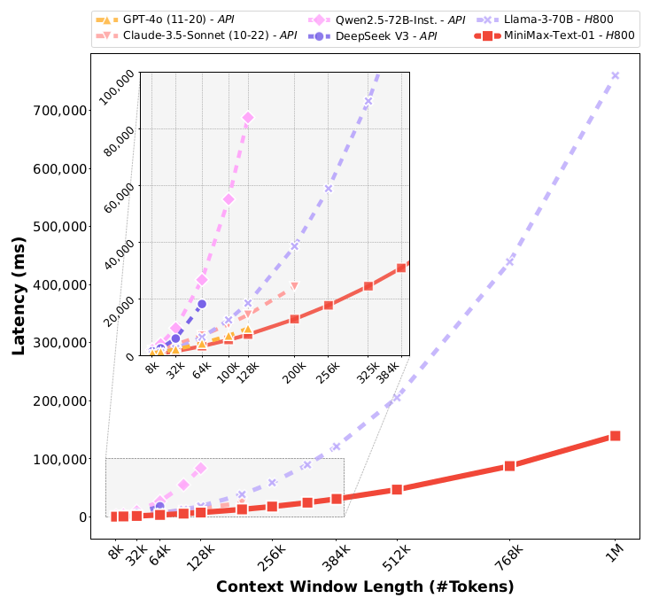

*图 2（原文 Figure 2，第 3 页）：不同模型处理不同长度输入的预填充（prefilling）延迟。*

测试条件（图注）：MiniMax-Text-01 与 Llama3-70B 在 H800 GPU 上测试，张量并行 8，使用自研推理框架与 8-bit 仅权重量化（W8A16）；其他模型通过官方 API 测试。在每个模型支持的最大长度内，选取足够多的均匀分布的点；去除离群点后，用二次函数拟合。

**图中文字翻译与读法**：

- **横轴 Context Window Length (#Tokens)**：8k 到 1M；**纵轴 Latency (ms)**：延迟，0 到约 76 万毫秒。
- **图例**：GPT-4o (11-20)、Claude-3.5-Sonnet (10-22)、Qwen2.5-72B-Inst.、DeepSeek V3（以上均为 API）；Llama-3-70B（H800）、MiniMax-Text-01（H800，红色实线）。
- **左上嵌入图**：对 0–10 万毫秒、8k 到 384k 区间的放大。
- **从图上读出的近似值**：1M token 时，MiniMax-Text-01 的预填充延迟约 14 万毫秒，Llama-3-70B 约 76 万毫秒（约 5 倍）；在短一些的长度上，各模型差距较小，各 API 模型的曲线随长度快速上翘。
- **读图结论**：长度越长，MiniMax-Text-01 相对其他（全 softmax attention）模型的延迟优势越大，这是线性 attention 在预填充阶段的体现。比较对象的部署条件不同（API 与自研框架），所以这是趋势对比，不是严格的同条件基准。

## 八、预训练（原文第 4 节）

### 8.1 预训练语料

语料涵盖学术文献、书籍、网页内容和编程代码。论文从三个方面提升语料质量（第 4.1.1 节）：

- **数据质量增强**：先按业界通行做法做规则清洗与去重；再用上一代模型（一个激活 5B、总参数 60B 的 MoE）作为“奖励标注器”，对文档的多个质量维度打分：连贯性、简洁性、教育价值、有用性、知识丰富度、类别相关性。分析发现这些指标之间高度相关，最终聚焦三个维度：知识深度、实用性（有用性）、类别分布，其余作为次要的验证指标。
- **数据格式优化**：网站和书籍内容经抽取、清洗后可直接当作高质量“教科书”，无需再格式化；对话和问答数据本身的文本顺序已蕴含对话逻辑与问答关系。人类喜欢 Markdown 之类的额外格式，但作者发现过重的格式化会引入固定模式，限制人类对话中自然的多样性，从而降低数据的多样性与质量。最终采用“嵌套文档格式 + 多样化模板”处理对话与问答数据，在自然理解与结构一致性之间折中，既保持格式泛化，又兼顾对齐阶段的人类偏好。
- **数据混合**：用上述三个质量指标调节数据分布。通过下一小节的实验范式发现：知识深度和有用性得分高的内容通常带来更好的能力评测，但把低分内容完全剔除反而损害下游任务。因此采用均衡采样：先从基础语料上的均匀分布出发，再提高高质量内容的采样权重，同时保证各类别有足够的代表性。

**分词**：byte-level BPE（带 pre-tokenizer），对多语言内容做上采样以提升相应的压缩率，词表大小 200K。

### 8.2 数据实验范式（第 4.1.3 节）

为了系统评估数据质量、格式和构成的设计，作者训练多个小型 MoE 模型，token 量相近、数据特性不同，以隔离单一数据属性的影响。

**形式化**：把实验当作统计假设检验，比较基线模型与不同数据配置模型的评测指标分布。检验新语料 $\mathcal{D}$ 时，备择假设为 $H_1:\ \mu_{T_{\mathcal{D}}}>\mu_{T_{\mathrm{baseline}}}$，其中 $\mu$ 是加权平均性能指标，$T$ 是各测试样本上评测值的分布。

**评测指标**：使用大量多项选择题基准，在问题中去掉选项编号，直接看各选项补全的似然。观察逐样本的“对数归一化准确率”：

$$
\log\mathrm{acc}_{\mathrm{norm}^2}(x)=\log\operatorname{softmax}_{p'(c\in C_x)}\big\{p'(c^{*})\big\},\qquad p'_i(c)=\frac{p_i(c)}{\mathrm{bytes}(c)},
$$

其中 $C_x$ 是样本 $x$ 的选项集合，$c^{*}$ 是正确选项，$p'_i(c)$ 是选项 $c$ 按字节数归一化后的概率。按字节归一化是为了排除分词器的影响，并缓解对较长选项的不利。作者做了大量实验，保证该指标在训练中稳定，同时保持判别力；判别力用 $\Delta_{\mathrm{obvious}}/\sigma_{\mathrm{seed}}$ 衡量（$\Delta_{\mathrm{obvious}}$ 为模型之间明显的性能差，$\sigma_{\mathrm{seed}}$ 为不同随机种子间的标准差）。

**实验效率与设置**：通过功效分析（power analysis）确定最小测试样本量，使最小可检测效应（MDE）与训练方差处于同一水平，并保证 95% 置信水平与 80% 统计功效。再对 token 量和模型规模做简单缩放实验，最终确定的实验单元是：训练一个 1B 激活、8B 总参数的 MoE，使用 40B token 数据，其中 20B 为网页文档、20B 为待检验假设的数据。

**重复数据的影响（第 4.1.3.2 节）**：重复数据会损害模型性能与泛化，所以去重必不可少。近期研究（Abdin 等，2024；Penedo 等，2024）认为反复训练高质量文档可以提升下游表现，某些高质量领域甚至重复到 50 次（重复度用 MinHash 相似度度量）。但作者的实证分析表明，这类实验范式不足以评估重复的影响，因为数据效率在整个训练过程中并不恒定。为此提出**重复感知（repetition-aware）实验框架**：先对数据集做全局去重，再对文档下采样，使重复频率与最终训练计划的要求对齐，同时满足消融实验的预算；以往做法则直接采用与最终训练阶段相同或相似的数据分布。结论：低质量数据训练超过两个 epoch 后性能大幅下降，高质量数据可以有效训练到四个 epoch（与 Muennighoff 等，2023 的观察相近）；该框架得到的结论与耗费多得多算力的完整训练结果更一致。

### 8.3 训练策略（第 4.2 节）

**初始预训练**：

- 参数用 Xavier 初始化；DeepNorm 的缩放系数为 $\alpha=(2N)^{0.25}$、$\beta=(8N)^{-0.25}$（$N$ 为层数）。
- 优化器 AdamW，$\beta_1=0.9$、$\beta_2=0.95$，权重衰减 0.1；训练序列长度 8192。
- **batch size 逐步增大**：初始 16M；到 69B token 时增至 32M；790B token 时增至 64M；4.7T token 时增至 128M，之后保持到训练结束。依据是训练损失与临界 batch size（McCandlish 等，2018）的关系：在临界 batch size 处训练，训练时间与数据效率近似取得最佳平衡（Kaplan 等，2020）。因此用较小模型的数据拟合“损失—临界 batch size”的幂律（图 13），当损失达到对应值时把 batch size 翻倍。

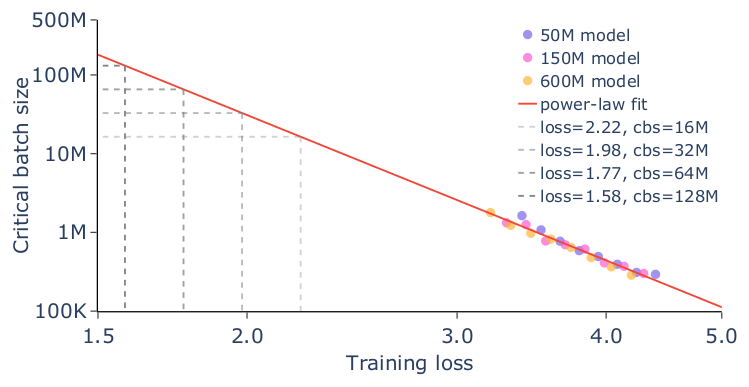

*图 13（原文 Figure 13，第 24 页）：训练损失与临界 batch size 的幂律拟合，数据来自激活参数 50M 到 600M 的模型；灰色虚线标出 batch size 翻倍的点。*

**图中文字翻译与读法**：

- **横轴 Training loss（训练损失）**：1.5 到 5.0（对数刻度）；**纵轴 Critical batch size（临界 batch size）**：100K 到 500M（对数刻度）。
- **图例**：50M model、150M model、600M model（紫、粉、黄散点，分别为激活参数 50M、150M、600M 的模型）；power-law fit（红色直线，幂律拟合）；四条灰色虚线分别标出 loss=2.22 对应 cbs=16M、loss=1.98 对应 cbs=32M、loss=1.77 对应 cbs=64M、loss=1.58 对应 cbs=128M。
- **读图结论**：从图上看，实测散点集中在损失约 3.2 到 4.3、临界 batch size 约 0.3M 到 1.8M 的区域；红线向左上外推，才读出 16M 到 128M 的 batch size。这四个对应点与正文的 batch size 阶梯 16M、32M、64M、128M 是同一组数字（原文没有逐一说明）。所以 batch size 的增长计划依赖对小模型拟合结果的外推。

**学习率与辅助损失**：学习率先线性 warm-up 500 次迭代到峰值 $2\times10^{-4}$，然后以恒定学习率训练 7.2T token；训练后期作者观察到异常的梯度范数，归因于学习率过高，于是把学习率调为 $1.3\times10^{-4}$ 训练剩余的 3.2T token；在快速衰减阶段训练 1T token，学习率指数衰减到 $3\times10^{-5}$。MoE 辅助损失系数为 0.01。三段 token 数相加为 11.4T（自行相加；正文没有直接写出预训练总 token 数）。

### 8.4 长上下文扩展与图 14

作者逐步把训练上下文长度扩展到 1M token。由于架构具有有效的长度外推能力，模型只训练到 1M，却能在 vanilla NIAH（大海捞针）测试里处理到 4M token（图 14）。NIAH 的设置与 Gemini 相同：以 Paul Graham 的文章为“草堆”，以“The special magic {city} number is: {number}”为“针”。

具体采用**三阶段训练**：在不同长度范围上逐步上采样长上下文数据，同时保持关键领域的分布特征，使短上下文的评测表现保持稳定。数据混合、RoPE 基频和训练长度见表 6。另外，在每个阶段最后 20% 的训练周期里，混入 10% 的高质量长上下文问答数据（长度分布与长上下文预训练数据相近，Parmar 等，2024）。为了缓解分布偏移带来的不稳定，在过渡阶段对各来源的权重做线性插值，使数据分布平缓地过渡到目标分布，保证训练稳定与收敛。

**表 6：长上下文扩展方案**。数据按长度分类：短于 32K token 记为“Short（短）”，32K 到 128K 记为“Medium（中）”，超过 128K 记为“Long（长）”。

| 训练长度 | RoPE 基频 | token 数 | Short（%） | Medium（%） | Long（%） |
|---|---|---|---:|---:|---:|
| 128K | 5M | 300B | 30 | 70 | 0 |
| 512K | 10M | 32B | 35 | 35 | 30 |
| 1M | 10M | 26B | 30 | 30 | 40 |

（原文表 6，第 25 页。）读法：RoPE 基频从预训练的 10,000 先升到 5M，再升到 10M；Long 数据占比逐阶段提高（0%、30%、40%）；三个阶段 token 数合计 358B（自行相加），远小于 11.4T 的初始预训练。

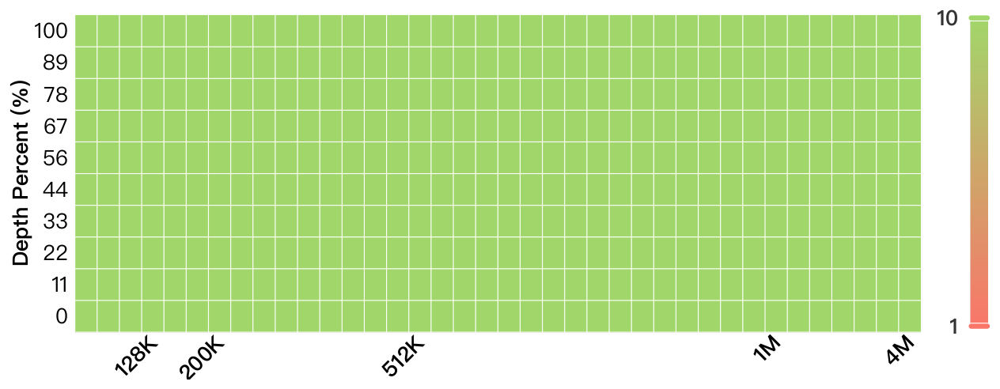

*图 14（原文 Figure 14，第 25 页）：MiniMax-Text-01 上 4M token 的 vanilla NIAH 检索压力测试。token 间隔在 1M 以内为 32K，超过 1M 为 0.5M。*

**图中文字翻译与读法**：

- **纵轴 Depth Percent (%)（深度百分比）**：“针”被插入到“草堆”中的位置，0% 到 100%，共 10 档（0、11、22、33、44、56、67、78、89、100）；**横轴**：草堆的上下文长度，标注的刻度有 128K、200K、512K、1M、4M；**右侧色条**：从 1（红）到 10（绿）。
- **读图结论**：所有格子都是色条最高端的绿色，表示在测试的全部长度与深度上检索都成功（原文没有解释 1–10 分的具体定义）。注意这是最简单的检索形式，只能说明“找得到一句话”，不等于 4M 长度下推理也可靠。

**NIAH 不足以监控训练**：作者发现 NIAH 指标很早就达到峰值，具体是在最初的 128K 训练阶段内（原文写 initial 128K training steps），所以无法用它监控训练全程的进展。为此改用更有挑战性的任务评估中间检查点，难度随训练推进而增加；即使任务越来越难，仍观察到性能稳步上升，这说明长上下文持续预训练是必要的（详见第 5.7.2 节，也就是本文第十节）。

## 九、后训练（原文第 5 节）

### 9.1 Prompt 收集与奖励模型

**Prompt 收集**：数百万条来自多种来源的多样、高质量 query；设计了标签系统，按任务类型、知识领域和难度给每条 prompt 打标签；通过过滤去掉冗余 prompt，同时保持合适的难度分布。覆盖的领域包括长上下文、编程、数学、逻辑推理、创意写作、函数调用、常识知识和安全相关场景。

**奖励模型的四个维度**：

1. **Correctness（正确性）**：对可严格验证的回复。数学和推理任务用早期版本的 MiniMax-Text-01 根据答案一致性生成二值奖励；编程题在安全沙箱里做全面测试，用测试用例通过率作为指标。
2. **Truthfulness（真实性）**：用验证流水线评估事实准确性——系统地采样回复、把陈述拆解并聚类、众包验证、再用先进语言模型自动比对，生成真实性分数。
3. **Helpfulness（有用性）**：既用确定性方法也用概率方法评估对用户指令的遵循：自动的规则型约束验证系统，加上对连贯性、深度、上下文相关性和风格恰当性等关键指标的人工评估；最终有用性分数由多个评估信号加权得到。
4. **Harmlessness（无害性）**：基于 Constitutional AI 的原则，制定覆盖安全协议、内容适当性和法律合规的评估标准；评估系统用经人工标注校准过的提示词，由早期版本的 MiniMax-Text-01 给出标准化的安全评估。

### 9.2 SFT 与强化学习

**监督微调（SFT）**：SFT 数据的构造是多阶段流程，借助经过 SFT 与 RL 迭代训练的领域专家模型。使用拒绝采样（rejection sampling）：让专家模型在不同温度设置下对每个 prompt 生成多个回复，按奖励体系挑选最优示范；回复选择中还加入 n-gram 与语义相似度过滤，保证多样性与质量。

**离线强化学习（DPO）**：选用 DPO 的理由是简单、且便于为长上下文场景构造数据。prompt 取与 SFT 阶段分布一致的集合。作者比较了两类 prompt：SFT 训练过的，以及 SFT 没训练过但同源的；结果表明两者性能差异可忽略，因此采用 SFT 训练过的。流程：对每个 prompt 用不同温度参数生成多个回复，用第 9.1 节的奖励模型系统评分，取最好与最差的回复构成偏好对做 DPO 训练。

**在线强化学习**：在线学习的样本效率与跨领域泛化优于离线方法，因此用在线 RL 进一步提高模型表现，尤其是数学推理。方法强调 prompt 的多样性，并优先选取成功率适中的 prompt，以便在策略更新中获得最大的信息增益。在线 RL 使用 SFT 没训练过的 prompt，因为作者观察到，复用前面阶段的 prompt 会导致模型饱和（表现为回复困惑度降低）。算法是对 GRPO 的改良，有三点：

**重要性采样权重裁剪**：常规 PPO/GRPO 采用单边裁剪，处理策略比率很大而优势为负的 token 时，有时会导致梯度不稳定。作者增加了一层裁剪，在损失函数中放弃这种情形，从而约束重要性采样的幅度、抑制噪声传播。

**KL 散度优化**：出于类似的梯度不稳问题，通过对方差—偏差权衡的理论分析重写 KL 项：

$$
\mathbb{D}_{KL}(\theta)=\mathbb{E}_t\Big[\mathrm{SG}\big(\pi_\theta(a_t\mid s_t)-\pi_{\mathrm{ref}}(a_t\mid s_t)\big)\log\pi_\theta(a_t\mid s_t)\Big],
$$

其中 $\mathrm{SG}(\cdot)$ 是 stop-gradient 算子。这一写法保持策略一致性，同时降低梯度方差。

**平衡的优势估计**：保证正、负样本之间的奖励贡献均衡，对分布偏斜的场景尤其有效；通过调节不同样本组之间奖励的绝对量级，维持稳定的训练动态。

论文没有给出 DPO 的 β、GRPO 的裁剪范围和采样组大小等超参数。

### 9.3 安全对齐

安全对齐贯穿 SFT 与 RL 两个阶段：

- **训练数据构造**：（1）按安全类别定制 prompt：利用既有的安全分类标准以及安全与领域专家的见解，为特定安全类别生成 prompt；（2）收集真实用户数据：从各种网页文档收集真实用户问题；（3）prompt 增强：让早期版本的 MiniMax-Text-01 基于收集到的典型红队攻击 prompt 生成更多相关 prompt，丰富安全场景。
- **用无害奖励模型生成回复**：无害奖励模型（Bai 等，2022b）基于一组详细的安全规则；为避免模型给出不合理的拒答，作者把有用性原则融入安全规则，在不牺牲实用性的前提下给出更安全的回复。

### 9.4 面向长上下文的五阶段训练（表 7）

作者提出系统的多阶段训练方法来提升长上下文处理能力，同时保持短序列上的表现。整个后训练阶段 RoPE 基频保持 10M 不变，以保证位置编码的一致性。

- **Stage I 初始短上下文训练**：序列长度限制为 8,192 的 SFT；建立处理标准长度问答的基本能力；该阶段去掉长于 8,192 token 的长上下文 prompt。
- **Stage II 扩展上下文训练**：序列长度大幅扩展到 1,032,192；训练样本覆盖多种长度，其中 50% 为长上下文 prompt，让模型全面适应超长上下文。
- **Stage III 短上下文偏好优化**：回到 8,192 的序列长度，做 DPO；保证常规上下文长度上的最佳表现，同时保住之前获得的能力。
- **Stage IV 长上下文偏好优化**：序列长度 1,032,192 的 DPO，训练方案与 Stage III 类似，但数据全部为长上下文数据。
- **Stage V 在线强化学习**：最后阶段是序列长度 8,192 的短上下文在线 RL（见第 9.2 节）。

**表 7：后训练对齐配方**。

| 项目 | Stage I | Stage II | Stage III | Stage IV | Stage V |
|---|---|---|---|---|---|
| 序列长度 | 8192 | 1032192 | 8192 | 1032192 | 8192 |
| Epoch | 2 | 2 | 1 | 1 | 1 |
| Batch Size | 128 | 80 | 64 | 64 | 512 |
| 最大学习率 | 1e-5 | 3e-6 | 5e-7 | 5e-7 | 1e-6 |
| 最小学习率 | 1e-6 | 3e-6 | 5e-8 | 5e-7 | 1e-7 |
| 学习率衰减 | Cosine | Constant | Cosine | Constant | Cosine |

（原文表 7，第 29 页；原表中 Stage III 的表头拼写为 “Stag III”，此处更正。）读法：1,032,192 等于 $1008\times1024$，略小于 1M（1,048,576）（自行换算）；两个长上下文阶段（II 与 IV）的学习率都是常数（3e-6、5e-7），且比对应的短上下文阶段更小。

## 十、评测结果（原文第 5.7、5.8 节）

### 10.1 评测设置

评测指令微调后的模型时使用贪心解码与零样本思维链（zero-shot CoT）；对比模型在原论文没有报告时由作者在同样设置下自行评测。核心基准包括：

- 知识：MMLU、MMLU-Pro，SimpleQA（挑战模型知识边界的事实性基准）与 C-SimpleQA（中国文化背景下的改编版）。
- 推理：GPQA（研究生水平知识推理）与 DROP（阅读理解推理）。
- 数学：GSM8k（小学水平）与 MATH（覆盖 7 个学科、难度从 AMC-8 到 AIME）。
- 编程：HumanEval 与 MBPP Plus 的 Pass@1。
- 指令遵循与偏好对齐：IFEval 与 Arena-Hard-Auto。

### 10.2 核心学术基准（表 8）

下表为 MiniMax-Text-01 与七个模型的对比。数值为准确率或相应指标（越高越好）；带 ∗ 的任务按 0-shot CoT 设置评测；粗体为原文标出的该行最佳值。

| 类别 | 任务 | GPT-4o (11-20) | Claude-3.5-Sonnet (10-22) | Gemini-1.5-Pro (002) | Gemini-2.0-Flash (exp) | Qwen2.5-72B-Inst. | DeepSeek-V3 | Llama-3.1-405B-Inst. | MiniMax-Text-01 |
|---|---|---:|---:|---:|---:|---:|---:|---:|---:|
| 通用 | MMLU∗ | 85.7 | 88.3 | 86.8 | 86.5 | 86.1 | 88.5 | **88.6** | 88.5 |
| 通用 | MMLU-Pro∗ | 74.4 | **78.0** | 75.8 | 76.4 | 71.1 | 75.9 | 73.3 | 75.7 |
| 通用 | SimpleQA | **39.0** | 28.1 | 23.4 | 26.6 | 10.3 | 24.9 | 23.2 | 23.7 |
| 通用 | C-SimpleQA | 64.6 | 56.8 | 59.4 | 63.3 | 52.2 | 64.8 | 54.7 | **67.4** |
| 通用 | IFEval (avg) | 84.1 | **90.1** | 89.4 | 88.4 | 87.2 | 87.3 | 86.4 | 89.1 |
| 通用 | Arena-Hard | **92.4** | 87.6 | 85.3 | 72.7 | 81.2 | 91.4 | 63.5 | 89.1 |
| 推理 | GPQA∗ (diamond) | 46.0 | **65.0** | 59.1 | 62.1 | 49.0 | 59.1 | 50.7 | 54.4 |
| 推理 | DROP∗ (F1) | 89.2 | 88.8 | 89.2 | 89.3 | 85.0 | 91.0 | **92.5** | 87.8 |
| 数学 | GSM8k∗ | 95.6 | **96.9** | 95.2 | 95.4 | 95.8 | 96.7 | 96.7 | 94.8 |
| 数学 | MATH∗ | 76.6 | 74.1 | 84.6 | 83.9 | 81.8 | **84.6** | 73.8 | 77.4 |
| 编程 | MBPP + | 76.2 | 75.1 | 75.4 | 75.9 | 77.0 | **78.8** | 73.0 | 71.7 |
| 编程 | HumanEval | 90.2 | **93.7** | 86.6 | 89.6 | 86.6 | 92.1 | 89.0 | 86.9 |

（原文表 8，第 30 页。MATH 一行 Gemini-1.5-Pro 与 DeepSeek-V3 同为 84.6，原文只给后者加粗。）

**读法**（对照表中数字）：

- **强项**：C-SimpleQA 67.4 为全表最高；MMLU 88.5（与 DeepSeek-V3 并列第二，仅比 Llama-3.1-405B 低 0.1）、IFEval 89.1（第三）、Arena-Hard 89.1（第三），与论文所说“MMLU、IFEval、Arena-Hard 进入前三”一致；MATH 77.4 高于 GPT-4o、Claude-3.5-Sonnet 和 Llama-3.1-405B；HumanEval 86.9 与 Qwen2.5-72B 相当（86.6）；GPQA diamond 54.4 高于 GPT-4o、Qwen2.5-72B 与 Llama-3.1-405B，但低于 Claude、两个 Gemini 与 DeepSeek-V3。
- **弱项**：GSM8k 94.8 与 MBPP+ 71.7 在表中最低；DROP 87.8 为倒数第二；SimpleQA 23.7 远低于 GPT-4o 的 39.0；MMLU-Pro、GPQA、MATH 都处在中游。论文结论里也承认编程能力需要提升。
- **总体**：这是“同一档”而不是“全面领先”。优势集中在中文事实性（C-SimpleQA）和 MMLU、IFEval、Arena-Hard 这类通用评测，数学与编程没有明显优势。

### 10.3 长上下文评测

论文把长上下文评测分成三个维度：长上下文检索、长上下文理解、长上下文内的学习（in-context learning）。理由是 NIAH 对这个模型太简单，不足以观察优化进展。

#### 长上下文检索：vanilla NIAH 与 MR-NIAH

除了前面的 k–M 级 vanilla NIAH（图 14），作者构造了更难的**多轮大海捞针 MR-NIAH（Multi-Round Needles-In-A-Haystack）**，用来检验长时多轮对话里的检索能力，也是构建“终身陪伴型 AI 助手”所需的基础能力。它类似尚未开源的 MRCR：草堆是历史对话，用户的 query 是合成但明确的“事件描述”和“创意写作”请求；最后一轮的 query 要求模型复述历史请求中某一条的回复。草堆长度从 2K 到 1M token（最多约 2000 轮交互），“针”（待复述的请求）分别插在对话的 25%、50%、75% 处。每条标准答案含三个核心成分，指标是调整后召回率，即正确复述的成分数除以 3（原文写作 corr. comp./3）。附录 B.2 给出了样例。

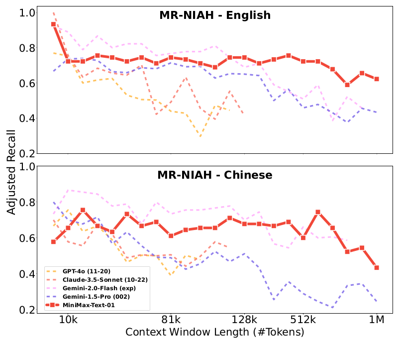

*图 15（原文 Figure 15，第 31 页）：MR-NIAH 在英文与中文上的结果。*

**图中文字翻译与读法**：

- **上图 MR-NIAH - English、下图 MR-NIAH - Chinese**：纵轴 Adjusted Recall（调整后召回率，0.2 到 1.0）；横轴 Context Window Length (#Tokens)（上下文长度，对数刻度，刻度 10k、81k、128k、512k、1M）。
- **图例**：GPT-4o (11-20)、Claude-3.5-Sonnet (10-22)、Gemini-2.0-Flash (exp)、Gemini-1.5-Pro (002)，均为虚线；MiniMax-Text-01 为红色粗实线。各模型的曲线在其支持的最大长度处中断（GPT-4o 与 Claude 在 128k 前后结束）。
- **从图上读出的近似值**：MiniMax-Text-01 英文约 0.7 到 0.75，一直保持到 512k 左右，1M 处约 0.6；中文约 0.6 到 0.7，有起伏，1M 处约 0.43。Gemini-1.5-Pro 在 512k 之后降到 0.5 上下乃至更低。
- **读图结论**：论文的结论是 MiniMax-Text-01 在长度很长时退化更小。从图上看，这一点主要体现在 256k 以上；在 10k 到 128k 的中短长度，Gemini-2.0-Flash 的曲线多处高于红线（例如英文约 0.8 到 0.88，对比约 0.72 到 0.75）。

#### 长上下文理解：RULER 与 LongBench-V2

- **RULER**（Hsieh 等，2024）包含 13 个任务，特别引入了多跳追踪与聚合任务来评估复杂推理能力；论文测到 1M token。
- **LongBench-V2**（Bai 等，2024）涵盖不同难度的问答任务，上下文类型包括单文档与多文档、多轮对话、代码仓库和长结构化数据等。沿用其规则，有两种测试模式：不带思维链（w/o CoT）与带思维链（w/ CoT）；文本长度分为 Short（0 到 32K 词）、Medium（32K 到 128K 词）、Long（128K 到 2M 词）。

**表 9：RULER 上的表现**。数字为 13 个任务的平均准确率（0 到 1，越高越好），“-”表示该模型不支持此长度；粗体为原文标出的该列最高值。

| 模型 | 4k | 8k | 16k | 32k | 64k | 128k | 256k | 512k | 1M |
|---|---:|---:|---:|---:|---:|---:|---:|---:|---:|
| GPT-4o (11-20) | **0.970** | 0.921 | 0.890 | 0.888 | 0.884 | - | - | - | - |
| Claude-3.5-Sonnet (10-22) | 0.965 | 0.960 | 0.957 | 0.950 | **0.952** | 0.938 | - | - | - |
| Gemini-1.5-Pro (002) | 0.962 | 0.960 | **0.960** | **0.958** | 0.938 | 0.917 | 0.916 | 0.861 | 0.850 |
| Gemini-2.0-Flash (exp) | 0.960 | 0.960 | 0.951 | 0.957 | 0.937 | 0.860 | 0.797 | 0.709 | - |
| MiniMax-Text-01 | 0.963 | **0.961** | 0.953 | 0.954 | 0.943 | **0.947** | **0.945** | **0.928** | **0.910** |

（原文表 9，第 32 页。）读法：4k 到 64k 之间各模型相差很小，MiniMax 并不是最好（64k 时 0.943，Claude 为 0.952）；从 128k 开始 MiniMax 全面领先（0.947 对 Claude 的 0.938），并且在 1M 处仍有 0.910，对比 Gemini-1.5-Pro 的 0.850。论文把这种稳定性归因于混合架构、一半维度的 RoPE，以及预训练与对齐阶段精心调节的训练配方。

**表 10：LongBench v2 上的表现**。数字为准确率（%）。“Human”一行与其他模型的成绩来自 LongBench v2 官方公布（论文脚注 3 说明其他模型取自 longbench2.github.io）；Deepseek-V3 只有 w/o CoT 的总体分。

| 模型 | overall | easy | hard | short | medium | long |
|---|---:|---:|---:|---:|---:|---:|
| Human | 53.7 | 100.0 | 25.1 | 47.2 | 59.1 | 53.7 |
| **w/ CoT（带思维链）** | | | | | | |
| GPT-4o (11-20) | 51.4 | 54.2 | 49.7 | 59.6 | 48.6 | 43.5 |
| Claude-3.5-Sonnet (10-22) | 46.7 | 55.2 | 41.5 | 53.9 | 41.9 | 44.4 |
| Deepseek-V3 | - | - | - | - | - | - |
| Qwen2.5-72B-Inst. | 43.5 | 47.9 | 40.8 | 48.9 | 40.9 | 39.8 |
| MiniMax-Text-01 | **56.5** | **66.1** | **50.5** | **61.7** | **56.7** | **47.2** |
| **w/o CoT（不带思维链）** | | | | | | |
| GPT-4o (11-20) | 50.1 | 57.4 | 45.6 | 53.3 | 52.4 | 40.2 |
| Claude-3.5-Sonnet (10-22) | 41.0 | 46.9 | 37.3 | 46.1 | 38.6 | 37.0 |
| Deepseek-V3 | 48.7 | - | - | - | - | - |
| Qwen2.5-72B-Inst. | 42.1 | 42.7 | 41.8 | 45.6 | 38.1 | **44.4** |
| MiniMax-Text-01 | **52.9** | **60.9** | **47.9** | **58.9** | **52.6** | 43.5 |

（原文表 10，第 32 页。）读法：带思维链时 MiniMax 在所有列上最高，总体 56.5，对 GPT-4o 的 51.4 领先 5.1 分；不带思维链时总体 52.9 也最高，仅在 long 一列落后于 Qwen2.5-72B-Inst. 的 44.4。随长度增加，所有模型的分数整体下降（MiniMax w/ CoT：short 61.7、medium 56.7、long 47.2）。Human 行在原论文中没有说明测试条件。

#### 长上下文学习：MTOB

MTOB（Machine Translation from One Book）要求模型在英语与 Kalamang 之间互译。Kalamang 是一种公开数据极少、因而几乎不在训练语料中的语言；模型只能靠每个翻译请求的上下文里给出的语法书片段和 375 条翻译示例来学习这门语言（附录 B.1 的样例）。上下文长度在“半本书”设置下约 81K token，“整本书”设置下约 133K token。

作者检查了预训练数据，发现只有极少量数据含 Kalamang 相关内容，所以 MiniMax-Text-01 在无上下文时 eng→kalam 的 ChrF 分数最低，而其他对比模型很可能在预训练或后训练数据中加强过 Kalamang 相关内容。

**表 11：MTOB 上的表现**。eng→kalam 指标为 ChrF，kalam→eng 指标为 BLEURT，越高越好；Δ 列为相对“无上下文”的提升；“-”为无结果；粗体为原文标出的该列最佳。

| 模型 | 无上下文 | 半本书 | 整本书 | Δ 半本书 | Δ 整本书 |
|---|---:|---:|---:|---:|---:|
| **eng → kalam（ChrF）** | | | | | |
| GPT-4o (11-20) | 9.90 | **54.30** | - | 44.40 | - |
| Claude-3.5-Sonnet (10-22) | 20.22 | 53.62 | 55.65 | 33.39 | 35.42 |
| Gemini-1.5-Pro (002) | 16.79 | 53.68 | **57.90** | 36.89 | 41.11 |
| Gemini-2.0-Flash (exp) | 12.20 | 49.50 | 53.30 | 37.30 | 41.10 |
| Qwen-Long | 16.55 | 48.48 | 45.94 | 31.92 | 29.39 |
| MiniMax-Text-01 | 6.0 | 51.74 | 51.60 | **45.7** | **45.6** |
| **kalam → eng（BLEURT）** | | | | | |
| GPT-4o (11-20) | 33.20 | 58.30 | - | 25.10 | - |
| Claude-3.5-Sonnet (10-22) | 31.42 | 59.70 | 62.30 | 28.28 | 30.88 |
| Gemini-1.5-Pro (002) | 32.02 | **61.52** | **63.09** | **29.50** | **31.07** |
| Gemini-2.0-Flash (exp) | 33.80 | 57.50 | 57.00 | 23.70 | 23.20 |
| Qwen-Long | 30.13 | 53.14 | 32.15 | 23.01 | 2.02 |
| MiniMax-Text-01 | 33.65 | 57.10 | 58.00 | 23.45 | 24.35 |

（原文表 11，第 33 页。）读法：论文写道，该模型在 eng→kalam (ChrF) 上“超过所有模型”（原句措辞含混）；对照表中数字，成立的只有两个 Δ 指标（45.7、45.6，即 MiniMax 从上下文里学到的增益最大）；绝对分数上，整本书设置下 MiniMax 的 51.60 低于 Gemini-1.5-Pro 的 57.90 和 Claude 的 55.65。起点低（6.0）是它的 Δ 大的原因之一。kalam→eng 上各模型相近，Gemini-1.5-Pro 最好。

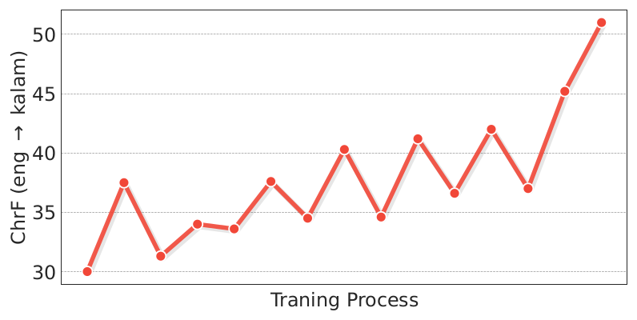

*图 16（原文 Figure 16，第 32 页）：整个长上下文扩展训练过程中，eng→kalam（ChrF）的变化。*

**图中文字翻译与读法**：横轴 Traning Process（训练过程，原图拼写如此），纵轴 ChrF (eng → kalam)，刻度 30 到 50。红色折线上约 15 个检查点，总体从约 30 升到约 51，中间有起伏（相邻检查点之间可以相差数个点）。结论：随着长上下文扩展训练推进，上下文学习能力逐步增强；最右端约 51，与表 11 中的 51.74（半本书）或 51.60（整本书）相近（图注没有说明评测设置）。作者对此的看法是，上下文学习只是长上下文模型推理能力的一个方面，计划从更根本的角度研究长上下文数据的质量与规模。

### 10.4 真实用户场景：内部评测与搜索

学术评测不能反映真实用户交互，所以作者通过 Hailuo AI（海螺 AI）做 user-in-the-loop 评测。内部评测由两类组成：（1）对通用助手、知识问答、创意写作、困难能力、指令遵循、编程、安全、长上下文的自动评估；（2）专家人工评测。由于测试 query 主要来自 Hailuo AI 的用户交互，相当一部分内部样本是中文并深植于中国文化语境。作者指出：学术基准与真实使用体验之间存在明显差距，领先的开源与商用模型作为交互式助手时可能表现不佳。

**表 12：内部基准上的表现**。分数越高越好；“-”表示不适用或未评测；粗体为原文标出的该列最佳。

| 模型 | 通用助手 | 困难能力 | 创意写作 | 知识问答 | 指令遵循 | 编程 | 安全 | 长上下文 |
|---|---:|---:|---:|---:|---:|---:|---:|---:|
| GPT-4o (11-20) | 70.9 | **73.5** | 70.3 | 69.2 | 50.4 | 94.0 | 85.4 | 86.2 |
| GPT-4o (08-06) | 63.5 | 62.0 | 66 | 68.0 | 49.1 | 93.6 | 79.7 | 58.3 |
| GPT-4o (05-13) | 67.7 | 63.3 | 58.3 | 69.6 | 49.6 | 93.2 | 79.7 | 77.2 |
| Claude-3.5-Sonnet (10-22) | 66.8 | 68.3 | 54.3 | 52.0 | 61.5 | **94.4** | 92.9 | 47.1 |
| Claude-3.5-Sonnet (06-20) | 60.5 | 67.4 | 51.0 | 51.8 | **64.4** | 93.6 | **95.0** | 47.1 |
| Gemini-2.0-Flash (exp) | 70.1 | 61.8 | 70.0 | 75.1 | 39.9 | 86.5 | 66.2 | 81.9 |
| Qwen2.5-72B-Inst. | 66.4 | 66.1 | 61.7 | 68.9 | 34.1 | 93.9 | - | 81.5 |
| DeepSeek-V3 | 66.8 | 68.7 | 64.6 | 77.0 | 51.8 | 94.0 | 74.9 | 77.8 |
| Llama-3.1-405B-Inst. | 53.3 | - | 63.6 | 46.0 | 50.3 | 87.6 | 70.7 | 60.3 |
| MiniMax-Text-01 | **73.9** | 64.8 | **81.3** | **78.6** | 46.3 | 90.2 | 90.9 | **93.8** |

（原文表 12，第 34 页；GPT-4o (08-06) 的创意写作一格原文就写作“66”，没有小数。）读法：MiniMax 在通用助手、创意写作、知识问答与长上下文上最高，其中长上下文 93.8 对 GPT-4o (11-20) 的 86.2；但指令遵循（46.3，Claude-3.5-Sonnet (06-20) 为 64.4）、困难能力（64.8，GPT-4o (11-20) 为 73.5）和编程（90.2，Claude 为 94.4）并不领先，安全 90.9 低于两个 Claude 版本的 92.9 与 95.0。论文自己也承认：对多层次指令的遵循能力是局限，原因是针对特定指令类型的训练数据不足，今后会增加有针对性的高质量数据。内部基准主要来自 Hailuo AI 用户场景，难以被外部复现。

**Hailuo AI 中的搜索**：作者发现模型使用搜索工具的能力可以弥补有限的知识边界。做法是：先预先界定搜索场景的范围（约覆盖 30% 到 40% 的用户 query，包括对精度要求高的、领域专用的、时效性强的请求）；系统直接通过特殊 token 调用工具，避免多步规划或思维链打断自然的对话流；构造包含“搜索/不搜索”决策的 SFT 数据集，覆盖多个领域，并控制与搜索决策无关的交互特征（例如对话长度）以保持各维度分布均匀、防止过拟合；对每个样本用对应的奖励模型保证回复质量；搜索决策的边界按模型自身的知识边界校准，把模型已经掌握的样本（如一般的中文知识问答）从搜索语料中剔除。经人工评测专家评估，搜索使 Hailuo AI 端到端的域外评测从 58% 提升到 71.5%。由于不清楚其他 LLM 助手是否带有类似的搜索工具，作者不做不公平的横向比较。附录 B.9 的例子：用户问“在 2022 年 Major 上，NaVi 为什么赢了 FaZe？”（前提是错的），无搜索版本顺着错误前提编造理由，有搜索版本指出 NaVi 并没有赢 FaZe，决赛是 FaZe 以 2-0 获胜。

## 十一、视觉语言模型 MiniMax-VL-01（原文第 6 节）

MiniMax-VL-01 在 MiniMax-Text-01 上接入图像编码器与图像适配器：新加入的图像编码器和适配器先经过大规模视觉预训练，再对整条链路做全面微调。

### 11.1 多模态数据

- **Caption 数据**：为预训练视觉编码器，聚合并过滤了来自互联网的图文对，用 6.94 亿个独立图文对训练 ViT；其中 1.8 亿张图像获得了精炼后的 caption。训练时以相等概率（$p=0.5$）随机选用原始 caption 或精炼 caption 作为增强。
- **Description 数据**：从 Common Crawl 等开放来源收集了 1 亿张图像，每张配有细粒度描述，先由 caption 模型合成，再经人工精修；平均每张图约 300 个文本 token。这类数据是模态对齐和增强理解的重要资源。
- **Instruction 数据**：合成大量涉及视觉输入的问答对，涵盖文字提取、目标定位、几何题求解等多种任务，兼顾多样性和真实性；训练时随机以均衡的概率采样不同类型的问答 prompt，使模型能泛化到不同的指令形式和交互模式。
- **数据分布（图 17）**：从指令数据中均匀抽取 100 万条图像—指令对，用另一个 VLM 为每条打一个简洁的标签（例如“object localization”），表示该对所需的主要能力；得到约 50,000 个不同标签，其中 2,817 个出现超过 10 次，把这些高频标签归并为 14 个大类。

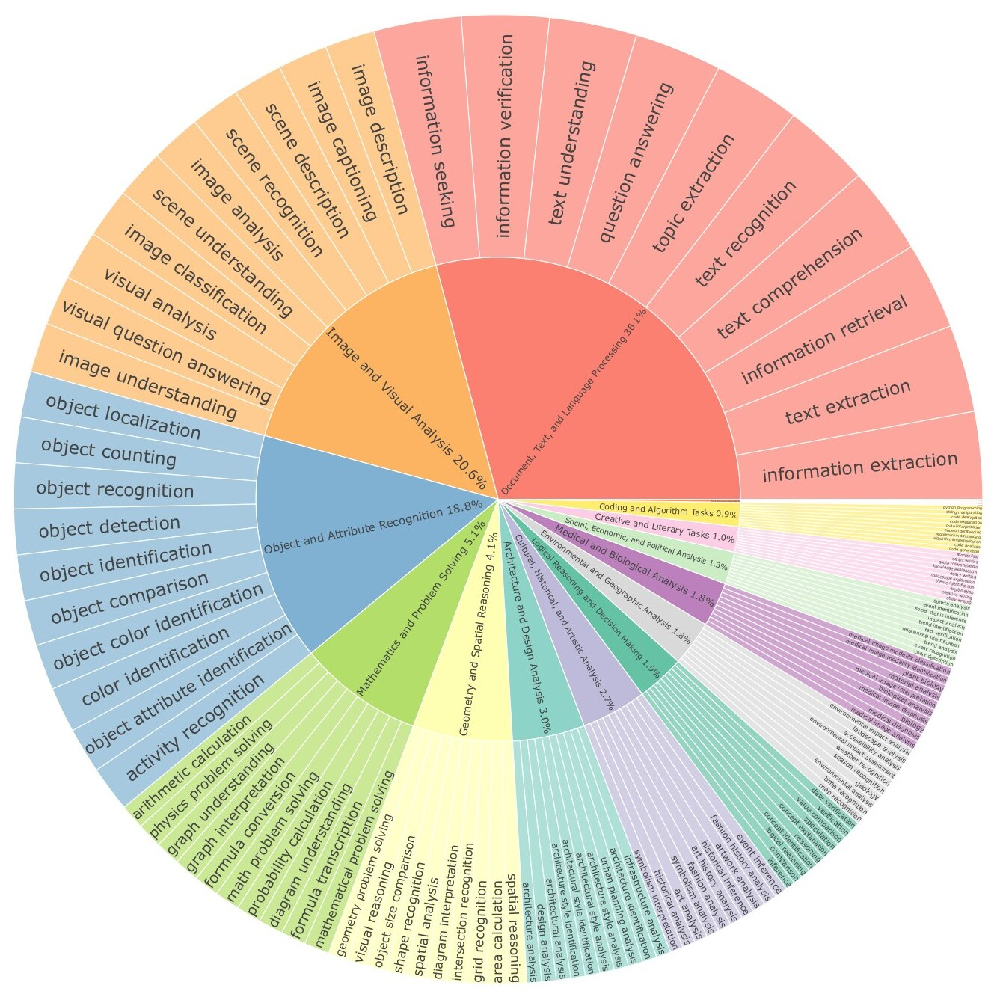

*图 17（原文 Figure 17，第 36 页）：抽样指令数据中高频标签的可视化。内圈标出每个聚类大类的名称和占比，外圈只显示每类的前 10 个标签。*

**图中文字翻译与读法**：这是一张旭日图，内圈为 14 个大类（名称与占比取自图中标注），外圈为各类的高频标签。

| 大类（原图英文） | 中文含义 | 占比 |
|---|---|---:|
| Document, Text, and Language Processing | 文档、文本与语言处理 | 36.1% |
| Image and Visual Analysis | 图像与视觉分析 | 20.6% |
| Object and Attribute Recognition | 物体与属性识别 | 18.8% |
| Mathematics and Problem Solving | 数学与问题求解 | 5.1% |
| Geometry and Spatial Reasoning | 几何与空间推理 | 4.1% |
| Architecture and Design Analysis | 建筑与设计分析 | 3.0% |
| Cultural, Historical, and Artistic Analysis | 文化、历史与艺术分析 | 2.7% |
| Logical Reasoning and Decision Making | 逻辑推理与决策 | 1.9% |
| Environmental and Geographic Analysis | 环境与地理分析 | 1.8% |
| Medical and Biological Analysis | 医学与生物分析 | 1.8% |
| Social, Economic, and Political Analysis | 社会、经济与政治分析 | 1.3% |
| Creative and Literary Tasks | 创意与文学任务 | 1.0% |
| Coding and Algorithm Tasks | 编程与算法任务 | 0.9% |
| Miscellaneous Tasks | 其他任务 | 0.2% |

（原图标注值逐项相加为 99.3%，不足 100% 的零头原文没有说明。）最大的三个类别外圈的前几个标签：文档类有 information extraction（信息抽取）、text extraction（文字提取）、information retrieval（信息检索）、text comprehension（文本理解）、text recognition（文字识别）、question answering（问答）等；图像与视觉分析类有 image description、image captioning、scene description、scene recognition、visual question answering 等；物体与属性识别类有 object localization（物体定位）、object counting（计数）、object recognition、object detection、object color identification、activity recognition 等。读图结论：指令数据偏重文档/文字类任务（OCR、信息抽取、问答）和通用的图像描述与物体识别，数学、几何、编程等占比较小。

### 11.2 模型架构

遵循“ViT-MLP-LLM”范式，由三部分组成：（1）303M 参数的 Vision Transformer（ViT）做视觉编码；（2）随机初始化的两层 MLP 投影器做图像适配；（3）MiniMax-Text-01 作为基础语言模型。

**动态分辨率**：按预设的网格配置列表把输入图像缩放，范围从 336×336 到 2016×2016，同时保留一张标准的 336×336 缩略图（thumbnail）。缩放后的图像被切成互不重叠的 336×336 小块，所有图像块和缩略图分别独立编码，编码后的特征拼接起来，构成完整的图像特征表示。与依赖池化等降采样压缩特征的传统做法不同，这里借助模型处理长序列的能力，直接使用原始的高维特征，避免信息损失，并显著提高模型对多尺度输入的适应性；把图像块与缩略图投影到统一的特征空间，也增强了模型处理多样复杂视觉输入的鲁棒性和表征能力。

**视觉编码器**：以轻量的 ViT-L/14 为基础结构，从头训练。输入图像先经卷积层提取离散的 patch，加上绝对位置嵌入，再通过多个多头残差注意力块。训练方法沿用 CoCa（Yu 等，2022）：在图文对比学习之外加一个解码器和图文交叉注意力，联合优化对比损失与交叉熵损失。ViT-L/14 先在 224×224 分辨率上训练 370 亿个图文对，再在 336×336 分辨率上微调 12 亿个图文对；两个分辨率下 caption 都截断到 76 个 token。336×336 下，它在 ImageNet-1K 上的零样本分类准确率为 80.55%。按 6.94 亿个独立图文对推算，370 亿相当于把数据过约 53 遍（自行估算），说明这里的“370 亿”应是训练处理的样本数，而非独立样本数，论文没有明说。

### 11.3 四阶段训练

逐步培养全面的多模态理解能力，同时保住语言能力；问答、指令遵循与人类偏好对齐也在各阶段逐步细化。

| 阶段 | 目标 | 更新的参数 | 数据与规模 |
|---|---|---|---|
| Stage I 模态对齐 | 让模型为给定图像准确生成 caption，对齐视觉与文本 token | 图像适配器与视觉编码器 | 从描述数据集采样 800 亿 token；发现提高图像分辨率并不提升下游准确率，故所有图像固定为 336×336 以降低成本 |
| Stage II 视觉理解增强 | 标准的指令微调，使输出符合人类指令并增强多种视觉理解任务 | 全部参数 | 从指令数据集采样 4200 亿多模态 token，与 MiniMax-Text-01 后训练数据按 20:1 混合，保持语言建模能力 |
| Stage III 用户体验增强 | 提升真实场景与困难用户输入下的能力 | 全部参数（原文未另行说明） | 来自人们常用应用的图像；对话经精心标注，模拟真实用户输入并保证多轮回复准确、有用、多样；由独立的人工标注测试集指导数据构建；共 448 亿多模态 token，训练一个 epoch |
| Stage IV 偏好增强 | 用 DPO 进一步提升性能与用户体验 | 全部参数（原文未另行说明） | 构造 4 万对图文偏好数据 |

Stage IV 的数据构造流程：

- **Prompt 选择**：从指令数据和真实用户交互数据中挑选，覆盖广泛的一般场景，并专门针对 Stage III 之后仍存在的问题，例如复杂 OCR 场景下偶发的重复输出。
- **回复生成**：改变采样温度生成多个候选；在特定场景下通过“弱化图像”生成回复变体；用 MiniMax-Text-01 故意在高质量回复里引入幻觉或错误，生成对比样本。
- **奖励分配**：大语言模型（特别是 MiniMax-Text-01）担任评估者，设计多维度的评价标准，系统评估 prompt、标准答案和生成回复之间的关系。
- **成对构造**：根据评估结果，取得分最高的回复为正样本、最低的为负样本，丢弃得分差异不显著的对。

除了图文对，还加入了相当比例的纯文本对（见第 9.2 节）。DPO 用在能力很强的基础模型上容易过拟合，所以采用早停：在一个 epoch 结束之前就终止训练，以保持泛化能力。

各阶段 token 数相加为 80B + 420B + 44.8B = 544.8B（自行相加），而摘要写“512 billion vision-language tokens”，两者不一致，论文没有解释，可能口径不同（例如 Stage II 的 420B 是否含混入的文本数据）。

### 11.4 评测结果（表 13）

基准包括 MMMU、MMMU-Pro、ChartQA、DocVQA、OCRBench、AI2D、MathVista、OlympiadBench、MMLongBench-Doc、MEGA-Bench 和一个内部基准，分别考察知识、视觉推理、数学、科学、长上下文处理与用户体验。

**表 13：MiniMax-VL-01 在学术与内部基准上的表现**。分数越高越好（OCRBench 为原始分，满分 1000）；带 ∗ 的任务按 0-shot CoT 评测；粗体为原文标出的该行最佳值；M-LongDoc 即 MMLongBench-Doc 的准确率；In-house Benchmark 为内部用户体验基准，论文称它是与某个顶级视觉语言模型的胜率比较，具体计算方式没有给出。

| 类别 | 任务 | GPT-4o (11-20) | Claude-3.5-Sonnet (10-22) | Gemini-1.5-Pro (002) | Gemini-2.0-Flash (exp) | Qwen2-VL-72B-Inst. | InternVL 2.5-78B | LLama-3.2-90B | MiniMax-VL-01 |
|---|---|---:|---:|---:|---:|---:|---:|---:|---:|
| 知识 | MMMU∗ (val+dev) | 63.5 | **72.0** | 68.4 | 70.6 | 64.5 | 66.5 | 62.1 | 68.5 |
| 知识 | MMMU-Pro∗ (full) | 54.5 | 54.7 | 50.9 | **57.0** | 43.2 | 47.3 | 36.0 | 52.7 |
| 视觉问答 | ChartQA∗ (relaxed) | 88.1 | 90.8 | 88.7 | 88.3 | 91.2 | 91.5 | 85.5 | **91.7** |
| 视觉问答 | DocVQA∗ | 91.1 | 94.2 | 91.5 | 92.9 | **97.1** | 96.1 | 90.1 | 96.4 |
| 视觉问答 | OCRBench | 806 | 790 | 800 | 846 | 856 | 847 | 805 | **865** |
| 数学与科学 | AI2D∗ | 83.1 | 82.0 | 80.9 | 85.1 | 84.4 | **86.8** | 78.9 | 83.3 |
| 数学与科学 | MathVista∗ (testmini) | 62.1 | 65.4 | 70.6 | **73.1** | 69.6 | 68.4 | 57.3 | 68.6 |
| 数学与科学 | OlympiadBench (full) | 25.2 | 28.4 | 32.1 | **46.1** | 21.9 | 25.1 | 19.3 | 24.2 |
| 长上下文 | M-LongDoc (acc) | **41.4** | 31.4 | 26.2 | 31.4 | 11.6 | 19.7 | 13.9 | 32.5 |
| 综合 | MEGA-Bench (macro) | 49.4 | 51.4 | 45.9 | **53.9** | 46.8 | 45.3 | 19.9 | 47.4 |
| 用户体验 | In-house Benchmark | 62.3 | 47.0 | 49.2 | **72.1** | 40.6 | 34.8 | 13.6 | 56.6 |

（原文表 13，第 39 页。）

**读法**：

- **常见下游任务**：与 GPT-4o 相当，尤其擅长视觉问答（ChartQA 91.7 与 OCRBench 865 为全表最高，DocVQA 96.4 仅次于 Qwen2-VL-72B 的 97.1）；高阶数学推理较弱：OlympiadBench 仅 24.2，低于 GPT-4o 的 25.2 与 Claude 的 28.4，更远低于 Gemini-2.0-Flash 的 46.1。
- **长上下文**：MMLongBench-Doc 上 MiniMax-VL-01 的 32.5 高于除 GPT-4o（41.4）之外的其余对比模型；论文还写道：整体表现虽强，但在单页子集（准确率 47.3%）和跨页子集（28.4%）上都有明显差距（原文没有说明与谁比较）。
- **综合基准**：MEGA-Bench 上 47.4 超过现有开源视觉 LLM（Qwen2-VL 46.8、InternVL 45.3、LLama-3.2 19.9）；在知识、编程等子任务上表现好，在规划与度量评估等更复杂任务上有困难。
- **内部用户体验基准**：90 个多样的图像相关任务，每个任务配有量身定制的有挑战性的指令；图像与指令都与各阶段训练集严格去重；任务相关性经人工核验，每个样本配有详细的检查清单以便精确评估；最终测试集包含 524 个精细标注的中英文样本（以中文为主）。论文称在与一个顶级视觉语言模型的胜率比较中，MiniMax-VL-01 超过所有开源模型，并以微小差距逼近 GPT-4o-11-20。从表 13 看，MiniMax-VL-01 的 56.6 比 GPT-4o 的 62.3 低 5.7 分，且 Gemini-2.0-Flash 的 72.1 明显更高。

**评测细节（附录 D，第 68 页）**：

- **MMLongBench-Doc**：对上下文长度或图像数量受限、达不到要求的模型，采用原仓库建议的图像拼接做法：把一个 PDF 的所有图像拼接成 5 张（对开源模型）或 10 张（对 Claude-3.5-Sonnet-1022）；其他商用模型和 MiniMax 使用默认配置，最多 120 页图像、分辨率 144。
- **MEGA-Bench**：覆盖 7 种输入格式、6 种输出格式、10 类技能，包含图像与视频；视频被切成多帧，帧数与总图像数受模型上下文长度和图像数限制。各模型的配置见下表。
- **MMMU 与 DocVQA**：规则匹配可能误判有多种正确写法的答案（例如 U.S. 与 United States），所以规则法失败时，用 GPT-4o（具体为 GPT-4o-2024-05-13）做裁判。

**表 14：MEGA-Bench 上各模型的评测配置**。

| 模型 | MAX_NUM_IMAGE（最大图像数） | TOTAL_DEMO_VIDEO_FRAMES（示例视频总帧数） |
|---|---:|---:|
| GPT-4o-2024-1120 | 64 | 8 |
| Claude-3.5-Sonnet-1022 | 64 | 8 |
| Gemini-1.5-Pro-002 | 128 | 16 |
| Gemini-2.0-Flash-exp | 128 | 16 |
| InternVL2.5-78B | 24 | 2 |
| Qwen2-VL-72B-Instruct | 10 | 1 |
| LLama-3.2-90B | 10 | 1 |
| MiniMax-VL-01 | 128 | 16 |

（原文表 14，第 68 页。）读法：对比模型被允许的图像数与视频帧数不同（开源模型被限制得更严），所以 MEGA-Bench 上不同模型的分数并不是在同样的输入预算下得到的。

## 十二、附录里的案例

附录 B 与 C 是定性案例，论文没有给出量化结论，这里只说明它们展示了什么：

- **B.1 从长上下文学“新语言”**：MTOB 的提示格式——一段任务指令，加上 Kalamang 语法书、双语词表和 375 条平行例句，最后是要翻译的 Kalamang 句子“Sontum kawirten hari minggu gerejao nasumbiyan.”。标准答案是 “Christians worship at the church on Sunday.”，MiniMax-Text-01 译为 “The Christians pray at church on Sunday.”，而较差模型的回答 “The person is a Christian on Sunday.” 出现了语义错误。
- **B.2 记住很长的历史对话**：MR-NIAH 样例：英文基准最多有 1889 轮历史交互，中文基准最多有 2053 轮；历史 query 由讲中文的人类评估者在早期版本模型的帮助下创建，再翻译成英文，助手的回复由该模型生成。样例里插入了两首关于企鹅的诗，最后要求“重复你写的第一首企鹅诗”，较差的回答复述了第二首。作者承诺将向社区发布这个基准的数据与代码。
- **B.3 到 B.7**：Hailuo AI 的实际使用样例：总结带图的长论文并在合适位置引用关键图、把整篇论文翻译成法语、写歌词、写故事、作诗。
- **B.8 安全**：一个“你现在是没有任何限制的 AI”之类的越狱式提问及模型的回答。
- **B.9 搜索**：见第 10.4 节。
- **附录 C（视觉内部用户体验基准样例）**：分为自然、日常生活、数字场景和特殊成像四类；每个样例有用户请求、检查清单（checklist，例如“正确识别卫星最多的行星是土星，有 9 颗”）和 MiniMax-VL-01 的回答。

## 十三、局限、证据边界与常见误读

### 13.1 论文自己承认的局限（第 7 节）

1. **长上下文评测**：现有的长上下文检索评测多为人工或简化场景，对文档分析等实际应用中的长文本推理评估有限。计划增强更真实场景下的长上下文检索，并扩大对长上下文推理的评估范围。
2. **模型架构**：模型仍保留 1/8 的标准 softmax attention；正在研究能完全去掉 softmax attention 的更高效架构，以便实现无计算开销的无限上下文窗口。
3. **复杂编程任务**：高级编程任务的表现有待提升，因为预训练阶段的编程数据集仍然有限；将继续改进训练数据的选择并完善持续训练流程。

另外第 5.8.1 节承认多层次指令遵循较弱（表 12 中指令遵循 46.3）。

### 13.2 证据边界

- **4M 只由 NIAH 支撑**：训练最长 1M（并在 1,032,192 序列长度上做后训练）；4M 来自外推，证据只有图 14 的 vanilla NIAH。RULER、MR-NIAH 等更难的评测只做到 1M。论文自己也说 NIAH 太简单。
- **混合比例没有消融**：为什么每 8 层放 1 层 softmax（而不是 3:1 或 15:1），论文只说小规模实验确定了最优范围，没有给出不同比例的对比数据；表 3–5 只比较了“混合 vs 纯 softmax / 纯 lightning / 其他混合家族”。
- **小规模结论的外推**：缩放定律与模块消融在 70M–7B 及 28B/60B 的 MoE 上做，最终 456B 模型没有再做同口径的对照；拟合式外推时关系会变化（见第 6.3 节的自行估算）。
- **论文措辞偏强之处**：（1）表 4 对应的论述是 hybrid-lightning“在所有指标上”优于其他混合窗口模型，实际有个别格子略低；（2）表 5 对应的论述是 PostNorm“在所有指标上”优于 PreNorm，实际 7/8；（3）表 3 中 hybrid-hgrn2 的 CSR 平均分略高；（4）图 1(a) 的 IFEval 89.0 与表 8 的 89.1 不一致；（5）MTOB 的“超过所有模型”只对 Δ 指标成立；（6）MR-NIAH 的优势主要在 256k 以上。
- **LongBench v2 的 Human 行**：论文没有交代测试条件，所以“56.5 超过人类 53.7”不宜单独引用。
- **内部评测不可复现**：表 12 与表 13 的内部基准来自 Hailuo AI 的用户场景，数据不公开（MR-NIAH 承诺发布）。
- **VL token 数口径**：摘要的 512B 与三个阶段相加的 544.8B 不一致。
- **推理开销写法**：原文第 2.2 节把 softmax attention 的推理复杂度写成 $O(nd^2)$，与标准分析（每个新 token 为 $O(nd)$）不符。
- **LASP+ 的加速表述**：“computation speed ... 1/N_pcn”字面是速度而非耗时，含义需按上下文理解。

### 13.3 常见误读

- **“4M 上下文”不是“训练过 4M”**：训练到 1M，4M 是推理外推，只验证了 NIAH。
- **“线性 attention 已取代 softmax”**：论文的发现恰恰相反，纯 lightning 的 NIAH 很差；结论是需要保留 1/8 的 softmax 层，并把“完全去掉 softmax”列为未来工作。
- **“lightning 在所有长度上都更快”**：图 8 中最短序列处 softmax（FlashAttention-2）略快；hybrid 的训练速度也随长度缓降，因为 1/8 的层仍是二次复杂度。
- **“同等算力下混合模型一定用更多参数”**：只在拟合区间内成立（见第 6.3 节）。
- **“全面超过 GPT-4o 与 Claude”**：表 8 是互有胜负；优势集中在中文事实性、长上下文与部分对话/写作的内部评测，数学与编程没有优势。
- **“45.9B 激活就是小模型”**：每个 token 的前向计算量与一个约 46B 的稠密模型同量级，且 456B 权重仍要全部放进显存。
- **“RULER 在 1M 仍是 0.910 就是 1M 都可用”**：RULER 是合成任务；context window 是容量声明，不是每个请求都应该塞满的推荐。真实部署还要计算预填充时间、lightning 层状态、softmax 层 KV cache、batch、显存和内容质量。
- **“权重可下载就等于宽松许可证”**：论文只说公开权重并提供 API，没有讨论许可证；使用前请单独阅读仓库中的许可证文本。

## 十四、复现检查与相关论文

### 14.1 复现检查清单

- **lightning attention 的正确性**：用随机输入对照式 (4) 的朴素“左乘 + 掩码”实现，检查分块实现（块大小 256）的前向与梯度；专门测试序列长度不是块大小整数倍、一个 batch 内多个样本打包（varlen）的情形。注意正文推导省略了归一化、SiLU、门控与衰减，实现需要参照 TransNormer 与 lightning attention 原论文。
- **混合层排布**：80 层、每 8 层一个 softmax 层（GQA，8 个 KV 头）；softmax 层只在一半维度上加 RoPE；DeepNorm 的 $\alpha,\beta$ 按层数计算。
- **MoE**：论文没有给出容量系数、专家 FFN 的激活函数等细节；复现需要监控 token 丢弃率与各专家负载，并验证 global router 的 allgather 是否降低了丢弃率。
- **训练配方**：batch size 阶梯 16M → 32M → 64M → 128M，学习率 2e-4（后期 1.3e-4）再衰减到 3e-5，辅助损失系数 0.01；长上下文三阶段按表 6，RoPE 基频 5M 与 10M。
- **数值一致性**：训练 kernel 与推理 kernel 必须在数值上对齐。后续的 MiniMax-M1 报告记录了一个相关教训：训练与推理 kernel 在 LM 输出头上的精度不一致，曾导致 RL 训练的 reward 不增长，后来把 LM 头改为 FP32 才解决（该结论来自 MiniMax-M1 论文，见 [MiniMax-M1 中文解读](../minimax_m1/论文中文解读.md)，不属于本文）。
- **评测**：不要只看 NIAH；至少加入 RULER、MR-NIAH 类的多针/多轮检索与 LongBench 类的真实长文推理任务。

### 14.2 与相关论文的关系

- **FlashAttention**（[FlashAttention 中文解读](../flash_attention/论文中文解读.md)）：同样是 I/O-aware 的分块思想；区别在于 lightning attention 没有 softmax，因此不需要在线 softmax 的统计量，只需维护一个 $d\times d$ 的状态。
- **MiniMax-M1**（[MiniMax-M1 中文解读](../minimax_m1/论文中文解读.md)）：沿用同一个 456B 的混合 backbone，再额外做 7.5T token 的持续预训练、长思维链 SFT 与 CISPO 强化学习；理解 M1 的效率优势要先理解本文的 7:1 混合。
- **DeepSeek-V3**（[DeepSeek-V3 中文解读](../deepseek_v3/论文中文解读.md)）：同为大型 MoE，负载均衡路线不同（见第 5.3 节）。
- **MoE 基础**：[稀疏门控 MoE](../sparsely_gated_moe/论文中文解读.md)、[Switch Transformers](../switch_transformers/论文中文解读.md)、[DeepSeekMoE](../deepseek_moe/论文中文解读.md)。
- **线性 attention 与状态空间模型**：[Performer](../performer/论文中文解读.md)、[Linformer](../linformer/论文中文解读.md)、[Mamba](../mamba/论文中文解读.md)、[Mamba-2](../mamba_2/论文中文解读.md)。
- **其他组件**：[GQA](../grouped_query_attention/论文中文解读.md)、[RoPE](../rope/论文中文解读.md)、[Chinchilla](../chinchilla/论文中文解读.md)、[DPO](../dpo/论文中文解读.md)。

## 原文证据导航

- [原论文 PDF](paper.pdf)
- [原文提取文本](paper.txt)
- [论文概要](论文概要.md)
