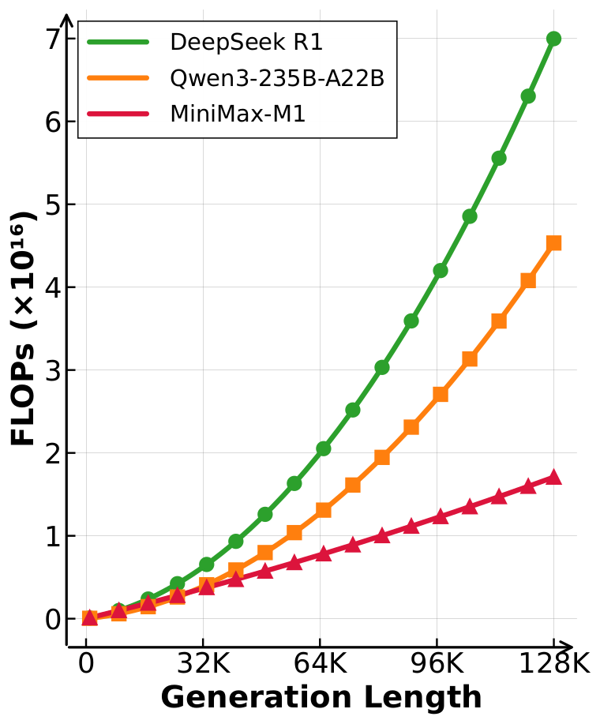
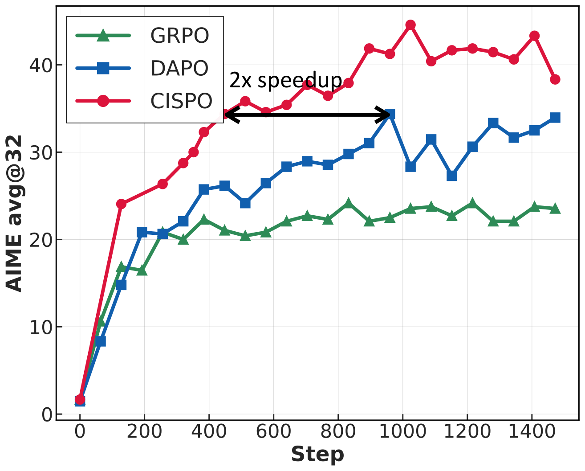
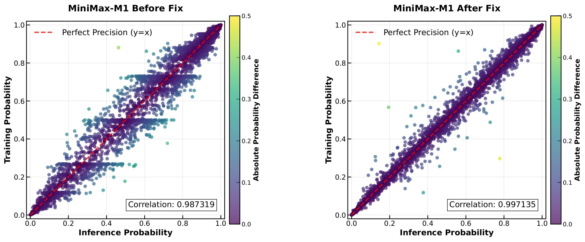
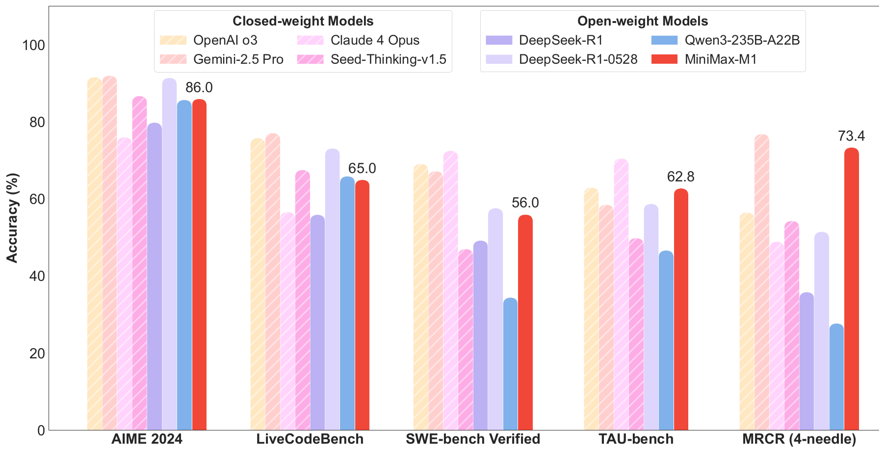
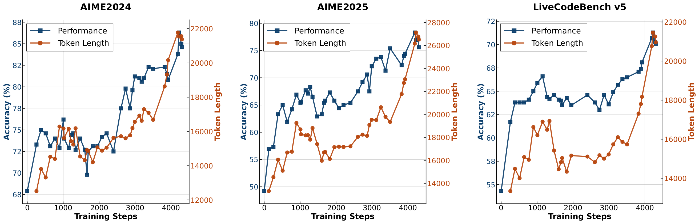

# 论文中文解读：《MiniMax-M1: Scaling Test-Time Compute Efficiently with Lightning Attention》

> **基本信息**：MiniMax，技术报告，arXiv:2506.13585（本地 PDF 为 2025 年 6 月 16 日的 v1，共 22 页）；论文原文 [arXiv 页面](https://arxiv.org/abs/2506.13585)，模型发布于 [GitHub](https://github.com/MiniMax-AI/MiniMax-M1)（论文摘要给出的地址）。
>
> **本文的读法**：图均为从 PDF 中按图裁出的原图，表为逐格核对后的中文转录（数字与原文一致，表头译成中文，模型名与基准名保持英文）。每张图后有中文图题、图中文字翻译和读图结论；从图上读出的近似数值写作“约”，正文给出的数字优先用原文数字。凡标注“笔者推导”“笔者核算”“背景知识”的是为帮助理解而补充的内容，不是论文原话。本地 v1 版本对模型架构只有简短描述（没有 lightning attention 的公式和架构图），第二节的相关原理属于背景知识。

## 一、一句话结论

MiniMax-M1 是一个开放权重的大规模“混合注意力”推理模型：总参数 456B、每 token 激活 45.9B、32 个专家，注意力层采用“每 7 层 lightning attention（线性注意力的 I/O 感知实现）后接 1 层标准 softmax attention”的混合结构，原生支持 1M token 输入。线性注意力使长生成的推理 FLOPs 随长度近似线性增长：论文给出的理论曲线是，生成 100K token 时只需 DeepSeek-R1 约 25% 的 FLOPs，这让**超长思维链的强化学习**（RL）更便宜。论文的算法贡献是 **CISPO**：不再像 PPO/GRPO 那样把 ratio 超出范围的 token 整个丢掉，而是只裁剪（stop-gradient 的）重要性采样权重，所有 token 都保留梯度；在 Qwen2.5-32B 的对照实验中约用一半训练步数就追平 DAPO。工程贡献是找出并修复混合架构 RL 的精度问题（把 LM 输出头改用 FP32，使训练与推理概率的相关系数从约 0.987 升到约 0.997）。整个 RL 在 512 张 H800 上用约 3 周完成，论文按租价估算约 \$534,700。模型发布 40K 和 80K 两个“思考预算”版本；评测上它在软件工程、长上下文和工具使用上表现突出，但在竞赛数学/编程以及知识类基准上落后于更新的 DeepSeek-R1-0528。

## 二、背景与动机

### 2.1 测试时计算与长推理

OpenAI o1、DeepSeek-R1 等大推理模型（LRM）通过大规模强化学习把推理过程拉长，效果随之提升；这被视为一个新的缩放维度：**测试时计算**（test-time compute），即生成阶段花多少 FLOPs 来“想”。但传统 Transformer 的 softmax attention 计算量随长度平方增长，所以继续把推理拉长很快就变得昂贵。稀疏注意力、线性注意力、状态空间模型等方法早已被提出，但论文认为它们都还没有在大规模推理模型上被充分验证，几乎所有有竞争力的 LRM 仍使用传统注意力（Hunyuan-T1 用 Mamba 架构，但未开源、细节很少）。M1 的目标是做出并开源一个能高效扩展测试时计算的大推理模型。

### 2.2 背景知识：softmax attention 与线性注意力（本文未展开）

- **softmax attention**：$O=\mathrm{softmax}(QK^\top/\sqrt d)\,V$。生成第 $t$ 个 token 时要和之前所有 token 的 key 做点积，所以单 token 的计算量正比于已有长度，生成 $n$ 个 token 的总计算量约随 $n^2$ 增长；KV 缓存也随长度线性增长。
- **线性注意力**：去掉 softmax 的归一化，使因果形式可以写成递推：维护一个固定大小的状态矩阵 $S_t=S_{t-1}+k_t^\top v_t$，输出为 $o_t=q_tS_t$（实际模型里还带有衰减和归一化）。单 token 计算量和状态大小都与已有长度无关，总计算量随 $n$ 线性增长。
- **Lightning Attention**：论文称其为线性注意力变体的 I/O 感知实现（思路类似 FlashAttention 的分块），使因果线性注意力在 GPU 上真正跑得快。M1 的注意力结构是：每 7 个使用 lightning attention 的 TransNormer 块之后接 1 个使用 softmax attention 的 Transformer 块。论文提到 lightning attention 的前后层衰减率不同，早期层更关注局部信息（见 4.1 节关于长上下文扩展的讨论）。

### 2.3 背景知识：PPO、GRPO 与 token 裁剪

策略梯度需要用“旧策略 $\pi_{\theta_{\mathrm{old}}}$ 采样的数据”去更新新策略 $\pi_\theta$，所以要用**重要性采样（IS）权重** $r_{i,t}(\theta)=\pi_\theta(o_{i,t}\mid q,o_{i,<t})/\pi_{\theta_{\mathrm{old}}}(o_{i,t}\mid q,o_{i,<t})$ 校正分布差异。PPO 为了稳定训练，对这个 ratio 做**裁剪**（clip）：当 ratio 偏离 1 超过 $\epsilon$ 时，该 token 的更新被截断。GRPO 去掉 value model，改用同一问题下一组回答的相对奖励当优势。这两点是理解 CISPO 的前提，见第五节。

## 三、模型与训练路线

### 3.1 架构与规模

M1 基于此前的 MiniMax-Text-01：总参数 **456B**，每 token 激活 **45.9B**，**32 个专家**；每 7 个 lightning attention 的 transnormer 块后跟 1 个 softmax attention 块；原生支持最长 **1M token** 的输入，约为 DeepSeek-R1（128K）的 8 倍。论文宣称它是“世界上首个开放权重的大规模混合注意力推理模型”（这是论文自己的说法）。

下表对比各推理模型支持的最大输入/输出长度（M1 的 80K 是训练时设定的最大生成长度）：

| 项目 | o3 | Gemini 2.5 Pro | Claude 4 | DS-R1 | Qwen3-235B | MiniMax-M1-80k |
|---|---:|---:|---:|---:|---:|---:|
| 最大输入（Max Input） | 200K | 1M | 200K | 128K | 128K | 1M |
| 最大输出（Max Output） | 100K | 64K | 32K | 64K | 32K | 80K |

（原文表 1，第 3 页。表注：Claude 4 指 Claude-4-Opus，“DS-R1”指最新的 DeepSeek-R1-0528。）

### 3.2 效率：理论推理 FLOPs（图 1 右）

*图 1 右半（原文 Figure 1 Right，第 1 页）：理论推理 FLOPs 随生成长度（token 数）的变化。*

**图中文字翻译与读法**：横轴 Generation Length（生成长度），刻度 0、32K、64K、96K、128K；纵轴 FLOPs（×$10^{16}$）。绿色圆点线 DeepSeek R1，橙色方块线 Qwen3-235B-A22B，红色三角线 MiniMax-M1。DeepSeek R1 的曲线向上弯曲（近似平方增长），到 128K 约 $7.0\times10^{16}$；Qwen3-235B-A22B 到 128K 约 $4.5\times10^{16}$；MiniMax-M1 近似一条直线，到 128K 约 $1.7\times10^{16}$（读自图）。生成长度在约 32K 以内三条曲线几乎重合，差距在更长的区间才拉开。

**读图结论**：论文据此写道：与 DeepSeek-R1 相比，M1 在生成 64K token 时 FLOPs 不到其 50%，在 100K token 时约为其 25%。（笔者读图：64K 时约为 R1 的 38%；100K 时约为 R1 的 28%–29%，128K 时约 24%，与论文的约 25% 大体一致。）注意这是**理论**曲线，不是实测耗时。论文认为 rollout 的计算与延迟往往是 RL 训练的主要瓶颈，所以这一优势直接转化为更高效的 RL 扩展。

### 3.3 训练路线总览

| 阶段 | 做什么 | 关键数字 |
|---|---|---|
| 继续预训练 | 在 MiniMax-Text-01 上用推理密集语料继续训练 | 7.5T token；STEM/代码/书籍/推理相关数据占 70% |
| 长上下文扩展 | 分四个阶段平滑加长 | 32K 逐步扩展到 1M |
| SFT（冷启动） | 注入长思维链（CoT）的反思式推理模式 | 数学与代码约占 60% |
| RL（CISPO） | 在可验证与不可验证任务上做强化学习 | 先 40K 输出上限，再分阶段扩到 80K |
| 资源 | 完整 RL 一次运行 | 512 张 H800，约 3 周，租价约 \$534,700 |

笔者核算：512 张 GPU × 24 小时 × 21 天 ≈ 25.8 万 GPU·小时，\$534,700 对应约 \$2.07 每 GPU·小时（论文没有给出单价）。论文发布两个版本：**M1-40k** 与 **M1-80k**，分别对应最大生成长度 40K 与 80K；40K 模型是 80K 训练的中间阶段（intermediate phase）。

## 四、RL 之前的准备：继续预训练与 SFT

为了让后续 RL 可扩展，作者先继续预训练以增强基础推理能力，再做冷启动 SFT 注入特定的推理模式。

### 4.1 继续预训练（7.5T token）

- **数据**：改进网页与 PDF 解析机制，增强启发式清洗规则以提高数学与代码数据的召回率；优先从网页、论坛、教科书等来源抽取**自然的问答对**，并严格避免使用合成数据；对问答数据做语义去重以保证多样性；把 STEM、代码、书籍、推理相关数据的占比提高到 **70%**，在不损害其他通用能力的前提下显著增强处理复杂任务的能力。
- **配方**：降低 MoE 辅助损失的系数，并调整并行训练策略以支持更大的训练 micro batch，以减轻辅助损失对整体性能的不利影响；在 MiniMax-Text-01 基础上用恒定学习率 **8e-5** 训练 **2.5T** token，随后用衰减调度在 **5T** token 上降到 **8e-6**（合计 7.5T）。
- **长上下文扩展**：对 hybrid-lightning 这种收敛更复杂的架构，作者观察到过于激进地拉长训练长度会导致训练中突然的梯度爆炸，优化极其困难。作者的归因是：浅层参数的优化跟不上深层的变化——lightning attention 中前后层的衰减率不同，使浅层更关注局部信息。解决办法是更平滑地分**四个阶段**扩展上下文长度，从 32K 开始，最终把训练上下文扩展到 1M token。

### 4.2 监督微调（SFT）

继续预训练之后，用高质量样本做 SFT，灌输“基于反思的 CoT 推理”等期望行为，为下一阶段更高效、更稳定的 RL 打好起点。样本特点是长 CoT 回答，覆盖数学、代码、STEM、写作、问答和多轮对话，其中数学与代码样本约占 **60%**。

## 五、核心算法：CISPO

### 5.1 PPO 与 GRPO 回顾

对问题 $q\sim\mathcal{D}$，策略 $\pi_\theta$ 生成回答 $o$。PPO 的目标为

$$
\mathcal{J}_{\mathrm{PPO}}(\theta)=\mathbb{E}_{q\sim\mathcal{D},\,o_i\sim\pi_{\theta_{\mathrm{old}}}(\cdot\mid q)}\left[\frac{1}{\lvert o_i\rvert}\sum_{t=1}^{\lvert o_i\rvert}\min\Big(r_{i,t}(\theta)\hat A_{i,t},\ \mathrm{clip}\big(r_{i,t}(\theta),1-\epsilon,1+\epsilon\big)\hat A_{i,t}\Big)-\beta D_{KL}(\pi_\theta\Vert\pi_{\mathrm{ref}})\right],
$$

其中 $r_{i,t}(\theta)$ 是上面定义的 IS 权重（因为用 $\pi_{\theta_{\mathrm{old}}}$ 收集轨迹后要在一个 minibatch 内多步更新，所以需要校正）。PPO 需要单独的 value model 来算优势 $\hat A_{i,t}$；GRPO 去掉 value model，把优势定义为这个回答的奖励相对同组其他回答的奖励：

$$
\hat A_{i,t}=\frac{R_i-\mathrm{mean}\big(\{R_j\}_{j=1}^{G}\big)}{\mathrm{std}\big(\{R_j\}_{j=1}^{G}\big)},
$$

$R_i$ 是回答的奖励，每个问题采样 $G$ 个回答 $\{o_i\}_{i=1}^{G}$；奖励来自规则验证器（如数学题）或奖励模型。

### 5.2 问题：token 裁剪会丢掉关键的“分叉”token

在混合架构的 zero-RL（直接从基座做 RL）初期实验中，作者发现 GRPO 对训练有负面影响，无法有效促成长 CoT 推理行为的出现。经过一系列受控消融，作者把罪魁归为原始 PPO/GRPO 损失里的裁剪操作。具体地：与**反思行为**相关的 token（例如 `However`、`Recheck`、`Wait`、`Aha`）常是推理路径上的“分叉点”，它们通常很罕见，基座模型给的概率很低；在策略更新时，这些 token 的 $r_{i,t}$ 容易变得很大，于是在第一次 on-policy 更新之后就被裁掉，不再参与后续的 off-policy 梯度更新。这个问题在混合架构模型上尤其明显，也进一步阻碍了 RL 的扩展。而这些低概率 token 恰恰对稳定熵、促成可扩展的 RL 很关键。DAPO 试图通过提高裁剪的上界来缓解，但在作者“每个生成批次做 **16 轮** off-policy 更新”的设置下，这个办法效果较差。

（笔者推导，帮助理解：对 $\hat A>0$ 的 token，一旦 $r>1+\epsilon$，$\min$ 选中的是与 $\theta$ 无关的常数项，梯度为零；而低概率 token 只要绝对概率稍微变化，比值 $r$ 就容易很大，所以最容易被“裁掉”。）

### 5.3 CISPO：裁剪重要性权重，而不是裁剪 token

先回顾带校正的朴素 REINFORCE 目标（$\mathrm{sg}(\cdot)$ 表示 stop-gradient）：

$$
\mathcal{J}_{\mathrm{REINFORCE}}(\theta)=\mathbb{E}_{(q,a)\sim\mathcal{D},\,o_i\sim\pi_{\theta_{\mathrm{old}}}(\cdot\mid q)}\left[\frac{1}{\lvert o_i\rvert}\sum_{t=1}^{\lvert o_i\rvert}\mathrm{sg}\big(r_{i,t}(\theta)\big)\hat A_{i,t}\log\pi_\theta(o_{i,t}\mid q,o_{i,<t})\right].
$$

CISPO（Clipped IS-weight Policy Optimization）不再像 PPO/GRPO 那样裁剪 token 的更新，而是裁剪上式里的**重要性采样权重**；同时采用 GRPO 的组内相对优势和 token 级损失（对整组所有 token 的总数做归一化）：

$$
\mathcal{J}_{\mathrm{CISPO}}(\theta)=\mathbb{E}_{(q,a)\sim\mathcal{D},\,\{o_i\}_{i=1}^{G}\sim\pi_{\theta_{\mathrm{old}}}(\cdot\mid q)}\left[\frac{1}{\sum_{i=1}^{G}\lvert o_i\rvert}\sum_{i=1}^{G}\sum_{t=1}^{\lvert o_i\rvert}\mathrm{sg}\big(\hat r_{i,t}(\theta)\big)\hat A_{i,t}\log\pi_\theta(o_{i,t}\mid q,o_{i,<t})\right],
$$

其中 $\hat r_{i,t}(\theta)$ 是裁剪后的 IS 权重：

$$
\hat r_{i,t}(\theta)=\mathrm{clip}\Big(r_{i,t}(\theta),\ 1-\epsilon^{IS}_{low},\ 1+\epsilon^{IS}_{high}\Big).
$$

要点：

- 没有权重裁剪时，$\mathcal{J}_{\mathrm{CISPO}}$ 退化为标准的策略梯度目标；
- 实验里**没有给 IS 权重设下界**（把 $\epsilon^{IS}_{low}$ 设得很大），只调了上界 $\epsilon^{IS}_{high}$（论文没有给出具体取值）；
- 因为权重被裁剪，式的梯度有轻微偏差（biased），但**所有 token 的梯度贡献都被保留**，尤其是长回答里的 token；作者认为这有助于降低方差、稳定 RL；
- 另外使用 DAPO 的动态采样（dynamic sampling）和长度惩罚（length penalty）技术；与近期其他工作一样，**CISPO 没有 KL 惩罚项**。

与 PPO/GRPO 的差别可以用一句话概括：PPO/GRPO 里 token 被“裁掉”意味着它的梯度变成零；CISPO 里 token 只是被“限幅”——大 ratio 的权重最多是 $1+\epsilon^{IS}_{high}$，仍然提供梯度。

### 5.4 统一形式

为了在同一框架下表示不同的裁剪策略，论文在 CISPO 目标里加入 token 级的掩码 $M_{i,t}$：

$$
\mathcal{J}_{\mathrm{unify}}(\theta)=\mathbb{E}\left[\frac{1}{\sum_{i=1}^{G}\lvert o_i\rvert}\sum_{i=1}^{G}\sum_{t=1}^{\lvert o_i\rvert}\mathrm{sg}\big(\hat r_{i,t}(\theta)\big)\hat A_{i,t}\log\pi_\theta(o_{i,t}\mid q,o_{i,<t})\,M_{i,t}\right],
$$

$$
M_{i,t}=\begin{cases}0 & \text{若 }\hat A_{i,t}>0\text{ 且 }r_{i,t}(\theta)>1+\epsilon_{high},\\ 0 & \text{若 }\hat A_{i,t}<0\text{ 且 }r_{i,t}(\theta)<1-\epsilon_{low},\\ 1 & \text{其他情形。}\end{cases}
$$

这个掩码等价于 PPO 信赖域里隐含的掩码（上面第 1、2 种情形就是 PPO 里“被裁掉、梯度为零”的 token）。令 $M_{i,t}\equiv1$ 就是 CISPO；这样统一后，不同的裁剪策略都可以通过调参来控制“是否、在什么条件下丢弃某些 token 的梯度”。

### 5.5 实证验证（图 2）

为验证 CISPO，作者在 zero-RL 设定下把它与 DAPO、GRPO 对比：用不同的 RL 算法训练 Qwen2.5-32B-base，数据是 DAPO 论文的数学推理数据集，在 AIME 2024 上报告性能。

*图 2（原文 Figure 2，第 6 页）：基于 Qwen2.5-32B-base，在 AIME 2024 上比较 GRPO、DAPO 与 CISPO。*

**图中文字翻译与读法**：横轴 Step（训练步，0 到约 1,470），纵轴 AIME avg@32（AIME 2024 上 32 次采样的平均得分，约 0–45）。绿色三角线 GRPO、蓝色方块线 DAPO、红色圆点线 CISPO。图中黑色双向箭头标注 “2x speedup（2 倍加速）”：CISPO 在约第 450 步达到约 34–35 分，DAPO 要到约第 960 步才达到同样的分数。到训练末端，CISPO 约 38（中间峰值约 44.5，在约 1,025 步），DAPO 约 34，GRPO 约 23.5（均读自图）。

**读图结论**：在同样的训练步数下，CISPO 明显优于 DAPO 与 GRPO；用约一半的步数就匹配 DAPO。这是一次控制变量的小模型（32B 稠密基座）对照；曲线有明显波动，只有一个任务（AIME 2024）、没有多种子的误差条。

### 5.6 CISPO 与 GRPO、DAPO 的对照

| 维度 | PPO/GRPO | DAPO（按本文描述） | CISPO |
|---|---|---|---|
| 优势估计 | PPO 用 value model；GRPO 用组内相对奖励 | —（本文未展开） | 组内相对优势 |
| ratio 超界的 token | 梯度被裁成零（token 被丢弃） | 提高上界以缓解，但在 16 轮 off-policy 更新下效果不佳（论文观察） | 不丢 token，只裁剪 stop-gradient 的 IS 权重 |
| 损失归一化 | PPO 式：每条回答内按长度平均 | token 级损失 | token 级损失（对整组总 token 数归一化） |
| KL 惩罚 | PPO 目标含 $\beta D_{KL}$ | 无（论文说 CISPO 与近期工作一样没有） | 无 |
| 其他技巧 | — | 动态采样、长度惩罚 | 沿用 DAPO 的动态采样与长度惩罚 |

## 六、混合架构带来的 RL 工程问题

论文强调：作为在这个新架构上做大规模 RL 的先行者，作者遇到了独特的挑战，RL 过程可能因各种问题变得不稳定甚至失败，需要针对性方案。

### 6.1 训练与推理的计算精度不匹配（图 3）

RL 训练对计算精度高度敏感。训练中作者发现，同一批 rollout 出的 token，**训练模式**和**推理模式**下算出的概率有显著差异（图 3 左）。这是训练 kernel 与推理 kernel 的精度不匹配造成的；它是有害的，在作者的实验中**阻止了奖励增长**。有意思的是，这个问题在较小的、带 softmax attention 的稠密模型上并未出现。通过逐层分析，作者把主要误差来源定位到输出层 LM head 上的**高幅值激活**。修复方法是把 **LM 输出头的精度提高到 FP32**，使两个理论上相同的概率重新对齐（图 3 右）；训练与推理概率的相关性从约 0.9x 提升到 0.99x，而且这一指标在整个训练过程中保持稳定，奖励因此能够上升。

（笔者推导，非原文：采样是由推理引擎的分布产生的，而梯度和 IS 权重是用训练引擎的概率算出来的；两者不一致，就等于在每个 token 上额外引入了偏差。一般而言，低精度下幅值很大的 logit 会让指数运算放大相对误差，把输出头改用 FP32 就是在最敏感的位置减小这种误差。）

*图 3（原文 Figure 3，第 8 页）：训练模式代码与推理模式代码下 token 概率的对比；每个点是一个 token，图中标出 Pearson 相关系数。理论上两者应完全相同，所有 token 都应落在对角线上。左：修复前的 M1；右：把 LM 输出头改用 FP32 精度后的 M1。*

**图中文字翻译与读法**：两幅散点图，横轴 Inference Probability（推理模式下的概率），纵轴 Training Probability（训练模式下的概率），红色虚线 Perfect Precision (y=x)（完美精度，即对角线）；点的颜色按右侧色标 Absolute Probability Difference（绝对概率差，0.0 到 0.5）着色。左图标题 MiniMax-M1 Before Fix（修复前），右下角标注 Correlation: 0.987319（相关系数）；右图标题 MiniMax-M1 After Fix（修复后），Correlation: 0.997135。

**读图结论**：修复前的点云明显偏离对角线，概率差较大的点（偏绿/偏黄）很多；修复后点云紧贴对角线。（笔者读图：左图在训练概率约 0.27、0.50、0.73 处出现水平条带，像是训练侧概率被粗粒度地“量化”成少数几个取值；论文没有对此作解释。）注意 0.987 对 0.997 看起来差距很小，但对 RL 这种逐 token 累积偏差的场景，论文认为已足以决定奖励能否增长。

### 6.2 优化器超参数很敏感

作者使用 AdamW，$\beta_1,\beta_2,\epsilon$ 配置不当会导致训练不收敛（引用 Molybog 等人的 Adam 不稳定性理论）。例如 VeRL 的默认配置 $\beta=(0.9,0.999)$、$\epsilon=10^{-8}$ 就可能出问题。作者观察到 M1 训练中的梯度量级跨度很大，从 $10^{-18}$ 到 $10^{-5}$，其中大多数小于 $10^{-14}$；而且相邻迭代的梯度相关性很弱。据此设置 $\beta_1=0.9$、$\beta_2=0.95$、$\epsilon=10^{-15}$。（笔者推导：当绝大多数梯度远小于 $10^{-8}$ 时，Adam 分母 $\sqrt{v}+\epsilon$ 会被 $\epsilon$ 主导，更新量变得极小；把 $\epsilon$ 降到 $10^{-15}$ 才能让更新反映真实的梯度量级。）

### 6.3 通过重复检测提前截断

RL 训练中，复杂 prompt 会诱发病态地很长、很重复的回答，它们的大梯度威胁模型稳定性。作者的目标是在这种生成循环发生时**提前终止**生成，而不是去惩罚已经重复的文本。简单的字符串匹配对多样的重复模式无效，所以作者设计了基于 token 概率的启发式：一旦模型进入重复循环，每个 token 的概率会飙升。因此规则是：**如果连续 3,000 个 token 的概率都高于 0.99，就停止生成**。这既防止了模型不稳定，也因消除了这些病态的长尾样本而提高了生成吞吐。

## 七、RL 数据与奖励

作者的 RL 数据覆盖可用规则验证的任务和需要奖励模型验证的通用任务，并通过精心设计的课程把它们整合进 RL 阶段。

### 7.1 用规则验证的推理密集任务

对下面所有任务，用基于规则的最终答案正确性作为正确性奖励，再辅以格式奖励。

| 任务 | 数据来源与构造 | 规模 |
|---|---|---|
| 数学推理 | 起始数据为数十万道高质量竞赛级题目（来自公开来源与官方数学竞赛，每题带标准参考解答）；清洗：去掉不完整、格式或拼写错误的样本；跨 RL 数据源做基于嵌入的去重；与 SFT 数据严格隔离（SFT 泄漏到 RL 会妨碍探索、损害训练效果）；用 n-gram 与嵌入方法去除与常用数学测试集的潜在污染；过滤含多个子问题、证明题和易靠猜测的二元题（如判断对错）；选择题改写成开放式；用内部模型从参考解答中抽取最终答案，只保留规则检查器能正确解析的样本；最后用强推理模型算每题 pass@10，只保留通过率严格介于 0 到 0.9 之间的 | 近 50K |
| 逻辑推理 | 选出 41 个需要不平凡推理能力的逻辑任务（如密码、数独），用 SynLogic 框架（带任务专用的数据生成器与基于规则的验证器）自动合成；难度上限：要求当前强推理模型的 pass@10 大于 0；难度下限：用最低难度参数下 MiniMax-Text-01 的通过率介于 0 到 0.5 之间来设定；随着训练推进，在后期提高数据难度 | 约 53K |
| 竞赛编程 | 从在线评测平台和热门编程网站收集公开题目；缺测试用例的题目，用 MiniMax-Text-01 的 LLM 工作流生成完整测试集；按模型采样通过率筛选，保留难度适中、质量高的算法题 | 30K |
| 软件工程 | 受 SWE-bench 启发，用真实 GitHub 公共仓库的 issue 与 PR（涵盖定位 bug、修复代码、合成测试用例）构建可验证的 RL 环境；搭建容器化沙箱以真实执行代码；以预定义或新生成的测试用例通过情况为主要奖励：通过所有相关测试得正奖励，编译错误、运行失败或测试回归得零或负奖励 | 数千条 |

（软件工程每条样本包括问题描述（如 issue 里的 bug 报告）、初始有错的代码和一组相关测试；RL 智能体因此要学会精确定位 bug、提出正确的修复，甚至合成新的有效测试，并在沙箱中直接验证。）

### 7.2 用模型反馈的通用任务

通用 RL 数据集共 **25K** 个复杂样本，分两类。

- **有标准答案的任务**：主要是 STEM 和其他事实类问题，答案客观但表达方式可能很多，基于规则的答案检查器往往不准。数据清洗与数学类似，但用**生成式奖励模型（GenRM）**当验证器，对标准答案与模型回答的一致性按**五档**打分。作者先构建一个人工标注的奖励模型基准（覆盖各类客观任务，特别是规则检查器判断不准的“回答—标准答案”对），再用 GenRM 选出的 Best-of-N 回答与多个基准上的 pass@N 的差距来评估 GenRM；这两个指标指导 GenRM 训练时数据分布和提示的优化。
- **无标准答案的任务**：包括指令遵循、创意写作等。prompt 依据内部标签系统从大池中采样，保证细粒度领域上的平衡分布。虽然这些问题开放，作者仍为每个问题配一个**参考答案**供奖励模型判断参照：先由各种内部与外部模型生成回答，再经内部质量评估。RL 训练时采用**成对比较**框架评估回答，每次比较给出 -1、0、1，分别表示模型输出比参考答案差、相近、好；对带约束的指令遵循任务，同时使用基于规则的奖励（判断是否满足约束）与基于模型的奖励（评价回答质量）。同样先构建人工标注基准（含多位可靠标注者的盲评偏好），再改进评分标准与偏好提示，以优化准确率并减少潜在偏差；训练数据还通过“多次盲评一致判断”“位置互换一致判断”等方法优化。训练出最优 GenRM 后，在训练集上做 **Swiss Round 打分系统**，确定最适合 RL 的参考答案。

### 7.3 长 CoT 下生成式奖励模型的偏差

对复杂 CoT 任务，通用 RL 严重依赖准确且无偏的奖励模型。作者发现 GenRM 偏好**更长的输出**，而不管实际推理质量，甚至偏好它胜过可能更优的简洁回答。这种**长度偏置**会严重误导 RL 的策略优化：激励冗长而无实质，诱发奖励黑客（reward hacking）。离线策略包括：（1）用各种长度、来源、质量层级的回答使训练数据多样化；（2）加入对抗样本暴露漏洞；（3）改进模型结构。但经验分析表明，仅靠离线评估和事先缓解，往往无法在 RL 训练中防住长度偏置。

于是核心策略是在 RL 训练期间**持续在线监控长度偏置**：设定专门指标，检测 RL 策略是否为了最大化 GenRM 奖励而不成比例地拉长输出，而任务成功率或推理深度没有收益。一旦检测到这种“利用长度偏置”的有害行为，立即**重新校准 GenRM**。同时在 RL 侧系统地使用奖励塑形（reward shaping）、value clipping 与归一化等技术，使奖励信号对来自表面特征（如长度）的极端值不敏感，把策略优化引向长 CoT 推理的实质质量与正确性。

### 7.4 课程：如何混合多种数据

RL 数据覆盖范围很广，核心挑战是训练**一个**既擅长推理密集任务又擅长通用任务的策略。做法是在 CISPO 训练中使用精心管理的课程和动态加权：**先只用带规则奖励的推理密集任务，再逐步混入通用任务**。这样模型在持续打磨数学、代码等可验证技能的同时，逐步提升在复杂指令遵循、开放式 CoT 推理等各类通用任务上的表现；混合 RL 训练还鼓励模型学会按语境应用推理能力——对可验证问题进行严格的逐步推演，对通用问题进行更灵活、自适应的生成——且都在统一策略框架内，既防止专业技能的灾难性遗忘，又促进更广的泛化。

## 八、把 RL 扩展到更长的思考（40K 到 80K）

第一次 RL 训练的输出长度上限为 **40K** token。因为 M1 的混合架构原生支持长序列的近线性扩展（图 1 右），作者进一步把 RL 的生成长度扩展到 **80K**，得到 MiniMax-M1-80k。

**数据**：用之前训练的 40K 模型来指导数据筛选：先在第七节整理的数据集上评估通过率，去掉容易解出的样本；再调整数据分布，偏向更有挑战的样本（如困难的数学和编程题）；另外对合成的推理数据（SynLogic 类）**下采样**，因为发现它会让长上下文 RL 不稳定——这类数据生成的输出常常变得重复、同质，持续接触这些模式对模型整体表现有害。

**长度扩展策略**：采用分阶段的窗口扩展，从 40K 开始，依次扩到 48K、56K、64K、72K，最终 80K；这种分阶段方式保证每一步训练稳定。是否进入下一个长度，由一组经验指标决定，包括：所生成序列上的困惑度（perplexity）是否收敛、输出长度的第 99 百分位是否逼近当前上下文窗口的上限。

**扩展中的训练不稳定**：每个长度窗口的训练后期，模型易出现“模式崩溃”（pattern collapse）：生成序列的后半段退化成不连贯或乱码文本，并且与困惑度升高同时出现，说明生成质量与稳定性受损。作者找到的根因是：长度扩展时，**负样本的长度增长远快于正样本**，常常更早触到上下文窗口的上限；于是大量不成比例的负梯度累积在生成序列的后部。这种不平衡源于 GRPO 优势归一化与所用 token 级损失本身的不对等性质。对策有三条：（1）检测重复模式（连续的高概率 token）并提前停止，防止重复回答过度消耗上下文窗口；（2）采用样本级损失与 token 级归一化相结合的方式，缓解正负样本不平衡并减轻其不利影响；（3）同时降低梯度裁剪阈值和 $\epsilon^{IS}_{high}$，进一步稳定生成。

| 阶段 | 输出长度上限 | 备注 |
|---|---|---|
| 第 1 阶段 | 40K | 得到 M1-40k（80K 训练的中间阶段） |
| 逐步扩展 | 48K、56K、64K、72K | 按“困惑度收敛、P99 长度逼近窗口上限”判断是否进入下一档 |
| 最终 | 80K | 得到 M1-80k |

## 九、实验结果

### 9.1 评测设置

所有任务都用温度 1.0、top-p 0.95 采样。

- **数学**：MATH-500、AIME 2024、AIME 2025；AIME 采样 32 次取平均通过率。
- **通用编程**：LiveCodeBench、FullStackBench；两者都取 16 次采样的平均通过率。
- **推理与知识**：GPQA-Diamond（采样 32 次取平均通过率）、MMLU-Pro、HLE（不使用外部工具评测）、ZebraLogic。
- **软件工程**：SWE-bench Verified，用 Agentless 脚手架得到的结果；相比原流程，采用两阶段定位（不用基于嵌入的检索机制）：先粗粒度文件定位，再细粒度定位到具体文件和代码元素。
- **长上下文**：OpenAI-MRCR（测在长上下文中检索并区分多个相似项）；LongBench-v2（503 道多选题，上下文长度从 8k 到 2M 词）。
- **工具使用**：TAU-bench（模拟动态对话，agent 须使用 API 工具并遵守领域政策），用 GPT-4.1 当用户模型，通用系统提示，不使用自定义工具，最大交互步数 40。
- **事实性**：SimpleQA。
- **通用助手**：MultiChallenge（真实的多轮对话），由 GPT-4o 评判。

### 9.2 核心基准（表 2）

下面把原文表 2（9 个模型 × 17 个基准）按领域拆成两张表；“思考预算”是各模型评测时使用的扩展思考长度（Extended Thinking），M1-40k/80k 即 40K/80K；— 表示原文无数据；\* 表示该数据在 HLE 的纯文本子集上评测。所有数字越大越好。

**表 2-A：数学、编程与推理知识**

| 基准 | o3 | Gemini 2.5 Pro (06-05) | Claude 4 Opus | Seed-Thinking-v1.5 | DeepSeek-R1 | DeepSeek-R1-0528 | Qwen3-235B-A22B | MiniMax-M1-40k | MiniMax-M1-80k |
|---|---:|---:|---:|---:|---:|---:|---:|---:|---:|
| 思考预算（Extended Thinking） | 100K | 64K | 64K | 32K | 32K | 64K | 32K | 40K | 80K |
| AIME 2024 | 91.6 | 92.0 | 76.0 | 86.7 | 79.8 | 91.4 | 85.7 | 83.3 | 86.0 |
| AIME 2025 | 88.9 | 88.0 | 75.5 | 74.0 | 70.0 | 87.5 | 81.5 | 74.6 | 76.9 |
| MATH-500 | 98.1 | 98.8 | 98.2 | 96.7 | 97.3 | 98.0 | 96.2 | 96.0 | 96.8 |
| LiveCodeBench (24/8~25/5) | 75.8 | 77.1 | 56.6 | 67.5 | 55.9 | 73.1 | 65.9 | 62.3 | 65.0 |
| FullStackBench | 69.3 | — | 70.3 | 69.9 | 70.1 | 69.4 | 62.9 | 67.6 | 68.3 |
| GPQA Diamond | 83.3 | 86.4 | 79.6 | 77.3 | 71.5 | 81.0 | 71.1 | 69.2 | 70.0 |
| HLE (no tools) | 20.3 | 21.6 | 10.7 | 8.2 | 8.6\* | 17.7\* | 7.6\* | 7.2\* | 8.4\* |
| ZebraLogic | 95.8 | 91.6 | 95.1 | 84.4 | 78.7 | 95.1 | 80.3 | 80.1 | 86.8 |
| MMLU-Pro | 85.0 | 86.0 | 85.0 | 87.0 | 84.0 | 85.0 | 83.0 | 80.6 | 81.1 |

**表 2-B：软件工程、长上下文、工具使用、事实性与通用助手**

| 基准 | o3 | Gemini 2.5 Pro (06-05) | Claude 4 Opus | Seed-Thinking-v1.5 | DeepSeek-R1 | DeepSeek-R1-0528 | Qwen3-235B-A22B | MiniMax-M1-40k | MiniMax-M1-80k |
|---|---:|---:|---:|---:|---:|---:|---:|---:|---:|
| SWE-bench Verified | 69.1 | 67.2 | 72.5 | 47.0 | 49.2 | 57.6 | 34.4 | 55.6 | 56.0 |
| OpenAI-MRCR (128k) | 56.5 | 76.8 | 48.9 | 54.3 | 35.8 | 51.5 | 27.7 | 76.1 | 73.4 |
| OpenAI-MRCR (1M) | — | 58.8 | — | — | — | — | — | 58.6 | 56.2 |
| LongBench-v2 | 58.8 | 65.0 | 55.6 | 52.5 | 58.3 | 52.1 | 50.1 | 61.0 | 61.5 |
| TAU-bench (airline) | 52.0 | 50.0 | 59.6 | 44.0 | — | 53.5 | 34.7 | 60.0 | 62.0 |
| TAU-bench (retail) | 73.9 | 67.0 | 81.4 | 55.7 | — | 63.9 | 58.6 | 67.8 | 63.5 |
| SimpleQA | 49.4 | 54.0 | — | 12.9 | 30.1 | 27.8 | 11.0 | 17.9 | 18.5 |
| MultiChallenge | 56.5 | 51.8 | 45.8 | 43.0 | 40.7 | 45.0 | 40.0 | 44.7 | 44.7 |

（原文表 2，第 13 页；原文没有加粗标记。表头分组为 Leading Close-Weights Models（前四列）、Open-Weights Models（DeepSeek-R1、R1-0528、Qwen3）与 Our Models（M1-40k、M1-80k）。）

**读法与结论**（条件：各模型使用各自的思考预算，温度 1.0、top-p 0.95）：

- **数学**：M1-80k 的 AIME 2024 为 86.0，在开源模型中仅次于 DeepSeek-R1-0528（91.4），高于 Qwen3-235B-A22B（85.7）与 DeepSeek-R1（79.8）；AIME 2025（76.9）则低于 R1-0528（87.5）与 Qwen3（81.5）。论文说在数学上与闭源的 Seed-Thinking-v1.5 相当。
- **编程**：LiveCodeBench 上 M1-80k（65.0）与 Qwen3-235B-A22B（65.9）相当，FullStackBench 上高于 Qwen3（68.3 对 62.9）；都低于 R1-0528（73.1、69.4）。
- **推理与知识**：GPQA Diamond（70.0）、MMLU-Pro（81.1）略低于 DeepSeek-R1（71.5、84.0）与 Qwen3（71.1、83.0），明显低于 R1-0528（81.0、85.0）；ZebraLogic 86.8 高于 R1 与 Qwen3，但低于 R1-0528 的 95.1。**知识类基准是 M1 的短板。**
- **软件工程**：M1-40k/80k 为 55.6/56.0，略低于 R1-0528 的 57.6，显著高于 R1（49.2）与 Qwen3（34.4）。这是用 Agentless 脚手架得到的结果（见 9.1 节）。
- **长上下文**：OpenAI-MRCR（128k）M1-40k 76.1、M1-80k 73.4，仅次于 Gemini 2.5 Pro 的 76.8，高于 o3（56.5）与 Claude 4 Opus（48.9）；MRCR（1M）只有 Gemini 与 M1 有结果（58.8 对 58.6/56.2）；LongBench-v2 上 M1 仅次于 Gemini。论文称 M1 在长上下文上显著超过所有其他开源模型。
- **工具使用**：TAU-bench airline 上 M1-80k（62.0）与 M1-40k（60.0）高于 Claude 4 Opus（59.6）；retail 上 M1-40k（67.8）高于 Gemini 2.5 Pro（67.0），M1-80k（63.5）则低于它，也低于 Claude 4 Opus（81.4）与 o3（73.9）。
- **事实性与通用助手**：SimpleQA 上 M1（17.9/18.5）低于 DeepSeek-R1（30.1）和 R1-0528（27.8），只高于 Qwen3（11.0）与 Seed-Thinking-v1.5（12.9）；MultiChallenge 上与 R1-0528（45.0）、Claude 4 Opus（45.8）相当，低于 o3 与 Gemini 2.5 Pro。
- **M1-80k 与 M1-40k**：笔者逐行比较，80k 在 17 行里有 13 行更高、3 行更低（OpenAI-MRCR 128k、OpenAI-MRCR 1M、TAU-bench retail）、1 行相同（MultiChallenge），与论文“在大多数基准上 80k 优于 40k，印证测试时计算缩放的收益”一致，但并非所有任务都受益。

### 9.3 论文头图（图 1 左）

*图 1 左半（原文 Figure 1 Left，第 1 页）：在竞赛数学、编程、软件工程、agentic 工具使用和长上下文理解任务上，主流商用模型与开放权重模型的性能对比；图中的 MiniMax-M1 使用 MiniMax-M1-80k。*

**图中文字翻译与读法**：纵轴 Accuracy (%)（准确率，0–100）；横轴五个基准：AIME 2024、LiveCodeBench、SWE-bench Verified、TAU-bench、MRCR (4-needle)（4 根针的 MRCR）；每个基准有 8 根柱，从左到右依次为（图例）闭源模型 Closed-weight Models：OpenAI o3、Gemini-2.5 Pro、Claude 4 Opus、Seed-Thinking-v1.5；开放权重模型 Open-weight Models：DeepSeek-R1、DeepSeek-R1-0528、Qwen3-235B-A22B；最右红色实心柱是 MiniMax-M1（柱顶标注数值 86.0、65.0、56.0、62.8、73.4）；其余柱为带斜纹的浅色柱。DeepSeek-R1 在 TAU-bench 上没有数据，所以那一组缺这根柱。

**读图结论**：M1（红）在 AIME 2024、LiveCodeBench 上处于中上，在 SWE-bench Verified 上处于开源前列，在 TAU-bench 与 MRCR 上突出；这与表 2 的结论一致。笔者核对：图中 TAU-bench 一栏的数值是表 2 中 airline 与 retail 的平均值（例如 M1-80k：$(62.0+63.5)/2\approx62.8$）；MRCR (4-needle) 对应表 2 的 OpenAI-MRCR (128k)（M1-80k 为 73.4）。

### 9.4 RL 扩展的效果（图 4）

为研究 RL 扩展的效果，作者在训练过程中跟踪性能与回答长度；图 4 给出 AIME 2024、AIME 2025 和 LiveCodeBench v5 三个代表。

*图 4（原文 Figure 4，第 15 页）：MiniMax-M1 的准确率与生成长度随 RL 训练步数的变化。*

**图中文字翻译与读法**：三个子图，标题分别为 AIME2024、AIME2025、LiveCodeBench v5；横轴都是 Training Steps（训练步数，0 到约 4,300）；每个子图有两条曲线：蓝色方块线 Performance（性能），对应左侧蓝色纵轴 Accuracy (%)（准确率）；橙色圆点线 Token Length（生成长度），对应右侧橙色纵轴（平均回答长度，token）。

- AIME 2024：准确率从约 68% 升到约 85%–87%，平均长度从约 12,500 升到约 21,800 token；
- AIME 2025：准确率从约 49% 升到约 76%–78%，长度从约 13,300 升到约 27,000 token；
- LiveCodeBench v5：准确率从约 54.5% 升到约 70%–71%，长度从约 13,500 升到约 21,500 token（以上均读自图）。

**读图结论**：整体上准确率与回答长度一起上升，尤其在最后约 500 步两者同时陡升；中间有明显的回落与波动，不是单调上升。论文据此强调二者的相关性说明了把 RL 扩展到更长推理的重要性，并写道 AIME 和 LiveCodeBench 的平均回答长度超过 20,000 token。（论文正文说 AIME 2024 准确率“从 68% 提升到 80%”，而图上的末端约为 85%–87%，约在 3,000 步附近才是 80% 左右；两者口径不一致。另外图 4 的 LiveCodeBench v5 与表 2 的 LiveCodeBench（24/8~25/5）是不同版本，数值不能直接对照。）

## 十、局限、证据边界与常见误读

- **CISPO 的受控证据有限**：图 2 只有 Qwen2.5-32B-base、一个数学数据集、AIME 2024 一个指标，曲线波动大；完整 456B 的 M1 训练没有在同成本下用 GRPO 或 DAPO 做对照，所以“CISPO 是 M1 效果的主因”这个结论只能是推断，M1 的最终表现还混合了架构、数据、SFT、奖励模型、系统与精度修复等因素。CISPO 的梯度是有偏的（权重被裁剪），论文只给出经验上的稳定性，没有理论分析；$\epsilon^{IS}_{high}$ 的取值也没有公布。
- **“25% FLOPs”是理论值**，是 FLOPs 估计而不是端到端延迟或吞吐，也只比较了生成阶段；且 M1 的激活参数（45.9B）比 DeepSeek-R1（按其公开的 37B）与 Qwen3-235B-A22B（按名称中的 22B）更多（后两个数字不是本文提供的），它的优势主要出现在长生成区间（图 1 右在约 32K 以内几乎没有差距）。
- **表 2 的可比性**：各模型用各自的思考预算（32K 到 100K 不等）；SWE-bench Verified 用 Agentless 脚手架，其他模型的数字来源与脚手架没有说明；HLE 一行里带 \* 的五个数字（R1、R1-0528、Qwen3、M1-40k/80k）是纯文本子集的结果，与不带星号的闭源模型数字不一定在同一子集上，不能直接比较；表中没有加粗，论文也没有标注数字来自自测还是公开报告。
- **论文文字与表格的几处出入**（笔者逐项核对）：（1）论文写 SimpleQA 上 M1“优于所有其他开源模型”，但表 2 中 DeepSeek-R1-0528 为 27.8，高于 M1 的 17.9/18.5；（2）论文写 AIME 2024 准确率“从 68% 提升到 80%”，图 4 的末端约为 85%–87%；（3）摘要与引言的“约 25% FLOPs（100K）”，图 1 右读出约为 28%–29%，属于近似口径。
- **M1 的短板**：知识与事实类（MMLU-Pro、GPQA-Diamond、SimpleQA）和竞赛数学/编程低于更新的 R1-0528；80K 输出上限与 1M 输入上限是上限，不代表每个问题都应耗尽预算（论文也没有给出达到同样精度所需的 token 数对比）。
- **成本口径**：“512 张 H800、3 周、约 \$534,700”只指一次完整 RL 运行的 GPU 租价估算，不含 Text-01 的预训练、额外的 7.5T 继续预训练、数据与奖励模型、失败的实验、人员与服务成本。
- **SWE-bench 的评测题数**：有的二手资料称 M1 只评估了 500 题中可运行的 486 题；这一说法不在本地 v1 PDF 里，论文只说明了使用 Agentless 脚手架；若要引用具体题数，请核对论文的更新版本或官方发布页。
- **常见误读**：“线性注意力 = 训练天然稳定”不成立（4.1 节的梯度爆炸、第六节的精度不匹配，按论文的观察都是在这种混合架构上才出现或更严重的问题）；“CISPO 没有偏差”不成立（它有意引入权重裁剪的偏差，换取不丢 token）；“生成越长越好”不成立（RL 中要监控长度偏置，并用重复检测提前截断）。

## 十一、复现检查清单

- **算法**：GRPO 式组内标准化优势；token 级损失（对整组总 token 数归一）；IS 权重只设上界 $\epsilon^{IS}_{high}$（需自行调）；无 KL 项；动态采样与长度惩罚沿用 DAPO；每个生成批次 16 轮 off-policy 更新。
- **工程**：LM 输出头用 FP32；监控训练/推理概率相关系数（目标约 0.99 以上，且全程稳定）；AdamW 取 $\beta_1=0.9,\beta_2=0.95,\epsilon=10^{-15}$；连续 3,000 个 token 概率都 > 0.99 时提前截断。
- **数据与课程**：数学约 50K（pass@10 通过率严格介于 0 与 0.9 之间）；SynLogic 41 个任务约 53K；竞赛编程 30K；SWE 数千条；通用任务 25K（GenRM 打分、参考答案成对比较）；先只用规则奖励任务，再逐步混入通用任务；80K 阶段对简单样本过滤、对合成逻辑数据下采样。
- **长度扩展**：40K → 48K → 56K → 64K → 72K → 80K；用困惑度收敛与 P99 长度是否逼近窗口决定是否升档；加入重复早停、样本级损失与 token 级归一化相结合、更低的梯度裁剪阈值和 $\epsilon^{IS}_{high}$。
- **评测**：温度 1.0、top-p 0.95；AIME 与 GPQA-Diamond 采样 32 次、LiveCodeBench 与 FullStackBench 采样 16 次；SWE-bench Verified 用 Agentless 两阶段定位；TAU-bench 用 GPT-4.1 作用户模型、最多 40 步；MultiChallenge 由 GPT-4o 评判。

## 十二、与相关论文的关系

| 模型 | 策略更新 | 长 rollout 的系统点 | 主干 |
|---|---|---|---|
| [DeepSeek-R1](../deepseek_r1/论文中文解读.md) | GRPO | 大规模 rollout 与验证器 | MLA + DeepSeekMoE |
| [Kimi k1.5](../kimi_k15/论文中文解读.md) | 在线镜像下降的变体 | partial rollout 复用历史片段 | 论文未完整披露 |
| [Kimi K2](../kimi_k2/论文中文解读.md) | K1.5 式目标 + 预算控制、PTX 损失、温度衰减 | 同机训推、checkpoint engine | MLA + 超稀疏 MoE |
| MiniMax-M1（本文） | CISPO | 混合注意力 + 训练/推理精度一致 | lightning/softmax 混合 + MoE |

M1 的路线与 K1.5/K2 都在回答“如何便宜地做长 CoT RL”，但切入点不同：M1 靠**架构**降低长生成成本，并改**裁剪方式**以保留稀有反思 token 的梯度；K1.5/K2 更偏**系统与奖励设计**。

## 原文证据导航

- [原论文 PDF](paper.pdf)
- [原文提取文本](paper.txt)
- [论文概要](论文概要.md)
