# 论文中文解读：《MPK: A Compiler and Runtime for Mega-Kernelizing Tensor Programs》

> **基本信息**：Xinhao Cheng、Zhihao Zhang、Yu Zhou、Jianan Ji（共同一作）等 21 位作者，来自 Carnegie Mellon University、Tsinghua University、NVIDIA、University of Michigan、Peking University 等，末位作者为 Tianqi Chen 与 Zhihao Jia；arXiv:2512.22219v2 [cs.DC]，2026 年 6 月 10 日（本地 PDF 即 v2）；项目名 Mirage Persistent Kernel，代码 <https://github.com/mirage-project/mirage>；论文原文 [官方页面](https://arxiv.org/abs/2512.22219)。论文正文没有标明发表场所，附录 A 的 artifact 分支名叫 `tgx-osdi26-ae`，暗示它对应 OSDI 2026 的 artifact 评审。
>
> **本文的读法**：图 1–13 取自论文 PDF 的原图（含其中的子图标号），表 1、表 2 与 Algorithm 1 逐项转录成中文，页码指 `paper.pdf` 的页码。图 9–13 的柱状图里有原文自己标出的加速比数据标签，本文照录；图中没有标签、从柱高读出的数值一律写“约”，并说明基线与口径。凡是解读者自己的计算、推断或判断，文中都明确标出。

## 一、一句话结论

现有 LLM 推理系统“一个算子一个 kernel”，kernel 之间被 GPU 强加了隐式屏障，因此无法跨算子做软件流水线、无法细粒度重叠计算与通信、还要为成百上千次 kernel 启动付出开销。MPK 是第一个能把多 GPU 模型推理**自动**编译成**一个常驻的 mega-kernel** 的编译器与运行时。核心做法有三点：

1. 用 **tGraph**（SM 级任务图）表示程序：节点是在单个 SM 上执行的任务（task）和任务之间的同步事件（event），依赖细到“某个输出 tile 只等某几个输入 tile”；
2. **编译器**把算子切成任务、推导精确依赖，并用事件融合、规范化、线性化三步让任务图又小又规整，任务的 CUDA 实现用 Mirage superoptimizer 自动生成；
3. **kernel 内的并行运行时**把一部分 SM 当作 scheduler、其余当作 worker，用事件驱动、完全异步的方式执行 tGraph，并混合 JIT（即时派发）与 AOT（预先入队）两种任务发射方式。

在 A100、H100、B200 上对 5 个模型（4 个稠密、1 个 MoE）做 batch size 1–16 的离线批量推理，MPK 比 vLLM、SGLang 中较强的一个快 1.0–1.7 倍，多 GPU（Qwen3-1.7B，2/4/8 张 H100）下图上标注为 1.0–1.3 倍（正文写 1.1–1.4 倍），并有 MoE 混合负载均衡、跨任务流水、计算通信重叠等消融证据。证据限定在离线批量推理（固定 prompt 64、输出 1024 个 token），且 scheduler 要占用少量 SM。

## 二、背景与动机

### 2.1 一个算子一个 kernel 的三个限制

大多数系统用一个专门的 GPU kernel 执行每个算子（由专家手写，或由 TVM、Triton 这类 ML 编译器生成）。论文指出这种 kernel-per-operator 执行模型有三个限制：

1. **kernel 屏障阻止跨算子流水**：同一个 stream 上连续启动的两个 kernel 之间，GPU 会插入隐式的 kernel barrier，保证前一个 kernel 的所有线程都结束后下一个才开始。这保证了数据依赖的正确性，却使依赖的算子只能严格顺序执行。NVIDIA 的 programmatic dependent launch（PDL）允许同一 stream 上的 kernel 部分重叠，但采用它需要大量工程投入，因为它从根本上改变了 kernel 的结构与控制流。
2. **无法细粒度重叠计算与通信**：依赖只在算子这个粒度上表示，运行时必须等整个算子完成才能启动依赖它的通信或计算。例如矩阵乘后面跟 all-reduce，两者在不同 kernel 里时，all-reduce 要等整个矩阵乘结束，尽管 all-reduce 的每个片段只依赖矩阵乘输出的一个子集。
3. **启动开销**：每次推理迭代可能要启动成百上千个 kernel。为降低启动开销，现有系统大量依赖 CUDA Graph（捕获一串 GPU 操作并以很低的开销重放），但 CUDA Graph 基本是静态的：控制流、张量形状、数据依赖的任何变化都要重新实例化或修改捕获的图，不利于模型推理里常见的动态负载。

### 2.2 软件流水线（图 2）

GPU 越来越异构，集成了 tensor core 和 Tensor Memory Accelerator（TMA）等专用加速器。TMA 的 load/store 是异步的，所以数据搬运可以与 tensor core、CUDA core 的计算并行。充分利用这些加速器需要**软件流水线**：把计算与数据搬运里相互独立的阶段，在多次迭代之间交错起来。现有系统实现的是**任务内（intra-task）流水线**：一个任务被拆成多次迭代，TMA、tensor core、CUDA core 分别对不同迭代同时做数据传输、矩阵计算和辅助操作。但 kernel 屏障把流水线限制在单个任务内，不能跨任务，于是留下流水线气泡（pipeline bubbles），硬件资源没有被充分利用。

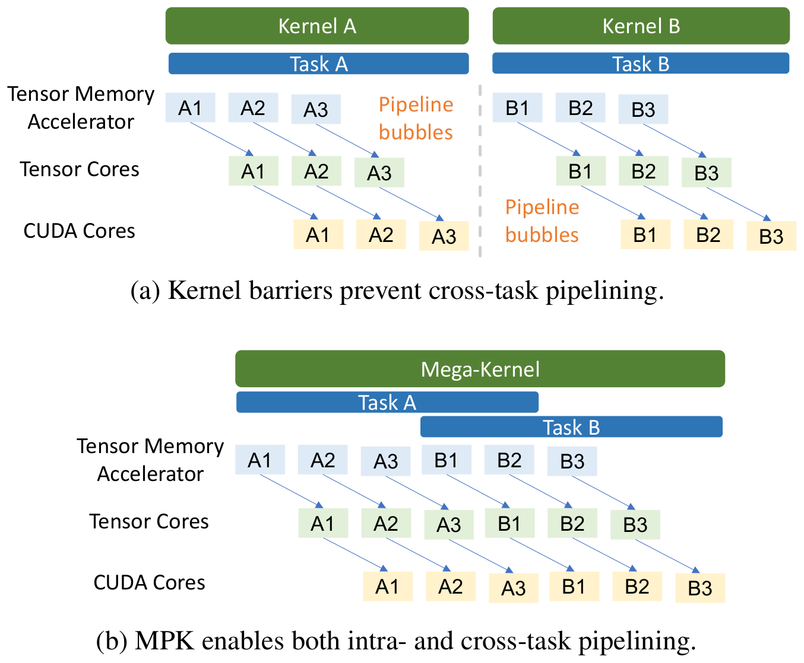

*图 2（原文 Figure 2，第 3 页）：MPK 与现有方法对任务内与跨任务流水线的支持对比。*

**图中文字翻译与读法**：

- **(a) Kernel barriers prevent cross-task pipelining（kernel 屏障阻止跨任务流水）**：左边绿色的 Kernel A 里有蓝色的 Task A，右边 Kernel B 里有 Task B，中间虚线是 kernel 边界。三行分别是 Tensor Memory Accelerator（TMA）、Tensor Cores、CUDA Cores：Task A 的三次迭代 A1、A2、A3 在三个硬件单元间形成斜向的流水线（TMA 搬 A1 → tensor core 算 A1 → CUDA core 处理 A1，同时 TMA 去搬 A2……）。橙色字 Pipeline bubbles（流水线气泡）标在两处：Kernel A 末尾（TMA 已经空了，而 tensor core 与 CUDA core 还在收尾），以及 Kernel B 开头（B1 的 TMA 之后，后两个单元要等流水线重新灌满）。
- **(b) MPK enables both intra- and cross-task pipelining（MPK 同时支持任务内与跨任务流水）**：整个 Mega-Kernel 里 Task A 与 Task B 在时间上重叠：B1 的 TMA 紧接着 A3 的 TMA 之后就开始，不必等 Task A 的 tensor core 与 CUDA core 完成，三行硬件单元上的方块连成一条不间断的斜线，没有气泡。

**读图结论**：kernel 屏障造成的气泡发生在每个任务（算子）的头尾；去掉屏障后，下一个任务的数据预取可以和当前任务的计算重叠，硬件利用率更高。

### 2.3 细粒度的 kernel 重叠（图 3）

kernel 屏障也阻止了使用不同硬件资源（如计算与通信）的 kernel 之间的重叠，因为它按整个 kernel 而不是按单个数据单元来强制依赖。图 3 是 LLM 里常见的模式：一个 MatMul 后接一个 AllGather。现有系统把它们启动成两个 kernel，AllGather kernel 的所有 thread block 必须等前面 MatMul kernel 的所有 thread block 完成。实际上两者的数据依赖要细得多：AllGather 是逐元素的操作，它的每个 thread block 只依赖一个 MatMul thread block 的输出。保持住这种细粒度依赖，不同的 SM 就可以并行执行 MatMul 与 AllGather，同时利用现代 GPU 的计算资源和通信带宽。这需要在低于 kernel 的粒度上同步 SM，这是传统 kernel 屏障做不到的。

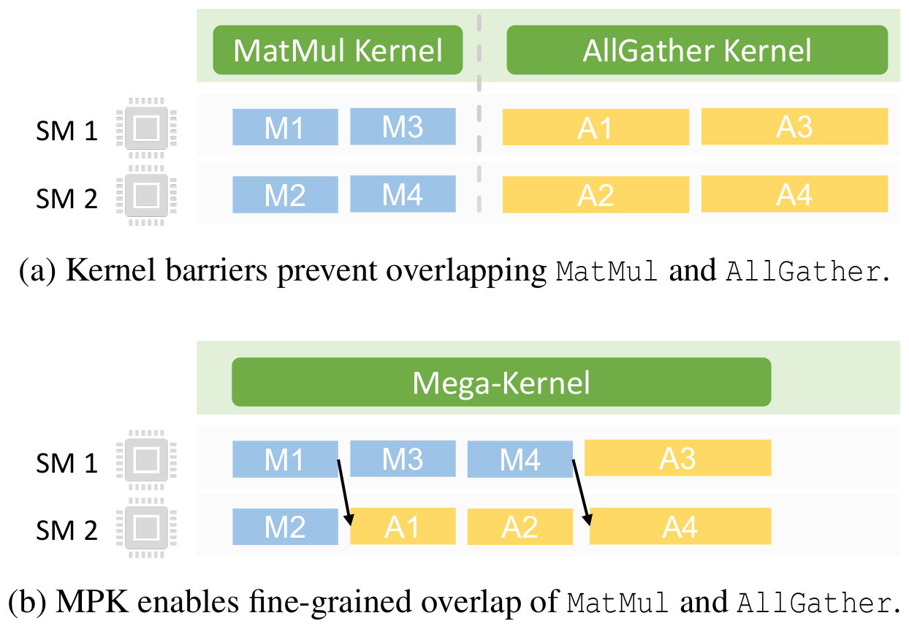

*图 3（原文 Figure 3，第 3 页）：MPK 与现有方法对任务间细粒度 kernel 重叠的支持对比；图 (b) 中的黑色箭头是保证正确性的数据依赖。*

**图中文字翻译与读法**：

- **(a) Kernel barriers prevent overlapping MatMul and AllGather（kernel 屏障阻止 MatMul 与 AllGather 重叠）**：两个 SM（SM 1、SM 2）。先是 MatMul Kernel：SM 1 依次执行 M1、M3，SM 2 依次执行 M2、M4；中间的虚线是 kernel 边界；之后才是 AllGather Kernel：SM 1 执行 A1、A3，SM 2 执行 A2、A4。
- **(b) MPK enables fine-grained overlap of MatMul and AllGather（MPK 实现 MatMul 与 AllGather 的细粒度重叠）**：同一个 Mega-Kernel 里，SM 1 依次执行 M1、M3、M4、A3，SM 2 依次执行 M2、A1、A2、A4。黑色箭头 M1→A1、M4→A4 表示 A1 只依赖 M1、A4 只依赖 M4：一个 MatMul 任务完成，依赖它的 AllGather 任务就可以立刻开始，不必等其他 MatMul 任务。

**读图结论**：细粒度依赖让“算”与“传”在不同 SM 上同时进行；图中 SM 2 在 SM 1 还在算 M3、M4 时就已经开始通信任务 A1、A2。

### 2.4 kernel fusion 与 mega-kernel

kernel fusion 把在同一数据上顺序执行的多个 GPU kernel 合并成一个语义等价的 kernel，避免中间结果落地、减少显存访问、消除启动开销。PyTorch、JAX、TVM 用基于规则的启发式融合相邻的 kernel，Mirage 与 TASO 等系统则通过超优化自动发现融合规则。但现有编译器只能融合小范围的局部算子：为一整个复杂的 tensor program 生成一个忠实实现它的 kernel，计算上很难，往往不可行。

**mega-kernel（又叫 persistent kernel）** 把融合推到极致：把一个 tensor program 的所有计算与通信融合进一个常驻的 kernel，用显存里的同步原语协调各 SM。它的好处有三：消除重复的 kernel 启动开销；跨算子软件流水（当前算子还在计算时，下一个算子的数据就可以预取）；细粒度重叠计算与 GPU 间通信。难点是：PyTorch、Triton、TVM 都不支持端到端 mega-kernel 生成，且这些系统依赖碎片化的专用库生态（NCCL 或 NVSHMEM 做通信，FlashInfer 或 FlashAttention 做 attention，CUDA 或 Triton 写自定义计算），很难把整条推理流水线统一进一个 kernel。已有的 mega-kernel 都是 GPU 专家为特定模型手写的，例如 FlashDMoE 把 MoE 计算与 GPU 间通信融合进一个 kernel，Spector 等人手工设计并实现了面向 LLaMA-1B 的低延迟 mega-kernel。

常规的 GPU 编程模型不支持一个 kernel 内跨 thread block 的直接同步：thread block 被独立地调度到各个 SM 上，可能不会同时驻留。所以 mega-kernel 需要所有执行单元同时驻留；这与后面“worker 与 scheduler 的数量在 kernel 启动时固定、与物理 SM 数一致”的设计相呼应（这一联系是解读者的推论，论文没有明说）。

### 2.5 MPK 概览（图 1）

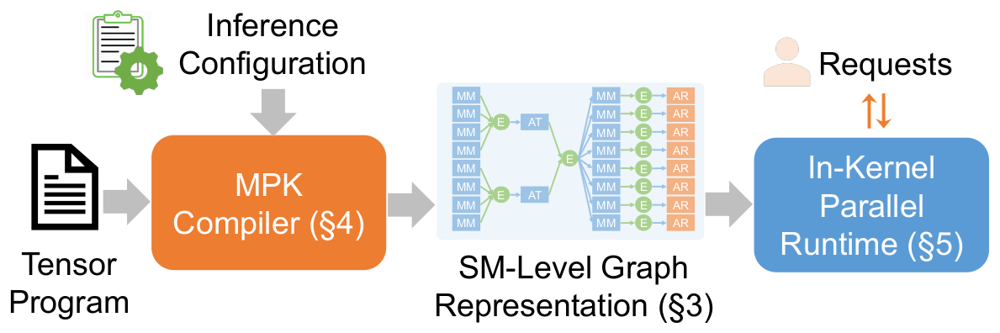

*图 1（原文 Figure 1，第 2 页）：MPK 的整体结构。*

**图中文字翻译与读法**：从左到右：Tensor Program（张量程序）与 Inference Configuration（推理配置；论文没有逐项列出，从上下文看包括最大 batch 规模、GPU 数量等）一起进入橙色的 MPK Compiler（MPK 编译器，第 4 节）；编译器输出 SM-Level Graph Representation（SM 级图表示，第 3 节）：中间小图里蓝色方块 MM、AT 是计算任务（MatMul、Attention），橙色方块 AR 是通信任务（AllReduce），绿色圆圈 E 是事件；再交给蓝色的 In-Kernel Parallel Runtime（kernel 内并行运行时，第 5 节），它与 Requests（请求）双向交互。

论文把 MPK 实现成 PyTorch 的编译器后端：用户只需几行代码改动（`torch.compile(backend=MPK)`），就能把一个 PyTorch 程序编译成 MPK mega-kernel，相比带 CUDA Graph 与 `torch.compile` 的原生 PyTorch 取得显著提升。

## 三、tGraph：SM 级任务图（论文第 3 节）

**tGraph** 用单个 SM 的粒度表示一个 tensor program 的计算。传统计算图只暴露张量算子之间的依赖，而 tGraph 捕获的是 SM 级工作单元之间的依赖。图中每个节点是任务（task）或事件（event）：

- **任务**（图中蓝色或橙色矩形）：在单个 SM 上执行的一个计算（蓝）或通信（橙）单元；
- **事件**（绿色圆圈）：跨任务的同步点；
- 任务和事件在图中**交替出现**：每个任务只有指向“触发事件（triggering event）”的出边，和来自“依赖事件（dependent event）”的入边；
- 一个任务在它的**依赖事件全部被激活**后才就绪，完成时通知它的触发事件；一个事件在收到与它相关的所有任务的通知后被**激活**。

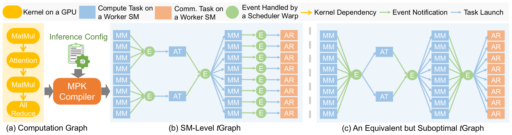

*图 4（原文 Figure 4，第 4 页）：MPK 编译器把 kernel 级的计算图变换成优化的 SM 级 tGraph。MM、AT、AR 分别表示 MatMul、Attention、AllReduce 任务。*

**图中文字翻译与读法**：

- **图例（顶部）**：黄色圆角块 Kernel on a GPU（GPU 上的一个 kernel）；蓝色方块 Compute Task on a Worker SM（worker SM 上的计算任务）；橙色方块 Comm. Task on a Worker SM（worker SM 上的通信任务）；绿色圆 Event Handled by a Scheduler Warp（由 scheduler warp 处理的事件）；黄色箭头 Kernel Dependency（kernel 依赖）；绿色箭头 Event Notification（事件通知）；蓝色箭头 Task Launch（任务启动）。
- **(a) Computation Graph（计算图）**：MatMul → Attention → MatMul → AllReduce 的算子序列，加上 Inference Config（推理配置）输入到 MPK Compiler。
- **(b) SM-Level tGraph（SM 级 tGraph）**：8 个 MM 任务，每 4 个汇入一个事件 E，各自触发一个 AT 任务（共 2 个 AT）；两个 AT 汇入下一个事件 E，它触发 8 个 MM 任务；**每个 MM 任务各有自己的事件 E，各触发一个 AR 任务**，也就是说 AllReduce 的每个任务只等产生它输入 tile 的那一个 MatMul 任务。
- **(c) An Equivalent but Suboptimal tGraph（等价但次优的 tGraph）**：同样的计算，但事件只表示算子级的依赖：8 个 MM → 一个 E → 2 个 AT → 一个 E → 8 个 MM → 一个 E → 8 个 AR。这等同于传统的 kernel 屏障。

**读图结论**：同一张计算图可以对应多张 tGraph。(b) 是精细依赖，AllReduce 可以和 MatMul 重叠，从而同时利用计算与通信资源；(c) 把依赖粗化成算子级，丢掉了这种重叠。第 4 节讲 MPK 如何通过推导精确的数据依赖来生成 (b) 这样的高性能任务图，最大化并发、最小化同步开销。

**与 CUDA Graph 的比较**：tGraph 可以看作 CUDA Graph 更低层的扩展，两者结构上有相似处：都是静态实例化的，都显式编码操作之间的依赖。但 CUDA Graph 只在 kernel 层面捕获依赖，主要描述 kernel 的启动顺序，同步依赖 stream 语义，因此重叠与融合被限制在 kernel 边界内；tGraph 则在单个 SM 任务与 kernel 内部事件的粒度上工作，显式建模算子内部与跨算子的依赖，使得在单个 kernel 内实现跨 SM 的细粒度同步、计算与通信的重叠成为可能。

## 四、MPK 编译器（论文第 4 节）

编译器的输入是一张计算图和一个推理配置，输出是针对该配置与目标 GPU 架构专门优化的 tGraph。图 5 用一个很小的例子画出了完整流程：先把算子分解成任务并推导依赖（b），再做两种事件融合（c、d）、规范化（e）、线性化（f）。

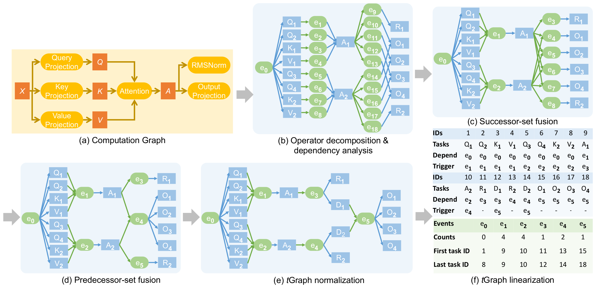

*图 5（原文 Figure 5，第 5 页）：MPK 编译器的工作流程。(b) 中 Q、K、V、A、O、R 分别表示对 query 投影、key 投影、value 投影、attention、output 投影、RMSNorm 做分解后得到的任务集合；(e) 中的 D1、D2 是 tGraph 规范化时插入的 dummy 任务，保证每个任务只有一个触发事件；(f) 展示 MPK 如何线性化 tGraph 并存储结果，任务与事件用统一的规范表示。*

**图中文字翻译与读法**：

- **(a) Computation Graph（计算图）**：输入 $X$ 经 Query Projection、Key Projection、Value Projection 得到 $Q$、$K$、$V$，三者送入 Attention 得到 $A$；$A$ 同时是 RMSNorm 与 Output Projection 的输入。
- **(b) Operator decomposition & dependency analysis（算子分解与依赖分析）**：每个算子被分解成若干任务：query 投影分成 $Q_1$–$Q_4$，key 投影 $K_1$、$K_2$，value 投影 $V_1$、$V_2$，attention $A_1$、$A_2$，output 投影 $O_1$–$O_4$，RMSNorm $R_1$、$R_2$。起始事件 $e_0$ 触发全部 8 个投影任务；之后对每一对有数据重叠的“生产者任务—消费者任务”各建一个事件，共 $e_1$–$e_{18}$：例如 $Q_1,Q_2,K_1,V_1$ 各自有一个事件通向 $A_1$（$e_1$–$e_4$），$Q_3,Q_4,K_2,V_2$ 各自有一个事件通向 $A_2$（$e_5$–$e_8$），$A_1$、$A_2$ 各自又通过 5 个事件通向 $R$ 与 $O$ 任务（$e_9$–$e_{18}$）。
- **(c) Successor-set fusion（后继集融合）**：把消费者集合相同的事件合并，19 个事件减为 9 个（$e_0$–$e_8$）。
- **(d) Predecessor-set fusion（前驱集融合）**：把生产者集合相同的事件再合并，减为 6 个（$e_0$–$e_5$）：$e_4$ 同时等待 $A_1$ 与 $A_2$，并触发 $O_1$–$O_4$。
- **(e) tGraph normalization（tGraph 规范化）**：$A_1$、$A_2$ 各有两个触发事件，插入 dummy 任务 $D_1$、$D_2$，使每个任务只触发一个事件。
- **(f) tGraph linearization（tGraph 线性化）**：把任务按事件顺序编号为 1–18，每个任务只记依赖事件与触发事件的编号，每个事件记触发次数和它所启动任务的“首/末任务编号”（表格见第 4.3 节）。

### 4.1 tGraph 生成：算子分解、依赖分析、事件融合（论文第 4.1 节）

**算子分解（operator decomposition）**：编译器把输入计算图中的每个算子分解成一组任务，做法是**划分算子的输出张量**：每个任务计算输出的一个互不相交的子集，所以同一算子的任务可以在各 SM 上并行。大多数张量代数算子可以沿多个输出维度划分，例如矩阵乘的输出可以沿行和列两个维度分块来暴露并行。划分策略的性能取决于问题形状和目标 GPU 架构；为找到有效的策略，MPK 选择使**从显存到共享内存的数据加载量最小**的划分，因为显存访问比共享内存访问以及 CUDA core、tensor core 上的计算贵得多。默认情况下，MPK 生成的任务数与 SM 数成正比，以促进执行时各 SM 的负载均衡；MPK 也提供接口，让用户通过设定每个输出维度上的并行度来指定自己的划分策略。

**依赖分析（dependency analysis）**：MPK 用事件表示任务之间的依赖。对共享一个张量的任意两个算子，MPK 枚举这两个算子的所有任务对，**当且仅当**生产者 $t_1$ 产出的输出区域与消费者 $t_2$ 读取的输入区域**有重叠**时，才为这对任务 $(t_1,t_2)$ 引入一个事件 $e$。事件是同步点，表示 $t_2$ 在 $t_1$ 产出所需数据之前不能开始。相应地，MPK 往 tGraph 里加两条边 $(t_1,e)$ 和 $(e,t_2)$。这种细粒度的依赖分析保留了所有生产者—消费者依赖，同时暴露出相互独立的任务之间的并行。

**事件融合（event fusion）**：逐对建事件会得到很多冗余的同步点，所以 MPK 用两种互补的融合来消除冗余并简化 tGraph。对事件 $e$ 定义两个函数：$\mathrm{InTasks}(e)$ 是触发 $e$ 的任务集合，$\mathrm{OutTasks}(e)$ 是依赖 $e$ 的任务集合；它们刻画了多个事件何时有相同的依赖结构因而可以融合。

- **后继集融合（successor-set fusion，定义 4.1）**：合并作为**同一组消费者任务**的先决条件的事件。对 tGraph 中任意两个事件 $e_1,e_2$，当且仅当 $\mathrm{OutTasks}(e_1)=\mathrm{OutTasks}(e_2)$ 时适用；MPK 把 $e_1,e_2$ 去掉，引入融合事件 $e'$，使 $\mathrm{InTasks}(e')=\mathrm{InTasks}(e_1)\cup\mathrm{InTasks}(e_2)$、$\mathrm{OutTasks}(e')=\mathrm{OutTasks}(e_1)$。理由：这些消费者任务要等所有这些事件都被激活才能开始，把它们分开表示不会带来额外的调度灵活性。例：图 5(b) 的 $e_{10}$ 与 $e_{14}$ 都是任务 $O_1$ 的先决条件，被融合成图 5(c) 的 $e_4$；同理 $e_1$–$e_4$（都只通向 $A_1$）融合成 $e_1$。
- **前驱集融合（predecessor-set fusion，定义 4.2）**：合并依赖**同一组生产者任务**的事件。当且仅当 $\mathrm{InTasks}(e_1)=\mathrm{InTasks}(e_2)$ 时适用；融合事件 $e'$ 满足 $\mathrm{InTasks}(e')=\mathrm{InTasks}(e_1)$、$\mathrm{OutTasks}(e')=\mathrm{OutTasks}(e_1)\cup\mathrm{OutTasks}(e_2)$。理由：这样的事件会被同时触发，把它们保留为独立的同步节点只会带来不必要的图复杂度。例：图 5(c) 的 $e_4,e_5,e_6,e_7$ 都依赖任务 $A_1$ 和 $A_2$，被融合成新 tGraph 里的 $e_4$。

效果（论文第 6.7 节）：融合后，所评测模型的最终 tGraph 只含 1,142–2,366 个事件，却编码了约 69,000–162,000 个生产者—消费者任务对依赖，相当于同步事件减少 37–118 倍（表 2）。MoE 模型的减少最大，因为专家路由造成的多对多依赖特别适合融合。

### 4.2 tGraph 规范化（图 6；论文第 4.1 节）

运行时需要一种统一而廉价、避免昂贵间接寻址的表示：MPK 在各 SM 上并行执行任务、更新事件。两个难点：其一，一个任务可能依赖、触发任意多个事件，若按最大个数预留空间会带来很大的内存开销；其二，事件融合之后，一个事件可能触发任意多个任务，若按最大扇出预留空间同样昂贵。MPK 用两个技术解决：规范化（本节）与线性化（下一节）。

**规范化**限定每个任务存储的依赖元数据：当每个任务至多依赖一个事件、至多触发一个事件时，任务描述符只需存一个“依赖事件编号”和一个“触发事件编号”，而不是变长列表。MPK 用图 6 的两个改写，把输入 tGraph 变成功能等价、且每个任务至多一个依赖事件、至多一个触发事件的形式。

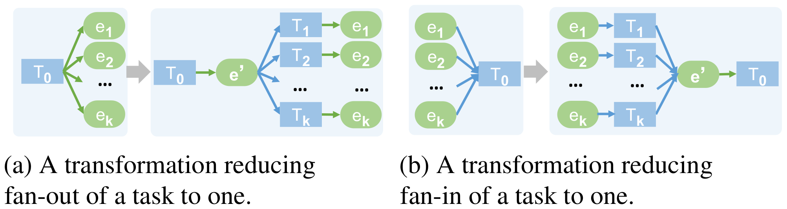

*图 6（原文 Figure 6，第 6 页）：MPK 对任意 tGraph 做图变换使之规范化，保证每个任务至多有一个依赖事件和一个触发事件。*

**图中文字翻译与读法**：

- **(a) A transformation reducing fan-out of a task to one（把任务的扇出降为 1）**：左边，任务 $T_0$ 触发多个事件 $e_1,e_2,\ldots,e_k$；右边，MPK 引入一个新事件 $e'$ 和 $k$ 个空任务 $T_1,\ldots,T_k$（不做任何计算，各自依赖 $e'$），于是 $T_0$ 只触发 $e'$，而每个新引入的 $T_i$ 恰好触发原来的某一个 $e_i$。这保证每个任务至多一个触发事件。
- **(b) A transformation reducing fan-in of a task to one（把任务的扇入降为 1）**：左边，任务 $T_0$ 依赖多个事件 $e_1,\ldots,e_k$；右边，MPK 引入新事件 $e'$ 和 $k$ 个空任务 $T_1,\ldots,T_k$（各自触发 $e'$），于是 $T_0$ 只依赖 $e'$，每个新引入的 $T_i$ 恰好依赖原来的某一个 $e_i$。

规范化只在 tGraph 中有任务出现多个扇入或扇出事件（即分叉与汇合处）时才引入额外的任务和事件。这通常发生在原计算图里有可以并行执行的算子时：例如图 5(d) 中 $A_1$、$A_2$ 有两个扇出事件，因为 RMSNorm 与 output 投影都依赖 attention、可以并行；图 5(e) 对 $A_1$、$A_2$ 各应用一次变换，把它们的触发事件数降到 1。（解读者观察：图 5(e) 每个任务只插入了一个 dummy 任务，而规则写的是 $k$ 个空任务；示例相当于让 $R$ 任务直接由新事件启动，论文没有解释这个差别。）论文报告规范化开销可忽略，在评测中**始终低于 1%**，因为现实的模型通常是“深”的（有许多顺序算子）而不是“宽”的（有许多并行算子）。在论文第 6.7 节，所编译的三个 LLM 前向 tGraph 里甚至没有出现分叉/汇合组，因为本来会扇出的 Q/K/V 投影被发射成了融合算子；但并行分支出现时规范化仍是保证正确所必需的。

### 4.3 tGraph 线性化（算法 1、图 5(f)；论文第 4.1 节）

**线性化**与规范化互补：规范化限制每个任务的事件数，线性化限制记录“每个事件对应哪些任务”所需的存储。规范化本身不能解决第二个难点：事件融合后，一个事件仍可能要触发很多任务，例如图 5(e) 中的事件 $e_5$ 要触发 4 个任务，否则需要显式存储所有出边的任务编号。MPK 用一个基于广度优先搜索的算法（算法 1）线性化 tGraph：给由同一个事件触发的所有任务在最终的任务排序里分配**连续的编号**。于是一个事件的扇出只需用“首个任务编号和末个任务编号”两个数就能编码，不需要显式存储依赖任务的列表，同时保留全部依赖。

**算法 1：MPK 的 tGraph 线性化算法**（原文 Algorithm 1，第 6 页；中文转录，行号与原文一致。保证每个任务恰好入队 $T$ 一次、每个事件恰好入队 $E$ 一次；第 5–7 行保证依赖同一个事件的所有任务在 $T$ 中连续）

```text
输入：规范化后的 tGraph G
输出：任务列表 T，使得对 G 中每个事件 e，被 e 启动的任务在 T 中连续
 1: T ← ∅
 2: E ← { e ∈ G | e.counts = 0 }          # 先入队所有没有依赖任务的事件（起始事件）
 3: 当 E 非空：
 4:     e ← E.dequeue()
 5:     对 G 中每个任务 t：
 6:         若 t.dependent_event = e：
 7:             T.enqueue(t)                # 依赖 e 的任务一次性连续入队
 8:             e' ← t.trigger_event
 9:             若触发 e' 的所有任务都已在 T 中：
10:                 E.enqueue(e')
11:
12: 返回 T
```

**图 5(f) 的存储格式**：对每个任务，MPK 只记录它的依赖事件和触发事件的编号；对每个事件，存储激活它所需的触发次数（counts），事件一旦被激活，运行时就启动编号落在该事件首、末任务编号之间的所有任务。下面是图 5(f) 的转录（任务 ID 即线性化后的顺序；“–”表示没有）：

| ID | 任务 | 依赖事件 | 触发事件 |
| ---: | --- | --- | --- |
| 1 | $Q_1$ | $e_0$ | $e_1$ |
| 2 | $Q_2$ | $e_0$ | $e_1$ |
| 3 | $K_1$ | $e_0$ | $e_1$ |
| 4 | $V_1$ | $e_0$ | $e_1$ |
| 5 | $Q_3$ | $e_0$ | $e_2$ |
| 6 | $Q_4$ | $e_0$ | $e_2$ |
| 7 | $K_2$ | $e_0$ | $e_2$ |
| 8 | $V_2$ | $e_0$ | $e_2$ |
| 9 | $A_1$ | $e_1$ | $e_3$ |
| 10 | $A_2$ | $e_2$ | $e_4$ |
| 11 | $R_1$ | $e_3$ | – |
| 12 | $D_1$ | $e_3$ | $e_5$ |
| 13 | $R_2$ | $e_4$ | – |
| 14 | $D_2$ | $e_4$ | $e_5$ |
| 15 | $O_1$ | $e_5$ | – |
| 16 | $O_2$ | $e_5$ | – |
| 17 | $O_3$ | $e_5$ | – |
| 18 | $O_4$ | $e_5$ | – |

| 事件 | $e_0$ | $e_1$ | $e_2$ | $e_3$ | $e_4$ | $e_5$ |
| --- | ---: | ---: | ---: | ---: | ---: | ---: |
| Counts（激活所需触发次数） | 0 | 4 | 4 | 1 | 2 | 1 |
| First task ID（首个任务编号） | 1 | 9 | 10 | 11 | 13 | 15 |
| Last task ID（末个任务编号） | 8 | 9 | 10 | 12 | 14 | 18 |

（原文图 5(f)，第 5 页。）读法：事件 $e_0$ 触发任务 1–8（八个投影任务），$e_1$ 只触发任务 9（$A_1$），$e_3$ 触发任务 11–12（$R_1$、$D_1$），$e_5$ 触发任务 15–18（$O_1$–$O_4$）。每个事件的扇出只用两个整数描述。**解读者核对**：按图 5(e) 的结构，$e_4$ 只由 $A_2$ 触发，应有 counts 为 1，而 $e_5$ 由 $D_1$、$D_2$ 两个任务触发，应为 2；原图 Counts 一行印成了“…1, 2, 1”（$e_3$、$e_4$、$e_5$），疑为原图笔误（论文没有说明）。

线性化的效果（论文第 6.7 节）：把每个事件的后继任务编码成连续区间而不是显式任务列表，使设备端的占用降低 4.4–5.9 倍（稠密模型，如 Qwen3-8B 从 110,932 字节降到 18,928 字节），MoE 模型降低 15.0 倍，因为专家路由的高扇出事件在区间编码下特别紧凑；而且不丢失任何依赖信息。

### 4.4 任务实现的生成（论文第 4.2 节）

除了构造 tGraph，MPK 还要为每个任务生成一个在 GPU SM 上执行的设备函数。论文沿用先前工作，用编译器**超优化**自动生成高性能实现，具体是在 **thread block 层**而不是 kernel 层做超优化：每个计算任务带有一份参考的 PyTorch 实现，MPK 用 Mirage superoptimizer 搜索一个优化过的 thread-block 图，再交给 Mirage 编译器生成 CUDA 实现；其中包含 SM 内的优化，如软件流水线、寄存器复用，以及降低共享内存 bank 冲突的布局优化。通信任务借助 NVSHMEM 在 kernel 内完成 GPU 间通信（论文第 6.1 节）。

## 五、kernel 内并行运行时（论文第 5 节）

运行时在**单个 mega-kernel 内**、所有 SM 上执行 tGraph，因此消除了反复的 kernel 启动，并暴露出对调度、同步、执行顺序的细粒度控制。mega-kernel 一旦启动，就持续管理计算与通信，直到推理工作负载完成。

### 5.1 worker 与 scheduler（论文第 5 节开头）

MPK 把一个 GPU 的 SM 划分为 **worker** 和 **scheduler**：

- **worker**：每个 worker 运行在一个物理 SM 上，维护一个独立的任务队列。它执行一个轻量的循环：反复出队任务、执行相应的计算或通信，然后通过通知任务的触发事件来标记任务完成。这使 worker 保持满负荷，同时允许跨算子的异步执行。
- **scheduler**：按 **warp** 粒度组织，每个 SM 上放 4 个 scheduler warp。每个 scheduler 维护一个事件队列，反复轮询新被激活的事件，把对应的任务派发给 worker。
- worker 与 scheduler 的分配在 kernel 启动时固定，且与 GPU 的物理 SM 数一致，避免在 kernel 内做动态角色切换的开销。

### 5.2 事件驱动的执行（图 7；论文第 5.1 节）

MPK 用事件驱动的模型执行 tGraph。每个 tGraph 从一个指定的**起始事件**（如图 7 的 $e_0$）开始，它没有任何先决条件，先被放入某个 scheduler 的事件队列。scheduler（如 $s_1$）出队该事件，启动所有依赖它的任务（如 $AT_1,\ldots,AT_4$）；每个被启动的任务被派发给一个 worker，worker 执行任务，完成后通知该任务的触发事件。一个事件的所有先决条件都完成、共同把它触发了所需的次数后，它就被**激活**，被放入某个 scheduler 的事件队列，使运行时继续沿 tGraph 向前推进。事件就这样驱动任务执行，实现细粒度的异步调度。

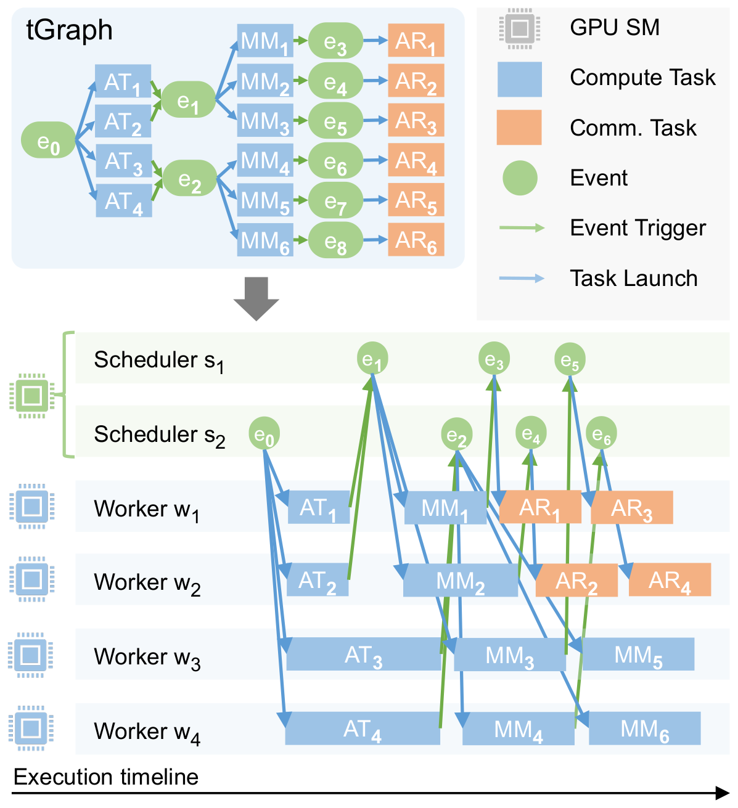

*图 7（原文 Figure 7，第 7 页）：MPK 事件驱动的执行模型。圆圈是事件，蓝色（或橙色）矩形是计算（或通信）任务；事件指向任务的边表示任务启动，任务指向事件的边表示任务完成时触发该事件。AT、MM、AR 分别表示 attention、矩阵乘、AllReduce。*

**图中文字翻译与读法**：

- **上半：tGraph**。起始事件 $e_0$ 触发 4 个 attention 任务 $AT_1$–$AT_4$；$AT_1$、$AT_2$ 汇入事件 $e_1$，$AT_3$、$AT_4$ 汇入事件 $e_2$；$e_1$ 触发 $MM_1$–$MM_3$，$e_2$ 触发 $MM_4$–$MM_6$；每个 $MM_i$ 通过自己的事件 $e_{i+2}$ 触发橙色的通信任务 $AR_i$。图例：GPU SM、Compute Task（计算任务）、Comm. Task（通信任务）、Event（事件）、Event Trigger（事件触发，绿色箭头）、Task Launch（任务启动，蓝色箭头）。
- **下半：执行时间线（Execution timeline，横轴为时间）**。上面两行是 Scheduler $s_1$、$s_2$（各处理若干事件：$s_2$ 处理 $e_0,e_2,e_4,e_6$，$s_1$ 处理 $e_1,e_3,e_5$），下面四行是 Worker $w_1$–$w_4$。$e_0$ 激活后启动 $AT_1$–$AT_4$，分别派给四个 worker；$AT_1$、$AT_2$ 很快完成，触发 $e_1$，于是 $MM_1,MM_2,MM_3$ 马上被启动；而 $AT_3$、$AT_4$ 持续的时间长得多，所以 $e_2$ 激活得晚，$MM_4$–$MM_6$ 随后才启动。先做完 attention 的 $w_1$、$w_2$ 接着执行 $MM_1$、$MM_2$ 乃至通信任务 $AR_1$、$AR_3$ 与 $AR_2$、$AR_4$，没有等 $w_3$、$w_4$。

**读图结论**：这展示了论文所说的“先完成 attention 任务的 worker 可以执行更多下游任务，改善端到端延迟并在各 SM 之间平衡负载”。

**对互联拓扑不敏感**：事件驱动模型还使 MPK 无需显式的拓扑 profile 就能适应底层互联。通信与计算在同一张 tGraph 里被统一表示为任务，由同一批 scheduler 派发；依赖这些通信任务输出的计算任务，在通信任务触发相应事件后立即启动，而不管它们经过的链路延迟如何：更快的链路更早触发事件、更早释放依赖它的工作，更慢的链路只延迟依赖它的任务。所以 scheduler 不需要显式知道链路带宽或拓扑距离，同一张 tGraph 和同一个 scheduler 可以处理异构互联（如节点内的 NVLink 与节点间网络），靠对数据可用性做出反应，而不依赖静态拓扑模型。（这是论文的论述，实验只在单节点 H100 上做，没有测节点间网络。）

### 5.3 混合任务发射：JIT 与 AOT（图 8；论文第 5.2 节）

一个任务进入 worker 的任务队列有两种方式：

- **JIT（just-in-time，即时）**：scheduler 在任务的依赖事件**已被完全激活之后**才把它分配给 worker，所以任务被分配后可立即执行；
- **AOT（ahead-of-time，预先）**：运行时在前驱事件被激活**之前**就把任务预先放入某个 worker 的任务队列，worker 在依赖事件被完全激活之前不能执行它，只能在本地等待依赖满足。

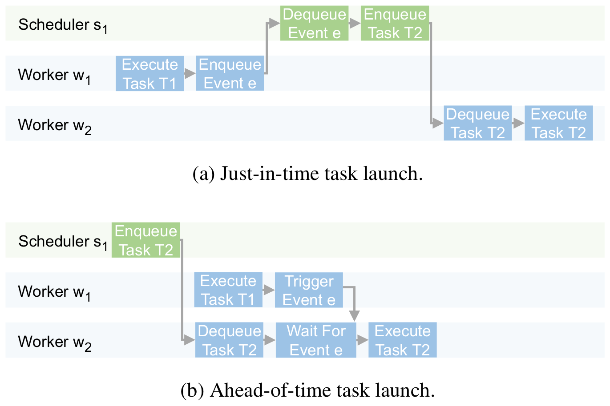

*图 8（原文 Figure 8，第 8 页）：JIT 与 AOT 任务发射的对比：任务 $T_1$ 触发事件 $e$ 之后启动任务 $T_2$。*

**图中文字翻译与读法**：

- **(a) Just-in-time task launch（JIT 发射）**：Worker $w_1$ 先 Execute Task T1（执行 $T_1$）、再 Enqueue Event e（把事件 $e$ 入队）；Scheduler $s_1$ 随后 Dequeue Event e（出队事件）、Enqueue Task T2（把 $T_2$ 入队到某个 worker）；Worker $w_2$ 再 Dequeue Task T2（出队）、Execute Task T2（执行）。这条链要经过 **两次同步**：worker→scheduler，scheduler→worker。
- **(b) Ahead-of-time task launch（AOT 发射）**：$s_1$ 在一开始就把 $T_2$ 入队到 $w_2$；$w_1$ 执行 $T_1$ 后 Trigger Event e（触发事件）；$w_2$ 早已 Dequeue Task T2，处于 Wait For Event e（等待事件）状态，事件一激活就 Execute Task T2。只需 **一次同步**（经过事件触发），每个任务的发射延迟更低。

**两种方式的取舍**：JIT 使 MPK 能适应负载不均衡。例如 LLM 里的 attention 的执行时间由于依赖数据的序列长度而变化很大，长序列的请求比短序列的耗时更长，静态分配因此失效；在 JIT 下，MPK 只在触发下游任务（如 MatMul 或 AllReduce）的 attention 任务完成之后才启动它们，先完成 attention 任务的 worker 可以执行更多下游任务（即图 7 的情形）。但 JIT 的延迟更高，因为多了 worker 与 scheduler 之间的通信（图 8a 的两次同步）。

**混合发射（hybrid task launch）**：编译器在构造 tGraph 时，按“算子的执行时间是否依赖数据、是否可能引起运行时不均衡”把每个算子标记为 JIT 或 AOT：

1. 执行时间依赖数据的算子（如 attention）标为 **JIT**；
2. 它们的下游算子也保持 JIT，直到执行到一个**全局屏障**（即必须由所有上游任务触发的事件）；这样的屏障消除了累积的不均衡，使之后的算子适合 AOT；
3. 其余算子都标为 **AOT**，以最小化派发开销；
4. 标记以算子为粒度：同一个算子生成的所有任务共享同一种发射方式。

运行时的配合：worker 维护两个队列，一个放 JIT 任务，一个放 AOT 任务。worker **总是优先取 JIT 任务**，因为它们已就绪；JIT 队列用完时，检查 AOT 队列里第一个任务的依赖事件是否已经被完全激活，是就执行它。这样 worker 只在没有任何就绪工作时才阻塞。scheduler **只处理启动 JIT 任务的事件**；所有 AOT 任务在执行开始前就已入队。由于一个算子产生的任务数通常与 worker 数成正比（本文第 4.1 节），MPK 以 round-robin 方式把 AOT 任务分配到各 worker 来保持负载均衡。预先入队 AOT 任务减少了 scheduler 的负载、摊薄了派发开销，而 JIT 发射则动态地平衡各 SM 的工作。

### 5.4 运行时优化（论文第 5.3 节）

**分页的共享内存抽象（paged shared memory）**：传统 GPU 编程里，共享内存是每个 thread block 私有的片上快速内存，只在 kernel 生命周期内存在；kernel-per-operator 下每个 kernel 通常假定独占其 thread block 分到的共享内存。这个假设阻碍跨任务软件流水（那需要在当前任务计算的同时为下一个任务加载数据，两个任务可能同时需要共享内存）。为此 MPK 引入分页共享内存抽象：共享内存被划分为固定大小的页，任务实现被改成按页而不是按整块来操作；任务根据其共享内存占用量获取一页或多页，不再需要时必须释放；**一个任务一旦释放了任何一页，就不能再获取新的共享内存页**，这种单调的使用模式简化了调度。当前任务释放页时，MPK 可以立刻为下一个任务分配可用页并开始数据预取。实验里页大小在所有 GPU 上都设为 32 KB，A100、H100、B200 每个 SM 分别得到 5、7、7 页（按 A100 约 164 KB、H100/B200 约 227 KB 的每 SM 共享内存容量核算，与此一致；这是解读者的核对）。

**跨任务软件流水（cross-task software pipelining）**：为了在同一个 worker 上执行的任务之间做软件流水，MPK 把每个任务分成**预加载阶段**（pre-loading phase）和**计算阶段**（compute phase）。预加载阶段发出数据传输指令，把所需张量的一个块从显存取到共享内存，启动任务内的软件流水线，但不做计算。当满足两个条件时，MPK 机会性地让当前任务 $T_1$ 的计算阶段与后继任务 $T_2$ 的预加载阶段重叠：(1) $T_1$ 已经发出了自己所有的数据传输指令；(2) 有足够的共享内存页供 $T_2$ 的预加载使用。这个流水不干扰 $T_1$ 的执行，因为 MPK 会插入必要的 SM 内同步屏障，保证 $T_2$ 的内存传输不与 $T_1$ 正在进行的数据传输冲突。

**任务描述符预取（pre-fetching task descriptions）**：每个 worker 在显存里维护 JIT 与 AOT 两个任务队列；每个任务关联一个任务描述（编码其输入张量、输出张量和配置参数），当前实现里每个描述占 352 字节。为了降低入队、出队延迟并隐藏显存访问开销，MPK 用一个轻量的预取机制，在需要之前就把即将执行的任务描述取到共享内存里。

**降低任务发射开销**：MPK 把计算分解成比传统 GPU kernel 细得多的任务，所以必须压低每个任务的发射开销。一是 worker 与 scheduler 都很轻量：事件队列与任务队列是 GPU 显存里的环形缓冲区，入队、出队只用开销很低的 `atomicAdd` 指令；二是采用**去中心化调度**：每个 scheduler 用本地状态分配任务，避免全局协调，免去了全局协调调度固有的通信与同步开销。目前的实现采用去中心化调度，但运行时设计成可以用很小的代码改动支持其他策略，包括全局协调调度；探索这些策略及其性能权衡留作未来工作。

**支持运行时动态性**：为展示对高度动态负载的支持，论文给系统加入了 LLM serving 所需的机制，包括 continuous batching 与 paged attention。处理一个 tGraph 的起始事件时，scheduler 准备新一轮解码迭代：(1) 移除上一轮已完成的请求；(2) 接纳新到达的请求；(3) 更新每个请求的 KV-cache 元数据。这段逻辑作为单个任务执行，KV-cache 元数据放在显存里供 attention 任务直接访问。为处理 LLM serving 固有的动态 batch size，MPK 为有代表性的 batch size（取 2 的幂，直到最大 batch size）生成多个特化的 tGraph；运行时 scheduler 按当前 batch size 选出合适的 tGraph。这样编译器能为具体 batch size 生成优化的 tGraph，同时保留对动态 serving 负载的灵活性。注意这仍是“多个特化图”，不是一个与形状无关的单图。

## 六、实验（论文第 6 节）

论文用四个问题组织评测：(1) MPK 的 mega-kernel 执行模型与最先进的 kernel-per-operator 系统相比如何（第 6.3 节）；(2) MPK 如何支持动态负载（第 6.4 节）；(3) MPK 多 GPU 执行的可扩展性与效率（第 6.5 节）；(4) 拆开各项主要运行时优化的贡献（第 6.6、6.7 节）。评测聚焦在 LLM serving，理由有二：一是 SGLang、vLLM 等是高度优化的 kernel-per-operator 基线，与它们比较是严苛的基准；二是 LLM serving 天然动态（不同迭代的 batch size、序列长度、prefill 与 decode 的混合都可能变化），对编译器和运行时都构成压力。论文称 MPK 的编译器和运行时与模型无关，可支持一般的 DNN 架构，但实验只覆盖 LLM serving。

### 6.1 实现与实验设置（论文第 6.1、6.2 节）

**实现**：MPK 实现为 PyTorch 的编译器后端，调用 `torch.compile(backend=MPK)` 触发 MPK 编译器，生成 mega-kernel 并返回一个可调用的 PyTorch 函数，调用该函数只发起一次 mega-kernel 启动。当前实现约 44K 行 C++、42K 行 CUDA、10K 行 Python；kernel 内并行运行时用 CUDA 编写，用显存里的信号量协调 worker 与 scheduler；编译器用 C++ 和 Python 实现，自动把输入的 tensor program 变成针对特定 GPU 的优化 tGraph；计算任务用 Mirage superoptimizer 生成优化的 CUDA 实现，GPU 间的 kernel 内通信用 NVSHMEM。

**模型与硬件**：5 个广泛部署的 LLM（Qwen3-0.6B、Llama-3.2-1B-Instruct、Qwen3-1.7B、Qwen3-8B 四个稠密模型，以及 MoE 模型 Qwen3-30B-A3B）；3 代 NVIDIA GPU：A100、H100、B200。

**MPK 配置（表 1）**：所有实验里 MPK 预留 4 个 SM 给 scheduler，因为每个 SM 最多承载 4 个活跃的 scheduler warp，所以共有 16 个 scheduler warp；其余 SM 作 worker。共享内存页大小在所有 GPU 上设为 32 KB，A100、H100、B200 每个 SM 分别有 5、7、7 页。

**表 1：评测中的 MPK 配置**

| GPU | SM 数 | worker 数 | scheduler 数（warp） |
| --- | ---: | ---: | ---: |
| A100 | 108 | 104 | 16 |
| H100 | 132 | 128 | 16 |
| B200 | 148 | 144 | 16 |

（原文表 1，第 10 页；“scheduler 数”为 scheduler warp 数，括号说明按正文“4 个 SM 共 16 个 scheduler warp”补充。）

**评测方法**：为排除请求到达模式带来的差异，所有实验采用**离线批量推理**，改变最大 batch size（1、2、4、8、16，图中记为 BS）；每个请求的 prompt 长度为 64 个 token，生成 1024 个输出 token，这样可避免请求并发度不足造成的服务端停顿，便于做受控的系统级比较。所有系统都从 HuggingFace Transformers 加载模型结构，使用 bfloat16 精度，并开启 paged attention 与 continuous batching。

**基线**：SGLang 与 vLLM（两个最先进的 LLM serving 系统，均为 kernel-per-operator 方式，依赖专用 kernel 库：attention 用 FlashInfer 与 FlashAttention，矩阵乘用 cuBLAS 与 CUTLASS，其他算子用 CUDA 或 Triton），以及原生 PyTorch。关键的架构差别是：MPK 把页分配和请求调度直接放进 mega-kernel；而 SGLang、vLLM 在 CPU 上执行这些操作，带来额外的主机—设备同步与派发开销。（基线的具体版本号正文没有给出；附录 A 的 artifact 说明了 CUDA 12.8、PyTorch 2.7、transformers 4.57.1，vLLM 与 SGLang 各在独立的虚拟环境里运行。）

### 6.2 端到端结果（图 9；论文第 6.3 节）

对每个模型，在 B200、H100、A100 上，用从 1 到 16 的最大 batch size 比较三个系统（外加 PyTorch），并报告 serving 吞吐（正文称 serving throughput，附录 A 的 artifact 说明则写作每 token 的解码延迟）。

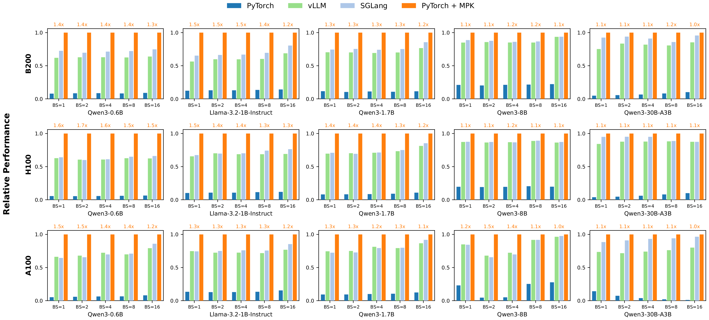

*图 9（原文 Figure 9，第 11 页）：MPK 与现有系统在 A100、H100、B200 GPU 上、5 个模型上的端到端对比。所有结果都以 MPK 为 1 归一化，越高越好；每根 MPK 柱上方的数字是它相对最佳基线的加速比。*

**图中文字翻译与读法**：图例：蓝色 PyTorch、绿色 vLLM、浅蓝 SGLang、橙色 PyTorch + MPK（即用 MPK 后端编译的 PyTorch 程序）。3 行（B200、H100、A100）× 5 列（模型）共 15 个子图，每个子图 5 组柱（BS=1、2、4、8、16）；纵轴 Relative Performance（相对性能，MPK=1.0，越高越好）。橙色柱恒为 1.0，其他柱的高度是该系统相对 MPK 的性能（如 0.62 表示 MPK 快约 1.6 倍）。橙色柱上方的 1.4x 等是 MPK 相对**最佳基线**（vLLM 与 SGLang 中更强的一个）的加速比。下面三张表照录这些标注（原文数据标签，1.0x 表示与最佳基线持平）：

**B200**

| 模型 | BS=1 | BS=2 | BS=4 | BS=8 | BS=16 |
| --- | ---: | ---: | ---: | ---: | ---: |
| Qwen3-0.6B | 1.4× | 1.4× | 1.4× | 1.4× | 1.3× |
| Llama-3.2-1B-Instruct | 1.5× | 1.5× | 1.5× | 1.4× | 1.2× |
| Qwen3-1.7B | 1.3× | 1.3× | 1.3× | 1.3× | 1.2× |
| Qwen3-8B | 1.1× | 1.1× | 1.2× | 1.2× | 1.1× |
| Qwen3-30B-A3B | 1.1× | 1.1× | 1.1× | 1.2× | 1.0× |

**H100**

| 模型 | BS=1 | BS=2 | BS=4 | BS=8 | BS=16 |
| --- | ---: | ---: | ---: | ---: | ---: |
| Qwen3-0.6B | 1.6× | 1.7× | 1.6× | 1.5× | 1.5× |
| Llama-3.2-1B-Instruct | 1.5× | 1.4× | 1.4× | 1.3× | 1.3× |
| Qwen3-1.7B | 1.4× | 1.4× | 1.4× | 1.3× | 1.2× |
| Qwen3-8B | 1.1× | 1.1× | 1.2× | 1.1× | 1.1× |
| Qwen3-30B-A3B | 1.1× | 1.1× | 1.1× | 1.1× | 1.1× |

**A100**

| 模型 | BS=1 | BS=2 | BS=4 | BS=8 | BS=16 |
| --- | ---: | ---: | ---: | ---: | ---: |
| Qwen3-0.6B | 1.5× | 1.5× | 1.4× | 1.4× | 1.2× |
| Llama-3.2-1B-Instruct | 1.3× | 1.3× | 1.3× | 1.3× | 1.2× |
| Qwen3-1.7B | 1.3× | 1.3× | 1.2× | 1.3× | 1.1× |
| Qwen3-8B | 1.2× | 1.5× | 1.4× | 1.1× | 1.0× |
| Qwen3-30B-A3B | 1.1× | 1.1× | 1.1× | 1.1× | 1.0× |

（原文图 9 的数据标签，第 11 页。）

**读法与论文结论**：

- 正文：单 batch 推理时 MPK 把 serving 性能提升了 1.0–1.7 倍（图上最大值 1.7 倍出现在 H100 上的 Qwen3-0.6B、BS=2）。提升在**较小的模型和较新的 GPU** 上最显著。论文给出的解释是：随着每个 token 的计算量下降、GPU 硬件变快，三类开销变得更显著：(1) kernel-per-operator 方法即使用了 CUDA Graph 仍有 kernel 切换开销；(2) kernel 边界造成流水线气泡并阻止跨任务流水（图 2）；(3) SGLang、vLLM 在 CPU 上做页分配和请求调度，增加 CPU–GPU 同步延迟（论文第 6.6 节对这些优化做了量化）。
- 论文的例子：A100 上的 Qwen3-8B，MPK 把每个 token 的解码延迟从 vLLM、SGLang 这类高度优化系统的 14.5 ms 降到 12.5 ms，接近约 10 ms 的硬件下界（按“加载 16 GB 模型参数、带宽 1.6 TB/s”粗估；这个下界忽略了缓存、其他张量和效率损失，只用于判断量级）。
- 论文还强调可编程性：vLLM 与 SGLang 要为新模型做大量工程优化、整合专用 kernel，而 MPK 用基于编译器的方法，几行代码即可把一个 PyTorch 模型 mega-kernel 化；相对原生 PyTorch 取得超过 10 倍的加速（图中蓝色柱最低约 0.01–0.28，即 MPK 相对原生 PyTorch 快数倍到上百倍）。
- **解读者对图 9 的观察**：(i) 提升最大的都是小模型（0.6B、1B、1.7B），8B 与 MoE 的 30B-A3B 只有约 1.0–1.2 倍，印证“固定的启动/同步开销相对总计算更显著时收益更大”；(ii) 图上 A100 的 Qwen3-8B 在 BS=2、4 两点（1.5×、1.4×）高于 BS=1 与 BS=8，这两点的基线柱相对更低（约 0.65–0.72）；这种非单调的原因论文没有解释，可能是基线或 MPK 本身在这些 batch size 上的性能波动（解读者推测）；(iii) 与基线的差异不只来自执行模型：MPK 的任务由 Mirage 自己生成，基线用 cuBLAS、FlashInfer 等库，两者的 kernel 实现本身不同，论文没有把“执行模型”与“kernel 实现质量”分开（第 6.6 节的流水线消融部分地回应了这一点）。

### 6.3 案例研究：MoE（图 10；论文第 6.4 节）

为高效地服务 MoE 这类动态负载，MPK 实现了两项针对 MoE 的优化：**混合负载均衡器**与**融合的 gather-GEMM**。

**专家并行的表示**：MPK 用与其他算子相同的任务抽象表示专家并行。一个 MoE 块被降低成 tGraph 里的一串 SM 级任务：路由（routing）、分发（dispatch）、专家计算（expert computation）、合并（combine）。dispatch 与 combine 阶段对应专家并行所需的 all-to-all 通信，MPK 把它们降低成 GPU 间的数据传输任务，方式与降低其他集合通信相同（论文第 6.5 节，即本文第 6.4 节）。由于通信任务与专家计算任务在同一张 tGraph 里、由同一个事件驱动的 scheduler 派发，运行时可以在相关事件触发后立即让 all-to-all 通信与计算重叠，不依赖 CUDA stream 或主机侧同步。

**混合负载均衡器（hybrid workload balancer）**：每个专家分到的 token 数只有运行时才知道，所以静态地选择有效的划分很难。朴素的静态策略给预先分配好的专家固定一组 SM，但在路由分布偏斜时会严重不均衡：有的 SM 组被过度订阅，有的闲置。另一个极端是基于 persistent Grouped-GEMM 的完全动态策略，可以平衡 SM 之间的工作，却引入细粒度同步开销。MPK 因此采用混合策略：编译时把 MoE 计算划分成按专家的任务；运行时每个任务收到 `topk-softmax` 产生的一个元张量（meta-tensor），其中含全局的 MoE 信息，包括被激活的专家数和分给每个专家的 token 数；任务利用这些元数据动态地细化其工作量分配、把工作分得更均匀，同时避免完全动态调度的开销。

**融合的 gather-GEMM**：为了在 Hopper 与 Blackwell 上使用 TMA，传统的 MoE 实现会先把路由到同一专家的 token 聚集（gather）成连续的内存布局。对 SGLang 上 batch size 为 1 的 Qwen3-30B-A3B，这个预处理步骤最多占整个 MoE 执行时间的 11%。在 MPK 里把这一步作为单独的预处理任务，会引入额外的调度开销。MPK 的做法是：把基于 TMA 的 gather 换成直接融入 GEMM 任务数据加载阶段的、异步的、逐 token 的拷贝；这样既消除了单独的 gather kernel，又避免了额外的调度点，同时保持高效的内存搬运。结果是融合 gather-GEMM 的 MPK 相对 SGLang 的实现取得稳定的加速。

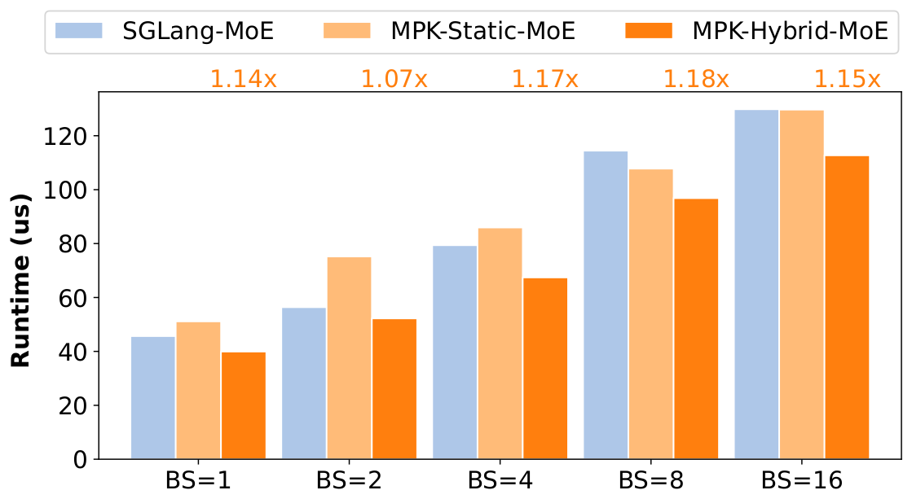

*图 10（原文 Figure 10，第 11 页）：MPK 与现有系统在 B200 上的 Qwen3-30B-A3B MoE 层对比。每个值是各方法实际的 MoE 运行时间（单位微秒，越低越好），柱上方的数字是 MPK-Hybrid-MoE 相对 SGLang-MoE 的加速比。*

**图中文字翻译与读法**：图例：浅蓝 SGLang-MoE（SGLang 的 MoE 实现）、浅橙 MPK-Static-MoE（MPK 的纯静态划分）、深橙 MPK-Hybrid-MoE（MPK 的混合划分）；横轴 BS=1、2、4、8、16，纵轴 Runtime (us)。柱上方橙色数字是原文标注的加速比（MPK-Hybrid-MoE 相对 SGLang-MoE）。下表是原文加速比标注，以及读图所得的运行时间（约，单位 µs）：

| batch size | 原文标注的加速比 | SGLang-MoE 约 | MPK-Static-MoE 约 | MPK-Hybrid-MoE 约 |
| --- | ---: | ---: | ---: | ---: |
| BS=1 | 1.14× | 45 | 51 | 40 |
| BS=2 | 1.07× | 56 | 75 | 52 |
| BS=4 | 1.17× | 79 | 85 | 67 |
| BS=8 | 1.18× | 114 | 107 | 96 |
| BS=16 | 1.15× | 129 | 129 | 112 |

**读图结论**：论文说混合策略在所有 batch size 上都稳定地优于纯静态划分，从图上读数确实如此（Hybrid 总是最低）。同时可以看到，**纯静态的 MPK 在 BS=1、2、4 时反而慢于 SGLang-MoE**（约 51 对 45、75 对 56、85 对 79 µs），在 BS=16 时与之持平，只在 BS=8 时略快；所以 MoE 上的收益主要来自“按运行时元数据细化划分”这个混合策略，而不是单纯的 mega-kernel 化。

### 6.4 多 GPU 结果（图 11；论文第 6.5 节）

**设置**：在一台 NVIDIA H100 DGX 上评测跨多个 GPU 的可扩展性。与基线系统一样用张量模型并行（遵循 Megatron-LM）：用户在 attention 与 gated MLP 块之后插入 AllReduce 来指定张量并行执行；MPK 随后自动把这些集合算子编译成两类任务：GPU 间数据传输任务（用 NVSHMEM 的 `nvshmem_signal_wait_until` 实现）和本地归约任务。这把同步的集合通信分解成可融入 MPK 基于任务的事件驱动运行时的异步任务。

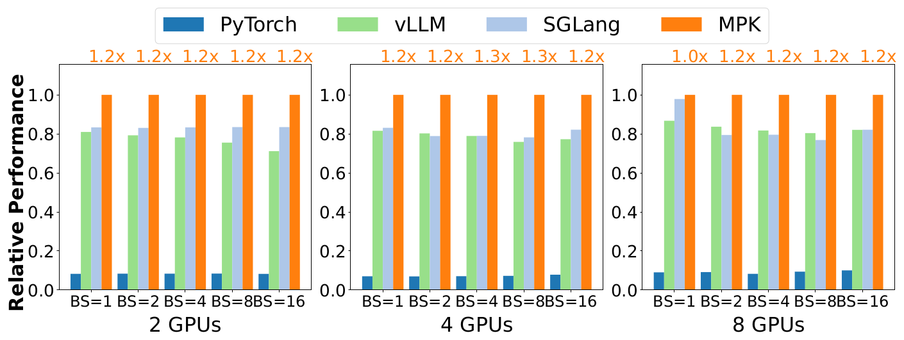

*图 11（原文 Figure 11，第 12 页）：MPK 与现有系统在 H100 GPU 上用张量并行运行 Qwen3-1.7B 的多 GPU 对比。所有结果以 MPK 为 1 归一化，越高越好。*

**图中文字翻译与读法**：三个子图依次是 2 GPUs、4 GPUs、8 GPUs；每个子图 5 组柱（BS=1、2、4、8、16）；图例：蓝色 PyTorch、绿色 vLLM、浅蓝 SGLang、橙色 MPK；纵轴 Relative Performance（MPK=1.0）；橙色数字是 MPK 相对最佳基线的加速比，原文标注如下：

| GPU 数 | BS=1 | BS=2 | BS=4 | BS=8 | BS=16 |
| --- | ---: | ---: | ---: | ---: | ---: |
| 2 GPUs | 1.2× | 1.2× | 1.2× | 1.2× | 1.2× |
| 4 GPUs | 1.2× | 1.2× | 1.3× | 1.3× | 1.2× |
| 8 GPUs | 1.0× | 1.2× | 1.2× | 1.2× | 1.2× |

**读图与论文结论**：

- 论文正文：相比 PyTorch（手工优化 kernel、CUDA Graph 与 `torch.compile` 的组合），MPK 的 mega-kernel 执行使吞吐最多提升 10 倍；相比 SGLang、vLLM 这类高度优化的 serving 系统，扩展到 8 张 H100 时 MPK 取得 1.1–1.4 倍加速。论文把收益归于基线缺少的三项优化：(1) MPK 把页分配与请求调度直接集成进 mega-kernel，消除了 CPU 侧派发开销；(2) MPK 的异步执行模型让计算任务与集合通信重叠；(3) MPK 消除了 kernel 屏障并实现跨任务软件流水（论文第 6.6 节分析后两项，即本文第 6.5 节）。
- **图文数字的差别**：图上相对最佳基线的标注最大 1.3 倍、最小 1.0 倍（8 张 GPU、BS=1 为 1.0 倍：此时 SGLang 约 0.98），而正文写的 1.1–1.4 倍是对 vLLM、SGLang 两个基线整体的范围；从图上柱高看，vLLM 约 0.71–0.87（即 MPK 快约 1.15–1.4 倍），SGLang 约 0.77–0.98（约 1.0–1.3 倍）。所以“1.1–1.4 倍”要理解为含较弱基线 vLLM 的范围，相对更强基线的收益更小。
- 多 GPU 的收益受网络、拓扑、world size 和通信库影响很大，论文只测了单节点的 H100 DGX。

### 6.5 消融：流水线、重叠与启动开销（图 12、图 13；论文第 6.6 节）

**跨任务流水（图 12）**：MPK 用“在当前任务执行时预加载下一个任务的输入块”来实现跨任务流水（本文第 5.4 节）。论文在 B200 上对 Qwen3-8B 的最后一个线性层测它的影响：对比 CUBLAS（基于 cuBLAS 的编译 kernel）、MPK-No-Pipe（不做跨任务流水）与 MPK-Pipe（做）。

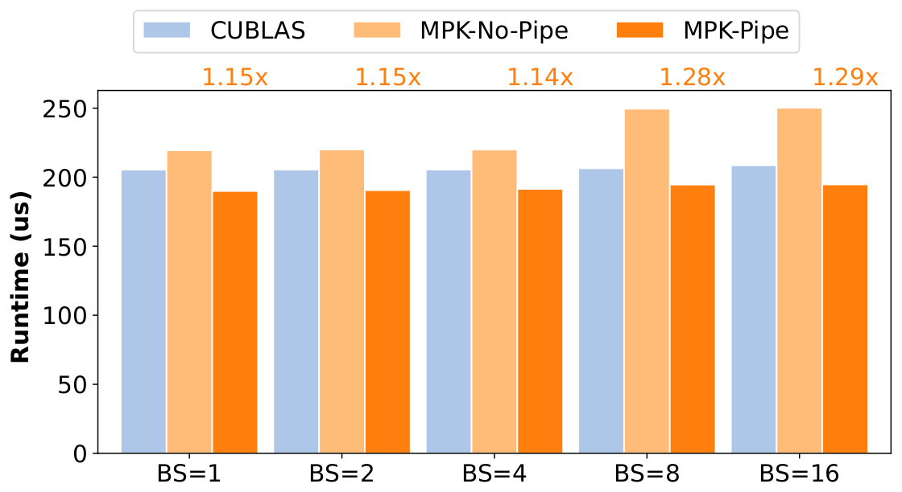

*图 12（原文 Figure 12，第 12 页）：跨任务流水线的消融。在 NVIDIA B200 上测量 Qwen3-8B 最后一个线性层的运行时间（微秒，越低越好）；柱上方的数字是 MPK-Pipe 相对 MPK-No-Pipe 的加速比。*

**图中文字翻译与读法**：图例：浅蓝 CUBLAS、浅橙 MPK-No-Pipe、深橙 MPK-Pipe；横轴 BS=1 到 16；纵轴 Runtime (us)。原文标注的加速比与读图所得运行时间（约，单位 µs）：

| batch size | 原文标注的加速比 | CUBLAS 约 | MPK-No-Pipe 约 | MPK-Pipe 约 |
| --- | ---: | ---: | ---: | ---: |
| BS=1 | 1.15× | 205 | 219 | 190 |
| BS=2 | 1.15× | 205 | 220 | 190 |
| BS=4 | 1.14× | 205 | 220 | 191 |
| BS=8 | 1.28× | 206 | 249 | 194 |
| BS=16 | 1.29× | 208 | 250 | 194 |

**读图结论**：论文正文说跨任务流水把任务运行时间降低 1.2–1.3 倍，并且甚至优于基于 cuBLAS 的编译 kernel。图上原文标注是 1.14–1.29 倍：BS=8、16 时是 1.28–1.29 倍，BS=1、2、4 时只有约 1.14–1.15 倍，所以“1.2–1.3 倍”是对较大 batch 而言；MPK-Pipe 相对 CUBLAS 的优势约为 7%–8%（按读图的 190–194 对 205–208，解读者计算）。另外未做流水的 MPK-No-Pipe 反而慢于 CUBLAS（BS=8、16 时约慢 21%），解读者据此推断：MPK 自己生成的 kernel 离开跨任务流水并不比 cuBLAS 快，流水是关键因素。

**计算—通信重叠（图 13）**：MPK 捕获任务之间的细粒度依赖（图 5），使运行时可以机会性地重叠计算与通信。为关闭重叠，论文把 tGraph 限制成只捕获每个集合算子（如 AllReduce）与它前面计算之间的粗粒度依赖，用单个事件表示，如图 4(c) / 图 5 所示。

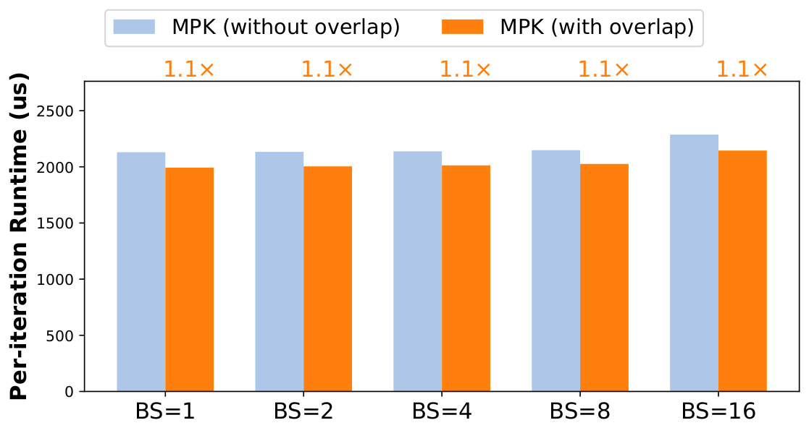

*图 13（原文 Figure 13，第 13 页）：计算—通信重叠的消融。在 4 张 H100 上用张量并行测量 Qwen3-1.7B 的运行时间，越低越好；对比开启与关闭重叠的 MPK 来量化细粒度重叠的收益。*

**图中文字翻译与读法**：图例：浅蓝 MPK (without overlap)（关闭重叠）、橙色 MPK (with overlap)（开启重叠）；横轴 BS=1 到 16；纵轴 Per-iteration Runtime (us)（每次迭代的运行时间）。柱上方每组都标 1.1×。按柱高读出的运行时间约为：关闭重叠 2130（BS=1）、2130、2135、2145、2285（BS=16）µs；开启重叠 1990、2000、2010、2025、2145 µs，即实际比值约 1.06–1.07，标注的 1.1× 是四舍五入。论文结论：开启细粒度计算—通信重叠把每次迭代的延迟降低 1.1 倍，即这一项的收益是个位数百分比。

**kernel 启动开销的消除**：MPK 用一次 kernel 启动执行整个模型，而 kernel-per-operator 方式执行 Qwen3-8B 每个 token 需要 293 次 kernel 启动。在 B200 上，eager 执行下每次启动耗时 3.8 µs，合计每 token 1.1 ms；使用 CUDA Graph 后每次 0.8 µs，合计每 token 0.2 ms。MPK 避免了这部分开销；它在 kernel 内的 scheduler 只占总运行时间的 0.28%（论文第 6.1 节）。（解读者核算：$293\times3.8\ \mu\mathrm{s}\approx1.11$ ms，$293\times0.8\ \mu\mathrm{s}\approx0.23$ ms，与正文一致。）

### 6.6 编译器各阶段的消融（表 2；论文第 6.7 节）

前面的消融隔离了两项运行时机制，这一节隔离论文第 4 节各编译阶段的贡献。因为各阶段目的不同，论文对每个阶段报告最合适的指标，而不是一个统一的指标。表 2 汇总了三个代表性模型的结果（B200）。

**表 2：B200 上各编译阶段的统计**（Ops：算子数；Tasks/op：分解后每个算子平均的任务数；Events：最终 tGraph 中的事件数；Fusion：事件融合带来的事件数减少倍数；Lin.：线性化带来的设备端存储占用减少倍数）

| 模型 | Ops | Tasks/op | Events | Fusion | Lin. |
| --- | ---: | ---: | ---: | ---: | ---: |
| Qwen3-1.7B | 229 | 35.6 | 1,870 | 37× | 4.4× |
| Qwen3-8B | 293 | 47.3 | 2,366 | 68× | 5.9× |
| Qwen3-30B-A3B | 533 | 32.2 | 1,142 | 118× | 15.0× |

（原文表 2，第 13 页。）读法：

- **算子分解**：把每个算子划成独立的 SM 级任务，暴露出可观的并行：每个算子平均被分成 32–47 个任务；例如 Qwen3-8B 的 293 个算子被分解成 13,867 个任务（与表里 $293\times47.3\approx13{,}859$ 相符）。线性层、attention、MoE 专家这类计算密集型算子各暴露几十个并行任务，只有少数逐点算子（如 batch size 为 1 时的归一化）对应单个任务。这给运行时提供了足够多的独立工作，使所有 SM 保持忙碌。
- **事件融合**：没有融合时，依赖分析会为每一对重叠的生产者—消费者任务各发出一个事件；后继集与前驱集融合把共享同一消费者集或生产者集的事件合并成一个同步点。所评测模型的最终 tGraph 只有 1,142–2,366 个事件，却编码了约 69,000–162,000 个生产者—消费者任务对依赖，即减少 37–118 倍；MoE 模型减少最多，因为专家路由造成多对多的依赖，特别适合融合。
- **规范化**：只在任务有多个触发或依赖事件（分叉与汇合）时才插入辅助任务和事件。评测里三个编译出的 LLM 前向 tGraph 几乎完全是顺序的：三个 tGraph 里都没有分叉/汇合组，因为本来会扇出的算子（如 Q/K/V 投影）被发射成了融合算子，规范化因此基本不改变这些 tGraph，印证了论文第 4 节所说“深而不宽”的结构。尽管如此，当出现并行分支时（如图 5 中未融合的 Q/K/V 例子）规范化仍是保证正确所必需的，它把每个任务的事件扇入、扇出限制为 1，保持定长、无间接寻址的编码。
- **线性化**：把每个事件的后继任务编码成连续的索引区间；这使设备端占用降低 4.4–5.9 倍（稠密模型，Qwen3-8B 从 110,932 字节降到 18,928 字节）和 15.0 倍（MoE 模型）。

## 七、讨论（论文第 7 节）

- **资源占用**：mega-kernel 常被担心必须在每个 SM 上预留所有融合算子所需资源的总和。MPK 避免了这点：任务在各 SM 上是时间复用而不是静态划分的，每个 SM 只使用它当前正执行的任务所需的资源；共享内存也是如此（分页抽象按任务粒度获取、释放页）。主要的例外是每线程的寄存器用量：它按 mega-kernel 里所有任务类型的最大需求固定。
- **整合手工调优的 kernel 与移植到新硬件**：每个 MPK 任务都是一个有统一调用约定的 CUDA 设备函数（由 tGraph 定义）。因此：(1) 手工调优的 kernel 可以包装成某个任务的设备函数加入 MPK，在与编译器生成的任务相同的事件驱动调度下执行，不需要改运行时或 tGraph；MPK 能在有手工实现时复用，并自动生成其余任务。(2) 移植到新的 GPU 架构只需更新产生这些设备函数的逐任务代码生成器；tGraph 表示、编译器的图级变换、运行时与 scheduler 都不用变。所以逐任务代码生成是 MPK 里唯一与硬件相关的部分。

**相关工作（论文第 8 节）的定位**：手工设计的 kernel（FlashAttention、FasterTransformer、FlashInfer 等，依赖专家，难以统一进一个 kernel）；ML 编译器（TVM、Ansor、Triton 等基于 Halide 的算法—调度分离，以及基于超优化的工作，围绕算子或图级优化，不生成统一的 mega-kernel）；已有 mega-kernel（FlashDMoE、Spector 等人的 LLaMA-1B 手写 mega-kernel，靠手工设计，难以跨模型、跨 GPU 泛化）；简化手写融合 kernel 开发的工具（ThunderKittens、PipeThreader，仍需开发者决定融合哪些算子，论文认为它们与 MPK 互补，可用来实现 MPK 运行时里的单个任务 kernel）；TileRT 也把算子分解成 tile 级任务并作为单个常驻 kernel 执行，论文视之为对“常驻 mega-kernel 是低延迟推理的关键”这一核心想法的印证；以及一大批重叠通信与计算的工作（DeepEP、Triton-Distributed、TokenWeave、FlashOverlap、ParallelKittens 等），论文指出它们是在单个 kernel 或集合算子的粒度上实现重叠，而 MPK 把通信和计算统一表示成同一张 tGraph 里的任务、用同一个 kernel 内运行时调度，所以重叠从全局的任务调度里自然涌现，并同时适用于张量并行的集合通信和专家并行的 all-to-all。

## 八、局限、证据边界与常见误读

### 8.1 局限与证据边界

1. **只有离线批量推理**：prompt 固定 64、输出 1024 个 token、batch 1–16，不等价于有请求到达过程、TTFT/TPOT 和 SLO 的在线服务（论文自己说明这样设计是为了排除到达模式的影响）。
2. **动态性靠特化**：为 2 的幂的 batch size 生成多个 tGraph 并在运行时选择，不是单个与形状无关的图；编译时间、tGraph 的存储与不在 2 的幂的 batch size 上的表现，论文没有量化。
3. **scheduler 占用 SM**：每块 GPU 预留 4 个 SM（约占 A100 的 3.7%、H100 的 3.0%、B200 的 2.7%，解读者按表 1 计算）；论文没有报告这个预留对大模型、大 batch 的影响，那里 launch 开销占比小，收益本来就小（图 9 中 8B 与 MoE 模型只有约 1.0–1.2 倍）。
4. **收益来源没有完全拆开**：MPK 生成的 kernel 与基线所用的库（FlashInfer、cuBLAS 等）不同；跨任务流水的消融（图 12）显示未流水的 MPK-No-Pipe 比 cuBLAS 慢，说明 MPK 的收益部分来自流水而不是更好的单算子实现，但 CPU 侧调度 vs GPU 侧调度的贡献没有单独隔离。
5. **图文数字有出入**：图 11 的标注是 1.0–1.3 倍而正文写 1.1–1.4 倍；图 12 的标注是 1.14–1.29 倍而正文写 1.2–1.3 倍；图 5(f) 的 Counts 行与结构不一致（第 4.3 节）。
6. **多 GPU 只在单个 H100 DGX 节点上测**；关于异构互联、节点间网络的论述没有实验支撑。
7. **工程复杂度**：论文约 44K 行 C++、42K 行 CUDA 的实现、设备端 runtime 的调试与 CUDA codegen 复杂度都很高（论文只给出规模，没有讨论调试难度；这一条是解读者的判断）。
8. **寄存器按最大需求固定**：论文承认每线程寄存器用量取所有任务类型的最大值，这是 mega-kernel 难以完全避免的资源折衷。

### 8.2 常见误读

- **“一次 kernel 启动就没有调度开销”**：只是把主机侧的 launch 变成了设备侧的事件、队列、scheduler 与信号量开销；论文报告 scheduler 占总运行时间 0.28%，但这依赖具体配置。
- **“mega-kernel 就是把所有代码串起来”**：若只是顺序执行，最多省掉 launch；MPK 真正新增的空间是 tile 级流水、负载均衡和计算—通信重叠，而这靠 tGraph 的精确依赖才能做到（图 4(b) 对比 (c)）。
- **“所有 batch 共用一个最优 kernel”**：MPK 为多个 batch size 生成特化的 tGraph，运行时再选择。
- **“事件融合与规范化的开销在评测中低于 1%”**：论文给出“低于 1%”的是规范化引入的额外任务/事件开销（论文第 4 节），并且在三个评测模型里规范化根本没有被触发（没有分叉/汇合组）；事件融合给出的是“37–118 倍的事件减少”（表 2）。这两个数字常被混在一起。

## 九、复现检查清单

- 报告被 scheduler 保留的 SM 数（论文：4 个 SM、16 个 scheduler warp）和页配置（32 KB，A100/H100/B200 为 5/7/7 页）。
- 把编译时间、预热与稳态性能分开；论文没有报告 MPK 的编译时间，也没有报告为多个 batch size 生成多个 tGraph 的总代价。
- 记录基线是否启用 CUDA Graph、paged attention、continuous batching；本文基线都启用了 paged attention 与 continuous batching，且都使用 bfloat16。
- 在线场景要补充请求到达轨迹、TTFT、TPOT、P50/P99 与 SLO 达成率；论文是离线批量。
- 对每种 batch/模型/GPU 记录所选的 tGraph（batch size 取 2 的幂）。
- 检查设备端 scheduler 的 atomic/队列开销与死锁诊断。
- **artifact（论文附录 A）**：冻结分支 `tgx-osdi26-ae`（commit `8b981a4`），已存档于 Zenodo（DOI 10.5281/zenodo.20563064），仓库为 <https://github.com/mirage-project/mirage>。硬件：单卡 A100、H100（SXM）或 B200 做单 GPU 扫描，4–8 张 H100 的多 GPU 节点做张量并行实验；四个较小的模型能放进 40 GB A100，Qwen3-30B-A3B 至少需要 80 GB（80 GB A100、H100 或 B200）。软件：Linux、CUDA（论文用 12.8）、PyTorch 2.7、NVSHMEM 与 OpenMPI（多 GPU）、transformers 4.57.1；`setup.sh` 安装依赖并构建 MPK，vLLM 与 SGLang 各用独立的虚拟环境；Llama-3.2 是受限模型，需设置 `HF_TOKEN`。所有运行都是离线批量推理，prompt 长度 64，解码 1024 个 token，贪心解码，每个数字是四次迭代预热后五次运行的中位数。artifact 验证三项主要结论：(i) 单 batch 下 MPK 比 vLLM 与 SGLang 降低 1.0–1.7 倍的每 token 延迟，对小模型与新 GPU 收益最大（图 9）；(ii) 张量并行下相对 PyTorch 最多 10 倍、相对 vLLM/SGLang 在 8 张 H100 上 1.1–1.4 倍（图 11）；(iii) 跨任务流水与计算—通信重叠各自带来可测的加速（图 12、13）。

```bash
git clone --recursive -b tgx-osdi26-ae https://github.com/mirage-project/mirage
cd mirage && bash artifact_evaluation/setup.sh
bash artifact_evaluation/<gpu>/run_tgx.sh
bash artifact_evaluation/<gpu>/run_pytorch.sh
bash artifact_evaluation/<gpu>/run_vllm.sh
bash artifact_evaluation/<gpu>/run_sglang.sh
```

## 十、与仓库其他论文的关系

- [Event Tensor](../event_tensor/论文中文解读.md)：把 MPK 里的 event 提升为带符号形状的一等 tensor 抽象，补上动态形状与数据相关依赖的编译器表示，并让静态/动态两种调度可以互换；MPK 的“tGraph + 多个 batch 特化图”与它的“一份符号模板”形成对照。
- [Ada-MK](../ada_mk/论文中文解读.md)：在资源较小的 Ada GPU 上把运行时搜索尽量提前到编译期，并嵌入 TensorRT-LLM。
- [FusionStitching](../fusion_stitching/论文中文解读.md)、[Welder](../welder/论文中文解读.md)：主要在编译期决定静态的算子融合，与 MPK 把依赖与调度迁入常驻 kernel 的路线相对。
- [TASO](../taso/论文中文解读.md)：Mirage 与 TASO 都是论文提到的“自动发现融合规则”的超优化路线（论文第 2.2 节）。

## 原文证据导航

- [原论文 PDF](paper.pdf)
- [原文提取文本](paper.txt)
- [论文概要](论文概要.md)
