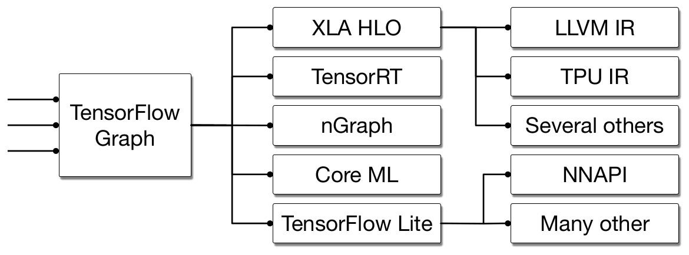
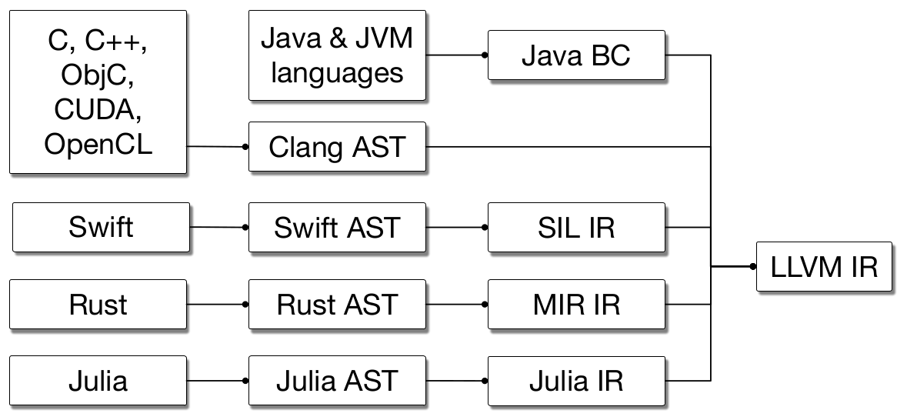
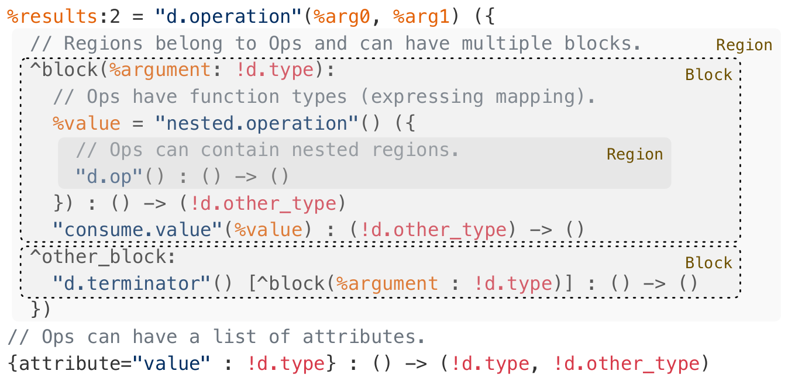

# 论文中文解读：《MLIR: A Compiler Infrastructure for the End of Moore's Law》

> **基本信息**：Chris Lattner、Mehdi Amini、Uday Bondhugula、Albert Cohen、Andy Davis、Jacques Pienaar、River Riddle、Tatiana Shpeisman、Nicolas Vasilache、Oleksandr Zinenko（Google；Bondhugula 属 IISc；Lattner 发表时在 SiFive），arXiv:2002.11054v2 [cs.PL]，2020 年 3 月 1 日（preprint）；论文原文 [官方页面](https://arxiv.org/abs/2002.11054)。
>
> **本文的读法**：这是一篇基础设施论文，没有性能数据表；它的“证据”是设计论证、IR 示例代码和应用案例。图 1 至图 3 取自 `paper.pdf` 的原图；原文的图 4 至图 10 是代码清单，本文用代码块逐字转录并逐行解释，不再放截图。代码用的是 2020 年的 MLIR 语法，今天的 MLIR 已有不少变化（见第九节）。标注“（补充）”的内容不在原文里，是帮助读懂的背景知识或笔者的核对。

## 一、一句话结论

MLIR（Multi-Level Intermediate Representation）不是一个具体的编译器，而是**构建编译器的基础设施**：它只规定极少的内建概念（operation、type、attribute、region、block 和 SSA 形式的值），其余一切由用户用 **dialect**（方言，一组带命名空间的 operation、type、attribute）自定义；不同层次的抽象可以在同一个 IR 里共存，并通过**渐进式降低**（progressive lowering）一步步转换到硬件层。基础设施同时“开箱即用”地提供声明式的 operation 定义（ODS）、声明式重写规则（DRR）、能并行编译的 pass 管理器、可往返的文本 IR、位置追踪、verifier 和自动生成的文档。论文用 TensorFlow 图、多面体（affine）代码生成、Fortran 前端 FIR 和若干领域专用编译器作为应用案例；证据以“被采用的程度”为主：超过 26 个 dialect 在开发，7 个公司项目正在用 MLIR 替换自研基础设施；唯一给出的性能数字是一个 lattice regression 编译器，用 3 人月做出相对原实现最高 8 倍的性能提升。

## 二、背景与动机

### 2.1 “一刀切”的 IR 与它的代价

编译器领域有 LLVM、JVM 这样成功的技术平台，它们的共同特点是“**one size fits all**”：系统只提供一个抽象层次作为接口。LLVM IR 大致是“带向量的 C”，JVM 提供“带垃圾回收的面向对象类型系统”。这种做法非常有价值，因为 C/C++ 和 Java 这类通用源语言到它们的映射很直接。

但很多问题在更高层或更低层的抽象上建模更合适，例如在 LLVM IR 上做 C++ 的源码级分析就很困难。于是很多语言（Swift、Rust、Julia、Fortran 等）都发展了自己的 IR，以解决领域专用问题：语言或库特有的优化、流敏感的类型检查（例如线性类型）、改进降低（lowering）过程的实现。机器学习系统同样普遍用“ML 图”作为领域专用抽象。

领域专用 IR 的**工程与实现成本仍然很高**。基础设施的质量并不总是实现者的第一优先级，于是这些系统常有用户可见的问题：编译慢、实现有 bug、诊断信息差、对优化后代码的调试体验差，等等。MLIR 项目要直接解决这些问题：让定义并引入新的抽象层次变得非常便宜，并提供“开箱即用”的基础设施来解决常见的编译器工程问题。做法有三点：

1. 把基于静态单赋值（SSA）的 IR 数据结构**标准化**；
2. 提供一个**声明式**的系统来定义 IR dialect；
3. 提供大量通用基础设施（文档、解析与打印逻辑、位置追踪、多线程编译支持、pass 管理等）。

### 2.2 MLIR 的来历（原文 1.2 节，图 1 与图 2）

MLIR 的工作始于一个认识：现代机器学习框架由许多不同的编译器、图技术和运行时系统组成，它们没有共同的基础设施和设计点，也并非都遵循编译器设计的最佳实践。这在用户层面表现为：糟糕的错误信息、边界情况下的失败、不可预测的性能，以及难以把整套栈推广到支持新硬件。



*图 1（原文 Figure 1，第 2 页）：TensorFlow 模型的执行横跨不同的框架。*

**图中文字翻译与读法**：左边是 TensorFlow Graph（TensorFlow 计算图，三条线表示输入的模型）。它向右分出五条路径：XLA HLO、TensorRT、nGraph、Core ML、TensorFlow Lite。其中 XLA HLO 再通向 LLVM IR、TPU IR 和 Several others（其他若干）；TensorFlow Lite 再通向 NNAPI 和 Many other（许多其他）。**读图结论**：同一个 TensorFlow 图，要经过多套彼此独立的编译器与 IR 才能到达不同的硬件，每一套都各自实现一遍优化与降低；这就是论文所说的碎片化。

作者随后发现整个编译器行业有类似的问题：LLVM 这类系统很成功地统一并整合了各种语言实现的工作，但现代高级语言往往最终要自己建高层 IR，并为更高的抽象层重造大量同类技术（图 2）。同时，LLVM 社区也一直为一些问题挣扎：如何最好地表示并行构造，如何共享前端降低的通用基础设施（例如 C 调用约定，或 OpenMP 这类跨语言特性），一直没有令人满意的方案。



*图 2（原文 Figure 2，第 3 页）：不同语言的编译流水线：为了做语言专用的优化，各自有多个中层 IR，并共用同一个面向多种硬件目标的后端。*

**图中文字翻译与读法**：自左向右，五条流水线最终都汇入右边的 **LLVM IR**：C、C++、ObjC、CUDA、OpenCL 经 Clang AST；Java 与 JVM 语言经 Java BC（字节码）；Swift 经 Swift AST 再到 SIL IR；Rust 经 Rust AST 再到 MIR IR；Julia 经 Julia AST 再到 Julia IR。**读图结论**：除 C 系语言外，Swift、Rust、Julia 都在 AST 与 LLVM IR 之间多建了一层自己的中层 IR（SIL、MIR、Julia IR）来做语言专用优化，每家都在重复造“从 AST 到可优化 IR”的基础设施。

于是作者们认为，无法承担为 N 个编译器实例各自做改进的工程投入，需要构建一个更通用的方案：这样可以把投入集中到一套高质量的基础设施上，使多个领域受益；可以**就地渐进地升级**现有系统；让针对专用加速器的异构编译这类紧迫问题更容易解决；并提供有趣的研究机会。

论文的四项贡献是：描述一个有重要工业与研究应用的新型编译器基础设施；构建可扩展、模块化编译器系统的新方法；探索 MLIR 在若干不同领域的应用，说明系统的通用性；分享在 MLIR 基础设施之上开发系统的经验。

## 三、七条设计原则（原文第 2 节）

| 原则（原文） | 要点 |
|---|---|
| Little builtin, everything customizable（内建极少，一切可定制） | 系统基于极少数基本概念，把 IR 的大部分留给用户定制。只用 type、operation、attribute 这几个最常见的抽象来表达其他一切，使抽象更少、更一致，易于理解、扩展和采用。成功标准是能表达机器学习图、AST、多面体等数学抽象、控制流图（CFG）和 LLVM IR 这类指令级 IR，而不在系统里硬编码这些抽象的概念。论文承认可定制会带来“互不兼容的抽象造成内部碎片化”的风险，技术上多半没有纯粹的解决办法，系统应鼓励人们设计可复用、并假定会被用到最初范围之外的抽象 |
| SSA and regions（SSA 与区域） | SSA 形式在编译器 IR 中广泛使用，使数据流分析简单而稀疏。许多现有 IR 使用扁平的、线性化的 CFG，而表示更高层抽象时需要把**嵌套的 region** 作为 IR 里的一等概念（例如循环树），这样能加速编译，或提取指令级、SIMD 并行。挑战之一是让基于 CFG 的分析与变换能在嵌套 region 之上组合。为此论文有意**牺牲 LLVM 的归一化（normalization）性质，有时还牺牲其规范化（canonicalization）性质**。把各种数据和控制结构降成一小组归一化的表示，是控制编译器复杂度的关键，LLVM 里规范的循环结构（pre-header、header、latch、body）就是把前端各种循环线性化的典型。MLIR 则给用户选择：依编译算法和所处的 pass，嵌套循环既可以保存成嵌套的 region，也可以保存成线性化的控制流，从而摆脱 LLVM“只认归一化”的取向，又在需要时保留处理高层抽象的能力 |
| Progressive lowering（渐进式降低） | 系统应支持从高层表示一步一步降低到最低层，沿多个抽象层次分小步进行。以往的编译器引入的是**固定的多层**：例如 Open64 的 WHIRL 有五层，Clang 从 AST 降到 LLVM IR，再到 SelectionDAG、MachineInstr、MCInst，也是五层；这种做法太刚性，扩展性需要更灵活的设计。这对变换的**相位顺序**影响很深：把多个优化 pass 组合起来能让编译器发现更多关于程序的事实（经典例子是把常量传播、值编号和不可达代码消除混合）。pass 可大致分为四种角色：（1）优化变换，（2）使能变换（enabling），（3）降低，（4）清理；系统应允许在**单个 operation 的粒度**上混合搭配这些角色，而不是在整个编译单元上顺序执行 pass |
| Maintain higher-level semantics（保持高层语义） | 系统需要保留分析与优化性能所需的高层语义和计算结构。降低之后再“抬升”（raise）语义很脆弱，把这些信息硬塞进低层表示往往具有侵入性（例如用调试信息记录结构，则所有 pass 都要重新验证）。所以应当保持计算结构并逐步降低到硬件抽象，于是结构的丢失是**自觉的**，只发生在不再需要它的地方。例如结构化控制流（循环结构）应在相关变换期间一直保留，一旦转成基于 CFG 的控制流，就意味着这一层不会再有后续变换。推论是：在同一个 IR 里**混合不同层次的抽象**是关键性质，让一部分表示保持高层、另一部分已降低；例如专用加速器的编译器可以把系统定义的某些高层结构，与加速器特有的标量/向量原语指令放在一起复用 |
| IR validation（IR 验证） | 开放的生态要求广泛的验证机制。验证与测试能发现编译器错误、捕捉 IR 不变量，而在可扩展的系统里更需要稳健的验证方法与工具。机制应尽量简单、尽量声明式，提供“唯一的事实来源”。长期目标是复现翻译验证（translation validation）和现代编译器测试方法的成功；在可扩展的编译器生态里这两者都还是开放问题 |
| Declarative rewrite patterns（声明式重写模式） | 定义“表示的修改”应当像定义新抽象一样简单：常见的变换应能写成**声明式的重写规则**，采用机器可分析的格式，以便推理重写的复杂度、终止性等性质。重写系统的可靠性与效率已被广泛研究，并被应用到从类型系统到指令选择的众多编译问题；这为把程序变换建模成重写系统提供了许多途径，系统需要在保持可扩展的同时，保证行为是可靠、单调和可复现的 |
| Source location tracking and traceability（位置追踪与可追溯） | 一个 operation 的来历（包括原始位置和被施加的变换）应当很容易追溯，以解决复杂编译系统里常见的“缺乏透明”问题（几乎无法理解最终表示是怎么从原始表示构造出来的）。这对编译安全关键与敏感应用尤其重要：追踪降低与优化的步骤是软件认证流程的重要部分；对密码协议等代码，优化可能改变或完全破坏代码里嵌入的安全属性（防侧信道、抗故障攻击），这种不透明在安全编译领域被称为 WYSINWYX（what you see is not what you execute）。把高层信息准确传播到低层，是支持安全且可追溯编译的间接目标之一 |

## 四、IR 的核心概念（原文第 3 节）

### 4.1 Operation（操作，简称 Op）

MLIR 里**语义的基本单位是“operation”**。从“指令”到“函数”再到“模块”，全部建模成 Op。MLIR 没有固定的 Op 集合，而是允许（并鼓励）用户自定义扩展：编译 pass 会对不认识的 Op 采取**保守**处理，同时 MLIR 提供丰富的手段通过 trait（特征）、特权 operation 钩子和优化接口，向 pass 描述 Op 的语义（见第七节）。

Op 有唯一的操作码（opcode），文本上是一个标识其所属 dialect 和操作名的字符串。Op 接收和产生零个或多个值（分别叫 operand 和 result），这些值以 SSA 形式维护，**每个值都有类型**，这点与 LLVM IR 相似。除了操作码、operand 和 result 之外，Op 还可以有 Attribute、Region、Block Argument 和 Location 信息。在通用文本表示里，`%` 开头的标识符是（一组）命名的值，`:` 后面的数字说明一组里有几个值，`#` 取其中某一个；Op 名是带引号的字符串，后面是括号里的 operand。

### 4.2 Attribute（属性）

Attribute 是**结构化的编译期静态信息**，例如整数常量、字符串数据或一组浮点常量。属性是有类型的，每个 Op 实例带有一个开放的“字符串名 → 属性值”的键值字典。在通用语法里，属性写在 Op 的 operand 与它的类型之间，是花括号括起、逗号分隔的键值对。例如图 4 用属性定义了循环的边界，它们是编译期已知的常量仿射形式：`{lower_bound = () -> (0), step = 1 : index, upper_bound = #map3}`，其中 `lower_bound`、`upper_bound` 和 `step` 是属性名；`() -> (0)` 是内联的仿射形式，这里产生常量 0；`#map3` 是属性别名，允许先把一个属性值与一个标签关联起来，然后在任何需要属性值的地方用标签。

和操作码一样，属性也没有固定集合，它们的含义来自所属 Op 的语义或所属 dialect。属性也是可扩展的，允许直接引用外部数据结构，便于与已有系统集成，例如一个属性可以引用 ML 系统里（编译期已知的）数据存储的内容。

### 4.3 Location（位置信息）

MLIR 提供紧凑的位置信息表示，并鼓励在整个系统中处理和传播它。位置信息可用来保存产生某个 Op 的源程序调用栈，以生成调试信息；它规范了编译器发出诊断的方式，也被大量测试工具使用。位置信息同样可扩展，允许编译器引用现有的位置追踪系统、高层 AST 节点、LLVM 风格的“文件-行-列”地址、DWARF 调试信息，或任何高质量实现所需的东西。

### 4.4 Region 与 Block（区域与基本块，图 3）

一个 Op 实例可以挂有一串 **region**。region 是 MLIR 里表示**嵌套结构**的机制：一个 region 含一串 block，一个 block 含一串 operation（这些 operation 里又可以有 region）。和属性一样，region 的语义由挂载它的 Op 定义；但 region 里的 block（如果多于一个）构成一张**控制流图（CFG）**。例如图 4 中的 `affine.for` 是一个循环，其单 block 的循环体作为 region 挂在分隔符 `({` 与 `})` 之间；由这个 Op 规定跨 region 的控制流：循环体被反复执行，直到达到上界。

每个 region 的体是一串 block，每个 block 以一个 **terminator（终结）operation** 结尾，它可以有后继 block，控制流可以转移过去。每种 terminator（例如 switch、条件分支、unwind）定义自己的语义：它可以把控制转到同一 region 的另一个 block，也可以把控制交还给包含该 region 的 Op。后继关系构成 CFG，使 region 内可以使用标准的基于 SSA 的控制流。



*图 3（原文 Figure 3，第 5 页）：Operation（Op）是 MLIR 的主要实体；operation 含有 region 列表，region 含有 block 列表，block 含有 Op 列表，从而可以递归嵌套。*

**图中文字翻译与读法**：图里的代码是 MLIR 的**通用（generic）文本语法**，右侧的 Region、Block 标注和虚线框标出了嵌套结构。逐行解释如下，其中英文注释的翻译放在括号里：

```text
%results:2 = "d.operation"(%arg0, %arg1) ({
  // Regions belong to Ops and can have multiple blocks.
  ^block(%argument: !d.type):
    // Ops have function types (expressing mapping).
    %value = "nested.operation"() ({
      // Ops can contain nested regions.
      "d.op"() : () -> ()
    }) : () -> (!d.other_type)
    "consume.value"(%value) : (!d.other_type) -> ()
  ^other_block:
    "d.terminator"() [^block(%argument : !d.type)] : () -> ()
})
// Ops can have a list of attributes.
{attribute="value" : !d.type} : () -> (!d.type, !d.other_type)
```

- `%results:2 = "d.operation"(%arg0, %arg1)`：一个属于 dialect `d`、名为 `operation` 的 Op，有两个 operand `%arg0`、`%arg1`，产生**两个结果**（`:2` 表示一组 2 个值，可用 `%results#0`、`%results#1` 引用）。
- `({ ... })`：圆括号里的花括号块是挂在这个 Op 上的 **region**（“region 属于 Op，可以有多个 block”）。
- `^block(%argument: !d.type):` 是 region 里的第一个 **block**，带一个有类型的 **block 参数**（`!d.type` 是 dialect `d` 里的类型；`!` 前缀表示类型）。
- `%value = "nested.operation"() ({ ... }) : () -> (!d.other_type)`：block 里的一个 Op，它**自己又挂了 region**（“Op 可以包含嵌套 region”），区域内是 `"d.op"() : () -> ()`；冒号后是它的**函数类型**，表达“从 operand 类型到 result 类型的映射”。
- `^other_block:` 是第二个 block，以 terminator `"d.terminator"() [^block(%argument : !d.type)]` 结尾：方括号里是**后继 block** 和传给它的参数。
- 最后一行 `{attribute="value" : !d.type}` 是这个 Op 的**属性字典**（“Op 可以有一串属性”）。
- **读图结论**：整个 IR 就是“Op 套 region、region 套 block、block 套 Op”的递归结构，没有别的内建结构，函数、循环、模块都是这个结构的实例。（补充：图 3 是示意性的语法样例，例如最后一行的函数类型 `() -> (...)` 与两个 operand 并不严格对应，请把它当作各语法位置的说明，而不是一个可验证的程序。）

**用 block 参数代替 φ 节点。** MLIR 没有使用 φ 节点，而是采用 SSA 的**函数式形式**：terminator 把值传给后继 block 定义的 block 参数。每个 block 有一个（可能为空的）带类型的 block 参数列表，它们是普通的值，服从 SSA。terminator Op 的语义规定控制转移之后 block 的参数取什么值。对 region 的第一个（入口）block，参数的值由所属 Op 的语义定义。例如 `affine.for` 用入口 block 的参数 `%arg4` 作为循环的归纳变量（induction variable）。

### 4.5 值的支配与可见性、isolated-from-above

Op 只能使用在作用域内的值，即按 SSA 支配关系、嵌套关系和外围 Op 施加的语义限制而可见的值。在一个 CFG 内，值满足标准的 SSA 支配关系才可见：控制保证在到达使用之前先经过定义。

**基于 region 的可见性**由 region 的简单嵌套定义：如果 Op 的 operand 在当前 region 之外，则它必须在使用处 region 的外部、词法上更靠上的位置定义；这使得 `affine.for` 里的 Op 可以使用外层作用域定义的值。

MLIR 还允许把 operation 定义为**自上方隔离（isolated from above）**，表示这个 Op 是作用域屏障：例如 `std.func` 定义一个函数，函数内的 operation 引用函数之外定义的值是不合法的。除了提供有用的语义检查，包含 isolated-from-above Op 的模块可以被 MLIR 编译器**并行处理**，因为 use-def 链不会跨越隔离屏障。这对利用多核机器编译很重要。

### 4.6 Symbol 与 symbol table（符号表）

Op 可以挂一张符号表，它是把名字（字符串）与 IR 对象（称为 symbol）关联起来的标准方式。IR 并不规定符号用来做什么，交给 Op 的定义。符号最适合表示**不需要服从 SSA** 的命名实体：它们不能在同一张表里被重定义，但可以在定义之前使用。例如全局变量、函数和命名模块都可以表示成符号；没有这个机制，就无法定义例如在自己的定义里引用自己的递归函数。如果带符号表的 Op 的 region 里也有带符号表的 Op，符号表可以嵌套。MLIR 提供从一个 Op 引用符号（包括嵌套符号）的机制。

### 4.7 Dialect（方言）

MLIR 用 **dialect** 管理可扩展性：dialect 在一个唯一的命名空间下，把 Op、属性和类型做逻辑分组。dialect 自己**不引入新语义**，只是逻辑分组机制，也可用来提供 dialect 通用的 Op 支持（例如对 dialect 里所有 Op 的常量折叠行为）。dialect 命名空间在操作码里作为用点分隔的前缀出现，例如图 4 用了 `affine` 和 `std` 两个 dialect。

把 Op、类型和属性拆分到 dialect 中是概念上的，类似设计一组模块化的库。例如一个 dialect 可以包含操作硬件向量的 Op 和类型（shuffle、插入/提取元素、mask），另一个 dialect 可以包含操作代数向量的 Op 和类型（绝对值、点积等）；两个 dialect 是否共用同一个向量类型、这个类型属于哪个 dialect，是留给 MLIR 用户的设计决策。理论上可以把所有 Op、类型和属性放进一个 dialect，但很快会因同时存在的概念太多和名字冲突而无法管理。

尽管每个 Op、类型和属性只属于一个 dialect，MLIR **明确支持混用多个 dialect** 来实现渐进式降低：来自不同 dialect 的 Op 可以在 IR 的任何层次、任何时候共存，它们可以使用不同 dialect 里定义的类型，等等。这种混用带来更多复用、可扩展性和灵活性，否则开发者就要用各种不可组合的变通办法。

### 4.8 类型系统

MLIR 里每个值都有类型，类型由产生该值的 Op 指定，或者由把它定义为参数的 block 指定。类型为 IR 提供编译期语义。类型系统是用户可扩展的，可以引用已有的外部类型系统（如 `llvm::Type` 或 `clang::Type`）。MLIR 强制严格的类型相等检查，**不提供类型转换规则**。Op 用尾随的类似函数的语法列出输入和结果类型；图 4 里 `affine.load` 的类型是从内存引用类型和下标类型映射到被加载值的类型。

从类型论的角度看，MLIR 只支持**非依赖类型**，包括平凡类型、参数化类型、函数类型、和类型与积类型。把 Op、符号与用户自定义类型结合，按 Curry-Howard 同构的字面解释，也可以实现依赖类型系统，但这样的类型对 IR 来说是不透明的。

**标准类型**：MLIR 还提供一组常用的标准类型，包括任意精度整数、标准浮点类型，以及简单的常见容器：元组、多维向量和张量。它们只是对 dialect 作者的便利，不要求使用。

### 4.9 Function 与 Module

与传统 IR 类似，MLIR 通常组织成函数和模块，但它们**不是新的、单独的概念**，而是在 builtin dialect 里实现的 Op：

- **module** 是一个只有单个 region、region 里只有单个 block 的 Op，以一个不转移控制流的占位 Op 结尾。module 定义一个符号，可以被引用；其体是一串 Op，可以是函数、全局变量、编译器元数据或其他顶层构造。
- **function** 是只有一个 region 的 Op，region 的参数对应函数参数；它定义一个符号，可以按名字引用。控制流通过函数调用 Op 转入函数，进入之后沿着 region 里 block 的 CFG 走；`return` terminator 没有后继，它终止 region 的执行并把控制交回调用点，其 operand 就是函数的返回值。

### 4.10 一个完整的例子：多项式乘法（图 4 与图 8）

论文用同一个计算，即多项式乘法内核 `C(i+j) += A(i) * B(j)`，给出两种文本形式。先看图 4，它是 `affine` 与 `std` 两个 dialect 的**通用表示**：

```text
// Attribute aliases can be forward-declared.
#map1 = (d0, d1) -> (d0 + d1)
#map3 = ()[s0] -> (s0)

// Ops may have regions attached.
"affine.for"(%arg0) ({
// Regions consist of a CFG of blocks with arguments.
^bb0(%arg4: index):
  // Block are lists of operations.
  "affine.for"(%arg0) ({
  ^bb0(%arg5: index):
    // Ops use and define typed values, which obey SSA.
    %0 = "affine.load"(%arg1, %arg4) {map = (d0) -> (d0)}
       : (memref<?xf32>, index) -> f32
    %1 = "affine.load"(%arg2, %arg5) {map = (d0) -> (d0)}
       : (memref<?xf32>, index) -> f32
    %2 = "std.mulf"(%0, %1) : (f32, f32) -> f32
    %3 = "affine.load"(%arg3, %arg4, %arg5) {map = #map1}
       : (memref<?xf32>, index, index) -> f32
    %4 = "std.addf"(%3, %2) : (f32, f32) -> f32
    "affine.store"(%4, %arg3, %arg4, %arg5) {map = #map1}
       : (f32, memref<?xf32>, index, index) -> ()
    // Blocks end with a terminator Op.
    "affine.terminator"() : () -> ()
  // Ops have a list of attributes.
  }) {lower_bound = () -> (0), step = 1 : index, upper_bound = #map3}
    : (index) -> ()
  "affine.terminator"() : () -> ()
}) {lower_bound = () -> (0), step = 1 : index, upper_bound = #map3}
  : (index) -> ()
```

逐行解释：

- **仿射映射别名**：`#map1 = (d0, d1) -> (d0 + d1)` 是有两个维度参数的仿射映射，结果是两者之和，用来表示下标 `i + j`；`#map3 = ()[s0] -> (s0)` 没有维度参数、有一个符号参数 `s0`，结果就是 `s0`，用作循环上界（符号的值由 `affine.for` 的 operand 提供）。
- **两层 `affine.for`**：`"affine.for"(%arg0) ({ ... }) {lower_bound = () -> (0), step = 1 : index, upper_bound = #map3} : (index) -> ()`。operand `%arg0` 是上界符号的值（也就是循环次数 N，补充：它是外围函数的参数）；括号里的花括号是循环体 region；属性字典给出下界常量 0、步长 1 和上界 `#map3`；函数类型 `(index) -> ()` 说明它吃一个 `index` 类型的 operand、没有结果。
- **循环体 block**：`^bb0(%arg4: index)` 的 block 参数 `%arg4` 就是外层循环的归纳变量 `i`；内层的 `%arg5` 是 `j`。
- **三次 `affine.load`**：前两个 `{map = (d0) -> (d0)}` 是恒等映射，分别从内存引用 `%arg1`（数组 A）取 `A[i]`、从 `%arg2`（数组 B）取 `B[j]`；第三个 `{map = #map1}` 用 `#map1` 把两个下标算成 `i + j`，从 `%arg3`（数组 C）取 `C[i+j]`。类型 `memref<?xf32>` 表示元素为 f32 的、长度未知（`?`）的一维内存引用（memref）。
- **算术**：`std.mulf`（乘）和 `std.addf`（加）来自 `std` dialect，是与目标无关的简单算术；`%2` 是 `A[i]*B[j]`，`%4` 是 `C[i+j] + %2`。
- **`affine.store`**：把 `%4` 写回 `C[i+j]`；**`affine.terminator`**：每个 block 都以终结 Op 结尾。
- **读图结论**：同一个 IR 里，`affine` dialect 的 Op（循环、受限的 load/store）与 `std` dialect 的 Op（算术）自由混用；循环是带 region 的 Op，不是低层的“跳转加标签”。

图 4 的通用形式冗长。MLIR 允许为 Op 定义**自定义的打印和解析格式**，于是同一个例子可以写成图 8 的样子：

```text
// Affine loops are Ops with regions.
affine.for %arg0 = 0 to %N {
  // Only loop-invariant values, loop iterators, and affine functions of
  // those are allowed.
  affine.for %arg1 = 0 to %N {
    // Body of affine for loops obey SSA.
    %0 = affine.load %A[%arg0] : memref<? x f32>
    // Structured memory reference (memref) type can have
    // affine layout maps.
    %1 = affine.load %B[%arg1] : memref<? x f32, (d0)[s0] -> (d0 + s0)>
    %2 = mulf %0, %1 : f32
    // Affine load/store can have affine expressions as subscripts.
    %3 = affine.load %C[%arg0 + %arg1] : memref<? x f32>
    %4 = addf %3, %2 : f32
    affine.store %4, %C[%arg0 + %arg1] : memref<? x f32>
  }
}
```

对照读法：`affine.for %arg0 = 0 to %N` 把图 4 里的属性字典、`#map3` 和 `affine.terminator` 都吸收进了简洁的语法；`%A[%arg0]` 直接把下标写在方括号里，`%C[%arg0 + %arg1]` 的仿射表达式下标就是 `#map1`；注释说明 `affine.for` 里只允许使用循环不变量、循环迭代变量，以及它们的仿射函数。（补充：图 8 与图 4 并不逐字相同。图 8 给 `%B` 的 memref 类型加了一个**布局映射** `(d0)[s0] -> (d0 + s0)`，用来展示“structured memory reference 类型可以带仿射布局映射”；图 4 里所有 memref 都没有布局映射，而且打印形式里 `std.` 前缀被省略。）两种形式**都可以完整地往返转换**。

## 五、IR 基础设施（原文第 4 节）

除了 IR 本身，MLIR 还提供用来定义 IR 元素（dialect、Op、模式重写、验证和可复用的 pass）的基础设施，这是为定义新抽象和把 MLIR 当优化工具箱使用提供可扩展性与易用性的关键。

### 5.1 Operation 的声明式描述：ODS（图 5）

MLIR 用基于 TableGen 的规格说明来描述 Operation（原文称 Operation Descriptions / Operation Definition Syntax，缩写 ODS），声明式地定义 Op 的结构及其 verifier 的组成部分。TableGen 是 LLVM 里大量使用的数据建模工具，用来帮助定义和维护特定领域的信息记录；作者选它来为 Op 和重写模式建模，是为了借助它在业界的认可度。ODS 可以看作嵌入 TableGen 输入语言的、用于定义 MLIR Op 的 DSL：语法由 TableGen 规定，而 MLIR 相关的语义由 ODS 提供。ODS 定义最终被翻译成 C++ 代码（包括带命名访问器、验证等的 Op 类），与系统的其余部分交互。

```text
// An Op is a TableGen definition that inherits the "Op" class parameterized
// with the Op name
def LeakyReluOp: Op<"leaky_relu",
    // and a list of traits used for verification and optimization.
    [NoSideEffect, SameOperandsAndResultType]> {
  // The body of the definition contains named fields for a one-line
  // documentation summary for the Op.
  let summary = "Leaky Relu operator";

  // The Op can also a full-text description that can be used to generate
  // documentation for the dialect.
  let description = [{
    Element-wise Leaky ReLU operator
      x -> x >= 0 ? x : (alpha * x)
  }];

  // Op can have a list of named arguments, which include typed operands
  // and attributes.
  let arguments = (ins AnyTensor:$input, F32Attr:$alpha);

  // And a list of named and typed outputs.
  let results = (outs AnyTensor:$output);
}
```

（原文图 5，第 9 页：用 ODS 定义 LeakyRelu Op，它接收一个张量和一个浮点值，返回与输入同类型的张量。）

逐项解释：

- **`def LeakyReluOp: Op<"leaky_relu", [...]>`**：用 TableGen 的 `Op` 类定义一个 Op，名字是 `leaky_relu`；方括号里是 **trait 列表**，用于验证和优化：`NoSideEffect`（无副作用，死代码消除、公共子表达式消除等通用 pass 靠它判断可否删除或合并）、`SameOperandsAndResultType`（结果与 operand 类型相同，既可用来验证，也让 ODS 能自动推出结果类型）。
- **`summary` 与 `description`**：一行摘要和完整描述，用来**自动生成该 dialect 的文档**。描述里写明语义 `x -> x >= 0 ? x : (alpha * x)`。
- **`arguments = (ins AnyTensor:$input, F32Attr:$alpha)`**：具名的参数，包括有类型的 operand 与属性：operand `input` 可以是任意张量，属性 `alpha` 是一个 f32 常量。
- **`results = (outs AnyTensor:$output)`**：具名、有类型的结果。

论文指出，每个被定义的 Op 有一个唯一标识的名字、一串描述 Op 性质的 trait、一串指定 operand 和属性的参数，以及一串结果；参数与结果有名字和类型约束（例如“固定形状的 float 或 int32 张量”）。定义还可以给出供文档用的、人类可读的描述，以及一个（有限的）自定义文本形式，由此生成自定义的 printer 与 parser。当 Op 定义需要比 ODS 更细粒度的控制时，可以通过 builder、printer、parser、verifier 子句注入额外的 C++ 代码。**trait 可以是通用的**（例如“无副作用”），**也可以是 dialect 或 ODS 专用的**（例如“有自定义导出器”）；ODS 里的 trait 可以由 C++ 类支撑来定义该 trait 的行为。trait 没有固定集合，但有些 trait 被 ODS 所知（例如“shape result and operand type”，一个能由输入类型完全确定输出类型的约束），或被优化器所知（例如“无副作用”，见第七节）。**类型约束**检查参数与结果的类型性质，对用户和 dialect 都是可扩展的，MLIR 基础设施也提供许多预定义的类型约束，如“任意类型”“元素满足给定约束的张量”“给定秩的向量”等。ODS 对“利用 trait 引出的约束，由 operand 自动推导结果的类型”也有有限支持。

### 5.2 声明式重写：DRR（图 6）

许多 MLIR 变换涉及 Op 的操作，有些需要复杂地修改 IR，但另外许多变换可以表示成对由 SSA use-def 关系定义的 DAG 的**简单重写**。MLIR 提供一个图重写框架，并辅以 **Declarative Rewrite Rule（DRR，声明式重写规则）**系统，使表达模式变得简单。与 ODS 类似，DRR 也是嵌入 TableGen 的 DSL。DRR 表达源 DAG 与目标 DAG 模式，以及约束（包括动态约束）和用于模式优先级排序的收益；模式可以捕获并复用一个 Op 的参数。概念上，DRR 表达的是**在特定约束下两个 DAG 等价**。

```text
// A rewrite pattern declaring an equivalence between a source and target DAG.
def : Pattern<
    // The first parameter is the source DAG with nodes corresponding to Ops in
    // ODS followed by a list of named arguments, potentially with more type
    // constraints.
    (LeakyReluOp $arg, F32Attr:$alpha),

    // The second parameter is a list of DAGs that is used to replace matched
    // source DAG. DRR supports multiple result patterns as well as auxiliary
    // Ops, which are used for building the replacement ops but are not
    // directly used for replacements. The DAGs may refer to matched values in
    // the source DAG or those created in target.
    [(SelectOp (CmpFOp CMPF_P_ODT
      // A referenced argument bound in the source DAG.
        $arg
      // Nested DAG construct Ops that produce value from attribute created in
      // pattern.
        (ConstantOp ConstantAttr<F32Attr, "0.">))
      // And the two final, required arguments of SelectOp.
        $arg, (ConstantOp $alpha))]>;
```

（原文图 6，第 10 页：把一个 LeakyRelu 变换成浮点比较，再接一个 select 的声明式图重写规则。）

怎么读：`Pattern<源, [目标]>` 的第一个参数是**源 DAG**：匹配一个 `LeakyReluOp`，并把它的 operand 绑定为 `$arg`、把属性绑定为 `$alpha`；第二个参数是替换用的 **DAG 列表**：先 `CmpFOp` 比较 `$arg` 与常量 0，再用 `SelectOp` 按比较结果选择：条件成立取 `$arg`，否则取 `ConstantOp $alpha`。DRR 会被转换成 C++ 代码，可以与直接用通用图重写框架写的更复杂的 C++ 模式混用，这使 MLIR 能让常见情形保持简单，同时不限制框架的通用性。

（补充：这个例子有两处原文没有说明的出入。其一，图 5 里 LeakyRelu 的语义是 `x >= 0 ? x : alpha * x`，而图 6 的 `SelectOp` 在条件不成立时选的是常量 `alpha` 本身，缺少与 `$arg` 的乘法，严格说并不等价，应是示意时的简化；其二，比较谓词 `CMPF_P_ODT` 的含义原文没有解释。）

### 5.3 Pass 管理器与并行编译

MLIR 的 pass 管理器组织并高效执行一系列作用在不同粒度上的 IR pass。现有系统里的 pass 管理通常定义在固定粒度上（模块、函数或循环 pass 管理器），而在 MLIR 中模块和函数并不特殊，它们只是带 region 的 Op，而且可以有多种变体。因此 pass 管理器也不专门针对一组固定的 Op，而是能作用在**任意嵌套层次上的任意 Op**。

**并行编译**是 MLIR 的重要需求：要利用多核机器加速编译。pass 管理器支持并发遍历和修改中间表示，这由 Op 的 isolated-from-above 性质提供的不变量保证：因为 SSA 的 use-def 链不能跨越这类 Op 的 region 边界，具有这种行为的 Op（例如 `std.func`）因此定义了一棵可以并行处理的 region 树。这个需求也是**MLIR 与 LLVM 不同、没有整模块 use-def 链**的原因：全局对象通过符号表条目引用，常量实现为带属性的 Op。

### 5.4 可往返的文本 IR

MLIR 中的 IR 和 Op 有一个**完整反映内存表示**的文本表示，这对调试、理解变换过程中的 IR 和编写测试用例都至关重要。图 4 的原始（通用）形式冗长难懂，所以 MLIR 允许为 Op 定义自定义的打印与解析格式，使该例子能以图 8 的形式打印和解析，后者好用得多。两种形式**都完整可往返**，而且每个编译 pass 都可以单独测试，用文本形式作输入与输出。因为没有隐藏状态，单独运行一个 pass 的结果与在完整 pass 流水线里运行该 pass 完全一致。这种做法对用户友好：IR 可以手写，IR 变换也容易追踪。

### 5.5 文档与 verifier

- **文档**：dialect、Op 和接口的文档由它们的 ODS 描述生成。除了一行摘要和更易读的描述外，生成的文档包括参数与结果的类型约束；由于验证代码和文档来自同一个来源，文档与运行时行为保持同步的可能性更高。
- **Verifier（验证器）**：verifier 用来强制 IR 的结构正确性和 Op 的不变量，让 pass 可以假定 IR 已被验证、不变量已检查，同时也是调试工具。验证从检查 MLIR 整体的结构性质开始：类型必须严格匹配，值只定义一次并服从支配关系与可见性，符号表中符号名唯一，所有 block 以 terminator Op 结尾，等等；然后再应用各个 Op 和属性的 verifier。每个 Op 可以定义一套结构与语义规则来检查其合法性，例如二元 Op 检查有两个 operand，许多 Op 只接受特定类型的值，许多要求带有特定属性或 region。类似地，dialect 属性可以只允许出现在特定 Op 上，或对挂载的 Op 施加进一步限制。验证失败被视为违反不变量，会**中止编译**。

## 六、应用评估（原文第 5 节）

### 6.1 评估方式与社区采用情况

MLIR 的目标是泛化并驱动各类编译器项目，所以论文的**主要评估指标是展示它正被用于各类项目**。论文给出了社区活动的概括，并详细描述几个用例，以突出 MLIR 的通用性与可扩展性，并说明它对“可定制性”这条设计原则落实得有多好。下表逐项转录论文给出的采用情况（均为论文原话中的数字）：

| 指标 | 论文给出的数字 |
|---|---|
| 学术研讨会 | 关于在高性能计算（HPC）中使用 MLIR 的学术研讨会，来自 16 所大学的人员参加，涉及 4 个国家的 4 个国家实验室 |
| 公司背书 | 14 家跨国公司对 MLIR 表示支持 |
| LLVM 开发者会议 | 超过 100 名业界开发者参加了关于 MLIR 的圆桌会议 |
| dialect 数量 | 超过 26 个 dialect 正在公开或私下开发 |
| 替换自研基础设施 | 不同公司的 7 个项目正在用 MLIR 替换自研基础设施 |

论文的论证是：社区的采用和参与是可用性和需求的代理指标；这表明确有需要，也印证了它的可用性。（补充：这是间接证据，不是对编译速度、生成代码质量的度量；论文没有给出任何与 LLVM 或其他基础设施的对比实验。）

### 6.2 TensorFlow 图（原文 5.1 节，图 7）

MLIR 的一个关键用例是支持机器学习框架的开发。这些框架的内部表示常基于带有动态执行语义的数据流图，TensorFlow 就是一例：它的表示是一个高层数据流计算，节点是可以放到各种设备（包括专用硬件加速器）上的计算。MLIR 被用在 TensorFlow 里为这种内部表示建模，并为图 1 展示的用例执行变换：从简单的代数优化，到为在数据中心的加速器集群上并行执行而重新定向图，从降低成适合移动端部署的表示，到用 XLA 这类工具生成高效本机代码。

```text
%0 = tf.graph (%arg0 : tensor<f32>, %arg1 : tensor<f32>,
               %arg2 : !tf.resource) {
  // Execution of these operations is asynchronous, the %control return value
  // can be used to impose extra runtime ordering, for example the assignment
  // to the variable %arg2 is ordered after the read explicitly below.
  %1, %control = tf.ReadVariableOp(%arg2)
     : (!tf.resource) -> (tensor<f32>, !tf.control)
  %2, %control_1 = tf.Add(%arg0, %1)
     : (tensor<f32>, tensor<f32>) -> (tensor<f32>, !tf.control)
  %control_2 = tf.AssignVariableOp(%arg2, %arg0, %control)
     : (!tf.resource, tensor<f32>) -> !tf.control
  %3, %control_3 = tf.Add(%2, %arg1)
     : (tensor<f32>, tensor<f32>) -> (tensor<f32>, !tf.control)
  tf.fetch %3, %control_2 : tensor<f32>, !tf.control
}
```

（原文图 7，第 12 页：TensorFlow 数据流图在 MLIR 里的 SSA 表示。）

怎么读：

- `tf.graph (...)` 是一个 Op，参数是两个 f32 张量 `%arg0`、`%arg1` 和一个 `!tf.resource`（TensorFlow 的资源类型，这里表示一个变量）；图体是它的 region。
- 每个 TensorFlow 运算除了数据结果，还多返回一个 `!tf.control` 类型的**控制令牌**（`%control`、`%control_1` 等），用来表达“额外的运行时顺序”：TensorFlow 图里各 Op 的执行是**异步**的，所以要靠控制依赖强行规定先后。
- `%1, %control = tf.ReadVariableOp(%arg2)`：读变量，得到值 `%1` 和控制令牌 `%control`；`%2 = tf.Add(%arg0, %1)`：把 `%arg0` 加到读出的值上；`%control_2 = tf.AssignVariableOp(%arg2, %arg0, %control)`：把 `%arg0` 赋给变量，**把 `%control` 作为 operand，保证赋值排在读之后**（注释所说“the assignment to the variable %arg2 is ordered after the read explicitly below”）；`%3 = tf.Add(%2, %arg1)`；最后 `tf.fetch %3, %control_2` 把结果 `%3` 取出，并等待赋值的控制令牌 `%control_2`。
- **读图结论**：原本是“节点与边”的数据流图，被表示成 SSA 形式的 Op 序列：数据依赖是 SSA 的值，原先隐含在边上的副作用顺序被显式化成控制令牌。

### 6.3 多面体代码生成：affine dialect（原文 5.2 节）

MLIR 最初的动机之一，是探索面向加速器的**多面体（polyhedral）代码生成**。`affine` dialect 是一个**简化的多面体表示**，设计目的是支持渐进式降低。论文说完整探讨超出本文范围，只展示 affine dialect 的若干方面来说明 MLIR 的建模能力，并与以往的表示做对比。

**相似之处。** affine dialect 在所有内存访问上使用结构化的多维类型。默认情形下这些结构化类型是**单射**的：不同的下标保证不会别名，这是多面体依赖分析的常见前提。仿射建模分两部分：用**属性**在编译期建模仿射映射和整数集合，用 **Op** 对代码施加仿射限制。具体地：`affine.for` 是一个“for”循环，边界是函数内必须保持不变的值的仿射映射，因此循环具有静态控制流；`affine.if` 是受仿射整数集合限制的条件。循环与条件的体是 region，其中用 `affine.load` 和 `affine.store` 把下标限制为外围循环迭代变量的仿射形式。这就能做**精确的仿射依赖分析**，同时避免从有损的低层表示里去推断仿射形式。

**四点不同。** 与已有的多面体框架的差别有很多，论文把它们归为四类：

1. **丰富的类型（Rich types）**：MLIR 的结构化内存引用类型含有一个**布局映射**，把缓冲区的下标空间连接到实际地址空间。这种关注点分离使循环变换与数据变换能更好地组合：数据布局的改变不影响代码，也不污染依赖分析。这类混合变换以前有人研究过，但不常见。
2. **混合抽象（Mix of abstractions）**：affine 循环的体可以用对有类型的 SSA 值的 Op 来表达，因此所有传统的编译器分析与变换仍然适用，并能与多面体变换交错进行。相反，多面体编译器常把这类细节完全抽象掉，使得它们难以处理例如向量类型。
3. **更小的表示鸿沟（Smaller representation gap）**：多面体模型的关键特性之一，是能在类型系统里表示循环迭代的顺序，使大量循环变换可以直接组合，并用简单的数学抽象来推理。但多面体变换需要把程序**抬升**成与原表示常常差别极大的表示；而且把变换后的多面体转换回循环在计算上很难。MLIR 的表示在低层表示周围保持高层的循环结构，因此不需要抬升。
4. **编译速度（Compilation speed）**：编译速度是 MLIR 的关键目标（见 5.3 节），但大多数现有多面体方法并不关注它。它们严重依赖指数复杂度的算法：用整数线性规划自动推导循环顺序，用多面体扫描算法把表示转换回循环。MLIR 的做法明确不依赖多面体扫描，因为循环在 IR 中被保留了下来。

经验表明，affine dialect 对许多代码生成项目有用，它的开发是一次重要的探索，MLIR 的设计使之变得可行。

### 6.4 Fortran IR：FIR（原文 5.3 节，图 9）

LLVM 的 Fortran 前端 `flang` 目前在大力开发，由 NVIDIA/PGI 主导。与 Swift、Rust 等类似，flang 需要一个专用 IR 来支持对高性能 Fortran 代码库的高级变换，它用 MLIR 来支持这些 Fortran 专用的优化：先进的循环优化、数组拷贝消除、调用特化、去虚拟化（devirtualization）——这些高层优化只用 LLVM 很难实现。例如，FIR 能把 Fortran 的**虚函数分派表**建模为一等概念：

```text
// Dispatch table for type(u)
fir.dispatch_table @dtable_type_u {
  fir.dt_entry "method", @u_method
}

func @some_func() {
  %uv = fir.alloca !fir.type<u> : !fir.ref<!fir.type<u>>
  fir.dispatch "method"(%uv) : (!fir.ref<!fir.type<u>>) -> ()
  // ...
}
```

（原文图 9，第 13 页：FIR 对动态虚函数分派表有一等支持。）

怎么读：`fir.dispatch_table @dtable_type_u { fir.dt_entry "method", @u_method }` 为类型 `u` 声明一张分派表，里面一项把方法名 `"method"` 对应到函数符号 `@u_method`；在函数里，`fir.alloca` 为类型 `u` 的对象分配栈空间，得到引用类型 `!fir.ref<!fir.type<u>>`；`fir.dispatch "method"(%uv)` 是一次**对方法名的动态分派**，而不是已经降成函数指针调用。因为分派表是 IR 里的一等对象，才能写出稳健的去虚拟化 pass（把能确定目标的分派换成直接调用）。

论文说，这在定制的编译器 IR 里也可以实现，但使用 MLIR 让 flang 开发者能把工程资源集中在自己领域的 IR 设计上，而不是重新实现基础设施。选择 MLIR 还解锁了与 Fortran 无关的 dialect 的复用：一个与语言无关的 **OpenMP dialect** 可以由 Fortran 和 C 语言前端共享；类似地，通过共享和复用面向 GPU 的 dialect 和 pass，用 OpenACC 面向异构平台也变得可行，这得益于 MLIR 为支持可组合 dialect 的混合而专门设计。

### 6.5 领域专用编译器（原文 5.4 节）

上面的应用都在大型编译工作流中，MLIR 也被用来为特定的小工作流构建领域专用编译器：可复用、模块化的基础设施使这些专门路径可行，且相对便宜。

- **优化 MLIR 自己的模式重写**：MLIR 有一个可扩展的模式重写系统（5.2 节）。除了静态声明的模式，还有应用需要在**运行时动态扩展**重写模式，允许硬件厂商在驱动里添加新的降低。解决办法是**把 MLIR 的模式重写本身表示成一个 MLIR dialect**，于是可以用 MLIR 基础设施即时构建并优化高效的有限状态机（FSM）匹配器与重写器。这项工作包含在其他系统（如 LLVM 的 SelectionDAG 和 GlobalISel 指令选择系统）里见到的 FSM 优化。
- **Lattice regression 编译器**：lattice regression 是一种以评估速度快、可解释性好著称的机器学习技术。这个编译器的前身用 C++ 模板实现，能用元编程得到高性能代码，但在端到端模型上表达通用优化并不直接。该系统用于有数百万用户的应用，性能改进至关重要。MLIR 被用作这个专门领域新编译器的基础，由一种专门的搜索方法驱动（实际上是在编译期间解一个机器学习问题）。得到的编译器**投入了 3 人月**，在一个生产模型上取得**最高 8 倍的性能提升**，同时提高了编译过程的透明度。（补充：这是论文唯一的性能数字，没有给出基线实现、硬件和模型细节，应当当作个案经验，而不是 MLIR 的通用加速比。）

## 七、设计带来的后果（原文第 6 节）

MLIR 的设计便于为新的语言与编译抽象建模，同时复用已有的通用抽象及其编译方法。许多问题的解决方案实质上是“**添加新的 Op、新的类型**”，可能收集成“一个新的 dialect”，这是编译器工程中一个重大的设计转变，带来新的机会、挑战和洞见。

### 7.1 可复用的编译 pass（图 10）

在一个 IR 里表示多层抽象，自然会希望写能跨多个抽象层工作的 pass。一个常见问题是“既然 Op 和类型系统都是开放可扩展的，怎么写编译器 pass？”pass 总是可以对未知构造做保守而正确的处理，但目标是生成高性能代码，所以需要在常见情形里做有用的事。作者发现了四种主要办法：

1. **基础的 operation trait（Fundamental operation traits）**。一些“面包与黄油”式的编译 pass，如死代码消除（DCE）与公共子表达式消除（CSE），依赖非常简单的性质（如“无副作用”或“可交换”），这些性质被定义成 Op 的 trait。ODS 里的 Op 定义允许 Op 的作者指定这些 trait，pass 可以用这些信息在许多不同抽象域里保持适用。MLIR 还有几种结构性性质，包括某个 Op 是否已知是控制流 terminator、含 region 的 Op 是否已知是 isolated-from-above 等，它们允许对函数、闭包、模块和其他代码结构做通用的建模和处理。
2. **特权 operation 钩子（Privileged operation hooks）**。某些 trait 只需一个比特就能建模，另一些则需要 C++ 代码来实现，例如常量折叠逻辑。MLIR 对适用于大量 pass 的某些钩子提供一等支持，这些钩子可以按 Op 实现，也可以在 Dialect 对象里实现；后一种做法对 TensorFlow Op 的常量折叠这类事情很方便，因为可以直接委托给已有的逻辑。常量折叠很重要，但更有意思的钩子是 `getCanonicalizationPatterns`：它允许为某个 Op 指定折叠模式。这使重要的代数化简（如 x − x → 0、min(x, y, y) → min(x, y) 等）具有开放的可扩展性，并驱动一个能应用到所有 dialect 的通用“Canonicalization（规范化）”pass，用这一个可扩展系统取代 `InstCombine`、`DAGCombine`、`PeepholeOptimizer`、`SILCombine` 等 LLVM 生态（以及其他编译器）里众所周知的维护与复杂度负担。
3. **优化接口（Optimization interfaces）**。MLIR 的首要目标是让**变换**也具有开放的可扩展性，而不仅是 Op 和类型。规范化与常量折叠很关键，但还有许多标准变换需要按某种方式参数化，例如描述变换专用的性质、实现成本模型等。解决办法是“优化接口”子系统。以 MLIR 的内联 pass 为例：希望内联器能处理 TensorFlow 图、Flang 函数、函数式语言里的闭包等，但内联器并不知道调用点甚至被调用者是什么。内联器需要知道的核心特性是：（a）把一个 operation 内联进给定的 region 是否合法；（b）内联后落在 block 中间的 terminator operation 如何处理。因此 Inliner pass 定义了图 10 的接口：

```cpp
struct DialectInlinerInterface {
  /// Returns true if the given operation 'op', that is registered to this
  /// dialect, can be inlined into the given region, false otherwise.
  bool isLegalToInline(Operation *, Region *, BlockAndValueMapping &) const;

  /// Handle the given inlined terminator by replacing it with a new operation
  /// as necessary.
  void handleTerminator(Operation *, ArrayRef<Value *> ) const;
};
```

（原文图 10，第 15 页：用于查询内联合法性的 dialect 接口。）单个 Op 和 dialect 可以向 MLIR 注册自己对这个接口的实现，从而受益于通用的内联器 pass。如果一个 Op 或 dialect 没有提供接口，相应的优化 pass 就对这个 Op 采取保守处理。这个设计让 dialect 的实现者能快速跑起来，之后再随着在接口上投入更多实现工作，从系统里获得更多价值。优化接口还给核心编译器带来模块化的好处：dialect 专用的逻辑在 dialect 内部实现，而不是在核心变换里。

4. **Dialect 专用的 pass（Dialect specific passes）**。定义专用于某些 dialect 的 pass 也是合理且有用的，它们可以由所针对 dialect 里 Op 的完整语义驱动。这些 pass 在 MLIR 里和在其他编译器系统里一样有用，例如想按特定机器约束或其他不适合更广泛框架的技巧对机器指令做自定义调度的代码生成器。对新的变换来说，这是简单而有用的起点，此时不需要通用化。

### 7.2 混用 dialect

MLIR 最深刻（但也最难理解）的特性之一，是**允许并鼓励把来自不同 dialect 的 operation 混合进同一个程序**。某些情形相当容易理解（例如把主机与加速器的计算放进同一个模块），但最有意思的情形是直接混合 dialect：这使得一整类复用成为可能，在其他系统里没有见过。例如 affine dialect：仿射控制流和仿射映射的定义，与仿射 region 里所含 operation 的语义是相互独立的。论文的做法是把 affine dialect 与“standard”dialect（以与目标无关的形式表示简单算术，类似 LLVM IR）结合，再与面向内部加速器的多个目标相关机器指令 dialect 结合；其他人则把它与其他问题域的抽象结合。通过 Op 接口获取各 operation 在具体变换中的语义，以复用通用的多面体变换，是一种强有力的（也令作者兴奋的）编译器基础设施分解方式。另一个例子是 OpenMP dialect，可以在各种源语言 IR 之间复用。

### 7.3 互操作性

作者的工作涉及与大量已有系统的互操作，例如以 protocol buffer 编码的机器学习图、包括 LLVM IR 在内的编译器 IR、专有指令集等。这些表示常常含有许多在原系统语境下合理、但并不理想的决定，MLIR 的能力能提供更有表现力的表示。由于导入器与导出器**出了名地难以测试**（测试用例常常是二进制格式），所以要把它们的复杂度降到最低。

办法是**定义一个尽可能直接对应外部系统的 dialect**，让它能以简单可预测的方式与该格式往返转换。一旦 IR 以 MLIR 形式导入，就可以用所有 MLIR 基础设施把它抬升或降低成更方便的 IR，并像测试其他 MLIR pass 一样测试这些变换。例子包括：（a）LLVM dialect，把 LLVM IR 映射进 MLIR；（b）TensorFlow 图的表示，被抬升以便于分析和变换与 TensorFlow 的“switch 与 merge”节点相关的东西；（c）函数式风格的控制流算子，如“functional while”和“functional if”，它们在机器学习图中很常见，用 region 而不是外联函数来处理它们的体更方便。这种方法效果很好，MLIR 的工具也被用来给这些外部二进制文件格式写测试。

### 7.4 “没有主见”的设计带来新挑战，以及展望

MLIR 允许定义几乎任意的抽象，却几乎没有给出该做什么的指导：哪种做法在实践中好或不好？作者已经看到不少工程师与研究者把这些技术用于新问题领域，并意识到编译器 IR 与抽象设计的“艺术”在编译器与语言领域并没有被很好理解：许多人在既有系统的约束下工作，很少有人有机会自己定义抽象。这既是挑战，也是未来研究的新机会；更广泛的 MLIR 社区正在积累抽象设计权衡方面的大量专业知识。

在展望里，作者承认 MLIR 的设计与其他编译器基础设施足够不同，即便已经在许多不同系统里构建和应用过，**仍在学习**；相信还有很多东西有待发现，需要几年的研究才能完全理解各个设计点并确立最佳实践。例如树外（out-of-tree）dialect 的兴起、越来越多使用 MLIR 的源语言前端、对抽象语法树的可能应用，以及对结构化数据（如 JSON、protocol buffer）的应用，都还很早期，很可能带来有趣的新挑战和机会。

## 八、相关工作与结论（原文第 7、8 节）

**与 LLVM 的比较。** MLIR 是类似 LLVM 的编译器基础设施，但 LLVM 对标量优化和同构编译是极大的助力，而 MLIR 力图把一大批数据结构和算法（包括张量代数及其算法、图表示以及异构编译）建模成一等值与一等 operation。MLIR 允许“混搭”式优化：把编译 pass 分解成组件，并重新定义降低与清理角色；这主要归功于模式重写基础设施，它把完整的变换表示成一组小的局部模式的组合，并能在单个 operation 的粒度上控制应用哪些模式重写。后端一侧，MLIR 的 DRR 类似 LLVM 的指令选择基础设施，支持带多结果模式的可扩展 operation，以及以约束形式给出的规格。

**与异构编程模型的比较。** OpenMP 增加了对任务和并行区域卸载到加速器的支持（建立在 StarSs、OpenACC 等较早提案之上）；C++ AMP、HCC 和 SyCL 利用常规的 Clang/LLVM 流程与现代 C++ 为硬件加速提供高层抽象。但这些例子都很快把高层构造降低成对运行时执行环境的调用，依赖宿主语言（通常是 C++）里已有的优化来缓解抽象代价；针对异构编译过程本身的努力少得多。扩展 LLVM IR 的并行中间表示解决了部分问题，但传统上关注同构场景。迄今最有雄心的工作可能是 Liquid Metal，它用协同设计的领域专用语言与编译流程，把托管对象语义转换成静态、向量或可重构硬件。MLIR 则通过一组可扩展的 operation 与类型，为拥抱异构的高级语言提供直接的嵌入，同时提供一个通用基础设施，以最大程度复用各目标间的公共组件来逐步降低这些构造。

**与元编程、前端工具的比较。** LMS、Delite 这类元编程与多阶段编程系统是对 MLIR 的补充，在更高的抽象层嵌入 DSL 并通过通用元编程构造实现优化；ANTLR 这类解析器生成器让开发新编译器前端更容易，而 MLIR 目前没有通用的解析器生成，也没有 AST 构造或建模功能，把 MLIR 与这类系统结合，可得到从用户输入一直到代码生成的可复用编译器库。

**与机器学习编译器的比较。** XLA、Glow 和 TVM 针对类似的异构编译目标，但它们是从图抽象出发、面向加速器的多维向量抽象的相当具体的代码生成实例；它们都可以把 MLIR 当作基础设施，利用其通用功能，同时沿用现有的代码生成策略。类似地，Halide、TVM 的循环嵌套元编程技术，以及全自动流程（PolyMage、Tensor Comprehensions、Stripe、Diesel、Tiramisu 及其底层多面体编译技术）可以作为 MLIR 编译框架里不同的代码生成路径共存。ONNX 等序列化与互操作格式用另一种方式应对机器学习前端的多样性：提供一组公共的 op，让不同框架映射上去；ONNX 可以成为 MLIR 的一个 dialect，让其他 op 与之相互降低。

**结论与未来方向。** 论文提出了 MLIR：一个灵活、可扩展的编译器构建基础设施；描述了它的具体设计，展示了它在一系列重要领域的适用性，并描述了一些原创性的研究与工程影响。展望包括：在 ML 与 HPC 领域，从带符号 shape 的、秩多态的参考规格推断高效的 Op 实现；支持更多数据结构（稀疏、图）与更多程序变换；把自动微分、代数化简等符号推理与传统的基于数据流与控制流的优化结合起来。在 ML 与 HPC 之外，可以考虑把 MLIR 用于安全编译、安全关键系统、数据分析与图处理、关系查询优化等相关领域。在通用语言方面，一个明显缺失的前端是从 Clang 导出的 C++ 中层表示（比如类似 Swift 的 SIL、Rust 的 MIR 的“CIL”），它能方便优化目前需要从降低后的代码里重建的 C++ 惯用法（例如把 `std::vector` 当数组而不是指针操作）；支持垃圾回收语言、高阶与多态类型系统及类型推断仍是开放挑战。在 LLVM 里探索并行与并发构造一直很困难，主要因为所需的改动具有侵入性、不易分层；而在 MLIR 里，并行构造可以成为一等 operation，使用 region 和并行惯用法专用的验证，从而在降低之前支持更高层的变换。此外，IR 的文本形式除了调试与测试，对教育也有用，MLIR 为编译器与 IR 设计的教学提供了新的可能。

## 九、证据边界、小出入与时效性

- **没有性能实验**：论文没有与 LLVM 等基础设施比较编译时间或生成代码质量。仅有的量化信息是社区采用的数字（第 6.1 节）和一个 lattice regression 编译器的个案（3 人月、最高 8 倍）。因此“MLIR 让编译更快或代码更好”不是这篇论文能证明的结论，论文证明的是“可以用它低成本地搭建多种编译器”。
- **论文自己承认的风险**：可定制性带来内部碎片化的风险；“没有主见”的设计缺少抽象设计的指导；翻译验证与可扩展生态下的编译器测试仍是开放问题；重写逻辑的扩展、形式化与验证是需要做的下一步。
- **原文内部的小出入**：（1）Operation 的缩写 ODS 在 4.1 节写作 Operation Descriptions，在图 5 的图注写作 Operation Definition Syntax；（2）图 4 的图注说“同一个 IR 用自定义语法显示在图 8”，但图 8 多了 `%B` 的布局映射，且去掉了 `std.` 前缀；（3）图 6 的重写结果与图 5 的 LeakyRelu 语义并不严格等价（第 5.2 节）；（4）图 3 的函数类型 `() -> (...)` 与 operand 个数不对应，只是语法示意；（5）相关工作一节把 DRR 写成了 DDR。
- **时效性（补充）**：这是 2020 年的论文，今天的 MLIR 与文中代码有明显差异。例如当年的 `std` dialect 后来被拆分成 `arith`、`func`、`cf`、`math` 等多个 dialect（`std.mulf` 现在写作 `arith.mulf`，`std.func` 现在是 `func.func`，`affine.terminator` 现在是 `affine.yield`），`NoSideEffect` trait 已改名，接口里的 `Value *` 现在是值类型 `Value`，文中的 `tf.graph` 表示也已大幅演进。请以当前的官方文档为准，不要把本文转录的代码当作现行语法。
- **论文的范围**（补充）：这篇 2020 年的论文讨论的 dialect 是 `std`、`affine`、`llvm`、`tf`、`fir`、OpenMP 与面向 GPU 的 dialect；机器学习编译器方面只在相关工作里提到 XLA、Glow 和 TVM 可以把 MLIR 当作基础设施。今天常与 MLIR 一起提到的 IREE、Torch-MLIR、Linalg、Tensor、StableHLO 等都是论文之后的发展，论文里没有出现。

## 十、上手与审核检查

- 为自定义 Op 写 ODS 定义：明确 trait（无副作用、可交换、是否 terminator、是否 isolated-from-above）、参数与结果的类型约束，并让文档、verifier 与 printer、parser 都来自同一份定义。
- 先决定哪些抽象应该是**单独的 dialect**（避免名字冲突与不可管理），再决定 dialect 之间的降低边界：每一步降低要有明确的合法性定义，不允许“静默残留”未降低的 Op。
- 每个 pass 都用文本 IR 做输入输出的单独测试；利用“没有隐藏状态”的性质，保存 pass 前后的 IR dump，便于复现。
- 为新 dialect 提供优化接口（例如内联接口）和规范化模式（`getCanonicalizationPatterns`），否则通用 pass 只会对它保守处理。
- 若涉及外部格式的导入导出，按 7.3 节的做法先建一个“尽量直接对应外部系统”的 dialect，保证往返转换后再做抬升与降低。

## 十一、常见误读

- **“MLIR 是一个 AI 编译器”**：不是。它是构建编译器的基础设施，论文里的应用既有 TensorFlow 图，也有多面体代码生成、Fortran 前端和领域专用编译器。
- **“用了 MLIR 就自动更快”**：论文没有这样的证据。dialect、pass、成本模型、运行时和后端仍然要自己实现。
- **“MLIR 的目标是取代 LLVM IR”**：不是。LLVM 在标量优化和同构编译上依然很成功，LLVM IR 在 MLIR 里作为一个 dialect（LLVM dialect）存在，降低的终点之一正是它。
- **“dialect 带来新语义”**：论文明确说 dialect 自己不引入新语义，只是 Op、属性和类型的逻辑分组；语义来自其中的 Op。
- **“越多 dialect 越好”**：论文把内部碎片化列为可定制性的风险，并提醒应设计可复用的抽象。
- **“在高层表示上总能把结构丢掉再抬升回来”**：论文的立场恰恰相反：抬升很脆弱，应保持结构并**自觉地**逐步降低。

## 十二、与本仓库其他论文的关系

- 论文把 [Glow](../glow_compiler/论文中文解读.md)、[TVM](../tvm_compiler/论文中文解读.md)、[XLA](../xla_compiler/论文中文解读.md) 都列为“可以把 MLIR 当基础设施”的同类系统；Glow 是手工的两层 IR，MLIR 把“多层 IR”做成通用基础设施。
- [TinyIREE](../tinyiree/论文中文解读.md) 是在 MLIR 之上构建的编译器与运行时，可用来看 MLIR 如何落到实际系统。
- 论文里的 affine dialect 与多面体代码生成，可与 [Tensor Comprehensions](../tensor_comprehensions/论文中文解读.md)（多面体加自动调优）对照。
- [XLA](../xla_compiler/论文中文解读.md) 的 GPU 架构页面里，TritonIR 和 RuntimeIR 被明确说成 MLIR dialect，Triton 的优化流水线（TritonIR、TritonGPU IR、LLVM+NVVM+GPU dialects）也是一串 dialect，可作为论文之后 MLIR 落地的实例；[Triton](../triton_compiler/论文中文解读.md) 本身是 GPU 上 block 级 kernel 语言的论文。

## 原文证据导航

- [原论文 PDF](paper.pdf)
- [原文提取文本](paper.txt)
- [论文概要](论文概要.md)
