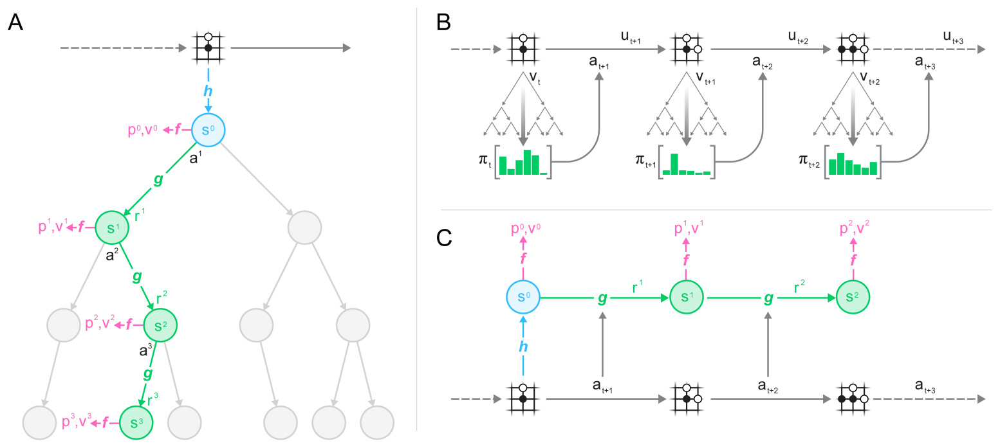
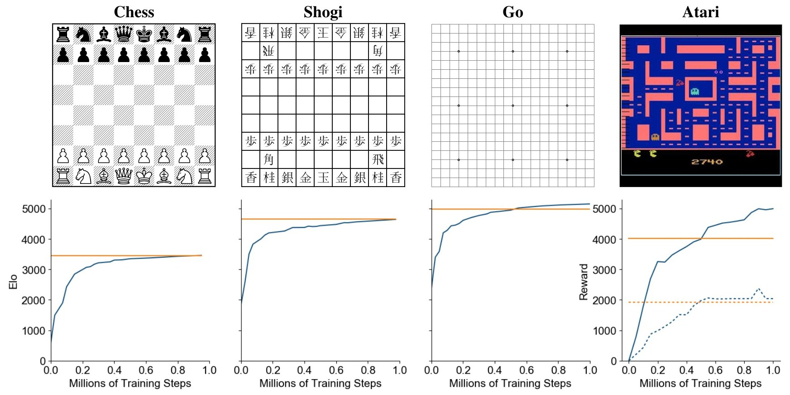
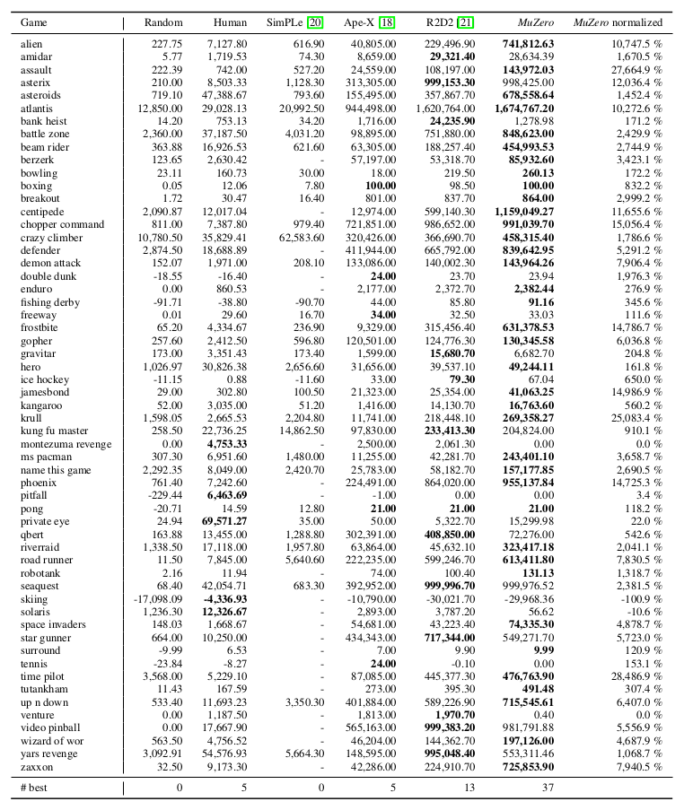
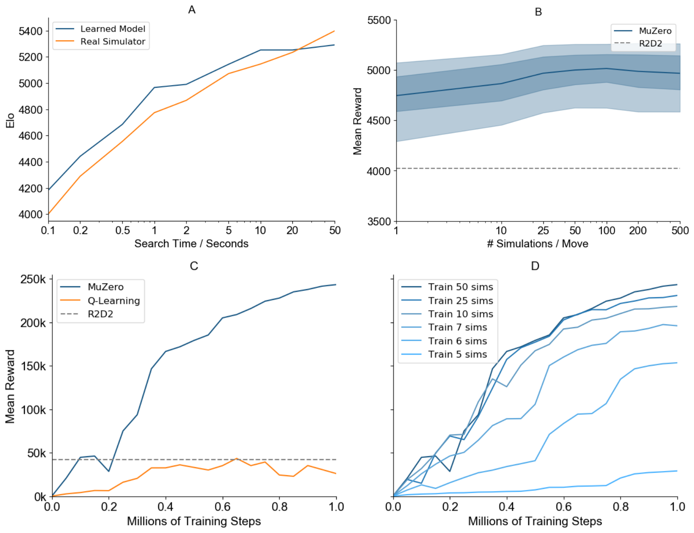
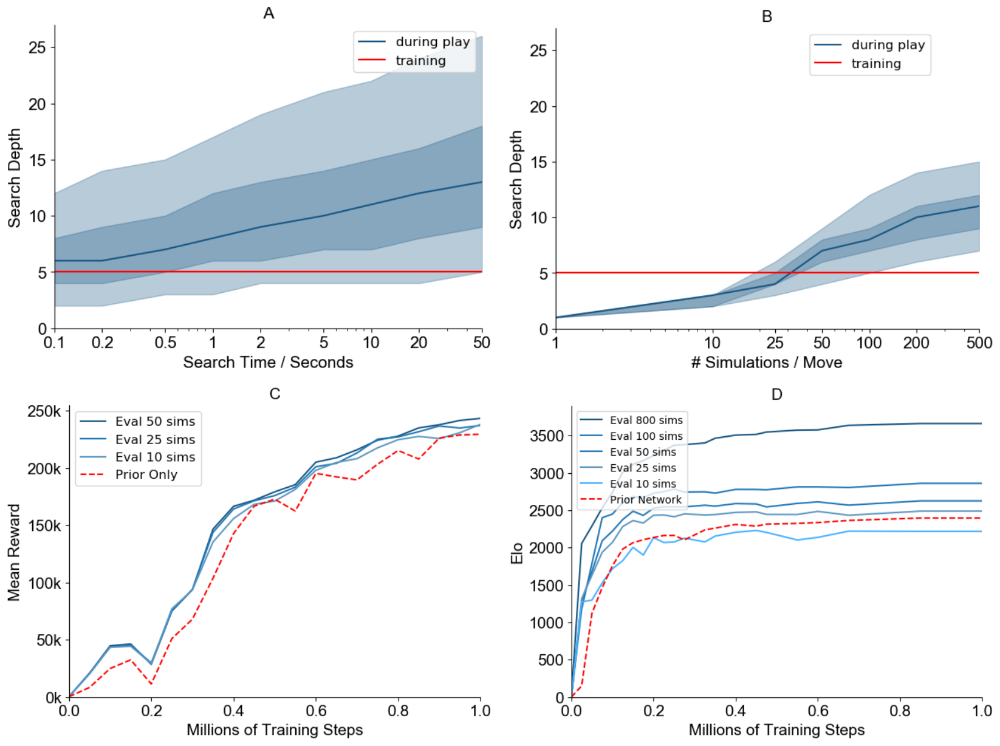
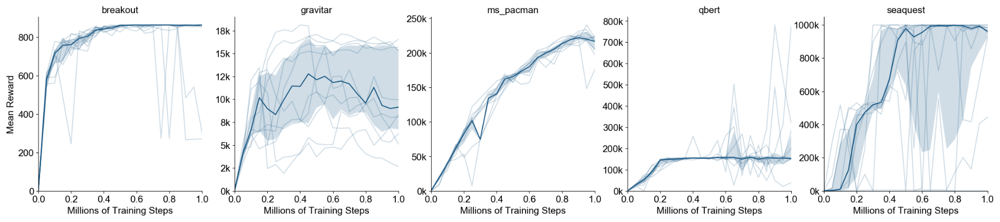

# 论文中文解读：《Mastering Atari, Go, Chess and Shogi by Planning with a Learned Model》

> **基本信息**：Julian Schrittwieser、Ioannis Antonoglou、Thomas Hubert、Karen Simonyan、Laurent Sifre、Simon Schmitt、Arthur Guez、Edward Lockhart、Demis Hassabis、Thore Graepel、Timothy Lillicrap、David Silver（DeepMind，部分作者同时隶属 University College London）；arXiv:1911.08265，本地 PDF 为 v2（2020 年 2 月 21 日，21 页，含附录 A–I 与补充表）；[论文官方页面](https://arxiv.org/abs/1911.08265)。论文后来发表于 Nature（2020），以本 arXiv 版本为准。
>
> **本文的读法**：图 1–3 与附录图 S1、S3 取自论文原图；表 1 逐格转录；附录 Table S1（57 个 Atari 游戏的整表）附原表截图并摘录关键行，Table S2 只摘录关键行；附录 Figure S2（算法公式汇总）转写为公式。文中“第 N 页”指 PDF 页码。凡是我自己推算、而论文没有直接写出的数字或论断，都会明确标注“推算”或“我的观察”。

## 一、一句话结论

AlphaZero 能在围棋、国际象棋、将棋上达到超人水平，前提是有一个完美的规则模拟器可以在搜索树里推演。MuZero 去掉了这个前提：它**学习一个只预测“规划所需量”的模型**，即每个假想动作之后的即时奖励 $r$、动作选择策略 $\mathbf p$ 和价值 $v$，然后在这个学到的隐空间里做与 AlphaZero 类似的蒙特卡洛树搜索（MCTS）。隐状态不要求能还原画面，也不要求等于真实状态。结果是：在 57 个 Atari 游戏上取得当时的最好成绩（相对人类的归一化得分，中位数 2041.1%、均值 4999.2%），同时在围棋、国际象棋、将棋上不使用规则也达到了 AlphaZero 的水平。它的代价是巨大的算力（棋类自博弈用 1000 个 TPU）和每个游戏单独训练。

## 二、背景与动机

### 2.1 基于前瞻搜索的规划为什么难以走出游戏

基于前瞻搜索的规划算法已经在跳棋、国际象棋、围棋、扑克中击败过人类世界冠军，也应用于物流、化学合成等领域。但这些规划算法都依赖对环境动力学的了解，例如游戏规则或精确的模拟器，因此不能直接用于机器人、工业控制或智能助手这类真实世界问题，那里的动力学复杂且未知。

基于模型的强化学习（model-based RL）想解决这个问题：先学习环境动力学的模型，再针对学到的模型做规划。但已有的做法一般要么重建真实环境状态，要么重建完整观测序列（逐帧像素）。这类方法在视觉复杂的领域（如 Atari 2600）仍远落后于最好的方法；最成功的是无模型（model-free）方法，直接从交互估计最优策略和价值函数。而无模型方法在需要精确、复杂前瞻的领域（国际象棋、围棋）又远落后于搜索。

### 2.2 此前基于模型的 RL 做了什么，问题在哪里

- 经典做法是学一个 MDP 模型，包括预测下一状态的状态转移模型和预测期望奖励的奖励模型，再用值迭代或 MCTS 之类的规划算法。在大型或部分可观测环境里，必须先构造“模型应当预测的状态表示”。这种“表示学习、模型学习、规划”三者分离的做法有隐患：智能体无法为了有效规划而优化自己的表示或模型，例如建模误差会在规划中累积；
- 直接在像素层面建模观测流：计算上在大规模问题里不可行；有人假设深度随机模型可缓解误差累积；
- 建立足以重建像素的隐状态空间模型，或预测未来隐状态：规划更高效，但模型容量仍大多花在可能无关的细节上；
- 以上方法都没能在 Atari 这样视觉复杂的领域构造出便于规划的模型，成绩落后于调好的无模型方法，甚至在数据效率上也是如此。

### 2.3 价值等价模型（value-equivalent models）

另一条路线端到端地预测价值函数：构造一个抽象 MDP，使得在抽象 MDP 中规划等价于在真实环境中规划。等价性通过“价值等价”保证：从同一真实状态出发，通过抽象 MDP 的轨迹的累计奖励与真实环境轨迹的累计奖励一致。

- Predictron 首先提出了用于预测价值（不含动作）的价值等价模型；模型仍是 MDP 形式，但不要求其转移模型对应真实状态，而把 MDP 当作深度网络的隐藏层；
- TreeQN 学一个抽象 MDP 模型，使得在其上（用树状结构的神经网络表示的）树搜索逼近最优价值函数；value iteration networks 学局部 MDP 模型，使得在其上的值迭代（用卷积网络表示）逼近最优价值函数；
- value prediction networks 是最接近 MuZero 的前驱：学习基于真实动作的 MDP 模型，展开后的 MDP 被训练得使“按简单前瞻搜索产生的真实动作序列”下的累计奖励与真实环境一致。与 MuZero 不同的是它没有策略预测，搜索只用到价值预测。

## 三、MuZero 算法

### 3.1 三个函数：表示、动态、预测（图 1A）

MuZero 的模型由三部分组成。在每个时间步 $t$，对 $k=1,\dots,K$ 步，模型 $\mu_\theta$ 以过去观测 $o_1,\dots,o_t$ 和未来动作 $a_{t+1},\dots,a_{t+k}$ 为条件，预测三个未来量：

$$
\mathbf p_t^k\approx\pi\big(a_{t+k+1}\mid o_1,\dots,o_t,a_{t+1},\dots,a_{t+k}\big),
$$

$$
v_t^k\approx\mathbb E\big[u_{t+k+1}+\gamma u_{t+k+2}+\cdots\mid o_1,\dots,o_t,a_{t+1},\dots,a_{t+k}\big],
\qquad
r_t^k\approx u_{t+k},
$$

其中 $u$ 是真实环境给出的奖励，$\pi$ 是用来选择真实动作的策略，$\gamma$ 是环境的折扣函数。

模型内部（省略时间下标 $t$）由三个函数组合而成：

$$
s^0=h_\theta(o_1,\dots,o_t),\qquad r^k,s^k=g_\theta(s^{k-1},a^k),\qquad \mathbf p^k,v^k=f_\theta(s^k).
$$

- **表示函数** $h_\theta$：把过去的观测（例如围棋棋盘或 Atari 屏幕）编码成根隐状态 $s^0$，没有任何特殊语义，只要它能支持对未来的预测；
- **动态函数** $g_\theta$：这是一个循环过程：给定上一隐状态 $s^{k-1}$ 和一个假想动作 $a^k$，算出即时奖励 $r^k$ 和新的隐状态 $s^k$。它模仿 MDP 模型（给定状态和动作，计算期望奖励和状态转移）的结构，但与传统方法不同，这个内部状态 $s^k$ 不带有环境状态的任何语义，它只是整个模型的隐状态，唯一用途是准确预测相关的未来量：策略、价值和奖励。本文的动态函数是确定性的，随机转移的扩展留给未来；
- **预测函数** $f_\theta$：从隐状态 $s^k$ 算出策略 $\mathbf p^k$ 和价值 $v^k$，类似 AlphaZero 的策略/价值联合网络。

*图 1（原文 Figure 1，第 3 页）：用学到的模型规划、行动与训练。（A）MuZero 如何在模型里规划；（B）MuZero 如何在环境中行动；（C）MuZero 如何训练模型。*

**图中文字翻译与读法**：

- **A：规划**。最上方的围棋盘面是真实观测，经表示函数 $h$（蓝色）变成根隐状态 $s^0$。每个隐状态（树节点）经预测函数 $f$（粉色箭头）输出 $p^k,v^k$。树的每条边是一个假想动作 $a^1,a^2,a^3$，动态函数 $g$（绿色）把（上一隐状态，动作）映射成（即时奖励 $r^k$，新隐状态 $s^k$）。图中绿色节点和箭头标出一次模拟走过的路径 $s^0\to s^1\to s^2\to s^3$，灰色部分是树里未走这条路径的其余节点。
- **B：行动**。每个真实时间步 $t$ 都从当前观测出发做一次 MCTS（图中的小树），搜索得到价值 $v_t$ 和策略 $\pi_t$（绿色柱状图，正比于根节点各动作的访问次数），从 $\pi_t$ 采样动作 $a_{t+1}$ 送给环境；环境返回新观测 $o_{t+1}$ 和奖励 $u_{t+1}$（箭头上标注的 $u_{t+1},u_{t+2},u_{t+3}$）。一局结束时，整条轨迹存入回放缓冲区（replay buffer）。
- **C：训练**。从回放缓冲区抽一段轨迹。起点处表示函数 $h$ 以所选轨迹的过去观测 $o_1,\dots,o_t$ 为输入；然后模型循环展开 $K$ 步（图中画了 2 步），每一步动态函数 $g$ 的输入是上一步的隐状态和**真实**动作 $a_{t+k}$。表示、动态、预测三个函数的参数通过时间反向传播（backpropagation-through-time）联合端到端训练，目标是三个量：策略 $\mathbf p^k\approx\pi_{t+k}$、价值 $v^k\approx z_{t+k}$、奖励 $r_{t+k}\approx u_{t+k}$，其中 $z_{t+k}$ 是一个样本回报：棋类取最终结果，Atari 取 $n$ 步回报。

**读图结论**：模型在搜索时用的是**假想动作**，训练时用的是轨迹里的**真实动作**；隐状态 $s^k$ 在训练中只受“三个预测是否准确”约束，没有重建观测的约束。

### 3.2 搜索与训练目标

有了这样的模型，就可以在以过去观测为条件的假想未来轨迹 $a^1,\dots,a^k$ 上搜索。例如，朴素的搜索可以直接选使价值函数最大的 $k$ 步动作序列；更一般地，可以对由动态函数诱导出的内部奖励和状态空间应用任何 MDP 规划算法。MuZero 用的是与 AlphaZero 类似的 MCTS，推广到单智能体领域和带中间奖励的情形（见 3.3 节）。在每个内部节点，它用当前参数 $\theta$ 的模型给出的策略、价值和奖励估计。MCTS 输出建议策略 $\pi_t$ 和估计价值 $\nu_t$，然后选择动作 $a_{t+1}\sim\pi_t$。

模型的所有参数联合训练，使每个假想步 $k$ 的策略、价值、奖励与“经过 $k$ 个真实时间步之后观测到的相应目标”相符。三个目标分别是：

- **策略目标**：与 AlphaZero 一样，改进的策略目标由 MCTS 产生，第一个目标是最小化预测策略 $\mathbf p_t^k$ 与搜索策略 $\pi_{t+k}$ 的误差；
- **价值目标**：改进的价值目标由实际玩游戏或 MDP 产生。与 AlphaZero 不同的是，MuZero 允许带折扣和中间奖励的长 episode，办法是从搜索价值向未来 bootstrap $n$ 步，即 $z_t=u_{t+1}+\gamma u_{t+2}+\cdots+\gamma^{n-1}u_{t+n}+\gamma^n\nu_{t+n}$。棋类的终局结果（输、和、赢）被当作 episode 最后一步的奖励 $u_t\in\{-1,0,+1\}$。第二个目标是最小化预测价值 $v_t^k$ 与价值目标 $z_{t+k}$ 的误差；
- **奖励目标**：就是观测到的奖励，第三个目标是最小化预测奖励 $r_t^k$ 与观测奖励 $u_{t+k}$ 的误差。

再加上 L2 正则，得到总损失（论文式 (1)）：

$$
l_t(\theta)=\sum_{k=0}^{K}\Big[l^r(u_{t+k},r_t^k)+l^v(z_{t+k},v_t^k)+l^p(\pi_{t+k},\mathbf p_t^k)\Big]+c\,\lVert\theta\rVert^2,
$$

其中 $l^r,l^v,l^p$ 分别是奖励、价值、策略的损失函数。

两个损失函数的细节（正文脚注 1 与附录 Figure S2，第 4、19 页）：

- 棋类沿用 AlphaZero 的做法，奖励和价值用平方误差；棋类没有中间奖励，所以奖励损失被省略（Figure S2 中 $l^r=0$）。棋类的价值目标就是终局结果：$z_t=u_T$；
- Atari 上奖励和价值的尺度变化很大，作者发现用交叉熵比平方误差更稳定：把标量目标转成 601 维类别分布（见 4.2 节）后，$l^r(u,r)=\phi(u)^\top\log\mathbf r$、$l^v(z,q)=\phi(z)^\top\log\mathbf q$（$\phi$ 是把实数表示成相邻整数线性组合的映射）；
- 两类任务的策略损失都是交叉熵：Figure S2 写作 $l^p(\pi,p)=\pi^\top\log\mathbf p$。

对 Figure S2 的说明（我的观察）：原图把这些交叉熵写成 $\phi(u)^\top\log\mathbf r$、$\pi^\top\log\mathbf p$ 等形式，**没有写负号**；作为损失来最小化时应理解为交叉熵 $-\phi(u)^\top\log\mathbf r$、$-\pi^\top\log\mathbf p$。另外式 (1) 把求和写成从 $k=0$ 开始，而奖励 $r^k$ 只有 $k\ge1$ 才由动态函数产生，论文正文没有说明 $k=0$ 处的奖励项怎么处理（补充材料里的伪代码不在本地 PDF 里，无法核对）。

下面把 Figure S2 汇总的算法公式整理如下。

模型（对应 3.1 节）：

$$
s^0=h_\theta(o_1,\dots,o_t),\qquad r^k,s^k=g_\theta(s^{k-1},a^k),\qquad \mathbf p^k,v^k=f_\theta(s^k),
$$

$$
\mathbf p^k,v^k,r^k=\mu_\theta(o_1,\dots,o_t,a^1,\dots,a^k).
$$

搜索：在时刻 $t$ 以根隐状态 $s_t^0$ 和模型 $\mu_\theta$ 做 MCTS，输出搜索价值与搜索策略，并从搜索策略中采样真实动作：

$$
\nu_t,\pi_t=\mathrm{MCTS}(s_t^0,\mu_\theta),\qquad a_t\sim\pi_t.
$$

学习规则：展开预测 $\mathbf p_t^k,v_t^k,r_t^k=\mu_\theta(o_1,\dots,o_t,a_{t+1},\dots,a_{t+k})$，价值目标与损失为

$$
z_t=\begin{cases}u_T & \text{for games}\\ u_{t+1}+\gamma u_{t+2}+\cdots+\gamma^{n-1}u_{t+n}+\gamma^n\nu_{t+n} & \text{for general MDPs}\end{cases}
$$

损失 $l_t(\theta)$ 即上面的式 (1)，其中 $l^r,l^v,l^p$ 的具体形式见上文两条列表。

### 3.3 搜索细节：pUCT 选择、扩展与回传（附录 B）

MuZero 的搜索基于带置信上界的蒙特卡洛树搜索，这是一种在单智能体领域渐近收敛到最优策略、在零和博弈中收敛到极小极大价值函数的规划方法。搜索树的每个节点对应一个内部状态 $s$；从 $s$ 出发对每个动作 $a$ 有一条边 $(s,a)$，存一组统计量 $\{N(s,a),Q(s,a),P(s,a),R(s,a),S(s,a)\}$，依次是访问次数、平均价值、策略（先验）、奖励和状态转移（下一隐状态）。与 AlphaZero 类似，搜索分三个阶段，重复多次模拟。

**选择（Selection）**。每次模拟从内部根状态 $s^0$ 出发，到达叶节点 $s^l$ 为止。对模拟中每个假想时间步 $k=1,\dots,l$，根据 $s^{k-1}$ 的统计量，用最大化置信上界的规则选动作：

$$
a^k=\arg\max_a\Bigg[Q(s,a)+P(s,a)\cdot\frac{\sqrt{\sum_bN(s,b)}}{1+N(s,a)}\Big(c_1+\log\frac{\sum_bN(s,b)+c_2+1}{c_2}\Big)\Bigg].
$$

（论文式 (2)。）常数 $c_1$、$c_2$ 控制随着节点被访问得越来越多，先验 $P(s,a)$ 相对于价值 $Q(s,a)$ 的影响；实验中 $c_1=1.25$，$c_2=19652$。读法：第一项 $Q$ 是目前估计的价值（利用）；第二项里 $P(s,a)$ 是网络给的先验，$\sqrt{\sum_bN}/(1+N(s,a))$ 让访问少的动作更有吸引力，括号里的对数项随总访问次数缓慢增大。对 $k<l$，下一状态和奖励从状态转移表和奖励表里查：$s^k=S(s^{k-1},a^k)$，$r^k=R(s^{k-1},a^k)$。

**扩展（Expansion）**。在模拟的最后时间步 $l$，用动态函数算出奖励和状态：$r^l,s^l=g_\theta(s^{l-1},a^l)$，并存进相应的表：$R(s^{l-1},a^l)=r^l$、$S(s^{l-1},a^l)=s^l$。策略和价值由预测函数算出：$\mathbf p^l,v^l=f_\theta(s^l)$。把对应状态 $s^l$ 的新节点加入搜索树，从新节点出发的每条边初始化为 $\{N(s^l,a)=0,\,Q(s^l,a)=0,\,P(s^l,a)=\mathbf p^l\}$。注意：每次模拟最多只调用一次动态函数和一次预测函数，计算成本与 AlphaZero 同一量级。

**回传（Backup）**。模拟结束时，更新轨迹上的统计量。回传被推广到：环境可以给出中间奖励、折扣 $\gamma$ 不必为 1、价值估计无界（在棋类中假设折扣为 1 且无中间奖励）。对 $k=l,\dots,0$，用价值函数 $v^l$ 做 bootstrap，构造一个 $l-k$ 步的累计折扣奖励估计：

$$
G^k=\sum_{\tau=0}^{l-1-k}\gamma^{\tau}r_{k+1+\tau}+\gamma^{\,l-k}v^l.
$$

对 $k=l,\dots,1$，更新模拟路径上每条边 $(s^{k-1},a^k)$ 的统计量：

$$
Q(s^{k-1},a^k):=\frac{N(s^{k-1},a^k)\,Q(s^{k-1},a^k)+G^k}{N(s^{k-1},a^k)+1},\qquad
N(s^{k-1},a^k):=N(s^{k-1},a^k)+1.
$$

即把 $G^k$ 并入平均价值，访问次数加 1。

**价值归一化**。在两人零和博弈里，价值函数假设有界于 $[0,1]$，这样可以用 pUCT 规则把价值估计与概率结合。但很多环境的价值无界，需要调整 pUCT 规则。一个简单办法是用环境中可能观测到的最大分数来重新缩放价值或设置 pUCT 常数，但这需要往算法里加入与游戏相关的先验知识。为避免这一点，MuZero 用截至目前搜索树里观测到的最小、最大价值来计算归一化的 $\overline Q\in[0,1]$。在选择阶段到达某节点时，用下式算出其各边的归一化 Q 值，用于 pUCT 规则（论文式 (5)）：

$$
\overline Q(s^{k-1},a^k)=\frac{Q(s^{k-1},a^k)-\min_{s,a\in\mathrm{Tree}}Q(s,a)}{\max_{s,a\in\mathrm{Tree}}Q(s,a)-\min_{s,a\in\mathrm{Tree}}Q(s,a)}.
$$

我的补充：搜索树早期的极值不稳定时，这种归一化会改变探索压力；论文没有对此做单独分析。

### 3.4 与 AlphaZero 的区别（附录 A）

AlphaGo Zero 和 AlphaZero 的规划用到两个独立组件：一个实现游戏规则的模拟器，在遍历搜索树时用来更新棋局状态；一个神经网络，联合预测模拟器产生的局面的策略和价值。MuZero 把规则被使用的三个地方都换成了一个学到的隐式模型：

| 环节 | AlphaZero | MuZero |
|---|---|---|
| 树内状态转移 | 完美模拟器给出真实动力学 | 学到的动态模型：树中每个节点对应一个隐状态，给定隐状态 $s^{k-1}$ 和动作 $a^k$ 即转移到 $s^k=g(s^{k-1},a^k)$ |
| 树内可用动作 | 用模拟器给出的合法动作去屏蔽整棵树里网络给出的先验 | 只在搜索树的根节点屏蔽合法动作（那里可以向环境查询），树内不做任何屏蔽；因为网络很快学会不预测训练轨迹里从未出现的动作 |
| 终局节点 | 搜索在表示终局状态的节点停止，用模拟器给的终局价值取代网络价值 | 对终局节点不做特殊处理，永远用网络预测的价值；树内搜索可以越过终局节点继续，此时期望网络总是预测同一价值，这靠训练时把终局状态当作吸收状态来实现 |
| 适用设定 | 终局奖励为 $\pm1$、无折扣的两人博弈 | 一般强化学习设定：单智能体、带折扣、中间奖励大小任意 |

## 四、实现与训练细节

### 4.1 输入表示（附录 E）

- **表示函数的输入（棋类）**：围棋和将棋沿用 AlphaZero，编码最近 8 个棋盘状态；国际象棋把历史加长到最近 100 个棋盘状态，以便正确预测和棋。
- **表示函数的输入（Atari）**：最近 32 帧 RGB 图像（分辨率 $96\times96$），再加上导致这些帧的最近 32 个动作。编码历史动作是因为 Atari 里一个动作不一定在画面上有可见的效果。RGB 帧每种颜色一个平面，缩放到 $[0,1]$，不做其他归一化、白化或预处理；历史动作用简单的偏置平面编码，缩放为 $a/18$（Atari 共 18 个动作）。
- **动态函数的输入**：表示函数输出（或上一次动态函数输出）的隐状态，与该次转移的动作表示在通道上拼接。动作被空间化地编码成与隐状态同分辨率的平面：Atari 为 $6\times6$（见 4.2 节的降采样），棋类与棋盘大小相同（围棋 $19\times19$，国际象棋 $8\times8$，将棋 $9\times9$）。

动作的平面编码：

| 游戏 | 动作如何编码成平面 |
|---|---|
| 围棋 | 普通动作（落子）编码成全零平面，仅在落子位置为 1；停着（pass）编码成全零平面 |
| 国际象棋 | 8 个平面：第 1 个 one-hot 平面表示棋子从哪个位置走出；接下来 2 个平面表示走到哪里：一个 one-hot 平面表示目标位置（若在棋盘上），另一个二值平面表示目标是否有效（是否在棋盘上），这是因为，为简单起见，策略的动作空间枚举了所有可能动作的超集，其中并非都合法，而且策略预测与动态函数输入使用同一动作空间；其余 5 个二值平面表示升变类型（后、马、象、车、无） |
| 将棋 | 共 11 个平面：前 8 个平面表示棋子从哪里走出，要么是棋盘位置（第 1 个 one-hot 平面），要么是打入七种持子之一（其余 7 个二值平面）；接下来 2 个平面编码目标，同国际象棋；最后 1 个二值平面表示该着是否升变 |
| Atari | 动作编码成 one-hot 向量，并平铺成平面 |

### 4.2 网络结构（附录 F）

- **预测函数** $\mathbf p^k,v^k=f_\theta(s^k)$：与 AlphaZero 相同，先用一两个保持分辨率但减少平面数的卷积层，再接全连接层到输出尺寸。
- **表示函数与动态函数（棋类）**：与 AlphaZero 同样的架构（卷积加残差），但用 16 个而不是 20 个残差块，$3\times3$ 卷积核，每层卷积 256 个隐藏平面。
- **表示函数（Atari）**：观测的空间分辨率大，所以表示函数先用一串步长为 2 的卷积降低分辨率。输入是 $96\times96$、128 个平面（32 帧历史 $\times$ 3 个颜色通道，再拼上广播成平面的 32 个动作），降采样过程如下（所有操作的核大小都是 $3\times3$）：

| 步骤 | 操作 | 输出分辨率 |
|---|---|---|
| 1 | 1 个步长为 2 的卷积，128 个输出平面 | $48\times48$ |
| 2 | 2 个残差块，128 个平面 | $48\times48$ |
| 3 | 1 个步长为 2 的卷积，256 个输出平面 | $24\times24$ |
| 4 | 3 个残差块，256 个平面 | $24\times24$ |
| 5 | 平均池化，步长 2 | $12\times12$ |
| 6 | 3 个残差块，256 个平面 | $12\times12$ |
| 7 | 平均池化，步长 2 | $6\times6$ |

- **动态函数（Atari）**：始终工作在降采样后的 $6\times6$ 分辨率；先把动作编码成图像，再沿平面维与上一步隐状态叠加。

**隐状态的缩放**。为改善学习并限制激活的范围，把隐状态缩放到与动作输入相同的范围 $[0,1]$：

$$
s_{\text{scaled}}=\frac{s-\min(s)}{\max(s)-\min(s)}.
$$

**Atari 的奖励与价值的变换**（沿用 R2D2 的做法）。先用可逆变换压缩尺度：

$$
h(x)=\operatorname{sign}(x)\big(\sqrt{\lvert x\rvert+1}-1+\epsilon x\big),\qquad \epsilon=0.001,
$$

再对标量奖励和价值目标施加变换 $\phi$，得到等价的类别表示：用大小为 601 的离散支撑集，每个整数 $-300$ 到 $300$ 对应一个支撑点。每个标量表示为相邻两个支撑点的线性组合，使原值可由 $x=x_{\text{low}}\,p_{\text{low}}+x_{\text{high}}\,p_{\text{high}}$ 恢复。例如目标 3.7 被表示成支撑点 3 上权重 0.3、支撑点 4 上权重 0.7。网络的价值和奖励输出也用大小 601 的 softmax 建模；推理时先算 softmax 分布下的期望值，再反变换得到实际价值和奖励。变换在网络一侧透明进行，对算法其余部分不可见。

### 4.3 数据生成（附录 D）

- 产生训练数据时，用网络的最新检查点（每 1000 个训练步更新一次）配合 MCTS 玩游戏。棋类每步搜索 800 次模拟；Atari 由于动作空间小得多，每步 50 次模拟就足够；
- 棋类的对局一结束就送到训练任务；Atari 的对局很长（最长 30 分钟，即 108,000 帧），所以每 200 步送一次中间序列；
- 训练任务在内存中维护回放缓冲区：棋类保存最近收到的 100 万局；Atari 的观测更大，保存最近的 12.5 万条长度为 200 的序列；
- 棋类的探索方案沿用 AlphaZero（本文没有重述）。

Atari 采用其变体：整局游戏中都按访问次数分布采样动作，而不是只在前若干步采样。访问次数分布用温度 $T$ 参数化：

$$
p_\alpha=\frac{N(\alpha)^{1/T}}{\sum_bN(b)^{1/T}}.
$$

$T$ 随网络训练步数衰减：前 50 万个训练步用 $T=1$，接下来 25 万步用 $T=0.5$，其余 25 万步用 $T=0.25$，使动作选择随训练越来越贪心。

### 4.4 训练（附录 G）

- 训练时 MuZero 网络展开 $K$ 个假想步，并与 MCTS actor 产生的轨迹中抽出的序列对齐：先从回放缓冲区里任一局抽一个状态，再从该状态展开 $K$ 步。Atari 的样本按优先级回放抽取，优先级为 $P(i)=p_i^{\alpha}/\sum_kp_k^{\alpha}$，其中 $p_i=\lvert\nu_i-z_i\rvert$（$\nu$ 是搜索价值，$z$ 是观测到的 $n$ 步回报）；为修正优先采样带来的偏差，用重要性采样比 $w_i=\big(\tfrac1N\cdot\tfrac1{P(i)}\big)^{\beta}$ 缩放损失；所有实验取 $\alpha=\beta=1$。棋类均匀采样；
- 序列里每个观测 $o_t$ 都有对应的 MCTS 策略 $\pi_t$、估计价值 $\nu_t$ 和环境奖励 $u_t$。在每个展开步 $k$，网络对该步的价值、策略和奖励目标有损失，加起来得到 MuZero 网络的总损失（式 (1)）。棋类没有中间奖励，所以省略奖励预测损失；棋类直接 bootstrap 到对局结束，等价于预测最终结果；Atari bootstrap 未来 $n=10$ 步；
- 为使不同展开步的梯度量级大致相同，在两处缩放梯度：每个预测头的损失乘 $1/K$（$K$ 为展开步数），使总梯度大小与展开多少步无关；动态函数起点处的梯度乘 $1/2$，使施加到动态函数上的总梯度保持不变；
- 本文所有实验都展开 $K=5$ 步；
- 算力：全部实验用第三代 Google Cloud TPU。每个棋类游戏，训练用 16 个 TPU，自博弈用 1000 个 TPU；Atari 每个游戏，训练用 8 个 TPU，自博弈用 32 个 TPU。Atari 用于 acting 的 TPU 比例小得多，是因为每步模拟少得多（50 对 800），而且动态函数比表示函数小。

### 4.5 设置汇总（我据正文和附录整理）

| 项目 | 棋类（围棋、国际象棋、将棋） | Atari |
|---|---|---|
| 展开步数 $K$ | 5 | 5 |
| 训练步数与小批量 | 100 万步，小批量 2048 | 100 万步，小批量 1024 |
| 每步搜索模拟次数（训练与评测） | 800 | 50 |
| 价值/奖励损失 | 平方误差；无奖励预测损失 | 对 601 维类别分布做交叉熵 |
| 价值目标 | bootstrap 到终局 | $n=10$ 步回报加 $n$ 步后的搜索价值（Reanalyze 版 $n=5$） |
| 折扣 | 1，无中间奖励 | 0.997（沿用 R2D2） |
| 表示函数输入 | 围棋、将棋最近 8 个棋盘状态；国际象棋最近 100 个 | 最近 32 帧 $96\times96$ RGB 与最近 32 个动作 |
| 回放缓冲区与抽样 | 最近 100 万局，均匀抽样 | 最近 12.5 万条长 200 的序列，优先级回放 $\alpha=\beta=1$ |
| 隐状态分辨率 | 与棋盘相同 | $6\times6$ |
| TPU（训练 + 自博弈） | 16 + 1000 | 8 + 32 |

此外：所有网络都用 256 个隐藏平面；棋类沿用 AlphaZero 的 UCB 常数、狄利克雷探索噪声和每步 800 次模拟；评测 Atari 时每 4 个时间步用 50 次模拟选一次动作，并把选出的动作重复 4 次（图 2 图注，与以往工作一致）。附录 C 说明，为简单起见，尽可能沿用以往工作的架构和超参数，对正文未提及的参数值，参见补充材料里的伪代码（不在本地 PDF 中）。

## 五、实验结果

### 5.1 训练过程中的表现（图 2）

论文在 57 个 Atari 游戏上以及围棋、国际象棋、将棋上训练 MuZero，每个游戏都训练 $K=5$ 个假想步、100 万个小批量；棋类训练和评测时每步 800 次模拟，Atari 为 50 次。

*图 2（原文 Figure 2，第 5 页）：MuZero 在国际象棋、将棋、围棋和 Atari 上随训练的评测。横轴为训练步数（单位百万）。*

**图中文字翻译与读法**：

- **前三列（Chess、Shogi、Go）**：纵轴 Elo，通过与 AlphaZero 对局（双方每步 800 次模拟）来确定。蓝线是 MuZero 的 Elo，水平橙线是 AlphaZero 的 Elo。
- **最后一列（Atari）**：纵轴写作 Reward，按图注其实是全部 57 个游戏上相对人类的归一化得分：实线为均值，虚线为中位数；水平橙线是 R2D2（此前该领域的最好成绩，基于无模型 RL）的得分，实线对应均值，虚线对应中位数。Atari 的评测每 4 个时间步用 50 次模拟选一次动作，然后把选出的动作重复 4 次，与以往工作一致。
- 从图上读出的近似数值（不是论文给出的数字）：国际象棋中 MuZero 从约 500 升到约 3450，在训练结束前追平 AlphaZero 的橙线（约 3450）；将棋从约 1900 升到约 4650，也只是追平 AlphaZero（约 4650）；围棋从约 2400 升到约 5150，在约 50 万步之后越过 AlphaZero 的橙线（约 5000）；Atari 的均值升到约 5000（表 1 中是 4999.2%），中位数约 2000（表 1 中是 2041.1%），均值与中位数都在约 50 万步附近越过 R2D2 的橙线（R2D2 均值 4024.9%，中位数 1920.6%）。

**读图结论**：论文的说法：在围棋中，MuZero 略微超过 AlphaZero，尽管搜索树里每个节点用的计算更少（MuZero 每次评估用 16 个残差块，AlphaZero 用 20 个）；作者推测这表明 MuZero 可能把计算缓存在搜索树里，并利用动态模型的每一次额外应用来更深入地理解局面。国际象棋和将棋上则是与 AlphaZero 持平。

关于棋类 Elo 的基线：图 2 图注说 Elo 是通过与 AlphaZero 对局确定的；而附录 I 的文字写的是基线选手分别为 Stockfish、Elmo、AlphaZero，基线选手的 Elo 锚定到 AlphaZero 论文公布的数值，基线的等效搜索时间为每步 100 ms。两处写法并不完全一致，本文以图注为准（图上三个棋类子图都只有一条橙线，标作 AlphaZero）。

### 5.2 Atari 主结果（表 1）

下表比较 MuZero 与此前各智能体在 Atari 57 个游戏上的成绩，上半是大数据设置，下半是小数据设置。除 MuZero 外所有智能体都用无模型 RL 技术。均值与中位数是相对人类测试员的归一化分数；加粗为原文表中标出的最好结果。

| 智能体 | 中位数 | 均值 | 环境帧数 | 训练时间 | 训练步数 |
|---|---:|---:|---:|---|---:|
| Ape-X | 434.1% | 1695.6% | 22.8B | 5 天 | 8.64M |
| R2D2 | 1920.6% | 4024.9% | 37.5B | 5 天 | 2.16M |
| MuZero | **2041.1%** | **4999.2%** | 20.0B | 12 小时 | 1M |
| IMPALA | 191.8% | 957.6% | 200M | – | – |
| Rainbow | 231.1% | – | 200M | 10 天 | – |
| UNREAL（a） | 250%（a） | 880%（a） | 250M | – | – |
| LASER | 431% | – | 200M | – | – |
| MuZero Reanalyze | **731.1%** | **2168.9%** | 200M | 12 小时 | 1M |

（原文表 1，第 6 页。（a）表示该智能体的超参数是针对每个游戏分别调的；B 表示十亿，M 表示百万；原文没有定义“训练步数”的单位。）

读法：

- 上半部分（大数据设置）里，MuZero 的中位数和均值都高于 Ape-X 和 R2D2，而且用的环境帧数更少（20.0B 对 37.5B、22.8B），训练时间也只有 12 小时对 5 天；
- 下半部分（200M 帧的小数据设置）里，MuZero Reanalyze（见 5.3 节）的中位数 731.1%，远高于 IMPALA、Rainbow、UNREAL、LASER 的 191.8%、231.1%、250%、431%；
- 两档不能混比：标准版 MuZero 的 2041.1% 是 200 亿帧的成绩，不能与 Rainbow 的 231.1%（2 亿帧）当作同预算的提升来比；
- 论文还称：MuZero 在 57 个游戏里的 42 个超过 R2D2，且在所有游戏里都超过此前最好的基于模型的方法 SimPLe。核对见下。

**我对附录 Table S1（30 个随机 no-op 起始，见 5.4 节）的核对与统计**（不是论文的结论，是我用表中数字重算的）：

- 用表中的随机、人类、MuZero 三列重算归一化分数，57 个游戏全部与最后一列吻合；这 57 个归一化分数的中位数 2041.1%、均值 4999.2%，正好等于表 1 的 MuZero 一行；
- MuZero 严格高于 R2D2 的游戏有 41 个，另有 Pong 并列（两者都是 21.00）；论文说“42/57”，对应把并列算作不低于；MuZero 不高于 R2D2 的 16 个游戏是 Amidar、Asterix、Bank Heist、Gravitar、Ice Hockey、Kung-Fu Master、Montezuma's Revenge、Pitfall、Pong（并列）、Q*bert、Seaquest、Solaris、Star Gunner、Venture、Video Pinball、Yars' Revenge；
- SimPLe 只评测了 57 个游戏中的 36 个，MuZero 在这 36 个上都高于它；
- 高于人类分数的游戏有 51 个；低于人类的 6 个是 Montezuma's Revenge、Pitfall、Private Eye、Skiing、Solaris、Venture，它们大多是需要长时间无奖励探索或稀疏奖励的游戏；
- 有 35 个游戏的归一化分数超过 1000%，最高是 Time Pilot（28,486.9%）、Assault（27,664.9%）、Krull（25,083.4%），均值因此远高于中位数。

下表摘录 Table S1 的关键行：随机策略（Random）、人类、SimPLe、Ape-X、R2D2、MuZero 的平均每局得分，以及 MuZero 相对人类的归一化得分；“–”表示该方法没有此游戏的结果；得分越大越好。

| 游戏 | 随机 | 人类 | SimPLe | Ape-X | R2D2 | MuZero | MuZero 归一化 |
|---|---:|---:|---:|---:|---:|---:|---:|
| Breakout | 1.72 | 30.47 | 16.40 | 801.00 | 837.70 | 864.00 | 2,999.2% |
| Pong | -20.71 | 14.59 | 12.80 | 21.00 | 21.00 | 21.00 | 118.2% |
| Boxing | 0.05 | 12.06 | 7.80 | 100.00 | 98.50 | 100.00 | 832.2% |
| Seaquest | 68.40 | 42,054.71 | 683.30 | 392,952.00 | 999,996.70 | 999,976.52 | 2,381.5% |
| Video Pinball | 0.00 | 17,667.90 | – | 565,163.00 | 999,383.20 | 981,791.88 | 5,556.9% |
| Ms. Pacman | 307.30 | 6,951.60 | 1,480.00 | 11,255.00 | 42,281.70 | 243,401.10 | 3,658.7% |
| Alien | 227.75 | 7,127.80 | 616.90 | 40,805.00 | 229,496.90 | 741,812.63 | 10,747.5% |
| Krull | 1,598.05 | 2,665.53 | 2,204.80 | 11,741.00 | 218,448.10 | 269,358.27 | 25,083.4% |
| Time Pilot | 3,568.00 | 5,229.10 | – | 87,085.00 | 445,377.30 | 476,763.90 | 28,486.9% |
| Q*bert | 163.88 | 13,455.00 | 1,288.80 | 302,391.00 | 408,850.00 | 72,276.00 | 542.6% |
| Kung-Fu Master | 258.50 | 22,736.25 | 14,862.50 | 97,830.00 | 233,413.30 | 204,824.00 | 910.1% |
| Pitfall | -229.44 | 6,463.69 | – | -1.00 | 0.00 | 0.00 | 3.4% |
| Montezuma's Revenge | 0.00 | 4,753.33 | – | 2,500.00 | 2,061.30 | 0.00 | 0.0% |
| Venture | 0.00 | 1,187.50 | – | 1,813.00 | 1,970.70 | 0.40 | 0.0% |
| Solaris | 1,236.30 | 12,326.67 | – | 2,893.00 | 3,787.20 | 56.62 | -10.6% |
| Skiing | -17,098.09 | -4,336.93 | – | -10,790.00 | -30,021.70 | -29,968.36 | -100.9% |
| Private Eye | 24.94 | 69,571.27 | 35.00 | 50.00 | 5,322.70 | 15,299.98 | 22.0% |

（原文 Table S1，第 17 页，从 57 行中摘录。）下面是该表的原表截图（57 个游戏）：

*原文 Table S1，第 17 页：Game=游戏；Random=随机；Human=人类；SimPLe、Ape-X、R2D2=三个对比方法；MuZero=本文方法；MuZero normalized=MuZero 相对人类的归一化得分；# best=该列在多少个游戏上取得最好成绩（加粗）。*

表下的说明：每个 episode 最多 30 分钟游戏时间（10.8 万帧）；SimPLe 只评测了 57 个游戏里的 36 个，缺失结果用“-”表示；人类归一化得分为 $s_{\text{normalized}}=\dfrac{s_{\text{agent}}-s_{\text{random}}}{s_{\text{human}}-s_{\text{random}}}$。“# best”一行：Random 0、Human 5、SimPLe 0、Ape-X 5、R2D2 13、MuZero 37（并列时多个方法都记为最好，所以合计超过 57）。

这张表告诉我们：

- MuZero 的优势主要来自视觉复杂但奖励较稠密的游戏，如 Alien、Krull、Time Pilot，那里它的归一化分数都在 10,000% 以上；
- 在 Q*bert 上它远低于 R2D2（72,276 对 408,850）；在 Pong、Boxing、Breakout、Seaquest、Video Pinball 上与 R2D2、Ape-X 的分数几乎相同（如 Pong 三者都是 21.00，Boxing 为 100.00、98.50、100.00），差异没有区分度；
- Montezuma's Revenge、Pitfall、Venture、Solaris、Skiing、Private Eye 等稀疏奖励或长程规划的游戏上仍然失败或接近失败，Skiing 与 Solaris 的归一化分数甚至是负数。我的观察：规划加上学到的模型并没有解决这类任务的探索与长程信用分配问题，论文也没有就此做专门分析。

### 5.3 提高样本效率的版本：MuZero Reanalyze（附录 H）

为提高样本效率，论文引入了第二个版本 MuZero Reanalyze：它回头重新访问过去的时间步，用最新的模型参数重新执行搜索，可能得到比原始搜索更好的策略。这个新鲜的策略在 MuZero 训练中被用作 80% 更新的策略目标。此外，使用一个基于近期参数 $\theta^-$ 的目标网络（$\cdot,v^-=f_{\theta^-}(s^0)$）为价值函数提供更新鲜、更稳定的 $n$ 步 bootstrap 目标：

$$
z_t=u_{t+1}+\gamma u_{t+2}+\cdots+\gamma^{n-1}u_{t+n}+\gamma^n v^-_{t+n}.
$$

同时还调整了几项超参数，主要为了增加样本复用、避免价值函数过拟合：

| 项目 | MuZero（标准版） | MuZero Reanalyze |
|---|---|---|
| 策略目标 | 当时自博弈搜索得到的 $\pi$ | 80% 的更新用最新参数重新搜索得到的 $\pi$ |
| 价值目标 | $n=10$ 步回报加搜索价值 $\nu_{t+n}$ | $n=5$ 步回报加目标网络价值 $v^-_{t+n}$ |
| 每个状态抽取的样本数 | 0.1 | 2.0 |
| 价值目标的损失权重 | 1.0 | 0.25（策略与奖励目标权重仍为 1.0） |
| 使用的经验量 | 200 亿帧（表 1 上半） | 2 亿帧（表 1 下半） |

在 57 个 Atari 游戏上，每个游戏用 2 亿帧经验，MuZero Reanalyze 的中位数归一化得分是 731%，而此前最好的无模型方法 IMPALA、Rainbow、LASER 分别是 192%、231%、431%（表 1）。因为这里同时改了好几个超参数，Reanalyze 的增益不能纯粹归因于“重新搜索”这一个因素。

### 5.4 Atari 评测协议与第二张整表（附录 I，Table S2）

- **评测**：每个游戏取 1000 个 episode 的平均奖励，每个 episode 限制在标准的 30 分钟（10.8 万帧）以内，除特别说明外每步用 50 次模拟。为缓解 Atari 模拟器确定性的影响，用两种评测策略：（1）30 个随机 no-op 起始：每个 episode 开始时先对模拟器执行 0 到 30 个随机数量的空操作，再把控制权交给智能体（Table S1 用的就是这种）；（2）human starts：从人类专家的游戏中采样起始位置来初始化模拟器，再把控制权交给智能体（Table S2）。
- **棋类**：用 BayesElo 对每个选手估计 Elo。Elo 来自训练过程中 MuZero 各迭代之间、以及与一个基线选手之间每步 800 次模拟的比赛；基线选手使用相当于每步 100 ms 的搜索时间，并且基线选手的 Elo 锚定到公开数值。选手 $a$ 击败选手 $b$ 的概率用逻辑函数建模：

$$
p(a\ \text{defeats}\ b)=\Big(1+10^{\,c_{\text{elo}}\,(e(b)-e(a))}\Big)^{-1},\qquad c_{\text{elo}}=\frac1{400}.
$$

Table S2 是同样 57 个游戏的 human-starts 评测，列为随机、人类、Ape-X、MuZero 与 MuZero 归一化（没有 R2D2 与 SimPLe）。下表摘录与上表相同的游戏：

| 游戏 | 随机 | 人类 | Ape-X | MuZero | MuZero 归一化 |
|---|---:|---:|---:|---:|---:|
| Breakout | 1.77 | 27.86 | 757.00 | 849.59 | 3,249.6% |
| Pong | -17.95 | 15.46 | 19.00 | 19.20 | 111.2% |
| Boxing | -1.46 | 9.61 | 81.00 | 56.60 | 524.5% |
| Seaquest | 215.50 | 40,425.80 | 377,180.00 | 997,601.01 | 2,480.4% |
| Video Pinball | 0.00 | 15,641.09 | 873,989.00 | 970,881.10 | 6,207.2% |
| Ms. Pacman | 197.80 | 15,375.05 | 6,135.00 | 230,650.24 | 1,518.4% |
| Alien | 128.30 | 6,371.30 | 17,732.00 | 713,387.37 | 11,424.9% |
| Krull | 1,151.90 | 2,109.10 | 8,592.00 | 257,706.70 | 26,802.6% |
| Time Pilot | 3,273.00 | 5,650.00 | 71,543.00 | 405,829.30 | 16,935.5% |
| Q*bert | 159.38 | 12,085.00 | 380,152.00 | 39,302.10 | 328.2% |
| Kung-Fu Master | 304.00 | 20,786.80 | 72,068.00 | 174,623.60 | 851.1% |
| Pitfall | -348.80 | 5,998.91 | -273.00 | -801.10 | -7.1% |
| Montezuma's Revenge | 25.00 | 4,182.00 | 1,079.00 | 57.10 | 0.8% |
| Venture | 18.00 | 1,039.00 | 936.00 | 21.10 | 0.3% |
| Solaris | 2,047.20 | 11,032.60 | 3,116.00 | 2,108.08 | 0.7% |
| Skiing | -15,287.35 | -3,686.58 | -11,359.00 | -29,400.75 | -121.7% |
| Private Eye | 662.78 | 64,169.07 | 865.00 | 5,067.59 | 6.9% |

（原文 Table S2，第 18 页，从 57 行中摘录。）按我对 Table S2 的重算：归一化分数全部与表中吻合，中位数 2281.9%、均值 4926.8%（论文表 1 没有给出 human starts 的汇总）；MuZero 高于人类的游戏仍是 51 个，低于人类的仍是同样 6 个游戏；“# best”一行是 Random 0、Human 6、Ape-X 5、MuZero 46。结论：无论起始方式如何，MuZero 在 Atari 上的整体优势和失败模式基本一致。

### 5.5 模型的作用：规划是否随搜索量扩展（图 3）

为理解模型在 MuZero 中的作用，论文在围棋和 Atari 游戏 Ms. Pacman 上做了几组实验。

*图 3（原文 Figure 3，第 7 页）：MuZero 在围棋（A）、全部 57 个 Atari 游戏（B）和 Ms. Pacman（C–D）上的评测。*

**图中文字翻译与读法**：

- **A（围棋）**：横轴 Search Time / Seconds（每步搜索时间，对数刻度，0.1 到 50 秒），纵轴 Elo。蓝线 Learned Model（学到的模型），橙线 Real Simulator（真实模拟器）。图注：两个网络都是在每次搜索 800 次模拟（相当于每次搜索 0.1 秒）下训练的。学到的模型可以很好地扩展到比训练时长两个数量级的搜索。从图上读出的近似数值：学到的模型从 0.1 秒时约 4190 升到约 20 秒时的约 5250，之后约 5290；真实模拟器从约 4000 升到 50 秒时约 5400；在 0.1 秒到约 20 秒之间学到的模型不低于真实模拟器。
- **B（57 个 Atari 游戏）**：横轴 # Simulations / Move（每步模拟次数，1 到 500，对数刻度），纵轴 Mean Reward（按图注是 Atari 的最终人类归一化平均得分）。蓝线是均值，深色和浅色阴影分别是第 25 到 75 百分位和第 5 到 95 百分位（论文没有说明这些百分位是对什么统计的），灰色虚线是 R2D2（约 4025，即 4024.9%）。网络是在每步 50 次模拟下训练的。图注：学到的模型的表现随模拟次数增加而提高，直到每步约 100 次；此后即使扩展到比训练时长得多的搜索，表现也保持稳定，只是略有下降。这与围棋（A）里好得多的扩展性形成对比，可能是因为 Atari 里模型误差比围棋里更大。从图上读出的近似数值：1 次模拟时均值约 4750，50–100 次模拟时约 5000，500 次时约 4970。
- **C（Ms. Pacman：MCTS 训练与 Q-learning 的比较）**：横轴 Millions of Training Steps，纵轴 Mean Reward（0 到 25 万）；蓝线 MuZero，橙线 Q-Learning，灰色虚线 R2D2。图注：在 MuZero 框架中比较基于 MCTS 的训练与 Q-learning，保持网络大小和训练量不变；最好的 Q-learning 算法 R2D2 作为基线。作者的 Q-learning 实现达到与 R2D2 相同的最终得分，但提升更慢，最终性能比 MCTS 训练低得多。从图上读出的近似数值：MuZero 终点约 24 万，Q-learning 约 3 万，R2D2 约 4.2 万（Table S1 里 R2D2 为 42,281.70）。
- **D（Ms. Pacman：训练时模拟次数的影响）**：同样的横轴；六条线分别是训练时每步 50、25、10、7、6、5 次模拟（Train 50 sims 等），颜色越深模拟次数越多。图注：不同网络用不同的每步模拟次数训练，但都用每步 50 次模拟评测。用更多模拟训练的网络提升得更快，与 B 的消融一致，即每步模拟越多，策略改进越大。令人惊讶的是，即使每步训练的模拟次数少于覆盖 Ms. Pacman 全部 8 个可能动作所需的次数，MuZero 仍能有效学习。从图上读出的近似终点：50 次约 24 万，25 次约 23 万，10 次约 22 万，7 次约 20 万，6 次约 15 万，5 次约 3 万。

**读图结论**：

- 围棋：学到的模型在搜索时间远大于训练时的情况下，仍能与真实模拟器匹配（A）。这说明隐动力学在搜索实际访问的深度上足够一致；
- Atari：增加模拟次数只到约 100 次持续改善，之后持平甚至略降（B）。作者推测是 Atari 的模型误差更大。即使只用 1 次模拟，也就是只按策略网络选动作，MuZero 表现依然很好（平均约 4750，高于 R2D2），说明到训练结束时，原始策略已经把搜索的好处内化了（另见图 S3C）；
- Ms. Pacman：把 MuZero 的训练目标换成 R2D2 风格的 Q-learning 目标，并把价值和策略两个头换成表示 $Q(\cdot\mid s_t)$ 的单个头，然后不用搜索地训练和评测；这个无模型版本在 Ms. Pacman 上与 R2D2 的结果相同，但学得慢得多，收敛到低得多的最终得分（C）。作者推测，MuZero 基于搜索的策略改进步骤比 Q-learning 高偏差、高方差的目标提供了更强的学习信号；
- 每步只用 6 次模拟，少于动作数，MuZero 也学到了有效策略，并且提升得很快；更多模拟让性能跳得明显更高（D）。这个结果与此前的工作形成对比。

### 5.6 附录补充图：搜索深度与策略改进（图 S3）、重复性（图 S1）

*图 S3（原文 Figure S3，第 20 页）：MuZero 评测的细节（A–B）与策略改进消融（C–D）。*

**图中文字翻译与读法**：

- **A–B（评测时的搜索深度）**：是图 3A、3B 评测中学到的模型在搜索树里的评估深度分布。网络训练时只展开了 5 个假想步，图中用红线（training，深度 5）标出。深蓝线是距根节点的深度中位数，深色阴影是第 25 到 75 百分位，浅色阴影是第 5 到 95 百分位（during play 为评测时）。A（围棋）横轴为搜索时间，B（Atari）横轴为每步模拟次数，纵轴 Search Depth（搜索深度）。从图上读出的近似数值：A 里中位深度从 0.1 秒时的约 6 增长到 50 秒时的约 13；B 里从 1 次模拟的 1 增长到 500 次的约 11，在每步约 25 到 50 次模拟时越过 5。
- **C（Ms. Pacman 的策略改进）**：一个在每步 50 次模拟下训练的网络，在不同模拟次数（Eval 50、25、10 sims）以及“只用原始策略网络的 argmax”（Prior Only，红色虚线）下评测。横轴训练步数，纵轴 Mean Reward。图注：搜索相对原始策略网络的策略改进效果在整个训练期间都清晰可见；这条有搜索与无搜索之间持续存在的差距，正说明了 MuZero 利用的策略改进：不断向改进后的策略更新，从而高效地向最优策略推进。
- **D（围棋的策略改进）**：一个在每步 800 次模拟下训练的网络，在不同模拟次数（Eval 800、100、50、25、10 sims 和 Prior Network）下评测，纵轴 Elo。图注：围棋里更长搜索带来的棋力提升远大于 Ms. Pacman，并且在整个训练过程中持续存在，这与此前的结果一致，说明模型的好处在精确规划领域最大。从图上读出的近似数值：训练结束时 800 次模拟约 3650，100 次约 2860，50 次约 2630，25 次约 2500，10 次约 2220，只用原始策略网络约 2400。

**读图结论**：图 3 里的搜索深度（A、B）与图 S3 里的深度分布一起表明，模型只训练展开 5 步，但搜索时可以走得更深；参数共享的循环动态函数允许这种外推，但论文没有给出深度增加不累积误差的保证；论文把 Atari 在约 100 次模拟之后进入平台期归因于模型误差更大，这是推测，没有单独验证。C 与 D 则显示：搜索相对原始策略的增益在围棋里远大于在 Ms. Pacman 里。

*图 S1（原文 Figure S1，第 16 页）：MuZero 在五个 Atari 游戏上的重复性。纵轴为总奖励，横轴为训练步数（单位百万）。深色线是 10 次独立训练的中位数得分，浅色线是各次训练，阴影为第 25 到 75 百分位。*

**图中文字翻译与读法**：从左到右依次是 breakout、gravitar、ms_pacman、qbert、seaquest。从图上读出的近似情况（不是论文给出的数字）：Ms. Pacman 的 10 次训练几乎重合，中位数约 22 万；Breakout 大部分运行收敛到约 860，但有少数运行在训练后期出现明显的掉分；Gravitar 的各次运行差别很大（约 2 千到 1.8 万），中位数约 9 千到 1.2 万；Q*bert 的中位数在约 20 万步之后保持在约 15 万的平台，但个别运行在后期出现大幅波动；Seaquest 的中位数接近 100 万，但四分位带很宽。

**读图结论**：同一游戏的不同训练运行之间可以有很大差异，所以表 1 与 Table S1 里每个游戏的单个数字不能当作训练过程方差很小的证据。论文没有说明 Table S1 的数字对应一次训练还是多次的平均或最好值。

另外，附录 Figure S4（第 21 页）给出了每个 Atari 游戏的学习曲线（线为 1000 局评测的平均得分，阴影为标准差），共 57 个小图，本文不逐个转录。

## 六、局限、证据边界与常见误读

论文明确承认的范围：

- 动态函数是确定性的，随机转移的扩展留给未来；扑克等不完全信息博弈不是本方法直接处理的对象。

证据边界与常见误读：

- “不知道规则”的准确含义是：搜索树内的状态转移、合法动作和终局都不由手写的模拟器提供，而由学到的隐动态、策略、价值近似。但根节点仍然可以向环境查询合法动作，真实的 episode 仍由环境判断终止，训练数据仍需要与真实环境（或自博弈）交互，并获得观测、奖励和终局结果；
- 它不是“只看视频就学会下棋”，也不是完全没有先验：棋类的动作编码、棋盘历史长度（国际象棋用 100 个历史状态）、输入输出平面设计都是领域接口设计；
- 每个棋类游戏和每个 Atari 游戏都分别训练模型，不是一套权重同时玩四类任务；通用性来自算法结构和超参数的迁移，而非多任务共享参数；
- 算力巨大：每个棋类游戏 16 个 TPU 训练 + 1000 个 TPU 自博弈，每个 Atari 游戏 8 个 TPU 训练 + 32 个 TPU 自博弈。表 1 里的“12 小时”不是普通单机的复现成本；
- Atari 的均值被少数归一化得分上万的游戏（Time Pilot、Assault、Krull 等）强烈影响，均值明显高于中位数；稀疏探索任务（Montezuma's Revenge、Pitfall、Venture 等）并未解决；
- 同一游戏的多次训练之间可有很大差异（图 S1），而论文给出的整表看起来是每个游戏一个数字；
- 隐状态不可解释，学到的模型成功不证明它恢复了真实动力学；错误诊断比像素级模型更难；
- 没有真实机器人或非平稳现实系统的验证；奖励由环境给出，不涉及奖励设计。

## 七、复现检查清单

- 模型：表示、动态、预测三个函数；隐状态缩放到 $[0,1]$；动作编码成与隐状态同分辨率的平面；Atari 隐状态 $6\times6\times256$；
- 训练：展开 $K=5$ 步；每个预测头的损失乘 $1/K$，动态函数起点梯度乘 $1/2$；棋类 100 万步、小批量 2048，Atari 100 万步、小批量 1024；
- 搜索：pUCT 常数 $c_1=1.25$、$c_2=19652$；棋类 800 次模拟，Atari 50 次；Q 值用树内最小最大值归一化；只在根节点屏蔽非法动作；终局状态当作吸收状态训练；
- Atari 特有：32 帧 RGB 加 32 个动作的输入；价值与奖励用可逆变换加 601 维类别表示的交叉熵；$n=10$ 步 bootstrap；优先级回放 $\alpha=\beta=1$ 与重要性采样；动作温度 $T$ 按 50 万、25 万、25 万步依次取 1、0.5、0.25；
- Reanalyze：80% 更新用重新搜索的策略；目标网络价值；每个状态抽样 2.0 次；价值损失权重 0.25；$n=5$；
- 评测：Atari 每个游戏 1000 个 episode、最长 30 分钟，同时报告 no-op 起始和 human starts，并给出逐游戏结果与多随机种子的方差；
- 比较帧数时区分 200 亿帧与 2 亿帧两种数据设置。

## 八、与本仓库其他论文的关系

- [AlphaZero](../alphazero/论文中文解读.md)：MuZero 沿用其 MCTS 与策略迭代结构，但把树内的规则模拟器换成学到的隐动态模型，并把设定从两人零和博弈推广到单智能体、带中间奖励和折扣的一般强化学习；
- [DQN](../deep_q_network/论文中文解读.md)：DQN 直接学 $Q$，没有显式搜索，也在 Atari 上；MuZero 的无模型对照实验（图 3C）用了 Q-learning 目标，结果学得更慢、终点更低，作者推测搜索产生的策略改进比 Q-learning 目标提供更强的学习信号；
- [PPO](../proximal_policy_optimization/论文中文解读.md) 与 [SAC](../soft_actor_critic/论文中文解读.md)：PPO 对 on-policy 代理目标做梯度更新，SAC 用回放的 off-policy 最大熵 actor-critic；MuZero 的策略改进主要发生在搜索里，网络做的是对搜索结果的监督拟合，目标来自搜索、环境奖励与 bootstrap 价值（这是我的对照概括，论文没有与 PPO、SAC 做比较）。

## 原文证据导航

- [原论文 PDF](paper.pdf)
- [原文提取文本](paper.txt)
- [论文概要](论文概要.md)
