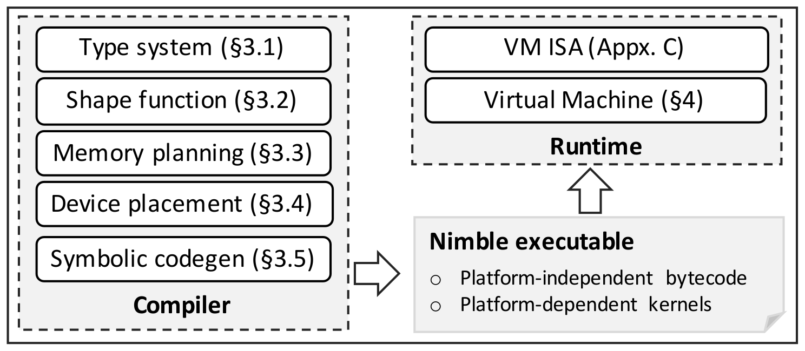
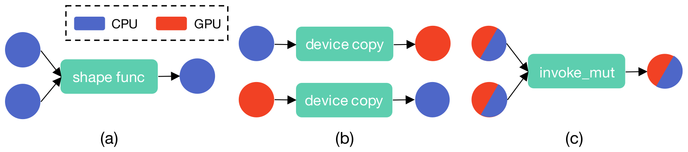
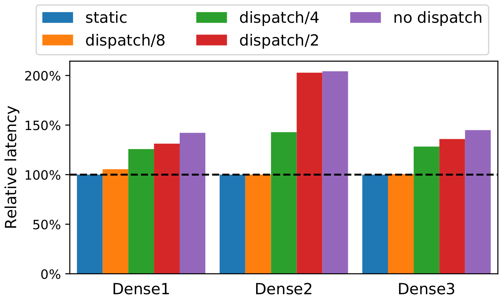

# 论文中文解读：《Nimble: Efficiently Compiling Dynamic Neural Networks for Model Inference》

> **基本信息**：Haichen Shen*、Jared Roesch*（共同第一作者）、Zhi Chen、Wei Chen、Yong Wu、Mu Li、Vin Sharma、Zachary Tatlock、Yida Wang（Amazon Web Services、OctoML、University of Washington），MLSys 2021（第 4 届 MLSys 会议，美国圣何塞），arXiv:2006.03031；论文原文 [MLSys 论文页](https://proceedings.mlsys.org/paper/2021/hash/5b47430e24a5a1f9fe21f0e8eb814131-Abstract.html) 与 [arXiv 页面](https://arxiv.org/abs/2006.03031)（arXiv 编号取自同仓库 DISC 论文的参考文献）。
>
> **本文的读法**：图为从 PDF 中按图裁出的原图，表为逐格核对后的中文转录（数字与原文一致，表头翻译为中文）。每张图后有中文图题、图中文字翻译与读图结论，因此不必再翻英文版。柱状图上读出的数值写作“约”，原文正文给出的数字优先；凡是“由表中数字算出”的倍数都注明是本文的计算。标明“说明性示例”的内容是为了讲清机制而编的，不是原文内容。

## 一、一句话结论

现代神经网络越来越多地用到控制流（如 LSTM 的循环）、动态数据结构（如树）和动态张量 shape（如变长序列），而 TVM、XLA、Glow 这类深度学习编译器当时都只能处理静态模型：每个张量的 shape、整个执行路径在编译期就已知。Nimble 在 TVM（0.6 版）之上做了一套“编译器 + 虚拟机（VM）运行时”的系统：（1）给类型系统加入 **Any 维度**，并用渐进类型（gradual typing）把无法静态证明的检查推迟到运行时；（2）给算子附加 **shape function**，运行时先算出输出 shape 再分配内存；（3）把隐式的内存分配改写成显式 IR（`alloc_storage`、`alloc_tensor`、`invoke_mut`、`kill`），支持**动态内存规划**；（4）用基于合一（unification）的分析做 **CPU/GPU 异构设备放置**；（5）**符号 shape 代码生成**：按 tile 因子的余数生成多份 kernel 并在运行时分发，用“选大值调优、再跨 shape 评估 top-k 配置”的办法让调优时间可承受；（6）一个**轻量、跨平台的 VM**，用 22 条粗粒度（CISC 风格）指令的字节码表达只能在运行时确定的路径与内存行为，性能关键的计算则交给编译出的原生 kernel。在 Intel CPU、NVIDIA GPU、ARM CPU 上测试 LSTM、Tree-LSTM、BERT，相对各自表现最好的对比系统，延迟降低 1.05 倍到 19.9 倍（摘要写“最高 20 倍”）。

## 二、背景与动机

### 2.1 动态模型是什么

原文把“静态模型”定义为：表示成静态数据流图，每个输入输出张量的大小事先已知，每次调用执行路径不变。把表现出下面三类动态性的模型称为“动态模型”：

1. **控制流（dynamic control flow）**：分支或循环走哪条路径到运行时才确定（如 LSTM 对序列循环）；
2. **动态数据结构（dynamic data structures）**：列表、树等结构随输入变化（如 Tree-LSTM）；
3. **动态张量 shape（dynamic shapes）**：如 BERT 的序列长度随输入变化。

动态模型引入了依赖输入的图拓扑，打破了现有系统的假设，使只为纯静态数据流图设计的优化失效。

### 2.2 已有方案的问题

- **基于已有深度学习框架的方案**（Cavs、JANUS、Jeong 等人的 recursion 工作、DyNet、TensorFlow Fold 等）：为训练优化的框架在推理场景里因功能繁多而显得笨重、庞大、不可移植；它们还依赖第三方内核库（OpenBLAS、cuDNN、oneDNN），这些库对每种硬件只暴露固定的算子集合，而动态模型需要大量不同数据类型与 shape 的算子，损害了可移植性。完全绕开框架另设计新接口，编程模型干净，但常因动态解释模型而损失性能（原文引用 DyNet）；
- **深度学习编译器（XLA、Glow、TVM、MLIR）**：编译与运行分离，编译阶段可以做整图优化和针对不同硬件的 kernel 代码生成，但此前主要只限于静态模型。

### 2.3 现有编译器缺了哪些动态特性

原文第 2.1 节列出四项缺失：

1. **表示动态性的 IR**：静态模型的类型与 shape 推断很直接，因为声明时已知且运行期不变；动态模型里输入张量的 shape 可能随样本剧烈变化，控制流还会使不同执行路径产生截然不同的数据；完全静态的 IR 不足以应对；
2. **面向动态的优化**：TVM、Glow 等的每个优化都要求静态输入：每个张量的内存预先分配，生命周期由专门的 pass 确定，并保证整个模型同构执行（所有 kernel 在同一设备上）。一旦出现动态性，不同执行路径可能需要不同大小的内存（运行前无法确定），这些优化可能完全失效。为支持运行时类型推断和内存分配，可能要引入一些新的 IR 节点，这些节点的操作本质上更适合 CPU，若放置不当会引起严重的性能问题；
3. **符号 kernel 代码生成器**：已有工作在静态 shape 上取得了出色的 kernel 性能，但符号 shape 下的代码生成问题没有被探索。应用同样的循环优化后，符号 shape 生成的 kernel 若循环边界没有处理好，性能仍可能很差；而且符号 shape 下的 kernel 调优搜索空间指数级增长；
4. **轻量且跨平台的运行时**：静态模型的运行时可以只是按拓扑序逐个调用算子的顺序执行器；动态模型的执行路径可能到运行时才知道，某些算子的 kernel 要依据运行时确定的数据 shape 来分发，简单的遍历图的运行时不够用。

### 2.4 Nimble 的设计目标

1. **支持动态模型**：覆盖所有类型的动态性（控制流、动态数据结构、变化的数据 shape）；
2. **可移植、轻量**：产物能在云端（高端 CPU 和 GPU）与边缘（低功耗 CPU 和 GPU）的多种平台上执行，运行时要足够轻，能在算力和内存极小的设备上运行；
3. **高性能**：在动态性存在的情况下跨平台仍有好的性能。

## 三、系统总览



*图 1（原文 Figure 1，第 3 页）：Nimble 总览。Nimble 由处理动态性的编译器和在多平台上执行动态模型的运行时两部分组成。*

**图中文字翻译与读法**：

- 左侧虚线框 **Compiler（编译器）** 里自上而下五个模块，括号内是原文章节：Type system（类型系统，§3.1）、Shape function（shape 函数，§3.2）、Memory planning（内存规划，§3.3）、Device placement（设备放置，§3.4）、Symbolic codegen（符号代码生成，§3.5）；
- 编译器经右向箭头输出 **Nimble executable（Nimble 可执行文件）**，包含两部分：Platform-independent bytecode（与平台无关的字节码）和 Platform-dependent kernels（与平台相关的 kernel）；
- 右侧虚线框 **Runtime（运行时）**：VM ISA（虚拟机指令集，见附录 C）与 Virtual Machine（虚拟机，§4），可执行文件向上箭头被它加载执行；
- **读图结论**：控制逻辑（字节码）与性能关键的 kernel 被拆开：字节码跨平台共享同一个解释器，kernel 则针对特定硬件优化。这样只需维护一份执行逻辑，而把精力放在性能关键的算子 kernel 上。

流程：Nimble 接受主流深度学习框架格式的模型，转换成统一 IR（借用 TVM 的前端转换器，原文称 TVM 的前端使得本文可以专注于 IR 扩展与优化），再优化并编译成包含平台无关字节码和平台相关 kernel 的可执行文件，最后在基于 VM 的运行时里加载执行。使用时只需喂给它一个预训练好的模型，编译，然后推理。为了在支持动态模型的同时不降低静态模型的性能，编译器里引入了下面这些分析与优化：

1. 一组 IR 扩展，用来表示动态 shape（Any）和动态分配，使动态行为也能做静态优化（§3.1）；
2. 给算子附加 shape function，在运行时算输出 shape 并做类型检查（§3.2）；
3. 内存规划优化，减少内存消耗（§3.3）；
4. 异构设备放置，把 IR 节点放在“最合适”的设备上，减少昂贵的跨设备数据传输与同步（§3.4）；
5. 能针对可能的 shape 做特化的代码生成器（§3.5）。

## 四、编译器对动态性的支持

### 4.1 类型系统：Any 维度

深度学习编译器用类型系统来表示、检查和推断张量的数据类型与 shape。有些框架和编译器把它拆成 shape 推断与数据类型推断两步；TVM 把二者同时做并统称“类型推断”（type inference），本文沿用这个说法。一个 **Tensor Type** 由 n 维 shape（整数元组）和数据类型（如 float32、int64）指定。当时的深度学习 IR 只在张量 shape 的所有维度在编译期已知时才支持代码生成，即类型推断与检查强制要求静态 shape。

为支持动态 shape，Nimble 引入一个特殊维度 **Any**，表示静态未知的维度。例如张量类型 `Tensor[(1, 10, Any), float32]`：第三维大小未知，其余两维有具体值。Any 的概念在其他框架里出现过：JANUS 用类似记号表示动态维度，但只用于类型合一；Nimble 把类型推断扩展到能处理 Any。

**算子的类型关系（type relation）**：描述算子输入类型与输出类型的关系，TVM 的类型系统依赖这些关系在整个网络里双向传播类型和 shape 信息。引入 Any 之后必须把类型关系推广来正确处理动态 shape。例如，一个让张量在每次循环迭代里增长的程序（NLP 模型解码器里常见）没有类型系统的支持就既无法确定类型也无法编译。有两种特别的动态类型关系情形：

1. 输出 shape 依赖输入**数据**的算子（如 `arange`、`unique`）用 Any 描述这些 shape（`arange` 在 (start, stop, step) 区间里生成一串值，输出大小是输入参数的函数；`unique` 选出张量的不同元素）；
2. 输入 shape 含 Any 时，类型关系需要把 Any 正确传播到输出类型，并在必要时放宽静态情形下成立的类型约束。例如两个维度之间的 broadcast 类型关系规则为：

$$
\begin{aligned}
\text{broadcast\_rel}(\text{Any},\,1) &\to \text{Any},\\
\text{broadcast\_rel}(\text{Any},\,d) &\to d\quad(d>1),\\
\text{broadcast\_rel}(\text{Any},\,\text{Any}) &\to \text{Any}.
\end{aligned}
$$

这三条的含义：与 1 广播时，结果取决于 Any 实际是多少，仍然是 Any；与大于 1 的 $d$ 广播时，只有 Any 是 1 或 $d$ 才合法，且结果都是 $d$；两个 Any 广播结果仍是 Any。

**渐进类型（gradual typing）**：由于存在动态 shape，这些类型关系规则不再能在编译期排除所有类型错误。例如上面第二条，运行时 Any 若既不是 1 也不是 $d$，就违反了 broadcast 的类型约束。为此 Nimble 采用 Siek 和 Taha 的渐进类型思路：把一部分类型检查留到运行时，在 Any 被具体值实例化之后再检查（见 §4.2 的 shape function）。原文也说，可以用更高级的类型系统消除这些错误，但会增加复杂度。

**类型推断与子 shape（sub-shaping）**：Any 维度的一个麻烦是，未知维度会在类型推断中传播，减少了 shape 特化的机会。为限制 Any 带来的精度损失，Nimble 在类型系统里引入 sub-shaping：和常见编程语言里的子类型（subtyping）类似，类型系统扩展使得具有具体维度的值是带动态维度的张量类型的合法子类型。例如 `Tensor[(128, 128), f32]` 是 `Tensor[(any, 128), f32]` 的合法子类型。此外，用程序分析检测并去掉不必要的动态性，把额外的 shape 信息传给下游编译：（1）用二次 shape 分析把误标为动态的维度恢复成静态维度；（2）在代码生成时，对等价的动态维度使用同一个变量维度。

### 4.2 Shape function：先算形状，再分配内存

Any 维度使现有深度学习编译器采用的**预分配**机制失效：现在必须在计算的同时跟踪需要分配的内存量；而且由于动态张量 shape，静态类型检查无法在编译期消除所有类型错误。因此 Nimble 为每个算子定义 **shape function**：计算输出 shape 用于存储分配，并按算子语义验证类型关系。shape function 的结构类似上节的类型关系，但出现在运行时而不是编译期，使得输出 shape 的计算可以被编译并嵌入程序。

按算子的特点，shape function 分三种模式：

| 模式 | 输出 shape 取决于 | 例子 |
|---|---|---|
| data independent（数据无关） | 只取决于输入的 shape | 普通 2D 卷积 |
| data dependent（数据相关） | 需要输入的具体**值** | `arange`：输出 shape 取决于 start、stop、step 的值 |
| upper bound（上界） | 精确算出输出 shape 的复杂度与执行算子本身相当 | 非极大值抑制（NMS） |

对第三种，为避免冗余计算，用 **upper bound shape function** 快速估计输出 shape 的上界。原文要求这类算子在返回输出值的同时返回**真实的输出 shape**，以便用真实 shape 把输出张量切成精确的输出 shape 与布局。

**算子融合要特别处理**：算子融合把基本算子合并成复合算子，减少不必要的内存拷贝并提高缓存局部性，是重要的性能优化。当所有 shape function 都是数据无关时，编译器可以直接把基本算子的 shape function 连起来，形成复合算子的 shape function。但是，**数据相关或上界 shape function 的基本算子不能与其他算子融合**（即不能把其他算子的输出作为输入融合在一起），因为这类 shape function 需要访问复合算子内部的中间结果。所以原文显式定义了融合策略来避免这种情况。

**说明性示例（非原文）**：设计算图里有 `x = relu(a)`、`y = arange(0, n, 1)`、`z = y + 1`。`relu` 的输出 shape 只取决于输入 shape（数据无关），可以与别的逐元素算子融合，融合后的 shape function 也就是各自 shape function 的连接。`arange` 的输出 shape 取决于 n 的值（数据相关），所以要先真正读到 n 的值，才能分配 `y` 的内存；它不能把前面算子的输出吞进自己里面融合，否则它的 shape function 需要读取复合算子内部的中间结果。

### 4.3 动态内存规划

许多深度学习编译器用一种静态内存规划，把内存合并成连续块并最小化分配次数；对 GPU 等设备，这些优化对减少内存碎片、保证分配不拖累 kernel 性能至关重要。已有深度学习编译器的 IR 把内存分配隐藏在函数式接口后面：每个算子隐式分配自己的输出存储。执行前，系统再对数据流图做静态内存规划，预先分配输出 buffer。这种“带外”的分配方式使得定制、修改或与其他 pass 组合内存优化很困难。例如要为异构执行调整内存分配，就需要修改运行时；TVM 的 graph runtime 就是静态内存规划的例子。由于深度学习模型的内存语义是粗粒度的，内存优化必须发生在合适的高抽象层次，不同于传统编译器；而已有工作没有给出对动态内存分配做静态优化的明确路径。

为了做原文所谓的“动态内存规划”，作者扩展了 TVM，把带隐式内存分配的 IR 变换成带显式 buffer 分配与操作的 IR。变换的关键是一次跨过程的**调用约定变更**：每个算子现在显式地接收它的输出。这让动态内存分配可以在 IR 中被跟踪和优化。为此引入四个新的 IR 构造：

- `invoke_mut(op, inputs, outputs)`：把输出当作可变的 in-out 参数；
- `alloc_storage(size, alignment, device)`：在指定设备上分配一块指定大小、对齐的内存区域；
- `alloc_tensor(storage, offset, shape, dtype, attrs)`：在某个 storage 的偏移处分配一个带 shape 与数据类型的张量；
- `kill(tensor)`：在引用计数因退出栈帧而变为零之前就释放这个张量。

**例 1：静态 shape 的广播加法**（原文 §3.3，代码为转录，注释为本文所加）。变换前：

```text
fn main() -> Tensor<10> {
  let t1, t2 : Tensor<10> = ...;
  add(t1, t2)
}
```

变换后只需要分配一个 buffer，即加法的返回 buffer：

```text
fn main() -> Tensor<10> {
  let t1 = ...; let t2 = ...;
  let buf1 = alloc_storage(40,64,cpu);          // 40 字节（10 个 float32），64 字节对齐，在 CPU 上
  let out1 = alloc_tensor(buf1,0,(10),f32);     // 在 buf1 偏移 0 处建一个形状 (10)、f32 的张量
  invoke_mut(add, (t1, t2), (out1));            // add 把结果写进显式给出的输出 out1
  out1
}
```

（原文中 `Tensor<d1, ..., dn>` 是形状为 (d1, ..., dn) 的浮点张量的简写。）变换把算子调用 `add` 换成：先从底层 storage 的偏移 0 处分配一个输出张量，再调用 `invoke_mut`。

**例 2：动态 shape 的拼接（附录 A）**。输入含动态维度的算子，需要在 kernel 调用之前插入 shape function 来算输出 shape 并据此分配内存。原文把 shape function 当作普通张量表达式统一对待，使它们也能像普通算子一样被融合和优化；一个挑战是，必须在一个不动点上显式写出内存分配，直到为计算和必要的 shape function 的输出都分配好。以一个动态拼接为例，变换前：

```text
fn (x: Tensor<?, 2>, y: Tensor<1, 2>) -> Tensor<?, 2> {
  concat((%x, %y))
}
```

变换后（`?` 即 Any，下面是原文代码转录）：

```text
fn (x: Tensor<?, 2>, y: Tensor<1, 2>) -> Tensor<?, 2> {
  let in_sh0 = shape_of(x);                          // 取 x 的 shape
  let in_sh1 = shape_of(y);                          // 取 y 的 shape
  let buf0 = alloc_storage(16, 64, ...);             // 为 shape function 的输出分配 storage
  let out_sh0 = alloc_tensor(buf0, ...);             // shape function 的输出张量
  invoke_shape_func(concat,
      (in_sh0, in_sh1), (out_sh0,), ...);            // 调用 concat 的 shape function
  let buf1 = alloc_storage(...);                     // 按 out_sh0 的结果为真正的输出分配 storage
  let out0 = alloc_tensor(
      buf1, out_sh0, ...);
  invoke_mut(concat, (x, y), (out0));                // 真正的拼接，输出写进 out0
  out_0                                              // 原文此处写作 out_0，应指 out0
}
```

要点：变换插入了对 `invoke_shape_func` 的调用来调用 kernel 的 shape function（第 7 行）；shape function 需要输入 shape 作参数，所以要先对 `x` 和 `y` 调用 `shape_of`（第 3 到 4 行），`shape_of` 被直接映射到一条 VM 指令，在运行时取张量的 shape；变换还为 shape function 的输出多插入了一次 storage 与张量分配（第 5 到 6 行）。（`alloc_storage(16, ...)` 中的 16 字节，按两个 int64 元素的 shape 张量（2 维 shape）推算，这是本文的推断。）

**这样做的好处**：关键思想是把“内存分配”的概念内化进 IR，使得在存在控制流和动态 shape 的情况下，对**静态和动态分配都**能做静态优化。所有分配在 IR 里显式之后，就能为动态程序提供与静态情形类似的优化：例如作者实现了一个 **storage 合并（storage coalescing）** pass，把 storage 归并成更大的区域，使多个张量分配可以复用同一块 storage；还可以对程序做活跃性分析（liveness analysis）和图着色算法来复用 storage。

### 4.4 异构设备放置

如 §4.2 所述，shape function 在运行时执行来计算算子的输出 shape。它们应该在 **CPU** 上执行，因为它们的输出被用来计算要分配的内存大小。在异构执行（CPU 与 GPU）时，把 IR 节点放到合适的设备上至关重要；否则，如果 shape function 和 kernel 的输入要从 GPU 拷出来或拷进去，就会产生可观的数据传输与设备同步开销。为了最小化性能损失，作者分析程序，把子表达式放到最合适的设备上。

**基于合一的设备分析**：它基于对计算 kernel 的先前调度，计算正确的设备放置与分配，目标是给每个 IR 节点合适地指派设备，**最小化跨设备拷贝的次数**。关键概念：

- **DeviceDomain**：表示一个设备的域，含源和目的。IR 里每个表达式默认属于空域，即对设备放置没有约束；
- **device_copy**：新的 IR 构造，表示不同设备之间的数据传输，在必须做跨设备拷贝时插入；
- 把分析表述成一组**设备放置规则**，描述设备约束如何流动，再用合一（unification，类型推断和编译器里常用的技术）算出精确的设备放置。



*图 2（原文 Figure 2，第 6 页）：几条异构设备放置规则。（a）shape function 的输入和输出都放在 CPU 上。（b）device_copy 相应地改变输出所在的设备。（c）invoke_mut 的所有参数的设备必须相同。*

**图中文字翻译与读法**：

- 图例：蓝色表示 CPU，红色表示 GPU；绿色圆角框是 IR 算子；
- **(a)**：两个蓝色（CPU）输入圆圈经 `shape func` 得到蓝色（CPU）输出圆圈：shape function 的输入与输出都在 CPU；
- **(b)**：上行：蓝（CPU）经 `device copy` 变成红（GPU）；下行：红（GPU）经 `device copy` 变成蓝（CPU）：输出的设备是拷贝的目的设备；
- **(c)**：两个半红半蓝的输入圆圈进入 `invoke_mut`，输出也是半红半蓝的圆圈：半红半蓝表示“具体放在 CPU 还是 GPU 尚未确定，但这些参数必须是同一个设备”（本文对图的解读）；
- **读图结论**：这三条规则分别固定了 shape function 的设备、跨设备拷贝的设备变化、以及 kernel 调用要求同设备，其他节点的设备再由合一传播出来。

原文附录 B 给出全部规则：

- `shape_of`：默认放在 CPU 域，因为不论张量放在哪个设备上都能访问它的 shape；
- shape function：以一个或多个 `shape_of` 的输出为输入，按预先定义的类型推断规则推出算子的 shape；其输出用来计算该算子运行时需要的内存量，只需几次便宜的标量算术，所以输入输出也最好放在 CPU 域；
- `device_copy`：输入和输出处于不同的域（把数据从一个域拷到另一个域）；输入输出的设备域会被沿相反方向传播给能到达/来自该 `device_copy` 节点的其他 IR 节点；
- 内存操作：`alloc_storage` 的 storage 的设备域在表达式里指定，之后通过 `alloc_tensor` 传播到由这块 storage 分配出的张量的设备域；
- `invoke_mut`：其所有参数必须具有相同的设备域；
- 其他常见 IR 节点（变量、常量、算子等）：设备域可以直接从上述节点传播而来。

**合一算法**：用并查集（union-find）数据结构双向传播并合一各个 IR 节点的设备放置，引入两个操作：`union(s, t)` 在设备类型匹配时，把 s 和 t 的等价设备域合并成一个等价域；`find(s)` 返回 s 所属设备域的代表。这两个操作反复应用，直到所有 IR 节点都被标注。若某个设备域**没有任何约束**，就把编译目标（即 GPU）分配给它，以获得更好的 kernel 性能。异构设备放置的结果与内存规划、shape function 插入组合，得到正确放置的分配。

### 4.5 符号 shape 代码生成

深度学习编译器（TVM、Halide）已被证明在多个平台上能达到与手工调优 kernel 相当的性能；近期趋势是用基于机器学习的搜索进一步减少或消除复杂的人工性能调优，方法有基于模板（template）的与基于搜索的两类。然而已有的、聚焦于静态 shape 调优的工作，在符号（动态）shape 下不够用。符号 shape 代码生成有两个固有挑战：

1. 在使用同一个 schedule 时，如何让符号 shape 生成的 kernel 达到与静态 shape 生成的 kernel 同样的性能？
2. 如何把基于机器学习的方法扩展到调优符号 shape 的 kernel？

**挑战 1：循环边界条件与“按余数多版本”**。循环并行（loop parallelism）与循环分块（loop tiling）是常见的优化技术：它们利用多核能力，实现 CPU/GPU 上感知存储层次的数据访问模式。但二者结合会导致复杂的循环边界条件。静态 shape 时可以证明这些条件总成立，从而消除妨碍进一步优化（如循环展开）的检查；符号 shape 下就困难得多，处理不当，边界条件检查会保留下来，导致性能很差。

Nimble 的做法：根据符号维度对 tile 因子取余的结果生成多份 kernel，并在运行时依据实际 shape 分发。例如一个符号维度 $x$ 以因子 8 分块，就把生成的 kernel 复制 8 份，在每份里把符号变量 $x$ 替换成 $8k+r$，其中 $k=\lfloor x/8\rfloor$，$r\in[0..7]$。配合一个增强的符号表达式化简 pass，可以消除绝大多数边界检查，使性能与单一静态 shape 编译的 kernel 几乎一样。最后自动生成一个**分发函数**，按余数调用对应的 kernel；分发函数还可以扩展成调用编译器生成的 kernel 或第三方库（按 profiling 结果取更快者）。增加的 kernel 体积相对整个深度学习模型很小；在资源极其有限时，可以生成少于 tile 因子个数的 kernel，或者减小 tile 因子，在代码体积和性能之间折中。

**说明性示例（非原文）**：设符号维度 $x=21$、tile 因子为 8，则 $k=2$、$r=5$：分发函数调用“余数为 5”的那份 kernel，这份 kernel 的循环里 $x=8k+5$，编译器能证明 $r=5$ 时尾块恰好有 5 个元素，因此不必在每次迭代里检查是否越界。若 $x=24$，则 $r=0$，调用“余数为 0”的版本，没有尾块。

**挑战 2：符号 shape 的调优**。基于机器学习的调优的一个已知问题是为单个 kernel 找到最佳 schedule 通常要花数小时；对符号 shape，如果朴素地为每个可能的 shape 都调优，调优时间可能呈指数级增长。本文把基于模板的调优方法扩展到符号 shape，使调优时间可控。基于模板的调优接受人工定义的代码模板和搜索空间，用机器学习算法在搜索空间里找最佳配置。作者观察到：**对一个 shape 好的配置通常对其他 shape 也好**。基于此：

1. 先把符号维度换成一个足够大的值（如 64），使搜索空间覆盖绝大多数可能性，在这个静态 shape 上跑足够多轮调优；
2. 选出 top-$k$ 个配置，把它们应用到另一批 shape 上，评估性能；
3. 选出在先前评估过的各 shape 上平均表现最好的配置。

经验上 $k=100$ 能覆盖其他 shape 的大多数最佳配置。当前流行的动态模型通常只要求 kernel 有**一个**符号变量，因此在对其他 shape 做交叉评估时，原文选取不超过 256 的 2 的幂作为取值；若有多个符号变量，可能需要更复杂的选择方法来限制第 2 步的评估时间，留作未来工作。另外，如果工作负载分布已知，可以在第 3 步里调整已知 shape 的权重。

## 五、虚拟机（VM）运行时

静态模型的传统运行时（逐个算子按拓扑序执行）不能用来执行动态模型编译出的模块：需要更聪明、更强的执行引擎来处理控制流的执行逻辑，并相应分发不同的 kernel。为了实现这些目标并能移植到不同平台，作者设计并实现了基于虚拟机的运行时。

**可执行文件**：Nimble 把动态模型编译成一个 VM 可执行文件，里面有平台无关的**字节码**和平台相关的 **kernel 代码**。字节码是一系列指令，规定 kernel 的调用顺序和控制流执行逻辑。这个设计补足了传统运行时的能力：传统运行时擅长执行高度优化的 kernel，却不能直接处理 kernel 之间的编排。

**指令集设计（ISA）**：指令集的设计出自一个简单观察：**kernel 执行主导了神经网络的执行时间**。这和传统语言虚拟机很不同：后者有许多只做很少工作的指令，使每条被执行的指令的开销都很要紧。Nimble 的 ISA 由 **CISC 风格**的指令组成：每条指令对应一个关于张量的原始 IR 表达式（如分配、kernel 调用），而它本身可能对应执行多个“低层”操作。例如 `LoadConst idx, $reg` 有多种寻址模式：先读索引 `idx`，再从常量池把数据加载到目的寄存器 `$reg`。完整的指令集在附录 C。

- 采用**基于寄存器**的虚拟机设计，字节码紧凑，易于用户阅读与修改；提供“无限多个虚拟寄存器”的抽象，大大简化优化与分配（类似 SSA），也降低快速原型与修改的概念障碍；
- 指令用传统的**带标签联合体**表示，包含操作码（op-code）与数据载荷（payload），便于高效序列化、解码与分发；由于指令里有 shape 等**可变大小的操作数**，所以采用变长指令格式；
- 解释器：加载可执行文件后，创建解释器，执行**分发循环**：检查操作码，执行相应逻辑，然后重复。由于指令是粗粒度的（可看作“超指令”），分发循环产生的分支数比传统编程语言 VM 少，与提前编译（AOT）相比开销可以忽略。

**讨论**：一种替代方案是用提前编译（AOT）消除分发开销。但由于操作的粒度，分发时间在执行中只占很小一部分；更重要的是，VM 提供了传统上归于虚拟机的灵活性，以及清晰的编译器/运行时分工。作者看到把 VM 作为运行时模块集成进更大系统的潜力：例如 VM 可以为云上共享同一硬件的多个推理实例提供资源隔离；感知 QoS 的系统可以利用 VM 挂起当前模型的执行，转去执行更高优先级或有时间要求的模型；由于 VM 设计简单，还可以为安全和隐私目的验证 VM 的实现。（注意：DISC 论文反过来认为 VM 解释带来开销并选择编译生成运行时流程，见 [DISC 的中文解读](../disc_dynamic_shape/论文中文解读.md)。）

**附录 C：指令集**。原文说当前指令集只含 22 条用于动态模型推理的指令，大大减少了分发开销，也简化了字节码的序列化与反序列化。表 C.1 给出每条指令的操作码与功能：

**表 C.1：Nimble 指令集的操作码与说明**

| 指令 | 说明 |
|---|---|
| `Move` | 把数据从一个寄存器移到另一个寄存器 |
| `Ret` | 把结果寄存器里的对象返回给调用者的寄存器 |
| `If` | 依据条件跳转到“真”或“假”偏移 |
| `Goto` | 无条件跳转到某个偏移 |
| `LoadConst` | 从常量池按索引加载一个常量 |
| `LoadConsti` | 加载一个常量立即数 |
| `AllocStorage` | 在指定设备上分配一块 storage |
| `AllocTensor` | 从 storage 中分配一个静态 shape 的张量对象 |
| `AllocTensorReg` | 按寄存器里给定的 shape 分配一个张量对象 |
| `AllocADT` | 用寄存器里的各项分配一个（代数）数据类型对象 |
| `AllocClosure` | 用一个已降低的虚拟机函数分配闭包 |
| `FreeStorage` | 把已分配的内存释放回内存管理器 |
| `FreeTensor` | 把张量占用的内存释放回 storage 对象 |
| `Invoke` | 调用一个函数 |
| `InvokeClosure` | 调用一个闭包 |
| `InvokePacked` | 调用一个已优化的算子 kernel |
| `GetField` | 取 VM 对象在某个索引处的值 |
| `GetTag` | 取代数数据类型（ADT）构造子的标签 |
| `DeviceCopy` | 把一块数据从一个设备拷到另一个设备 |
| `ShapeOf` | 取张量的 shape |
| `ReshapeTensor` | 给张量指定新 shape 而不改变其数据 |
| `Fatal` | 在 VM 里抛出致命错误 |

（原文表 C.1，附录第 15 页；共 22 行。）原文把它们分为五类：

- **寄存器间操作**：如 `Move`，在寄存器文件的不同偏移之间传数据。对象有引用计数、使用写时复制（copy-on-write）、按引用传递，所以即使底层容器很大寄存器操作也很便宜；
- **内存操作**：为张量分配空间、加载常量张量等。由于常量池的设计，推理期间保持不变的权重可以留在内存里，不需要专门支持，用 `LoadConst` 引用即可；`FreeStorage`、`FreeTensor` 在引用计数变零之前就释放内存；
- **调用操作**：是执行最频繁的指令。ISA 为调用全局函数、kernel 原语和闭包各有专门的调用指令。`InvokePacked` 是对性能最关键的一条：负责调用由底层深度学习编译器或第三方库优化过的算子 kernel；kernel 原语是提前编译的，可以通过 §4.5 的分发函数利用编译器生成的 kernel 和第三方库。`Invoke` 与 `InvokeClosure` 则调用 VM 的全局函数，其中闭包对象携带捕获的寄存器；
- **控制流操作**：`Goto`、`Ret` 这类无条件跳转静态与动态模型都用；只有动态模型需要条件控制操作（如 `If`）来决定分支方向：解释器按条件值更新 PC（程序计数器）到真分支或假分支的偏移；
- **其他操作**：为方便编译器优化（如内存规划与设备放置）与代码生成，VM 原生支持 `ShapeOf`、`DeviceCopy`、`ReshapeTensor`，直接操作运行时数据（取 shape、跨设备搬数据、改 shape）。有了它们，前端可以保留更粗粒度的 IR，使优化更简单。

## 六、实验

### 6.1 设置

所有实验都在 Amazon EC2 实例上完成，评估三种硬件平台：

| 简称 | 实例与配置 |
|---|---|
| Intel CPU | Intel Skylake CPU（c5.9xlarge，18 个物理核） |
| Nvidia GPU | NVIDIA Tesla T4 GPU（g4dn.4xlarge，1 块卡，2,560 个 CUDA 核） |
| ARM CPU | ARM Cortex A72（a1.4xlarge，16 个物理核） |

所有测试在云上完成，但因架构相同，ARM CPU 的结果可移植到树莓派（Raspberry Pi）这类边缘设备。

**对比系统**：主流深度学习框架 TensorFlow（v1.15）、MXNet（v1.6）、PyTorch（v1.5，ARM 上用 v1.4，因为 v1.5 在该 ARM 实例上构建失败）、DyNet（v2.1），以及动态模型专用系统 TensorFlow Fold（基于 TensorFlow v1.0）。Cavs、JANUS 和 Jeong 等人的工作没有开源，无法比较；当时没有公开的深度学习编译器声称支持动态模型。

**模型**（各代表一类动态性）：LSTM（动态控制流）、Tree-LSTM（动态数据结构）、BERT（动态数据 shape）。LSTM 与 Tree-LSTM 的输入大小/隐藏大小分别为 300/512 和 300/150；BERT 用 BERT base 实现。LSTM 和 BERT 用 Microsoft Research Paraphrase Corpus（MRPC）里长度可变的输入做数据集；Tree-LSTM 用 Stanford Sentiment Treebank（SST）里不同树结构的输入。

**哪些基线能跑什么**：Nimble 在所有平台上都完成了所有模型的推理，但并非所有基线都能：Tree-LSTM 只能在 PyTorch、DyNet 与 TensorFlow Fold 上跑，其他框架不能处理动态数据结构；TensorFlow Fold 不是为处理 BERT 设计的，所以没有结果；没有找到 DyNet 上的 BERT 实现；Tree-LSTM 在 Nvidia GPU 上的推理被省略，因为过多的控制流和过小的 kernel 使 GPU 难以被用满，GPU 不是它的合适部署目标。基线系统都借助第三方 kernel 库，利用手工优化的算子取得高性能，但当某算子在特定目标上不被支持时就受限；Nimble 可以在“自己编译的 kernel”和“第三方库提供的 kernel”之间选更快的，并通过平台无关字节码里的动态分发逻辑在运行时调用所选 kernel。

### 6.2 LSTM（表 1）

**表 1：LSTM 模型推理延迟**（单位：µs/token，越小越好；Nimble 与 PyTorch（PT）、DyNet（DY）、MXNet（MX）、TensorFlow（TF）在 Intel CPU、Nvidia（NV）GPU、ARM CPU 上的比较；1 layer / 2 layers 是 LSTM 层数）

| 系统 | 1 层 Intel | 1 层 NV | 1 层 ARM | 2 层 Intel | 2 层 NV | 2 层 ARM |
|---|---|---|---|---|---|---|
| Nimble | **47.8** | **54.6** | **182.2** | **97.2** | **107.4** | **686.4** |
| PT | 103.6 | 80.6 | 2735.9 | 224.0 | 158.1 | 5862.2 |
| DY | 936.4 | 68.8 | 5701.6 | 2350.8 | 140.7 | 12811.3 |
| MX | 212.9 | 135.7 | 3695.9 | 401.7 | 223.8 | 7768.0 |
| TF | 301.4 | 304.7 | 978.3 | 687.3 | 406.9 | 2192.8 |

（原文表 1，第 9 页。）读法与原文结论：

- 原文说所有系统里的 LSTM 都用 for 循环控制流实现以保证公平。Nimble 在 1 层和 2 层上都稳定地快于基线，比最好的替代方案在 Intel CPU、Nvidia GPU、ARM CPU 上分别快 2.2 倍、1.3 倍、3.2 倍（原文数字）。本文由表中数字计算：1 层的最佳替代分别为 PT（Intel）、DY（NV）、TF（ARM），比值约 2.17、1.26、5.37；2 层约 2.30、1.31、3.19。可见原文的三个倍数并不对应同一个配置（Intel 的 2.2 接近 1 层，ARM 的 3.2 对应 2 层），读者引用时应按表重新计算；
- PyTorch 还有另一种 LSTM 实现：沿序列长度展开 LSTM cell，并对输入的矩阵乘做动态批处理；原文说这种优化与控制流处理正交，可以在 Nimble 里实现；
- DyNet 在 CPU 上显著慢，因为它只用一个核；
- 在 Nimble 上，Nvidia GPU 的延迟高于 Intel CPU（如 1 层 54.6 对 47.8），因为 LSTM 模型相对较小，无法充分利用 GPU 的大规模并行性；
- Nimble 的显著收益来自两方面：（a）利用深度学习编译器做更好的 kernel 融合与实现；（b）把控制流编码成平台无关指令，开销极小。

### 6.3 Tree-LSTM（表 2）

**表 2：Tree-LSTM 模型推理延迟**（单位：µs/token，越小越好；“–”表示没有结果，TensorFlow Fold 在 ARM CPU 上没能成功构建）

| 系统 | Intel | ARM |
|---|---|---|
| Nimble | **40.3** | **86.3** |
| PyTorch | 701.6 | 1717.1 |
| DyNet | 98.2 | 312.9 |
| TF Fold | 209.9 | – |

（原文表 2，第 9 页。）读法与原文结论：Nimble 显著快于基线。对 PyTorch，原文给出 Intel CPU 上 17.4 倍、ARM CPU 上 19.8 倍（因为 PyTorch 用 Python 处理树数据结构）；本文由表中数字计算 701.6 / 40.3 ≈ 17.4，1717.1 / 86.3 ≈ 19.9（原文引言写“最高 19.9 倍”，与正文的 19.8 倍略有出入）。DyNet 比 PyTorch 好得多，因为它在 C++ 里小心处理控制流执行，但 Nimble 仍然胜出，因为 DyNet 没有为 CPU 优化计算 kernel（本文计算：Intel 约 2.4 倍，ARM 约 3.6 倍）。TensorFlow Fold 比 Nimble 在 Intel CPU 上慢 5.2 倍，因为它每遇到一个输入都要重新编译。

### 6.4 BERT（表 3）

**表 3：BERT 模型推理延迟**（单位：µs/token，越小越好）

| 系统 | Intel | Nvidia | ARM |
|---|---|---|---|
| Nimble | **307.0** | **95.2** | **2862.6** |
| PyTorch | 479.5 | 220.4 | 11851.2 |
| MXNet | 455.8 | 152.9 | 8628.0 |
| TensorFlow | 768.7 | 125.2 | 2995.4 |

（原文表 3，第 9 页。）读法与原文结论：Nimble 在所有平台上都胜过所有基线。相对最佳替代方案，延迟降低在 Intel CPU、Nvidia GPU、ARM CPU 上分别为 1.5 倍、1.3 倍、1.05 倍（本文由表计算：455.8 / 307.0 ≈ 1.48，125.2 / 95.2 ≈ 1.31，2995.4 / 2862.6 ≈ 1.05，与原文一致）。原因有二：（a）与各框架类似，Nimble 也能使用调优过的第三方库：Intel CPU 上的 MKL 与 Nvidia GPU 上的 cuDNN；（b）Nimble 能利用深度学习编译器带来的更彻底的算子融合。

**总体结论**（原文）：Nimble 为各类动态模型在不同平台上给出更**可移植**的性能；相反，框架的性能更依赖平台，也因模型而异（例如本文表 3 里 TensorFlow 在 ARM 上接近 Nimble，而 PyTorch、MXNet 在 ARM 上慢 3 到 4 倍）。摘要的“最高 20 倍”只对应某一个模型、平台与基线的组合：本文由表 2 算得 Tree-LSTM、ARM CPU、对 PyTorch 的 1717.1 / 86.3 ≈ 19.9 倍，但这既不是对该设置下最好基线（DyNet，312.9，约 3.6 倍）的倍数，也不是表 1 到表 3 里所有“基线延迟 / Nimble 延迟”中最大的（例如 LSTM 1 层 ARM 上对 DyNet 为 5701.6 / 182.2 ≈ 31 倍）。因此引言里“相对最好的方案降低 1.05 倍到 19.9 倍”的说法是松散的概括，不能当作统一的加速比。

### 6.5 微基准：VM 的开销、内存规划与符号代码生成

以 BERT 为微基准，分三项研究：（a）VM 带来的开销；（b）内存规划 pass 的好处；（c）符号代码生成与静态代码生成的性能差异。原文说其他模型的观察类似。

**(a) 处理动态性的开销（表 4）**：与 TVM 比较，后者用静态序列长度和 TVM 静态运行时执行 BERT。

**表 4：用 TVM 和 Nimble 在不同硬件上的 BERT 延迟（序列长度 128）**（单位：毫秒；“kernel 延迟”是 Nimble 中 kernel 执行的时间，“其他”是其他指令引入的额外延迟）

| 设备 | TVM 延迟（ms） | Nimble 延迟（ms） | kernel 延迟（ms） | 其他（ms） |
|---|---|---|---|---|
| Intel | 19.38 | 24.32 | 21.06 | 3.26 |
| ARM | 223.50 | 237.41 | 228.59 | 8.82 |
| Nvidia | 5.58 | 5.86 | 5.60 | 0.26 |

（原文表 4，第 9 页。）读法：每一行里“kernel 延迟 + 其他 = Nimble 延迟”（如 Intel：21.06 + 3.26 = 24.32）。原文结论：在静态 shape 下 TVM 比 Nimble 快 5% 到 25%，但绝对延迟差别很小（本文由表计算 Nimble / TVM：Intel 约 1.25，ARM 约 1.06，Nvidia 约 1.05，所以“5% 到 25%”覆盖的是三个平台，不只是 CPU）。开销来自两方面：（a）用符号 shape 生成的 kernel 在索引计算上有额外开销；（b）VM 里为处理动态执行所需的其他指令，如 shape function、动态内存分配、指令分发等。在 Nvidia GPU 上，得益于异构设备放置（§4.4），大部分字节码的延迟与 GPU 执行重叠，所以其他指令的开销可以忽略（表中为 0.26 ms）。

**(b) 内存规划**：§4.3 的内存规划把内存分配合并在一起并复用已分配的内存块。这个 pass 把 buffer 分配次数减少了 **47%**，在 Intel CPU 上内存分配延迟降低了 **75%**。作者还在流行的计算机视觉模型（ResNet、MobileNet、VGG、SqueezeNet）上，把带内存规划的 Nimble 的内存用量与 TVM（静态分析并预分配内存）比较，结果 Nimble **最多多用 8%** 的内存 footprint。

**(c) 符号代码生成（图 3）**：从 BERT 里选 3 个 dense 层，在 ARM CPU 上比较符号代码生成与静态代码生成的性能。符号代码生成时编译期把序列长度设为 Any，运行时用序列长度 128 评估；静态代码生成则在编译期直接把序列长度设为 128。自动调优算法在三个 kernel 里都把符号轴按 8 分块。作者把符号代码生成时生成的、用于运行时分发的 kernel 数从 8（完全分发）变到 1（不分发），如 §4.5 所述。



*图 3（原文 Figure 3，第 10 页）：在 ARM CPU 上，用符号代码生成和静态代码生成的 3 个 dense 算子的相对延迟。以静态 shape kernel 的延迟为基线。“dispatch/k”表示生成 k 个符号 kernel 供运行时分发；“no dispatch”表示只生成一个符号 kernel，因此不需要分发。*

**图中文字翻译与读法**：

- 横轴是三个 dense 算子 Dense1、Dense2、Dense3；纵轴 Relative latency（相对延迟，0% 到 200% 以上，越低越好），黑色虚线是 100%（静态基线）；每个算子五根柱子，从左到右：static（静态，蓝）、dispatch/8（橙）、dispatch/4（绿）、dispatch/2（红）、no dispatch（紫）；
- 读图近似值（相对延迟，约）：Dense1：100%、105%、126%、131%、142%；Dense2：100%、100%、143%、203%、204%；Dense3：100%、100%、128%、136%、144%（从柱高读出，约 ±2 个百分点）；
- 原文结论：完全分发（dispatch/8）的符号代码生成可以达到与静态代码生成几乎相同的性能，而减少 kernel 个数会损害性能；在不同 shape 的 dense 算子、其他算子以及其他平台上也能看到类似趋势；
- **读图结论**：按余数多版本生成 kernel 是符号 shape 下接近静态性能的关键；不分发（只生成一个通用符号 kernel）比静态 kernel 慢约 42% 到 104%（Dense2 最明显，约 2 倍），证明“一个完全通用的 kernel”并非免费。代价是 kernel 体积（8 个版本）与分发表。

## 七、相关工作（原文第 6 节）

- **深度学习框架**：有的框架通过在图表示里加入原语支持动态控制流，如 TensorFlow 的 switch 与 merge，MXNet 的 foreach、cond、while_loop。控制流的间接编码需要专门的数据流运行时来处理 switch 之类的操作，或把控制面和数据面的执行分开的混合运行时，二者都对框架代码库侵入很大。TensorFlow Fold 分析用户提供的计算图找出可批处理的动态操作，再生成批处理后的 TensorFlow 图（带 shape 特化的子图），虽然可能提速，但每条路径都作为单独的子计算图执行，开销大，也限制进一步优化。Jeong 等人以及 JANUS 也扩展 TensorFlow，是框架特定的，与本文的编译技术无直接关系；推测执行与本文技术互补。DyNet 和 PyTorch 用宿主语言（Python）的特性动态展开控制流，产生动态模型的静态 trace：编程模型灵活友好，代价是失去提前优化，且每个 trace 都要建一张数据流图，给控制流构造带来开销并限制整程序优化。JAX 也支持受限形式的动态网络，但优化从根本上受限于底层的 XLA（如 JIT 模式下不支持依赖值的动态控制流）。Nimble 让动态行为的使用代价更低，且不损害静态子集的性能；
- 框架依赖第三方库实现不同数据 shape 的算子，只有对应高性能库支持该操作，才能在特定硬件上让动态 shape 模型有好性能；因此框架以及由它们衍生的动态模型运行时通常在二线支持设备（如 ARM CPU）以及流行基准里没有的算子/shape 组合上表现很差；Nimble 可以在所有平台上工作，按需为新 shape 与新设备生成高性能代码（§4.5）；
- **深度学习编译器**：XLA、TVM、Glow 能把模型编译到多种硬件上加速，但为动态神经网络优化编译的工作很少。MLIR 是有前途的方向，它的 IR 支持动态 shape，但当时没有报告过动态优化或端到端性能。Nimble 的编译与 VM 设计很大程度上受 LLVM、GCC、JVM 等生产级编译器与虚拟机处理控制流和变长输入数组等动态行为的通用方案的启发。

## 八、局限、证据边界与常见误读

### 8.1 局限与证据边界

- 目标是**已训练模型的推理**，不是任意 Python 训练程序的捕获；原文把“动态模型推理的高性能训练”和“新兴 AI 加速器上的动态模型推理”列为未来工作；
- 基于 **TVM 0.6**、2020 年前后的框架版本（TensorFlow 1.15、PyTorch 1.5 等）与当时的硬件，数字不能直接外推到今天；
- VM 带来指令分发与 shape function 开销：BERT 上相对静态 TVM 慢 5% 到 25%（表 4）；符号 kernel 通常不及精确的静态 shape kernel，多版本分发用代码体积换性能；
- 符号调优的“跨 shape 评估”假设 kernel 只有**一个**符号变量；多个符号变量需要更复杂的选择方法（未来工作）；
- 所有对比使用原文自己的测量，原文没有给出重复测量次数和方差，也没有说明 LSTM/BERT 的序列长度分布；
- 内存规划：相对 TVM 静态规划，最多多 8% 的 footprint（视觉模型上的比较）；
- 原文自身的小出入：Tree-LSTM 对 PyTorch 在 ARM 上的倍数，正文写 19.8 倍，由表 2 算得 19.9 倍，引言也写 19.9 倍；引言说“相对最好的方案降低 1.05 倍到 19.9 倍”，但 19.9 倍其实是对 PyTorch（并非该设置下最好的基线）的倍数。

### 8.2 常见误读

- **“支持 dynamic shape 就不再需要多个版本”**：通用图可以覆盖多个 shape，但 kernel 层面 Nimble 仍然按 tile 余数多版本化，并在运行时分发（图 3）；
- **“Any 越多越灵活，所以越好”**：Any 会丢失优化信息，Nimble 为此用 sub-shaping 与二次 shape 分析把误标为动态的维度还原为静态；
- **“shape function 都很轻”**：数据相关的输出 shape（如 `arange`）需要读到具体的值，上界模式的算子则要精确 shape 与执行算子一样贵，所以才有三种模式与专门的融合限制；
- **“摘要的 20 倍是统一加速比”**：它对应的是 Tree-LSTM、ARM CPU、对 PyTorch 的 19.9 倍；对同一设置下最好的基线 DyNet 只有约 3.6 倍，BERT 在 ARM 上对最好的基线只有 1.05 倍；
- **“Nimble 与 TVM 静态编译一样快”**：BERT 上 Nimble 比静态 TVM 慢 5% 到 25%（表 4），这是动态性的固定税。

## 九、复现检查清单

- 软件栈：Apache TVM 0.6 上实现；对比用 TensorFlow v1.15、MXNet v1.6、PyTorch v1.5（ARM 上 v1.4）、DyNet v2.1、TensorFlow Fold（基于 TensorFlow v1.0）；
- 硬件：c5.9xlarge（Intel Skylake，18 个物理核）、g4dn.4xlarge（1 块 Tesla T4，2,560 个 CUDA 核）、a1.4xlarge（ARM Cortex A72，16 个物理核）；
- 模型与数据：LSTM（输入/隐藏 300/512，1 层与 2 层）、Tree-LSTM（300/150）、BERT base；LSTM 与 BERT 用 MRPC，Tree-LSTM 用 SST；所有 LSTM 都用 for 循环实现；
- 指标：µs/token（表 1 到表 3）；表 4 是毫秒，序列长度 128；
- 微基准：BERT 的 3 个 dense 层，ARM CPU，序列长度 128，符号轴按 8 分块，分发 kernel 数 8/4/2/1（图 3）；
- 符号调优参数：选 64 为替代值，top-$k$ 取 $k=100$，评估 shape 取不超过 256 的 2 的幂；
- 注意基线里并非所有系统都能跑所有模型（表 2 的 TF Fold 在 ARM 上缺失；Tree-LSTM 不测 GPU）。

## 十、与相关论文的关系

- **DISC**（[中文解读](../disc_dynamic_shape/论文中文解读.md)）：同期工作，目标相近；Nimble 用 VM 在运行时解释动态 shape 处理流程，DISC 则在编译期把 shape 计算、buffer 管理、kernel 启动等运行时流程都生成成代码。DISC 的评估里与 Nimble 做了对比（Transformer 上端到端 105.28 ms 对 188.5 ms），但 DISC 论文说明因没找到 Nimble 计算密集算子 schedule 的开源实现，对比里 Nimble 的计算密集算子用的是 cuDNN/cuBLAS，不能当作与官方实现的同配置对比；
- **TVM**（[中文解读](../tvm_compiler/论文中文解读.md)）：Nimble 实现于 TVM 之上，复用其前端转换器与类型推断（Relay 的类型关系）；
- **Ansor**（[中文解读](../ansor/论文中文解读.md)）：原文把基于搜索的调优（Ansor 等）与基于模板的调优（本文所扩展）并列；Nimble 的符号调优扩展的是模板式调优；
- **XLA**（[中文解读](../xla_compiler/论文中文解读.md)）：XLA 是静态 shape 编译器，原文把它列为不能处理动态模型的深度学习编译器之一。

## 原文证据导航

- [原论文 PDF](paper.pdf)
- [原文提取文本](paper.txt)
- [论文概要](论文概要.md)
