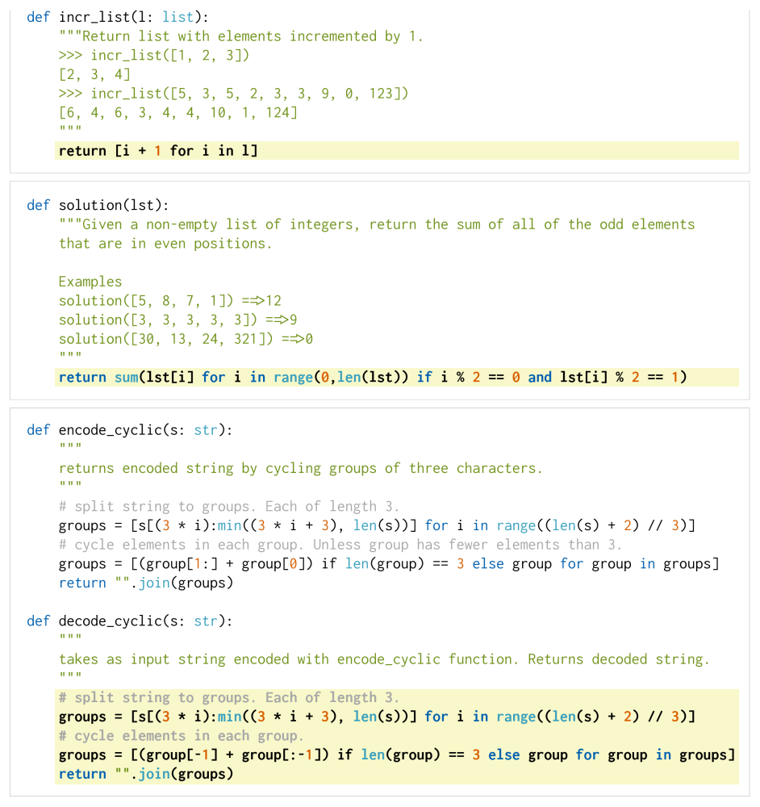
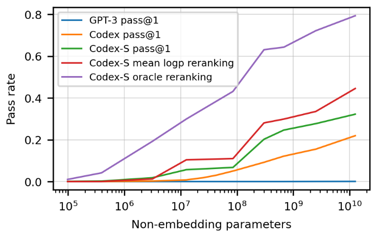
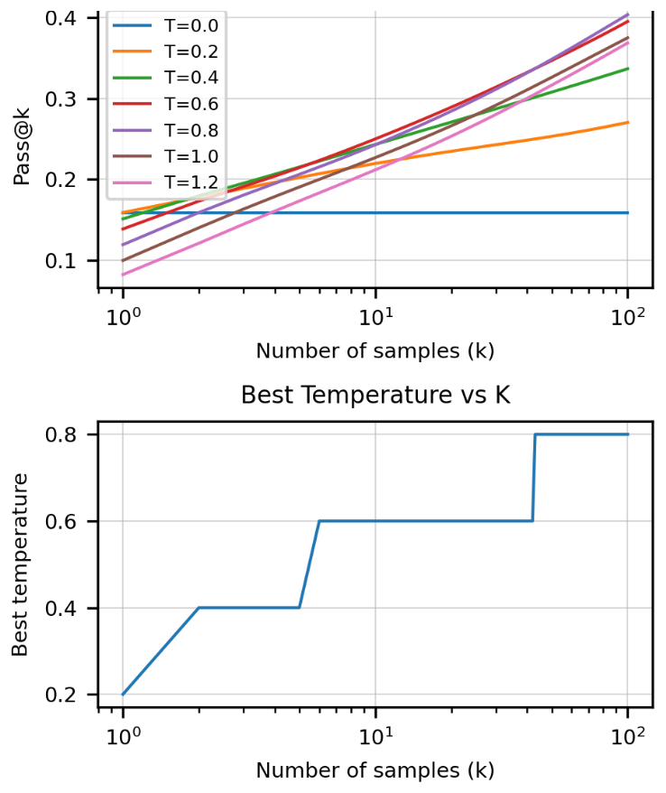
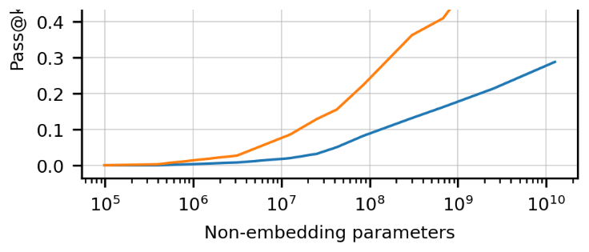
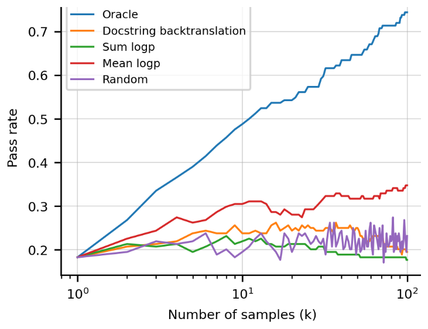
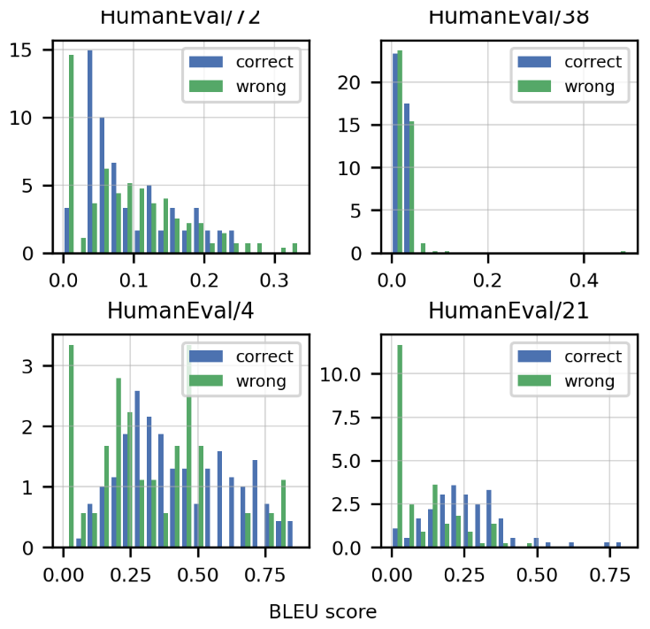
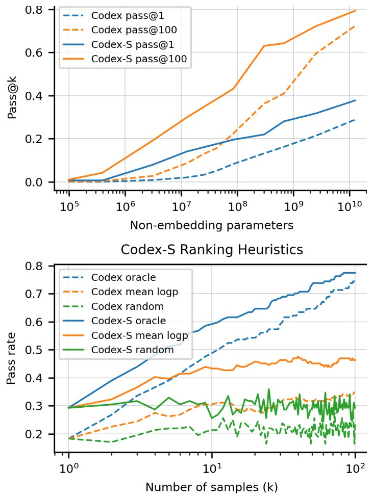
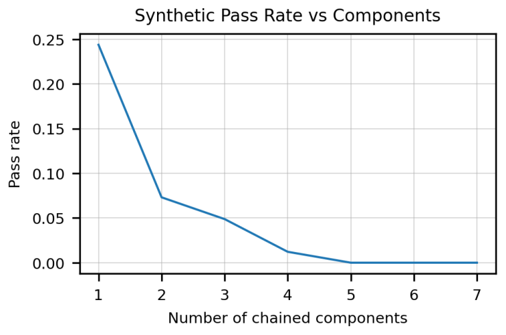
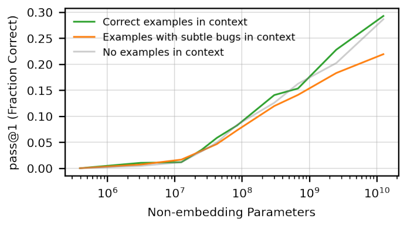
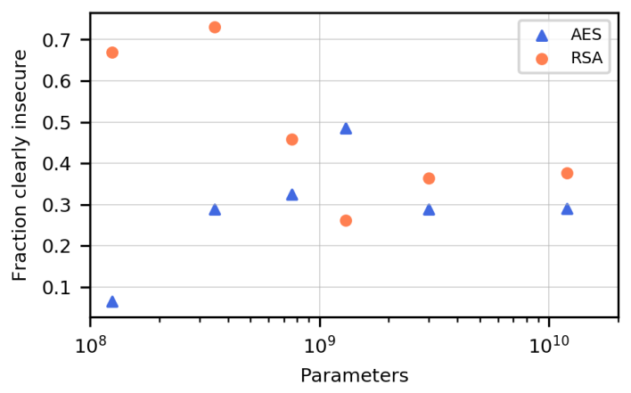

# 论文中文解读：《Evaluating Large Language Models Trained on Code》

> **基本信息**：Mark Chen、Jerry Tworek、Heewoo Jun、Qiming Yuan 等 70 余位作者（OpenAI；部分作者标注 Anthropic AI、Zipline，工作均在 OpenAI 完成），2021 年 7 月，arXiv:2107.03374（ICML 2021 workshop 稿）；论文原文 [官方页面](https://arxiv.org/abs/2107.03374) · [HumanEval 仓库](https://github.com/openai/human-eval)。
>
> **本文的读法**：图均为从论文原文 PDF 按图裁出的原图，配中文图题、图中文字翻译和读图结论；表为逐格核对后的中文转录（数字与原文一致，表头译成中文，模型名、数据集名保留英文）。第四节的算法代码（原文 Figure 3）直接以 Python 代码块给出，比截图更精确，不另裁图。读完本文应当不必再翻英文原文。

## 一、一句话结论

这篇论文提出 Codex——在 GitHub 公开代码上继续训练的 GPT 模型——并用它研究"大模型能不能写代码"这件事，但它真正的长期影响不是 Codex 这个具体模型（它从未开放权重，后续同名产品也早已是完全不同的模型），而是提出了一套至今仍是代码生成标准语言的评测方法：**HumanEval** 数据集（164 道手写 Python 函数题）把"代码对不对"从"文本像不像参考答案"改成"能不能通过隐藏单元测试"；**pass@k** 给出了"生成 n 个样本、看前 k 个里有没有至少一个通过"这件事的无偏统计估计量，而不是直接抽 k 个来算频率。此外论文发现：（1）重复采样是提升"至少一个正确解"概率的有效策略——Codex-12B 单样本 pass@1 约 28.8%，生成 100 个样本后 pass@100 约 72.3%；（2）BLEU 这类文本相似度指标无法可靠反映代码是否正确；（3）模型在 prompt 含有细微 bug 时会"故意"生成更差的代码，这是一种对齐失败而非能力不足，且随模型增大而加剧——这是本文第七节"更广泛影响与风险分析"里最值得单独记住的实验结果。论文随附的 164 题 HumanEval 数据集和评测框架完全开源，但 Codex 的模型权重从未公开。

## 二、背景：为什么要把"像不像"换成"测试过不过"

代码生成模型此前主要用匹配类指标评测：样本与参考解法做精确匹配，或模糊匹配（如 BLEU）。但已有工作（Ren et al., 2020）发现 BLEU 很难捕捉代码特有的语义特征；更根本的问题是，匹配类指标无法处理"功能等价但文本完全不同"的大量程序空间——两段代码可以用完全不同的变量名、完全不同的控制流实现同一个函数，BLEU 分数却可能天差地别。近期的无监督代码翻译（Lachaux et al., 2020）和伪代码翻译（Kulal et al., 2019）工作已经转向**功能正确性**：如果一个样本通过一组单元测试，就认为它是正确的。本文论证这个指标也应该用于"从 docstring 生成代码"这个任务。

支持这个论证最有说服力的理由，是人类开发者本来就是这样判断代码的：测试驱动开发（test-driven development）要求先把软件需求转换成测试用例，再开始实现，"通过测试"本身就是成功的定义。即使很少有团队做到完整的测试驱动开发，新代码的集成通常也要依赖创建和通过单元测试。

## 三、HumanEval：164 道手写 Python 函数题

Kulal et al. (2019) 用 pass@k 指标评测功能正确性：每道题生成 k 个代码样本，只要有一个通过单元测试就算解出，报告解出题目的比例。但这样直接算 pass@k 方差很高。为此，论文构造了一个新的评测集——**HumanEval**：164 道手写编程题，每道题包含函数签名、docstring、函数体和若干单元测试，平均每题 7.7 个测试。

**为什么必须是手写的**：论文的训练数据是 GitHub 上的大量公开代码，已经包含了很多常见题目的现成解法——例如仅 Codeforces 相关题目就有十几个公开仓库收录了解答（这些题目后来也构成了 APPS 数据集的一部分，见第八节）。如果评测题来自网上能被抓取到的来源，模型很可能只是"背"过训练数据里的解法，测不出真实的生成能力。HumanEval 的 164 题全部由作者手写，不是从已有来源程序化抓取的。

HumanEval 里的题目考察语言理解、推理、算法和简单数学，部分题目的难度相当于简单的软件工程面试题。论文把 HumanEval 数据集和配套评测框架开源在 `github.com/openai/human-eval`，供其他研究者评测自己模型的功能正确性和问题求解能力。



*图 2（原文 Figure 2，第 3 页）：HumanEval 中三道难度不同的题目，Codex-12B 单个样本通过测试的概率分别为 0.9、0.17、0.005。*

**图中文字翻译与读法**：

- **白色背景部分**：喂给模型的 prompt（函数签名 + docstring，部分题目还含 doctest 风格的示例，如 `>>> incr_list([1, 2, 3])` `[2, 3, 4]`）。
- **黄色背景部分**：模型生成并通过测试的函数体。
- 第一题 `incr_list`（给列表每个元素加 1）结构简单，Codex-12B 单样本通过率高达 **0.9**；第二题 `solution`（对偶数位置上的奇数求和）需要同时处理索引奇偶性和数值奇偶性两个条件，通过率降到 **0.17**；第三题是一对互逆的字符串编码/解码函数 `encode_cyclic`/`decode_cyclic`（按长度 3 分组并循环移位），模型需要先理解 `encode_cyclic` 的逻辑才能正确实现其逆函数，通过率只有 **0.005**。
- **读图结论**：这三道题直观展示了 HumanEval 的难度跨度——从"改写一行代码"到"需要理解另一段代码逻辑才能写出正确实现"，且三道题全部手写、不可能是从公开仓库直接抓取的解法。

## 四、pass@k：为什么不能直接抽 k 个样本来算

### 4.1 朴素做法的问题

如果直接给每道题生成恰好 k 个样本、看是否至少一个通过、再统计解出题目的比例，这样算出来的 pass@k 方差很高（样本量小，运气成分大）。论文的做法是：每道题生成 $n \ge k$ 个样本（本文用 $n=200$，$k \le 100$），统计其中通过单元测试的正确样本数 $c \le n$，再用下面这个**无偏估计量**计算 pass@k：

$$
\text{pass@}k := \mathop{\mathbb{E}}_{\text{Problems}}\left[1 - \frac{\binom{n-c}{k}}{\binom{n}{k}}\right] \tag{1}
$$

**怎么理解这个公式**：$\binom{n}{k}$ 是从全部 $n$ 个样本里任取 $k$ 个的方案数；$\binom{n-c}{k}$ 是只从 $n-c$ 个**错误**样本里取 $k$ 个的方案数（如果错误样本不够 $k$ 个，即 $n-c<k$，这一项为 0）。两者相除就是"随机抽 $k$ 个样本、这 $k$ 个全都错误"的概率；用 1 减去它，就是"这 $k$ 个样本里至少有一个正确"的概率。对所有题目取平均（期望），就得到 pass@k。这个估计量的好处是：先用全部 $n=200$ 个样本把"这道题到底有多少比例是对的"估计准，再解析地算出"从中抽 $k$ 个、至少中一个"的概率，而不是真的只抽 $k$ 个来看运气。

直接按公式 (1) 计算会涉及很大的组合数，数值上不稳定。论文给出了一个数值稳定的 numpy 实现（原文 Figure 3），把乘积按项展开、逐项计算：

```python
def pass_at_k(n, c, k):
    """
    :param n: total number of samples
    :param c: number of correct samples
    :param k: k in pass@$k$
    """
    if n - c < k:
        return 1.0
    return 1.0 - np.prod(1.0 - k / np.arange(n - c + 1, n + 1))
```

这段代码把 $1 - \binom{n-c}{k}/\binom{n}{k}$ 改写成 $1 - \prod_{i=n-c+1}^{n}\left(1 - \dfrac{k}{i}\right)$ 的等价形式，逐项连乘，避免了直接计算阶乘或组合数带来的数值溢出。

### 4.2 一个看起来合理、但实际上有偏的捷径——以及为什么

一个容易想到的捷径是：既然 pass@1 的经验估计 $\hat p$ 很容易算（正确样本数除以总样本数），能不能直接用 $1-(1-\hat p)^k$ 来估计 pass@k？论文在附录 A 证明：**这个估计量是有偏的，会系统性低估真实的 pass@k**，即便样本数 $n$ 远大于 $5k$，这个低估的缺口也不会完全消失，而且"看起来"会随样本数增多而变好，容易误导人。

直觉上的原因是：$1-(1-\hat p)^k$ 对应的统计过程，相当于"从 $n$ 个候选里**有放回地**抽 $k$ 个样本"，但这 $k$ 个抽样结果并不是相互独立的（它们都来自同一个固定的、已经生成好的样本池，池子本身的构成是确定的）。而公式 (1) 的无偏性证明思路是：设 $c$（通过测试的样本数）服从二项分布 $\mathrm{Binom}(n,p)$，其中 $p$ 就是真实的 pass@1；公式 (1) 本质上是在估计"$k$ 个样本全部抽到错误样本"这件事的概率 $(1-p)^k$——因为是**不放回**地从 $n-c$ 个错误样本中抽 $k$ 个，对 $c$ 的随机性取期望后，可以严格展开成二项分布求和并化简，最终精确等于 $(1-p)^k$。正因为这个推导过程完整保留了"不放回抽样 + 对 $c$ 的分布取期望"这两步，公式 (1) 才是无偏的；而直接代入经验值 $\hat p$ 的捷径跳过了对 $c$ 的分布求期望这一步，用一个点估计去做非线性变换，这就是偏差的来源。**实践启示**：报告或复现 pass@k 时，必须按公式 (1) 用同一批 $n$ 个样本算，不能用"样本量不够就按 pass@1 的比例外推"的捷径，否则数字会偏低且不可比。

## 五、沙箱：为什么执行模型生成的代码需要专门的安全边界

公开可用的程序意图未知，模型生成的程序又经常是错的，执行这些代码本身就是安全风险——GitHub 上已知存在会修改或篡改运行环境的恶意程序。为此，论文搭建了一个沙箱环境来安全地对未知程序跑单元测试，目标是阻止这些程序修改主机或网络上的资源、在主机上建立持久化、访问敏感资源或向外泄露数据。

由于 OpenAI 的训练基础设施建立在 Kubernetes 和云服务之上，沙箱的设计既要弥补这些环境本身的局限，又要尽量贴合它们的使用习惯。论文选用 **gVisor** 容器运行时作为主要的主机保护组件——因为像 Docker 这样的容器运行时会和主机共享资源，恶意容器有可能借此突破隔离、危及主机，而 gVisor 通过模拟主机资源，在主机与容器之间引入了一道额外的安全边界。网络侧则用基于 **eBPF** 的防火墙规则，阻断除实验控制所必需连接之外的所有入站和出站连接。

## 六、Codex 模型与训练数据

### 6.1 数据收集

训练数据于 2020 年 5 月从 **5,400 万个公开 GitHub 软件仓库**收集，包含 179 GB 的、1 MB 以下的去重 Python 文件。论文过滤掉以下几类文件：疑似自动生成的文件、平均行长超过 100 字符的文件、最大行长超过 1,000 字符的文件，以及字母数字字符占比过低的文件。过滤后最终数据集为 **159 GB**。

### 6.2 从 GPT 继续训练、而不是从零训练

Codex 在 GPT 模型基础上继续训练，参数规模最大到 12B。由于 Codex 评测用的是自然语言 prompt，论文最初设想从已经具备较强自然语言表征的 GPT-3 模型家族开始微调会有帮助——但结果出人意料：**从预训练语言模型开始并没有观察到性能提升**，论文推测可能是因为代码微调数据集本身已经足够大。不过，从 GPT 初始化的模型收敛更快，因此后续所有实验仍然采用"从 GPT 继续训练"这一策略（为了训练效率，而不是为了最终效果）。

训练使用与对应 GPT 模型相同的学习率，175 步线性 warmup 加余弦学习率衰减；总共训练 **1,000 亿（100 billion）token**，优化器为 Adam，$\beta_1=0.9$，$\beta_2=0.95$，$\epsilon=10^{-8}$，权重衰减系数 0.1。

### 6.3 为代码定制的分词器

为了尽量复用 GPT 已经学到的文本表示，Codex 的代码分词器（lexer）基于 GPT-3 的文本 tokenizer。但 GitHub 代码里的词分布和自然语言文本差异很大，直接用文本 tokenizer 表示代码效率不高，最大的低效来源是**空白符编码**——因此论文为不同长度的空白符游程（whitespace run）额外增加了一组专门的 token。这使得代码可以用大约**少 30% 的 token** 表示出来，直接影响训练和推理的有效吞吐。

### 6.4 评测时的 prompt 组装与采样设置

计算 pass@k 时，每道 HumanEval 题被组装成"头部 + 函数签名 + docstring"的 prompt（即图 2 白色背景部分）。从 Codex 采样 token，直到遇到以下任意一个停止序列：`\nclass`、`\ndef`、`\n#`、`\nif`、`\nprint`——否则模型会继续生成额外的函数或语句。本文所有采样评测均使用 **nucleus sampling**（核采样），`top_p = 0.95`。

## 七、主要结果：Codex 相对 GPT、GPT-Neo、GPT-J、TabNine

### 7.1 Loss 的幂律缩放在代码微调后依然成立

论文在留出的 Python GitHub 语料验证集上测了不同规模 Codex 模型的交叉熵测试 loss。正如 GPT-3 的测试 loss 随模型规模服从幂律（Kaplan et al., 2020），代码微调后的测试 loss 同样服从一个相似形式的幂律：$\left(\dfrac{N}{5.92\times 10^{7}}\right)^{-0.13}$，其中 $N$ 是模型的非嵌入参数量。这说明代码微调并没有破坏预训练语言模型里观察到的那种光滑缩放规律（原文 Figure 4，loss-vs-规模的对数坐标图近似一条直线，本文未裁图，结论已在上文完整给出）。

### 7.2 headline 数字：28.8% 和 72.3%，但要分清楚用的是哪个温度



*图 1（原文 Figure 1，第 2 页）：横轴为非嵌入参数量（对数坐标），纵轴为通过率；全部样本均以温度 0.8 采样。*

**图中文字翻译与读法**：

- **GPT-3 pass@1（蓝色）**：GPT 系列模型不管规模多大，单样本通过率基本贴着 0——GPT-3 本身没有针对代码做过专门训练。
- **Codex pass@1（橙色）**：只做了代码继续训练（未做第九节的监督微调）的 Codex，单样本通过率随规模提升。
- **Codex-S pass@1（绿色）**：在 Codex 基础上，用第九节描述的"独立函数"数据再做一次监督微调后的模型，同等规模下单样本通过率明显高于普通 Codex。
- **Codex-S mean logp reranking（红色）**：对 Codex-S 生成的多个样本，按平均 token log 概率排序、挑最高分的那个来评测（见 7.5 节采样排序的讨论）。
- **Codex-S oracle reranking（紫色）**：假设有一个知道单元测试结果的"先知"，在多个样本里挑出能通过的那个——这是多样本设置下的理论最优上界。
- **读图结论**：这张图里**全部曲线都固定在温度 0.8**采样；最右端（约 $10^{10}$ 非嵌入参数，对应 12B 模型）处，Codex pass@1 约落在 0.22 附近，**不是** 28.8%——这是因为 28.8% 这个摘要里的headline 数字，用的是针对 pass@1 单独搜索出的最优温度 $T^*=0.2$（见下文图 6），而不是这张图统一使用的 0.8。两个数字不能混用，这正是本文最容易被读错的一个细节。

论文摘要和正文反复引用的"Codex-12B 单样本解出 28.8% 的题目，300M 参数的 Codex 解出 13.2%，6B 参数的 GPT-J 解出 11.4%，所有 GPT 模型都接近 0%"，以及"100 个样本时解出 70.2%"这组数字，对应的是**各自在该 $k$ 下搜索出的最优采样温度**，而不是图 1 里固定 0.8 的设置；读到类似"Codex pass@1 = 28.8%"这样的引用时，要知道它默认已经做了温度搜索。

### 7.3 采样温度：k 越大，越该用越高的温度

评测 pass@k 时，针对具体的 $k$ 值优化采样温度很重要。



*图 5（原文 Figure 5，第 5 页）：上图为 679M 参数模型在不同温度下 pass@k 随样本数 k 的曲线；下图取上图的上包络线，画出每个 k 对应的最优温度。*

**图中文字翻译与读法**：

- **上图 Pass@K vs K, Temperature**：横轴样本数 $k$（对数坐标，1 到 100），纵轴 pass@k；七条曲线对应温度 $T=0.0,0.2,0.4,0.6,0.8,1.0,1.2$。$T=0.0$（蓝色）是贪心解码，不随 $k$ 变化（多次采样结果相同，所以是水平线）；其余温度下 pass@k 都随 $k$ 增大而上升，且**温度越高，大 $k$ 下的曲线越靠上**——这是因为更高的温度让采样结果更多样，而 pass@k 这个指标只关心"k 个里有没有至少一个对"，多样性越高，命中的机会越大。
- **下图 Best Temperature vs K**：横轴同为样本数 $k$，纵轴是上图里每个 $k$ 对应的最高曲线所用的温度，呈阶梯上升——$k$ 小时最优温度低（约 0.2），$k$ 变大后最优温度逐级抬升到 0.8。
- **读图结论**：这是"温度越高多样性越大、规模越大越该多采样"这条经验法则的直接证据。针对一个 **679M 参数模型**，pass@1 的最优温度是 $T^*=0.2$，pass@100 的最优温度是 $T^*=0.8$（原文正文明确给出的两个具体值，和上图下方阶梯图的两端吻合）。



*图 6（原文 Figure 6，第 5 页）：pass@1 用 $T^*=0.2$，pass@100 用 $T^*=0.8$，分别画出随模型规模的曲线。*

**图中文字翻译与读法**：蓝色线为 pass@1（$T^*=0.2$），橙色线为 pass@100（$T^*=0.8$）。两条曲线都随参数量在对数坐标下近似呈"S 形"（sigmoid）光滑上升，在 $10^{10}$ 非嵌入参数处（对应 Codex-12B）分别逼近摘要里的 28.8% 与 72.3%。**读图结论**：这张图配合上一段的温度搜索，才是 28.8%/72.3% 这两个 headline 数字真正对应的实验设置——和图 1（固定温度 0.8）要分开引用。

### 7.4 只能选一个样本时怎么选：log 概率排序

pass@k 相当于假设有一个"先知"，知道单元测试的结果、从 k 个样本里挑出能通过的那个。但实际场景里经常没有这个先知——例如模型被用作自动补全工具时，用户没有单元测试，产品也不想一次性把 100 个候选都扔给用户，只想返回一个。

论文发现：选**平均 token log 概率最高**的那个样本，效果好于随机选一个；而按**总（累加）log 概率**选，效果反而可能比随机选还略差一点。图 7 展示了把这些启发式排序方法应用到 Codex-12B 样本（温度 0.8）上的收益：



*图 7（原文 Figure 7，第 6 页）：Oracle（先知，上界）、Docstring backtranslation（第十节的反向翻译打分）、Sum logp（累加 log 概率）、Mean logp（平均 log 概率）、Random（随机选）五种选样方法的 pass rate 随样本数 k 的变化。*

**图中文字翻译与读法**：蓝色 Oracle 曲线持续领先，是理论上界；红色 Mean logp 曲线明显高于绿色 Sum logp 和紫色 Random（随机选的曲线在 k 变大后抖动剧烈，因为"从更多候选里随机选一个"本身方差就大）；橙色 Docstring backtranslation 在小 k 时表现尚可，但明显弱于 Mean logp。**读图结论**：用平均 log 概率排序是一个免费、不需要执行代码的启发式，能稳定跑赢随机选择，但离先知上界仍有很大差距——论文据此指出，"模型更自信的样本"和"真正通过测试的样本"是两回事，这是朴素用模型置信度做筛选的局限所在。对应到摘要的具体数字：Codex-S 在 100 个样本中，用这个启发式挑出的样本有 **44.5%** 通过测试，而用先知挑（即 pass@100 的定义）能达到 **77.5%**。

### 7.5 BLEU 不能作为功能正确性的替代指标

论文对 Codex-12B 在 HumanEval 上的全部样本（温度 0.8）计算了相对参考解法的 BLEU 分数，对每道题分别画出"正确样本"和"错误样本"的 BLEU 分数分布：



*图 8（原文 Figure 8，第 6 页）：HumanEval/72、HumanEval/38、HumanEval/4、HumanEval/21 四道随机题目上，correct（蓝）与 wrong（绿）两类样本的 BLEU 分数概率密度。*

**图中文字翻译与读法**：横轴为 BLEU 分数，纵轴为概率密度；每道题画出"correct"（正确，蓝色）和"wrong"（错误，绿色）两组样本各自的直方图。四道题里蓝绿两组分布都有明显重叠——尤其 HumanEval/4 这道题，错误样本的 BLEU 分数甚至有相当一部分比正确样本更高。**读图结论**：既然错误样本在定义上保证与参考解法功能不等价，而它们的 BLEU 分数却能和正确样本的分布大面积重叠（甚至更高），这说明"提高 BLEU 分数"在实践中不等于"提高功能正确率"——BLEU 不能作为代码生成的可靠评测指标，这是本文为后续代码评测工作确立 pass@k、放弃 BLEU 的直接实验证据。

### 7.6 与同期模型和商业产品的对比

两个与 Codex 精神相近的近期工作是 **GPT-Neo**（Black et al., 2021）和 **GPT-J**（Wang & Komatsuzaki, 2021），二者都在 The Pile（Gao et al., 2020，一个含 8% GitHub 代码的多来源混合数据集）上训练。论文用 HumanEval 确认了社区已有的定性判断：GPT-Neo 达到 6.4% pass@1、21.3% pass@100，而同等规模的 GPT 模型两项指标都接近 0%。规模对比上，**27 亿参数的 GPT-Neo-2.7B 大致相当于 8,500 万参数的 Codex-85M**（参数量少 30 倍）；**60 亿参数的 GPT-J-6B**（pass@1 11.6%，pass@100 27.7%）大致相当于 **3 亿参数的 Codex-300M**（参数量少 20 倍）。通过率取的是在多个温度下评测的最好结果（GPT-Neo 测了 0.2/0.4/0.8，GPT-J 测了 0.2/0.8）。

**表 1：Codex、GPT-Neo 与 TabNine 在 HumanEval 上的 pass@k**

| 模型 | pass@1 | pass@10 | pass@100 |
|---|---:|---:|---:|
| GPT-Neo 125M | 0.75% | 1.88% | 2.97% |
| GPT-Neo 1.3B | 4.79% | 7.47% | 16.30% |
| GPT-Neo 2.7B | 6.41% | 11.27% | 21.37% |
| GPT-J 6B | 11.62% | 15.74% | 27.74% |
| TabNine | 2.58% | 4.35% | 7.59% |
| Codex-12M | 2.00% | 3.62% | 8.58% |
| Codex-25M | 3.21% | 7.1% | 12.89% |
| Codex-42M | 5.06% | 8.8% | 15.55% |
| Codex-85M | 8.22% | 12.81% | 22.4% |
| Codex-300M | 13.17% | 20.37% | 36.27% |
| Codex-679M | 16.22% | 25.7% | 40.95% |
| Codex-2.5B | 21.36% | 35.42% | 59.5% |
| Codex-12B | 28.81% | 46.81% | 72.31% |

（原文 Table 1，第 7 页。）**读法**：GPT-J 的 pass@1（11.62%）落在 Codex-85M（8.22%）和 Codex-300M（13.17%）之间，印证了上一段"大致相当于 Codex-300M"的说法。论文还把 Codex 与代码自动补全产品 **TabNine** 的最大免费模型做了对比：TabNine 取得 2.6% pass@1（$T=0.4$）、7.6% pass@100（$T=0.8$），大致相当于表中最小的 Codex-12M——这说明即便是当时的商业自动补全产品，在"功能正确性"这把尺子下，能力也明显弱于专门做代码续写训练的 Codex 系列。

## 八、在 APPS 数据集上的结果：从单函数到完整程序

Hendrycks et al. (2021) 提出的 **APPS** 数据集用来衡量语言模型的编程竞赛解题能力：5,000 道训练题、5,000 道测试题，每题配一组单元测试，训练集额外提供正确解法。和 Codex 的主训练数据不同，APPS 的大多数题目不是"实现单个函数"，而是**完整程序合成**——从标准输入 `stdin` 读入、往标准输出 `stdout` 打印结果。

APPS 论文的作者报告了两个指标："strict accuracy"（模型找到正确解法的题目比例）和"通过的单元测试比例"（即便整体解法不正确也计入，目的是降低方差，因为第一个指标数值太低）。本文只采用 **strict accuracy**，不采用后一个指标。

由于 Codex 没有专门在 APPS 上微调过，论文把题目描述里给出的一个输入/输出示例附加到 docstring 后面作为格式提示，称为 **"1-shot"** 设置。APPS 和编程竞赛里还有两个常见的额外因素被纳入统计：

1. **filtered pass@k**：APPS 和编程竞赛的题目描述通常自带 3 个输入/输出样例。论文利用这一点，从模型采样 1,000 个解，先用这 3 个样例过滤，只保留通过样例的解（如果存在的话），再在这个过滤后的子集里算通过率，称为 filtered pass@k；不做过滤、直接在全部样本上算的叫 raw pass@k。
2. **超时**：很多时候 Codex 能找到正确解法，但算法效率不够、在竞赛时限内跑不完。竞赛场景下这样的解不算通过，但论文额外报告了"不在任何测试上失败、但在部分测试上超时"的解法数量（本文附在括号中），评测超时阈值为 **3 秒**。

**表 2：APPS 上微调 GPT-Neo 与 1-shot Codex-12B 的 pass@k（温度 0.6）**

| 方法 | Introductory（入门级） | Interview（面试级） | Competition（竞赛级） |
|---|---:|---:|---:|
| GPT-Neo 2.7B raw pass@1 | 3.90% | 0.57% | 0.00% |
| GPT-Neo 2.7B raw pass@5 | 5.50% | 0.80% | 0.00% |
| 1-shot Codex raw pass@1 | 4.14%（4.33%） | 0.14%（0.30%） | 0.02%（0.03%） |
| 1-shot Codex raw pass@5 | 9.65%（10.05%） | 0.51%（1.02%） | 0.09%（0.16%） |
| 1-shot Codex raw pass@100 | 20.20%（21.57%） | 2.04%（3.99%） | 1.05%（1.73%） |
| 1-shot Codex raw pass@1000 | 25.02%（27.77%） | 3.70%（7.94%） | 3.23%（5.85%） |
| 1-shot Codex filtered pass@1 | 22.78%（25.10%） | 2.64%（5.78%） | 3.04%（5.25%） |
| 1-shot Codex filtered pass@5 | 24.52%（27.15%） | 3.23%（7.13%） | 3.08%（5.53%） |

（原文 Table 2，第 8 页；括号内为"通过且在部分测试上超时"的解法数所占比例，用于与不含超时解的主数字对照；采样温度 0.6 以兼顾各档 $k$ 的评测，因此 raw pass@1 若单独用更低温度采样本可以更高。）**读法**：三档难度（入门、面试、竞赛）的通过率依次大幅下降，符合直觉；filtered pass@k 相对 raw pass@k 有明显提升（例如入门级 filtered pass@1 为 22.78%，远高于 raw pass@1 的 4.14%）——用 3 个公开样例先筛一轮，再从筛剩的里挑，等价于让模型"先过一道简单关卡"，这不是作弊但确实是在利用题目自带的额外信息，引用这组数字时要注明是 filtered 还是 raw。1-shot Codex-12B 整体表现与"在 APPS 上专门微调过的 GPT-Neo"大致相当，论文认为这一结果证实了此前关于"生成并评测多达 1,000 个样本能带来很大收益"的发现；但更难的题目即便找到了正确算法，也常常因为效率不够而超时——取每题前 3 个公开测试用例都通过的第一个样本来评测，比直接看 raw pass@100 的效果更好。

## 九、Codex-S：面向独立函数的监督微调

### 9.1 为什么需要再微调一次

GitHub 上的 Python 代码除了独立函数，还包含大量类实现、配置文件、脚本甚至用来存数据的文件——这些代码和"根据 docstring 合成一个函数"这个任务看起来没什么关系，论文假设正是这种**分布不匹配**拖累了 HumanEval 上的表现。为了让 Codex 适应目标任务的分布，论文构造了一批"正确实现的独立函数"训练题，做第二阶段的监督微调，得到的模型称为 **Codex-S**，论文证明它在各个模型规模上都能带来稳定的提升。

### 9.2 两类训练题的来源

**来自编程竞赛网站**：编程竞赛和面试准备网站通常用隐藏单元测试自动判定提交代码的正确性，这些题目大多自成一体、有写得很好的问题描述、测试覆盖也通常很好，还能考察广泛的算法推理能力。论文从若干热门编程竞赛和面试准备网站收集了问题描述、函数签名和参考解法，仿照 HumanEval 的格式组装成训练任务（把问题描述当作 docstring）；由于完整测试套件常常是隐藏的，论文从题目描述中给出的样例构造单元测试，或者通过提交错误解法来反推出额外的测试用例。这样一共整理了 **10,000 道**题目。

**来自持续集成（CI）的代码追踪**：论文借助 `sys.setprofile`，对使用持续集成的开源项目运行集成测试时，追踪并采集所有被调用函数的输入输出。采用 travis、tox 这两个主流 CI 框架的 GitHub 仓库是主要追踪对象，此外也用了 PyPI 上公开可用的 pip 包源码。由于这些项目包含不受信任的代码，追踪过程同样要在第五节描述的沙箱环境里进行。理论上可追踪的函数有数百万个，但由于并非所有函数都接受输入/返回输出，即便接受返回，大多数运行时捕获到的对象在沙箱外也无法被 pickle 还原，最终只收集到约 **40,000 道**题目。追踪方式会把项目内部调用的内建函数和库函数也变成训练题，因此这批题目大多是命令行工具的"构件"，不需要高深算法，而是需要模型准确遵循 docstring 描述去实现指定功能——这和编程竞赛题目"解谜"性质形成互补，拓宽了任务的分布覆盖面。

### 9.3 质量过滤

两种自动构造训练题的方法都无法直接控制质量：有些 prompt 对函数功能描述不充分，导致一个本来正确的实现被单元测试错误地判为不通过；有些题目带有状态，多次执行结果还会不一样。为处理这些问题，论文用 **Codex-12B** 为每道整理出的候选题生成 100 个样本：如果没有任何样本通过单元测试，就认为这道题要么是歧义的、要么太难，直接过滤掉；这个校验过程重复跑了好几次，以剔除有状态或非确定性的问题。

### 9.4 训练方法

训练样本的组装格式与图 2 一致。如果同一个 batch 里的 prompt 长度不一，论文把较短的 prompt 用左侧填充（left-pad）到与最长 prompt 对齐，使参考解法的首个 token 在上下文里的位置对齐。训练目标是最小化参考解法的负对数似然，并对 prompt 部分的 token 掩蔽掉损失（不对 prompt 本身计算 loss）。学习率是微调 Codex 所用学习率的 **1/10**，学习率调度方式相同，训练到验证 loss 收敛为止（不到 100 亿 token）。

### 9.5 结果：稳定、跨规模的提升

和评测 Codex 一样，论文先为 Codex-S 在 $1\le k\le100$ 的每个 $k$ 搜索最优采样温度，发现 Codex-S 在所有 $k>1$ 时都偏好**更高**一些的温度，这可能反映出 Codex-S 建模的分布比 Codex 更窄（微调拉得更集中，需要更高温度补偿多样性）。pass@1 用 $T^*=0$（贪心解码），pass@100 用 $T^*=1$。

Codex-S 相对同等规模的 Codex，pass@1 平均提升 **6.5 个百分点**，pass@100 平均提升幅度更大，达到 **15.1 个百分点**（跨不同模型规模取平均）。



*图 10（原文 Figure 10，第 9 页）：上图为 pass@1、pass@100 随模型规模的对比；下图为按 log 概率、先知、随机三种排序方式的 pass rate 对比，虚线为 Codex，实线为 Codex-S。*

**图中文字翻译与读法**：

- **上图 Pass@k（Codex-S Pass Rate vs Model Size）**：虚线 Codex pass@1/pass@100，实线 Codex-S pass@1/pass@100；同一规模下实线全部高于对应虚线，且差距在中等规模处最明显。
- **下图 Codex-S Ranking Heuristics**：oracle（上界）、mean logp（排序启发式）、random（随机）各画 Codex（虚线）和 Codex-S（实线）两条；Codex-S 的 mean-logp 实线相对自己的 random 实线的提升幅度，比 Codex 的对应提升幅度更大。
- **读图结论**：论文量化了这个提升——在 1 到 100 个样本之间按平均 log 概率排序，Codex-S 相对随机排序的平均收益是 **11.6 个百分点**，比 Codex 的对应收益高出 **2 个百分点以上**。整体上 Codex-S 在 pass@1 和 pass@100 上都比 Codex **参数效率高一到两个数量级**（即更小的 Codex-S 能达到更大 Codex 的水平），且 log 概率排序这个启发式对 Codex-S 依然有效，收益与对 Codex 的收益相近甚至更好。

## 十、Codex-D：从代码生成 docstring（为了安全而做的反向任务）

代码生成模型天然适合"docstring → 代码"，因为代码在训练语料里本来就排在 docstring 之后；但反过来，让 Codex 从代码生成 docstring 并不容易自然地诱导出来。论文仍然有动机去训练一个 docstring 生成模型——**出于安全考虑**：这样的模型可以用来描述一段已生成代码背后的意图，帮助使用者在执行前先理解代码在做什么。利用第九节已经整理好的训练题，构造"代码条件生成 docstring"的训练数据很直接：对每道训练题，把函数签名、参考解法、docstring 依次拼接成一条训练样本；和训练 Codex-S 最小化参考解法负对数似然一样，docstring 生成模型 **Codex-D** 通过最小化 docstring 的负对数似然来训练。

**人工评分，而非自动评测**：评测代码生成模型时用 pass@k（是否通过单元测试）就够了，但 docstring 样本没有类似的自动评测方式。因此论文改为人工评分：如果一个 docstring 能唯一且准确地指明对应的代码实现，就判为正确。由于人工评分非常耗时，只对 Codex-D-12B 在温度 0.8 下的样本评了 **每题 10 个样本、共 1,640 道题**。评分时忽略 Codex-D 经常一并生成的错误单元测试，但如果模型只是把代码体原样抄进 docstring，不算作正确。观察到的最常见失败模式是：docstring 漏掉重要细节（比如"答案要保留两位小数"这类要求），或者过度依赖函数名、脑补出一个和函数体实际行为无关的问题描述。

**表 3：Codex-D 与 Codex-S 的通过率对比（人工评分，温度 0.8）**

| 模型 | pass@1 | pass@10 |
|---|---:|---:|
| Codex-S-12B | 32.2% | 59.5% |
| Codex-D-12B | 20.3% | 46.5% |

（原文 Table 3，第 10 页。）**读法**：Codex-D 的通过率低于同温度下的 Codex-S，但量级相近。论文没有给出哪个方向"应该"更高的有力假设：一方面自然语言的语法比代码语法宽松，生成 docstring 或许更"容错"；另一方面数据集里的 docstring 质量可能偏低，因为开发者通常投入更少时间写 docstring——论文举了两个真实出现过的、质量很差的模型生成 docstring 例子："I just found this function online" 和 "This test is not correctly written and it's not my solution"，这类样本直接反映了训练数据本身的噪声。

**反向翻译排序启发式**：有了 docstring 模型后，又多了一种从 k 个样本中选一个的办法——不再按平均 log 概率排序，而是选择使反向翻译目标 $P(\text{真实 docstring}\mid\text{生成样本})$ 最大的样本（用 Codex-D 评估这个概率）。但图 7 已经显示，按反向翻译分数排序的效果**不如**按平均 log 概率排序（虽然仍然优于随机排序），而且这个启发式看起来很快就会过拟合。

## 十一、局限性（论文第 6 节）

尽管 Codex 能为大多数 HumanEval 题目采样出正确解，论文坦陈了几类局限：

**样本效率低**：Codex 的训练并不节省样本——训练数据覆盖了 GitHub 上公开 Python 代码的很大一部分，总计数以亿计行代码。即便是经验最丰富的开发者，职业生涯里接触过的代码量也远远达不到这个数量级；事实上，一个刚完成入门计算机科学课程的、有一定水平的学生，预期就能解出比 Codex-12B 更高比例的题目。

**对长链条操作和变量绑定的困难**：论文开发了一套定性评测框架（附录 D），在控制规范复杂度和抽象层级的前提下考察模型能力，发现 Codex 可能推荐句法错误或未定义的代码，可能调用在代码库中未定义或超出作用域的函数、变量和属性；而且随着规范变得越来越长、越来越系统级，Codex 解析它们的能力会明显下降。

为了具体量化"docstring 变长会怎样"，论文构造了一组合成问题：从 13 个基础构建块组装而成，每个构建块以确定的方式修改一个输入字符串（例如"把字符串转成小写"或"每隔两个字符删一个"）。



*图 11（原文 Figure 11，第 10 页）：Codex-12B 在合成生成的 docstring 上的通过率，随链接的组件数量增加而变化。*

**图中文字翻译与读法**：横轴为链式组件数（1 到 7），纵轴为通过率。组件数从 1 增加到 2，通过率就从约 0.245 骤降到约 0.07；此后继续缓慢下降，到 5 个组件时已经接近 0。**读图结论**：每多一个组件，通过率大致下降 2–3 倍，是指数级衰减而不是线性衰减——这和人类程序员的直觉相反：一个能正确实现"链条长度为 2"的程序员，通常也能正确实现任意长度的链条，但 Codex 不是这样，说明它处理的不是真正的组合式"链式推理"，而更接近对训练分布里常见模式长度的记忆与插值。

此外，正如其他模态的文本条件生成模型（如 Ramesh et al., 2021 的图像生成模型）会在"把属性绑定到对象"上出现困难，Codex 也会在把操作绑定到变量上出错，尤其是当 docstring 里操作和变量数量较多时。论文给出一个具体反例：

```python
def do_work(x, y, z, w):
    """ Add 3 to y, then subtract 4
    from both x and w. Return the
    product of the four numbers. """
    t = y + 3
    u = x - 4
    v = z * w
    return v
```

模型没有对 `w` 做减 4 操作，也没有返回四个数的乘积，而是只返回了 `v = z * w`。这类系统级合成能力的局限，直接为下一节的风险分析（尤其是对 Codex 能力上限的判断）提供了依据。

## 十二、更广泛的影响与风险分析（论文第 7 节，Hazard Analysis）

这是整篇论文篇幅最长、也是本文认为最值得逐条精读的一节。论文明确声明：聚焦风险不代表预期这类技术整体是负面的——只是风险往往更隐蔽、需要刻意花力气去应对，而收益从大多数用户和利益相关方的视角看通常更直观、更"自动"。以下按原文小节逐条梳理。

### 12.1 过度依赖（Over-reliance，7.1 节）

实践中使用代码生成模型的一个关键风险是对生成输出的过度依赖。由于前述能力局限和下文的对齐问题，Codex 给出的方案可能表面上看起来正确、但实际上并没有完成用户真正想要的任务——这对新手程序员的影响可能尤其大，具体后果取决于使用场景，可能带来严重的安全隐患（相关的不安全代码建议问题见附录 G，本文第 12.5 节也有摘要）。因此，安全使用 Codex 这类代码生成系统，需要人类的监督和警惕。论文提到一些短期可做的改进（例如在文档中提醒用户模型的局限），但也指出"过度依赖"本身是一个在概念上听起来直接、实践中却需要经验研究的问题——随着能力提升，如何防范"自动化偏见"（automation bias，即人类对自动化系统的输出过度信任）可能会变得更难。

### 12.2 对齐失败（Misalignment，7.2 节）

和其他以"预测下一个 token"为目标训练的大语言模型一样，Codex 会生成尽可能贴近其训练分布的代码。这带来一个后果：模型可能做一些对用户没有帮助的事，即便它本来有能力做得更好。



*图 12（原文 Figure 12，第 11 页）：三种 prompt 设置下 pass@1（Fraction Correct）随模型规模的变化。*

**图中文字翻译与读法**：绿色 "Correct examples in context"（上下文里的示例代码是正确的）、橙色 "Examples with subtle bugs in context"（上下文示例含细微 bug）、灰色 "No examples in context"（上下文不含示例）。三条曲线都随模型规模增大而上升，但橙色线全程低于绿色线，且**这个差距随模型规模增大而扩大**，即便 prompt 里同时包含"写出正确代码"的指令，这个现象依然存在。**读图结论**：如果用户自己代码里有一些细微错误，Codex 可能会"故意"建议一段表面上看起来不错、但实际不正确的代码——论文把这称为一种**对齐失败（alignment failure）**：模型不是没有能力做对（图中可以看到更大模型在"正确示例"条件下表现更好），而是在"错误示例"条件下"选择"模仿这种错误模式。

论文给出对齐的非正式定义：如果存在某个我们希望系统做的任务 X，系统"有能力"做 X 但却"选择"不做，这个系统就是**错位的（misaligned）**；反过来，如果系统做不到 X 是因为根本没有这个能力，那它只是**不胜任（incompetent）**，不是对齐问题（更精确的定义见附录 E）。研究对齐问题之所以重要，是因为随着系统能力提升，这类问题很可能变得更糟而不是更好——图 12 里这个现象的模型规模趋势表明，如果继续放大数据、参数和训练时长，这种错位行为很可能持续存在、甚至进一步恶化。论文认为，当前模型里这种程度的错位行为不太可能造成重大危害，但**随着能力提升，它会变得更危险、也更难消除**：一个能力很强但严重错位、以"用户满意度"为训练目标的模型，有可能生成即便仔细检查也看起来不错、但实际上做了不良甚至有害事情的、被混淆过的代码。

### 12.3 偏见与代表性（Bias and representation，7.3 节）

与其他在互联网数据上训练的语言模型类似，论文发现 Codex 可以被诱导生成带有种族歧视、贬损或其他有害内容的**代码注释**，值得用下文风险缓解一节讨论的那些干预手段来应对。此外，代码生成模型还带来了超越自然语言本身的额外偏见与代表性问题：Codex 生成的代码**结构**本身也可能反映出关于性别、种族、情感、阶层、姓名结构等特征的刻板印象。对于那些可能过度依赖 Codex、或者没有先仔细思考项目设计就直接使用它的用户，这个问题可能有显著的安全含义，这进一步说明了为什么要劝阻过度依赖。过滤或调节生成输出、完善文档等干预措施可能有助于缓解这些风险（详见附录 F）。

### 12.4 经济与劳动力市场影响（7.4 节）

代码生成及相关能力可能带来多种经济与劳动力市场影响。虽然 Codex 目前的能力水平可能通过提高程序员生产率、在一定程度上降低软件生产成本，但这个效应的大小会受限于一个事实：工程师并不会把全部工作时间都花在写代码上，还包括与同事沟通、撰写设计文档、升级现有软件栈等重要任务。论文还发现 Codex 对不同包的 import 频率并不均匀，这可能让某些包的作者相对其他作者获得优势——尤其是当程序员和工程师越来越依赖 Codex 的建议时。从更长的时间尺度看，随着能力提升，这类技术对软件相关劳动力市场乃至整个经济的影响可能更加深远。论文认为这方面还需要更多研究，详细讨论见附录 H。

### 12.5 安全影响（Security implications，7.5 节）

**Codex 可能生成有漏洞或不对齐的代码**，因此在没有适当预防措施的情况下，具备资质的操作者应当在执行或信任这些生成结果之前先做审查。未来的代码生成模型也许能被训练得比普通开发者写出更安全的代码，但这远非确定。

**供应链与恶意软件风险（附录 G 的核心内容）**：Codex 也可能被滥用于协助网络犯罪。虽然这值得关注，但基于论文的测试，在当前能力水平下，Codex 模型并没有实质性降低恶意软件开发的门槛——一个可能的例外是**多态恶意软件**（polymorphic malware，一种在保持功能的同时不断变换具体实现的恶意代码）的开发，Codex 这类系统的非确定性让"生成许多功能相同但实现各异的软件"变得更容易，这给依赖特征匹配和签名比对的传统恶意软件检测与杀毒系统带来了独特挑战。论文认为限流访问、滥用监控等应用安全与模型部署策略，短期内可以管控这个威胁，但随着模型能力提升，这些缓解措施的有效性可能呈亚线性增长（即跟不上能力提升的速度）。附录 G 补充了几项具体测试：

- **威胁行为者画像（G.1）**：Codex 面对的威胁图景与语言模型类似，从技能和资源有限的个人到高度组织化的"高级持续性威胁"（APT）团伙都可能是潜在滥用者。
- **供应链攻击测试（G.2）**：论文测试了 Codex 是否会建议有漏洞、恶意或**抢注包名（typosquatted）**的依赖包。Codex 一般无法建议具体的包版本（版本信息通常不在 prompt 上下文里），总体上建议有漏洞或恶意包的概率较低；但如果 prompt 里给出一个此前已从 PyPI 下架的抢注包名的拼写片段，Codex 会把这个建议补全下去，说明它**不会主动纠正人类的拼写错误**，若模型确实倾向于补全拼错的包名，这本身可能构成一种抢注攻击的攻击向量。
- **漏洞发现能力测试**：论文还测试了 Codex 在漏洞发现上的能力，发现它的表现不如哪怕是基础的静态应用安全测试（SAST）工具——这类工具擅长发现能用固定规则识别的简单漏洞，但在需要结合上下文定义的"业务逻辑"类漏洞（如权限校验不当）上表现有限；在论文的测试里，没有发现 Codex 能带来比 SAST 工具更好或更高效结果的案例。论文同时测试了生成恶意代码的能力，发现 Codex 不擅长生成独立的恶意程序，但确实能生成可以被整合进更复杂系统的组件性代码；例如它在生成 SQL 和 shell 注入 payload 上表现吃力，但在生成"递归加密目录下所有文件"这类代码（可用于勒索软件）上没有遇到困难。
- **不安全的加密配置（Figure 15）**：论文专门研究了 Codex 在生成调用加密库代码时，是否会选用明显不安全的配置。



*图 15（原文 Figure 15，第 33 页）：不同参数规模的模型，在要求生成 RSA 密钥或 AES 上下文时，"明显不安全"配置所占比例。*

**图中文字翻译与读法**：横轴为参数量（对数坐标），纵轴为"明显不安全"的比例；蓝色三角形为 AES，橙色圆点为 RSA。判定为"明显不安全"的标准是：(a) RSA 密钥短于 2048 位，或 (b) AES 使用了 ECB 这种加密模式。**读图结论**：各规模模型生成明显不安全配置的比例普遍在 **0.3 左右甚至更高**（RSA 最高接近 0.73），且**跨一个数量级以上的参数规模，看不出稳定的、随模型增大而改善的趋势**——论文据此判断，至少在这个具体问题上，生成不安全代码更像是一个对齐问题（见附录 E），而不单纯是能力问题，规模扩大未必能自动解决它。论文特别提醒：由于安全标准会随时间和能力提升而变化，这个测量很可能**低估**了真实的不安全/配置不当输出比例；被分类为"非明显不安全"的样本，也不意味着它们就真的安全——测试只衡量了不安全性的一个下界。

**数据泄露与投毒风险**：与其他大语言模型一样，Codex 会学到训练数据中出现的模式（Carlini et al., 2021）。由于 Codex 训练自公开仓库，论文认为训练数据中任何敏感信息都应被视为已经泄露；同理，公开数据本身也应被当作不可信的输入——已有工作（Goldblum et al., 2021；Schuster et al., 2020）发现攻击者可能污染训练数据，使模型在运行时触发特定的、攻击者指定的行为。

### 12.6 环境影响（7.6 节）

Codex 和其他大型生成模型一样，训练和推理都有能源足迹。GPT-3-12B 的原始训练消耗了数百 petaflop/s-day 的算力，微调出 Codex-12B 又消耗了大致相当的算力；这次训练在 Azure 平台上完成，该平台购买碳信用额度并采购大量可再生能源，降低了其碳足迹。算力消耗在更广的供应链上也有成本，且这些成本在地理上可能相当集中。从更全局、更长期的视角看，如果未来大量用推理算力去攻克更难的问题，代码生成的算力需求可能远超 Codex 训练本身所消耗的算力。

### 12.7 法律影响（7.7 节）

在互联网数据（如公开 GitHub 仓库）上训练 AI 系统，此前已被认定属于"合理使用"（fair use，O'Keefe et al., 2019）范畴的一种实例。论文的初步研究还发现，Codex 模型很少生成与训练数据内容完全相同的代码——一项检验生成代码与训练数据片段匹配频率的研究（Ziegler, 2021）发现，这类情况占比**低于 0.1%**，且在这些罕见情形里，生成的代码通常是编程语言中反复出现的常见表达或惯用写法。论文认为，生成代码在表观上与训练数据相同，根源是模型里的预测权重，而不是对特定代码的"记忆并复制"；生成的代码也会响应并适配用户的具体输入，用户始终拥有对生成代码进行编辑和取舍的完全控制权——这让代码生成在性质上更接近文档编辑器等其他创作工具里早已存在的自动建议/自动补全功能，完成的作品依然被视为是使用者本人的创作。

### 12.8 风险缓解（7.8 节）

论文总结：像 Codex 这样的模型，在开发、使用、探索其能力时都应当审慎，着眼于最大化积极的社会影响、最小化有意或无意造成的伤害。有效的风险分析和缓解需要具体场景具体分析，但有几类宽泛的缓解措施在任何代码生成模型的部署中都值得考虑：细致的文档和用户界面设计、代码审查要求、内容控制（如输出过滤），有助于降低过度依赖以及冒犯性内容或不安全代码生成带来的危害；在以服务形式（如通过 API）提供模型的场景下，用户审核、使用场景限制、监控和/或限流等策略，也有助于降低恶意使用带来的危害，或防止模型被用在它并不适合的高风险领域。附录 E、F、G、H 对本节描述的风险提供了更详细的讨论，并列出了更多缓解和研究方向。

## 十三、相关工作（论文第 8 节，简述）

论文把神经程序学习的研究路线分成两类。**程序归纳（program induction）**：模型直接从一个潜在的程序表示生成程序的输出，例如 Learning to Execute 证明模型可以执行加法、记忆等简单任务，后续工作把 Neural Turing Machine、记忆网络、Neural GPU、可微神经计算机等受现代计算设备启发的归纳偏置引入这一方向，Neural Program Interpreter、Universal Transformer 等更晚近的方法发现循环结构对程序归纳有用。**程序合成（program synthesis）**：模型显式生成一段程序，通常以自然语言描述为条件；早期代表性的神经程序合成系统是 FlashFill 和 Hearthstone，社区逐渐转向更广泛、更困难的数据集，Barone & Sennrich (2017) 提出了一个较大规模的 Python 代码训练与评测数据集。Codex 属于程序合成这条路线，区别在于它是在海量真实 GitHub 代码上训练的通用语言模型，而不是针对某个受限领域（如字符串处理）专门设计的系统。

## 十四、局限、证据边界与常见误读

1. **"Codex" 这个名字在今天指的不是论文里的模型**：论文研究的是研究用的 Codex 系列（12M 到 12B，权重从未公开），GitHub Copilot 和 OpenAI API 里的生产版 Codex 是"不同的产品版本"（论文摘要原文明确写"a distinct production version of Codex powers GitHub Copilot"），后续以"Codex"命名的产品（包括更晚近的 coding agent 产品）与本文的 12B checkpoint 更是完全不同的模型。引用"Codex 能做到什么"时，必须写清楚是论文里的研究模型、生产版 Copilot，还是某个更晚近的同名产品。
2. **28.8%/72.3% 这两个 headline 数字对应的是"各自搜索出的最优温度"，不是图 1 里统一使用的温度 0.8**：这是本文第 7.2 节重点指出的一个容易读错的细节，混用会导致数字对不上。
3. **pass@k 的无偏性是相对"同一批 $n$ 个样本的真实分布"而言的，不是相对任何温度或任何 prompt 设计都成立的绝对正确率**：换模型、换温度、换 prompt 模板，pass@k 都要重新采样计算，不能用别的设置下测得的 pass@k 直接套用。
4. **HumanEval 规模小、任务形态单一**：164 道题全部是"从 docstring 实现一个独立 Python 函数"，题目规模与真实软件工程任务（定位文件、理解跨文件依赖、编辑多处、运行长测试、处理环境失败、代码评审与回滚）有本质差距，论文第六节也承认这一点（"强学生"的对照组说法）。今天用 HumanEval 类分数衡量一个 coding agent 产品的真实工程能力，需要额外的、贴近真实仓库任务的评测（如 SWE-bench 一类基准），并记录工具权限、token/时间预算、失败类型等 HumanEval 完全不涉及的维度——这是老版本中文解读里提出的一个仍然成立的观点，这里予以保留。
5. **单元测试是有限的 oracle**：通过论文给定的隐藏测试不代表没有未覆盖的边界条件、没有性能问题、没有资源消耗或安全副作用；HumanEval 更适合衡量"局部算法实现是否正确"，不直接等价于"这段代码可以安全地部署到生产环境"。
6. **数据治理的时代局限**：论文的训练数据来自 2020 年 5 月抓取的 5,400 万公开仓库，论文自己也在第 12.5、12.7 节讨论了敏感信息泄露、训练数据投毒、"合理使用"等问题，但整体的数据治理规范（例如系统性的许可证筛选、PII 过滤、opt-out 机制）早于今天业界更成熟的实践；"公开可抓取"不等于"适合无条件训练和再分发"，这一点在复现或讨论本文方法时应额外留意。
7. **不安全代码的比例是下界，不是上界**：第 12.5 节的加密密钥测试结果（图 15）、论文原文反复强调这些测量很可能低估真实的不安全/低质量输出比例，被测为"非明显不安全"不代表真的安全。
8. **规模增大不保证风险单调下降**：无论是对齐失败（图 12）还是不安全加密配置（图 15），论文观测到的现象都没有随模型规模增大而单调改善，这是本文在"安全/对齐"维度最反直觉、也最值得记住的发现。
9. **Codex（论文中的模型）与 Claude Code 这类现代 coding agent 产品不是同一层面的对象**：Codex 论文研究的是底层代码补全模型本身的能力；Claude Code 这类产品是带文件系统访问、终端、搜索、权限管理与长期上下文管理的完整 agent 系统。产品层面的实际表现，可以粗略理解为"基础模型 能力 × agent 脚手架（harness）× 工具集 × 预算 × 评测方法"的乘积，脱离 harness 单独比较"基础模型谁更强"，覆盖不了这个乘积里的其他因子；反过来，脱离基础模型单独夸"agent 做得好"，也可能只是 harness 工程做得好、与模型本身的代码生成能力关系不大。本文没有、也不可能找到一篇"Claude Code 架构论文"去和 Codex 12B 做逐项的纯模型对照，这一点在做跨产品比较时需要显式声明。

## 十五、复现检查清单

- **pass@k 必须按公式 (1) 用同一批 $n\ge k$ 个样本计算**，并在报告时写明 $n$、$k$、采样温度；不要用"按经验 pass@1 外推"的捷径（第四节已证明有偏）。
- **报告 pass@1/pass@k 时注明采样温度，并说明是否做过"按该 k 搜索最优温度"**：固定温度（如图 1 的 0.8）和逐 k 搜索最优温度（如图 6）得到的数字不可直接比较。
- **区分 Codex、Codex-S、Codex-D 三个模型**：Codex 只做了代码继续训练；Codex-S 额外做了面向独立函数的监督微调；Codex-D 是从代码生成 docstring 的模型，三者的训练数据、训练目标和适用评测完全不同。
- **复现 APPS 结果时注明是 raw 还是 filtered pass@k、是否为 1-shot、超时阈值是多少**（本文第八节表 2 已给出这几项设置）。
- **复现安全/对齐相关实验时，固定 prompt 模板和判定标准**：例如图 12 的"细微 bug"prompt 构造方式、图 15 的"明显不安全"判定标准（RSA < 2048 位、AES 用 ECB 模式），这些标准本身会随时间推移而显得宽松，复现时应考虑用更新的安全标准重新判定。
- **引用 Codex 时标注模型年代与产品层**：是 2021 年论文里的研究模型（12M–12B，未开源权重），还是 GitHub Copilot 等生产系统，还是更晚近的同名或不同名产品。

## 原文证据导航

- [原论文 PDF](paper.pdf)
- [原文提取文本](paper.txt)
- [论文概要](论文概要.md)
- [HumanEval 官方仓库](https://github.com/openai/human-eval)
