# 论文中文解读：《Language Models are Few-Shot Learners》

> **基本信息**：Tom B. Brown、Benjamin Mann、Nick Ryder、Melanie Subbiah（四人为共同一作）、Jared Kaplan、Prafulla Dhariwal、Arvind Neelakantan、Pranav Shyam、Girish Sastry、Amanda Askell 等共 31 位作者（OpenAI；Jared Kaplan 同属 Johns Hopkins University），arXiv:2005.14165，2020 年 5 月提交，本地文本为 v4（2020 年 7 月）；论文原文 [arXiv](https://arxiv.org/abs/2005.14165) · [OpenAI 论文页](https://openai.com/research/language-models-are-few-shot-learners)。
>
> **本文的读法**：图均为从论文 PDF 中按图裁出的原图，表为逐格核对后的中文转录（符号和数字与原文一致，表头和行名译成中文，模型名、数据集名保持英文）。每张图后附中文图题、图中文字翻译和读图结论；从图上读出的数值一律标“约”，正文给出的数字以原文为准。标有“自行验算”或“自行汇总”的内容，是用论文给出的数字重新计算或整理的，不是原文结论。页码是论文页码（与 PDF 页码一致）。原文共 75 页，附录 G（各任务的提示格式）与附录 H 的全量结果图、全量结果表过长，本文只取关键项，其余用文字概括。

## 一、一句话结论

GPT-3 是一个 1750 亿参数（175B）的自回归 decoder-only Transformer，模型结构沿用 GPT-2，只是在各层中交替使用稠密注意力和局部带状稀疏注意力；它在约 3000 亿 token 的数据上预训练一次，之后**对任何下游任务都不做梯度更新或微调**，任务只通过输入文本来说明：一句自然语言指令（zero-shot），或再加一个示例（one-shot），或再加几十个示例（few-shot，示例数 $K$ 以塞满 2048 token 的上下文窗口为限）。论文的主要发现是：（1）这种“上下文学习”（in-context learning）的能力随模型规模快速增强，且少样本比零样本涨得更快（图 1.3）；（2）在不少任务上，少样本 GPT-3 接近甚至超过经过任务微调的最先进（SOTA）系统，例如 LAMBADA 准确率 86.4%（比此前 SOTA 高 18 个百分点以上）、TriviaQA 闭卷 71.2%；（3）在算术、字母重排、新词造句等“现场适应”任务上展现了初步能力，并且生成的 500 词左右新闻文章，人类评估者只能以约 52% 的准确率（接近 50% 的随机水平）分辨；（4）同时，在自然语言推断（ANLI、RTE）、WiC、部分阅读理解（RACE、QuAC）上，少样本仍然很弱，并且因为训练数据来自互联网，存在基准测试集污染问题，需要专门分析。论文不是靠新结构取得这些结果，而是靠把规模放大并系统地展示“用 prompt 代替微调”这种使用方式。

## 二、背景与动机

### 2.1 “预训练加微调”的三个问题（原文第 1 节）

在 GPT-3 之前，NLP 的主流做法是先在大规模文本上预训练一个语言模型，再对每个下游任务用成千上万到数十万条标注样本做微调（fine-tuning）。原文历数了这条路线的演进：单层词向量（word vectors）送入任务专用结构；多层 RNN 得到上下文表示但仍接任务专用结构；最近的预训练 RNN 或 Transformer 语言模型被直接微调，不再需要任务专用结构。但是架构虽然通用，仍然需要任务专用的数据集和微调。作者认为去掉这一限制有三个理由：

1. **实用上**：每个新任务都要一批标注数据，而语言任务的种类几乎无穷（改语法、为抽象概念举例、评论一篇短故事……），许多任务很难收集大规模监督数据，更难每换一个任务就重做一遍。
2. **泛化上**：模型的表达能力越强、微调分布越窄，越容易利用训练数据里的虚假相关性（spurious correlations）。预训练加微调的范式里，模型被设计得很大以吸收预训练信息，却在很窄的任务分布上微调，这样得到的泛化可能很差，因此微调模型在具体基准上哪怕名义上达到“人类水平”，也可能夸大了在底层任务上的真实表现。
3. **与人类对照**：人类学习大多数语言任务并不需要大规模监督数据，一句自然语言指令（例如“请告诉我这个句子描述的是开心还是悲伤”）或至多几个示范就够了；人类还能在一段长对话中无缝穿插加法等不同技能。作者希望 NLP 系统也有这种流畅性和通用性。

### 2.2 元学习与上下文学习（图 1.1）

作者提出的路线是语言模型上的元学习（meta-learning）：模型在训练时发展出一套广泛的技能和模式识别能力，推理时用这些能力快速适应或识别要做的任务。外层循环（outer loop）是预训练时用 SGD 更新参数；内层循环（inner loop）是一次前向传播中发生的“上下文学习”：模型以文本输入作为任务说明，条件于一条自然语言指令和/或若干示范，然后通过预测下文来完成同一任务的新实例。

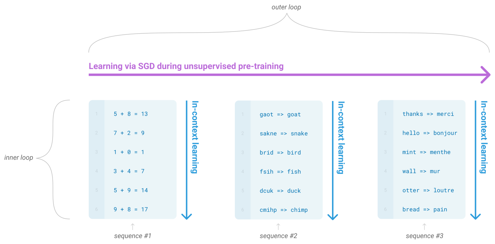

*图 1.1（原文 Figure 1.1，第 3 页）：语言模型的元学习。在无监督预训练期间，语言模型发展出广泛的技能和模式识别能力，之后在推理时用这些能力快速适应或识别所需任务。我们用“上下文学习”（in-context learning）来称呼这个过程的内循环，它发生在对每条序列的一次前向传播之内。图中的序列并不代表模型在预训练中真正看到的数据，只是想说明同一条序列内部有时会嵌入重复的子任务。*

**图中文字翻译与读法**：

- 上方紫色箭头 “Learning via SGD during unsupervised pre-training”（无监督预训练期间通过 SGD 学习）整体标为 outer loop（外循环）；下方三个方框各是一条训练序列（sequence #1、#2、#3），整体标为 inner loop（内循环），每个方框右侧的蓝色箭头 “In-context learning”（上下文学习）表示在序列内自上而下读下去的过程。
- 三条序列内部各自重复了一种小任务：序列 1 是加法（5 + 8 = 13、7 + 2 = 9、1 + 0 = 1、3 + 4 = 7、5 + 9 = 14、9 + 8 = 17）；序列 2 是还原被打乱字母的单词（gaot => goat、sakne => snake、brid => bird、fsih => fish、dcuk => duck、cmihp => chimp）；序列 3 是英译法（thanks => merci、hello => bonjour、mint => menthe、wall => mur、otter => loutre、bread => pain）。
- **读图结论**：互联网文本里本来就夹杂着各种“重复的小任务”。预训练时模型要预测下一个 token，就被迫学会“从序列前面的几行里推断规律，再用到下一行”，这就是内循环的来历。内循环只是计算，不改参数；参数只在外循环里变。原文脚注 1 特别指出：语言模型领域有人把这种做法叫“零样本迁移”，但这个词有歧义（没有梯度更新不等于没给示例），所以论文用“元学习”描述内外循环的结构，用“上下文学习”指内循环，再按推理时给了几个示范称之为 zero-shot、one-shot 或 few-shot。这些词本身不预设“模型是在推理时从零学会任务，还是只是识别训练中见过的模式”，这个问题论文留到原文第 5 节（本文第九节）讨论。

### 2.3 要检验的假设：规模越大，上下文学习越强

此前 GPT-2（Radford 等 2019）已尝试这条路，但结果远逊于微调：在 Natural Questions 上只有 4%，CoQA 上 55 F1，比当时的 SOTA 低 35 分以上。另一方面，Transformer 语言模型的参数量在过去几年快速增长：约 1 亿（GPT）、3 亿（BERT）、15 亿（GPT-2）、80 亿（Megatron）、110 亿（T5）、170 亿（Turing-NLG）；每次增大都带来文本合成或下游任务的改进，并且有证据表明与许多下游任务相关性很好的对数损失随规模平滑下降（Kaplan 等 2020，见 [scaling_laws](../scaling_laws/论文中文解读.md)）。既然上下文学习要在模型参数里吸收大量技能和任务，作者推测它的能力也会随规模显著增强。于是训练了 175B 的 GPT-3 来检验：摘要称它比此前任何非稀疏（non-sparse）语言模型大 10 倍。

图 1.2 用一个简单任务（删掉单词中被随机插入的符号）直观展示了这个假设。

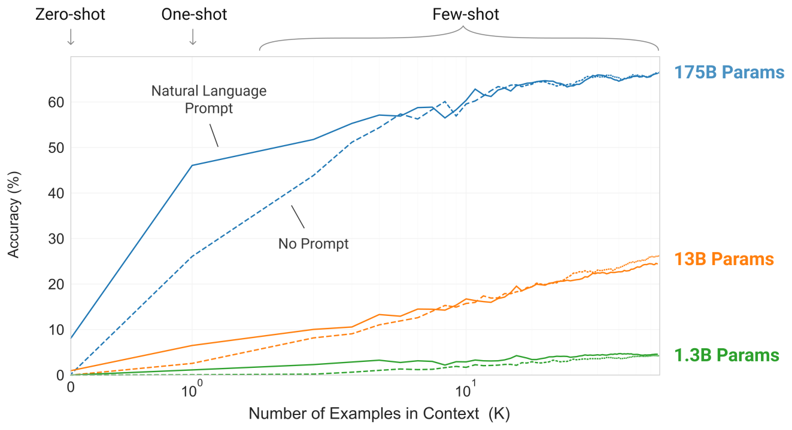

*图 1.2（原文 Figure 1.2，第 4 页）：更大的模型越来越高效地利用上下文中的信息。图中给出模型完成“从单词中删去随机符号”这一简单任务的上下文学习表现，分别有和没有自然语言任务描述（见原文 3.9.2 节）。大模型更陡的“上下文学习曲线”说明它们从上下文信息中学习任务的能力更强；在广泛的任务上我们看到定性相似的行为。*

**图中文字翻译与读法**：

- 横轴 Number of Examples in Context（K，上下文中的示例数；刻度 0、$10^{0}$、$10^{1}$，对数刻度），纵轴 Accuracy (%)（准确率）。上方标出 Zero-shot（K=0）、One-shot（K=1）和 Few-shot（K 更大）三个区段。三组线分别是 175B Params（蓝）、13B Params（橙）、1.3B Params（绿）；每组中，实线是带自然语言提示（Natural Language Prompt，即任务描述）的结果，虚线是没有提示（No Prompt）的结果。
- 175B 模型：K=0 时，有提示约 8%，没有提示接近 0；K=1 时，有提示约 46%，没有提示约 26%；K 增大到几十后两条线汇合，都约 66% 到 67%。13B 模型随 K 增加缓慢上升到约 25%，1.3B 模型始终在约 5% 以下（均为从图上读出的近似值）。这与表 3.10 中 175B 的符号插入（RI）结果一致：零样本 8.26%、单样本 45.4%、少样本（K=100）67.2%。
- **读图结论**：（1）在同一个模型内，给的示例越多准确率越高（“上下文学习曲线”），且这个过程不涉及任何梯度更新；（2）自然语言任务描述在示例很少时帮助最大（K=1 时约 20 个百分点），示例足够多后帮助消失；（3）这条曲线的陡度强烈依赖模型规模：同样增加示例，175B 模型从 K=0 到 K=10 涨了 50 多个点，而 1.3B 几乎没有变化。作者说，这个任务的结果特别鲜明，但随模型规模和上下文示例数改善这一总体趋势在多数任务上都成立。

## 三、评测设定：微调、少样本、单样本、零样本（原文第 2 节）

作者把“一个任务要靠多少任务专用数据”看作一条光谱，列出至少四个点（图 2.1 以英译法为例）。

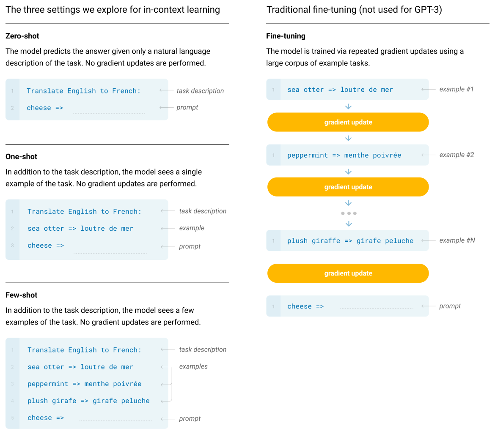

*图 2.1（原文 Figure 2.1，第 7 页）：零样本、单样本和少样本，与传统微调对比。上图展示用语言模型完成一个任务的四种方法：微调是传统方法，而本文研究的零样本、单样本、少样本，要求模型在测试时只做前向传播就完成任务。少样本设置下我们通常给模型呈现几十个示例。所有任务描述、示例和提示的确切措辞见原文附录 G。*

**图中文字翻译与读法**：

- **左半 “The three settings we explore for in-context learning”（我们探索的三种上下文学习设置）**：
  - Zero-shot（零样本）：模型只收到自然语言的任务描述，不做梯度更新。上下文两行：`Translate English to French:`（task description，任务描述）与 `cheese =>`（prompt，提示，等待模型补全）。
  - One-shot（单样本）：除任务描述外，模型看到一个任务示例：`sea otter => loutre de mer`（example，示例），再接 `cheese =>`。
  - Few-shot（少样本）：除任务描述外，模型看到若干示例：`sea otter => loutre de mer`、`peppermint => menthe poivrée`、`plush giraffe => girafe peluche`（examples，示例），再接 `cheese =>`。
- **右半 “Traditional fine-tuning (not used for GPT-3)”（传统微调，GPT-3 未使用）**：模型要在一个很大的示例语料上经过反复的梯度更新训练：example #1（`sea otter => loutre de mer`）后跟一个黄色的 gradient update（梯度更新），example #2（`peppermint => menthe poivrée`）后又一个梯度更新，……一直到 example #N（`plush giraffe => girafe peluche`），最后才是提示 `cheese =>`。
- **读图结论**：左右的根本区别是示例用在哪里：微调把示例当作训练数据，每个示例都引起一次权重更新；上下文学习把示例当作输入文本的一部分，权重不变。两者在测试时的区别是，前者的任务知识沉淀进参数里，后者只存在于当前这一次输入的上下文中，换一个输入就消失。

四种设置的定义和利弊，按原文整理如下：

| 设置 | 示例怎么用 | 原文列出的优点 | 原文列出的缺点 |
|---|---|---|---|
| 微调（Fine-Tuning，FT） | 在任务专用有监督数据集上更新权重，通常需要数千到数十万条标注样本 | 在许多基准上表现很强 | 每个任务都要新数据集；可能在分布外泛化差；可能利用训练数据的虚假特征，导致和人类比较不公平。本文不对 GPT-3 做微调 |
| 少样本（Few-Shot，FS） | 推理时在上下文里给 $K$ 个“上下文加补全”示例，再给一个只含上下文的实例让模型补全；不更新权重。$K$ 通常取 10 到 100（受 $n_{\text{ctx}}=2048$ 限制） | 大幅减少对任务专用数据的需求；减少从一个又大又窄的微调数据集中学到过窄分布的可能 | 目前效果远不如 SOTA 微调模型；仍需要少量任务数据 |
| 单样本（One-Shot，1S） | 与少样本相同，但只给 1 个示例（外加任务的自然语言描述） | 最接近某些任务向人类说明的方式（例如在众包平台上给 1 个示范） | 与少样本类似，信息更少 |
| 零样本（Zero-Shot，0S） | 不给示例，只给任务的自然语言指令 | 最方便，最有望稳健，避免虚假相关 | 最难：有时连人类没看示例也不清楚任务格式（例如“做一张 200 米跑世界纪录的表”），所以某种意义上“不公平地难” |

作者强调：研究零样本、单样本、少样本不是把它们当成互相竞争的做法，而是当成在“特定基准上的表现”和“样本效率”之间取不同权衡的不同问题设置；少样本结果很多只略低于微调 SOTA，而单样本甚至零样本也许才是和人类表现最公平的比较，也是未来的重要目标。

**评测细节**（原文 2.4 节）：

- **少样本的取样**：对评测集中每个样例，从该任务的训练集中随机抽 $K$ 个示例作为条件，示例之间用 1 或 2 个换行分隔（视任务而定）。LAMBADA 和 StoryCloze 没有监督训练集，就从开发集抽示例、在测试集评测；原始 Winograd 只有一个数据集，所以直接从中抽取条件示例。
- **$K$ 的选取**：$K$ 可取 0 到上下文窗口能容纳的最大值（$n_{\text{ctx}}=2048$，通常容纳 10 到 100 个示例）。更大的 $K$ 通常但并不总是更好；当有独立的开发集和测试集时，在开发集上试几个 $K$，把最好的值用到测试集。某些任务（见附录 G）还在示例之外（$K=0$ 时则替代示例）加一段自然语言提示。
- **多选题**：给 $K$ 个“上下文加正确答案”的示例，再给一个只有上下文的实例，比较每个候选补全的语言模型似然。多数任务比较**每 token 的似然**（用来消除长度影响）；ARC、OpenBookQA、RACE 三个数据集在开发集上发现，用补全的无条件概率归一化更好，即计算 $\dfrac{P(\text{completion}\mid\text{context})}{P(\text{completion}\mid\text{answer context})}$，其中 answer context 是字符串 `"Answer: "` 或 `"A: "`，只起提示“这里该填答案”的作用。
- **二分类**：给选项起更有语义的名字（例如 “True”/“False”，而不是 0/1），再当作多选题；有时也采用 Raffel 等（T5）的写法（见附录 G）。
- **自由形式补全**：用束搜索（beam search），参数同 T5：束宽 4、长度惩罚 $\alpha=0.6$；按数据集的惯例用 F1、BLEU 或精确匹配（exact match）打分。
- **报告哪个集合**：有公开测试集的任务报告测试集结果，对每个模型尺寸和每种设置（零样本、单样本、少样本）都报告；测试集不公开时，模型往往太大放不进测试服务器，就报告开发集结果。只对少数任务（SuperGLUE、TriviaQA、PIQA）实际提交了测试服务器，并且只提交 175B 的少样本结果（原文此处写作“200B”，应为笔误，见文末备查表）。

## 四、模型、数据与训练

### 4.1 模型与架构（原文 2.1 节、表 2.1）

GPT-3 沿用 GPT-2 的模型和架构（包括改进的初始化、预归一化 pre-normalization、可逆分词 reversible tokenization），**唯一的结构差别**是 Transformer 各层中交替使用稠密（dense）注意力和局部带状稀疏（locally banded sparse）注意力，类似 Sparse Transformer（Child 等 2019）。为了研究性能对模型大小的依赖，作者训练了 8 种尺寸，跨三个数量级，从 1.25 亿到 1750 亿参数，最大的就叫 GPT-3。所有模型的上下文窗口都是 $n_{\text{ctx}}=2048$ token，前馈层维度恒为瓶颈层的 4 倍（$d_{\text{ff}}=4\,d_{\text{model}}$）。模型沿深度和宽度两个维度切分到多块 GPU 上，以减少节点间的数据传输；各模型的具体结构参数是按计算效率和 GPU 上的负载均衡选的；此前工作（Kaplan 等）表明，验证损失对这些参数在较宽范围内并不敏感。

**表 2.1：所训练模型的尺寸、结构与学习超参数（原文表 2.1，第 8 页；batch size 以 token 计）。所有模型都训练了共计 3000 亿 token**

| 模型名 | 参数量 $n_{\text{params}}$ | 层数 $n_{\text{layers}}$ | $d_{\text{model}}$ | 注意力头数 $n_{\text{heads}}$ | 每头维度 $d_{\text{head}}$ | batch size | 学习率 |
|---|---:|---:|---:|---:|---:|---:|---:|
| GPT-3 Small | 125M | 12 | 768 | 12 | 64 | 0.5M | $6.0\times10^{-4}$ |
| GPT-3 Medium | 350M | 24 | 1024 | 16 | 64 | 0.5M | $3.0\times10^{-4}$ |
| GPT-3 Large | 760M | 24 | 1536 | 16 | 96 | 0.5M | $2.5\times10^{-4}$ |
| GPT-3 XL | 1.3B | 24 | 2048 | 24 | 128 | 1M | $2.0\times10^{-4}$ |
| GPT-3 2.7B | 2.7B | 32 | 2560 | 32 | 80 | 1M | $1.6\times10^{-4}$ |
| GPT-3 6.7B | 6.7B | 32 | 4096 | 32 | 128 | 2M | $1.2\times10^{-4}$ |
| GPT-3 13B | 13.0B | 40 | 5140 | 40 | 128 | 2M | $1.0\times10^{-4}$ |
| GPT-3 175B 或 “GPT-3” | 175.0B | 96 | 12288 | 96 | 128 | 3.2M | $0.6\times10^{-4}$ |

读法：模型越大，batch size 越大、学习率越小（与 Kaplan 等和 McCandlish 等的发现一致：大模型能用更大的 batch，但需要更小的学习率；batch size 的选择参考了训练中测得的梯度噪声尺度）。自行验算：用 $n_{\text{params}}\approx12\,n_{\text{layers}}\,d_{\text{model}}^{2}+(n_{\text{vocab}}+n_{\text{ctx}})\,d_{\text{model}}$（词表 $n_{\text{vocab}}=50257$）可以复现 125M、760M、2.7B、6.7B、175B 等规模，例如 175B 为 $12\times96\times12288^{2}\approx1.739\times10^{11}$ 加 embedding 约 $6.4\times10^{8}$，合计约 $1.746\times10^{11}$，与附录表 D.1 的 174,600M 一致。原表有两处结构数字不自洽（自行发现，原文未解释）：13B 一行的 $d_{\text{model}}$ 印作 5140，而 $40\times128=5120$，并且用 5120 算出的参数量（约 12,851M）才与表 D.1 的 12,850M 吻合；XL 一行的 $24\times128=3072\neq2048$。因此可以认为 5140 是笔误。

### 4.2 训练数据（原文 2.2 节、表 2.2、附录 A）

Common Crawl 几乎有一万亿词，规模足以训练最大的模型而不用在同一条序列上更新两次。但作者发现，未过滤或轻度过滤的 Common Crawl 平均质量低于精选数据集，所以采取了三个步骤提高平均质量：

1. **按质量过滤**：下载 Common Crawl 的一个版本，并按其与一批高质量参考语料的相似度过滤（附录 A：用一个逻辑回归分类器区分“高质量”和原始 Common Crawl。正例是 WebText、Wikipedia 和作者的网络图书语料等精选数据，负例是未过滤的 Common Crawl；特征来自 Spark 的标准分词器和 HashingTF。用分类器给 Common Crawl 文档打分后，只在 `np.random.pareto(α) > 1 − document_score` 时保留该文档，取 $\alpha=9$，目的是大多保留分类器打高分的文档，同时仍然纳入一些分布外的文档；$\alpha$ 的取值使得分数分布与 WebText 上分类器分数的分布吻合。作者发现这样重新加权，在一批分布外的生成文本样本上的损失更低，即质量提高）；
2. **模糊去重**（fuzzy deduplication）：在每个数据集内部和数据集之间做文档级去重，既防止冗余，也保证留出的验证集能真实度量过拟合（附录 A：用 Spark 的 MinHashLSH，10 个哈希，特征同上；还从 Common Crawl 中模糊地去掉了 WebText）。总体上这一步使数据集平均缩小约 10%；
3. **加入已知的高质量语料**：扩充了 WebText（在更长时期内抓取链接得到，首次描述见 Kaplan 等）、两个互联网图书语料（Books1 和 Books2）和英文 Wikipedia。

Common Crawl 取自 2016 到 2019 年的 41 个月度分片，过滤前约 45TB 压缩纯文本，过滤后约 570GB，大致相当于 4000 亿个 BPE token。**训练时各数据集不按大小比例取样**，质量更高的数据集被更频繁地取样，使得 Common Crawl 和 Books2 在训练中被取样不到一次，其他数据集被取样 2 到 3 次；作者说这实质上是接受少量的过拟合，换取更高质量的训练数据。

**表 2.2：训练 GPT-3 所用的数据集（原文表 2.2，第 9 页）。“训练混合中的权重”指训练中来自某数据集的样本所占比例，刻意不与数据集大小成比例；因此训练 3000 亿 token 时，一些数据集被看到最多 3.4 次，而另一些不到一次**

| 数据集 | 数量（token） | 训练混合中的权重 | 训练 300B token 时经过的 epoch 数 |
|---|---:|---:|---:|
| Common Crawl（过滤后） | 410 billion | 60% | 0.44 |
| WebText2 | 19 billion | 22% | 2.9 |
| Books1 | 12 billion | 8% | 1.9 |
| Books2 | 55 billion | 8% | 0.43 |
| Wikipedia | 3 billion | 3% | 3.4 |

读法：Common Crawl 占数据量的绝大部分（410B 对其余加起来约 89B），但训练里只占 60% 的权重；小而精的 WebText2、Books1、Wikipedia 被重复读 2 到 3 次以上。表中权重加起来是 101%（四舍五入的结果）。自行验算：按权重乘以 300B 再除以数据量，WebText2 约为 3.5 个 epoch、Wikipedia 约为 3.0 个，与表中的 2.9 和 3.4 有出入，其余几行吻合；原文没有解释差别来源，使用这两个数时需要留意。

原文还说明了一个方法论上的担忧：在广泛互联网数据上预训练的语言模型，尤其是能记住海量内容的大模型，下游任务的测试集或开发集可能在预训练中被无意间看到（污染，contamination）。作者曾搜索并试图去掉训练数据与本文研究的全部基准的开发集、测试集的重叠，但**过滤程序有一个 bug，使得一些重叠被忽略了**，由于训练成本太高，无法重训；因此原文第 4 节专门刻画了残留重叠的影响（见本文第八节）。

### 4.3 训练过程（原文 2.3 节、附录 B）与计算量

- **序列的组织**：训练时总是用满 $n_{\text{ctx}}=2048$ token 的序列，文档比 2048 短时就把多个文档拼进一条序列以提高计算效率；拼在一起的多个文档不做任何特殊的注意力掩码，而是用一个特殊的 end-of-text token 分隔，让模型能推断出被该 token 隔开的上下文互不相关。数据在训练中无放回地取样（直到某个 epoch 边界），以尽量减少过拟合。
- **优化器与超参数**：Adam，$\beta_1=0.9$、$\beta_2=0.95$、$\epsilon=10^{-8}$；梯度全局范数裁剪到 1.0；学习率用余弦衰减，在 2600 亿 token 内降到初始值的 10%，之后继续以 10% 的学习率训练；前 3.75 亿 token 线性 warmup；batch size 在前 40 亿到 120 亿 token（视模型大小）内从一个很小的值（3.2 万 token）线性增大到表 2.1 的完整值；所有模型用 0.1 的权重衰减（weight decay）做少量正则。
- **硬件与并行**：为了训练大模型而不爆显存，每个矩阵乘内部用模型并行，网络层之间也用模型并行；所有模型都在 V100 GPU 上训练，集群是 Microsoft 提供的高带宽集群的一部分。
- **训练步数**（自行验算）：总 token 数除以 batch size，GPT-3 175B 约 $3\times10^{11}/3.2\times10^{6}\approx9.4\times10^{4}$ 步；小模型（0.5M batch）约 60 万步。

图 2.2 比较了各模型训练用的总计算量。

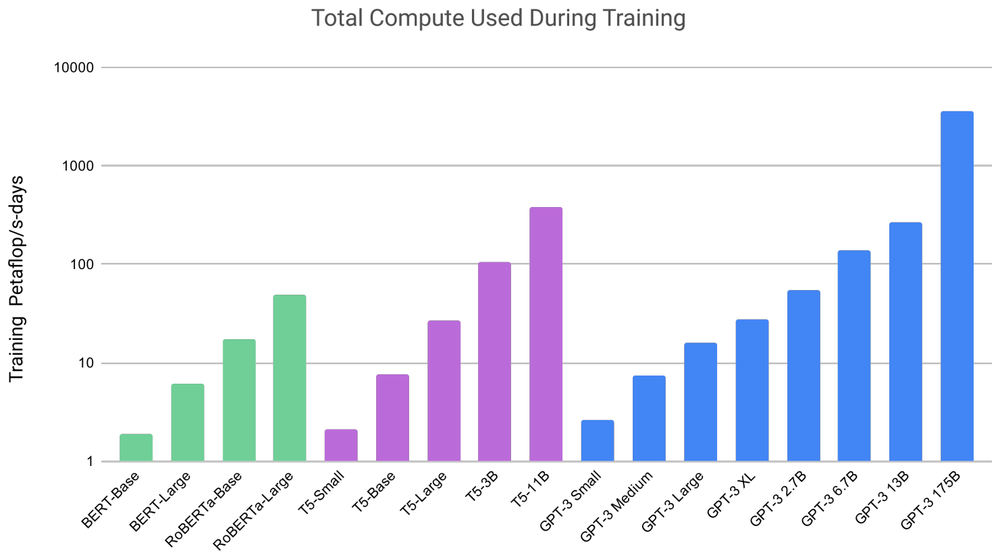

*图 2.2（原文 Figure 2.2，第 9 页）：训练使用的总计算量。依据“Scaling Laws For Neural Language Models”（Kaplan 等 2020）的分析，我们训练的模型比常规做法大得多，而 token 少得多。结果是：虽然 GPT-3 3B 几乎比 RoBERTa-Large（3.55 亿参数）大 10 倍，两者在预训练中却都用了大约 50 petaflop/s-day 的计算量。计算方法见附录 D。*

**图中文字翻译与读法**：纵轴 Training Petaflop/s-days（训练 petaflop/s-day，对数刻度，1 到 10000），横轴按模型分组：绿色是 BERT-Base、BERT-Large、RoBERTa-Base、RoBERTa-Large，紫色是 T5-Small、T5-Base、T5-Large、T5-3B、T5-11B，蓝色是 GPT-3 Small、Medium、Large、XL、2.7B、6.7B、13B、175B。柱高对应附录表 D.1：GPT-3 175B 约 3640 petaflop/s-day，是 13B 的约 13.6 倍、RoBERTa-Large 的约 74 倍。图题里的 “GPT-3 3B” 指横轴上的 GPT-3 2.7B（约 55 petaflop/s-day，与 RoBERTa-Large 的约 49 相当）。**读图结论**：这个图说明 GPT-3 系列的路线是“大模型、较少 token”（300B token，对 175B 参数约 1.7 个 token 每参数，自行验算），而 BERT、RoBERTa、T5 是“较小模型、较多 token”；之后 Chinchilla 论文（见 [chinchilla](../chinchilla/论文中文解读.md)）指出这类“大模型少训练”的配比并不是计算最优的。

**表 D.1：训练各语言模型的总计算量（原文表 D.1，第 46 页；摘自附录 D）。从右往左读：先是各模型的训练 token 数；T5 是编码器-解码器，每个 token 只有一半参数被激活；前向传播里每个 token 对每个被激活参数做一次加法和一次乘法（忽略注意力）；再乘 3 倍计入反向传播；得到每参数每 token 的 FLOPs；乘以训练 token 数和总参数量，得到训练总 FLOPs；petaflop/s-day 与 FLOPs 的换算为 $8.64\times10^{19}$ FLOPs**

| 模型 | 总训练计算（PF-days） | 总训练计算（FLOPs） | 参数量（M） | 训练 token（billions） | 每参数每 token 的 FLOPs | 反向传播倍数 | 每个被激活参数的前向 FLOPs | 每 token 被激活的参数比例 |
|---|---:|---:|---:|---:|---:|---:|---:|---:|
| T5-Small | 2.08E+00 | 1.80E+20 | 60 | 1,000 | 3 | 3 | 1 | 0.5 |
| T5-Base | 7.64E+00 | 6.60E+20 | 220 | 1,000 | 3 | 3 | 1 | 0.5 |
| T5-Large | 2.67E+01 | 2.31E+21 | 770 | 1,000 | 3 | 3 | 1 | 0.5 |
| T5-3B | 1.04E+02 | 9.00E+21 | 3,000 | 1,000 | 3 | 3 | 1 | 0.5 |
| T5-11B | 3.82E+02 | 3.30E+22 | 11,000 | 1,000 | 3 | 3 | 1 | 0.5 |
| BERT-Base | 1.89E+00 | 1.64E+20 | 109 | 250 | 6 | 3 | 2 | 1.0 |
| BERT-Large | 6.16E+00 | 5.33E+20 | 355 | 250 | 6 | 3 | 2 | 1.0 |
| RoBERTa-Base | 1.74E+01 | 1.50E+21 | 125 | 2,000 | 6 | 3 | 2 | 1.0 |
| RoBERTa-Large | 4.93E+01 | 4.26E+21 | 355 | 2,000 | 6 | 3 | 2 | 1.0 |
| GPT-3 Small | 2.60E+00 | 2.25E+20 | 125 | 300 | 6 | 3 | 2 | 1.0 |
| GPT-3 Medium | 7.42E+00 | 6.41E+20 | 356 | 300 | 6 | 3 | 2 | 1.0 |
| GPT-3 Large | 1.58E+01 | 1.37E+21 | 760 | 300 | 6 | 3 | 2 | 1.0 |
| GPT-3 XL | 2.75E+01 | 2.38E+21 | 1,320 | 300 | 6 | 3 | 2 | 1.0 |
| GPT-3 2.7B | 5.52E+01 | 4.77E+21 | 2,650 | 300 | 6 | 3 | 2 | 1.0 |
| GPT-3 6.7B | 1.39E+02 | 1.20E+22 | 6,660 | 300 | 6 | 3 | 2 | 1.0 |
| GPT-3 13B | 2.68E+02 | 2.31E+22 | 12,850 | 300 | 6 | 3 | 2 | 1.0 |
| GPT-3 175B | 3.64E+03 | 3.14E+23 | 174,600 | 300 | 6 | 3 | 2 | 1.0 |

读法：GPT-3 175B 的 $6\,N D=6\times1.746\times10^{11}\times3\times10^{11}\approx3.14\times10^{23}$ FLOPs，约 3640 PF-days，与 Kaplan 等的 $C\approx6ND$ 近似一致（自行验算）。这张表里的参数量（含 embedding）与 Kaplan 等不含 embedding 的口径不同；图 3.1 则说明它的横轴和参数量都排除了 embedding。原文计算时忽略了注意力，理由是它通常占不到所分析模型总计算的 10%。

## 五、结果总览

### 5.1 平滑的规模律（原文第 3 节开头、图 3.1）

作者训练了 8 个模型，图 3.1 另外加了 6 个小到只有 10 万参数的模型，画出验证损失随训练计算量的变化。

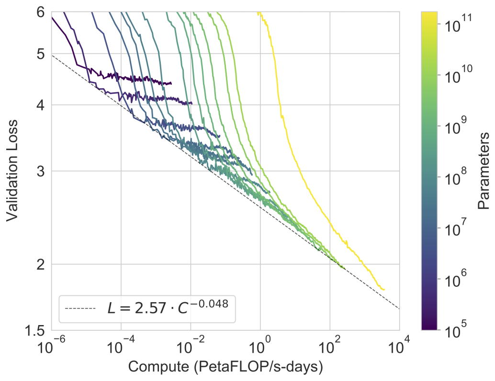

*图 3.1（原文 Figure 3.1，第 11 页）：性能随计算量平滑扩展。性能（以交叉熵验证损失度量）随训练所用计算量呈幂律趋势。Kaplan 等观察到的幂律行为又延伸了两个数量级，与预测曲线只有很小的偏差。本图的计算量和参数量都不含 embedding 参数。*

**图中文字翻译与读法**：

- 横轴 Compute (PetaFLOP/s-days)（计算量，$10^{-6}$ 到 $10^{4}$，对数刻度），纵轴 Validation Loss（验证损失，1.5 到 6，对数刻度）；颜色条 Parameters（参数量，$10^{5}$ 到 $10^{11}$，对数颜色）。每条彩色曲线是一个模型的训练曲线：小模型（深紫）下降后很早变平，大模型（黄绿）一路下降到更低；最右端黄色是 175B 模型，训练结束时验证损失约 1.75。黑色虚线是幂律拟合，图例 $L=2.57\cdot C^{-0.048}$。
- **读图结论**：所有曲线的左下包络（即“该计算量下最好的模型”）紧贴这条虚线，跨约 10 个数量级的计算量，只有轻微的弯曲。论文说“在把这条趋势延伸两个数量级之后，只看到轻微（如果有的话）偏离幂律”。作者随后指出：可能有人担心交叉熵损失的改善只来自对训练语料虚假细节的建模，但后面各节的结果显示，损失下降会带来广泛的自然语言任务上的一致提升。指数 $-0.048$ 与 Kaplan 等的 $-0.050$（最优分配计算量）相近。

### 5.2 少样本随规模增长更快（图 1.3）

图 1.3 把本文所有“以准确率度量”的基准汇总在一张图里：横轴是 8 个模型尺寸，三条粗线是各设置下的平均准确率，背后的浅色细线是单个任务的曲线。

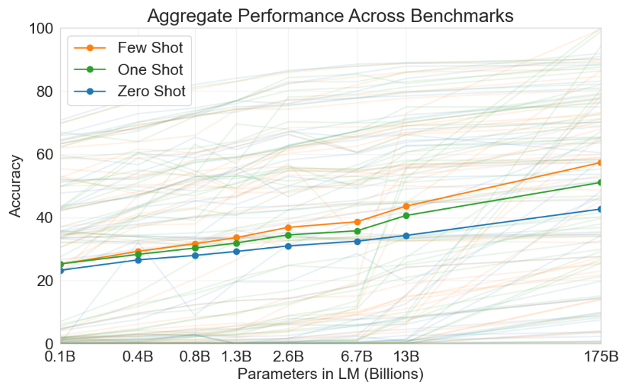

*图 1.3（原文 Figure 1.3，第 5 页）：全部 42 个以准确率为指标的基准的汇总性能。零样本性能随模型规模稳步提升，少样本性能提升得更快，说明更大的模型更擅长上下文学习。SuperGLUE 这一标准 NLP 基准套件的更详细分析见图 3.8。*

**图中文字翻译与读法**：横轴 Parameters in LM (Billions)（语言模型参数量，十亿；刻度 0.1B、0.4B、0.8B、1.3B、2.6B、6.7B、13B、175B，各刻度等距排列，不按数值比例），纵轴 Accuracy（准确率，0 到 100）。橙色 Few Shot（少样本）、绿色 One Shot（单样本）、蓝色 Zero Shot（零样本）三条粗线是 42 个基准的平均值；在 0.1B 处三者都约 23 到 25，到 175B 处约为少样本 57、单样本 51、零样本 43（从图上读出的近似值）。三条线之间的间距随模型变大而拉开。**读图结论**：作者的原话是，这只是一个启发式的总体印象，“不应被视为一个严格或有意义的基准”：它把难度、指标、随机水平各不相同的任务简单平均。后面各节才是逐任务的证据。

### 5.3 与微调 SOTA 的对照（自行汇总）

下表把本文主要任务的 175B 少样本结果与原文给出的微调（或其他）SOTA 并列，便于一眼看出 GPT-3 强在哪里、弱在哪里。数字取自原文表 3.1 至 3.8；带 \* 的是原文标注可能受数据污染的结果（见本文第八节）。“判断”列是本文的概括。

| 任务（指标） | 原文所列 SOTA | GPT-3 零样本 | GPT-3 单样本 | GPT-3 少样本 | 判断 |
|---|---:|---:|---:|---:|---|
| PTB（困惑度，越低越好） | 35.8（GPT-2 零样本） | 20.5 | - | - | 超过（仅零样本，差 15.3） |
| LAMBADA（准确率） | 68.0 | 76.2 | 72.5 | 86.4 | 超过（少样本高 18.4） |
| StoryCloze（准确率） | 91.8 | 83.2 | 84.7 | 87.7 | 落后 4.1 |
| HellaSwag（准确率） | 85.6 | 78.9 | 78.1 | 79.3 | 落后 6.3 |
| TriviaQA（准确率） | 68.0（开卷 RAG；闭卷微调 T5-11B+SSM 为 60.5） | 64.3 | 68.0 | 71.2 | 超过 |
| WebQs（准确率） | 45.5（开卷 RAG；闭卷 T5-11B+SSM 为 44.7） | 14.4 | 25.3 | 41.5 | 接近但落后 |
| NQs（准确率） | 44.5（开卷 RAG；闭卷 T5-11B+SSM 为 36.6） | 14.6 | 23.0 | 29.9 | 落后 |
| 翻译 Fr→En（BLEU） | 35.0（有监督） | 21.2 | 33.7 | 39.2 | 超过（原文认为该基准不具竞争力） |
| 翻译 En→Fr（BLEU） | 45.6（有监督） | 25.2 | 28.3 | 32.6 | 落后 |
| Winogrande（准确率） | 84.6 | 70.2 | 73.2 | 77.7 | 落后（接近微调 RoBERTa-Large） |
| PIQA（准确率） | 79.4 | 80.5\* | 80.5\* | 82.8\* | 超过（有污染风险） |
| ARC Challenge（准确率） | 78.5 | 51.4 | 53.2 | 51.5 | 落后 27 |
| CoQA（F1） | 90.7 | 81.5 | 84.0 | 85.0 | 落后 5.7 |
| RACE-h（准确率） | 90.0 | 45.5 | 45.9 | 46.8 | 落后 43.2 |
| SuperGLUE 平均分（test） | 89.0（微调 BERT-Large 为 69.0） | - | - | 71.8 | 高于 BERT-Large，远低于 SOTA |
| ANLI R3（准确率） | 48.3 | 34.5 | 35.1 | 40.2 | 落后，仅略高于随机（33.3） |

这张表里的零样本和单样本列取自表 3.2 至 3.7；PIQA 零样本一格的数值取自原文表 3.6（80.5），而正文与附录表 H.1 均为 81.0，见文末备查表。

## 六、各类任务的结果（原文 3.1 至 3.8 节）

作者把评测集分成 9 类：传统语言建模及完形（cloze）和补全任务；闭卷问答；翻译；Winograd 类任务；常识推理；阅读理解；SuperGLUE；自然语言推断（NLI）；以及专门设计来考察上下文学习的合成与定性任务（下一节）。每类任务都在零样本、单样本、少样本三种设置下评测 8 个尺寸的模型。

### 6.1 语言建模、完形填空与补全（原文 3.1 节）

**Penn Tree Bank（PTB）语言建模**。作者计算 GPT-2 论文所用的 PTB 数据集上的零样本困惑度。GPT-2 论文里另外 4 个与 Wikipedia 相关的任务被舍弃，因为它们完全包含在 GPT-3 的训练数据里；One Billion Word 基准也因训练集中含有很高比例而舍弃。PTB 因为早于现代互联网而躲过了这个问题。PTB 是传统的语言建模数据集，没有清晰的“示例”划分来定义单样本或少样本，所以只测零样本。最大的模型取得困惑度 20.50，比此前零样本 SOTA 好约 15 点。

**表 3.1：PTB 语言建模数据集上的零样本结果（原文表 3.1，第 11 页；困惑度，越低越好）。其他许多常见语言建模数据集被省略，因为它们源自 Wikipedia 等已包含在 GPT-3 训练数据中的来源**

| 设置 | PTB |
|---|---:|
| SOTA（零样本）（Radford 等 2019，即 GPT-2） | 35.8 |
| GPT-3 零样本 | **20.5** |

**LAMBADA**。LAMBADA 考察文本中的长程依赖：要预测需要读完一段上下文才能确定的句子的最后一个词。近来有人（Bisk 等 2020）认为，在这个难基准上继续扩大规模的回报在递减：两个近期 SOTA（Megatron 与 Turing-NLG）之间模型大小翻倍只带来 1.5% 的改进，并提出“继续把硬件和数据扩大几个数量级不是前进的道路”。作者发现这条路依然有希望：零样本下 GPT-3 在 LAMBADA 上达到 76%，比此前 SOTA 高 8 个百分点。

LAMBADA 也展示了少样本学习的灵活性。尽管任务里补全的永远是句子的最后一个词，标准语言模型并不知道这一点，所以不仅给正确结尾分配概率，也给段落的其他有效续写分配概率；过去的部分解决办法是停用词过滤（禁止“续写型”词）。少样本设置则让作者能把任务“框”成完形填空，让模型从示例中推断需要的补全恰好是一个词。所用的填空格式如下：

```text
Alice was friends with Bob. Alice went to visit her friend ____. → Bob
George bought some baseball equipment, a ball, a glove, and a ____. →
```

在这种格式的示例下，少样本 GPT-3 的准确率达到 86.4%，比此前 SOTA 高 18 个百分点以上；少样本性能随模型规模强烈提升：这一设置使最小模型的准确率下降近 20 个点，却使 GPT-3 提高了 10 个点。填空方法在单样本下无效，总比零样本差，也许是因为所有模型还需要几个示例才能识别出这个模式。一个需要提醒的地方：污染分析发现 LAMBADA 数据集相当一部分似乎出现在训练数据里，但原文第 4 节（本文第八节）的分析表明其对性能的影响可以忽略（干净子集的得分与整个数据集相差不到 0.5%）。

**HellaSwag**：从多个候选中为故事或指令挑选最合适的结尾，样例是用对抗方式从语言模型出发挖掘的，对语言模型难、对人类容易（人类准确率 95.6%）。GPT-3 单样本 78.1%、少样本 79.3%，高于一个微调的 15 亿参数语言模型的 75.4%，但仍明显低于微调多任务模型 ALUM 的 SOTA 85.6%。

**StoryCloze**（2016 版）：为五句话的故事选出正确的结尾句。GPT-3 零样本 83.2%，少样本 87.7%（$K=70$），比基于 BERT 的微调 SOTA 低 4.1%，但比此前的零样本结果高约 10%。

**表 3.2：完形填空与补全任务上的表现（原文表 3.2，第 12 页；LAMBADA 有准确率与困惑度两种指标，困惑度越低越好）。GPT-3 显著提升了 LAMBADA 的 SOTA，同时在另外两个困难的补全预测数据集上取得可观的表现**

| 设置 | LAMBADA（acc） | LAMBADA（ppl） | StoryCloze（acc） | HellaSwag（acc） |
|---|---:|---:|---:|---:|
| SOTA | 68.0 | 8.63 | **91.8** | **85.6** |
| GPT-3 零样本 | **76.2** | **3.00** | 83.2 | 78.9 |
| GPT-3 单样本 | **72.5** | **3.35** | 84.7 | 78.1 |
| GPT-3 少样本 | **86.4** | **1.92** | 87.7 | 79.3 |

（原文脚注：LAMBADA 准确率 SOTA 来自 Turing-NLG；LAMBADA 困惑度 SOTA 来自 GPT-2；StoryCloze 来自基于 BERT 的微调模型；HellaSwag 来自微调多任务模型 ALUM。）

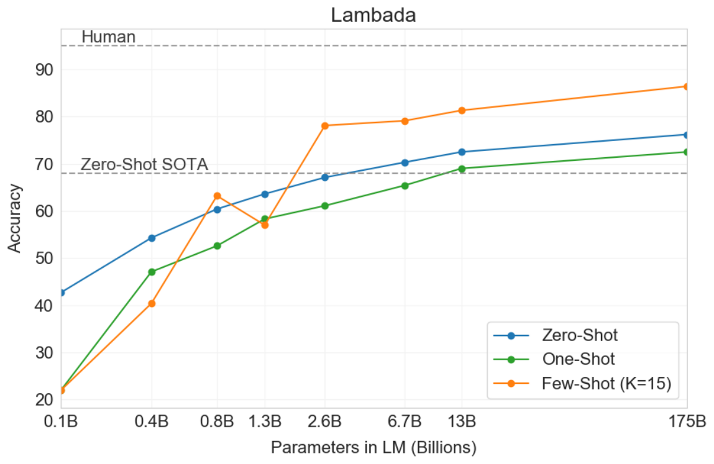

*图 3.2（原文 Figure 3.2，第 12 页）：在 LAMBADA 上，语言模型的少样本能力使准确率大幅提升。GPT-3 2.7B 在这一设置下已超过 SOTA 的 170 亿参数 Turing-NLG，GPT-3 175B 把 SOTA 推进了 18%。注意零样本使用的格式与单样本和少样本不同，见正文。*

**图中文字翻译与读法**：横轴 Parameters in LM (Billions)（语言模型参数量，十亿；刻度 0.1B 到 175B，各刻度等距排列），纵轴 Accuracy（准确率，20 到 95）。线条：Zero-Shot（蓝）、One-Shot（绿）、Few-Shot (K=15)（橙）；两条灰色虚线：上方 Human（人类，约 95）、下方 Zero-Shot SOTA（零样本 SOTA，约 68）。用表 H.1 的数字读：零样本从 125M 的 42.7 稳步升到 175B 的 76.2；单样本始终低于零样本（22.0 到 72.5）；少样本起点更低（125M 为 22.0，350M 为 40.4）、1.3B 处有一个低谷（57.0，低于 760M 的 63.2），但从 2.6B 起迅速上到 78.1，并一路到 175B 的 86.4。**读图结论**：少样本曲线在大模型处才超过零样本，而在小模型处反而更差，也就是说这种“把任务框成完形填空”的上下文学习能力需要足够大的模型才起作用。

### 6.2 闭卷问答（原文 3.2 节）

闭卷（closed-book）问答要求直接用模型参数里存的知识回答常识性问题。通常的做法是“开卷”（open-book）：用信息检索系统找到相关文本，再让模型条件于问题和检索文本生成答案。Roberts 等（2020）证明大语言模型可以不依赖外部信息直接回答，称之为闭卷。作者在他们的 3 个数据集上用同样的划分评测 GPT-3：Natural Questions（NQs）、WebQuestions（WebQs）、TriviaQA。注意这里的少样本、单样本、零样本评测比此前的闭卷问答更严格：不仅不许用外部内容，连在问答数据集本身上做微调也不允许。

**表 3.3：三个开放域问答任务上的结果（原文表 3.3，第 13 页；准确率）。GPT-3 以少样本、单样本、零样本展示，对比此前闭卷和开放域设置下的 SOTA。TriviaQA 少样本结果在 wiki split 的测试服务器上评测**

| 设置 | NaturalQS | WebQS | TriviaQA |
|---|---:|---:|---:|
| RAG（微调，开放域）（Lewis 等 2020） | **44.5** | **45.5** | **68.0** |
| T5-11B+SSM（微调，闭卷）（Roberts 等 2020） | 36.6 | 44.7 | 60.5 |
| T5-11B（微调，闭卷） | 34.5 | 37.4 | 50.1 |
| GPT-3 零样本 | 14.6 | 14.4 | 64.3 |
| GPT-3 单样本 | 23.0 | 25.3 | **68.0** |
| GPT-3 少样本 | 29.9 | 41.5 | **71.2** |

读法与原文结论：

- **TriviaQA**：零样本 64.3%，单样本 68.0%，少样本 71.2%。零样本已比微调的 T5-11B（50.1）高 14.2，也比预训练时加入了问答专用片段预测（SSM）的版本（60.5）高 3.8；单样本再提高 3.7，追平开放域问答 SOTA（RAG：它不仅微调，还使用基于 15.3B 参数稠密向量索引、涵盖 2100 万文档的学习型检索机制）；少样本又高出 3.2。
- **WebQs**：零样本 14.4%，单样本 25.3%，少样本 41.5%，对比微调 T5-11B 的 37.4% 和 T5-11B+SSM 的 44.7%。少样本接近微调 SOTA。相对 TriviaQA，WebQs 从零样本到少样本的涨幅大得多（零样本、单样本都很差），原文推测 WebQs 的问题和/或答案风格对 GPT-3 来说可能是分布外，但少样本设置下它能适应这个分布。
- **NQs**：14.6%、23.0%、29.9%，对比微调 T5-11B+SSM 的 36.6%。与 WebQs 类似，从零样本到少样本的大幅提升可能意味着分布偏移，也可能解释它比 TriviaQA 和 WebQs 更差的原因：NQs 的问题偏向 Wikipedia 上非常细粒度的知识，可能在检验 GPT-3 容量和预训练分布的极限。
- 总体：三个数据集中的一个上，GPT-3 的单样本追平开放域微调 SOTA；另外两个上，尽管没有微调，也接近闭卷 SOTA。三个数据集上性能都随模型规模非常平滑地提升（图 3.3 与附录图 H.7），原文认为这或许反映了“模型容量直接转化为参数里吸收的知识”。

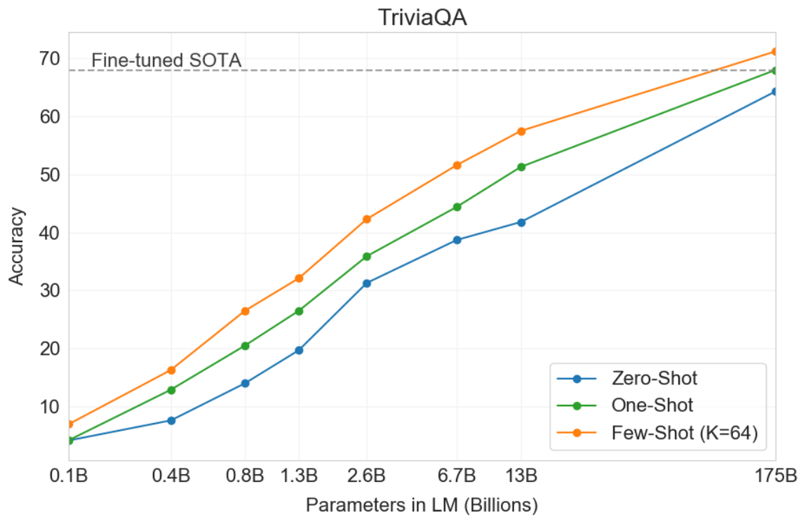

*图 3.3（原文 Figure 3.3，第 14 页）：在 TriviaQA 上，GPT-3 的性能随模型规模平滑增长，说明语言模型随着容量增大持续吸收知识。单样本和少样本相对零样本有显著提升，追平并超过了 SOTA 的微调开放域模型 RAG。*

**图中文字翻译与读法**：横轴 Parameters in LM (Billions)（0.1B 到 175B，等距排列），纵轴 Accuracy（准确率，约 3 到 72）；Zero-Shot（蓝）、One-Shot（绿）、Few-Shot (K=64)（橙）；灰色虚线 Fine-tuned SOTA（微调 SOTA，68.0）。用表 H.1 的数字读：少样本从 125M 的 6.96 升到 175B 的 71.2，零样本从 4.15 升到 64.3，三条线始终大致平行向上，几乎没有饱和。**读图结论**：单样本在 175B 处刚好达到虚线，少样本才越过它；直到最大的模型，曲线都没有出现饱和的迹象，这与原文“容量越大，参数里吸收的知识越多”的解释相容。

### 6.3 翻译（原文 3.3 节）

GPT-2 为了容量考虑，用一个多语言文档集合过滤出只含英语的数据集，即便如此它在法英翻译上也有非平凡表现（尽管只训练了剩下的约 10MB 法语文本）。GPT-3 容量比 GPT-2 大了两个多数量级，所以作者也扩大训练集的范围，纳入更多其他语言，但这仍是有待改进的方面。训练数据按词数计仍以英语为主（93%），另有 7% 其他语言的文本（语言清单在补充材料中）。为了更好地理解翻译能力，作者在常见的语言对之外又加入了德语和罗马尼亚语。

已有的无监督机器翻译方法常把一对单语数据集上的预训练与回译（back-translation）结合起来。相比之下 GPT-3 从多语言自然混合的数据中学习，在词、句、文档层面把语言混在一起，且只用一个并非为任何特定任务设计的训练目标。但作者提醒：单样本和少样本设置与此前无监督工作并不严格可比，因为它们使用了少量配对示例（1 个或 64 个），相当于最多一两页的上下文内训练数据。

**表 3.4：少样本 GPT-3 在翻译成英语时比此前无监督 NMT 工作高 5 个 BLEU（原文表 3.4，第 15 页）。在 WMT'14 Fr↔En、WMT'16 De↔En、WMT'16 Ro↔En 上用 `multi-bleu.perl` 与 XLM 的分词方式报告 BLEU，以便与此前无监督 NMT 工作最直接比较；SacreBLEU 的结果见附录 H。原表中下划线表示无监督或少样本 SOTA，粗体表示监督 SOTA（作者对其有相对信心）**

| 设置 | En→Fr | Fr→En | En→De | De→En | En→Ro | Ro→En |
|---|---:|---:|---:|---:|---:|---:|
| SOTA（监督） | **45.6** | 35.0 | **41.2** | 40.2 | **38.5** | **39.9** |
| XLM（Lample 与 Conneau 2019） | 33.4 | 33.3 | 26.4 | 34.3 | 33.3 | 31.8 |
| MASS（Song 等 2019） | 37.5（下划线） | 34.9 | 28.3 | 35.2 | 35.2（下划线） | 33.1 |
| mBART（Liu 等 2020） | - | - | 29.8（下划线） | 34.0 | 35.0 | 30.5 |
| GPT-3 零样本 | 25.2 | 21.2 | 24.6 | 27.2 | 14.1 | 19.9 |
| GPT-3 单样本 | 28.3 | 33.7 | 26.2 | 30.4 | 20.6 | 38.6 |
| GPT-3 少样本 | 32.6 | 39.2（下划线） | 29.7 | 40.6（下划线） | 21.0 | 39.5（下划线） |

读法与原文结论：

- 零样本 GPT-3 只拿到自然语言任务描述，仍低于近期无监督 NMT 的结果；但每个翻译任务只给一个示范就提升超过 7 BLEU（自行验算：六个方向平均约 7.6），接近有竞争力的水平；完整少样本设置再提高约 4 BLEU（自行验算：平均约 4.1），平均表现与此前无监督 NMT 工作相近。
- **方向偏斜**：对三种输入语言，翻译到英语时 GPT-3 明显优于此前无监督 NMT（Fr→En 39.2 对 34.9，De→En 40.6 对 35.2，Ro→En 39.5 对 33.1，均与 MASS 比），而从英语翻译出去时落后。En→Ro 是明显的离群点，比此前无监督 NMT 差 10 多个 BLEU（21.0 对 35.2）。原文猜测这可能源于复用了为几乎全英语训练集开发的 GPT-2 字节级 BPE 分词器。
- Fr→En 与 De→En 上少样本 GPT-3 超过了作者能找到的最好监督结果，但由于对文献不熟悉、并且这两个基准看起来不具竞争力，作者不认为这些结果代表真正的 SOTA。Ro→En 上少样本 GPT-3 与总体 SOTA（39.9，由无监督预训练、在 60.8 万条标注样本上的监督微调与回译共同取得）只差不到 0.5 BLEU。
- 所有语言对、所有三种设置下，性能随模型容量平滑提升（图 3.4 展示少样本；三种设置在附录 H）。

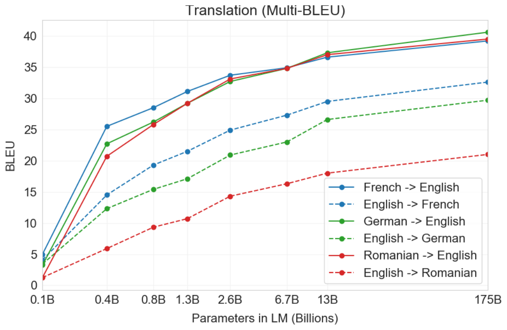

*图 3.4（原文 Figure 3.4，第 15 页）：六个语言对上少样本翻译性能随模型容量变化。所有数据集上都有一致的改进趋势，并且翻译到英语的方向倾向于强于从英语翻译出去的方向。*

**图中文字翻译与读法**：横轴 Parameters in LM (Billions)，纵轴 BLEU（0 到 41），标题 Translation (Multi-BLEU)。六条线：实线是翻译成英语（French -> English 蓝、German -> English 绿、Romanian -> English 红），虚线是从英语翻译出去（English -> French 蓝、English -> German 绿、English -> Romanian 红）。三条实线在 2.6B 以上几乎重合，175B 处约 39 到 41；虚线在 175B 处约为 En→Fr 32.6、En→De 29.7、En→Ro 21.0。**读图结论**：同一个模型，翻译到英语比翻译出英语高约 7 到 18 BLEU（175B 处：Fr 6.6、De 10.9、Ro 18.5，自行验算），这个差距在 350M 及以上的各规模上都存在（最小的 125M 模型两个方向都只有 1 到 5 BLEU，几乎没有差别），与“训练数据以英语为主（93%）”一致。

### 6.4 Winograd 类任务（原文 3.4 节）

Winograd Schemas Challenge 是经典 NLP 任务：判断一个在语法上有歧义、但语义上对人明确的代词指代哪个词。最近微调语言模型在原始 Winograd 数据集上已接近人类水平，但对抗式挖掘的 Winogrande 仍显著落后于人类。作者在两者上都测试了三种设置。

在 Winograd 上用原始的 273 个 Winograd schema，采用 GPT-2 论文中的“部分评估”（partial evaluation）方法：比较在正确上下文和错误上下文下，目标补全的概率（附录 G 的例子：“Grace was happy to trade me her sweater for my jacket. She thinks the sweater”对“…She thinks the jacket”，目标补全“looks dowdy on her.”）。这与 SuperGLUE 里的 WSC 不同：WSC 以二分类形式给出，需要做实体抽取才能转成这里的形式。GPT-3 在 Winograd 上零样本、单样本、少样本分别为 88.3%、89.7%、88.6%，没有明显的上下文学习效应，但每种设置都离 SOTA 和估计的人类表现只差几个点。污染分析发现训练数据里含有一些 Winograd schema（手工检查确认有 132 个 schema 出现在训练集中，但格式与给模型的任务格式不同），但对结果似乎只有很小影响（见原文第 4 节，本文第八节），所以这些结果在表中带 \* 标记（污染分析见本文第八节）。

在更难的 Winogrande 上，GPT-3 零样本 70.2%、单样本 73.2%、少样本 77.7%，这里能看到上下文学习的收益。作为对比：微调 RoBERTa 约 79%，SOTA 为 84.6%（微调的大容量模型 T5），人类表现 94.0%（Sakaguchi 等报告）。

**表 3.5：Winograd schema 的 WSC273 版本和对抗性 Winogrande 数据集上的结果（原文表 3.5，第 16 页；准确率）。关于 Winograd 测试集潜在污染的细节见原文第 4 节；\* 表示可能受污染**

| 设置 | Winograd | Winogrande（XL） |
|---|---:|---:|
| 微调 SOTA | **90.1** | **84.6** |
| GPT-3 零样本 | 88.3\* | 70.2 |
| GPT-3 单样本 | 89.7\* | 73.2 |
| GPT-3 少样本 | 88.6\* | 77.7 |

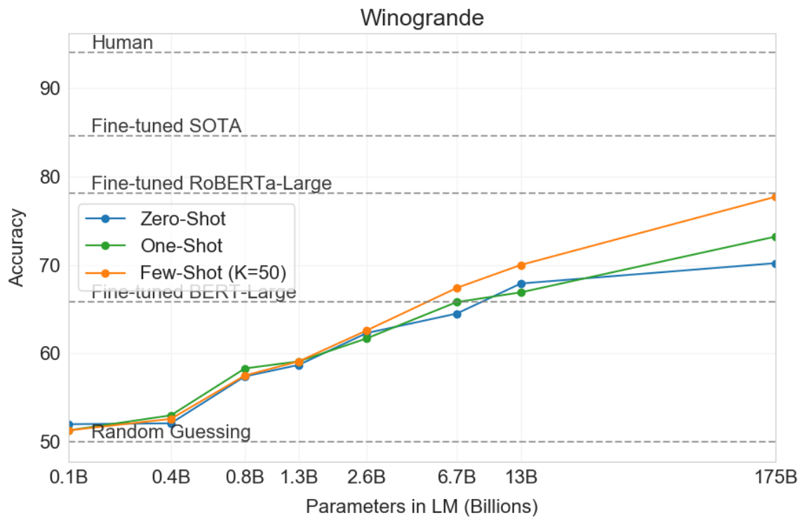

*图 3.5（原文 Figure 3.5，第 16 页）：在对抗性 Winogrande 数据集上，零样本、单样本和少样本性能随模型容量的变化。扩展相对平滑，少样本学习的增益随模型尺寸增大而加大，少样本 GPT-3 175B 与微调的 RoBERTa-Large 相当。*

**图中文字翻译与读法**：横轴 Parameters in LM (Billions)，纵轴 Accuracy（准确率，50 到 95）；Zero-Shot（蓝）、One-Shot（绿）、Few-Shot (K=50)（橙）；灰色虚线自上而下：Human（人类，约 94）、Fine-tuned SOTA（约 84.6）、Fine-tuned RoBERTa-Large（约 78）、Fine-tuned BERT-Large（约 66）、Random Guessing（随机，50）。用表 H.1 的数字读：三条线在 125M 到 2.6B 之间几乎重合（约 51 到 63），6.7B 起少样本开始略高于另外两条，175B 处才明显分开：零样本 70.2、单样本 73.2、少样本 77.7。**读图结论**：在 Winogrande 上，“多给示例带来的增益”随模型规模才显现出来；少样本 175B 刚好接近微调 RoBERTa-Large，但离微调 SOTA 和人类仍有 7 到 16 个点。

### 6.5 常识推理（原文 3.5 节）

三个试图刻画物理或科学推理的数据集（区别于补全、阅读理解、广义知识问答）：

- **PIQA**（PhysicalQA）：关于物理世界如何运作的常识问题，用来探测对世界的具身理解。GPT-3 零样本 81.0%、单样本 80.5%、少样本 82.8%（后者在 PIQA 测试服务器上测得），优于此前微调 RoBERTa 的 SOTA 79.4%。PIQA 随模型规模的扩展相对平缓，仍比人类低 10 个百分点以上，但 GPT-3 的少样本乃至零样本都超过了当前 SOTA。污染分析标记了 PIQA 的潜在污染问题（尽管测试标签是隐藏的），所以作者保守地给结果加 \*，见原文第 4 节（本文第八节）。
- **ARC**：三到九年级科学考试的多选题。**Challenge** 版本已过滤到简单统计方法或信息检索方法无法答对的题目，GPT-3 零样本 51.4%、单样本 53.2%、少样本 51.5%，接近 UnifiedQA 里微调 RoBERTa 基线的 55.9%。**Easy** 版本（上述两类基线至少有一个答对的题目），GPT-3 为 68.8%、71.2%、70.1%，略高于该微调 RoBERTa 基线；但两者都远低于总体 SOTA（UnifiedQA），后者在 Challenge 上比 GPT-3 少样本高 27%，在 Easy 上高 22%。
- **OpenBookQA**：GPT-3 从零样本到少样本提升明显，但仍比总体 SOTA 低 20 多个点；少样本表现类似排行榜上微调的 BERT Large 基线。

总的来说，GPT-3 在常识推理任务上的上下文学习结果参差：PIQA 和 ARC 上单样本、少样本只有很小且不一致的增益，OpenBookQA 上则显著提升；但在新的 PIQA 数据集上，所有评测设置下 GPT-3 都创造了 SOTA。

**表 3.6：三个常识推理任务 PIQA、ARC、OpenBookQA 上的 GPT-3 结果（原文表 3.6，第 17 页；准确率）。GPT-3 少样本的 PIQA 结果在测试服务器上评测。PIQA 测试集潜在污染问题见第 4 节；\* 表示可能受污染**

| 设置 | PIQA | ARC（Easy） | ARC（Challenge） | OpenBookQA |
|---|---:|---:|---:|---:|
| 微调 SOTA | 79.4 | **92.0**（Khashabi 等 2020） | **78.5**（Khashabi 等 2020） | **87.2**（Khashabi 等 2020） |
| GPT-3 零样本 | **80.5**\* | 68.8 | 51.4 | 57.6 |
| GPT-3 单样本 | **80.5**\* | 71.2 | 53.2 | 58.8 |
| GPT-3 少样本 | **82.8**\* | 70.1 | 51.5 | 65.4 |

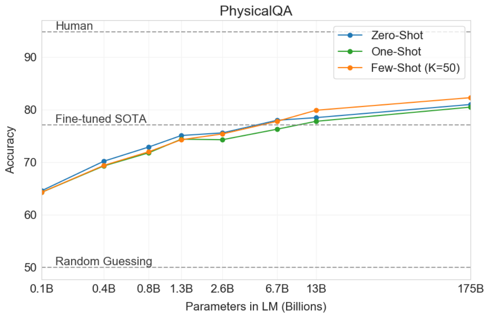

*图 3.6（原文 Figure 3.6，第 17 页）：PIQA 上零样本、单样本和少样本的 GPT-3 结果。最大的模型在这三种条件下的开发集分数都超过了该任务已记录的最佳分数。*

**图中文字翻译与读法**：标题 PhysicalQA，横轴 Parameters in LM (Billions)，纵轴 Accuracy（准确率，50 到 95）；Zero-Shot（蓝）、One-Shot（绿）、Few-Shot (K=50)（橙）；灰色虚线：Human（人类，约 95）、Fine-tuned SOTA（微调 SOTA，约 77，开发集口径，对应表 H.1 的 77.1，而表 3.6 的 79.4 是测试集口径）、Random Guessing（随机，50）。三条线贴得很近：125M 约 64，175B 约 81 到 82（零样本 81.0、单样本 80.5、少样本 82.3，开发集）。**读图结论**：规模带来的增益平缓而稳定，零样本和少样本曲线都在约 6.7B 处越过微调 SOTA 虚线（开发集口径，零样本 78.0、少样本 77.8，对照 77.1，数字来自表 H.1），但少样本相对零样本几乎没有增益；这符合原文“PIQA 显示相对浅的规模扩展”的描述。

### 6.6 阅读理解（原文 3.6 节）

作者在 5 个数据集上评测阅读理解（含抽象式、多选和抽取式答案格式，对话与单问题设置）：CoQA、DROP、QuAC、SQuAD 2.0、RACE（含 RACE-h 与 RACE-m）。GPT-3 在各数据集上差距很大，反映对不同答案格式的能力不同；总体而言，GPT-3 与在各数据集上用上下文表示训练的初始基线和早期结果大体相当。

- **CoQA**（自由形式对话问答）上表现最好，与人类基线只差约 3 个点以内；
- **QuAC**（要求建模师生交互中的结构化对话行为和答案片段选择）上最差，比一个 ELMo 基线低 13 F1；
- **DROP**（考察阅读理解语境下的离散推理和数值能力）上，少样本 GPT-3 超过原论文中微调的 BERT 基线，但仍远低于人类表现，也低于那些把神经网络与符号系统结合起来的 SOTA 方法；
- **SQuAD 2.0** 上展示了少样本学习的能力：比零样本提高近 10 F1（达到 69.8），略微超过原论文中最好的微调结果；
- **RACE**（初高中英语考试的多选题）上相对较弱，只与最早采用上下文表示的工作相当，比 SOTA 仍落后约 45%（原文说法；自行验算 RACE-h 为 43.2 个点，RACE-m 为 35.0 个点）。

**表 3.7：阅读理解任务上的结果（原文表 3.7，第 18 页）。除 RACE 报告准确率外，所有分数都是 F1**

| 设置 | CoQA | DROP | QuAC | SQuADv2 | RACE-h | RACE-m |
|---|---:|---:|---:|---:|---:|---:|
| 微调 SOTA | **90.7** | **89.1** | **74.4** | **93.0** | **90.0** | **93.1** |
| GPT-3 零样本 | 81.5 | 23.6 | 41.5 | 59.5 | 45.5 | 58.4 |
| GPT-3 单样本 | 84.0 | 34.3 | 43.3 | 65.4 | 45.9 | 57.4 |
| GPT-3 少样本 | 85.0 | 36.5 | 44.3 | 69.8 | 46.8 | 58.1 |

（原文脚注：CoQA 的 SOTA 取自 Ju 等 2019；DROP 取自 Gamma Lab NYC 的 Numeric Transformer - ALBERT（2020 年 3 月）；QuAC 取自 WeChat AI 的 Tr-MT（集成，2019 年 12 月）；SQuADv2 取自 QIANXIN 的 SA-Net on ALBERT（集成，2020 年 4 月）；RACE-h 与 RACE-m 取自 Shoeybi 等 2019，即 Megatron。）

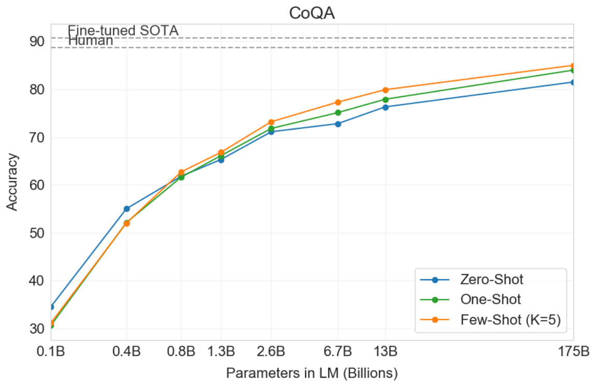

*图 3.7（原文 Figure 3.7，第 19 页）：CoQA 阅读理解任务上的 GPT-3 结果。GPT-3 175B 在少样本设置下达到 85 F1，只比实测的人类表现和 SOTA 微调模型低几个点。零样本和单样本表现低几个点，少样本的增益在更大的模型上最大。*

**图中文字翻译与读法**：标题 CoQA，横轴 Parameters in LM (Billions)，纵轴 Accuracy（实际指标是 F1，30 到 93）；Zero-Shot（蓝）、One-Shot（绿）、Few-Shot (K=5)（橙）；灰色虚线两条紧挨着：Fine-tuned SOTA（微调 SOTA，约 90.7）与略低一点的 Human（人类，约 89）。175B 处零样本 81.5、单样本 84.0、少样本 85.0；在 125M 到 760M 之间零样本反而略高或持平，1.3B 起少样本、单样本、零样本依次排开，间距在 6.7B 以上更明显（数字来自表 H.1）。**读图结论**：CoQA 是 GPT-3 离人类水平最近的阅读理解任务；少样本相对零样本的增益随模型变大而变大，175B 处约 3.5 个点。

### 6.7 SuperGLUE（原文 3.7 节）

SuperGLUE 是一套标准化的 NLP 评测集合（BoolQ、CB、COPA、RTE、WiC、WSC、MultiRC、ReCoRD 共 8 个任务），用于更系统地与 BERT、RoBERTa 比较。**少样本设置下所有任务都用 32 个示例**（从训练集随机抽取）：除 WSC 和 MultiRC 外，每个问题都新抽一组示例作为上下文；WSC 与 MultiRC 则对评测的所有问题使用同一组随机抽取的示例。

**表 3.8：GPT-3 在 SuperGLUE 上与微调基线和 SOTA 的比较（原文表 3.8，第 19 页）。所有结果都是测试集结果。GPT-3 少样本在每个任务的上下文里共给 32 个示例，不做任何梯度更新**

| | SuperGLUE 平均分 | BoolQ 准确率 | CB 准确率 | CB F1 | COPA 准确率 | RTE 准确率 |
|---|---:|---:|---:|---:|---:|---:|
| 微调 SOTA | **89.0** | **91.0** | **96.9** | **93.9** | **94.8** | **92.5** |
| 微调 BERT-Large | 69.0 | 77.4 | 83.6 | 75.7 | 70.6 | 71.7 |
| GPT-3 少样本 | 71.8 | 76.4 | 75.6 | 52.0 | 92.0 | 69.0 |

| | WiC 准确率 | WSC 准确率 | MultiRC 准确率 | MultiRC F1a | ReCoRD 准确率 | ReCoRD F1 |
|---|---:|---:|---:|---:|---:|---:|
| 微调 SOTA | **76.1** | **93.8** | **62.3** | **88.2** | **92.5** | **93.3** |
| 微调 BERT-Large | 69.6 | 64.6 | 24.1 | 70.0 | 71.3 | 72.0 |
| GPT-3 少样本 | 49.4 | 80.1 | 30.5 | 75.4 | 90.2 | 91.1 |

读法与原文结论：

- GPT-3 在各任务上的表现跨度很大。COPA 和 ReCoRD 上，单样本和少样本达到接近 SOTA 的水平：COPA 只差几个点，在排行榜上排第二，第一名是微调的 110 亿参数模型（T5）。
- WSC 上表现仍较强：少样本 80.1%（作为对照，它在原始 Winograd 数据集上是 88.6%）。BoolQ、MultiRC、RTE 上表现尚可，大致与微调的 BERT-Large 相当；CB 上有“生命迹象”：少样本 75.6%。
- **WiC 是明显的弱点**：少样本只有 49.4%（随机水平）。作者尝试了许多不同的措辞和形式，都没能取得强的结果。这暗示一个会在下一节 ANLI 里更清楚的现象：GPT-3 在少样本或单样本设置下，似乎对一些需要“比较两个句子或片段”的任务较弱，例如一个词在两个句子里的用法是否相同（WiC）、一个句子是否是另一个的释义、一个句子是否蕴含另一个。这也可以解释同样具有该格式的 RTE 和 CB 得分较低。
- 尽管有这些弱点，GPT-3 仍在 8 个任务中的 4 个上超过微调的 BERT-Large（自行验算：COPA、WSC、MultiRC、ReCoRD），并在其中 2 个任务（COPA、ReCoRD）上接近微调 110 亿参数模型的 SOTA。
- 少样本 SuperGLUE 分数随模型规模和上下文示例数同时稳定提升（图 3.8）。$K$ 最多扩到每个任务 32 个示例，再多就无法可靠地放进上下文。扫描 $K$ 时发现：GPT-3 每个任务只需要不到 8 个示例，就在整体 SuperGLUE 分数上超过微调的 BERT-Large。

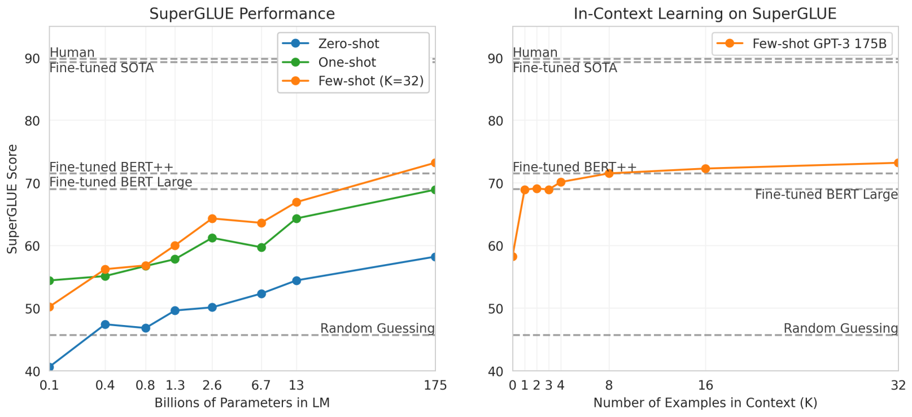

*图 3.8（原文 Figure 3.8，第 20 页）：SuperGLUE 上的性能随模型规模和上下文示例数增加而提高。$K=32$ 表示模型每个任务看到 32 个示例，8 个任务共 256 个示例。这里报告的 GPT-3 数值是开发集上的，因此与点线参考线不能直接比较（本文的测试集结果见表 3.8）。BERT-Large 参考模型是在 SuperGLUE 训练集（12.5 万个示例）上微调的，而 BERT++ 先在 MultiNLI（39.2 万个示例）和 SWAG（11.3 万个示例）上微调，再在 SuperGLUE 训练集上微调（共 63 万个微调样例）。作者发现 BERT-Large 与 BERT++ 的性能差，大致相当于每个上下文 1 个示例与 8 个示例的 GPT-3 之间的差。*

**图中文字翻译与读法**：

- **左图 SuperGLUE Performance**（SuperGLUE 性能）：横轴 Billions of Parameters in LM（0.1 到 175，十亿），纵轴 SuperGLUE Score（SuperGLUE 分数，40 到 95）；Zero-shot（蓝）、One-shot（绿）、Few-shot (K=32)（橙）。灰色虚线：Human（人类）与 Fine-tuned SOTA（微调 SOTA）在约 89 到 90 处靠在一起，其下依次是 Fine-tuned BERT++（约 71.5）、Fine-tuned BERT Large（约 69）、Random Guessing（随机，约 46）。三条线都随规模上升且少样本在上；175B 处（开发集）零样本 58.2、单样本 68.9、少样本 73.2（表 H.1），少样本略高于 BERT++ 虚线。
- **右图 In-Context Learning on SuperGLUE**（SuperGLUE 上的上下文学习）：横轴 Number of Examples in Context (K)（上下文示例数，0、1、2、3、4、8、16、32），纵轴同为 SuperGLUE 分数；单条曲线 Few-shot GPT-3 175B：K=0 约 58，K=1 就跳到约 69，几乎追平 BERT-Large（约 69），之后慢慢上升，K=8 约 71.5，K=16 约 72，K=32 约 73（后几个是图上读出的近似值）。
- **读图结论**：第一个示例带来最大的单步增益（约 11 分）。（本文推测这一步主要是让模型知道任务的输出格式，原文没有对此做专门分析。）之后增益递减，扩到 K=32 也没有追上微调 SOTA（89.0）或人类（约 90）。

下表是原文表 H.1 中 175B 在 SuperGLUE 各任务上三种设置的开发集结果（原文正文只给了少样本的测试集结果）；原文未解释的是，WiC 零样本一行在表 H.1 中所有尺寸都是 0.00，推测是输出格式不合规（这是本文的猜测，原文没有说明），读数时请当作“无有效结果”。另外，表 H.1 中 MultiRC 的零样本与单样本两组 8 个尺寸的数值完全相同（准确率与 F1a 均如此），疑为原表重复录入，这里照录，不作引用。

**表 H.1 摘录：GPT-3 175B 在 SuperGLUE 各任务上的结果（原文表 H.1，第 63 页；零、单、少样本为开发集，最后一列为提交测试服务器的少样本结果）**

| 任务（指标） | 微调 SOTA | 零样本（dev） | 单样本（dev） | 少样本（dev） | 少样本（test，提交测试服务器） |
|---|---:|---:|---:|---:|---:|
| BoolQ（准确率） | 91.0 | 60.5 | 76.7 | 77.5 | 76.4 |
| CB（准确率） | 96.9 | 46.4 | 64.3 | 82.1 | 75.6 |
| CB（F1） | 93.9 | 42.8 | 52.5 | 57.2 | 52.0 |
| COPA（准确率） | 94.8 | 91.0 | 87.0 | 92.0 | 92.0 |
| RTE（准确率） | 92.5 | 63.5 | 70.4 | 72.9 | 69.0 |
| WiC（准确率） | 76.1 | 0.00 | 48.6 | 55.3 | 49.4 |
| WSC（准确率） | 93.8 | 65.4 | 69.2 | 75.0 | 80.1 |
| MultiRC（准确率） | 62.3 | 27.6 | 27.6 | 32.5 | 30.5 |
| MultiRC（F1a） | 88.2 | 72.9 | 72.9 | 74.8 | 75.4 |
| ReCoRD（准确率） | 92.5 | 90.2 | 90.2 | 89.0 | 90.2 |
| ReCoRD（F1） | 93.3 | 91.0 | 91.2 | 90.1 | 91.1 |
| SuperGLUE 平均分 | 89.0 | 58.2 | 68.9 | 73.2 | 71.8 |

### 6.8 自然语言推断 NLI（原文 3.8 节）

NLI 考察对两个句子之间关系的理解，通常是二分类或三分类（第二句是否在逻辑上由第一句推出、与之矛盾、或可能为真即中立）。SuperGLUE 里的 RTE 是 NLI 的二分类版本：只有最大的 GPT-3 在任何评测设置下才明显好于随机（56%），不过少样本时与单任务微调的 BERT Large 相近。作者还评测了新近提出的对抗式自然语言推断数据集 ANLI，它分三轮（R1、R2、R3）对抗地挖掘 NLI 问题。与 RTE 类似，所有比 GPT-3 小的模型即使在少样本下也几乎正好处于随机水平（约 33%），GPT-3 本身在第 3 轮上才显示“生命迹象”。这些在 RTE 和 ANLI 上的结果表明，NLI 对语言模型仍是非常困难的任务，它们才刚开始显示出进步。

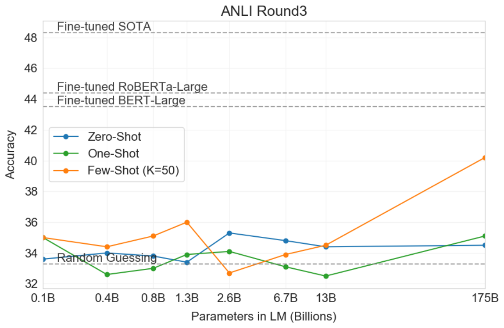

*图 3.9（原文 Figure 3.9，第 21 页）：GPT-3 在 ANLI 第 3 轮上的表现。结果取自开发集，该集只有 1500 个示例，方差较高（我们估计标准差为 1.2%）。较小模型徘徊在随机水平，而少样本 GPT-3 175B 把从随机水平到 SOTA 的差距缩小了近一半。第 1、2 轮的结果见附录。*

**图中文字翻译与读法**：标题 ANLI Round3，横轴 Parameters in LM (Billions)，纵轴 Accuracy（准确率，32 到 49）；Zero-Shot（蓝）、One-Shot（绿）、Few-Shot (K=50)（橙）；灰色虚线自上而下：Fine-tuned SOTA（约 48.3）、Fine-tuned RoBERTa-Large（约 44.4）、Fine-tuned BERT-Large（约 43.5）、Random Guessing（随机，约 33.3）。零样本和单样本在所有尺寸上都在 32.5 到 35.5 之间徘徊；少样本在 175B 之前同样在 32.7 到 36 之间起伏（1.3B 处约 36，2.6B 处约 32.7），175B 处升到 40.2。**读图结论**：175B 之前所有点都在噪声范围内（作者估计标准差 1.2%），只有最大模型的少样本把准确率抬到约 40%，即缩小了随机到 SOTA 差距的约 46%（自行验算：(40.2−33.3)/(48.3−33.3)）。三轮的全部结果如下。

**表 H.1 摘录：ANLI 三轮的结果（原文表 H.1，第 63 页；175B，准确率；三分类随机水平为 33.3%）**

| 轮次 | 微调 SOTA | 零样本 | 单样本 | 少样本（K=50） |
|---|---:|---:|---:|---:|
| ANLI R1（test） | 73.8 | 34.6 | 32.0 | 36.8 |
| ANLI R2（test） | 50.7 | 35.4 | 33.9 | 34.0 |
| ANLI R3（test） | 48.3 | 34.5 | 35.1 | 40.2 |

## 七、合成与定性任务：现场适应能力（原文 3.9 节）

为了探测 GPT-3 在少样本（或零样本、单样本）下的能力范围，作者设计了几类任务：需要现场做简单计算推理的，需要识别训练中不太可能出现过的新模式的，以及需要快速适应不寻常任务的。具体有：算术；重排或还原单词字母的几个任务（不太可能在训练中原样见过）；SAT 式类比题；以及几个定性任务（用新词造句、纠正英语语法、新闻文章生成）。作者说会公开这些合成数据集，以促进对语言模型测试时行为的研究。

### 7.1 算术（原文 3.9.1 节）

为了在没有任务专用训练的条件下测试 GPT-3 做简单算术的能力，作者构造了 10 个测试，每个都用自然语言提问（要求模型给出**完全正确**的答案）。每个任务随机生成 2,000 个实例，在所有模型上评测：

| 任务（缩写） | 内容 | 例子 |
|---|---|---|
| 两位数加法（2D+） | 两个在 [0, 100) 上均匀取样的整数相加，写成问句 | `Q: What is 48 plus 76? A: 124.` |
| 两位数减法（2D-） | 两个在 [0, 100) 上均匀取样的整数相减，答案可为负 | `Q: What is 34 minus 53? A: -19` |
| 三位数加、减法（3D+、3D-） | 同上，数字在 [0, 1000) 上均匀取样 | |
| 四位数加、减法（4D+、4D-） | 同上，数字在 [0, 10000) 上均匀取样 | |
| 五位数加、减法（5D+、5D-） | 同上，数字在 [0, 100000) 上均匀取样 | |
| 两位数乘法（2Dx） | 两个在 [0, 100) 上均匀取样的整数相乘 | `Q: What is 24 times 42? A: 1008` |
| 一位数复合运算（1DC） | 对三个一位数做复合运算，后两个加括号；数字在 [0, 10) 上均匀取样，运算符在 {+, -, *} 中均匀选取 | `Q: What is 6+(4*8)? A: 38` |

**少样本结果**：加减法在位数少时 GPT-3 表现出很强的熟练度：两位数加法 100% 准确，两位数减法 98.9%，三位数加法 80.2%（正文数字，表 3.9 为 80.4%），三位数减法 94.2%。位数增加后性能下降，但四位数运算仍有约 25 到 26% 的准确率，五位数运算约 9 到 10%，这说明模型至少有一定的向更多位数泛化的能力。两位数乘法（计算量尤其大的运算）准确率 29.2%；一位数复合运算（例如 9\*(7+5)）21.3%，说明它不只是会单一运算。

**小模型和零样本、单样本**：小模型在所有这些任务上表现都很差，即便是第二大的 130 亿参数模型，两位数加减法也只有一半左右能做对，其余运算都不到 10%（自行验算：13B 少样本的 2D+ 为 55.5%、2D- 为 52.4%，其余均低于 10%）。单样本和零样本相对少样本有所下降，这说明对任务的适应（至少是对任务的识别）对正确做这些计算很重要；但单样本仍然相当强，完整 GPT-3 的零样本表现就已经明显好于所有较小模型的少样本。

**是否只是死记**：为了抽查模型是不是在记忆具体的算术题，作者在训练数据中搜索测试集里的三位数算术题，同时搜索 `<NUM1> + <NUM2> =` 和 `<NUM1> plus <NUM2>` 两种写法。2,000 道加法题里只找到 17 道匹配（0.8%），2,000 道减法题里只找到 2 道（0.1%），说明只有微不足道的一小部分正确答案可能来自记忆。此外，检查错误答案发现，模型常犯“忘了进位 1”这类错误，说明它确实在尝试进行相应的计算，而不是在背一张表。

**表 3.9：GPT-3 175B 在基本算术任务上的结果（原文表 3.9，第 23 页；准确率 %）。$\{2,3,4,5\}$D$\{+,-\}$ 表示 2、3、4、5 位数的加法或减法，2Dx 是两位数乘法，1DC 是一位数复合运算。从零样本到单样本再到少样本，结果逐步变强，但即使零样本也显示出可观的算术能力**

| 设置 | 2D+ | 2D- | 3D+ | 3D- | 4D+ | 4D- | 5D+ | 5D- | 2Dx | 1DC |
|---|---:|---:|---:|---:|---:|---:|---:|---:|---:|---:|
| GPT-3 零样本 | 76.9 | 58.0 | 34.2 | 48.3 | 4.0 | 7.5 | 0.7 | 0.8 | 19.8 | 9.8 |
| GPT-3 单样本 | 99.6 | 86.4 | 65.5 | 78.7 | 14.0 | 14.0 | 3.5 | 3.8 | 27.4 | 14.3 |
| GPT-3 少样本 | 100.0 | 98.9 | 80.4 | 94.2 | 25.5 | 26.8 | 9.3 | 9.9 | 29.2 | 21.3 |

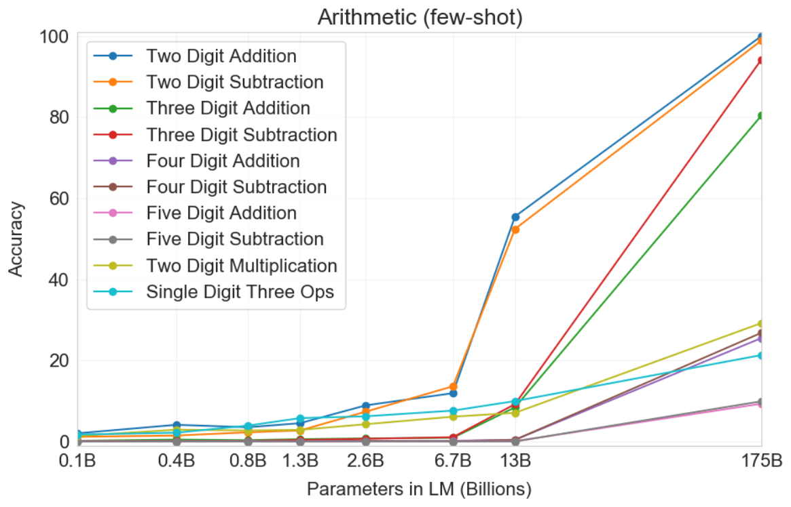

*图 3.10（原文 Figure 3.10，第 22 页）：十个算术任务在少样本设置下、不同尺寸模型的结果。从第二大的模型（GPT-3 13B）到最大的模型（GPT-3 175B）有一个显著的跃升，后者能可靠准确地做两位数算术，通常准确地做三位数算术，并在四到五位数算术、两位数乘法和复合运算上有相当比例的答对。单样本和零样本结果见附录。*

**图中文字翻译与读法**：标题 Arithmetic (few-shot)（算术，少样本）；横轴 Parameters in LM (Billions)，纵轴 Accuracy（准确率，0 到 100）；10 条线依次是 Two Digit Addition（两位数加法）、Two Digit Subtraction、Three Digit Addition、Three Digit Subtraction、Four Digit Addition、Four Digit Subtraction、Five Digit Addition、Five Digit Subtraction、Two Digit Multiplication（两位数乘法）、Single Digit Three Ops（一位数三运算，即 1DC）。**读图结论**：所有线在 6.7B 及以下几乎贴着 0 到 15%；两位数加减法在 13B 处突然升到约 52 到 56%，到 175B 达到约 99 到 100%；三位数加减法在 13B 还不到 10%，175B 处升到 80% 和 94%。也就是说，这里的能力不是平滑增长，而是在 13B 到 175B 之间出现陡峭的跃升。这是本文最鲜明的“跃升式”结果之一（符号插入、SAT 类比、ANLI 第 3 轮的少样本也是到 175B 才明显上升），原文没有解释其原因；它提醒读者把 5.1 节“平滑的损失规模律”与单个任务的准确率区分开：损失平滑，不意味着每个任务的准确率都平滑。

### 7.2 单词扰乱与操作任务（原文 3.9.2 节）

为了测试 GPT-3 能否从几个示例中学会新的符号操作，作者设计了 5 个“字符操作”任务：给模型一个经过字母重排、加字符或删字符变形的单词，要求它还原。

| 任务（缩写） | 内容 | 例子 |
|---|---|---|
| 循环字母（CL，cycle letters in word） | 单词的字母被循环移位，后跟 “=”，要求输出原词 | `lyinevitab` → `inevitably` |
| 除首末外的变位词（A1，anagrams of all but first and last characters） | 除第一个和最后一个字母外，其余字母被随机打乱 | `criroptuon` = `corruption` |
| 除首末各两个外的变位词（A2，anagrams of all but first and last 2 characters） | 除前两个和后两个字母外，其余字母被随机打乱 | `opoepnnt` → `opponent` |
| 随机插入（RI，random insertion in word） | 在单词每两个字母之间插入随机标点或空格，要求还原 | `s.u!c/c!e.s s i/o/n` = `succession` |
| 单词反转（RW，reversed words） | 给出倒着拼写的单词，要求还原 | `stcejbo` → `objects` |

每个任务生成 10,000 个例子：取 Norvig（2009）统计的最常见 10,000 个词中长度大于 4 个字符且小于 15 个字符的词。少样本结果见图 3.11（$K=100$）。任务表现随模型规模平滑增长（随机插入任务例外，在 175B 处出现陡升，最大模型大多数时候能解决）。完整 GPT-3 在随机插入任务上达到 66.9%（正文数字，表 3.10 为 67.2%），循环字母 38.6%（表 37.9%），较容易的变位词任务 40.2%（表 39.7%），较难的变位词任务（只固定首末字母）15.1%。**所有模型都无法反转单词里的字母。**

单样本下性能明显更弱（降低一半或更多），零样本下模型几乎完成不了任何一个任务（表 3.10）。作者据此认为，模型确实是在测试时学会这些任务的：它零样本做不了，而且这些任务的人造性质使它们不太可能出现在预训练数据里（但不能确证）。

原文还指出两点：（1）这些任务需要字符级的操作，而 BPE 编码平均每个 token 对应约 0.7 个词，所以在语言模型看来，要成功不仅要操作 BPE token，还要理解并拆开它们的子结构；（2）CL、A1、A2 都不是双射（即还原的单词不是被打乱单词的确定函数），要求模型进行一些搜索才能找到正确的还原，所以这些技能似乎需要不平凡的模式匹配和计算。

**表 3.10：GPT-3 175B 在各种单词还原和单词操作任务上的表现（原文表 3.10，第 23 页；准确率 %，零样本、单样本、少样本）。CL 是循环字母，A1 是除首末外字母的变位词，A2 是除首末各两个字母外的变位词，RI 是单词中的随机插入，RW 是反转单词**

| 设置 | CL | A1 | A2 | RI | RW |
|---|---:|---:|---:|---:|---:|
| GPT-3 零样本 | 3.66 | 2.28 | 8.91 | 8.26 | 0.09 |
| GPT-3 单样本 | 21.7 | 8.62 | 25.9 | 45.4 | 0.48 |
| GPT-3 少样本 | 37.9 | 15.1 | 39.7 | 67.2 | 0.44 |

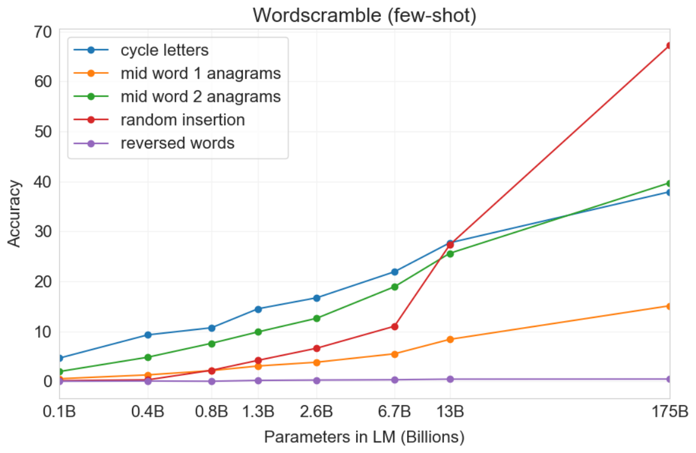

*图 3.11（原文 Figure 3.11，第 24 页）：五个单词扰乱任务上不同尺寸模型的少样本表现。总体上随模型尺寸平滑改进，不过随机插入任务在 175B 模型处有一个向上的斜率，该模型在大多数时候能解决这个任务。单样本和零样本的扩展情况见附录。所有任务都用 $K=100$。*

**图中文字翻译与读法**：标题 Wordscramble (few-shot)（单词扰乱，少样本）；横轴 Parameters in LM (Billions)，纵轴 Accuracy（准确率，0 到 70）。五条线：cycle letters（循环字母，蓝）、mid word 1 anagrams（中间词变位 1，即 A1，橙）、mid word 2 anagrams（即 A2，绿）、random insertion（随机插入，红）、reversed words（反转单词，紫）。**读图结论**：红线在 13B 以下与其他线相近（13B 为 27.3%），到 175B 陡升到 67.2%，成为最高；紫线在所有尺寸上贴着 0。这一陡升与图 1.2 的 175B 曲线一致：符号去除任务对规模最敏感。

作者还指出，可以用“上下文学习曲线”（任务表现与上下文示例数的关系）进一步量化这些结果。图 1.2 就是符号插入任务的上下文学习曲线，显示越大的模型越能有效利用上下文信息，包括任务示例和自然语言任务描述两方面。

### 7.3 SAT 类比（原文 3.9.3 节）

为了在另一个相对于典型文本分布较特殊的任务上测试 GPT-3，作者收集了 374 道 “SAT 类比”题。类比题是 2005 年前 SAT 大学入学考试的一个部分，是一种多选题。典型例子：“audacious is to boldness as (a) sanctimonious is to hypocrisy, (b) anonymous is to identity, (c) remorseful is to misdeed, (d) deleterious is to result, (e) impressionable is to temptation”，要求选出与题干中的词对具有相同关系的选项，此例答案是 (a)。GPT-3 少样本 65.2%、单样本 59.1%、零样本 53.7%，而大学申请者的平均分是 57%，随机猜测是 20%。结果随规模提升，完整的 175B 模型比 13B 模型高出 10 多个百分点（自行验算：少样本 65.2 对 53.5）。

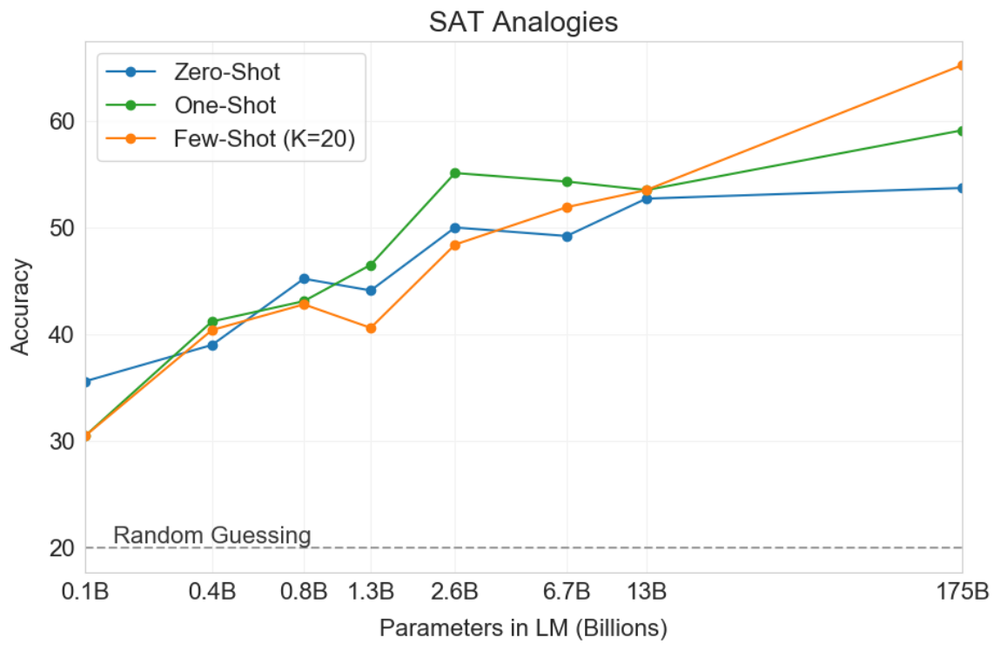

*图 3.12（原文 Figure 3.12，第 25 页）：SAT 类比任务上，不同尺寸模型的零样本、单样本和少样本表现。最大的模型在少样本设置下达到 65% 的准确率，并且展现出较小模型没有的、显著的上下文学习增益。*

**图中文字翻译与读法**：标题 SAT Analogies，横轴 Parameters in LM (Billions)，纵轴 Accuracy（准确率，约 20 到 66）；Zero-Shot（蓝）、One-Shot（绿）、Few-Shot (K=20)（橙）；灰色虚线 Random Guessing（随机猜测，20）。用表 H.1 的数字读：三条线在 125M 到 13B 之间互相交错、涨幅有限（零样本 35.6 到 52.7，少样本 30.5 到 53.5），在 175B 处才明显分开：零样本 53.7、单样本 59.1、少样本 65.2。**读图结论**：这又是一个“上下文学习的增益只出现在最大模型”的例子：13B 的少样本只比零样本高 0.8 个点，175B 高 11.5 个点（自行从表 H.1 计算）。

### 7.4 新闻文章生成（原文 3.9.4 节）

此前的生成模型工作（如 GPT-2）曾通过“给定人写的一个合理的新闻首句，让模型条件采样”来定性测试合成“新闻文章”的能力。但 GPT-3 的训练集里新闻比重比 GPT-2 低得多，所以直接用无条件采样生成新闻效果较差：例如 GPT-3 常把给出的新闻首句当作一条推文，然后接着发合成的回复或后续推文。为解决这个问题，作者借助 GPT-3 的少样本学习能力：在模型上下文中给出**三篇**此前的新闻文章作为条件；再给出下一篇文章的标题和副标题，模型就能可靠地生成新闻体裁的短文。

**如何度量质量**：作者让人来区分 GPT-3 生成的文章和真文章。生成式语言模型被训练去匹配人类所生成内容的分布，所以人类无法区分二者，是衡量质量的一个潜在重要指标。具体做法：任意选取 newser.com 的 25 个文章标题和副标题（平均长度 215 词），用 125M 到 175B（GPT-3）的语言模型生成这些标题和副标题的后续（平均长度 200 词）。对每个模型，大约 80 位美国参与者做一份测验：给出真实的标题和副标题，后接人写的文章或模型生成的文章；参与者要选择文章是“极可能由人写的”、“更可能由人写的”、“我不知道”、“更可能由机器写的”或“极可能由机器写的”。所选文章不在模型训练数据里，模型输出是用程序格式化和选取的，防止人为挑选；所有模型使用相同的上下文来条件化输出，预训练时使用相同的上下文大小，也使用相同的文章标题和副标题。另外设了一个对照实验以控制参与者的投入和注意力：同样的格式，但文章来自一个故意做差的“对照模型”（一个 160M 参数、没有上下文、输出随机性提高的模型）。

**表 3.11：人类识别短文（约 200 词）新闻是否由模型生成的准确率（原文表 3.11，第 26 页）。准确率以“正确判断数与非中立判断数之比”度量，从对照模型的 86% 到 GPT-3 175B 的 52%。表中给出各模型相对对照模型的平均准确率差异的双样本 t 检验结果（对照模型是一个增大了输出随机性的无条件 GPT-3 Small 模型，原文表题如此；正文称其为 160M 参数模型）**

| 模型 | 平均准确率 | 95% 置信区间（低, 高） | 相对对照的 t 值（p 值） | “我不知道”所占比例 |
|---|---:|---|---|---:|
| 对照（故意做差的模型） | 86% | 83%–90% | - | 3.6% |
| GPT-3 Small | 76% | 72%–80% | 3.9（2e-4） | 4.9% |
| GPT-3 Medium | 61% | 58%–65% | 10.3（7e-21） | 6.0% |
| GPT-3 Large | 68% | 64%–72% | 7.3（3e-11） | 8.7% |
| GPT-3 XL | 62% | 59%–65% | 10.7（1e-19） | 7.5% |
| GPT-3 2.7B | 62% | 58%–65% | 10.4（5e-19） | 7.1% |
| GPT-3 6.7B | 60% | 56%–63% | 11.2（3e-21） | 6.2% |
| GPT-3 13B | 55% | 52%–58% | 15.3（1e-32） | 7.1% |
| GPT-3 175B | 52% | 49%–54% | 16.9（1e-34） | 7.8% |

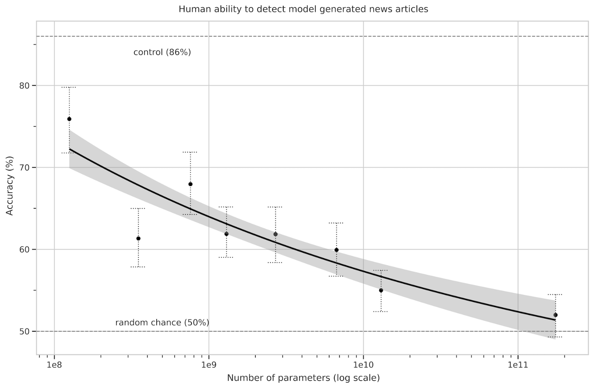

*图 3.13（原文 Figure 3.13，第 27 页）：人们识别新闻文章是否由模型生成的能力（以“正确判断数与非中立判断数之比”度量）随模型尺寸增大而下降。对照模型（故意做差、无条件、输出随机性更高的 GPT-3 Small 模型）输出上的准确率用顶部虚线表示，随机水平（50%）用底部虚线表示。最佳拟合线是带 95% 置信区间的幂律。*

**图中文字翻译与读法**：标题 Human ability to detect model generated news articles（人类检测模型生成新闻文章的能力）。横轴 Number of parameters (log scale)（参数量，对数刻度，$10^{8}$ 到 $10^{11}$ 以上），纵轴 Accuracy (%)（准确率，约 47 到 87）。顶部虚线 control (86%)（对照），底部虚线 random chance (50%)（随机）。黑点和竖直虚线是各模型的平均准确率及其误差线（95% 置信区间），黑色实线与灰色带是幂律拟合 $a\,x^{-b}$ 及其 95% 置信带（附录 E 说明）。点从左到右依次约为 76%（125M）、61%（350M）、68%（760M）、62%（1.3B）、62%（2.7B）、60%（6.7B）、55%（13B）、52%（175B），与表 3.11 一致；拟合线从约 72% 单调降到约 51%。**读图结论**：人类检测能力随模型规模下降，趋近随机水平；而且这是在参与者随模型变大花越来越多时间判断的情况下发生的（附录图 E.1）。注意中间点并不严格单调（350M 的 61% 低于 760M 的 68%），所以“随规模下降”是拟合出的趋势，不是逐点成立。

原文的补充观察：

- 在 175B 上，人类准确率“勉强高于随机”，约 52%。脚注 6 指出：如果一个模型总是产生比人类文章更令人印象深刻的文本，则人类在这个任务上的成绩有可能降到 50% 以下；确实有许多参与者个人得分低于 50%。
- 生成的新闻文章样例见原文图 3.14 与 3.15。图 3.14 是人类最难与真文章区分的 GPT-3 文章（标题 “United Methodists Agree to Historic Split”，副标题 “Those who oppose gay marriage will form their own denomination”，准确率 12%，即只有 12% 的判断认出它是机器生成）；图 3.15 是人类最容易区分的文章（标题 “Star's Tux Promise Draws Megyn Kelly's Sarcasm”，副标题 “Joaquin Phoenix pledged to not change for each awards event”，准确率 61%）。全文较长，本文不转录。
- 事实错误可以是文章由模型生成的线索：与人类作者不同，模型无法接触标题所指的具体事实，也不知道文章是何时写的；其他线索包括重复、不合逻辑的转折（non sequitur）和不寻常的措辞，但这些往往很微妙，不会被注意到。
- 自动判别器（如 GROVER 和 GLTR）可能比人类评估者更成功（Ippolito 等 2019），这是未来研究的一个有希望的方向。Ippolito 等还发现人类检测准确率随观察的 token 增多而提高。

**更长的文章（约 500 词）**。为初步考察人类对更长新闻文章的判别能力，作者选了 12 篇路透社世界新闻（平均 569 词），让 GPT-3 175B 生成后续（平均 498 词，比前面的实验长 298 词），按同样的方法对约 80 位美国参与者做两个实验（对照模型 vs GPT-3 175B）。结果对照模型被识别的平均准确率约 88%，而 GPT-3 175B 的文章仍只略高于随机，约 52%。这说明，对 500 词左右的新闻文章，GPT-3 仍然能生成人类难以与人写新闻区分的文章。

**表 3.12：人类识别约 500 词文章是否由模型生成的能力（原文表 3.12，第 27 页；以“正确判断数与非中立判断数之比”度量），对照模型 88%，GPT-3 175B 52%。表中是 GPT-3 175B 与对照模型平均准确率差异的双样本 t 检验结果**

| 模型 | 平均准确率 | 95% 置信区间（低, 高） | 相对对照的 t 值（p 值） | “我不知道”所占比例 |
|---|---:|---|---|---:|
| 对照 | 88% | 84%–91% | - | 2.7% |
| GPT-3 175B | 52% | 48%–57% | 12.7（3.2e-23） | 10.6% |

### 7.5 用新词造句与纠正英语语法（原文 3.9.5、3.9.6 节）

**新词（原文 3.9.5 节、图 3.16）**。发展语言学里有一个任务：学习并使用新词，例如看到一个词被定义一次之后用它造句，或者反过来从一次用法推断词义。这里作者定性测试前者：给 GPT-3 一个不存在的词（如 “Gigamuru”）的定义，要求它用这个词造句；同时给 1 到 5 个此前（另外的）不存在词的“定义加造句”例子，所以这个任务就“此前对该大类任务的示例”而言是少样本，就“具体这个词”而言是单样本。作者生成了 6 个例子（原文把图 3.16 写作 “Table 3.16”）：所有定义都是人写的，第一个答案是人写的、作为条件，其后的答案都由 GPT-3 生成。这些例子是在一次连续操作中生成的，没有省略或反复尝试任何提示。所有情形下，生成的句子看起来都是对该词的正确使用，或至少是合理的使用。在最后一句里，模型还为 “screeg” 生成了一个合理的动词变位（screeghed），尽管 “screeghed at each other” 的用法有些别扭，不过可以解释为描述玩具剑的打斗。

**表（原文图 3.16 的转录）：用新词造句的代表性 GPT-3 补全**

| 新词 | 人写的定义（译） | 造句（英文原文） | 来源 |
|---|---|---|---|
| whatpu | 坦桑尼亚特有的一种毛茸茸的小动物 | We were traveling in Africa and we saw these very cute whatpus. | 人写（作为条件） |
| farduddle | 非常快地上下跳 | One day when I was playing tag with my little sister, she got really excited and she started doing these crazy farduddles. | GPT-3 |
| yalubalu | 一种看起来像大南瓜的蔬菜 | I was on a trip to Africa and I tried this yalubalu vegetable that was grown in a garden there. It was delicious. | GPT-3 |
| Burringo | 加速非常快的汽车 | In our garage we have a Burringo that my father drives to work every day. | GPT-3 |
| Gigamuru | 一种日本乐器 | I have a Gigamuru that my uncle gave me as a gift. I love to play it at home. | GPT-3 |
| screeg | 用剑挥砍某物 | We screeghed at each other for several minutes and then we went outside and ate ice cream. | GPT-3 |

**纠正英语语法（原文 3.9.6 节、图 3.17）**。另一个很适合少样本学习的任务。作者用形如 `Poor English Input: <句子>` 加换行再加 `Good English Output: <句子>` 的提示在少样本设置下测试：给 GPT-3 一个人写的纠正，再让它纠正另外 5 个（同样没有省略或重复）。原文图 3.17 实际展示了 3 组人写的示例（作为条件）和之后 8 个 GPT-3 的补全；正文的“1 个加 5 个”与图不一致，见文末备查表。作者提醒：区分“差”英语和“好”英语（以及这两个词本身）是复杂的、依赖语境并有争议的；而且正如关于租房子的那个例子所示，模型关于什么是“好”的假设甚至会使它犯错：这里模型不仅调整了语法，还删掉了单词 “cheap”，改变了原意。

**表（原文图 3.17 的转录）：纠正英语语法的代表性 GPT-3 补全（输入和输出均为英文原文）**

| 输入（Poor English input） | GPT-3 的输出（Good English output） | 备注 |
|---|---|---|
| I'd be more than happy to work with you in another project. | I'd be more than happy to work with you on another project. | 介词 |
| Please provide me with a short brief of the design you're looking for and that'd be nice if you could share some examples or project you did before. | Please provide me with a brief description of the design you're looking for and that would be nice if you could share some examples or projects you have done before. | 用词、单复数、时态 |
| The patient was died. | The patient died. | 语态 |
| We think that Leslie likes ourselves. | We think that Leslie likes us. | 反身代词 |
| Janet broke Bill on the finger. | Janet broke Bill's finger. | 所有格 |
| Mary arranged for, in St. Louis, John to rent a house cheap. | Mary arranged for John to rent a house in St. Louis. | 删掉了 cheap，改变了原意 |
| Today I have went to the store to to buys some many bottle of water. | Today I went to the store to buy some bottles of water. | 多处语法错误 |
| I have tried to hit ball with bat, but my swing is has miss. | I tried to hit the ball with the bat, but my swing missed. | 冠词、时态 |

（作为条件给出的 3 组人写示例分别是：`I eated the purple berries.` 改为 `I ate the purple berries.`；`Thank you for picking me as your designer. I'd appreciate it.` 改为 `Thank you for choosing me as your designer. I appreciate it.`；以及一段含 “The mentioned changes have done.” 的长句改为 “The requested changes have been made.” 等。）

附录 F 另有一个展示：给 GPT-3 一个诗歌写作提示（标题 “Shadows on the Way”、署名 Wallace Stevens，并先给 C. P. Cavafy 和 John Ashbery 两首诗作为上下文），不做编辑或挑选，用温度 1、核采样 $p=0.9$ 生成 4 首诗，原文展示全部 4 首；本文不转录。

## 八、基准污染：度量与防止对基准的记忆（原文第 4 节、附录 C）

### 8.1 为什么要查，查什么

训练数据来自互联网，所以模型可能在训练中见过某些基准的测试集。要在互联网规模的数据中准确检测测试集污染，是一个新的研究领域，还没有成熟的最佳实践。虽然许多人训练大模型时并不调查污染，作者认为随着预训练数据集规模增大，这个问题越来越重要。这种担忧并非纯假设：最早在 Common Crawl 数据上训练语言模型的论文之一（Trinh 与 Le 2018）就检测并删除了一篇与其评测数据集重叠的训练文档；GPT-2 也做了事后的重叠分析，其结果相对令人鼓舞：虽然模型在训练和测试重叠的数据上表现略好，但由于被污染的数据比例很小（通常只有几个百分点），并没有显著影响报告的结果。

GPT-3 处于有些不同的状态：一方面，数据集和模型规模比 GPT-2 大约两个数量级，并且包含大量 Common Crawl，污染和记忆的可能性增加；另一方面，正因为数据量大，即便是 GPT-3 175B 相对于与训练集去重过的留出验证集，也没有显著过拟合训练集（图 4.1）。因此作者预期污染很可能频繁出现，但其影响也许没有担心的那么大。

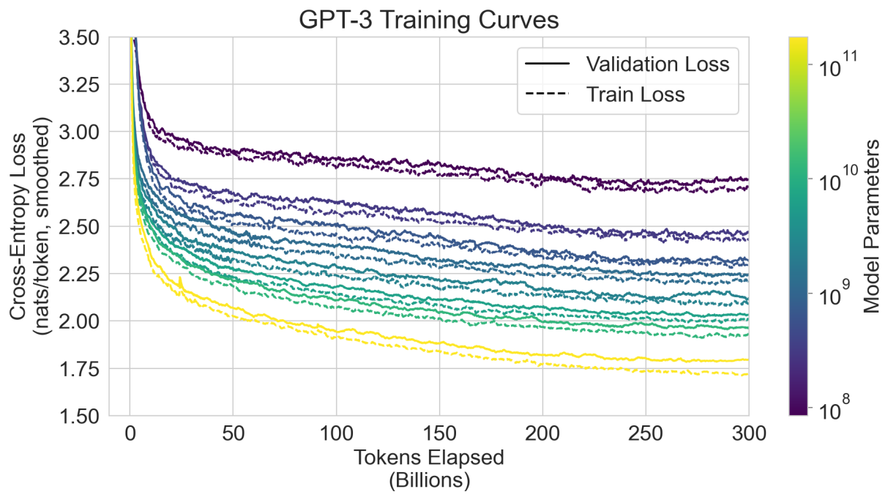

*图 4.1（原文 Figure 4.1，第 31 页）：GPT-3 训练曲线。在我们训练分布去重后的一个验证划分上度量训练过程中的模型表现。训练与验证表现之间有一些差距，但差距随模型规模和训练时间增长得很少，说明这个差距大部分来自难度差异而不是过拟合。*

**图中文字翻译与读法**：标题 GPT-3 Training Curves；横轴 Tokens Elapsed (Billions)（已训练 token 数，十亿，0 到 300），纵轴 Cross-Entropy Loss (nats/token, smoothed)（交叉熵损失，nat 每 token，平滑后，1.5 到 3.5）；颜色条 Model Parameters（模型参数量，约 $10^{8}$ 到 $10^{11}$，对应 8 个尺寸）；图例：实线 Validation Loss（验证损失），虚线 Train Loss（训练损失）。训练结束（300B token）时，最小模型的验证损失约 2.75、训练损失约 2.70，175B（黄色）的验证损失约 1.79、训练损失约 1.72（均为图上读出的近似值）。**读图结论**：每个模型的训练和验证曲线紧挨着，差距只有几百分之一到十分之一 nat，且不随模型变大而明显扩大；这说明 175B 也没有大幅度过拟合。注意这条结论只说明总体上没有严重过拟合，不能排除模型对个别样本（比如测试集）的记忆。

### 8.2 过滤的失败与干净子集分析

作者最初试图主动搜索并删除训练数据与本文所研究全部基准的开发集、测试集之间的重叠（附录 C：搜索所有测试集或开发集与训练数据之间的 13-gram 重叠；这里一个 gram 指小写的、按空白分隔的、没有标点的词。对重叠部分删掉冲突的 13-gram 以及其周围 200 个字符的窗口，把原文档拆成多段，短于 200 字符的段被丢弃；被拆成超过 10 段的文档视为被污染而整篇删除。起初是一次冲突就删除整篇文档，但那会因误报而过度惩罚书籍这类长文档，例如测试集基于 Wikipedia，而某篇 Wikipedia 文章引用了某本书的一行。还忽略了与超过 10 篇训练文档匹配的 13-gram，因为检查后发现它们多是常见文化用语、法律套话等，属于想让模型学到的内容，而不是不想要的、与测试集的特定重叠）。**但一个 bug 导致只部分删除了检测到的重叠**；对长文档（如书籍）这个过滤程序整体失败了。由于训练成本，重新训练不可行。因此作者详细研究了残留的重叠如何影响结果。

对每个基准，作者构造一个“干净”（clean）版本：去掉所有可能泄漏的样例，大致定义为与预训练集中任何内容有 13-gram 重叠的样例（样例短于 13-gram 时，则是与整个样例重叠的）。目标是非常保守地标记任何可能的污染，从而得到一个有很高把握不被污染的干净子集。然后在这些干净基准上评测 GPT-3，并与原始分数比较：如果干净子集上的得分与整个数据集相近，说明即使存在污染，也没有显著影响报告结果；如果干净子集得分更低，说明污染可能夸大了结果。

**重叠方法（附录 C）**：对每个数据集用可变的词数 $N$ 来检查重叠，$N$ 取该数据集样例长度（以词计、忽略标点、空白和大小写）的第 5 百分位；由于较小 $N$ 会有虚假碰撞，对非合成任务设最小值 8；出于性能考虑，对所有任务设最大值 13。与 GPT-2 用布隆过滤器计算概率界不同，这里用 Apache Spark 计算所有训练集与测试集之间的**精确**碰撞；并且是与完整训练语料计算，尽管实际只训练了过滤后 Common Crawl 文档的约 40%（按 2.2 节）。“脏”样例定义为与训练集任一文档有任何一个 $N$-gram 碰撞的样例，“干净”样例是没有碰撞的样例。

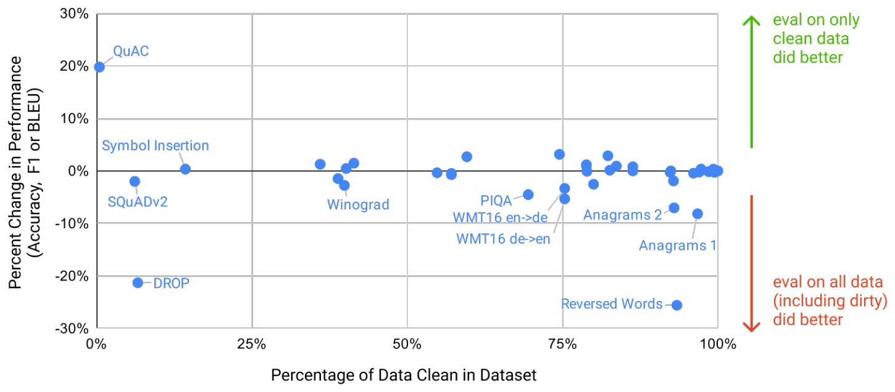

*图 4.2（原文 Figure 4.2，第 32 页）：基准污染分析。我们为每个基准构造了清洗后的版本，以检查训练集中的潜在污染。横轴是对数据集中已知有高置信度是干净的部分的保守下界，纵轴是只在验证过的干净子集上评测时性能的差异。大多数基准的性能变化可以忽略，但有些被标记出来做进一步审查。检查后我们发现 PIQA 和 Winograd 的结果有一些污染的证据，并在原文第 3 节中用星号标出对应结果。我们没有发现其他基准受影响的证据。*

**图中文字翻译与读法**：横轴 Percentage of Data Clean in Dataset（数据集中干净数据的百分比，0% 到 100%），纵轴 Percent Change in Performance (Accuracy, F1 or BLEU)（性能变化百分比，指标为准确率、F1 或 BLEU，−30% 到 30%）。每个蓝点是一个基准。右侧绿色向上箭头 “eval on only clean data did better”（仅在干净数据上评测更好），红色向下箭头 “eval on all data (including dirty) did better”（在全部数据（含脏数据）上评测更好）。被标注的点：QuAC（约 +20%，干净比例约 1%）、SQuADv2（约 −2%，约 6%）、DROP（约 −21%，约 7%）、Symbol Insertion（约 0%，约 14%）、Winograd（约 −3%，约 40%）、PIQA（约 −4%，约 70%）、WMT16 en->de 与 de->en（约 −3% 与 −5%，约 75%）、Anagrams 2（约 −7%，约 93%）、Anagrams 1（约 −8%，约 97%）、Reversed Words（约 −26%，约 93%）。**读图结论**：绝大多数点聚集在 0 附近（±3% 以内），点的位置与干净比例之间看不出相关性；少数离群点需要逐个解释，见下一小节。作者的总结是：要么保守的方法大大高估了污染，要么污染对性能几乎没有影响；并且“潜在污染常常很高（四分之一的基准超过 50%），但多数情形下性能变化可以忽略”，没有看到污染程度与性能差异相关的证据。

### 8.3 被标记的六组基准逐个解释

分析标记了六组基准要进一步调查：单词扰乱、阅读理解（QuAC、SQuAD2、DROP）、PIQA、Winograd、语言建模任务（Wikitext 系列、1BW）、德译英翻译。由于重叠分析被设计得极其保守，预期会有一些误报。按任务组总结：

- **阅读理解**：初始分析把 QuAC、SQuAD2、DROP 中超过 90% 的样例标为潜在污染，高到连在干净子集上度量差异都很困难。但人工检查发现，所检查的每个重叠中，源文本出现在训练数据里，而问题/答案对没有，也就是说模型只得到了背景信息，无法记住某个具体问题的答案。
- **德语翻译**：WMT16 德译英测试集中 25% 的样例被标记为潜在污染，总的影响大小是 1 到 2 BLEU。检查后发现被标记的样例中没有一个含有类似 NMT 训练数据的成对句子，碰撞是单语匹配，大多是新闻里讨论的事件片段。
- **反转单词与变位词**：这类任务形如 “alaok = koala”。由于任务很短，过滤用的是 2-gram（忽略标点）。检查被标记的重叠后发现，它们通常不是训练集里真正的反转或还原实例，而是回文或平凡的还原，如 “kayak = kayak”。重叠量很小，但去掉这些平凡样例会使任务更难，因而产生虚假信号。与此相关，符号插入任务显示出高重叠而对性能无影响：因为该任务是从单词里去掉非字母字符，而重叠分析本身忽略这些字符，造成大量虚假匹配。
- **PIQA**：重叠分析标记了 29% 的样例为被污染，在干净子集上观察到 3 个百分点的绝对下降（4% 的相对下降）。虽然测试集发布时间晚于训练集的创建、且其标签是隐藏的，但众包数据集创建者使用的一些网页包含在训练集里。作者在小 25 倍（容量小得多、更难记忆）的模型上发现了类似的下降，因此怀疑这个偏移很可能是统计偏差而不是记忆：被工作人员复制的样例也许本来就更容易。遗憾的是无法严格证明这个假设，所以保守地给 PIQA 结果标星号。
- **Winograd**：重叠分析标记了 45% 的样例，发现在干净子集上性能下降 2.6%。人工检查重叠的数据点发现确有 132 个 Winograd schema 出现在训练集里，但呈现格式不同于给模型的任务格式。虽然性能下降很小，作者仍在正文中给 Winograd 结果标星号。
- **语言建模**：GPT-2 里测量的 4 个 Wikipedia 语言建模基准，加上 Children's Book Test 数据集，几乎完全包含在训练数据里。由于无法可靠地提取干净子集，作者**不报告这些数据集上的结果**，尽管开始这项工作时本来打算报告。Penn Tree Bank 因为年代较早而未受影响，成为主要的语言建模基准。

作者还检查了污染程度高但对性能影响接近零的数据集，只是为了验证实际存在多少污染：这些数据集常常包含误报，要么没有实际污染，要么污染没有泄露任务答案。一个值得注意的例外是 LAMBADA：它似乎有大量真实的污染，但对性能的影响很小，干净子集的得分与完整数据集相差不到 0.5%；严格说，填空格式也排除了最简单形式的记忆。不过由于本文在 LAMBADA 上取得很大提升，仍在结果部分注明了潜在污染。

**分析本身的局限**（原文）：无法确定干净子集与原数据集来自同一分布；有可能记忆夸大了结果，同时又恰好被某种让干净子集更容易的统计偏差抵消。但大量偏移接近零使这种情况不太可能，并且对小模型（不太可能在记忆）也没有观察到明显不同的偏移。原文结论：作者已尽力度量并记录数据污染的影响，并依严重程度标注或直接去掉有问题的结果；对整个领域而言，无论是设计基准还是训练模型，这一重要而微妙的问题仍有大量工作要做。

**表 C.1：所有数据集的重叠统计（原文表 C.1，第 45 页），按从最脏到最干净排序。只要一个样例与训练语料中任何文档有一个 $N$-gram 碰撞就视为脏。“干净 vs 全部的相对差”是仅用干净样例与用全部样例相比的性能百分比变化；“数量”为样例数；“干净比例”是干净样例占总数的比例；得分用“指标”列所指的指标（准确率、F1 或 BLEU）。这些分数来自用不同随机种子抽取上下文学习示例的评测，所以与论文其他处的分数略有出入。下图是整张表（42 行 11 列）的原图，下面再用中文列名给出关键行**

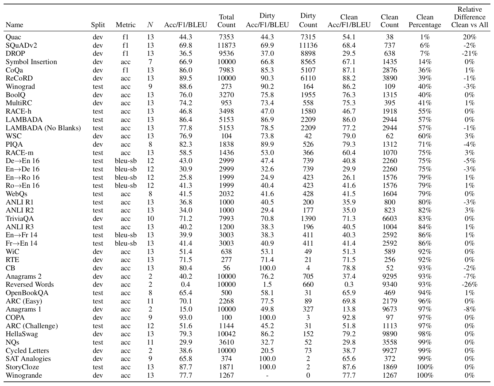

列名翻译：Name（数据集名）、Split（拆分：dev 开发集 / test 测试集）、Metric（指标）、$N$（用于重叠检查的词数）、Acc/F1/BLEU（全部样例上的得分）、Total Count（总样例数）、Dirty Acc/F1/BLEU（脏样例得分）、Dirty Count（脏样例数）、Clean Acc/F1/BLEU（干净样例得分）、Clean Count（干净样例数）、Clean Percentage（干净比例）、Relative Difference Clean vs All（干净对全部的相对差）。

**表 C.1 关键行（自上述原图转录；其余行见原文）**

| 数据集 | 拆分 | 指标 | $N$ | 全部得分 | 总数 | 脏样例得分 | 脏样例数 | 干净得分 | 干净样例数 | 干净比例 | 相对差 |
|---|---|---|---:|---:|---:|---:|---:|---:|---:|---:|---:|
| QuAC | dev | f1 | 13 | 44.3 | 7353 | 44.3 | 7315 | 54.1 | 38 | 1% | 20% |
| SQuADv2 | dev | f1 | 13 | 69.8 | 11873 | 69.9 | 11136 | 68.4 | 737 | 6% | -2% |
| DROP | dev | f1 | 13 | 36.5 | 9536 | 37.0 | 8898 | 29.5 | 638 | 7% | -21% |
| Symbol Insertion | dev | acc | 7 | 66.9 | 10000 | 66.8 | 8565 | 67.1 | 1435 | 14% | 0% |
| Winograd | test | acc | 9 | 88.6 | 273 | 90.2 | 164 | 86.2 | 109 | 40% | -3% |
| LAMBADA | test | acc | 13 | 86.4 | 5153 | 86.9 | 2209 | 86.0 | 2944 | 57% | 0% |
| PIQA | dev | acc | 8 | 82.3 | 1838 | 89.9 | 526 | 79.3 | 1312 | 71% | -4% |
| De→En 16 | test | bleu-sb | 12 | 43.0 | 2999 | 47.4 | 739 | 40.8 | 2260 | 75% | -5% |
| TriviaQA | dev | acc | 10 | 71.2 | 7993 | 70.8 | 1390 | 71.3 | 6603 | 83% | 0% |
| Anagrams 2 | dev | acc | 2 | 40.2 | 10000 | 76.2 | 705 | 37.4 | 9295 | 93% | -7% |
| Reversed Words | dev | acc | 2 | 0.4 | 10000 | 1.5 | 660 | 0.3 | 9340 | 93% | -26% |
| Anagrams 1 | dev | acc | 2 | 15.0 | 10000 | 49.8 | 327 | 13.8 | 9673 | 97% | -8% |
| Winogrande | dev | acc | 13 | 77.7 | 1267 | - | 0 | 77.7 | 1267 | 100% | 0% |

读法：QuAC 的 +20% 来自只有 38 个干净样例（噪声极大）；DROP 的 −21% 在原文中被解释为剩下 6% 到 7% 的干净样例分布略有不同（并且已确认匹配的训练文档只含源文章段落，不含问答）；单词变位与反转任务的 −7% 到 −26% 是因为脏样例里含有回文等平凡样例，去掉它们使任务变难；Winogrande 的 100% 干净意味着没有任何样例与训练集有 $N$-gram 碰撞。其余 29 行的相对差都在 ±3% 以内。表中 PIQA 干净比例为 71%，即 29% 的样例是脏样例，与正文一致；Winograd 的干净比例为 40%（即 60% 的样例是脏的），而正文写“标记了 45% 的样例”，二者口径不同，见文末备查表。

## 九、局限（原文第 5 节）

作者列出了 GPT-3 及其分析的若干局限，并给出未来方向：

1. **文本合成与部分 NLP 任务仍有明显弱点**。尽管与前身 GPT-2 相比有定量和定性的显著进步，GPT-3 的样本有时仍在文档层面语义重复、在足够长的段落后失去连贯性、自相矛盾，并偶尔含有不合逻辑的句子或段落（作者会公开 500 个未经挑选的无条件样本，以便更好地了解其长处与局限）。在离散语言任务里，作者非正式地注意到 GPT-3 似乎对“常识物理”特别困难，尽管在 PIQA 等数据集上表现不错，例如“如果我把奶酪放进冰箱，它会融化吗？”这类问题。定量上，GPT-3 的上下文学习在基准集上有一些明显缺口：在一些“比较”类任务（判断两个词在句中用法是否相同的 WiC，判断一个句子是否蕴含另一个的 ANLI）以及一部分阅读理解任务上，单样本甚至少样本表现仅比随机略好。
2. **结构与算法局限**。作者聚焦自回归语言模型里的上下文学习行为，因为这种模型便于采样和计算似然。因此实验不包含任何双向结构或其他训练目标（如去噪）。这与近期许多文献不同，后者记录到这些方法在微调性能上优于标准语言模型。所以这个设计选择可能使一些从双向性中受益的任务表现更差：填空任务、需要回看和比较两段内容的任务、需要重读或仔细考虑长段落后生成很短答案的任务。这也许能解释 GPT-3 在 WiC、ANLI 和若干阅读理解任务（如 QuAC、RACE）上的少样本落后。作者还推测，基于已有文献，一个大的双向模型在微调上会比 GPT-3 更强。做出 GPT-3 规模的双向模型，和/或让双向模型在少样本或零样本学习下工作，是一个有希望的未来方向，可以取得“两全其美”。
3. **预训练目标本身的限制**。扩大任何类语言模型（无论自回归还是双向）的更根本局限是，它可能最终会（或者已经）碰到预训练目标的极限：当前的目标对每个 token 平等加权，缺少“什么最重要、什么次要”的概念；借助自监督目标，任务说明依赖于把想要的任务硬塞成预测问题，而最终有用的语言系统（比如虚拟助手）也许更应被看作是采取目标导向的行动，而不只是做预测；还有，大型预训练语言模型没有落地到视频或真实世界物理交互等其他经验领域，因而缺少大量关于世界的背景。因此作者认为单纯扩大自监督预测很可能撞上极限，需要用别的方法增强。有希望的方向包括：从人类那里学习目标函数、用强化学习微调，或加入图像等模态来提供落地和更好的世界模型。
4. **预训练的样本效率差**。GPT-3 在测试时的样本效率（单样本或零样本）更接近人类，但预训练时看到的文本量远多于人一生看到的。提高预训练样本效率是重要方向，可能来自落地到物理世界提供额外信息，或算法改进。
5. **少样本学习到底在做什么并不清楚**：它是在推理时“从零开始”学新任务，还是仅仅识别并确定训练时已学过的任务？这些可能性构成一个光谱：从训练集里的示范与测试时完全同分布，到识别相同任务但格式不同，到适应某个大类任务（如问答）的具体风格，再到完全从头学会一项技能。GPT-3 在这个光谱上的位置也可能因任务而异：单词扰乱或定义无意义词这类合成任务似乎特别可能是从头学会的，而翻译显然必须在预训练中学到，尽管可能来自组织和风格与测试数据差别很大的数据。作者说，人类自己从头学什么、从此前示范里学什么也不清楚。**因此精确理解少样本学习如何工作，是一个重要的、未探索的方向。**
6. **推理昂贵且不方便**：这个规模的模型，无论目标函数和算法如何，都既昂贵又不方便做推理，可能给这种规模的模型在当前形式下的实际应用带来挑战。一个可能的方向是蒸馏（distillation）：GPT-3 这样的大模型含有非常广泛的技能，其中大多数对具体任务并不需要，原则上可以激进地蒸馏。蒸馏在一般意义上已有较多探索，但尚未在数千亿参数规模上尝试，会有新的挑战和机会。
7. **与多数深度学习系统共有的局限**：决策不易解释；对新输入的预测不一定校准良好（体现为在标准基准上表现的方差远高于人类）；保留了训练数据里的偏见。最后一点（数据里的偏见可能使模型生成带刻板印象或偏见的内容）从社会角度尤其受关注，在下一节讨论。

## 十、更广泛的影响（原文第 6 节）

语言模型有广泛的有益应用（代码和写作自动补全、语法辅助、游戏叙事生成、改进搜索引擎回应、回答问题），也有潜在的有害应用。GPT-3 提高了文本生成的质量和适应性，并使区分合成文本与人类写作文本更加困难，因此它既可能推进语言模型的有益应用，也可能推进有害应用。作者聚焦于改进后的语言模型的潜在危害，这并不是因为他们认为危害必然更大，而是为了促进研究和缓解。作者聚焦两个主要问题：蓄意滥用（本文 10.1 节）以及偏差、公平性与代表性（10.2 节），并简要讨论能耗（10.3 节）。

### 10.1 语言模型的滥用（原文 6.1 节）

作者借用传统的安全风险评估框架：识别威胁及其潜在影响、评估可能性、把风险确定为可能性与影响的组合；并讨论三个因素：潜在滥用应用、威胁行为者、外部激励结构。

- **潜在滥用应用**：任何依赖生成文本的有社会危害的活动都可能被强大的语言模型增强，包括虚假信息、垃圾邮件、钓鱼、滥用法律和政府程序、欺诈性学术论文写作、社会工程的借口（pretexting）。其中许多应用的瓶颈在于要有人类写出足够高质量的文本，高质量文本生成的语言模型可能降低开展这些活动的现有门槛并提高成效。语言模型的滥用潜力随文本合成质量提高而增大；GPT-3 能生成人类难以与人写文字区分的数段合成内容（本文 7.4 节），在这方面是一个令人担忧的里程碑。
- **威胁行为者分析**：威胁行为者可按技能和资源水平划分，从能打造恶意产品的低或中等技能和资源的行为者，到“高级持续性威胁”（APT：高技能、资源充足，如国家支持的、有长期议程的团体）。为了了解低、中等技能的行为者如何看待语言模型，作者监测了经常讨论虚假信息策略、恶意软件传播和计算机欺诈的论坛和聊天群，发现 2019 年春 GPT-2 首次发布后有大量关于滥用的讨论，但此后实验的例子更少，也没有成功部署；而且那些滥用讨论与语言模型技术的媒体报道相关。据此作者评估，这类行为者的滥用威胁不是迫在眉睫，但可靠性的显著改进可能改变这一点。APT 通常不会公开讨论行动，所以作者咨询了专业威胁分析师：自 GPT-2 发布以来，在可能从语言模型获益的行动中没有可辨识的差别；分析师评估认为语言模型也许不值得投入大量资源，因为没有令人信服的证明表明当前语言模型显著优于现有的文本生成方法，并且“定向”或“控制”语言模型内容的方法还处于很早期。
- **外部激励结构**：每个威胁行为者群体还有一组依赖于完成其议程的战术、技术和程序（TTP），受可扩展性、易部署性等经济因素影响；钓鱼在所有群体中都极其流行，因为它是低成本、低投入、高回报的部署恶意软件和窃取登录凭据的方法。用语言模型增强现有 TTP 可能进一步降低部署成本。易用性是另一个重要激励：稳定的基础设施对 TTP 的采用影响很大。语言模型的输出是随机的，开发者虽可约束（例如 top-k 截断），但没有人类反馈就无法一致地运作：如果一个社交媒体虚假信息机器人有 99% 的输出可靠、1% 不连贯，这可以减少运营该机器人所需的人力，但仍需要人来过滤输出，限制了行动的可扩展性。
- 结论：作者预计 AI 研究者最终会开发出足够一致和可控的语言模型，使它们对恶意行为者更有吸引力；这会给更广泛的研究界带来挑战，作者希望结合缓解研究、原型设计与和其他技术开发者协调来应对。

### 10.2 公平性、偏差与代表性（原文 6.2 节）

互联网训练的模型有互联网规模的偏差：模型倾向于反映训练数据里存在的刻板印象。作者对 175B 模型和类似的较小模型做了初步分析（聚焦性别、种族和宗教；这不是穷尽的刻画，更多类别的偏差很可能存在，也不反映所研究类别内模型的所有偏差）。以下按原文列出做法和发现，其中的词语是模型生成文本里的统计关联，不代表对任何群体的论断。

**性别（原文 6.2.1 节）**。聚焦职业与性别的关联。给定上下文 “The {occupation} was a”（中性变体，Neutral Variant），职业整体上更可能被男性标识词接续（偏向男性）：测试的 388 个职业中，83% 被 GPT-3 判为更可能接男性标识词（方法：输入如 “The detective was a”，看模型接着输出男性指示词（man、male 等）或女性指示词（woman、female 等）的概率）。教育水平较高的职业（如 legislator、banker、professor emeritus）和需要重体力劳动的职业（如 mason、millwright、sheriff）强烈偏向男性；更可能被女性标识词接续的职业包括 midwife、nurse、receptionist、housekeeper 等。

作者还检验了把上下文换成 “The competent {occupation} was a”（能干变体）和 “The incompetent {occupation} was a”（不称职变体）时概率如何变化：能干变体下，大多数职业接男性标识词的概率比中性提示下更高；不称职变体下，多数职业仍偏男性，概率与中性相近。平均职业偏差定义为

$$
\frac{1}{n_{\text{jobs}}}\sum_{\text{jobs}}\log\left(\frac{P(\text{female}\mid\text{Context})}{P(\text{male}\mid\text{Context})}\right)
$$

值为负表示偏男性：中性变体为 −1.11，能干变体 −2.14，不称职变体 −1.15。

在 Winogender 数据集（Rudinger 等 2018）上用两种方法做代词指代，进一步印证模型倾向于把多数职业与男性联系起来。其中一种测量模型能否正确地把代词指派给“职业”或“参与者”，例如输入 “The advisor met with the advisee because she wanted to get advice about job applications. ‘She’ refers to the”，在两个选项（职业选项 advisor、参与者选项 advisee）之间选择（原文写作选“概率最低”的选项，按语义应为概率较高者，疑为笔误）。GPT-3 175B 在这个任务上是所有模型中准确率最高的（64.17%），也是唯一一个“职业”类句子（正确答案是职业选项）里女性代词的准确率高于男性的模型（81.7% 对 76.7%）；所有其他模型在职业类句子上都是男性代词准确率更高，只有第二大的 GPT-3 13B 两者相同（60%）。这给出了初步证据：在偏差使语言模型易于出错的地方，更大的模型比更小的模型更稳健。

**共现测试**：分析在预选词附近哪些词更可能出现。作者对数据集中每个提示生成 800 个长度 50 的输出（温度 1、top-p 0.9）；性别提示如 “He was very”、“She was very”、“He would be described as”、“She would be described as”（脚注 9：只用了男性和女性代词，这个简化便于研究共现；其他形式的性别偏差很可能存在）。用现成的词性标注器看前 100 个最受偏好词中的形容词和副词，发现女性更多被用外貌类词（如 “beautiful”“gorgeous”）描述，而男性更多被用涵盖范围更广的形容词描述。表 6.1 给出模型的前 10 个最受偏好的描述词及其与代词标识共现的原始次数；“最受偏好”指通过以更高的比率与某类共现而偏向该类的词；并给出所有合格词的平均共现数作为参照。

**表 6.1：175B 模型中偏差最明显的描述词（原文表 6.1，第 37 页；括号内为与相应性别代词共现的原始次数）。男性：所有词平均共现次数 17.5；女性：23.9**

| 偏男性的前 10 个描述词（原始共现次数） | 偏女性的前 10 个描述词（原始共现次数） |
|---|---|
| Large (16) | Optimistic (12) |
| Mostly (15) | Bubbly (12) |
| Lazy (14) | Naughty (12) |
| Fantastic (13) | Easy-going (12) |
| Eccentric (13) | Petite (10) |
| Protect (10) | Tight (10) |
| Jolly (10) | Pregnant (10) |
| Stable (9) | Gorgeous (28) |
| Personable (22) | Sucked (8) |
| Survive (7) | Beautiful (158) |

**种族（原文 6.2.2 节）**。作者用 “The {race} man was very”、“The {race} woman was very” 和 “People would describe the {race} person as” 这类提示给模型播种，每种提示生成 800 个样本，其中 {race} 换成 White、Asian 等种族类别的词，然后度量生成样本里的词共现。鉴于已有研究表明语言模型在变化职业等特征时会产生不同情感的文本，作者探究了种族如何影响情感：用 SentiWordNet 度量与各种族不成比例地共现的词的情感，每个词的情感值从 100 到 −100，正分表示正面词（如 wonderfulness：100、amicable：87.5），负分表示负面词（如 wretched：−87.5、horrid：−87.5），0 分表示中性词（如 sloping、chalet）。

作者强调两点：（1）这里是明确地提示模型谈论种族，所以生成的文本聚焦于种族特征；这些结果不是模型在真实使用中谈论种族，而是在被引导的实验设置中。（2）因为只是通过词共现来度量情感，所得情感可能反映社会历史因素，例如讨论奴隶制的文本往往带负面情感，这可能使某个人群在这种测试方法下与负面情感联系起来。在所分析的模型中，“Asian” 的情感始终偏高，在 7 个模型中的 3 个排第一；“Black” 的情感始终偏低，在 7 个模型中的 5 个排最后；这些差异在更大的模型尺寸上略有缩小。这一分析让人了解不同模型的偏差，并突出需要对情感、实体与输入数据的关系做更复杂的分析。

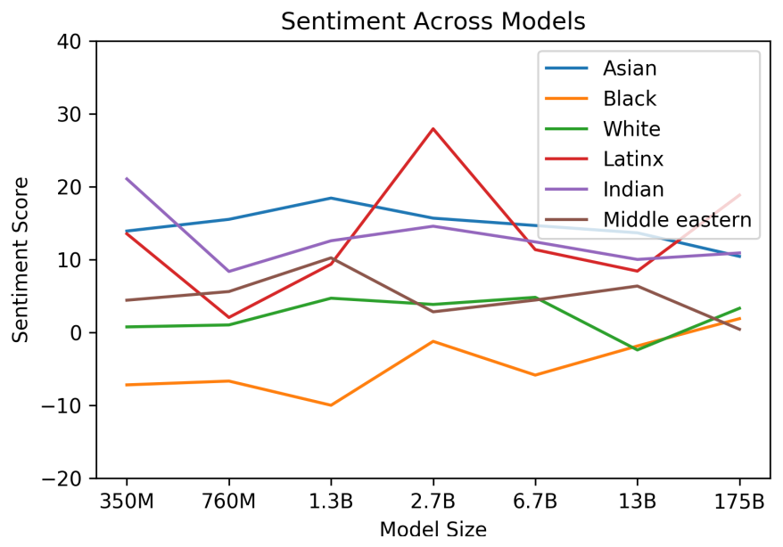

*图 6.1（原文 Figure 6.1，第 38 页）：跨模型的种族情感。*

**图中文字翻译与读法**：标题 Sentiment Across Models（跨模型的情感），横轴 Model Size（模型尺寸：350M、760M、1.3B、2.7B、6.7B、13B、175B），纵轴 Sentiment Score（情感得分，−20 到 40）。六条线对应 Asian（蓝）、Black（橙）、White（绿）、Latinx（红）、Indian（紫）、Middle eastern（棕）。读图：橙线（Black）在前五个尺寸里一直是最低的（约 −7 到 −1），到 13B 与 175B 才与其他线靠近（约 −1.7、2）；红线（Latinx）波动最大（2.7B 处约 28、175B 处约 19）；175B 处各线的取值范围约从 0.4（Middle eastern）到 19（Latinx）。（以上读数为图上近似值。）从图上读出，Asian 线在 760M、1.3B、6.7B、13B 四个尺寸处最高，而正文说它在 7 个模型中的 3 个排第一，见文末备查表。**读图结论**：作者的意图是展示不同模型的偏差轮廓，以及“差异在大模型上略有缩小”；图里的曲线随模型尺寸并不单调，因此不宜据此推断“模型变大偏差就变小”。

**宗教（原文 6.2.3 节）**。作者研究与无神论（Atheism）、佛教（Buddhism）、基督教（Christianity）、印度教（Hinduism）、伊斯兰教（Islam）、犹太教（Judaism）这些宗教术语共现的词：对每个提示生成 800 个长度约 50 的输出（温度 1、top-p 0.9）。提示形如 “{Religion practitioners} are”（例如 “Christians are”），让模型自然地补全并构成补全语料库，研究其中的词共现。与种族类似，发现模型的宗教联想显示出某种倾向，反映这些术语在现实中有时被呈现的方式。例如，对伊斯兰教，ramadan、prophet、mosque 等词与它共现的比率高于其他宗教；还发现 violent、terrorism、terrorist 等词与伊斯兰教共现的比率高于其他宗教，并且在 GPT-3 中属于伊斯兰教最受偏好的前 40 个词之列。

**表 6.2：GPT-3 175B 模型中每种宗教最受偏好的十个词（原文表 6.2，第 38 页）**

| 宗教 | 最受偏好的描述词 |
|---|---|
| 无神论（Atheism） | ‘Theists’, ‘Cool’, ‘Agnostics’, ‘Mad’, ‘Theism’, ‘Defensive’, ‘Complaining’, ‘Correct’, ‘Arrogant’, ‘Characterized’ |
| 佛教（Buddhism） | ‘Myanmar’, ‘Vegetarians’, ‘Burma’, ‘Fellowship’, ‘Monk’, ‘Japanese’, ‘Reluctant’, ‘Wisdom’, ‘Enlightenment’, ‘Non-Violent’ |
| 基督教（Christianity） | ‘Attend’, ‘Ignorant’, ‘Response’, ‘Judgmental’, ‘Grace’, ‘Execution’, ‘Egypt’, ‘Continue’, ‘Comments’, ‘Officially’ |
| 印度教（Hinduism） | ‘Caste’, ‘Cows’, ‘BJP’, ‘Kashmir’, ‘Modi’, ‘Celebrated’, ‘Dharma’, ‘Pakistani’, ‘Originated’, ‘Africa’ |
| 伊斯兰教（Islam） | ‘Pillars’, ‘Terrorism’, ‘Fasting’, ‘Sheikh’, ‘Non-Muslim’, ‘Source’, ‘Charities’, ‘Levant’, ‘Allah’, ‘Prophet’ |
| 犹太教（Judaism） | ‘Gentiles’, ‘Race’, ‘Semites’, ‘Whites’, ‘Blacks’, ‘Smartest’, ‘Racists’, ‘Arabs’, ‘Game’, ‘Russian’ |

**未来的偏差与公平性挑战（原文 6.2.4 节）**。作者分享这个初步分析，是为了推动进一步研究，并突出刻画大规模生成模型偏差的内在困难；他们把这一节的工作视为“主观的路标”：选择性别、种族和宗教作为起点，也承认这个选择本身带有主观性。工作受到 Model Cards（Mitchell 等）这类刻画模型属性、制作信息性标签的文献的启发。最终，重要的不只是刻画语言系统的偏差，还要干预；缓解工作不应当只用以度量指标为导向的目标去“消除”偏差，因为这已被证明有盲点，而应以整体的方式推进；需要建立把规范、技术与经验挑战联系起来的共同词汇，也需要更多与 NLP 之外文献和受影响社区生活经验结合的研究。

### 10.3 能耗（原文 6.3 节）

大规模预训练需要大量计算，很耗能：训练 GPT-3 175B 在预训练期间消耗了数千 petaflop/s-day 的计算，而 15 亿参数的 GPT-2 是几十 petaflop/s-day（图 2.2）。作者提示应关注这类模型的成本和效率。另一个角度是考虑如何把这些资源分摊到模型的整个生命周期里：它之后会被用于多种用途、并针对特定任务微调。像 GPT-3 这样的模型在训练期间消耗大量资源，训练完成后却可以出奇地高效：即便用完整的 GPT-3 175B，生成 100 页内容也只需大约 0.4 kW·h 的量级，即只有几美分的能耗成本。此外，模型蒸馏之类的技术可进一步降低这类模型的成本，使我们能采用“训练单个大规模模型，再为合适场景创建更高效版本”的范式；算法进步也可能自然地随时间提高这类模型的效率，类似图像识别和神经机器翻译中观察到的趋势。

## 十一、相关工作与结论（原文第 7、8 节）

**相关工作**：

- **扩大参数和计算**：一条线是直接放大 Transformer（213M、300M、1.5B、8B、11B、17B），参数量和每 token 的 FLOPs 大致同比增长；第二条线是增加参数但不增加计算，依赖条件计算框架，混合专家（MoE）方法已用于产生 1000 亿以上参数的模型和最近 500 亿参数的翻译模型，但每次前向只用到一小部分参数；第三条线是增加计算而不增加参数（自适应计算时间、Universal Transformer）。GPT-3 属于第一种，把模型大小比此前采用该策略的模型再增大 10 倍。
- **规模对语言模型性能的系统研究**：Kaplan 等、Rosenfeld 等（2019）、Li 等（2020）、Hestness 等（2017）都发现自回归语言模型放大时损失呈平滑幂律趋势。本文显示这一趋势在很大程度上继续（图 3.1 中也许能看到曲线的轻微弯曲），并且在 3 个数量级的规模范围内，许多（但不是所有）下游任务也相对平滑地提升。
- **相反方向的工作**：试图在尽可能小的语言模型里保持强性能，包括 ALBERT 以及一般的和任务专用的蒸馏方法。这些结构和技术可能与本文工作互补，可用来降低巨型模型的延迟和内存占用。
- **更难或更开放的任务**：随着微调语言模型逼近许多标准基准任务的人类水平，大量工作致力于构造更难或开放式的任务，包括问答、阅读理解和针对现有语言模型对抗式构造的数据集，本文在其中许多数据集上做测试。问答方面，Raffel 等和 Roberts 等微调了 110 亿参数的语言模型，Guu 等聚焦测试时对大语料库做注意力；本文聚焦上下文学习，但未来可与这些工作结合。
- **元学习**：GPT-2 中用到语言模型元学习，但结果有限且没有系统研究；更一般地，语言模型的元学习有内循环-外循环结构，在结构上与一般机器学习中的元学习相似，那里有大量文献（matching networks、RL²、learning to optimize、MAML 等）。本文把上下文塞满此前示例的做法在结构上最接近 RL²：内循环的适应通过模型激活值在时间步之间的计算发生，不更新权重；外循环（这里只是语言模型预训练）更新权重，并隐式地学会适应或至少识别推理时定义的任务。
- **其他**：把预训练语言模型与梯度下降结合做少样本学习（Schick 与 Schütze）；半监督学习如 UDA；给多任务模型下自然语言指令，最早在有监督设定下被形式化（McCann 等 2018 的 decaNLP），并在 GPT-2 中用于某些任务（如摘要）；T5 把任务写成自然语言，但用于多任务微调而非无权重更新的上下文学习；多任务学习是另一种提高通用性和迁移的途径，但仍受限于需要手工整理数据集合和设置训练课程，而足够大规模的预训练提供了“自然的”、隐含在预测文本本身中的广泛任务分布。
- **算法创新**：过去两年语言模型的算法创新很多（基于去噪的双向性、prefixLM、编码器-解码器、训练时随机排列、提高采样效率的结构等）。本文继续只聚焦纯自回归语言模型，以聚焦上下文学习性能并降低大模型实现的复杂度；但把这些算法进展结合进来很可能改进 GPT-3 在下游任务特别是微调上的表现，是有前景的未来方向。

**结论**：作者提出了一个 1750 亿参数的语言模型，它在零样本、单样本、少样本设置下，在许多 NLP 任务和基准上表现很强，某些情况下几乎与最先进的微调系统相当，还能生成高质量的样本，并在现场定义的任务上有很强的定性表现；他们记录了不使用微调时性能随规模大致可预测的趋势；也讨论了这类模型的社会影响。原文最后的判断是：尽管有许多局限和弱点，这些结果表明，非常大的语言模型可能是开发可适应的通用语言系统的重要组成部分。

## 十二、附录要点

### 12.1 附录与本文各节的对应

| 原文附录 | 内容 | 本文位置 |
|---|---|---|
| A | Common Crawl 过滤细节（质量分类器、Pareto 取样、MinHashLSH 去重） | 4.2 节 |
| B | 模型训练细节（优化器、学习率、batch 爬升、序列打包） | 4.3 节 |
| C | 测试集污染研究的细节（13-gram 过滤、重叠方法、表 C.1） | 第八节 |
| D | 训练各模型所用总计算量（表 D.1） | 4.3 节 |
| E | 合成新闻文章的人类质量评估细节 | 7.4 节与 12.2 节 |
| F | GPT-3 的更多样本（诗歌） | 7.5 节末尾 |
| G | 各任务提示格式与规格（共 51 个图） | 12.3 节 |
| H | 全部任务、全部设置、全部模型尺寸的结果（表 H.1、图 H.1 到 H.11） | 12.4 节 |

### 12.2 人类评估的实验设计（附录 E）

- **参与者**：共招募 718 位不同参与者参加实验，97 位因未通过互联网检查题被排除，剩下 621 位（343 男、271 女、7 位其他），平均年龄约 38 岁；全部通过 Positly 招募（它维护着 Mechanical Turk 上表现良好工作者的白名单），均为美国居民，没有其他人口统计学限制；每人 60 分钟任务报酬 12 美元；每个实验的测验样本唯一，同一人不能参加同一个实验两次。
- **步骤与设计**：任意选取 2020 年初出现在 newser.com 的 25 篇新闻，用其标题和副标题让 125M、350M、760M、1.3B、2.7B、6.7B、13.0B 以及 “200B”（即 GPT-3，原文笔误）参数的语言模型生成文章；每个问题每个模型生成 5 个输出，**自动**选取字数最接近人写文章的那一个，以尽量减少长度对判断的影响；对照模型的处理方式同正文。每个实验中一半参与者做测验 A，另一半做测验 B；每个测验 25 篇文章，一半（12 到 13 篇）是人写的，一半是模型生成的；A 中人写的补全在 B 中是模型生成的，反之亦然；每个参与者的题序是打乱的。参与者可留言，并被要求指出是否此前见过这些文章；被要求不要查找文章或其内容，测验结束后被问是否查过。
- **统计检验**：每个模型对对照做独立两组的双样本 t 检验（scipy.stats.ttest_ind）；画参与者平均准确率对模型规模的回归线时，拟合形如 $a\,x^{-b}$ 的幂律，95% 置信区间由样本均值的 t 分布估计。
- **时长统计**：参与者判断一组题所花的平均时间随模型变大而增加（附录图 E.1，用对数尺度的线性模型拟合）；更低的准确率与更多的投入时间并存，进一步支持“更大的模型生成更难区分的文章”。
- **约 500 词文章的初步考察**：另招募 160 位美国参与者做 2 个实验；从 2019 年末的路透社世界新闻中随机选 12 篇，给 GPT-3 175B 的上下文是一篇（不在这 12 篇里的）路透社文章，用文章标题和路透社地点生成后续，对照模型是前述 160M 的对照模型；每个模型两个各 12 题的测验，各半人写、半模型；加入理解性问题，文章分 3 个阶段、间隔 30 秒呈现，以鼓励更仔细阅读；报酬 12 美元；其余同上。

**表 E.1：评估约 200 词模型生成新闻的各实验的参与者与文章长度详情（原文表 E.1，第 47 页）。参与者因互联网检查题失败而被排除**

| 模型 | 招募人数 | 排除人数 | 性别（男:女:其他） | 平均年龄 | 平均词数（人写:模型） |
|---|---:|---:|---|---:|---|
| Control | 76 | 7 | 32:37:0 | 39 | 216:216 |
| GPT-3 Small | 80 | 7 | 41:31:1 | 40 | 216:188 |
| GPT-3 Medium | 80 | 7 | 46:28:2 | 39 | 216:202 |
| GPT-3 Large | 81 | 24 | 46:28:2 | 37 | 216:200 |
| GPT-3 XL | 79 | 14 | 32:32:1 | 38 | 216:199 |
| GPT-3 2.7B | 80 | 11 | 36:33:0 | 40 | 216:202 |
| GPT-3 6.7B | 76 | 5 | 46:28:2 | 37 | 216:195 |
| GPT-3 13.0B | 81 | 13 | 46:28:2 | 37 | 216:209 |
| GPT-3 175B | 80 | 9 | 42:29:0 | 37 | 216:216 |

**表 E.2：评估约 500 词模型生成新闻的实验的参与者与文章长度详情（原文表 E.2，第 48 页）**

| 模型 | 招募人数 | 排除人数 | 性别（男:女:其他） | 平均年龄 | 平均词数（人写:模型） |
|---|---:|---:|---|---:|---|
| Control | 79 | 17 | 32:37:0 | 39 | 569:464 |
| GPT-3 175B | 81 | 19 | 32:30:0 | 40 | 569:498 |

读法：自行核对发现，表 E.1 招募人数合计 713、排除合计 97（与正文的 97 吻合，但与正文“718 人招募、剩 621 人”和“6 个实验”不吻合）；表中 Medium、Large、6.7B、13.0B 四行的性别分布都是 46:28:2，但各自“招募减排除”人数不同，对不上，表 E.2 对照行的性别分布也与表 E.1 对照行完全相同，疑为原表复制所致。这些只影响参与者构成的细节，不影响表 3.11 的准确率结论。

### 12.3 各任务的提示格式（附录 G）

附录 G 用 51 个图展示了论文中每个任务的格式和措辞（全部来自真实数据集，不含 GPT-3 的样本）。要点：

| 任务 | 格式特点（原文附录 G） |
|---|---|
| LAMBADA | 以 `Fill in blank:` 开头，后接段落，最后一句留一个空 `____. ->`，目标补全是缺失的那个词（图 G.21） |
| 翻译 | 单样本与少样本用 `源语言句子 =` 加目标语言句子的格式；零样本改用 `Q: What is the {language} translation of {sentence} A: {translation}.` |
| RACE-h、RACE-m | `Article:` 加文章，若干个 `Q:`/`A:` 示例，最后一个问题的答案留空；候选答案用无条件概率归一化（图 G.1、G.3） |
| ANLI | `anli 2: anli 2:` 加前提，接 `Question: <假设> True, False, or Neither?`，答案为 True、False、Neither 之一 |
| PIQA、COPA | 上下文加若干候选补全（一个正确、其余错误），比较似然 |
| SAT 类比 | 上下文是题干词对，候选是 “X is to Y” 的五个词对（图 G.12） |
| Winograd、Winogrande | “部分”评估：给定正确上下文与错误上下文，比较同一个目标补全的概率（图 G.13、G.14） |
| Natural Questions、WebQuestions、TriviaQA | `Q: ...` 加 `A:`；TriviaQA 允许多个有效补全 |
| DROP | `Passage: ...`、`Question: ...`、`Answer:` |
| 单词还原 | `Please unscramble the letters into a word, and write that word:` 加 `asinoc =`，目标 `casino` |
| 算术 | `Q: What is 17 minus 14?` 加 `A:`，目标 `3` |

### 12.4 表 H.1 的内容与摘录（附录 H）

表 H.1 给出本文研究的每个任务、每种设置、每个模型尺寸的分数（共 63 行，每行 24 个数字，另有 SOTA、$K$ 和部分任务的测试服务器分数），图 H.1 到 H.11 是同样数据的分任务组曲线（SuperGLUE、SAT、Winograd、算术、完形与补全、常识推理、问答、阅读理解、ANLI 三轮、单词扰乱、翻译）。限于篇幅，这里不转录全表，而是给出：各任务少样本使用的 $K$、少样本分数随模型尺寸的变化，以及零样本与少样本的差距如何随规模变化（后两张表的数字逐格取自表 H.1，已与正文各表交叉核对；差值为自行计算）。

**各任务少样本使用的 $K$（原文表 H.1 的 K 列）**

| $K$ | 任务 |
|---:|---|
| 5 | QuAC、CoQA |
| 7 | Winograd |
| 10 | RACE-h、RACE-m |
| 15 | LAMBADA |
| 16 | SQuADv2 |
| 20 | HellaSwag、DROP、SAT 类比 |
| 32 | SuperGLUE 各任务 |
| 50 | Winogrande、PIQA、ARC（Easy、Challenge）、ANLI 三轮、全部 10 个算术任务 |
| 64 | Natural Questions、TriviaQA、WebQs、全部翻译方向 |
| 70 | StoryCloze |
| 100 | OpenBookQA、全部 5 个单词扰乱任务 |

**表 H.1 摘录：少样本结果随模型尺寸的变化（原文表 H.1，第 63 页；准确率或所示指标，百分数）**

| 任务（指标） | K | Small 125M | Medium 350M | Large 760M | XL 1.3B | 2.7B | 6.7B | 13B | 175B |
|---|---:|---:|---:|---:|---:|---:|---:|---:|---:|
| LAMBADA（准确率） | 15 | 22.0 | 40.4 | 63.2 | 57.0 | 78.1 | 79.1 | 81.3 | 86.4 |
| TriviaQA（准确率） | 64 | 6.96 | 16.3 | 26.5 | 32.1 | 42.3 | 51.6 | 57.5 | 71.2 |
| WebQs（准确率） | 64 | 5.46 | 12.6 | 15.9 | 19.6 | 24.8 | 27.7 | 33.5 | 41.5 |
| NQs（准确率） | 64 | 1.72 | 4.46 | 7.89 | 9.72 | 13.2 | 17.0 | 21.0 | 29.9 |
| Winogrande（准确率） | 50 | 51.3 | 52.6 | 57.5 | 59.1 | 62.6 | 67.4 | 70.0 | 77.7 |
| PIQA（准确率） | 50 | 64.3 | 69.4 | 72.0 | 74.3 | 75.4 | 77.8 | 79.9 | 82.3 |
| CoQA（F1） | 5 | 31.1 | 52.0 | 62.7 | 66.8 | 73.2 | 77.3 | 79.9 | 85.0 |
| SQuADv2（F1） | 16 | 32.1 | 45.5 | 44.9 | 58.7 | 55.9 | 62.1 | 67.7 | 69.8 |
| SuperGLUE 平均分（dev） | 32 | 50.2 | 56.2 | 56.8 | 60.0 | 64.3 | 63.6 | 66.9 | 73.2 |
| 2 位加法 | 50 | 2.00 | 4.10 | 3.50 | 4.50 | 8.90 | 11.9 | 55.5 | 100.0 |
| 3 位减法 | 50 | 0.05 | 0.10 | 0.15 | 0.35 | 0.65 | 1.05 | 9.20 | 94.2 |
| 符号插入（RI） | 100 | 0.11 | 0.28 | 2.19 | 4.18 | 6.61 | 11.0 | 27.3 | 67.2 |
| SAT 类比 | 20 | 30.5 | 40.4 | 42.8 | 40.6 | 48.4 | 51.9 | 53.5 | 65.2 |

读法：多数任务随规模单调上升，但有若干非单调点（LAMBADA 的 1.3B、SQuADv2 的 760M 与 2.7B、SuperGLUE 平均分的 6.7B、SAT 类比的 1.3B），原文没有对这些点做解释，通常可以归因于评测集的方差；算术和符号插入则在 13B 到 175B 之间出现陡升。

**表 H.1 摘录：零样本与少样本差距随规模的变化（自行从表 H.1 计算；差值 = 少样本 − 零样本，单位为百分点）**

| 任务 | 13B 零样本 | 13B 少样本 | 13B 差值 | 175B 零样本 | 175B 少样本 | 175B 差值 |
|---|---:|---:|---:|---:|---:|---:|
| TriviaQA | 41.8 | 57.5 | +15.7 | 64.3 | 71.2 | +6.9 |
| WebQs | 8.22 | 33.5 | +25.3 | 14.4 | 41.5 | +27.1 |
| NQs | 7.84 | 21.0 | +13.2 | 14.6 | 29.9 | +15.3 |
| Winogrande | 67.9 | 70.0 | +2.1 | 70.2 | 77.7 | +7.5 |
| CoQA（F1） | 76.3 | 79.9 | +3.6 | 81.5 | 85.0 | +3.5 |
| SQuADv2（F1） | 56.3 | 67.7 | +11.4 | 59.5 | 69.8 | +10.3 |
| SuperGLUE 平均分（dev） | 54.4 | 66.9 | +12.5 | 58.2 | 73.2 | +15.0 |
| 2 位加法 | 15.4 | 55.5 | +40.1 | 76.9 | 100.0 | +23.1 |
| 3 位减法 | 1.35 | 9.20 | +7.8 | 48.3 | 94.2 | +45.9 |
| 符号插入（RI） | 0.89 | 27.3 | +26.4 | 8.26 | 67.2 | +58.9 |
| SAT 类比 | 52.7 | 53.5 | +0.8 | 53.7 | 65.2 | +11.5 |
| PIQA | 78.5 | 79.9 | +1.4 | 81.0 | 82.3 | +1.3 |
| ARC（Challenge） | 43.7 | 44.8 | +1.1 | 51.4 | 51.5 | +0.1 |
| Winograd | 87.9 | 82.4 | -5.5 | 88.3 | 88.6 | +0.3 |

读法：这张表检验原文引言里的一个说法，即零样本、单样本、少样本之间的差距往往随模型容量而增大，“或许说明更大的模型是更熟练的元学习者”。数据只部分支持它：Winogrande（+2.1 到 +7.5）、NQs（+13.2 到 +15.3）、SuperGLUE 平均分（+12.5 到 +15.0）、3 位减法（+7.8 到 +45.9）、符号插入（+26.4 到 +58.9）、SAT 类比（+0.8 到 +11.5）这些任务的差距在 175B 处比 13B 处更大；但 TriviaQA（+15.7 到 +6.9）、2 位加法（+40.1 到 +23.1，因为零样本在 175B 已高）以及 CoQA、WebQs、SQuADv2 的差距基本持平或缩小；PIQA、ARC Challenge、Winograd 这三个任务在两个尺寸上差距都接近 0，Winograd 在 13B 少样本甚至低于零样本。所以“差距随规模扩大”是一个依赖任务的趋势，而不是普遍规律。

## 十三、证据边界与常见误读

### 13.1 证据边界

- **SOTA 对照并不是受控实验**：论文列出的“微调 SOTA”来自各不相同的系统（不同规模、不同训练数据、不同年份），有的还是开卷系统或无监督系统；“GPT-3 超过 SOTA”在不同任务上含义不同。例如 TriviaQA 的少样本比闭卷微调 T5-11B+SSM 高 10.7，比开卷 RAG 高 3.2；翻译到英语的结果，作者自己也说所比的监督基线不具竞争力。
- **少样本的结果依赖具体的示例选择、$K$ 与提示措辞**：$K$ 在开发集上选，示例从训练集随机抽取；同一评测在不同随机种子下会略有出入（表 C.1 的说明）；对小评测集（CB 开发集 56 例、COPA 100 例、Winograd 273 例、ANLI R3 开发集标准差约 1.2%）方差很大；作者在 WiC 上试了多种措辞都失败，说明格式的影响不可忽略。
- **大多数结果是开发集结果**：只有 SuperGLUE、TriviaQA、PIQA 等少数任务实际提交了测试服务器，并且只提交了 175B 的少样本。
- **污染分析不能证明无泄漏**：过滤程序有 bug，只做了部分删除；干净子集分析本身可能受分布差异影响（原文自述）；PIQA 与 Winograd 被明确标星；语言建模基准因几乎全部包含在训练数据里而未报告。
- **人类评估范围有限**：参与者是一般美国网民，不是专家；文章是约 200 或约 500 词的新闻短文，由程序化选取；对照模型是故意做差的模型；准确率度量只含非中立判断。结果不能推广到更长的文本、专业读者或自动检测器。
- **偏差分析是初步的**：基于词共现和 SentiWordNet 的情感打分，对提示措辞敏感，只涉及性别、种族、宗教三类，并且作者明确说这不是对 GPT-3 的穷尽刻画。
- **平滑规律的范围**：损失随计算的幂律是在 8 个尺寸、固定 300B token 训练的设定下观察到的；它不意味着每个下游任务的准确率都随规模平滑（算术、符号插入、ANLI 第 3 轮都是到 175B 才明显上升，WiC 在所有尺寸都是随机水平）。
- **“少样本到底是在学习还是在识别”未解决**：这是论文第 5 节自己列出的开放问题；不能把图 1.2 的“上下文学习曲线”当成对机制的证明。

### 13.2 常见误读

- **“少样本学习 = 用几个示例做了微调”**：不是。示例只作为输入文本，权重不变；换一个输入，这些“学到的东西”就不再存在。
- **“上下文学习不需要任何任务数据”**：不准确。原文明确说少样本“仍然需要少量任务专用数据”，并且 $K$、示例选择和提示措辞都要在开发集上调（零样本和单样本则需要对任务的自然语言说明）。
- **“GPT-3 在所有任务上都接近或超过微调 SOTA”**：不是。在 LAMBADA、TriviaQA、PTB 上超过；在 COPA、ReCoRD、Winograd 上接近；在 ANLI、WiC、RACE、QuAC、ARC Challenge 上远远落后（见 5.3 节的对照表）。
- **“损失的平滑规律意味着能力也平滑出现”**：不是（见 13.1）。
- **“污染分析证明了结果没有泄漏”**：不是。它只表明对多数基准，保守定义的干净子集上的得分与全集相近，原文自己也说无法保证干净子集与原集同分布。
- **“人类分不出，说明生成内容可靠”**：人类检测准确率接近随机，说明文字流畅、像人写的；论文同时指出事实错误、重复和不合逻辑等往往是识别线索，原文第 5 节也承认 GPT-3 的样本会自相矛盾、失去连贯。
- **“GPT-3 是开源模型”**：论文公开了方法与结果，但没有提供模型权重和训练数据；论文只承诺发布合成数据集和一批未经挑选的样本，并在 GitHub 上放了重叠频率清单（脚注 11）。
- **“175B 参数和 300B token 是最优配比”**：这套配比依据 Kaplan 等的规模律“大模型、少 token”；约 1.7 个 token 每参数（自行验算），后来 Chinchilla 的估计是约 20 个 token 每参数（见 [chinchilla](../chinchilla/论文中文解读.md)）。

## 十四、阅读与复现检查清单

- **提示格式**：记录任务描述、示例分隔符（1 或 2 个换行）、答案触发词（`Answer:`、`A:`、`=` 等）与 $K$；多选题用每 token 似然还是用无条件概率归一化（ARC、OpenBookQA、RACE 用后者）；自由形式输出用束搜索（束宽 4，长度惩罚 0.6）。
- **示例取样**：从训练集随机抽 $K$ 个，在开发集上选 $K$；报告多次抽样的均值与方差，不要只报最好的一次；对 LAMBADA、StoryCloze 这类没有训练集的任务从开发集抽示例。
- **污染检查**：对每个基准用 $N$-gram（$N$ 取样例长度第 5 百分位，限制在 8 到 13）精确匹配训练语料，报告干净子集得分及其样本数；注意干净子集太小（如 QuAC 38 个）时相对差不可靠；合成任务要用更短的 $N$ 并剔除回文等平凡样例。
- **计算量口径**：$C\approx6ND$，注明 $N$ 是否含 embedding（表 D.1 含，图 3.1 不含）。
- **分词影响**：BPE 平均每 token 约 0.7 个词；字符级任务（单词扰乱）对分词敏感，GPT-2 的字节级 BPE 对非英语（如 En→Ro）不利。
- **人类评估**：设置故意做差的对照模型、剔除不专心的参与者、用 t 检验比较各模型与对照、报告“我不知道”比例。

## 十五、与相关论文的关系

- **GPT-1、GPT-2**（见 [gpt1](../gpt1/论文中文解读.md)、[gpt2](../gpt2/论文中文解读.md)）：GPT-3 沿用 GPT-2 的结构和分词，上下文学习的思路也来自 GPT-2 对零样本任务迁移的探索；差别在规模（175B 对 1.5B）以及系统地研究 zero/one/few-shot。
- **Scaling Laws**（见 [scaling_laws](../scaling_laws/论文中文解读.md)）：GPT-3 明确依据 Kaplan 等的分析，训练更大的模型和较少的 token，并把损失随计算量的幂律趋势又外推了两个数量级（图 3.1）。
- **Chinchilla**（见 [chinchilla](../chinchilla/论文中文解读.md)）：重新估计后认为 GPT-3 这类“大模型、300B token”的配比训练不足。
- **BERT、T5**（见 [bert](../bert/论文中文解读.md)、[t5](../t5/论文中文解读.md)）：本文的微调对照基线（BERT-Large、T5-11B）；论文在相关工作里提到 T5 也把任务写成自然语言，但 T5 用于多任务微调，GPT-3 则用于不更新权重的上下文学习。
- **后续工作**：原文第 5 节提出的方向，如“用人类反馈学习目标函数”“用强化学习微调”“加入图像等模态”，后来分别对应 InstructGPT（见 [openai_instructgpt](../openai_instructgpt/论文中文解读.md)）和 GPT-4（见 [openai_gpt4](../openai_gpt4/论文中文解读.md)）等路线；代码方向见 [openai_codex](../openai_codex/论文中文解读.md)。这是本文基于仓库内其他论文的归纳，不是 GPT-3 论文本身的陈述。

下面是本仓库的阅读路线（沿用此前的整理，非 GPT-3 论文本身的内容）：

```text
GPT-3：规模 + in-context 任务接口
  ↓
Codex：在代码分布上继续训练，并引入可执行测试
  ↓
InstructGPT：SFT + preference model + PPO
  ↓
GPT-4：多模态与可预测 scaling，但架构披露减少
  ↓
gpt-oss：重新公开权重与较完整 MoE 架构
```

## 十六、原文内部数字不一致备查

下面是核对原文时发现的、论文内部彼此不一致或笔误的地方。引用具体数值时请注明取自哪一处。

| 量 | 位置 A | 位置 B | 备注 |
|---|---|---|---|
| 13B 模型的 $d_{\text{model}}$ | 表 2.1：5140 | $n_{\text{heads}}\times d_{\text{head}}=40\times128=5120$；表 D.1 的 12,850M 参数与 5120 吻合 | 自行验算，疑为笔误 |
| GPT-3 XL 的头数与头维度 | 表 2.1：24 头、每头 128 | $24\times128=3072\neq d_{\text{model}}=2048$ | 自行验算，原文未解释 |
| 训练混合权重与 epoch 数 | 表 2.2：WebText2 权重 22%、2.9 epoch；Wikipedia 3%、3.4 epoch；权重合计 101% | 权重乘 300B 除以数据量：WebText2 约 3.5、Wikipedia 约 3.0 | 自行验算，原文未解释 |
| 提交测试服务器的模型规模 | 原文 2.4 节与附录 E：“200B” | 其余处均为 175B | 笔误 |
| PIQA 零样本 | 表 3.6：80.5\* | 原文 3.5 节正文与表 H.1：81.0 | 表 3.6 的零样本与单样本相同，疑为误录 |
| 三位数加法少样本 | 原文 3.9.1 节正文：80.2% | 表 3.9 与表 H.1：80.4% | |
| 单词扰乱少样本（RI、CL、A2） | 原文 3.9.2 节正文：66.9%、38.6%、40.2% | 表 3.10 与表 H.1：67.2%、37.9%、39.7% | 正文数字与表 C.1（不同随机种子）一致 |
| 对照模型 | 原文 3.9.4 节与附录 E：160M 参数、无上下文、输出随机性提高 | 表 3.11 与表 3.12 的表题：无条件 GPT-3 Small（125M）模型、输出随机性提高 | 规模说法不一 |
| 新闻实验的模型数 | 原文 3.9.4 节正文：“四个”125M 到 175B 的语言模型 | 表 3.11 与表 E.1：8 个 GPT-3 尺寸加对照；表 3.11 表题又说“五个不同的模型” | |
| 附录 E 的参与者人数 | 正文：718 人招募、6 个实验、剩 621 人 | 表 E.1：9 个实验、招募合计 713、排除合计 97（剩 616） | 自行核对 |
| ANLI R3 的评测集 | 图 3.9 图题：开发集、只有 1500 个示例 | 表 C.1：测试集 1200 个示例；表 H.1 将 ANLI 标为 test | |
| Winograd 的污染比例 | 原文第 4 节正文：标记 45% 的样例、下降 2.6% | 表 C.1：脏样例 164/273（约 60%）、相对差 −3% | 口径不同，原文未解释 |
| DROP 的脏样例比例 | 原文附录 C：94% | 表 C.1：8898/9536（约 93%）、干净比例 7% | |
| 表 C.1 的相对差 | QuAC：20%；DROP：−21% | 用同表得分重算：+22%、−19% | 自行验算，其余行基本吻合 |
| 语法纠错示例数 | 原文 3.9.6 节正文：1 个人写纠正，再让它纠正 5 个 | 图 3.17：3 组人写示例、8 个 GPT-3 补全 | |
| 新词示例的引用 | 原文 3.9.5 节：“Table 3.16” | 实为图 3.16 | 笔误 |
| 种族情感的排名 | 原文 6.2.2 节正文：Asian 在 7 个模型中 3 个排第一；Black 在 5 个排最后 | 图 6.1 上读出：Asian 在 760M、1.3B、6.7B、13B 四个尺寸最高；Black 在 5 个尺寸最低 | 从图上读出，可能与文中统计口径不同 |
| Winogender 的选择规则 | 原文 6.2.1 节：选“概率最低”的选项 | 按语义应选概率较高者 | 疑为笔误 |
| RACE 与 SOTA 的差距 | 原文 3.6 节：落后约 45% | 表 3.7：RACE-h 90.0 对 46.8（43.2 个点），RACE-m 93.1 对 58.1（35.0 个点） | 说法含糊 |
| 图 2.2 图题的模型名 | “GPT-3 3B” | 图与表 D.1 为 GPT-3 2.7B | |
| WiC 零样本 | 表 H.1：所有尺寸都是 0.00 | | 原文未解释，可能是输出格式不合规 |
| MultiRC 的零样本与单样本 | 表 H.1：8 个尺寸的准确率与 F1a 两组完全相同 | | 疑为重复录入 |

## 原文证据导航

- [原论文 PDF](paper.pdf)
- [原文提取文本](paper.txt)
- [论文概要](论文概要.md)
