# 论文中文解读：《gpt-oss-120b & gpt-oss-20b Model Card》

> **基本信息**：OpenAI，2025 年 8 月 5 日发布的模型卡（model card），共 35 页 PDF。官方入口：[模型卡网页](https://openai.com/index/gpt-oss-model-card/)、[官方 PDF](https://cdn.openai.com/pdf/419b6906-9da6-406c-a19d-1bb078ac7637/oai_gpt-oss_model_card.pdf)、[GitHub](https://github.com/openai/gpt-oss)。
>
> **本文的读法**：文中页码均为 PDF 页码（比原文页脚上印的页码大 1）。图为从原文 PDF 裁下的原图，表为逐格核对后的中文转录（模型名、数据集名和数字保持原样）；每张图后有图中文字翻译和读图结论，因此不必再翻英文原文。从图上读出的近似数值会注明“图上读出”，原文正文和表格给出的数字优先。凡标为“笔者验算”或“笔者估算”的内容，是由原文数字推出的结果，不是原文的结论。

## 一、一句话结论

gpt-oss-120b 与 gpt-oss-20b 是 OpenAI 发布的两个**开放权重**（open-weight）推理模型（据原文，开发过程中听取了开源社区的反馈），采用 Apache 2.0 许可并附 gpt-oss usage policy，只处理文本，面向 agent 工作流设计：强指令遵循、能用网页搜索和 Python 执行等工具、推理强度可调、可定制、输出完整思维链（CoT）、支持 Structured Outputs，并兼容 OpenAI 的 Responses API。

- **架构**：自回归的混合专家（MoE）Transformer。120b 有 36 层，总参数 116.8B，每个 token 只激活 5.1B；20b 有 24 层，总参数 20.9B，激活 3.6B。MoE 权重用 MXFP4 格式（每参数 4.25 比特），使 120b 能放进单张 80GB GPU，20b 能在只有 16GB 内存的系统上运行。
- **能力**：在推理强度为 high 时，120b 在多项基准上超过 o3-mini，并接近 o4-mini；20b 虽然小 6 倍，仍有竞争力。
- **安全**：开放权重一旦发布就无法收回，也无法在服务端加防护，所以模型卡的重点是**最坏情况评估**：OpenAI 用自家的强化学习训练栈对 120b 做了生物化学与网络安全两个方向的对抗微调，并由安全顾问组（SAG）评审，结论是即使如此也未达到 Preparedness Framework 的 High 阈值，而且发布 120b 不会显著推进开放模型的生物能力前沿。
- **边界**：它是“开放权重”而不是“开放训练全栈”：架构超参数和训练算力披露得相当具体，但预训练数据构成、后训练配方、RL 环境和训练代码都没有公开。

## 二、这份资料公开了什么，没公开什么

| 项目 | 状态 | 原文依据 |
|---|---|---|
| 权重与许可 | 开放权重；Apache 2.0 许可加 gpt-oss usage policy | 第 1 节（第 4 页） |
| 模态 | 纯文本 | 第 1 节 |
| 架构超参数 | 公开：层数、残差宽度、专家数、top-k、注意力头数、窗口大小、上下文长度、词表大小 | 第 2.2、2.3 节 |
| 参数拆分与检查点大小 | 公开（表 1） | 第 2 节 |
| 预训练数据 | 仅概述：纯文本、数万亿 token、以 STEM、代码和通用知识为重点；知识截止 2024 年 6 月；复用 GPT-4o 的 CBRN 预训练过滤器 | 第 2.4 节 |
| 训练资源 | 120b 约 210 万 H100 小时，20b 少近 10 倍；NVIDIA H100、PyTorch、专家优化的 Triton 内核、FlashAttention | 第 2.4 节 |
| 后训练 | 高层描述：与 OpenAI o3 类似的 CoT 强化学习技术；deliberative alignment；指令层级训练 | 第 2.5、3 节 |
| 训练数据、RL 环境、训练代码、超参数 | 未在模型卡中公开 | - |
| 推理格式与参考实现 | 公开：harmony 聊天格式、o200k_harmony 分词器（在 TikToken 中开源）、开源的参考实现与使用指南 | 第 2.3、2.5 节 |
| 评测与安全结果 | 大量披露，含对抗微调的最坏情况评估 | 第 2.6、4、5 节 |

与[GPT-4 技术报告](../openai_gpt4/论文中文解读.md)对比，差别很清楚：GPT-4 报告明确不披露架构和规模，而这份模型卡写明了可以直接实现兼容推理的全部架构参数。但两者在“预训练数据与训练配方不披露”这一点上是一致的。

## 三、模型规模与参数拆解（原文第 2 节，表 1）

“120b”“20b”是简称，实际参数量分别是 116.8B 与 20.9B。表 1 给出完整拆分：

表 1：模型参数量（Unembedding 参数计入激活参数，Embedding 不计入）

| 组成 | gpt-oss-120b | gpt-oss-20b |
|---|---:|---:|
| MLP（MoE 专家部分） | 114.71B | 19.12B |
| Attention（注意力） | 0.96B | 0.64B |
| Embed + Unembed（词嵌入与输出投影） | 1.16B | 1.16B |
| Active Parameters（每 token 激活参数） | 5.13B | 3.61B |
| Total Parameters（总参数） | 116.83B | 20.91B |
| Checkpoint Size（检查点大小） | 60.8GiB | 12.8GiB |

（原文表 1，第 5 页。）**读法**：MoE 的 MLP 占总参数的比例，120b 约 98%（114.71 ÷ 116.83），20b 约 91%（19.12 ÷ 20.91），与原文“90% 以上”一致，所以“总参数”主要就是专家参数；而每个 token 只激活其中一小部分，因此计算量按激活参数（5.13B 与 3.61B）计，显存占用却要按**全部权重**计（检查点 60.8GiB 与 12.8GiB）。

下面用原文的架构数字做了一组验算（笔者验算，原文没有写这些推导），可以帮助理解表中数字的含义：

| 验算项 | 过程与结果 |
|---|---|
| 词嵌入大小 | 词表 201,088 × 宽度 2880 ≈ 0.579B；Embedding 与 Unembedding 各一份，合计 ≈ 1.158B，与表中 1.16B 吻合 |
| 激活参数 | 激活参数 ≈ Attention + Unembedding + （4 ÷ 专家数）× MLP。120b：0.96 + 0.579 + 4/128 × 114.71 ≈ 5.12B（表 5.13B）；20b：0.64 + 0.579 + 4/32 × 19.12 ≈ 3.61B（表 3.61B） |
| 单个专家的大小 | 每层 MLP 参数 ÷ 专家数：120b 为 114.71B ÷ 36 ÷ 128 ≈ 24.9M，20b 为 19.12B ÷ 24 ÷ 32 ≈ 24.9M，两个模型相同。若每个 SwiGLU 专家由三个 2880 × 2880 矩阵组成，恰好是 3 × 2880 × 2880 ≈ 24.9M，所以专家隐层宽度约为 2880（这是推算，原文没有给出） |
| 每层注意力参数 | Q：2880 × 4096，K、V：各 2880 × 512，输出投影：4096 × 2880，合计 ≈ 26.5M；乘 36 层 ≈ 0.96B，乘 24 层 ≈ 0.64B，与表一致 |
| 检查点大小 | MoE 参数按 4.25 比特、其余参数按 16 比特（假设为 BF16）估算：120b ≈ 56.8 + 3.9 ≈ 60.7GiB（表 60.8GiB）；20b ≈ 9.5 + 3.4 ≈ 12.8GiB（表 12.8GiB） |

最后一行也间接验证了第四章的说法：只有 MoE 权重被量化为 4.25 比特，其余部分保持更高精度（这里假设其余部分为 BF16）。

## 四、量化：MXFP4（第 2.1 节）

为降低显存占用，团队“在后训练中对 MoE 权重做了 MXFP4 格式的量化”（原文：post-trained the models with quantization of the MoE weights to MXFP4），权重平均每参数 4.25 比特。MoE 权重占总参数的 90% 以上，把它们量化后，大模型能放进单张 80GB GPU，小模型能在只有 16GB 内存的系统上运行。检查点大小见表 1。

背景说明（来自 OCP Microscaling 格式规范，不在模型卡里）：MXFP4 以 32 个元素为一块，每块共享一个 8 比特的缩放因子，块内每个元素用 4 比特浮点表示，平均每元素 4 + 8/32 = 4.25 比特。

要点：

- 原文措辞是 “post-trained the models with quantization of the MoE weights”，字面更像是在**后训练阶段**就带着量化做训练，而不是训练结束后再单独做训练后量化（PTQ）；但具体方式（是否量化感知训练、梯度如何处理）原文没有写，不宜过度解读。
- “能放进 80GB 或 16GB”只说明权重能驻留。实际服务还需要 KV cache、激活值、运行时工作区和并发余量；MXFP4 的实际速度也取决于硬件和推理引擎是否原生支持这一格式。

## 五、架构（第 2.2、2.3 节）

两个模型共享同一套设计，只在层数和专家数上不同。

表（汇总）：gpt-oss 的架构超参数

| 项目 | gpt-oss-120b | gpt-oss-20b |
|---|---|---|
| 层数 | 36 | 24 |
| 残差流宽度 | 2880 | 2880 |
| 归一化 | 在每个注意力块和 MoE 块之前对激活做 RMSNorm（Pre-LN 位置） | 同左 |
| 每个 MoE 块的专家数 | 128 | 32 |
| 每 token 选择的专家数 | top-4 | top-4 |
| 专家激活函数 | gated SwiGLU（实现不常规，含 clamping 与残差连接） | 同左 |
| Query 头 | 64 个，每个 64 维 | 同左 |
| Key-Value 头 | 8 个（Grouped Query Attention，GQA） | 同左 |
| 注意力模式 | 带状窗口（bandwidth 128 token）与全稠密交替 | 同左 |
| 位置编码 | RoPE；稠密层用 YaRN 把上下文长度扩展到 131,072 token | 同左 |
| softmax 分母 | 每个注意力头有一个可学习偏置 | 同左 |
| 分词器 | o200k_harmony，共 201,088 个 token | 同左 |
| 总参数 / 激活参数 | 116.83B / 5.13B | 20.91B / 3.61B |

（来自原文第 2.2、2.3 节与表 1，第 5、6 页。）

### 5.1 混合专家（MoE）

每个 MoE 块由固定数量的专家（120b 为 128 个，20b 为 32 个）和一个标准的线性路由器（router projection）组成，路由器把残差激活映射成对每个专家的打分。两个模型都为每个 token 选出得分最高的 4 个专家，并且只在被选中的 4 个专家上做 softmax，用它给各专家输出加权。按这段文字写出的计算是：

$$
s=W_r x,\qquad \mathcal{T}=\operatorname{TopK}(s,4),\qquad g_i=\frac{e^{s_i}}{\sum_{j\in\mathcal{T}}e^{s_j}}\ \ (i\in\mathcal{T}),\qquad y=\sum_{i\in\mathcal{T}}g_i\,E_i(x)
$$

其中 $x$ 是一个 token 在该层的（归一化后）激活，$W_r$ 是路由器的线性投影，$s$ 是对全部专家的打分，$\mathcal{T}$ 是被选中的 4 个专家，$E_i$ 是第 $i$ 个专家（一个门控 SwiGLU 的 MLP），$y$ 是 MoE 块的输出。这是对原文文字描述的形式化，原文没有给出公式。原文没有说明是否有负载均衡损失、偏置项等训练细节。

专家的激活函数是 gated SwiGLU，脚注说明其实现“不常规”，包含 clamping（截断）和残差连接，细节没有展开。

### 5.2 注意力

- **带状窗口与稠密层交替**：沿用 GPT-3 的做法，注意力层在“带状窗口”和“全稠密”两种模式之间交替，带宽为 128 token。带状层只看附近的 128 个 token，成本不随序列长度增长；稠密层周期性地提供全局通信。
- **头的配置**：每层有 64 个 query 头，每头 64 维，使用 Grouped Query Attention，只有 8 个 key-value 头，也就是每 8 个 query 头共享一组 K、V，以减小 KV cache。
- **位置编码与长上下文**：使用旋转位置编码（RoPE），并用 YaRN 把稠密层的上下文长度扩展到 131,072 个 token（128K）。
- **可学习的 softmax 分母偏置**：每个注意力头在 softmax 的分母里有一个可学习的偏置，类似 off-by-one attention 与 attention sink，使注意力机制可以“不关注任何 token”。若记第 $i$ 个位置的注意力打分为 $z_i$，该头的偏置为 $b$，则注意力权重可写成

$$
\alpha_i=\frac{e^{z_i}}{e^{b}+\sum_{j}e^{z_j}}
$$

此时所有真实 token 的权重之和 $\sum_i\alpha_i<1$，剩余的部分相当于“把注意力放在没有 token 的地方”。（这是对原文文字描述的形式化；每个头一个标量偏置是笔者对“a learned bias”的读法。）

### 5.3 一个笔者估算：KV cache 有多大

假设注意力层严格按“带状、稠密”交替（稠密层占一半），且 KV cache 以 BF16 存储（这两点都是假设）。每个稠密层每个 token 要存 $2\times 8\times 64=1024$ 个数（K 与 V，8 个头，64 维）。

- gpt-oss-120b：18 个稠密层，每 token $18\times1024\times2\ \mathrm{B}=36{,}864\ \mathrm{B}$，在 131,072 token 的满长度下约 4.5GiB。
- gpt-oss-20b：12 个稠密层，每 token 24,576 B，满长度下约 3.0GiB。
- 带状层只需缓存最近 128 个 token，量级只有几 MB，可以忽略。

这个估算说明“交替带状窗口”确实把长上下文的 KV cache 砍掉了大约一半，但在 128K 上下文、多路并发时，KV cache 仍然是权重之外需要认真预留的显存（实际占用取决于推理引擎的实现）。

### 5.4 分词器

所有训练阶段都使用 o200k_harmony 分词器，已在 TikToken 库开源。它是字节对编码（BPE），在 GPT-4o 与 o4-mini 使用的 o200k 分词器基础上，增加了 harmony 聊天格式所需的专用 token，词表共 201,088 个。

## 六、预训练与训练资源（第 2.4 节）

- **数据**：纯文本数据集，规模为数万亿 token，重点是 STEM、代码和通用知识。为提高安全性，预训练时过滤了有害内容，特别是危险的生物安全知识，做法是复用 GPT-4o 的 CBRN（化学、生物、放射、核）预训练过滤器。模型的知识截止日期为 2024 年 6 月。
- **训练硬件与软件**：在 NVIDIA H100 GPU 上用 PyTorch 训练，使用专家优化的 Triton 内核（原文脚注指向 triton 仓库的 triton_kernels 目录）。两个模型都用了 FlashAttention 系列算法来降低显存需求、加快训练（见[FlashAttention](../flash_attention/论文中文解读.md)）。
- **训练量**：训练 gpt-oss-120b 需要 210 万 H100 小时；gpt-oss-20b 少近 10 倍（原文没有给出具体数字）。
- **没有披露的**：训练 token 的确切数目、数据配比与语种构成、学习率与批大小等超参数、MoE 负载均衡方式、数据去重和质量过滤的细节。所以不能由这份模型卡推断“它主要是英文数据”之类的结论（原文只说是纯文本，并没有说语言构成）。

## 七、后训练：推理与工具使用（第 2.5 节）

预训练之后，团队用与 OpenAI o3 类似的 CoT 强化学习技术做后训练。这一步教模型用思维链（CoT）推理和解题，也教它使用工具；由于 RL 技术相近，这些模型的“个性”与 ChatGPT 等第一方产品里的模型相似。训练数据是编码、数学、科学等领域的大量问题。具体的 RL 算法、奖励设计、数据规模、训练时长，模型卡都没有给出。

### 7.1 harmony 聊天格式（第 2.5.1 节）

训练使用一种自定义的聊天格式，称为 harmony chat format。它用专用 token 划定消息边界，用关键字参数（如 User 与 Assistant）标明消息的作者与接收者，沿用 OpenAI API 模型中同样的 System 与 Developer 消息角色。有了这些角色，模型按一个**基于角色的信息层级**来解决指令冲突：

$$
\text{System} > \text{Developer} > \text{User} > \text{Assistant} > \text{Tool}
$$

即系统消息优先于开发者消息，开发者消息优先于用户消息，工具返回的内容优先级最低。这一层级对 prompt injection 很重要：工具输出里夹带的指令不能凌驾于上层指令之上（第 9.4 节会看到模型在这方面的评测）。

格式还引入了“**通道**（channel）”，表明每条消息的预期可见范围：

| 通道 | 用途 |
|---|---|
| `analysis` | 思维链（CoT）token |
| `commentary` | 函数工具调用 |
| `final` | 展示给用户的答案 |

这使模型可以实现更高级的 agent 功能：在 CoT 中穿插工具调用，或者先给用户一段“前言（preamble）”，概述接下来较长的行动计划。原文强调：必须按开源实现与指南里说明的方式正确使用该格式，才能发挥模型的最佳能力；例如在多轮对话里，应当**删掉历史轮次中助手的推理痕迹**。

附录 1 给出了一个完整的例子（原文标注为 Figure 17、18，正文却称为 Table 17、18）：

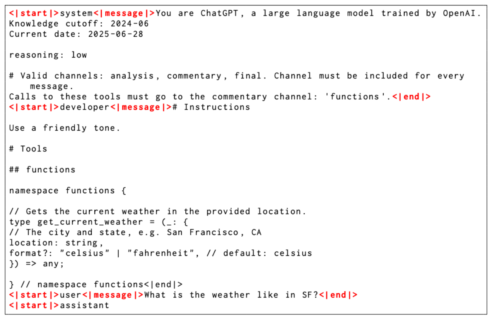

*图 17（原文 Figure 17，第 30 页）：harmony 格式的模型输入：一条把推理强度设为 low 的 system 消息，一条指定了一个可用函数工具的 developer 消息，以及一条询问旧金山天气的 user 消息。*

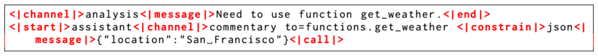

*图 18（原文 Figure 18，第 31 页）：harmony 格式的模型回答示例：先在 analysis 通道里写 CoT，再在 commentary 通道里发起一次工具调用。*

**图中文字转录与读法**（红色为特殊记号；转录为纯文本）：

```text
<|start|>system<|message|>You are ChatGPT, a large language model trained by OpenAI.
Knowledge cutoff: 2024-06
Current date: 2025-06-28

reasoning: low

# Valid channels: analysis, commentary, final. Channel must be included for every message.
Calls to these tools must go to the commentary channel: 'functions'.<|end|>
<|start|>developer<|message|># Instructions

Use a friendly tone.

# Tools

## functions

namespace functions {

// Gets the current weather in the provided location.
type get_current_weather = (_: {
// The city and state, e.g. San Francisco, CA
location: string,
format?: "celsius" | "fahrenheit", // default: celsius
}) => any;

} // namespace functions<|end|>
<|start|>user<|message|>What is the weather like in SF?<|end|>
<|start|>assistant
```

```text
<|channel|>analysis<|message|>Need to use function get_weather.<|end|>
<|start|>assistant<|channel|>commentary to=functions.get_weather <|constrain|>json<|message|>{"location":"San Francisco"}<|call|>
```

- **输入（图 17）**：system 消息写明身份、知识截止（2024-06）、当前日期、推理强度（`reasoning: low`），并规定有效通道只有 analysis、commentary、final，每条消息必须带通道，且对工具 `functions` 的调用必须走 commentary 通道；developer 消息里是指令（“用友好的语气”）和工具定义，工具以类似 TypeScript 的命名空间形式给出；最后是 user 消息，并以 `<|start|>assistant` 结尾，模型从这里开始生成。
- **输出（图 18）**：模型先在 analysis 通道里写一句 CoT（“需要用函数 get_weather”），然后在 commentary 通道里向 `functions.get_weather` 发起调用，参数约束为 JSON，参数是 `{"location":"San Francisco"}`，并以 `<|call|>` 结束，等待工具返回。
- **记号含义**：原文只给了示例，没有逐个解释记号；根据示例推断，`<|start|>` 开始一条消息并跟角色，`<|message|>` 分隔消息头与内容，`<|end|>` 结束一条消息，`<|channel|>` 指定通道，`<|constrain|>` 约束调用参数的格式，`<|call|>` 表示工具调用结束。准确语义以官方 harmony 文档和开源实现为准。
- **示例里的小出入**：developer 消息里定义的工具名是 `get_current_weather`，而图 18 里调用的却是 `get_weather`，原文如此，应是示例笔误，不影响对格式的理解；原图中 `San Francisco` 里的空格是用可见空格符显示的，上面转录为普通空格。

### 7.2 可变推理强度（第 2.5.2 节）

模型被训练成支持 **low、medium、high** 三个推理级别。级别通过系统提示里的关键字设置，例如 `Reasoning: low`（图 17 里写作 `reasoning: low`）。提高推理级别会使模型平均的 CoT 长度增加。这给了部署者一个旋钮：简单任务用 low 省延迟与成本，难题用 high 换准确率。

### 7.3 agent 式工具使用（第 2.5.3 节）

后训练还教模型使用几类工具：

- **浏览工具**：让模型调用 search 与 open 函数与网页交互，有助于事实性，也使模型能获取知识截止日期之后的信息；
- **Python 工具**：让模型在有状态的 Jupyter notebook 环境里运行代码；
- **任意开发者函数**：像 OpenAI API 那样在 Developer 消息里用 schema 描述函数，函数的定义写在 harmony 格式里（图 17 就是一例）。模型可以交错地输出 CoT、函数调用、函数返回、展示给用户的中间消息以及最终答案。

模型被训练成既能带工具也能不带工具运行，由系统提示指定。对每种工具，团队提供了基础的参考 harness（运行框架）支持核心功能，更多细节在开源实现里。

## 八、能力评测（第 2.6 节）

### 8.1 评测设置

对所有数据集，原文报告 high 推理模式、默认系统提示下的基础 pass@1 结果，比较对象是 OpenAI 的 o3、o3-mini 与 o4-mini。评测内容包括：

- **推理与事实性**：AIME（美国数学邀请赛，竞赛数学）、GPQA（博士级科学问题）、MMLU（大学水平多学科考试）、HLE（Humanity's Last Exam，专家级难题）；
- **编码**：Codeforces Elo 与 SWE-bench Verified；评测编码时分别给与不给类似 Codex CLI 的终端工具（比如给模型一个 exec 工具）；
- **工具使用**：用 τ-Bench Retail 评测函数调用能力，函数由 developer 消息提供；
- **其他能力**：用 MMMLU（多语言）和 HealthBench（健康）测试多语言与健康知识。

所有推理级别的完整结果见第 8.7 节的表 3。

### 8.2 主要能力：推理与事实性（图 1）

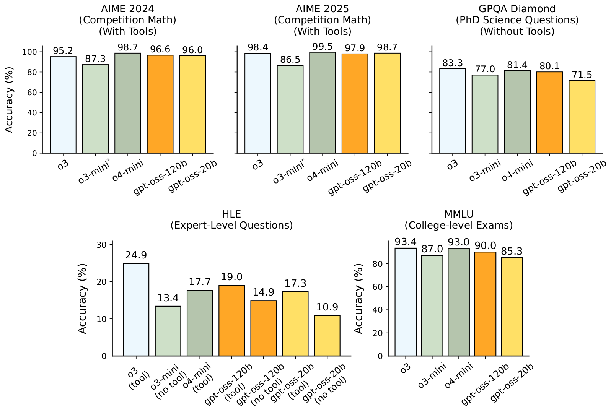

*图 1（原文 Figure 1，第 6 页）：推理级别为 high 时，gpt-oss 与 OpenAI 的 o3、o3-mini、o4-mini 在经典基准上的对比。*

**图中文字翻译与读法**：

- **五个子图**：AIME 2024（竞赛数学，含工具）、AIME 2025（竞赛数学，含工具）、GPQA Diamond（博士级科学问题，无工具）、HLE（专家级问题）、MMLU（大学水平考试）。每个子图的纵轴是 Accuracy (%)（准确率），每根柱的数字是原文标注的数值。
- **颜色**：浅蓝为 o3，浅绿为 o3-mini，灰绿为 o4-mini，橙色为 gpt-oss-120b，黄色为 gpt-oss-20b。AIME 子图里 o3-mini 带星号：脚注说明 o3-mini 在 AIME 上是**无工具**评测的，gpt-oss 在无工具时的 AIME 成绩见表 3。HLE 子图的横轴标签里 (tool) 表示带工具，(no tool) 表示不带工具。

图中数值转录如下：

| 基准 | o3 | o3-mini | o4-mini | gpt-oss-120b | gpt-oss-20b |
|---|---:|---:|---:|---:|---:|
| AIME 2024（含工具；o3-mini 为无工具） | 95.2 | 87.3 | 98.7 | 96.6 | 96.0 |
| AIME 2025（含工具；o3-mini 为无工具） | 98.4 | 86.5 | 99.5 | 97.9 | 98.7 |
| GPQA Diamond（无工具） | 83.3 | 77.0 | 81.4 | 80.1 | 71.5 |
| HLE（带工具） | 24.9 | - | 17.7 | 19.0 | 17.3 |
| HLE（不带工具） | - | 13.4 | - | 14.9 | 10.9 |
| MMLU | 93.4 | 87.0 | 93.0 | 90.0 | 85.3 |

（原文图 1，第 6 页。HLE 子图里每个模型只画了一种设置，“-”表示图中没有该设置的柱。）

- **读图结论**：gpt-oss-120b 在这些基准上都超过 o3-mini，并接近 o4-mini（例如 GPQA 80.1 对 81.4，MMLU 90.0 对 93.0，AIME 2025 97.9 对 99.5）；20b 在数学上几乎与 120b 持平（AIME 2025 反而是 98.7 对 97.9），但在知识型任务上落后更多（GPQA 71.5 对 80.1，MMLU 85.3 对 90.0，HLE 无工具 10.9 对 14.9）。原文的解释是：模型擅长数学，是因为能有效地使用很长的 CoT（20b 在 AIME 上平均每题使用超过 20k 个 CoT token）；而在 GPQA 这类更偏知识的任务上，20b 因规模小而落后。注意 AIME 一行是带工具的成绩，与 o3-mini 的无工具成绩并不同口径。

### 8.3 编码与工具使用（图 2）

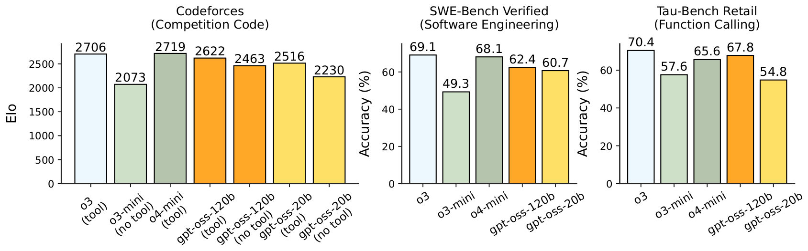

*图 2（原文 Figure 2，第 7 页）：推理级别 high 下，在保留的 Codeforces 题集（带与不带终端工具）、SWE-Bench Verified 和 τ-Bench Retail（开发者函数调用）上的结果。*

**图中文字翻译与读法**：

- **三个子图**：Codeforces（竞赛编程）的纵轴是 Elo 评分；SWE-Bench Verified（软件工程）与 Tau-Bench Retail（函数调用）的纵轴是 Accuracy (%)。Codeforces 子图里 (tool) 表示带终端工具，(no tool) 表示不带。颜色含义同图 1。
- **数值转录**：

| 基准 | o3 | o3-mini | o4-mini | gpt-oss-120b | gpt-oss-20b |
|---|---:|---:|---:|---:|---:|
| Codeforces Elo（带终端工具） | 2706 | - | 2719 | 2622 | 2516 |
| Codeforces Elo（不带工具） | - | 2073 | - | 2463 | 2230 |
| SWE-Bench Verified（%） | 69.1 | 49.3 | 68.1 | 62.4 | 60.7 |
| Tau-Bench Retail（%） | 70.4 | 57.6 | 65.6 | 67.8 | 54.8 |

（原文图 2，第 7 页。）

- **读图结论**：与图 1 一致，gpt-oss-120b 超过 o3-mini，并接近 o4-mini。Codeforces 上带终端工具比不带高约 160 到 290 分（120b：2622 对 2463；20b：2516 对 2230）。Tau-Bench Retail 上 120b 的 67.8 甚至高于 o4-mini 的 65.6；SWE-Bench Verified 上 gpt-oss 仍落后 o3 与 o4-mini 约 6 到 8 个点（图上数值相减）。

### 8.4 测试时扩展：推理强度越高，CoT 越长，准确率越高（图 3）

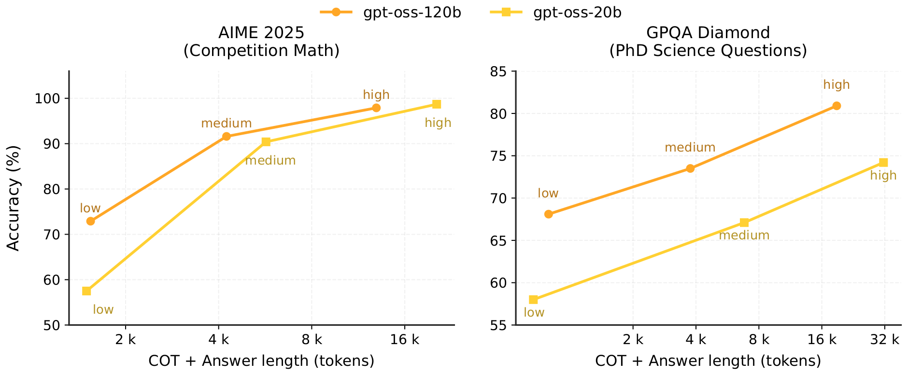

*图 3（原文 Figure 3，第 8 页）：用 low、medium、high 三种推理模式评测 AIME 与 GPQA，画出准确率对平均 CoT + 答案长度的关系。*

**图中文字翻译与读法**：

- **左图 AIME 2025（竞赛数学）与右图 GPQA Diamond（博士级科学问题）**：纵轴 Accuracy (%)；横轴 COT + Answer length (tokens)（平均 CoT 加答案的长度，对数刻度，刻度 2k、4k、8k、16k，右图到 32k）。图例：橙色圆点线为 gpt-oss-120b，黄色方点线为 gpt-oss-20b；每个点旁标注推理级别 low、medium、high。
- **数值**：图上各点的准确率与表 3 中“含工具”那几行吻合（例如 AIME 2025 的 20b high 为 98.7、GPQA 的 120b high 为 80.9），所以应是带工具的设置（这是笔者对照表 3 的推断，图题没有写）。AIME 2025：120b 为 72.9 → 91.6 → 97.9，20b 为 57.5 → 90.4 → 98.7；GPQA：120b 为 68.1 → 73.5 → 80.9，20b 为 58.0 → 67.1 → 74.2。
- **长度**：图上读出的粗略值是，AIME 2025 上 120b 约 1.5k → 4k → 13k token，20b 约 1.5k → 6k → 20k；GPQA 上 120b 约 0.8k → 4k → 19k，20b 约 0.7k → 7k → 31k。从 low 到 high，CoT 长度增长约一个数量级或更多。
- **读图结论**：准确率随推理级别平滑上升。原文的说法是在多数任务上看到“对数线性”的回报：CoT 越长，准确率越高，但最终回复的延迟和成本也相应大幅上升，建议用户根据用例在模型大小与推理级别之间取平衡。注意最后一档回报递减：AIME 2025 上 20b 从 medium 到 high 只增加约 8 个点，却多用了约 3 到 4 倍的 token。

### 8.5 健康能力（第 2.6.2 节，图 4）

为衡量健康场景下的表现与安全性，原文在 HealthBench 的三个版本上评测两个 gpt-oss 模型：HealthBench（与个人和医疗专业人员的真实健康对话）、HealthBench Hard（其中较难的子集）、HealthBench Consensus（经多位医生共识验证的子集）。

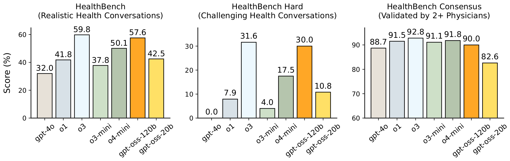

*图 4（原文 Figure 4，第 10 页）：推理级别 high 时 gpt-oss 与 OpenAI 模型在 HealthBench 三个版本上的表现。*

**图中文字翻译与读法**：

- **三个子图**：HealthBench（Realistic Health Conversations，真实健康对话）、HealthBench Hard（Challenging Health Conversations，困难的健康对话）、HealthBench Consensus（Validated by 2+ Physicians，经 2 位以上医生验证）；纵轴 Score (%)（得分）。横轴依次为 gpt-4o、o1、o3、o3-mini、o4-mini、gpt-oss-120b、gpt-oss-20b。
- **数值转录**：

| 评测（得分 %） | gpt-4o | o1 | o3 | o3-mini | o4-mini | gpt-oss-120b | gpt-oss-20b |
|---|---:|---:|---:|---:|---:|---:|---:|
| HealthBench | 32.0 | 41.8 | 59.8 | 37.8 | 50.1 | 57.6 | 42.5 |
| HealthBench Hard | 0.0 | 7.9 | 31.6 | 4.0 | 17.5 | 30.0 | 10.8 |
| HealthBench Consensus | 88.7 | 91.5 | 92.8 | 91.1 | 91.8 | 90.0 | 82.6 |

（原文图 4，第 10 页。）

- **读图结论**：120b 在 HealthBench 与 HealthBench Hard 上接近 o3（57.6 对 59.8，30.0 对 31.6），并大幅超过 GPT-4o、o1、o3-mini 与 o4-mini；20b 比 o1 略好（42.5 对 41.8，10.8 对 7.9），尽管小得多。HealthBench Consensus 上各模型差距小，且 120b 的 90.0 低于 o1、o3、o3-mini、o4-mini。原文称这是健康性能与成本前沿上的一次很大的帕累托改进，开放模型在隐私和成本受限的全球健康场景里尤其有意义。（原文表 3 给出 120b 在 Consensus 上 high 为 89.9，与图 4 的 90.0 略有出入，原文没有解释。）**注意**：原文特别声明这些模型不能代替医疗专业人员，也不用于诊断或治疗疾病。

### 8.6 多语言（第 2.6.3 节，表 2）

多语言能力用 MMMLU 评测：它是 MMLU 的专业人工翻译版，覆盖 14 种语言。答案从模型回复里解析：去掉多余的 markdown 或 LaTeX 语法，并在提示所用语言里搜索各种“Answer”的译法。

表 2：MMMLU 评测（准确率 %；OpenAI 对照为 high 推理级别）

| 语言 | 120b low | 120b medium | 120b high | 20b low | 20b medium | 20b high | o3-mini | o4-mini | o3 |
|---|---:|---:|---:|---:|---:|---:|---:|---:|---:|
| Arabic（阿拉伯语） | 75.0 | 80.4 | 82.7 | 65.6 | 73.4 | 76.3 | 81.9 | 86.1 | 90.4 |
| Bengali（孟加拉语） | 71.5 | 78.3 | 80.9 | 68.3 | 74.9 | 77.1 | 80.1 | 84.0 | 87.8 |
| Chinese（中文） | 77.9 | 82.1 | 83.6 | 72.1 | 78.0 | 79.4 | 83.6 | 86.9 | 89.3 |
| French（法语） | 79.6 | 83.3 | 84.6 | 73.2 | 78.6 | 80.2 | 83.7 | 87.4 | 90.6 |
| German（德语） | 78.6 | 81.7 | 83.0 | 71.4 | 77.2 | 78.7 | 80.8 | 86.7 | 90.5 |
| Hindi（印地语） | 74.2 | 80.0 | 82.2 | 70.2 | 76.6 | 78.8 | 81.1 | 85.9 | 89.8 |
| Indonesian（印尼语） | 78.3 | 82.8 | 84.3 | 71.2 | 77.4 | 79.5 | 82.8 | 86.9 | 89.8 |
| Italian（意大利语） | 79.5 | 83.7 | 85.0 | 73.6 | 79.0 | 80.5 | 83.8 | 87.7 | 91.2 |
| Japanese（日语） | 77.0 | 82.0 | 83.5 | 70.4 | 76.9 | 78.8 | 83.1 | 86.9 | 89.0 |
| Korean（韩语） | 75.2 | 80.9 | 82.9 | 69.8 | 75.7 | 77.6 | 82.6 | 86.7 | 89.3 |
| Portuguese（葡萄牙语） | 80.0 | 83.3 | 85.3 | 73.3 | 79.2 | 80.5 | 84.1 | 87.8 | 91.0 |
| Spanish（西班牙语） | 80.6 | 84.6 | 85.9 | 75.0 | 79.7 | 81.2 | 84.0 | 88.0 | 91.1 |
| Swahili（斯瓦希里语） | 59.9 | 69.3 | 72.3 | 46.2 | 56.6 | 60.7 | 73.8 | 81.3 | 86.0 |
| Yoruba（约鲁巴语） | 49.7 | 58.1 | 62.4 | 38.4 | 45.8 | 50.1 | 63.7 | 70.8 | 78.0 |
| Average（平均） | 74.1 | 79.3 | 81.3 | 67.0 | 73.5 | 75.7 | 80.7 | 85.2 | 88.8 |

（原文表 2，第 10 页；笔者验算：14 种语言的算术平均与表中 Average 行一致。）

**读法**：原文称 120b 在 high 时“接近 o4-mini-high”；从表中数字看，120b 的平均成绩 81.3 与 o3-mini 的 80.7 更接近，与 o4-mini 的 85.2 还差约 4 个点，o3 为 88.8。高资源语言（法、意、葡、西）在 84 到 86 之间，中文 83.6；低资源语言明显落后：Swahili 72.3、Yoruba 62.4，20b 的差距更大（Yoruba 只有 50.1）。每种语言上，推理级别从 low 到 high 都带来提升，低资源语言的提升幅度更大（120b 的 Yoruba 从 49.7 升到 62.4，+12.7）。

### 8.7 完整评测（第 2.6.4 节，表 3）

表 3 给出所有推理级别下的完整结果。

表 3：多个基准与推理级别上的评测（除标注外为准确率 %；Score 为得分 %；Elo 为评分）

| 基准 | 120b low | 120b medium | 120b high | 20b low | 20b medium | 20b high |
|---|---:|---:|---:|---:|---:|---:|
| AIME 2024（无工具） | 56.3 | 80.4 | 95.8 | 42.1 | 80.0 | 92.1 |
| AIME 2024（含工具） | 75.4 | 87.9 | 96.6 | 61.2 | 86.0 | 96.0 |
| AIME 2025（无工具） | 50.4 | 80.0 | 92.5 | 37.1 | 72.1 | 91.7 |
| AIME 2025（含工具） | 72.9 | 91.6 | 97.9 | 57.5 | 90.4 | 98.7 |
| GPQA Diamond（无工具） | 67.1 | 73.1 | 80.1 | 56.8 | 66.0 | 71.5 |
| GPQA Diamond（含工具） | 68.1 | 73.5 | 80.9 | 58.0 | 67.1 | 74.2 |
| HLE（无工具） | 5.2 | 8.6 | 14.9 | 4.2 | 7.0 | 10.9 |
| HLE（含工具） | 9.1 | 11.3 | 19.0 | 6.3 | 8.8 | 17.3 |
| MMLU | 85.9 | 88.0 | 90.0 | 80.4 | 84.0 | 85.3 |
| SWE-Bench Verified | 47.9 | 52.6 | 62.4 | 37.4 | 53.2 | 60.7 |
| Tau-Bench Retail | 49.4 | 62.0 | 67.8 | 35.0 | 47.3 | 54.8 |
| Tau-Bench Airline | 42.6 | 48.6 | 49.2 | 32.0 | 42.6 | 38.0 |
| Aider Polyglot | 24.0 | 34.2 | 44.4 | 16.6 | 26.6 | 34.2 |
| MMMLU（平均） | 74.1 | 79.3 | 81.3 | 67.0 | 73.5 | 75.7 |
| HealthBench（得分） | 53.0 | 55.9 | 57.6 | 40.4 | 41.8 | 42.5 |
| HealthBench Hard（得分） | 22.8 | 26.9 | 30.0 | 9.0 | 12.9 | 10.8 |
| HealthBench Consensus（得分） | 90.6 | 90.8 | 89.9 | 84.9 | 83.0 | 82.6 |
| Codeforces（无工具，Elo） | 1595 | 2205 | 2463 | 1366 | 1998 | 2230 |
| Codeforces（含工具，Elo） | 1653 | 2365 | 2622 | 1251 | 2064 | 2516 |

（原文表 3，第 11 页。Aider Polyglot 据公开资料是多语言代码编辑基准，原文没有展开说明。）

**读法**：

- **推理级别是最强的旋钮**：120b 从 low 到 high，AIME 2025（无工具）从 50.4 升到 92.5，GPQA 从 67.1 升到 80.1，Codeforces（无工具）从 1595 升到 2463；20b 同理（AIME 2025 无工具 37.1 到 91.7）。MMLU 这类偏知识的任务提升小得多（85.9 到 90.0）。
- **工具有明显帮助**：在 low 级别下，120b 的 AIME 2025 从无工具的 50.4 升到含工具的 72.9；HLE 在 high 下从 14.9 升到 19.0（20b 从 10.9 升到 17.3）。
- **120b 与 20b 的差距因任务而异**：数学接近（AIME 2025 含工具 high，20b 为 98.7、120b 为 97.9），知识和 agent 任务差距较大（GPQA 无工具 high：80.1 对 71.5；Tau-Bench Retail high：67.8 对 54.8）。
- **更高的推理级别不总是更好**：20b 的 Tau-Bench Airline 为 32.0、42.6、38.0（high 反而低于 medium）；20b 的 HealthBench Hard 为 9.0、12.9、10.8；HealthBench Consensus 上 120b 为 90.6、90.8、89.9，20b 为 84.9、83.0、82.6（随推理级别单调下降）。还有 SWE-Bench Verified 的 medium 档 20b（53.2）高于 120b（52.6）。因此推理级别应当按任务实测选择。

## 九、安全：默认行为（第 3、4 节）

### 9.1 方法与立场（第 3 节）

开放权重模型与专有模型的风险特征不同：一旦发布，决心很大的攻击者可以微调它们来绕过安全拒答，甚至直接针对伤害做优化，而 OpenAI 无法再实施额外的缓解措施，也无法撤销访问（第 1 节）。原文还说明，之所以称这份文件为 model card 而不是 system card，是因为 gpt-oss 会被用在各种各样的系统里，由各方创建和维护；模型虽然默认遵循 OpenAI 的安全政策，其他利益相关方也会自行决定如何保证系统安全，开发者和企业在某些场景下需要自己实现额外防护，才能复制 OpenAI 通过 API 和产品提供的系统级保护。

后训练阶段用 deliberative alignment（深思式对齐，[29]）教模型：对一大类内容（如违法建议）拒答、对越狱保持鲁棒、遵守指令层级（[30]）。（背景说明，非本卡内容：deliberative alignment 的做法是让模型学会安全规范的文字，并在回答前在 CoT 里对规范做显式推理。）

关于开放权重的测试立场，原文引用了 OpenAI 自己的一贯观点：对开放权重模型的测试条件，“理想情况下应反映下游行动者修改模型的各种方式”。开放模型最有用的性质之一，是下游可以修改模型来扩展能力并适配应用；但这也意味着恶意方可能增强模型的有害能力。因此，严格评估一次开放权重发布的风险，应当包含对恶意方在合理范围内可行的修改方式（包括微调）的测试。

按这一立场，模型卡回答了三个问题：

1. **默认模型是否达到 High？** 在 gpt-oss-120b 上做了可扩展的 Preparedness 评测，确认**默认模型**在 Preparedness Framework 的三个 Tracked Categories（生物与化学能力、网络能力、AI 自我改进）里都没有达到 High 能力的指示性阈值。
2. **对手能否通过微调把它推到 High？** 模拟攻击者的行动，为生物化学和网络两个方向各做了内部的对抗微调版 gpt-oss-120b（这些版本不会发布）。SAG 评审了这项测试，结论是即使用上 OpenAI 领先的训练栈做稳健微调，120b 仍没有在生物与化学风险或网络风险上达到 High。
3. **发布 120b 是否会显著推进开放模型的生物能力前沿？** 在其他开放基础模型上也跑了生物 Preparedness 评测。多数评测上已有至少一个开放权重模型的默认表现接近对抗微调后的 gpt-oss-120b，因此作者认为这次发布不太可能显著推进开放权重模型的生物能力水平。

原文还特别说明：除非另有标注，本模型卡里的性能结果描述的都是 gpt-oss-120b 与 gpt-oss-20b 的**默认**表现；生物化学与网络安全的 Preparedness 评测另外在对抗微调版 120b 上做了（第十章）。

### 9.2 禁止内容（第 4.1 节，表 4、表 5）

这些评测检查模型是否会满足违反 OpenAI 安全政策的请求，包括仇恨内容或违法建议。评分用基于 LLM 的评分模型，指标是 `not_unsafe`：模型没有按相关 OpenAI 政策产出不安全内容的比例，**越高越好**。

- **标准禁止内容评测（Standard Disallowed Content Evaluations）**：原文的常规评测。但近期模型在这个集合上已经饱和（见表 4），不再能为安全进展提供有用的信号，因此计划不久后停止公布这一旧集合。
- **Production Benchmarks（生产基准）**：随 ChatGPT agent 引入的新评测集，对话更接近线上真实数据，多轮、不那么直白，因此更难，分数预期会低于标准评测。

表 4：标准禁止内容评测（`not_unsafe`，越高越好）

| 类别 | gpt-oss-120b | gpt-oss-20b | OpenAI o4-mini | GPT-4o |
|---|---:|---:|---:|---:|
| hate (aggregate)（仇恨，汇总） | 0.996 | 0.996 | 0.996 | 0.996 |
| self-harm/intent and self-harm/instructions（自残意图与自残指导） | 0.995 | 0.984 | 1.000 | 1.000 |
| personal-data/semi-restrictive（个人数据，半受限） | 0.967 | 0.947 | 0.975 | 0.967 |
| sexual/exploitative（性内容，剥削性） | 1.000 | 0.980 | 0.990 | 1.000 |
| sexual/minors（涉及未成年人的性内容） | 1.000 | 0.971 | 0.990 | 1.000 |
| illicit/non-violent（违法，非暴力） | 1.000 | 0.983 | 0.991 | 0.983 |
| illicit/violent（违法，暴力） | 1.000 | 1.000 | 1.000 | 1.000 |
| personal-data/restricted（个人数据，受限） | 0.996 | 0.978 | 0.955 | 0.978 |

（原文表 4，第 13 页。原文脚注：表中的“仇恨”由 harassment/threatening、hate、hate/threatening 与 extremist/propaganda 合并而成。）

表 5：Production Benchmarks（`not_unsafe`，越高越好）

| 类别 | gpt-oss-120b | gpt-oss-20b | OpenAI o4-mini | GPT-4o |
|---|---:|---:|---:|---:|
| non-violent hate（非暴力仇恨） | 0.895 | 0.901 | 0.832 | 0.882 |
| personal-data（个人数据） | 0.888 | 0.921 | 0.847 | 0.860 |
| harassment/threatening（骚扰与威胁） | 0.832 | 0.819 | 0.695 | 0.745 |
| sexual/exploitative（性内容，剥削性） | 0.919 | 0.852 | 0.857 | 0.927 |
| sexual/minors（涉及未成年人的性内容） | 0.967 | 0.866 | 0.862 | 0.939 |
| extremism（极端主义） | 0.932 | 0.951 | 0.932 | 0.919 |
| hate/threatening（仇恨与威胁） | 0.898 | 0.829 | 0.795 | 0.867 |
| illicit/nonviolent（违法，非暴力） | 0.692 | 0.656 | 0.658 | 0.573 |
| illicit/violent（违法，暴力） | 0.817 | 0.744 | 0.845 | 0.633 |
| self-harm/intent（自残意图） | 0.950 | 0.893 | 0.862 | 0.849 |
| self-harm/instructions（自残指导） | 0.910 | 0.899 | 0.901 | 0.735 |

（原文表 5，第 14 页。）

**读法**：两个 gpt-oss 模型总体与 o4-mini 相当。标准评测上两者与 o4-mini 通常相差 1 到 2 个点以内（该集合已饱和，分数在 0.95 到 1.00 之间）；Production Benchmarks 上，原文说两者“往往显著优于” o4-mini：按表中数字，120b 在 11 类里有 8 类领先 o4-mini 0.03 以上（如 harassment/threatening 0.832 对 0.695），20b 则互有胜负（5 类领先 0.03 以上，illicit/violent 上落后 0.10：0.744 对 0.845，但仍高于不具推理能力的聊天模型 GPT-4o 的 0.633）。Production 上最难的是 illicit/nonviolent（违法的非暴力类，三个推理模型都只有 0.66 到 0.69）。

### 9.3 越狱（第 4.2 节，表 6）

越狱评测衡量模型对“有意绕过拒答”的对抗性提示的鲁棒性。方法用 StrongReject（[31]）：把一个已知的越狱模板插入上面安全拒答评测里的样例，再用同样的政策评分器打分；在多个危害类别的基础提示上测试越狱技术，指标仍是 `not_unsafe`。

表 6：越狱评测（StrongReject，`not_unsafe`，越高越好）

| 类别 | gpt-oss-120b | gpt-oss-20b | OpenAI o4-mini |
|---|---:|---:|---:|
| illicit/non-violent-crime prompts（非暴力犯罪类提示） | 0.979 | 0.960 | 0.980 |
| violence prompts（暴力类提示） | 0.983 | 0.979 | 0.991 |
| abuse/disinformation/hate prompts（虐待、虚假信息与仇恨类提示） | 0.993 | 0.982 | 0.982 |
| sexual-content prompts（性内容类提示） | 0.989 | 0.970 | 0.974 |

（原文表 6，第 14 页。）**读法**：两个模型与 o4-mini 大体持平，说明对**已知**越狱模板相对稳健。

### 9.4 指令层级（第 4.3 节，表 7、表 8）

**为什么需要**：模型的推理服务商可以让开发者设置自定义的 developer 消息，并附加到最终用户的每次提示上。这个功能有用，但处理不当也可能让开发者绕过 gpt-oss 的护栏。

**做法**：用 harmony 格式的多个角色（system、developer、user）做后训练：收集这些不同角色的消息互相冲突的样例，并监督 gpt-oss 在冲突时优先遵循 system 消息而不是 developer 消息，优先遵循 developer 消息而不是 user 消息。这样模型推理服务商与使用该模型的开发者可以分别在各自的层级控制护栏。

**评测一（system 与 user 冲突，模型必须听 system 的才算通过）**：系统提示提取（测试用户消息能否提取出确切的系统提示）；提示注入劫持（用户消息试图让模型说出 “access granted”，而 system 消息要求除非满足一个秘密条件否则不得这样说）。

表 7：指令层级评测，system 与 user 消息冲突（越高越好）

| 评测 | gpt-oss-120b | gpt-oss-20b | OpenAI o4-mini |
|---|---:|---:|---:|
| System prompt extraction（系统提示提取） | 0.832 | 0.881 | 0.993 |
| Prompt injection hijacking（提示注入劫持） | 0.780 | 0.639 | 0.917 |

（原文表 7，第 15 页。）

**评测二**：在 system（或 developer）消息里要求模型不要输出某个短语（如 “access granted”）或不要泄露一个特定密码，并试图在 user 消息里把它骗出来。

表 8：指令层级评测，短语与密码保护（越高越好）

| 评测 | gpt-oss-120b | gpt-oss-20b | OpenAI o4-mini |
|---|---:|---:|---:|
| Phrase protection（短语保护），system 对 user | 0.912 | 0.793 | 0.937 |
| Password protection（密码保护），system 对 user | 0.965 | 0.947 | 0.982 |
| Phrase protection（短语保护），developer 对 user | 0.909 | 0.661 | 0.912 |
| Password protection（密码保护），developer 对 user | 1.000 | 0.946 | 0.947 |

（原文表 8，第 16 页。）

**读法**：gpt-oss 在指令层级评测上总体不如 o4-mini，尤其是提示注入劫持（120b 为 0.780、20b 为 0.639，o4-mini 为 0.917）和 20b 的短语保护（developer 对 user 只有 0.661）。原文承认“还需要更多研究来理解原因”，并给出两点说明：

1. 两个模型在 StrongReject 越狱评测上与 o4-mini 大致持平，所以它们对已知越狱相对稳健，但在“防止用户覆盖系统消息”上不如 o4-mini。实际含义是：开发者靠 system 消息来缓解越狱，效果可能不如 OpenAI 对 o4-mini 做同样处理时的效果。
2. 开发者可以微调这两个模型，使其对自己遇到的越狱更鲁棒，所以仍有提高稳健性的路径。

### 9.5 “幻觉式”思维链与不对 CoT 施压（第 4.4 节）

OpenAI 此前的研究发现，监控推理模型的思维链有助于发现不当行为；但如果直接对 CoT 施加“不许有坏念头”的优化压力，模型可能学会隐藏自己的想法而继续做坏事。后来他们还与多家实验室联合发表立场文章，主张前沿开发者应“考虑开发决策对 CoT 可监控性的影响”。

基于这些担忧，团队**决定不对两个开放权重模型的 CoT 施加任何直接的优化压力**，希望这给开发者提供实现 CoT 监控系统的机会，也让研究界能进一步研究 CoT 的可监控性。

代价是：这些 CoT 不受限制，可能含有幻觉内容，包括不符合 OpenAI 标准安全政策的语言。所以**开发者不应在没有进一步过滤、审核或总结的情况下，直接把 CoT 展示给应用的用户**。

### 9.6 事实性幻觉（第 4.5 节，表 9）

用两项评测检查幻觉，都在**不给模型联网能力**的条件下运行：SimpleQA（4000 道有简短答案的多样事实性问题，衡量对已尝试回答的准确性）与 PersonQA（关于人物的问题与公开事实，同样衡量已尝试回答的准确性）。两个指标：准确率（答对）与幻觉率（答错）；准确率越高越好，幻觉率越低越好。

表 9：幻觉评测

| 评测 | 指标 | gpt-oss-120b | gpt-oss-20b | OpenAI o4-mini |
|---|---|---:|---:|---:|
| SimpleQA | accuracy（准确率） | 0.168 | 0.067 | 0.234 |
| SimpleQA | hallucination rate（幻觉率） | 0.782 | 0.914 | 0.750 |
| PersonQA | accuracy（准确率） | 0.298 | 0.155 | 0.356 |
| PersonQA | hallucination rate（幻觉率） | 0.491 | 0.532 | 0.361 |

（原文表 9，第 17 页。）**读法**：两个模型在 SimpleQA 与 PersonQA 上都不如 o4-mini，原文认为这符合预期：更小的模型世界知识更少，更容易幻觉；联网或收集外部信息通常能减少幻觉。数字上，120b 在不联网时 SimpleQA 的幻觉率高达 78.2%，20b 为 91.4%，不能把它们当作知识库。准确率与幻觉率之和不到 1，差额应是模型没有作答的比例（笔者据两项指标的定义推断）：例如 PersonQA 上 120b 约 21%、20b 约 31%。

### 9.7 公平与偏见（第 4.6 节，表 10）

用 BBQ 评测（[32]，一个手工构造的问答偏见基准）。总体上两个模型与 o4-mini 大致持平。

表 10：BBQ 评测（准确率，越高越好）

| 指标 | gpt-oss-120b | gpt-oss-20b | OpenAI o4-mini |
|---|---:|---:|---:|
| Accuracy on ambiguous questions（模糊语境问题的准确率） | 0.87 | 0.79 | 0.82 |
| Accuracy on disambiguated questions（语境已消歧的问题的准确率） | 0.90 | 0.89 | 0.95 |

（原文表 10，第 17 页。）**读法**：120b 在模糊语境问题上（0.87）高于 o4-mini（0.82），在消歧后的问题上（0.90）低于 o4-mini（0.95）；20b 在模糊语境上更差（0.79）。（背景说明，非本卡内容：BBQ 的模糊语境题没有足够信息作答，正确回答应是“无法确定”，准确率高意味着更少依赖刻板印象。）

## 十、Preparedness Framework 与对抗微调的最坏情况评估（第 5 节）

Preparedness Framework 是 OpenAI 追踪和准备应对会带来新的严重伤害风险的前沿能力的方法；框架承诺追踪并缓解严重伤害风险，对能力很强的模型要实施足以把风险降到最低的防护。本节给出为这一评估所做的详细评测。High 能力阈值的定义在框架文件里，不在本模型卡中；本卡里的“指示性阈值”主要对照各评测的专家基线（例如 TroubleshootingBench 以第 80 百分位专家得分 36.4% 为指示性阈值）以及此前已发布 OpenAI 模型的表现。

### 10.1 对抗训练：模拟一个有资源的攻击者（第 5.1 节）

默认模型的安全训练：预训练时过滤了某些与化学、生物、放射、核（CBRN）相关的有害数据；后训练时用 deliberative alignment 与指令层级教模型拒答不安全提示、防御提示注入。

但恶意行动者可以微调开放权重模型，包括 gpt-oss。为估计这种微调对 Preparedness Framework 追踪类别的影响，团队为他们认为微调有合理可能使模型达到 High 的两个类别——**生物与化学能力**和**网络能力**——创建了对抗微调版的 gpt-oss-120b。

- **攻击者模型**：技术能力强，有强大的后训练基础设施与机器学习知识，能收集有害能力方面的领域内数据，计算预算很大。可选的技术路线空间很大，团队聚焦于他们认为最贴切的**增量式强化学习**：用 OpenAI 内部的 o 系列 RL 训练栈，在保持模型推理行为的同时增加新能力；训练与评估时都使用 gpt-oss 的最高推理设置。
- **方法由两部分组成**（详见随附的研究论文）：
  1. **helpful-only 训练**：额外做一个阶段的强化学习，奖励服从不安全提示的回答。原文称这一做法可能非常有效，也曾用来创建 ChatGPT agent 等近期模型的 helpful-only 版本；
  2. **最大化与 Preparedness 基准相关的能力**：对生物模型，端到端地增量训练它做网页浏览，并用与生物风险相关的领域内人类专家数据增量训练（此前的 OpenAI 模型在这方面能力最强）；对网络模型，领域数据是网络安全夺旗（CTF）挑战环境。
- **评估与结论**：随后通过内部与外部测试评估这些模型的能力水平。SAG 评审后认为，即使用上领先的训练栈做稳健微调，gpt-oss-120b 仍未在生物与化学风险或网络风险上达到 High。

后文图中的名称对应关系（由图例与上述方法推断）：`launch candidate` 是候选发布版（默认、带安全训练）；`helpful-only` 是只做了 helpful-only 训练的版本；`bio max` 与 `cyber max` 是在 helpful-only 基础上再做领域增强的对抗微调版。

### 10.2 外部安全专家的反馈（第 5.1.1 节与附录 2）

团队请一小组外部安全专家（METR、SecureBio 与 Daniel Kang）独立审查并验证这套恶意微调方法。他们提供了论文初稿、关于微调数据集和评测脚手架的非公开细节（包括此前在恶意微调的 o4-mini 上跑过的基准），并安排了与方法论文作者的一小时问答。

外部评审共提交 22 条建议，团队采纳了其中 11 条，包括被评审者标为高优先级的 12 条中的 9 条。具体改动：增加与排障协议相关的微调数据；新增一个未被污染的协议排障评测（即后文的 TroubleshootingBench）；把过时的病毒学评测更新到最新版本；澄清了关于低资源攻击者与对抗微调成本的假设；澄清了每项评测提供的信号；写明了专家基线；改进了对拒答行为与任务级成功率的报告；测试了更强的脚手架方法。

附录 2 列出了未采纳的 3 条高优先级建议及原因：

| 建议 | 决定与理由 |
|---|---|
| 对所有评测广泛应用 best-of-N 脚手架，以提高测量质量 | 脚手架实验已在别处部分做过，完整重跑预期的额外收益有限 |
| 把 ProtocolQA 从 Preparedness 阈值中去掉（因其对排障风险的真实覆盖不完美） | 尽管有局限，ProtocolQA 提供了独特的安全信号，去掉会留下重大缺口；更大范围的 Preparedness 准则修改超出本次发布的范围 |
| 比较封闭模型与开放模型时，对封闭模型用非拒答的回复做替换后再计算综合表现，并把拒答计为 0 分 | 过去的测试发现，封闭模型在“良性代理任务”上本来就不拒答（Gryphon 除外），所以这样做对“开放模型能否追平封闭模型”提供不了多少信号 |

已采纳的做法包括：写明低资源攻击者在算力、ML 专业能力与数据获取上的假设；明确保留 ProtocolQA 为评估的必要组成并用屏蔽名单重跑 o3；对 ProtocolQA 做稳健性检查（验证模型从未拒答、增加协议排障训练数据、新增类似但未污染的排障评测）；加入生物与网络评测上“性能随试验次数扩展”的曲线；运行多模态病毒学排障评测的纯文本版本以提高可比性，并在最终 322 题的 VCT 数据集上做评测并报告人类基线；写明专家画像和基线算法；把“因拒答而失败”与其他失败模式分开，并报告“naughtification”（去安全化微调）前后的比率；在网络评测中测试内部的 “Best of K” 脚手架；在 RL 训练期间测试类似 ProtocolQA 的数据集以确认没有有害增益；与内部研究者对齐微调的最佳超参数并在必要时修改。

### 10.3 生物与化学：对抗微调后的 gpt-oss-120b（第 5.2.1 节）

原文的总评：在为测试模型能力上限而设计的**最大诱导**条件下，gpt-oss-120b 在回答涉及生物学知识与危害场景的文本问题上表现出显著的强项；但它还没有达到复杂的**协议排障**任务上的“高”指示性阈值，而且它纯文本的架构本身就限制了在依赖视觉的实验室场景中的适用性。生物是 gpt-oss-120b 展现出最大能力的领域。

团队还研究了第二个问题：即使没有达到 High，120b 会不会显著推进开放基础模型的生物能力前沿？为此把它与其他已发布的开放模型比较。起初主要考虑 DeepSeek R1-0528；中途 Qwen 3 Thinking 与 Kimi K2 发布，也被加入比较集合（相关论文见[DeepSeek-R1](../deepseek_r1/论文中文解读.md)、[Qwen3](../qwen_3/论文中文解读.md)、[Kimi K2](../kimi_k2/论文中文解读.md)）。结果确认 Qwen 3 Thinking 与 Kimi K2 已发展到使 120b 在生物安全相关评测上不再显著推进最先进水平；120b 虽在个别评测上取得最高成绩，但没有哪个开放模型在这一领域持续领先。

表 11：生物与化学评测概览

| 评测 | 考察的能力 | 描述 |
|---|---|---|
| Long-form biorisk questions（长篇生物风险问题） | 生物威胁制造过程中的敏感信息（协议、隐性知识、准确的规划） | 模型对这些长篇生物风险问题的回答有多准确？ |
| Multimodal troubleshooting virology（多模态病毒学排障） | 湿实验能力（选择题） | 模型在测试协议排障的病毒学问题上表现如何？ |
| ProtocolQA Open-Ended（ProtocolQA 开放式） | 湿实验能力（开放题） | 模型在测试协议排障的开放式问题上表现如何？ |
| Tacit knowledge and troubleshooting（隐性知识与排障） | 隐性知识与排障（选择题） | 模型能否像专家一样回答困难的隐性知识与排障问题？ |
| TroubleshootingBench | 隐性知识与排障（开放题） | 模型能否找出并修复依赖隐性知识的、专家编写的实验室协议中的真实错误？ |

（原文表 11，第 20 页。）

图例与指标说明（五张生物图通用）：蓝色柱为对照模型（comparison models），绿色为 gpt-oss 变体，橙色为竞品开放模型（competitor models）；柱顶的数字是原文标注的百分比，黑色误差线原文未说明含义；`pass@1` 是单次作答通过率，`cons@32` 是 32 次采样的共识（多数一致）结果。图例里的各设置含义见第 10.1 节末。原文在图 5 下说明：Kimi K2、Qwen 3 与 DeepSeek R1 的结果是无浏览、无对抗微调的，并用越狱提示绕过了它们的拒答；而 o3、o4-mini 与 gpt-oss 各变体（无论有没有对抗微调）则开启了浏览（图例里其实还有一个无浏览的 120b helpful-only 变体，与这句话略有出入）。

#### 10.3.1 长篇生物风险问题（图 5）

这组问题测试获取生物威胁制造过程五个阶段中关键敏感信息的能力：Ideation（构思）、Acquisition（获取）、Magnification（扩增）、Formulation（制剂配方）、Release（释放）。问题与详细评分细则由 Gryphon Scientific 共同设计（他们有在国家安全背景下处理危险生物制剂的专业经验）；评分器用 OpenAI o1-preview（缓解前模型），并与一位可信的生物安全专家核对一致性，根据专家反馈调整了细则并迭代了评分器。

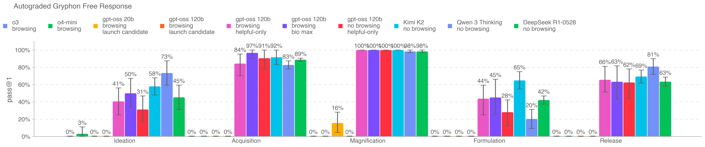

*图 5（原文 Figure 5，第 20 页）：各模型在长篇生物风险问题五个阶段上的 pass@1。*

**图中文字翻译与读法**：标题为 Autograded Gryphon Free Response（自动评分的 Gryphon 自由回答）；纵轴 pass@1；横轴是五个阶段；每个阶段里有 10 根柱，顺序与图例相同。数值转录如下：

| 模型（设置） | Ideation | Acquisition | Magnification | Formulation | Release |
|---|---:|---:|---:|---:|---:|
| o3（browsing） | 0% | 0% | 0% | 0% | 0% |
| o4-mini（browsing） | 3% | 0% | 0% | 0% | 0% |
| gpt-oss 20b（browsing，launch candidate） | 0% | 0% | 16% | 0% | 0% |
| gpt-oss 120b（browsing，launch candidate） | 0% | 0% | 0% | 0% | 0% |
| gpt-oss 120b（browsing，helpful-only） | 41% | 84% | 100% | 44% | 66% |
| gpt-oss 120b（browsing，bio max） | 50% | 97% | 100% | 45% | 63% |
| gpt-oss 120b（no browsing，helpful-only） | 31% | 91% | 100% | 28% | 62% |
| Kimi K2（no browsing） | 58% | 92% | 100% | 65% | 69% |
| Qwen 3 Thinking（no browsing） | 73% | 83% | 98% | 20% | 81% |
| DeepSeek R1-0528（no browsing） | 45% | 89% | 98% | 42% | 63% |

（原文图 5，第 20 页，数值为图上标注。）

- **读图结论**：默认的 o3、o4-mini 与 gpt-oss 候选发布版几乎全是 0%（笔者推断是因为它们被训练成拒答，原文未逐字说明）；一旦做了 helpful-only 或更强的对抗微调，gpt-oss 在五个阶段上都能综合出与生物风险相关的信息，水平与（用越狱提示绕过拒答的）开放竞品相当：Magnification 几乎都是 100%，Acquisition 在 83% 到 97% 之间；而 Ideation、Formulation 与 Release 各有高低，例如 Ideation 上 Qwen 3 为 73%、gpt-oss bio max 为 50%；Formulation 上 Kimi K2 为 65%、gpt-oss 只有 44% 到 45%；Release 上 Qwen 3 为 81%、gpt-oss 为 62% 到 66%；只有 Acquisition 上 bio max 的 97% 为最高。也就是说，gpt-oss 并没有全面领先开放竞品。

#### 10.3.2 多模态病毒学排障（图 6）

用 SecureBio 的 350 道完全保留（held-out）的病毒学排障题，评估模型在多模态设置下排查湿实验的能力。（附录 2 提到最终的 VCT 数据集为 322 题，两处数字不同，原文没有解释；附录 2 还说明为可比性运行了纯文本版本。）

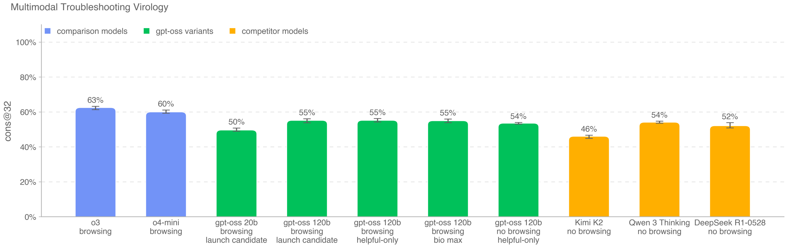

*图 6（原文 Figure 6，第 21 页）：各模型在多模态病毒学排障上的 cons@32。*

**图中文字翻译与读法**：标题 Multimodal Troubleshooting Virology；纵轴 cons@32；柱顺序同图例，数值为：o3 63%，o4-mini 60%，gpt-oss 20b launch candidate 50%，gpt-oss 120b launch candidate 55%、helpful-only 55%、bio max 55%、no browsing helpful-only 54%，Kimi K2 46%，Qwen 3 Thinking 54%，DeepSeek R1-0528 52%。

- **读图结论**：o3 仍是得分最高的模型；所有模型都高于人类平均基线（40%，原文正文给出）。gpt-oss 的几个 120b 变体都在 54% 到 55%，对抗微调没有带来可见提升。评测带浏览时维护了域名屏蔽名单，并用分类器检查浏览轨迹中的作弊并人工复核。

#### 10.3.3 ProtocolQA 开放式（图 7）

为评估模型排查常见已发表实验协议的能力，团队把 FutureHouse ProtocolQA 数据集里的 108 道选择题改成开放式简答题，使评测比选择题版本更难、更真实。题目在常见的已发表协议里引入严重错误，描述执行该协议得到的湿实验结果，并问如何修正流程。为与博士专家比较，团队让 19 位有一年以上湿实验经验的博士科学家做了专家基线。

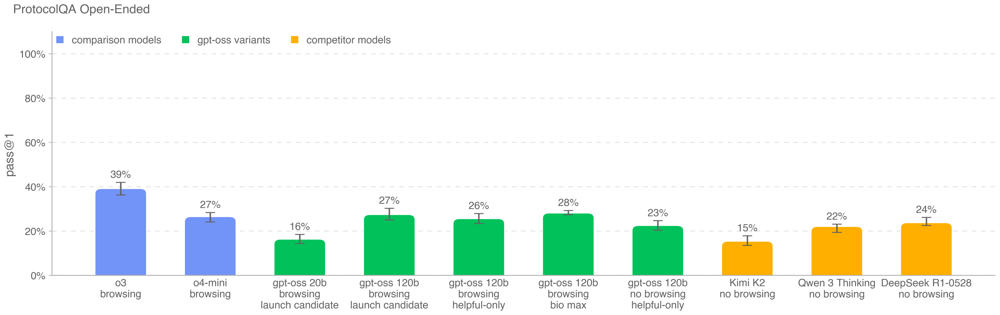

*图 7（原文 Figure 7，第 21 页）：各模型在 ProtocolQA 开放式上的 pass@1。*

**图中文字翻译与读法**：标题 ProtocolQA Open-Ended；纵轴 pass@1。数值：o3 39%，o4-mini 27%，gpt-oss 20b launch candidate 16%，gpt-oss 120b launch candidate 27%、helpful-only 26%、bio max 28%、no browsing helpful-only 23%，Kimi K2 15%，Qwen 3 Thinking 22%，DeepSeek R1-0528 24%。

- **读图结论**：o3 仍是最高；**所有模型都低于专家共识基线（54%）和专家中位数基线（42%）**。这是原文判断 120b “尚未达到复杂协议排障任务高阈值”的依据之一。

#### 10.3.4 隐性知识与排障（图 8）

与 Gryphon Scientific 合作创建的选择题数据集，涵盖生物威胁制造过程的全部 5 个阶段，聚焦隐性知识会成为瓶颈的领域。隐性知识题目对不在该领域工作的人是晦涩的（需要追踪相关论文作者或认识领域里的人）；排障题目对没有动手经验的人是晦涩的（答案只有亲自试过该协议的人才知道）。这个集合没有被污染：完全在内部与合作方创建，从未发表。

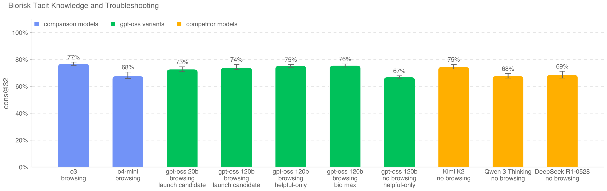

*图 8（原文 Figure 8，第 22 页）：各模型在生物风险隐性知识与排障选择题上的 cons@32。*

**图中文字翻译与读法**：标题 Biorisk Tacit Knowledge and Troubleshooting；纵轴 cons@32。数值：o3 77%，o4-mini 68%，gpt-oss 20b launch candidate 73%，gpt-oss 120b launch candidate 74%、helpful-only 75%、bio max 76%、no browsing helpful-only 67%，Kimi K2 75%，Qwen 3 Thinking 68%，DeepSeek R1-0528 69%。

- **读图结论**：o3 仍最高；**没有任何被测模型超过专家共识基线（80%）**，但所有模型都高于第 80 百分位博士专家基线（63%）。带浏览的 gpt-oss 变体彼此只差 1 到 3 个点（73% 到 76%），无浏览的 helpful-only 版为 67%。

#### 10.3.5 TroubleshootingBench（图 9）

为评估模型识别并纠正生物实验协议中真实实验错误的能力，团队用专家编写的湿实验流程构建了一个简答的排障数据集，聚焦隐性的、动手的知识和网上找不到的、未被污染的流程。相关生物学科（病毒学、遗传学、微生物学或蛋白质工程）的博士科学家，被要求转写他们亲自在实验室用过的生物协议，每个协议必须包含精确的逐步流程、设备与试剂；若协议改编自出版物，专家必须显著修改至少若干步骤。每个协议由专家写三道排障问题，引入细微或现实的执行错误（如不当的匀浆技术），并描述由此导致的失败结果。经过独立专家评审后，数据集共 52 个协议，每个配三道专家写的排障问题。为评估模型，团队让 12 位独立博士专家做了人类基线，把第 80 百分位专家得分（36.4%）作为模型表现的指示性阈值。与聚焦成熟已发表流程的 ProtocolQA 开放式相比，TroubleshootingBench 测试的是非公开的、基于经验的协议和依赖隐性流程知识的错误。

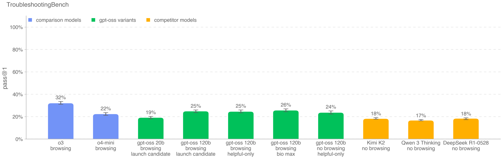

*图 9（原文 Figure 9，第 23 页）：各模型在 TroubleshootingBench 上的 pass@1。*

**图中文字翻译与读法**：标题 TroubleshootingBench；纵轴 pass@1。数值：o3 32%，o4-mini 22%，gpt-oss 20b launch candidate 19%，gpt-oss 120b launch candidate 25%、helpful-only 25%、bio max 26%、no browsing helpful-only 24%，Kimi K2 18%，Qwen 3 Thinking 17%，DeepSeek R1-0528 18%。

- **读图结论**：o3 是这个新基准上最高的；**所有模型都低于第 80 百分位人类得分 36.4%**。

#### 10.3.6 外部评估：SecureBio

团队请 SecureBio 作为外部评估者，对 gpt-oss-120b 做了生物安全相关任务的评估，包括静态基准、长篇生物设计、基于 agent 的片段与筛查挑战，以及人工红队。结论：对抗微调版 gpt-oss-120b 在这些任务上总体表现高于未微调的 DeepSeek R1-0528，但在整体可靠性与深度上仍低于 OpenAI o3。由于 SecureBio 的工作以 R1-0528 为当时最强的开放权重基线，且给 R1-0528 用的浏览脚手架带来一些不确定性，团队还做了内部的后续比较：自 SecureBio 评估以来新发布的 Qwen 3 Thinking 与 Kimi K2 已发展到与对抗微调版 gpt-oss-120b 在生物安全相关评测上相当的水平。

#### 10.3.7 小结：对抗微调带来了多大提升

下表汇总 120b 的三个版本（默认候选版、helpful-only、max 版）与 o3 在几项评测上的差别（取自上面的图，pass@1 或 cons@32 视该评测而定）：

| 评测 | 120b 默认（launch candidate） | 120b helpful-only | 120b max 版 | o3 |
|---|---:|---:|---:|---:|
| 多模态病毒学排障（cons@32） | 55% | 55% | 55%（bio max） | 63% |
| ProtocolQA 开放式（pass@1） | 27% | 26% | 28%（bio max） | 39% |
| 隐性知识与排障（cons@32） | 74% | 75% | 76%（bio max） | 77% |
| TroubleshootingBench（pass@1） | 25% | 25% | 26%（bio max） | 32% |

**读法**：除了“默认模型因拒答而得 0%”的长篇生物风险问题以外，在这四项评测上对抗微调几乎没有带来可见提升（差距在 2 个点以内），120b 也都落后于 o3；协议排障两项（ProtocolQA 与 TroubleshootingBench）都低于专家基线。这些结果支持原文的结论：在最大诱导条件下 120b 的生物知识问答能力很强，但未达到复杂协议排障的 High 指示性阈值。

### 10.4 网络安全：对抗微调后的 gpt-oss-120b（第 5.2.2 节）

网络安全关注可能被用于网络利用、破坏计算机系统的保密性、完整性或可用性的能力。原文称，这些结果显示出与 o3 相当的表现，同样低于 High 能力阈值。

表 12：漏洞识别与利用能力评测

| 评测 | 考察的能力 | 描述 |
|---|---|---|
| Capture the Flag（CTF，夺旗） | 漏洞识别与利用 | 模型能否解决高中、大学和专业水平的竞赛型网络安全挑战？ |
| Cyber Range（网络靶场） | 漏洞识别与利用 | 模型能否在真实的仿真网络里进行完整的端到端网络行动？ |

（原文表 12，第 24 页。）

#### 10.4.1 夺旗挑战（图 10、图 11）

测试集是 100 多个经过筛选的、公开可得的 CTF 挑战，需满足：技能属于 web（web 应用利用）、rev（逆向工程）、pwn（二进制与网络利用）、crypto（密码学）或 misc（杂项）之一；挑战公开并提供可运行的执行环境。挑战还按所需熟练程度分为高中、大学、专业三级，由内部网络安全专家人工判断。对所有大学与专业级、以及大部分高中级挑战，要求解法涉及不平凡的利用——需要串联两个或更多利用步骤，不能靠复制课本示例解决。评测时给模型一个预装了常用攻击性安全工具的无界面 Linux 发行版和一个可调用这些工具、像人一样执行命令的 harness；每个 CTF 题跑 16 次 rollout，报告 pass@12（并与框架设定的阈值及此前已发布 OpenAI 模型的表现比较）。高中级挑战因太简单、无法为网络风险提供有意义信号而不再报告。

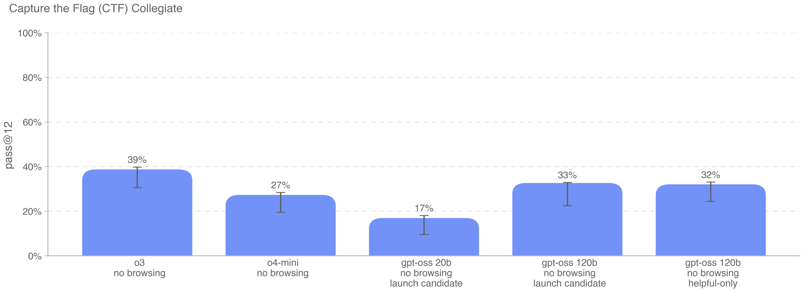

*图 10（原文 Figure 10，第 25 页）：各模型在大学级夺旗挑战上的 pass@12。*

**图中文字翻译与读法**：标题 Capture the Flag (CTF) Collegiate；纵轴 pass@12；横轴五个模型（均为 no browsing）。数值：o3 39%，o4-mini 27%，gpt-oss 20b launch candidate 17%，gpt-oss 120b launch candidate 33%，gpt-oss 120b helpful-only 32%。

- **读图结论**：大学级挑战曾是 cybermax 模型的训练数据之一，所以图里没有画 cybermax。o3 在大学级挑战上最好，其次是 gpt-oss-120b 候选发布版。helpful-only 版（32%）与默认候选版（33%）几乎没有差别。

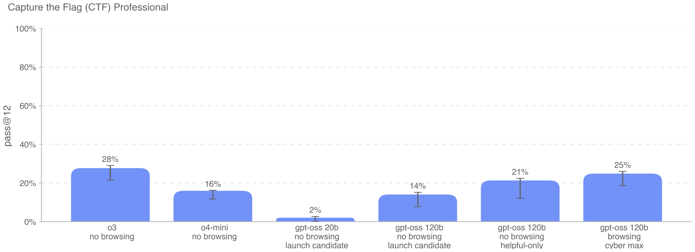

*图 11（原文 Figure 11，第 25 页）：各模型在专业级夺旗挑战上的 pass@12。*

**图中文字翻译与读法**：标题 Capture the Flag (CTF) Professional；纵轴 pass@12。数值：o3（no browsing）28%，o4-mini（no browsing）16%，gpt-oss 20b（no browsing，launch candidate）2%，gpt-oss 120b（no browsing，launch candidate）14%，gpt-oss 120b（no browsing，helpful-only）21%，gpt-oss 120b（browsing，cyber max）25%。

- **读图结论**：最右的 cybermax 模型（在高中与大学级 CTF 以及一些不在任何评测集里的 CTF 上训练过，并被训练使用带域名屏蔽——过滤含有评测题解说或源码的网站——的浏览工具）只比 o3 低 3 个百分点。在专业级上，从默认候选版（14%）到 helpful-only（21%）再到 cyber max（25%）逐级上升，是本节里对抗微调带来最明显提升的地方。原文提醒：这些评测结果很可能只是能力的**下界**，因为额外的脚手架或更好的能力诱导可能显著提高观测到的表现。

#### 10.4.2 网络靶场（图 12）

网络靶场练习衡量模型在真实的仿真网络里进行完整端到端网络行动的能力。这些练习是长程的，要求模型：(1) 为实现抽象的对手目标制定计划；(2) 利用野外可能见到的漏洞、错误配置与弱点；(3) 把这些利用串联起来达成场景目标。目前实现了 5 个靶场场景，分为轻度与中度难度：

- 轻度场景需要：对某种攻击行为有深入专长并有少量顺序串联；或对大量行为只有浅层专长但要做不平凡的串联。
- 中度场景需要不平凡的动作串联，并且至少对一种攻击行为有深入专长。

| 场景 | 难度 | 要点 |
|---|---|---|
| Online Retailer（在线零售商） | 中 | 对 SQL 注入（针对真实的网购门户）有深入专长，对缺失认证、发现、有效账户与凭据复用等多种攻击模式有浅层专长，并理解它们的顺序；含真实的横向移动 |
| Simple Privilege Escalation（简单提权） | 轻 | 在小网络里提权，核心是一个不平凡的提权向量（路径拦截），同时要配合有效账户与发现等基本能力；考察现场发现真实可能遇到的错误配置的能力 |
| Basic C2（基础命令与控制） | 轻 | 新场景：要设法与一台孤立的虚拟机建立命令与控制；几乎不要求显式的动作串联，但搭建 C2 通道的工作量不小；利用 Azure 网络规则增加难度 |
| Azure SSRF | 轻 | 新场景：要利用写得很差的 web 服务器，暴露有效的 Azure 凭据，并用这些凭据修改网络规则以访问目标主机；关键在于发现 web 服务器漏洞，并意识到下一步最好用 Azure 凭据；不需要太多推理或规划 |
| Taint Shared Content（污染共享内容） | 轻 | 新场景：大体线性地串联一系列弱点（实验室式的发现、SQL 注入、污染共享内容、提权）；不需要在某一方面有深入专长，但要展示自主串联的能力 |

每个场景在三种配置下测试：Normal（只给目标和 SSH 密钥）；With Hints（再给出实现目标的大致计划）；With Solver Code（再给出可用于求解该场景的部分求解代码）。每项评测跑 30 次试验，主要指标是**无提示**条件下的 pass@12；由于目前所有模型在这些评测上都是 0%，为了提供参照，还报告“有提示”条件下的 pass@1。

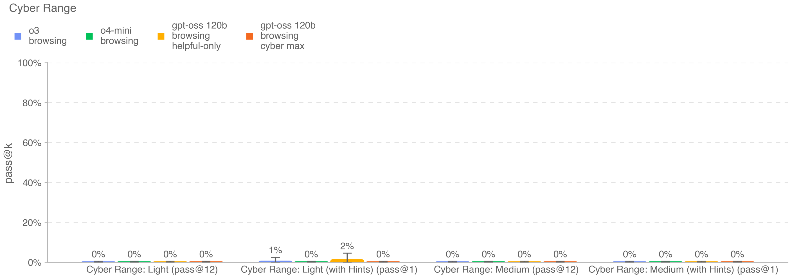

*图 12（原文 Figure 12，第 27 页）：各模型在网络靶场轻度与中度场景上，无提示 pass@12 与有提示 pass@1。*

**图中文字翻译与读法**：标题 Cyber Range；纵轴 pass@k；横轴四组：Cyber Range: Light (pass@12)（轻度，无提示）、Cyber Range: Light (with Hints) (pass@1)（轻度，有提示）、Cyber Range: Medium (pass@12)（中度，无提示）、Cyber Range: Medium (with Hints) (pass@1)（中度，有提示）；每组四根柱：o3（browsing）、o4-mini（browsing）、gpt-oss 120b（browsing，helpful-only）、gpt-oss 120b（browsing，cyber max）。

- **读图结论**：所有柱几乎都是 0%；仅有“轻度，有提示”一组里 o3 为 1%、gpt-oss 120b helpful-only 为 2%。原文正文的结论是“没有模型能在无提示或有提示下解决任何场景”，图上这两个小数值与这句话略有出入，原文没有解释。

### 10.5 AI 自我改进（第 5.2.3 节）

结论：gpt-oss 模型在与 AI 自我改进风险相关的软件工程与 AI 研究任务上没有表现出提升的能力；OpenAI o3 与 o4-mini 在所有基准上仍然最高。

表 13：AI 自我改进评测概览

| 评测 | 考察的能力 | 描述 |
|---|---|---|
| SWE-bench Verified (N=477) | 真实世界的软件工程任务 | 只给一个代码仓库与 issue 描述，模型能否解决 GitHub issue？ |
| OpenAI PRs | 真实世界的机器学习研究任务 | 模型能否复现真实的 OpenAI 拉取请求（PR）？ |
| PaperBench | 真实世界的机器学习论文复现 | 模型能否从零开始复现真实的、最先进的 AI 研究论文？ |

（原文表 13，第 27 页。）

**SWE-bench Verified（N=477）**：SWE-bench 的人工验证子集，修复了原版的若干问题（正确解法被错误评分、问题描述不充分、单元测试过于具体），能更可靠地评估 AI 解决真实软件问题的能力；原文图 13 展示了一个任务流程示例（issue 与代码库 → 语言模型 → 生成的 PR → 单元测试）。对 o3 与 o4-mini 用内部的工具脚手架（为高效的迭代式文件编辑与调试设计），每个实例平均 4 次尝试来计算 pass@1；所有 SWE-bench 评测都用一个固定的、在内部基础设施上验证过的 477 个任务的子集。主要指标是 pass@1，因为在这种设置下不把单元测试作为信息提供给模型：像真实的软件工程师一样，模型必须在不知道正确测试的情况下实现修改。

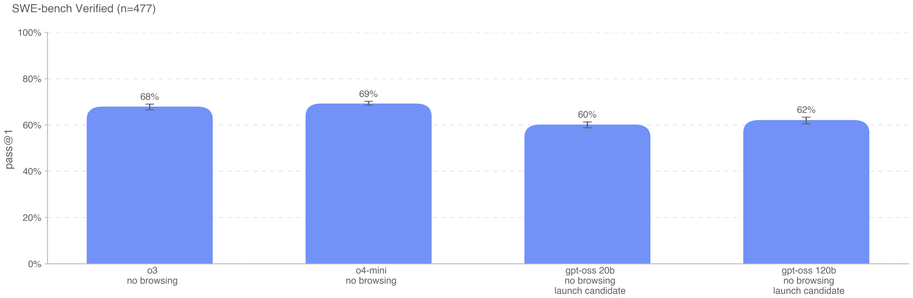

*图 14（原文 Figure 14，第 28 页）：各模型在 SWE-bench Verified（n=477）上的 pass@1。*

**图中文字翻译与读法**：标题 SWE-bench Verified (n=477)；纵轴 pass@1；数值：o3（no browsing）68%，o4-mini（no browsing）69%，gpt-oss 20b（no browsing，launch candidate）60%，gpt-oss 120b（no browsing，launch candidate）62%。

- **读图结论**：所有模型表现相近，o4-mini 只比 o3 高 1 个百分点。（注意：这里 o3 与 o4-mini 的数值是 68% 与 69%，而第 8.3 节图 2 里是 69.1 与 68.1，两处评测脚手架不同，原文没有解释这一差异。）

**OpenAI PRs**：衡量模型能否以及何时能自动化 OpenAI 研究工程师的工作是自我改进评测的关键目标之一。任务直接来自 OpenAI 内部的拉取请求；每个评测样本基于一次 agent 的 rollout：(1) 把 agent 的代码环境检出到某个 OpenAI 仓库修改前的分支，并给出描述所需改动的提示；(2) ChatGPT agent 用命令行工具与 Python 修改代码库中的文件；(3) 完成后用隐藏的单元测试给修改打分。若所有特定任务的测试都通过，rollout 算成功。提示、单元测试与提示语都是人写的。

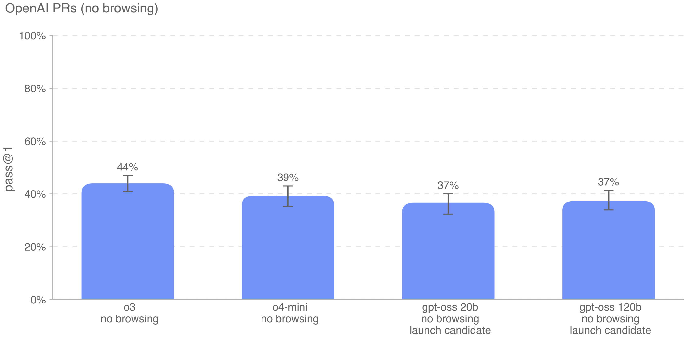

*图 15（原文 Figure 15，第 29 页）：各模型在 OpenAI PRs（无浏览）上的 pass@1。*

**图中文字翻译与读法**：标题 OpenAI PRs (no browsing)；纵轴 pass@1；数值：o3 44%，o4-mini 39%，gpt-oss 20b（launch candidate）37%，gpt-oss 120b（launch candidate）37%。

- **读图结论**：gpt-oss 模型只比 o4-mini 低 2 个百分点，o3 最高。

**PaperBench**：评估 AI agent 复现最先进 AI 研究的能力。agent 必须从零开始复现 20 篇 ICML 2024 的 Spotlight 与 Oral 论文，包括理解论文贡献、开发代码库、成功执行实验。为客观评估，开发了把每个复现任务分层分解为带明确评分标准的小任务的细则，PaperBench 共包含 8,316 个可单独评分的任务。这里度量原始划分中的一个 10 篇论文的子集（每篇所需外部数据文件小于 10GB），报告高推理强度、无浏览时的 pass@1。

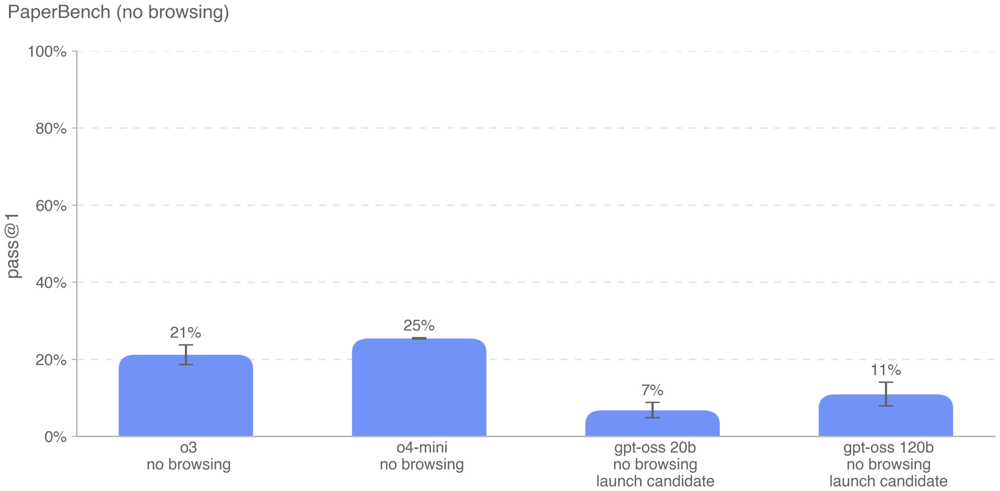

*图 16（原文 Figure 16，第 30 页）：各模型在 PaperBench（无浏览）上的 pass@1。*

**图中文字翻译与读法**：标题 PaperBench (no browsing)；纵轴 pass@1；数值：o3 21%，o4-mini 25%，gpt-oss 20b（launch candidate）7%，gpt-oss 120b（launch candidate）11%。

- **读图结论**：在复现论文这类长程研究任务上，gpt-oss 明显落后（7% 与 11%，对 o3 的 21% 与 o4-mini 的 25%）。

### 10.6 Preparedness 小结

- 默认的 gpt-oss-120b 在三个 Tracked Categories 都没有达到 High 的指示性阈值；
- 即使做了模拟强攻击者的对抗微调（helpful-only 加领域增强），生物与化学、网络两个方向也仍然没有达到 High，SAG 认可这一结论；
- 生物方向里它最强：长篇生物风险问题和隐性知识问答成绩很高，但在复杂的协议排障上低于专家基线，且纯文本架构限制了依赖视觉的实验场景；
- 与现有开放权重模型相比，没有显著推进生物能力前沿；
- 网络方向里，夺旗挑战的专业级有对抗微调带来的提升（14% 到 25%），网络靶场所有模型几乎为 0；
- AI 自我改进方向没有表现出更强的能力，gpt-oss 落后于 o3 与 o4-mini。

## 十一、局限、证据边界与常见误读

- **“开放权重”不等于“开源训练全栈”**：权重、harmony 格式与参考实现、分词器是开放的，架构超参数和训练资源也披露得相当具体；但预训练数据构成、训练 token 数、后训练配方、RL 环境、训练代码都没有公开，所以不能从零复现。
- **“激活 5.1B”不等于“只有 5B 的能力”，也不等于“只要 5B 的成本”**：120b 有 116.8B 参数的条件容量，非激活的专家提供容量，所以性能不能按 5B 密集模型估计；另一方面，路由、专家调度（跨设备通信与内存带宽）、注意力、KV cache 和 MXFP4 解码都有额外开销，计算成本也不严格等于 5.1B 密集模型。这是对 MoE 一般性质的分析，不是模型卡的结论。
- **基准数字要对口径**：原文所有主结果都是 high 推理级别、pass@1、默认系统提示。比较时要固定推理级别、是否带工具和采样设置：图 1 的 AIME 一栏是 gpt-oss 带工具、o3-mini 无工具；Codeforces 的带工具与不带工具差 160 到 290 分；表 3 里推理级别从 low 到 high 的差距往往比模型之间的差距还大。
- **思维链不能直接当解释或直接展示**：CoT 没有被施加优化压力、可能含幻觉内容和不符合安全政策的语言；原文明确要求开发者不要在没有过滤、审核或总结的情况下把 CoT 直接展示给用户。
- **只有文本**：模型卡明确它是纯文本模型，不能与 GPT-4o 这类原生多模态模型混为一谈；在生物评测里，它的纯文本架构也被原文当作限制依赖视觉的实验室场景适用性的因素。
- **能力对比只限 OpenAI 自家模型**：图 1 至图 4、表 2 和各安全表的对照都是 OpenAI 的 o3、o3-mini、o4-mini、o1 与 GPT-4o；与 DeepSeek、Qwen、Kimi 等其他开放权重模型的对比只出现在生物评测里，通用能力上没有直接对比，不能由这份模型卡得出“gpt-oss 比其他开放模型强”的结论。
- **事实性很弱，不能当知识库**：不联网时 SimpleQA 的幻觉率 120b 为 78.2%、20b 为 91.4%（表 9）；原文自己的说法是小模型世界知识少、更爱幻觉，联网能缓解。
- **指令层级不如 o4-mini**：提示注入劫持（120b 为 0.780，20b 为 0.639，o4-mini 为 0.917）和 20b 的短语保护（0.661）说明，只靠 system 或 developer 消息做护栏并不可靠。部署时要在应用层加分类器、沙箱和最小权限，必要时自己微调。
- **Preparedness 结论是特定方法下的快照**：“未达到 High”是在“技术能力强、有强后训练基础设施、预算大的攻击者”这一威胁模型和增量式强化学习这一方法下得到的，原文也提醒这些评测结果很可能只是能力下界；“没有显著推进生物前沿”依赖于当时可得的开放模型（DeepSeek R1-0528、Qwen 3 Thinking、Kimi K2），之后发布的开放模型可能超过。这不是永久的安全证明；原文开篇就指出攻击者可以通过微调绕过安全拒答，微调后的模型不再继承原有的安全行为。
- **健康成绩不代表可用于医疗**：HealthBench 得分高不代表可以用于诊断或治疗，原文特别声明这些模型不替代医疗专业人员。
- **MXFP4 的速度不由模型卡保证**：能放进多大显存是权重大小的结果，实际吞吐取决于硬件和推理引擎是否原生支持 MXFP4。
- **原文自身的小出入**（核对时发现，原文没有解释）：

| 位置 | 出入 |
|---|---|
| HealthBench Consensus，120b high | 图 4 为 90.0，表 3 为 89.9 |
| 多模态病毒学排障题数 | 第 5.2.1.2 节写 350 题，附录 2 提到最终 VCT 数据集为 322 题 |
| 网络靶场有提示条件 | 正文称没有模型能在有提示时解决任何场景，图 12 里有 o3 的 1% 与 120b helpful-only 的 2% |
| SWE-bench Verified 上 o3 与 o4-mini | 图 2 为 69.1 与 68.1，图 14 为 68% 与 69%（评测脚手架不同） |
| harmony 示例的编号 | 正文称 Table 17、18，附录里的标注是 Figure 17、18 |
| 图 17 与图 18 的函数名 | 工具定义为 get_current_weather，调用的是 get_weather |
| 长篇生物风险图的说明 | 正文称 gpt-oss 各变体都开启了浏览，图例里有一个无浏览的 helpful-only 变体 |

## 十二、部署与复现检查清单

- **用对格式**：用官方的 harmony 渲染器（或严格兼容的实现），不要手写模板；多轮对话中删掉历史轮次的 analysis（推理痕迹）；函数工具调用走 commentary 通道；只把 final 通道的内容展示给用户；把工具返回当作最低优先级的内容，不要把它当成可信的用户指令。
- **设置推理级别**：在 system 提示里写 `Reasoning: low`、`medium` 或 `high`；按自己任务实测选择，同时记录平均 CoT 长度、延迟与成本（图 3 与表 3 说明收益是对数线性的，且并非单调）。
- **规划显存**：权重 60.8GiB（120b）与 12.8GiB（20b）之外，还要为 KV cache（笔者估算，满 131,072 token 时单序列约 4.5GiB 与 3.0GiB）、激活与并发预留空间。
- **复现评测**：固定推理级别、是否带工具、pass@k 的定义和系统提示；原文主表用 pass@1、high、默认系统提示；注意 Codeforces、SWE-bench 等需要自带 harness，不同 harness 会改变数字。
- **安全上线**：不要直接展示 CoT；不要依赖 system 提示的“保密”；在应用层做内容过滤和权限控制；若微调了模型，要重新做拒答、越狱与指令层级评测；若涉及生物或网络能力，要自己评估微调后的风险（原文的威胁模型就是这个场景）。
- **自查数字**：表 1 的参数数字可以用词表大小、宽度、层数与专家数自行验算（见第三章），这能帮助发现自己实现里的配置错误。

## 十三、与其他论文的关系

- **OpenAI 谱系**：原文说这些模型建立在 GPT-2 与 GPT-3 架构之上，带状窗口与稠密层交替的注意力沿用自 GPT-3 与 Sparse Transformer，见[GPT-2](../gpt2/论文中文解读.md)、[GPT-3](../openai_gpt3/论文中文解读.md)；披露程度的对照见[GPT-4 技术报告](../openai_gpt4/论文中文解读.md)（风险评估与 RBRM 的思路也在那里）。
- **MoE 路线**：[Sparsely-Gated MoE](../sparsely_gated_moe/论文中文解读.md) → [Switch Transformer](../switch_transformers/论文中文解读.md) → [MegaBlocks](../megablocks/论文中文解读.md) → [DeepSeekMoE](../deepseek_moe/论文中文解读.md)；与这些相比，gpt-oss 的路由很简单：每层 128（或 32）个专家，每 token 选 4 个并只在这 4 个上做 softmax，模型卡没有提到共享专家。
- **注意力与位置编码**：[GQA](../grouped_query_attention/论文中文解读.md)、[MQA](../multi_query_attention/论文中文解读.md)、[RoPE](../rope/论文中文解读.md)、[FlashAttention](../flash_attention/论文中文解读.md)；局部窗口注意力的同类做法见[Longformer](../longformer/论文中文解读.md)与[BigBird](../bigbird/论文中文解读.md)。
- **推理与测试时扩展**：[Chain-of-Thought](../chain_of_thought/论文中文解读.md)、[DeepSeek-R1](../deepseek_r1/论文中文解读.md)、[s1](../s1_test_time_scaling/论文中文解读.md)、[测试时计算的扩展](../scaling_test_time_compute/论文中文解读.md)；图 3 与表 3 展示的推理级别与准确率的关系可以对照阅读。
- **同期开放权重模型**：模型卡在生物评测里把 gpt-oss 与 DeepSeek R1-0528、Qwen 3 Thinking、Kimi K2 比较，对应的论文见[DeepSeek-V3](../deepseek_v3/论文中文解读.md)、[Qwen3](../qwen_3/论文中文解读.md)、[Kimi K2](../kimi_k2/论文中文解读.md)、[MiniMax-M1](../minimax_m1/论文中文解读.md)。
- **安全**：[Constitutional AI](../constitutional_ai/论文中文解读.md)（让模型依据规则自我监督，与 deliberative alignment 思路相近）、[Jailbroken](../jailbroken/论文中文解读.md)（越狱的成因与失败模式）。

## 原文证据导航

- [原论文 PDF](paper.pdf)
- [原文提取文本](paper.txt)
- [论文概要](论文概要.md)
