# 论文中文解读：《PaLM: Scaling Language Modeling with Pathways》

> **基本信息**：Aakanksha Chowdhery、Sharan Narang、Jacob Devlin 等（Google Research），arXiv:2204.02311，2022 年 4 月首发，本地 PDF 为 2022 年 10 月 5 日的 v5（正文 50 页，附录至第 87 页）；论文原文 [官方页面](https://arxiv.org/abs/2204.02311)。
>
> **本文的读法**：图为从原文 PDF 中按图裁出的原图，表为逐格核对后的中文转录（数字、模型名、数据集名保持原样，表头译成中文）。每张图后有中文图题、坐标轴与图例翻译和读图结论，因此不必再翻英文版。从图上读出的数字都标了“约”；原文正文给出的数字优先。凡是“本文核算”“自行核对”的内容，是笔者根据原文数字算出来的，不是原文的话。

## 一、一句话结论

PaLM（Pathways Language Model）是一个 5400 亿参数的**稠密**（dense，每个 token 都激活全部参数）decoder-only Transformer，在 6144 块 TPU v4 上用 Pathways 系统训练（两个 TPU v4 pod，不用流水线并行），只训练一个 epoch、7800 亿 token。它的**模型 FLOPs 利用率（MFU）达到 46.2%**（硬件 FLOPs 利用率 57.8%），明显高于此前同级别模型的 21.3%–32.5%（表 3）。在评测上，PaLM 540B 在 29 个英文 NLP 基准的 few-shot 设置下有 28 个超过此前最好的大模型结果；在 BIG-bench 上 5-shot 平均分超过人类平均水平；结合思维链提示（chain-of-thought），在多步算术与常识推理上持平或超过“微调 + 外部验证器”的先前最佳。按 8B → 62B → 540B 三个规模看，约 25% 的 BIG-bench 任务出现“不连续”的规模收益。论文还单独分析了训练数据记忆、测试集污染、偏见与毒性，并如实说明了这些分析的局限。

## 二、背景与动机

### 2.1 从“微调”到“few-shot”

BERT、T5 这类模型用掩码填空（masked LM）或片段破坏（span corruption）预训练，再对每个下游任务微调。它们几乎在所有任务上都是最强的，但缺点是：每个任务都需要一批带标注的训练样本，并且至少要更新一部分参数，增加了训练和部署的复杂度。

GPT-3 展示了另一种用法：decoder-only 的自回归语言模型（用左到右的“预测下一个 token”目标训练），只要在输入里给出自然语言的任务说明和（可选的）几个示例，就能完成任务，不需要收集大规模任务数据，也不更新参数。这就是 few-shot 评测。本文里 0-shot、1-shot、5-shot 指提示里放 0、1、5 个示例。

### 2.2 GPT-3 之后的四条改进路线

PaLM 的引言把 GPT-3 之后（GLaM、Gopher、Chinchilla、Megatron–Turing NLG、LaMDA）的进步归结为四条：

1. 把模型在深度和宽度上做大；
2. 增加训练 token 数；
3. 用更干净、来源更多样的数据；
4. 用稀疏激活的模块，在不增加每 token 计算量的前提下增大模型容量（如 Mixture-of-Experts）。

PaLM 主要沿第 1 条走：训练一个稠密的 540B 模型，并在同一套数据和流程下训练 8B、62B 两个小模型，用来看规模曲线。论文第 13 节明确承认，没有做能区分第 1、2、3 条各自贡献的消融（训练成本太高），这一点在后文评价结论时要记住。

### 2.3 论文给出的六条主要结论

引言列了六个要点，也是后文各节的目录：

| 要点 | 内容 | 对应章节 |
|---|---|---|
| Efficient scaling（高效扩展） | 首次大规模使用 Pathways，在 6144 块 TPU v4 上训练 540B，MFU 46.2% | 第五节 |
| Continued improvements from scaling（规模持续带来提升） | 29 个英文基准中 28 个 few-shot 超过此前最好成绩；说明规模收益尚未饱和 | 7.1 |
| Breakthrough capabilities（突破性能力） | BIG-bench 超过人类平均；规模 + 思维链在推理任务上持平或超过微调 SOTA | 7.2、7.3 |
| Discontinuous improvements（不连续提升） | 约 25% 的 BIG-bench 任务从 62B 到 540B 的提升远大于从 8B 到 62B | 7.2 |
| Multilingual understanding（多语言） | 非英语仅约 22% 的训练数据，翻译很强（few-shot 在若干方向超过有监督 SOTA），非英语摘要与微调 SOTA 仍有差距 | 7.5–7.7 |
| Bias and toxicity（偏见与毒性） | Winogender、词共现、毒性分析，结论是模型会放大刻板印象，毒性与提示风格高度相关 | 第十一节 |

## 三、模型：一个“改了七处”的标准 Transformer

PaLM 采用标准 Transformer 的 decoder-only 形式（每个位置只能看到自己和之前的位置），并做了下面七处修改。表里“论文给出的理由”均来自原文第 2 节。

| 组件 | PaLM 的做法 | 论文给出的理由 |
|---|---|---|
| 激活函数 | SwiGLU，$\mathrm{Swish}(xW)\cdot xV$ | 相比 ReLU、GeLU、Swish，质量显著更好；代价是 MLP 要 3 个矩阵乘而不是 2 个，但 Shazeer (2020) 在算力相同的实验中仍然更好 |
| Transformer 块 | “并行层”：Attention 与 MLP 并行读同一个归一化输入 | 大规模下训练速度约快 15%（MLP 与 Attention 的输入矩阵乘可以融合） |
| 注意力 | Multi-Query Attention（MQA）：所有头共享一组 key/value | 对质量和训练速度中性，但自回归解码成本显著下降 |
| 位置编码 | RoPE | 在长序列上表现更好 |
| 词嵌入 | 输入、输出 embedding 矩阵共享 | 过去工作常见做法 |
| 偏置 | 所有稠密层（kernel）和 LayerNorm 都不用偏置 | 大模型训练更稳定 |
| 词表 | SentencePiece，256k token | 容纳语料里的大量语言而不过度切碎；词表从训练数据生成 |

### 3.1 并行层（Parallel Layers）

标准（串行）的预归一化（pre-LN）Transformer 块是先做 Attention 再做 MLP：

$$
x'=x+\mathrm{Attention}(\mathrm{LayerNorm}(x)),\qquad y=x'+\mathrm{MLP}(\mathrm{LayerNorm}(x')).
$$

PaLM 采用 Wang & Komatsuzaki (2021) 的并行写法：

$$
y=x+\mathrm{MLP}(\mathrm{LayerNorm}(x))+\mathrm{Attention}(\mathrm{LayerNorm}(x)).
$$

两条分支读的是同一个 $\mathrm{LayerNorm}(x)$，所以 Attention 的 Q/K/V 投影和 MLP 的第一层投影可以拼成一个大矩阵乘，这是约 15% 加速的来源。论文做了消融：8B 规模质量有小幅下降，62B 规模没有下降，于是外推“540B 规模应该是质量中性的”。注意，这是外推，540B 上并没有直接做并行层与串行层的对比（成本太高）。

> 核对备注：原文把“标准写法”印成 $y=x+\mathrm{MLP}(\mathrm{LayerNorm}(x+\mathrm{Attention}(\mathrm{LayerNorm}(x))))$，漏掉了 Attention 子层自身的残差项，应以上面的标准写法为准。这只影响公式印刷，不影响论文结论。

### 3.2 SwiGLU

SwiGLU 是带门控的 MLP：

$$
\mathrm{MLP}(x)=\big(\mathrm{Swish}(xW_1)\odot(xW_2)\big)W_3,\qquad \mathrm{Swish}(z)=z\cdot\sigma(z).
$$

$W_1,W_2\in\mathbb{R}^{d_{\text{model}}\times d_{\text{ff}}}$，$W_3\in\mathbb{R}^{d_{\text{ff}}\times d_{\text{model}}}$，一共 3 个矩阵（普通 ReLU MLP 是 2 个）。PaLM 保持 $d_{\text{ff}}=4\,d_{\text{model}}$（表 1 的注），所以每层 MLP 有 $3\times d\times 4d=12d^2$ 个参数。

### 3.3 Multi-Query Attention

标准多头注意力有 $k$ 个头，每个 token 的 query、key、value 都被投影成形状 $[k,h]$（$h$ 为头的维度）。MQA 里 query 仍是 $[k,h]$，但 key 和 value 只投影成 $[1,h]$，被所有头共享。

为什么这对解码重要：自回归解码时每步只生成一个 token，计算本身很小，瓶颈是反复读取已缓存的 key/value；标准多头注意力的 K/V 在不同样本之间不共享，加速器利用率很低。MQA 让 K/V 的体积缩小为原来的 $1/k$（对 540B 即 1/48，这是由结构直接推出的），读得少了，解码就快了。训练阶段它对质量和速度基本没影响。更多讨论见 [Multi-Query Attention 笔记](../multi_query_attention/论文中文解读.md)。

### 3.4 RoPE、共享 embedding、无偏置、词表

- **RoPE**：不再给 token 加绝对位置向量，而是把 query、key 按位置旋转，使注意力分数只依赖相对位置。论文只用一句话说明理由（长序列表现更好）。原理见 [RoPE 笔记](../rope/论文中文解读.md)。
- **共享输入输出 embedding**：输入 embedding 与输出（softmax 前）的投影共用一个矩阵。由于共享，预 softmax 的 logits 要乘 $1/\sqrt n$（$n$ 为 embedding 维度，见第六节）。
- **无偏置**：稠密层和 LayerNorm 都不带偏置项，论文观察到大模型训练更稳定。
- **词表**：256k 的 SentencePiece，从训练数据生成。词表“完全无损且可逆”：空白字符被完整保留（对代码很重要）；词表外的 Unicode 字符被切成 UTF-8 字节，每个字节有一个词表项；数字总是被切成单个数字（例如 `123.5` 被切成 `1 2 3 . 5`）。

### 3.5 三个规模的超参数（原文表 1）

三个模型用相同的数据、相同的词表、相同的训练设置（只有 batch size 不同）。因为是标准稠密 Transformer，每个 token 的 FLOPs 数大致等于参数数的若干倍（第五节会给出精确公式）。

| 模型 | 层数 | 注意力头数 | $d_{\text{model}}$ | 参数量（十亿） | batch size 调度 |
|---|---:|---:|---:|---:|---|
| PaLM 8B | 32 | 16 | 4096 | 8.63 | 256 → 512 |
| PaLM 62B | 64 | 32 | 8192 | 62.50 | 512 → 1024 |
| PaLM 540B | 118 | 48 | 18432 | 540.35 | 512 → 1024 → 2048 |

（原文表 1，第 6 页。表注：前馈维度 $d_{\text{ff}}$ 始终为 $4\times d_{\text{model}}$，注意力头维度始终为 256。）

**自行核对参数量**（本文核算，不是原文给出的）：按“每层 = Q/O 两个 $d\times(k\cdot256)$ 投影 + 共享的 K/V 两个 $d\times256$ 投影 + SwiGLU 的 $3\times d\times4d$，再加一个 $256000\times d$ 的共享 embedding”计算：

| 模型 | 每层参数（百万） | 层数 × 每层 | 加 embedding 后总参数 |
|---|---:|---:|---:|
| 8B | 236.98 | 7.58B | 8.632B |
| 62B | 943.72 | 60.40B | 62.495B |
| 540B | 4539.29 | 535.64B | 540.354B |

三个结果与表 1 的 8.63、62.50、540.35 完全吻合，说明上面列的结构（MQA、SwiGLU 三个矩阵、$d_{\text{ff}}=4d$、头维度 256、共享 256k embedding）确实就是论文实际使用的结构。顺带可以看到：540B 里约 90% 的参数在 MLP，Attention 只占约 10%（462M 对 4077M，每层）。

## 四、训练数据

### 4.1 数据构成（原文表 2）

PaLM 的预训练语料共 **7800 亿 token**，是过滤后的网页、书籍、Wikipedia、新闻、源代码和社交媒体对话的混合，基于训练 LaMDA 和 GLaM 的语料。三个模型都只训练**恰好一个 epoch**（所有模型使用相同的打乱顺序），并选取混合比例，使任何子语料都不重复。

| 数据来源 | 占比 |
|---|---:|
| 社交媒体对话（多语言） | 50% |
| 过滤后的网页（多语言） | 27% |
| 书籍（英语） | 13% |
| GitHub（代码） | 5% |
| Wikipedia（多语言） | 4% |
| 新闻（英语） | 1% |

（原文表 2，第 7 页。多语言语料包含 100 多种语言，分布见附录表 29。）

几处细节：

- **网页质量过滤**：用一个分类器给网页打“质量分”（分类器被训练成对“已知高质量网页集合”相似的页面给高分），按分数成比例采样。这样高质量网页被更频繁地包含，低质量网页也没有被完全排除。
- **代码**：来自 GitHub 开源仓库；按仓库许可证过滤，排除 copyleft 许可；按文件扩展名只保留 24 种常见编程语言（如 Java、HTML、JavaScript、Python、PHP、C#、XML、C++、C），共 196 GB 源代码；再用文件间的 Levenshtein 距离去重（代码仓库里重复文件很常见）。预训练里共有约 39B 代码 token，其中 Python 约占 7%（约 2.7B token）。代码语言按字节的占比最高的是 Java 18.8%、HTML 17.5%、JavaScript 11.6%、Python 7.3%、C 7.3%、PHP 7.2%（原文表 28，第 72 页）。
- **语言**：附录数据说明表明训练混合包含 124 种语言，英语约占非代码 token 的 78%（英语约 578B token，占 77.984%），其后是德语 3.5%、法语 3.25%、西班牙语 2.1%（另有 1.6% 的语言未识别）、波兰语 1.5%、意大利语 1.3%。正文引言所说“非英语约 22%”与此一致。（本文核算：578.064B ÷ 0.77984 ≈ 741B 非代码 token，加上约 39B 代码 token，正好约等于 780B。）原文表 29，第 73 页。
- **对话数据里加了日期标记**，使模型可以按日期条件生成（例如以较新的日期为条件，避免输出过时的事实）。

数据污染检查见第九节；原文还在附录 D 提供了完整的数据说明书（datasheet），并指出数据在文档级别去重后，段落、句子级别仍有大量冗余，且含有网络上常见的冒犯性内容。

## 五、训练系统与效率

### 5.1 硬件与并行策略（原文第 4 节）

PaLM 的训练和评测代码基于 JAX 和 T5X，所有模型都在 TPU v4 pod 上训练。540B 模型使用**两个通过数据中心网络（DCN）相连的 TPU v4 pod**，每个 pod 有 3072 块 TPU v4 芯片，连接 768 台主机（host）。这是论文发表时描述过的最大 TPU 配置，让 540B 的训练可以扩展到 6144 块芯片，而**不需要流水线并行（pipeline parallelism）**。

此前同规模的训练大致走两条路：

- LaMDA、GLaM 各在单个 TPU 系统上训练，既不用流水线并行，也不跨 DCN；
- Megatron–Turing NLG 530B 在 2240 块 A100 上用模型并行 + 数据并行 + 流水线并行；Gopher 在 4 个用 DCN 相连的 TPU v3 pod（每个 1024 块芯片）上训练，pod 之间用流水线。

流水线常与 DCN 搭配，因为它对带宽要求低，并且能在模型并行与数据并行的有效规模之上再提供一层并行度。但它有明显缺点：（1）流水线“气泡”（bubble）——在前向、反向开始和结束时填充和排空流水线，许多设备完全空闲；（2）每个微批（micro-batch）都要从内存重新加载权重，对内存带宽要求更高；（3）有时增加软件复杂度。

PaLM 的做法分两层：

1. **pod 内**：每个 pod 保存一份完整的模型参数，每个权重张量在 3072 块芯片上做 **12 路模型并行 + 256 路完全分片的数据并行（fully sharded data parallelism）**（$12\times256=3072$；Xu et al. 2021 把这种方法称为 “2D finalized”）。前向时权重沿数据并行轴 all-gather，每层只保存一个完全分片的激活张量；反向时其余激活重新计算（rematerialization）——因为在较大的 batch 下，这样比其他重计算方案吞吐更高。
2. **pod 间**：用 Pathways 做**两路数据并行**（见下图）。

### 5.2 Pathways：两个 pod 的数据并行（图 2）

先说这张图要说明什么：它画的是一步训练里，一个 Python 客户端怎样指挥两个 pod 分别算梯度、互相交换、再各自更新参数。

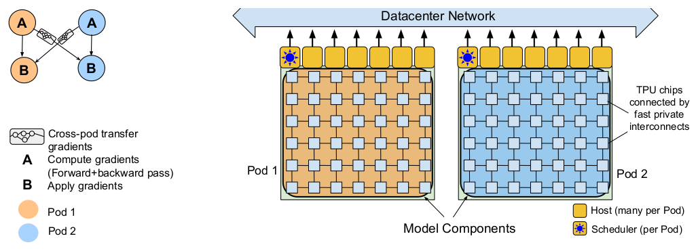

*图 2（原文 Figure 2，第 8 页）：Pathways 系统用 pod 级的两路数据并行，把训练扩展到两个 TPU v4 pod。*

**图中文字翻译与读法**：

- **左图（数据流程序）**：节点 A 表示“计算梯度（前向 + 反向）”（含 pod 内的梯度归约），节点 B 表示“应用梯度”（优化器更新，含对本地与远端梯度求和）。橙色是 Pod 1，蓝色是 Pod 2。两个 pod 各自执行 A，然后通过“Cross-pod transfer gradients（跨 pod 传输梯度）”这条边把梯度交给对方，最后各自执行 B。
- **右图（系统布局）**：两块方阵是两个 pod，方阵里的小方块是 TPU 芯片，芯片之间是“fast private interconnects（高速私有互连）”；每个 pod 顶部的黄色方块是主机（Host，一个 pod 有很多台），带蓝色星形标记的是每个 pod 一个的调度器（Scheduler）；两个 pod 的主机经由顶部的“Datacenter Network（数据中心网络）”相连；底部的 “Model Components”（模型组件）指向 pod 内的芯片阵列。
- **读图结论**：一个单独的 Python 客户端构造出这个分片的数据流程序，把 JAX/XLA 任务派给远端的两个 pod；每个 pod 用 pod 内的数据并行 + 模型并行并行地算出自己那一半 batch 的梯度，再交换，然后各自累加本地与远端梯度并更新参数，保证下一步的参数**逐位完全一致**（bitwise-identical）。

Pathways 能扩展到数千芯片，原文给出了两点：第一，通过各 pod 调度器上的**异步成组调度（asynchronous gang-scheduling）**，掩盖了从单个 Python 客户端向远端服务器分派 JAX/XLA 任务的延迟；第二，**分片数据流**（sharded dataflow）执行模型摊薄了管理数据传输的开销。

跨 pod 梯度传输是一个有趣的工程难点：

- 只有两个 pod 上“对应的主机”之间需要一对一传输（每个核只需要自己负责的那一片模型参数的远端梯度）；
- 传输要等每个核算完梯度才开始，所以是极强的突发流量：每对主机每步交换约 1.3 GB 梯度，所有主机合计的瞬时突发约 81 Tbps；
- 缓解办法：把梯度切成更小的块，通过多条更小的流、经由 DCN 上不同的链路发送；
- 结果：吞吐约为单个 pod 的 **1.95 倍**（因为 batch 翻倍，相当于理想线性弱扩展的 97%）。与理论 2 倍的差距来自反向传播与跨 pod 梯度归约之间没有重叠，原文说这留待未来改进。

### 5.3 训练效率：为什么提出 MFU，以及 46.2% 是怎么算的

过去常报“硬件 FLOPs 利用率”（hardware FLOPs utilization，HFU）：设备实测 FLOPs 与理论峰值之比。论文指出它有两个问题：

1. **实际执行的 FLOPs 取决于系统和实现**，编译器的选择会改变操作数。尤其是重计算（rematerialization）——为了省显存，反向时重算一部分前向激活。这相当于用更多硬件 FLOPs 换内存，但训练系统的最终目标是每秒处理更多 token（更快训完），而不是用掉更多 FLOPs；
2. 实测硬件 FLOPs 本身依赖统计方法（按解析公式记账，还是读硬件计数器）。

因此论文提出**模型 FLOPs 利用率（model FLOPs utilization，MFU）**：观测到的吞吐（tokens/s）除以系统在峰值 FLOPs 下的理论最大吞吐，且这个“理论最大”只计算前向 + 反向**必需**的运算，不计重计算。分子只是观测吞吐，分母只依赖模型结构和公布的峰值算力，所以不同系统之间可以公平比较。

附录 B 给出公式。对 $N$ 个参数的稠密 decoder-only 模型，不含自注意力时每个 token 需要 $6N$ 次矩阵乘 FLOPs（前向 $2N$，反向 $4N$；每个乘加算 2 次运算，反向有两倍于前向的矩阵乘）。稠密自注意力的矩阵乘再增加每 token $6LH(2QT)=12LHQT$ 次 FLOPs，其中 $L,H,Q,T$ 分别是层数、头数、头维度和序列长度。设一组加速器的理论峰值矩阵乘吞吐为 $P$ FLOP/s，则理论最大吞吐 $R$ 与 MFU 为

$$
R=\frac{P}{6N+12LHQT}\ \ \text{(tokens/s)},\qquad \mathrm{MFU}=\frac{\text{observed tokens/s}}{R}.
$$

其中 MFU 的分子是实测吞吐。原文给出的两个算例：

- **Megatron–Turing NLG 530B**：A100 峰值 312 TFLOP/s，2240 块 GPU，训练吞吐 65.43K tokens/s（$1920\times2048/60.1$），不含注意力的 MFU 为 $\dfrac{65.43\times6\times530}{312\times2240}=29.7\%$，含注意力为 30.2%。
- **PaLM 540B**：TPU v4 峰值 275 TFLOP/s，6144 块芯片，batch size 2048 时平均吞吐 238.3K tokens/s，不含注意力的 MFU 为 $\dfrac{238.3\times6\times540}{275\times6144}=45.7\%$，含注意力为 **46.2%**。含重计算 FLOPs 的硬件 FLOPs 利用率为 57.8%。

（本文核算：$12LHQT=12\times118\times48\times256\times2048\approx3.56\times10^{10}$，即每 token 约 0.036 TFLOPs，加上 $6N\approx3.242$ TFLOPs，合计约 3.278 TFLOPs，与表 22 的 3.28 一致；$57.8\%\approx46.2\%\times4.10/3.28$，即重计算让每 token 的硬件 FLOPs 比必需 FLOPs 多 25%。）

| 模型 | 参数量 | 加速器 | 模型 FLOPs 利用率（MFU） |
|---|---:|---|---:|
| GPT-3 | 175B | V100 | 21.3% |
| Gopher | 280B | 4096 块 TPU v3 | 32.5% |
| Megatron–Turing NLG | 530B | 2240 块 A100 | 30.2% |
| PaLM | 540B | 6144 块 TPU v4 | **46.2%** |

（原文表 3，第 9 页。PaLM 的硬件 FLOPs 利用率为 57.8%。）读法：表中 GPT-3 的 21.3% 按 OpenAI 经 Patterson et al. (2021) 报告的每 GPU 24.6 TFLOP/s 非注意力算力折算；Gopher 的 32.5% 按训练速度 0.0152 步/秒折算（来自与作者的私下沟通）；Megatron–Turing NLG 的 29.7%（不含注意力）与 30.2%（含注意力）按其论文报告的训练步时间折算。原文把高 MFU 归因于并行策略、XLA TPU 编译器优化和“并行层”等多项因素共同作用，没有给出各因素的单独贡献（只单独给出并行层约 15% 的训练加速）。表中四个系统的硬件、框架、批大小各不相同，所以这是“各系统在自己配置上的效率”，不是同硬件对比。

### 5.4 训练算力与碳排放（原文附录 B）

| 模型 | 每 token TFLOPs（非注意力 + 注意力） | 每 token TFLOPs（再加重计算） | 训练 FLOPs | PetaFLOP/s-天 |
|---|---:|---:|---:|---:|
| PaLM 8B | 0.0550 | 0.0561 | $4.29\times10^{22}$ | 497 |
| PaLM 62B | 0.388 | 0.392 | $3.08\times10^{23}$ | 3570 |
| PaLM 540B | 3.28 | 4.10 | $2.56\times10^{24}$ | 29600 |

（原文表 22，第 66 页。8B 和 540B 训练到 7800 亿 token，62B 训练到 7950 亿 token。）读法：540B 使用重计算，所以硬件上实际执行的 FLOPs 比“必需 FLOPs”多；8B 和 62B 只在自注意力里使用重计算。这些数字不含开发、被抢占或其他低效带来的计算。训练 FLOPs 就是“每 token FLOPs × token 数”：$3.28\times10^{12}\times7.8\times10^{11}\approx2.56\times10^{24}$（本文核算）。

碳排放（原文附录 B）：PaLM 540B 在 Google 俄克拉荷马数据中心训练，PUE 为 1.08，训练期间 89% 的电力来自无碳能源，碳强度 0.079 tCO2e/MWh；按 6144 块 TPU v4 训练 1200 小时、3072 块训练 336 小时（含停机和重复步骤）、每块芯片系统功率实测 378.5 W 计，总排放约 271.43 tCO2e。作为对照，原文引用 Patterson et al. (2021)：旧金山—纽约一架客机往返约 180 tCO2e，GPT-3 的训练约 552 tCO2e。论文称 PaLM 训练和本文所述全部实验的能耗与排放都已用可再生能源抵消。

## 六、训练设置与训练不稳定

### 6.1 训练设置（原文第 5 节）

训练遵循大型 Transformer 语言模型的相当标准的做法：

| 项目 | 设置 |
|---|---|
| 权重初始化 | 所有 kernel（除 embedding 与 LayerNorm 尺度外）按“fan-in 方差缩放”初始化，原文写作 $W\sim\mathcal N(0,1/\sqrt{n_{in}})$（$n_{in}$ 是该 kernel 的输入维度，即标准差为 $1/\sqrt{n_{in}}$）；输入 embedding 初始化为 $E\sim\mathcal N(0,1)$（embedding 之后不再做 LayerNorm） |
| 输出 logits 缩放 | 输入、输出 embedding 共享，所以 softmax 前的 logits 乘以 $1/\sqrt n$（$n$ 为 embedding 维度） |
| 优化器 | Adafactor，**不做因子分解**；这等价于带“参数缩放（parameter scaling）”的 Adam，学习率按参数矩阵的均方根缩放。因为权重初始化正比于 $1/\sqrt n$，其效果类似 GPT-3 手工调低 Adam 学习率；好处是不同尺度的参数矩阵（embedding、LayerNorm 尺度）不会被按同一速率压低学习率 |
| 学习率 | 前 10,000 步为 $10^{-2}$，之后按 $1/\sqrt k$ 衰减（$k$ 为步数） |
| 动量 $\beta_1$ | 0.9 |
| 二阶矩插值 $\beta_2$ | $1.0-k^{-0.8}$。论文发现这比标准的 0.99 更稳定，因为稀有的 embedding token 的二阶矩在较短窗口内估计很差 |
| 梯度裁剪 | 全局范数裁剪，阈值 1.0（所有模型） |
| 权重衰减 | 动态的 $\mathrm{lr}^{2.0}$（$\mathrm{lr}$ 为当前学习率） |
| 损失函数 | 标准语言模型损失（所有 token 的平均对数概率，无 label smoothing），外加辅助损失（原文称 `z_loss`）$L_z=10^{-4}\cdot\log^2 Z$，鼓励 softmax 归一化项的对数 $\log Z$ 接近 0，论文称它提高了训练稳定性 |
| 序列长度 | 所有模型 2048。样本拼接后切成恰好 2048 个 token 的序列，没有 padding，样本可能在中间被切断；样本之间用特殊的 `[eod]` token 分隔 |
| batch size | 所有模型训练中递增。540B：batch 512（约 1M token）到第 50k 步，翻倍到 1024（约 2M token）到第 115k 步，再翻倍到 2048（约 4M token）直到第 255k 步训练结束；小模型的调度类似 |
| 位级确定性 | 从任意 checkpoint 起完全可复现（例如训练到第 17,000 步，从第 15,000 步的 checkpoint 重启，两次从 15,000 到 17,000 的结果逐位相同）。靠两点实现：JAX + XLA + T5X 的位级确定性建模框架；确定性的数据流水线（打乱后的数据以随机访问格式写出，一个训练 batch 的内容只取决于步数） |
| dropout | 预训练**不用 dropout**；微调大多数情况用 0.1 |

关于 batch size 调度的两条理由：（1）训练早期较小的 batch 样本效率更高（同样 token 数下损失更低），后期较大的 batch 因梯度估计更好而更有利；（2）更大的 batch 带来更大的矩阵乘维度，TPU 效率更高。

（本文核算：按“batch 大小 × 2048 token”逐段累加，$50\mathrm{k}\times1.05\mathrm{M}+65\mathrm{k}\times2.10\mathrm{M}+140\mathrm{k}\times4.19\mathrm{M}\approx776\mathrm{B}$ token，与 780B 一致。）

### 6.2 训练不稳定（原文第 5.1 节）

最大的模型在训练中出现了约 20 次损失尖峰（loss spike），尽管开了梯度裁剪。尖峰出现的间隔很不规则，有时很晚才出现，在较小的模型上没有观察到。因为训练成本太高，作者没能找到有原则的缓解办法，而是用了一个简单有效的做法：**从尖峰出现前约 100 步的 checkpoint 重启，并跳过大约 200–500 个数据 batch**（覆盖尖峰之前和期间见过的 batch）。这样同一位置不再出现尖峰。

作者不认为尖峰是“坏数据”本身造成的：他们做了消融，把尖峰附近的那批数据，从一个更早的 checkpoint 开始再训练，没有出现尖峰。这意味着尖峰只在“特定数据 batch + 特定模型参数状态”的组合下才发生。论文把更有原则的缓解方法留作未来工作。

读法：这是一份很有价值的“工程事实”——540B 训练并不是平滑地一次跑完，约 20 次尖峰都靠回退加跳过数据解决；它也说明“可从任意 checkpoint 位级复现”（见上表）对这种回退操作是前置条件。

## 七、评测结果

### 7.1 29 个英文 NLP 任务（原文 6.1 节）

为了和已有的大模型直接比较，PaLM 评测了与 GLaM（Du et al., 2021）、GPT-3（Brown et al., 2020）相同的 29 个英文基准：

- 开放域**闭卷**问答：TriviaQA、Natural Questions、Web Questions（闭卷即只给问题，不给上下文文档；Natural Questions 也有给文档的“开卷”格式，这里没用）；
- 完形与补全：LAMBADA、HellaSwag、StoryCloze；
- Winograd 类：Winograd、WinoGrande；
- 常识推理：PIQA、ARC、OpenBookQA；
- 上下文内阅读理解：DROP、CoQA、QuAC、SQuADv2、RACE；
- SuperGLUE；
- 自然语言推断：Adversarial NLI（ANLI）。

下表只比较**单个 checkpoint 的预训练语言模型**结果；凡是使用了微调或多任务适配的模型（如 FLAN、T0）都不在表内。

**表：PaLM 540B 在 29 个 NLP 基准上与先前最佳大模型结果的对比。除标注外为准确率（%）；EM 为精确匹配，F1 为 F1 分数，越大越好。few-shot 列括号里是该任务使用的示例数；粗体为每组对比中的较好值。**

| 任务 | 0-shot 先前 SOTA | 0-shot PaLM 540B | 1-shot 先前 SOTA | 1-shot PaLM 540B | few-shot 先前 SOTA（shot 数） | few-shot PaLM 540B（shot 数） |
|---|---:|---:|---:|---:|---:|---:|
| TriviaQA (EM) | 71.3a | **76.9** | 75.8a | **81.4** | 75.8a（1） | **81.4**（1） |
| Natural Questions (EM) | **24.7**a | 21.2 | 26.3a | **29.3** | 32.5a（1） | **39.6**（64） |
| Web Questions (EM) | **19.0**a | 10.6 | **25.3**b | 22.6 | 41.1b（64） | **43.5**（64） |
| Lambada (EM) | 77.7f | **77.9** | 80.9a | **81.8** | 87.2c（15） | **89.7**（8） |
| HellaSwag | 80.8f | **83.4** | 80.2c | **83.6** | 82.4c（20） | **83.8**（5） |
| StoryCloze | 83.2b | **84.6** | 84.7b | **86.1** | 87.7b（70） | **89.0**（5） |
| Winograd | 88.3b | **90.1** | **89.7**b | 87.5 | 88.6a（2） | **89.4**（5） |
| Winogrande | 74.9f | **81.1** | 73.7c | **83.7** | 79.2a（16） | **85.1**（5） |
| Drop (F1) | 57.3a | **69.4** | 57.8a | **70.8** | 58.6a（2） | **70.8**（1） |
| CoQA (F1) | **81.5**b | 77.6 | **84.0**b | 79.9 | **85.0**b（5） | 81.5（5） |
| QuAC (F1) | 41.5b | **45.2** | 43.4b | **47.7** | 44.3b（5） | **47.7**（1） |
| SQuADv2 (F1) | 71.1a | **80.8** | 71.8a | **82.9** | 71.8a（10） | **83.3**（5） |
| SQuADv2 (EM) | 64.7a | **75.5** | 66.5a | **78.7** | 67.0a（10） | **79.6**（5） |
| RACE-m | 64.0a | **68.1** | 65.6a | **69.3** | 66.9a†（8） | **72.1**（8） |
| RACE-h | 47.9c | **49.1** | 48.7a | **52.1** | 49.3a†（2） | **54.6**（5） |
| PIQA | 82.0c | **82.3** | 81.4a | **83.9** | 83.2c（5） | **85.2**（5） |
| ARC-e | 76.4e | **76.6** | 76.6a | **85.0** | 80.9e（10） | **88.4**（5） |
| ARC-c | 51.4b | **53.0** | 53.2b | **60.1** | 52.0a（3） | **65.9**（5） |
| OpenbookQA | **57.6**b | 53.4 | **55.8**b | 53.6 | 65.4b（100） | **68.0**（32） |
| BoolQ | 83.7f | **88.0** | 82.8a | **88.7** | 84.8c（32） | **89.1**（8） |
| Copa | 91.0b | **93.0** | **92.0**a | 91.0 | 93.0a（16） | **95.0**（5） |
| RTE | **73.3**e | 72.9 | 71.5a | **78.7** | 76.8（5） | **81.2**（5） |
| WiC | 50.3a | **59.1** | 52.7a | **63.2** | 58.5c（32） | **64.6**（5） |
| Multirc (F1a) | 73.7a | **83.5** | 74.7a | **84.9** | 77.5a（4） | **86.3**（5） |
| WSC | 85.3a | **89.1** | 83.9a | **86.3** | 85.6a（2） | **89.5**（5） |
| ReCoRD | 90.3a | **92.9** | 90.3a | **92.8** | 90.6（2） | **92.9**（2） |
| CB | 48.2a | **51.8** | 73.2a | **83.9** | 84.8a（8） | **89.3**（5） |
| ANLI R1 | 39.2a | **48.4** | 42.4a | **52.6** | 44.3a（2） | **56.9**（5） |
| ANLI R2 | 39.9e | **44.2** | 40.0a | **48.7** | 41.2a（10） | **56.1**（5） |
| ANLI R3 | 41.3a | **45.7** | 40.8a | **52.3** | 44.7a（4） | **51.2**（5） |

（原文表 4，第 12 页。上标表示先前最佳结果的来源：a GLaM 62B/64E（Du et al., 2021）；b GPT-3 175B；c Megatron–Turing NLG 530B；d Gopher；e LaMDA（取自 Wei et al. 2022a 的报告）；f Chinchilla。†：Rae et al. (2021) 与 Hoffmann et al. (2022) 在 RACE-m/h 上得分高得多，但作者们自己说明那种任务设置与 GPT-3 等大模型不可比；PaLM 采用 GPT-3 式的任务设置，并与同样设置的结果比较。）

**读法**：

- PaLM 540B 在 1-shot 下有 24 个任务超过先前最佳，few-shot 下有 28 个（共 29 个任务；SQuADv2 的 F1 与 EM 算一个任务）。落后的任务：1-shot 下是 Web Questions、Winograd、CoQA、OpenBookQA、Copa；few-shot 下只有 CoQA。（逐行统计，0-shot 下为 24/29，原文未写。）
- 在 few-shot 下，PaLM 在部分阅读理解和 NLI 任务上比先前最佳高 10 分以上，例如 DROP 70.8 对 58.6、SQuADv2 EM 79.6 对 67.0、ARC-c 65.9 对 52.0、ANLI R1 56.9 对 44.3、ANLI R2 56.1 对 41.2（差值为本文由表中数字算出）。
- 对比大小相近的 Megatron–Turing NLG 530B，PaLM 540B 在所有这些基准上都更好。原文据此认为预训练数据、训练策略和训练 token 数也起了重要作用，而不是只有规模。
- **表中的“先前最佳”来自不同的模型、不同的 shot 数**，这是各家论文里最好的单项成绩的拼合，不是同一个基线在同一设置下的对比；读单格差距时要结合 shot 数。

**表：1-shot 下自然语言生成（NLG）与自然语言理解（NLU）任务的平均分（越大越好）。**

| 模型 | 平均 NLG | 平均 NLU |
|---|---:|---:|
| GPT-3 175B | 52.9 | 65.4 |
| GLaM 64B/64E | 58.4 | 68.7 |
| PaLM 8B | 41.5 | 59.2 |
| PaLM 62B | 57.7 | 67.3 |
| PaLM 540B | 63.9 | 74.7 |

（原文表 5，第 13 页。NLG 为 8 个任务：TriviaQA、NQS、WebQS、SQuADv2、LAMBADA、DROP、QuAC、CoQA，其余 21 个为 NLU。GPT-3 与 GLaM 的数字取自 Du et al. (2021)。）读法：PaLM 540B 在两类平均分上都比最强的先前结果（GLaM）高出 5 分以上；两类平均分随 PaLM 的规模单调上升；62B 的 PaLM 在两类上都超过 GPT-3 175B。

#### 7.1.1 MMLU

MMLU 是覆盖数学、历史、法律等 57 个科目的多选题基准。

**表：MMLU 5-shot 准确率（%），在每个科目的测试集上报告，越大越好；粗体为原文标出的最佳值。**

| 模型 | 平均 | 人文 | STEM | 社会科学 | 其他 |
|---|---:|---:|---:|---:|---:|
| Chinchilla 70B（此前最佳） | 67.5 | 63.6 | 54.9 | 79.3 | **73.9** |
| PaLM 8B | 25.3 | 25.6 | 23.8 | 24.1 | 27.8 |
| PaLM 62B | 53.7 | 59.5 | 41.9 | 62.7 | 55.8 |
| PaLM 540B | **69.3** | **77.0** | **55.6** | **81.0** | 69.6 |

（原文表 6，第 13 页。）读法：PaLM 540B 的平均分比此前最佳（Chinchilla）高约 2 分，除“其他”类外各类都更好；8B 的表现接近随机猜（四选一为 25%），到 62B 才明显离开随机水平，规模的作用在这里非常明显。

#### 7.1.2 微调：SuperGLUE

为了检验“规模能否弥补 decoder-only 在判别式微调上的劣势”，作者在 SuperGLUE 上对 PaLM 做了微调：Adafactor，学习率 $5\times10^{-5}$，batch size 32，通常不到 15K 步收敛，在 SuperGLUE 各任务按比例混合的数据上训练。

**表：SuperGLUE 开发集，微调结果。CB 为 F1/准确率，MultiRC 为 F1a/EM，ReCoRD 为 F1/EM（SuperGLUE 的标准指标）；报告各任务的最佳验证分数。**

| 模型 | 平均 | BoolQ | CB | CoPA | MultiRC | ReCoRD | RTE | WiC | WSC |
|---|---:|---:|---|---:|---|---|---:|---:|---:|
| T5-11B | 89.9 | 90.8 | 94.9/96.4 | 98.0 | 87.4/66.1 | 93.8/93.2 | 93.9 | 77.3 | 96.2 |
| ST-MoE-32B | 93.2 | 93.1 | 100/100 | 100 | 90.4/69.9 | 95.0/95.6 | 95.7 | 81.0 | 100 |
| PaLM 540B（微调） | 92.6 | 92.2 | 100/100 | 100 | 90.1/69.2 | 94.0/94.6 | 95.7 | 78.8 | 100 |

（原文表 7，第 14 页。）

**表：SuperGLUE 开发集，PaLM 540B 的 few-shot 与微调对比。**

| 设置 | BoolQ | CB | CoPA | MultiRC | ReCoRD | RTE | WiC | WSC |
|---|---:|---|---:|---|---|---:|---:|---:|
| few-shot | 89.1 | 89.3 | 95 | 86.3/- | 92.9/- | 81.2 | 64.6 | 89.5 |
| 微调 | 92.2 | 100/100 | 100 | 90.1/69.2 | 94.0/94.6 | 95.7 | 78.8 | 100 |

（原文表 8，第 14 页。）

**表：SuperGLUE 测试集（排行榜）。粗体为原文标出的最佳值。**

| 模型 | 平均 | BoolQ | CB | CoPA | MultiRC | ReCoRD | RTE | WiC | WSC |
|---|---:|---:|---|---:|---|---|---:|---:|---:|
| ST-MoE-32B | **91.2** | **92.4** | **96.9/98.0** | **99.2** | **89.6/65.8** | **95.1/94.4** | 93.5 | **77.7** | **96.6** |
| 排行榜上最好的 decoder-only 语言模型 | 71.8 | 76.4 | 52.0/75.6 | 92.0 | 75.4/30.5 | 91.1/90.2 | 69.0 | 49.4 | 80.1 |
| PaLM 540B（微调） | 90.4 | 91.9 | 94.4/96.0 | 99.0 | 88.7/63.6 | 94.2/93.3 | **95.9** | 77.4 | 95.9 |

（原文表 9，第 14 页。）

**读法**：

- PaLM 微调后在 SuperGLUE 上“接近 SOTA”：开发集平均 92.6（ST-MoE-32B 为 93.2），测试集 90.4（ST-MoE-32B 为 91.2），而测试榜上此前最好的 decoder-only 语言模型（GPT-3）只有 71.8，PaLM 大幅领先。
- 榜上最强的两个模型（T5-11B、ST-MoE-32B）都是用片段破坏目标预训练的 encoder-decoder 模型。论文引用 Raffel et al. (2020)：在训练成本相同时，这类结构在分类任务微调上通常优于自回归 decoder-only。PaLM 说明规模可以缩小这个差距。
- 表 8 同时显示，few-shot 与微调之间仍有明显差距（例如 CB 89.3 对 100，WiC 64.6 对 78.8，RTE 81.2 对 95.7）。

### 7.2 BIG-bench（原文 6.2 节）

**BIG-bench** 是一个协作式基准，旨在为大模型提供有挑战性的新任务，包含 150 多个任务，涵盖逻辑推理、翻译、问答、数学等；任务分文本型和程序型，本文只评文本型。数据发布里带有**人类表现**：在众包平台上通常约 10 名工作人员解题，他们拿到的任务说明和示例与 few-shot 模型看到的相似，并且可以使用任何外部工具（搜索引擎、计算器等）。人类和模型用同一个指标对照任务作者给出的金标准评分。“最佳”（best）人类表现取每个样本上得分最高的人类答案；“平均”（avg）人类表现取所有人类答案的平均分。

每个任务有自己的“首选指标”（preferred metric）。为了能跨任务求平均，原文对多选类任务做**归一化**：随机猜测记 0，满分记 100，所以低于随机时可以是负值；然后对任务取平均，叫“归一化首选指标”（Normalized Preferred Metric）。

#### 7.2.1 总体曲线（图 3、图 4）

先说这两张图要回答的问题：PaLM 在 BIG-bench 上相对已有大模型和人类到底在什么位置，随规模怎么变。

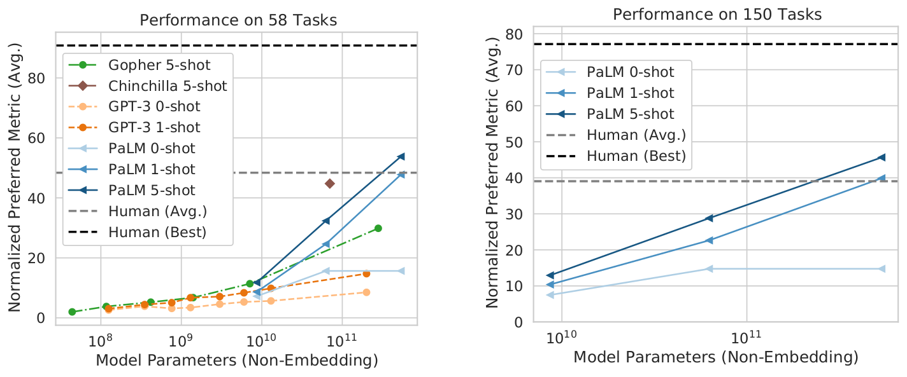

*图 3（原文 Figure 3，第 15 页）：左，58 个共同任务上 PaLM、GPT-3、Gopher、Chinchilla 的平均成绩；右，PaLM 在 150 个文本任务上的平均成绩。*

**图中文字翻译与读法**：

- **左图 Performance on 58 Tasks（58 个任务上的表现）**：横轴 Model Parameters (Non-Embedding)（模型参数量，不含 embedding，对数刻度，约 $10^8$ 到 $5\times10^{11}$），纵轴 Normalized Preferred Metric (Avg.)（归一化首选指标平均值）。图例：Gopher 5-shot、Chinchilla 5-shot、GPT-3 0-shot / 1-shot、PaLM 0-shot / 1-shot / 5-shot，两条水平虚线分别是 Human (Avg.)（人类平均，约 48）和 Human (Best)（人类最佳，约 91）。之所以只画 58 个任务，是因为以前的模型只在这些任务的子集上评测过，三个模型的共同任务只有 58 个。
- **右图 Performance on 150 Tasks（150 个任务上的表现）**：只有 PaLM 三个规模（0/1/5-shot）和人类平均（约 39）、最佳（约 77）两条参考线。
- **读图结论**：（1）左图中 PaLM 540B 的 5-shot 约 54，超过人类平均（约 48）；Chinchilla 70B 约 45，Gopher 280B 约 30，GPT-3 175B 的 1-shot 约 15（均为从图上读出的近似值）。（2）PaLM 的 1-shot、5-shot 成绩随规模大致呈**对数线性**增长，原文据此推断继续放大还会提升（0-shot 曲线从 62B 到 540B 基本持平，约 15–16，这是从图上看出的，原文正文没有单独讨论）。（3）右图 150 个任务上形态类似，540B 的 5-shot 约 46，也超过人类平均。

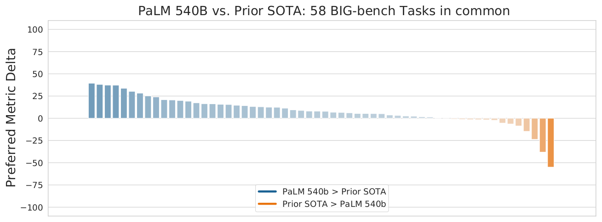

*图 4（原文 Figure 4，第 15 页）：58 个共同任务上，PaLM 540B 5-shot 与此前最佳（GPT-3 175B 1-shot、Gopher 5-shot、Chinchilla 5-shot 中最好者）的“归一化首选指标”之差。*

**图中文字翻译与读法**：纵轴 Preferred Metric Delta（首选指标差值，-100 到 100），每根柱子是一个任务，从左到右按差值从大到小排列；蓝色柱表示 “PaLM 540b > Prior SOTA”（PaLM 更好），橙色柱表示 “Prior SOTA > PaLM 540b”（先前最佳更好）。论文为了图面清爽没有标任务名。读图结论：PaLM 540B 5-shot 在 58 个共同任务中的 **44 个**上超过先前最佳（正文数字）；领先最多的任务领先约 39 分，落后最多的任务落后约 55 分（从图上读出的近似值）。

#### 7.2.2 单个任务：对数线性、不连续、平坦（图 5）

下面六个任务是论文挑出的“规模曲线有特点”的例子。任务说明（含原文示例的中译）：

- **goal_step_wikihow**：推理事件间的“目标—步骤”关系。例：“为了‘清洁银器’，哪一步应先做？(a) 把银器擦干 (b) 手洗银器”，答案 (b)。
- **logical_args**：从一段文字中预测正确的逻辑推断。
- **english_proverbs**：猜哪条谚语最能概括一段文字。例：Vanessa 多年周末在无家可归者援助中心帮忙，最近她丢了工作，中心马上给了她一份新工作。下面哪条谚语适用？(a) Curses, like chickens, come home to roost.（咒骂像鸡一样会回窝）(b) Where there is smoke there is fire（无风不起浪）(c) As you sow, so you shall reap（种瓜得瓜）。答案 (c)。
- **logical_sequence**：把一组“事物”（月份、动作、数字、字母等）排成合乎逻辑的顺序。例：下面哪个动作清单按时间顺序排对了？答案：“感到口渴、打开水瓶、喝水、盖上水瓶”。
- **navigate**：按一串简单的导航指令推断最后位置。例：“始终面朝前方。向左 6 步，向前 7 步，向左 8 步，向左 7 步，向前 6 步，向前 1 步，向前 4 步。你是否回到了起点？”答案 No。
- **mathematical_induction**：按数学归纳法规则做逻辑推断，即使前提与现实中的数学矛盾。例：“已知给任何奇数加 2 得到另一个奇数。2 是奇数。因此 6 是奇数。这是一个正确的归纳论证吗（即使有些假设可能不对）？”答案 Yes。

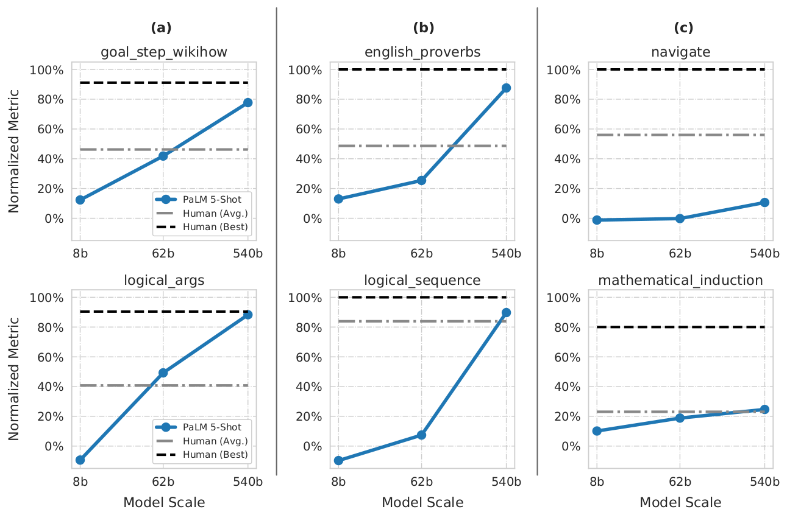

*图 5（原文 Figure 5，第 17 页）：六个任务上 PaLM 8B/62B/540B 的 5-shot 成绩，分 (a)(b)(c) 三类。*

**图中文字翻译与读法**：

- 每个小图的横轴 Model Scale（模型规模：8b、62b、540b），纵轴 Normalized Metric（归一化指标，0% 对应多选题的随机猜测）；蓝线 PaLM 5-Shot，灰色点划线 Human (Avg.)（人类平均），黑色虚线 Human (Best)（人类最佳）。
- **(a) 对数线性提升**：goal_step_wikihow（约从 12% 到 42% 再到 78%）和 logical_args（约从 -10% 到 49% 再到 88%）几乎是一条直线（横轴是等间隔的规模刻度），540B 接近人类最佳。
- **(b) 不连续提升**：english_proverbs（8B、62B、540B 约 13%、25%、87%，其中 25% 和 87% 是原文正文给出的数字）和 logical_sequence（约 -10%、7%、90%，从图上读出）在 62B → 540B 的增幅远大于 8B → 62B。
- **(c) 提升平缓**：navigate 和 mathematical_induction 上 540B 只略好于 62B，且远低于人类最佳。
- **读图结论**：规模对不同任务的作用形态不同，有的平滑，有的在最大规模上才突然“起飞”，有的几乎不动。（以上带“约”的数值是从图上读出的近似值。）

**怎样量化“不连续”**。原文用一个简单的定义：先用 8B → 62B 的增量按对数线性外推 540B 的成绩（$a$ 为各规模的归一化准确率，$\mathrm{pred}$ 为外推预测值），再看实际成绩比外推高多少（$\mathrm{disc}$，即“不连续度”）：

$$
\mathrm{pred}_{540\mathrm B}=a_{62\mathrm B}+\big(a_{62\mathrm B}-a_{8\mathrm B}\big),\qquad \mathrm{disc}=a_{540\mathrm B}-\mathrm{pred}_{540\mathrm B}.
$$

原文正文以 logical_sequence 为例：8B、62B、540B 的归一化准确率为 13%、25%、87%，外推预测 $25\%+(25\%-13\%)=37\%$，实际是 87%，不连续度为 $+50\%$。（核对备注：这组 13%、25%、87% 与图 5 中 english_proverbs 的曲线吻合，而图中 logical_sequence 约为 -10%、7%、90%，按同一定义不连续度约为 $+66\%$；这是原文正文与图之间的小出入，不影响定义和结论。）在全部 150 个任务里，**25% 的任务不连续度大于 +10%，15% 的任务大于 +20%**。论文据此认为“能力会在规模达到某个临界值后才涌现”，并且“不连续的提升在有挑战性的 few-shot 语言任务上很常见”。

（本文补充：8B → 62B 放大约 7.8 倍，62B → 540B 放大约 8.7 倍，两段在对数轴上长度接近，所以用前一段的增量去外推后一段是合理的。同时要注意，这里只有 8B、62B、540B **三个**规模点，所谓“不连续”是在三点上相对一条外推直线的偏离，不能据此断言存在相变；原文自己也只称之为经验观察。）

规模并非对所有任务都有帮助：navigate 和 mathematical_induction 上 540B 仅略优于 62B，两者都远低于人类最佳。作者分析认为这些任务内部的样本难度差异很大。例如 mathematical_induction 中有的样本前提正确（如“2 是偶数”），有的前提错误（如“2 是奇数”）；所有 PaLM 模型（以及参与的人类）在前提错误的样本上都吃力，尽管任务说明写明前提是否正确不影响结论。

#### 7.2.3 与人类对比（图 6、图 7、表 41–43）

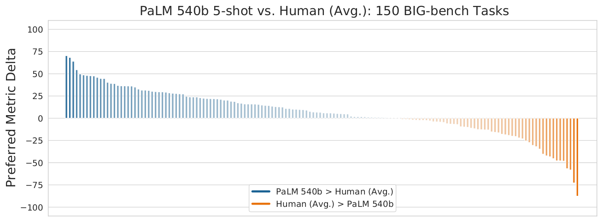

*图 6（原文 Figure 6，第 18 页）：150 个文本任务上，PaLM 540B 5-shot 与人类平均表现的“归一化首选指标”之差。*

**图中文字翻译与读法**：画法与图 4 相同：蓝色柱 “PaLM 540b > Human (Avg.)”，橙色柱 “Human (Avg.) > PaLM 540b”，纵轴为 Preferred Metric Delta。读图结论：PaLM 540B 总体上超过人类平均，但在约 **35% 的任务**上人类平均仍高于 PaLM 540B（正文数字），即 BIG-bench 上仍有很大提升空间；左端最高的几根蓝柱约 +70，右端最低的橙柱约 -87（从图上读出的近似值）。

PaLM 540B 超过人类平均的任务里（原文表 42），有几项体现了多语言能力，如 persian_idioms 和 swedish_to_german_proverbs，因为参与任务的人群可能并不都熟悉这些语言；periodic_elements 偏重记忆，利用了大模型的记忆能力；其余如 common_morpheme、sufficient_information、logical_args 体现语言处理能力。以 cause_and_effect 为例，它有两个版本：

- **one_sentence_no_prompt**：把两个事件按两种顺序各合成一句话，用模型对数似然给两句话打分，不给提示。例：“我洗了车，因为我的车脏了”与“我的车脏了，因为我洗了车”，似然更高的是前者。
- **two_sentence**：给出两个事件，让模型选择哪个事件是原因。例：“(a) 我的车脏了。(b) 我洗了车。”正确答案 (a)。

所有 PaLM 模型在第一个版本上都表现很好，8B 就超过 80% 的准确率；但较小的模型在第二个版本上很差，8B 接近随机，而 540B 超过 90%，作者借此说明规模可以解锁的通用语言建模能力。

**表：PaLM 540B 超过人类平均的 BIG-bench 任务中，归一化差距最大的十个。原始分是任务自己定义的首选指标；归一化分把随机猜测记 0、满分记 100（可以为负）。**

| 任务 | PaLM 540B（原始） | 人类平均（原始） | PaLM 540B（归一化） | 人类平均（归一化） |
|---|---:|---:|---:|---:|
| persian idioms | 72.7 | 20.0 | 63.6 | -6.7 |
| common morpheme | 84.0 | 32.8 | 78.7 | 10.3 |
| periodic elements | 71.5 | 7.5 | 71.5 | 7.5 |
| bbq lite json | 96.3 | 59.9 | 94.4 | 39.9 |
| physics | 77.3 | 40.0 | 69.7 | 19.9 |
| sufficient information | 79.5 | 30.8 | 79.5 | 30.8 |
| parsinlu reading comprehension | 49.2 | 1.5 | 49.2 | 1.5 |
| logical args | 90.6 | 52.6 | 88.3 | 40.8 |
| swedish to german proverbs | 79.9 | 46.8 | 72.1 | 26.2 |
| conlang translation | 66.3 | 21.6 | 66.3 | 21.6 |

（原文表 42，第 85 页。）

**表：人类平均超过 PaLM 540B 的 BIG-bench 任务中，归一化差距最大的十个。**

| 任务 | PaLM 540B（原始） | 人类平均（原始） | PaLM 540B（归一化） | 人类平均（归一化） |
|---|---:|---:|---:|---:|
| mnist ascii | 12.2 | 91.0 | 2.4 | 90.1 |
| ascii word recognition | 13.4 | 86.2 | 13.4 | 86.2 |
| temporal sequences | 47.0 | 90.6 | 29.3 | 87.5 |
| simple text editing | 0.0 | 56.7 | 0.0 | 56.7 |
| hyperbaton | 51.0 | 75.1 | 2.0 | 50.2 |
| tracking shuffled objects | 23.9 | 62.2 | 4.9 | 52.8 |
| hhh alignment | 51.1 | 75.0 | 2.2 | 50.0 |
| navigate | 55.3 | 78.0 | 10.6 | 56.0 |
| chinese remainder theorem | 0.0 | 43.3 | 0.0 | 43.3 |
| movie recommendation | 34.4 | 60.4 | 12.5 | 47.2 |

（原文表 43，第 85 页。）读法：其中不少是字符画识别（mnist ascii、ascii word recognition）、状态跟踪（tracking shuffled objects、temporal sequences）和精确计算（chinese remainder theorem）类任务，PaLM 接近随机水平（这是本文的归纳，原文只写明人类平均在这些任务上更高）。

**BIG-bench Lite**（24 个精选任务，作为轻量评测目标）：

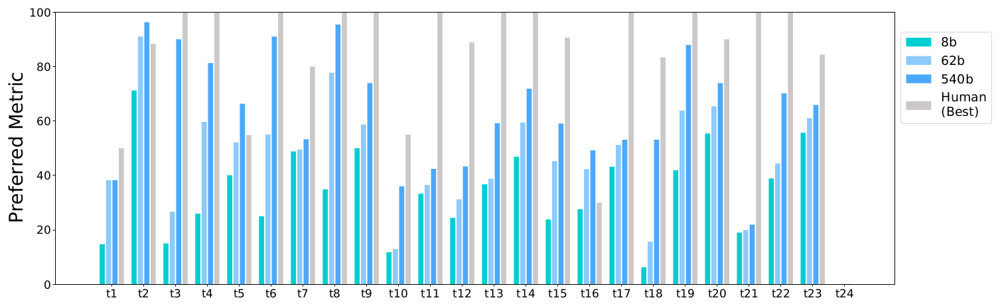

*图 7（原文 Figure 7，第 19 页）：24 个 BIG-bench Lite 任务上，PaLM 8B、62B、540B 的 5-shot 首选指标（未归一化）与人类最佳。*

**图中文字翻译与读法**：横轴 t1–t24 是 24 个任务（任务名见下表），纵轴 Preferred Metric（首选指标，0–100）；每个任务四根柱：青色 8b、浅蓝 62b、蓝色 540b、灰色 Human (Best)（人类最佳）。读图结论：540B 在所有规模中最好，但只在 3 个任务上超过人类最佳（t2 bbq_lite_json、t5 conlang_translation、t16 parsinlu_reading_comprehension；t24 linguistics_puzzles 人类最佳本身就是 0.0，不计）；t24 对模型和人类都极难，成绩接近 0。

**表：BIG-bench Lite 24 个任务 5-shot 的首选指标（未归一化，与图 7 一致）。**

| 编号 | 任务 | PaLM 8B | PaLM 62B | PaLM 540B | 人类（平均） | 人类（最佳） |
|---|---|---:|---:|---:|---:|---:|
| t1 | auto debugging | 14.7 | 38.2 | 38.2 | 13.7 | 50.0 |
| t2 | bbq lite json | 71.2 | 91.0 | 96.3 | 59.9 | 88.4 |
| t3 | code line description | 15.0 | 26.7 | 90.0 | 60.6 | 100.0 |
| t4 | conceptual combinations | 25.9 | 59.7 | 81.3 | 83.2 | 100.0 |
| t5 | conlang translation | 40.1 | 52.1 | 66.3 | 21.6 | 54.8 |
| t6 | emoji movie | 25.0 | 55.0 | 91.0 | 92.6 | 100.0 |
| t7 | formal fallacies syllogisms negation | 48.8 | 49.5 | 53.3 | 54.1 | 80.0 |
| t8 | hindu knowledge | 34.9 | 77.7 | 95.4 | 61.9 | 100.0 |
| t9 | known unknowns | 50.0 | 58.7 | 73.9 | 80.2 | 100.0 |
| t10 | language identification | 11.8 | 12.9 | 36.0 | 16.1 | 55.0 |
| t11 | logic grid puzzle | 33.3 | 36.5 | 42.4 | 45.1 | 100.0 |
| t12 | logical deduction | 24.4 | 31.2 | 43.3 | 40.1 | 88.9 |
| t13 | misconceptions russian | 36.7 | 38.8 | 59.2 | 64.7 | 100.0 |
| t14 | novel concepts | 46.9 | 59.4 | 71.9 | 67.2 | 100.0 |
| t15 | operators | 23.8 | 45.2 | 59.0 | 45.6 | 90.6 |
| t16 | parsinlu reading comprehension | 27.6 | 42.3 | 49.2 | 1.5 | 30.0 |
| t17 | play dialog same or different | 43.2 | 51.2 | 53.1 | 52.2 | 100.0 |
| t18 | repeat copy logic | 6.2 | 15.6 | 53.1 | 38.8 | 83.3 |
| t19 | strange stories | 41.9 | 63.8 | 87.9 | 80.1 | 100.0 |
| t20 | strategyqa | 55.4 | 65.4 | 73.9 | 62.9 | 90.0 |
| t21 | symbol interpretation | 19.0 | 19.9 | 21.9 | 36.8 | 100.0 |
| t22 | vitaminc fact verification | 38.9 | 44.4 | 70.2 | 63.7 | 100.0 |
| t23 | winowhy | 55.7 | 61.0 | 65.9 | 52.3 | 84.4 |
| t24 | linguistics puzzles | 0.0 | 0.1 | 0.1 | 0.0 | 0.0 |

（原文表 41，第 84 页。）

**这些结果是不是记忆出来的？** 原文做了三步验证：（1）BIG-bench 任务文件带唯一的 canary 字符串，确认它不在 PaLM 的训练数据里；（2）训练数据收集时 BIG-bench 数据集还没有放到互联网上，且绝大多数任务是任务作者专门为 BIG-bench 新构建的；（3）在若干表现强的任务上抽查模型输入输出，人工确认解码时没有金标准标签泄漏。

### 7.3 推理任务（原文 6.3 节）

PaLM 的一个核心主张是：**模型规模 + 思维链提示（chain-of-thought prompting），不靠任务特定微调或验证器，就能在多步推理上达到甚至超过先前最佳。**

**任务类型**：

- **算术推理**：小学水平的自然语言数学应用题，需要多步逻辑推断。数学本身通常很简单，难点是把自然语言转成数学式。论文既评了“带计算器”的形式，也评了模型自己直接算的形式。例：“Roger 有 5 个网球，又买了 2 罐网球，每罐 3 个，他现在有几个网球？”答案 11。
- **常识推理**：问答任务，需要很强的世界知识，但不是简单的事实问答，而是要把多个关于世界的推断串起来。例：“Sean 急着回家，但灯变黄了，他被迫做什么？(a) 花时间 (b) 磨蹭 (c) 慢行 (d) 海洋 (e) 减速”，答案 (e)。

**思维链提示**：在 few-shot 示例中，人工写出从问题到答案的中间推理步骤，模型对测试样本也会自己生成一段推理链，最后只用最终答案评分（推理链可用于误差分析和可解释性）。

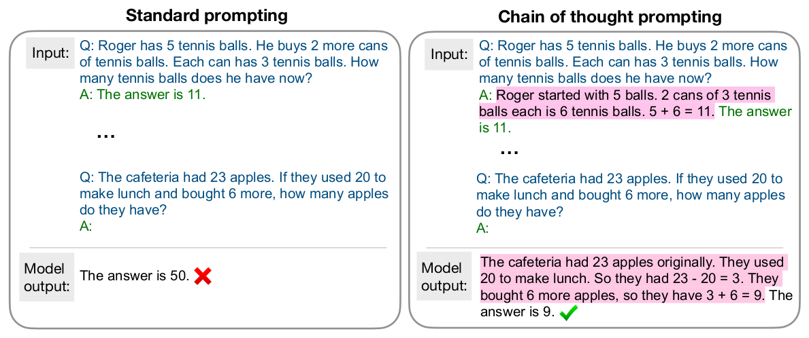

*图 8（原文 Figure 8，第 20 页）：思维链提示让语言模型更好地完成数学应用题等多步推理任务。*

**图中文字翻译与读法**：

- **左 Standard prompting（标准提示）**：示例是“Q: Roger 有 5 个网球。他又买了 2 罐网球，每罐有 3 个网球。他现在有几个网球？ A: 答案是 11。”，测试题是“Q: 食堂有 23 个苹果。如果他们用掉 20 个做午饭，又买了 6 个，他们现在有几个苹果？ A:”；模型直接输出“答案是 50。”（打叉，错误）。
- **右 Chain of thought prompting（思维链提示）**：示例的答案多了粉色高亮的推理：“Roger 开始有 5 个球。2 罐每罐 3 个网球是 6 个网球。5 + 6 = 11。答案是 11。”；同样的测试题，模型输出“食堂原来有 23 个苹果。他们用掉 20 个做午饭。所以他们有 23 - 20 = 3 个。他们又买了 6 个苹果，所以现在有 3 + 6 = 9 个。答案是 9。”（打勾，正确）。
- **读图结论**：关键区别只是提示里的示例带不带中间步骤；模型本身、任务和问题完全相同。

**设置**：8-shot 示例，与 Wei et al. (2022b) 完全一致。算术数据集：GSM8K、SVAMP、MAWPS、AQuA（图 10 还含 ASDiv）；常识数据集：CommonsenseQA、StrategyQA。对算术数据集，像 Cobbe et al. (2021) 一样用一个事后的外部计算器修正模型预测，但论文发现计算器在任何数据集上都没有带来超过 5% 的提升。论文还用 n-gram 重叠分析验证了训练语料与这些推理评测集之间没有数据污染。

#### 7.3.1 GSM8K 主结果（表 10、图 9）

GSM8K 此前的最佳成绩来自 Cobbe et al. (2021)：微调的 GPT-3 + 思维链 + 外部计算器 + 任务专用验证器（verifier），为 55%。

**表：GSM8K 8-shot 准确率，PaLM 与先前最佳的对比（越大越好）。**

| 模型 + 技术 | 准确率 |
|---|---:|
| PaLM 540B + 思维链 + 计算器 | **58%** |
| PaLM 540B + 思维链 | 54% |
| PaLM 540B，无思维链 | 17% |
| PaLM 62B + 思维链 | 33% |
| GPT-3 + 微调 + 思维链 + 计算器 | 34% |
| GPT-3 + 微调 + 思维链 + 计算器 + 验证器 | 55% |

（原文表 10，第 21 页。）读法：（1）思维链带来的提升巨大：同样是 540B，没有思维链只有 17%，有思维链 54%（加计算器 58%）；（2）规模同样关键：62B + 思维链只有 33%；（3）PaLM 540B 仅靠 8 个示例的提示，超过了需要微调和验证器的先前最佳 55%。注意计算器只带来 4 个点（54% 到 58%），这与正文“不超过 5%”一致。

**错误分析**：作者随机抽了 150 道 GSM8K 题，PaLM 62B 在其中 45 道上推理出错，人工分成三类，看 540B 修好了多少。

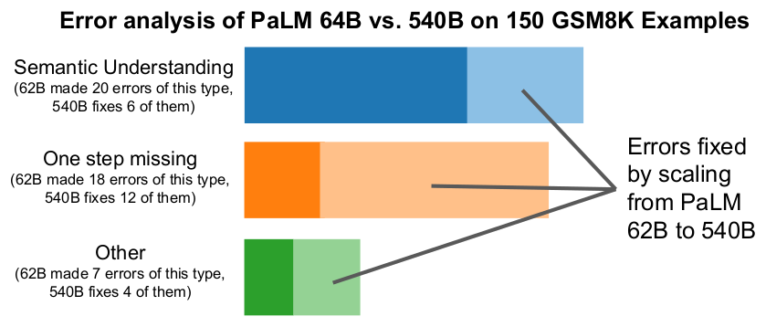

*图 9（原文 Figure 9，第 21 页）：150 道随机 GSM8K 题中 62B 出错的 45 道，按错误类型统计 540B 修好的比例。*

**图中文字翻译与读法**：图的标题写作 “Error analysis of PaLM 64B vs. 540B on 150 GSM8K Examples”（原图把 62B 写成了 64B）。三根横条：Semantic Understanding（语义理解错误）：62B 犯 20 个，540B 修好其中 6 个；One step missing（缺一步推理）：62B 犯 18 个，540B 修好 12 个；Other（其他：幻觉、重复输出、符号映射错误等）：62B 犯 7 个，540B 修好 4 个。每根条里深色是仍然错的，浅色是被规模修好的部分（“Errors fixed by scaling from PaLM 62B to 540B”）。读图结论：从 62B 放大到 540B，45 个错误中有 22 个（约 49%）被修好；其中“缺一步推理”类修好 12/18（67%），“语义理解”类修好 6/20（30%）。（22/45 与百分比为本文由原图数字算出。）

附录 G.1 给了两个对照例子（原文图 28、图 29，题目和答案都已译成中文）：

- **语义理解错误**：“Tracy 用一根 4 英尺长的铁丝给花园里的番茄苗做支撑。铁丝被剪成每段 6 英寸的小段。她得到了几段？”62B：“她把铁丝剪成 6 英寸一段。这意味着她得到 $4\times6=24$ 段。答案是 24。”（错，没有做英尺到英寸的单位换算）。540B：“铁丝长 4 英尺，即 $4\times12=48$ 英寸。剪成每段 6 英寸。所以她得到 $48/6=8$ 段。答案是 8。”（对）。
- **缺一步推理**：“Stephen 在网上订了杂货，账单总额 40 美元。因为通过配送商，配送商在最终总额上加收 25% 的费用，并收 3 美元配送费。Stephen 还另外加了 4 美元小费。加上这些额外费用后，Stephen 杂货的最终价格是多少？”62B：把总额乘以 125% 得 50，再加 3 美元配送费，得 53（错，漏掉了小费）。540B：25% 的费用是 $0.25\times40=10$，所以总额为 $40+10+3+4=57$ 美元（对）。

#### 7.3.2 七个推理数据集（图 10）

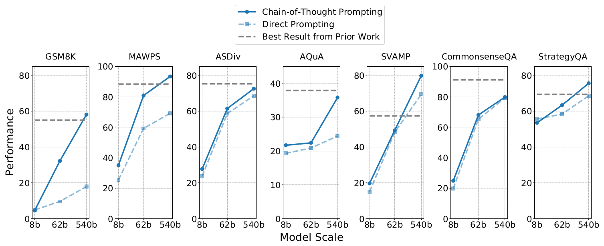

*图 10（原文 Figure 10，第 22 页）：通过思维链提示，PaLM 在一系列算术和常识推理任务上取得强劲表现，在 GSM8K、MAWPS、SVAMP 和 StrategyQA 上创造了新的最佳成绩。*

**图中文字翻译与读法**：

- 每个小图是一个数据集（GSM8K、MAWPS、ASDiv、AQuA、SVAMP、CommonsenseQA、StrategyQA）；横轴 Model Scale（8b、62b、540b），纵轴 Performance（准确率，%）。图例：Chain-of-Thought Prompting（思维链提示，蓝色实线）、Direct Prompting（直接提示，浅蓝色虚线）、Best Result from Prior Work（先前最佳，灰色虚线）。
- **读图结论**：（1）几乎所有数据集上，思维链都优于直接提示，且差距随规模变大（GSM8K 上 540B 直接提示约 18%，思维链约 58%）；（2）540B + 思维链在 GSM8K、MAWPS、SVAMP、StrategyQA 上超过先前最佳（约 58 对 55，约 93 对 88，约 80 对 57，约 76 对 70），在 ASDiv（约 73 对 75）、AQuA（约 36 对 38）上接近但未超过，在 CommonsenseQA 上约 80 对 91，差距较大（原文把这三项统称为“接近 SOTA”；数值均为从图上读出的近似值）；（3）正文指出，**如果既不用思维链、也不放大到 540B，PaLM 只会在 SVAMP 一个任务上达到先前最佳**——两个因素缺一不可。
- 先前最佳通常使用领域专用结构和任务专用微调。原文还说明：GSM8K 数据集自带中间推理步骤，其他基准没有，因此为完整起见，特别报告了 GSM8K 的直接提示结果（图中各数据集都画了直接提示曲线）。

### 7.4 代码任务（原文 6.4 节）

PaLM 的预训练语料里有 39B 代码 token，作者想看：同一个模型在自然语言之外，能不能也做好代码任务；再看只在代码上继续微调（得到 **PaLM-Coder**）会提高多少。

**任务**：

1. **文本到代码**（text-to-code）：
   - HumanEval、MBPP：给出几句英文描述和少量输入输出示例，要求写一个短的 Python 程序（通常是一个函数）；
   - **GSM8K-Python**（本文新引入）：由 GSM8K 数学应用题改写，不是输出答案，而是写一个返回正确解的 Python 程序；作者手工把数据集中 4 道题转成 Python 程序当作 few-shot 示例。
2. **代码到代码**（code-to-code）：
   - **TransCoder**：把 C++ 程序翻译成 Python。作者从 GitHub 下载数据，收集同时出现在 Python 和 C++ 子目录里的函数，挑 3 类函数当 few-shot 提示，其余构成含 560 个样本的测试集；
   - **DeepFix**：修复学生写的、编译不过的 C 程序。目标是修改程序使其能编译通过；沿用先前工作的做法，把编译器报错作为注释注入到有问题的代码里，在 1260 个程序上测试。

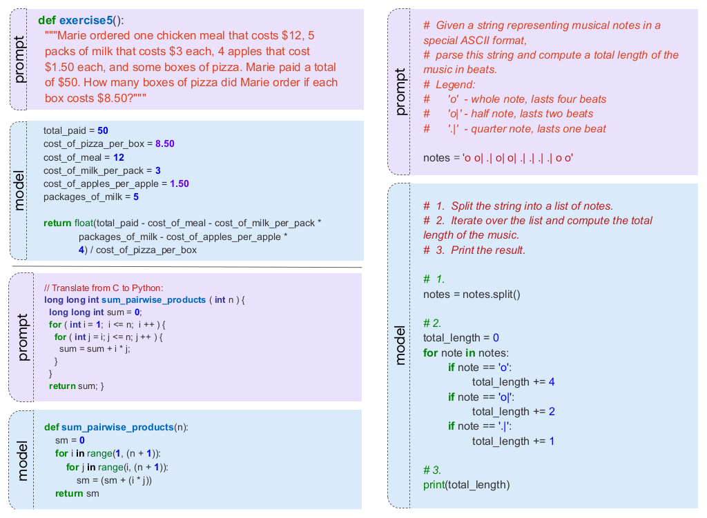

*图 11（原文 Figure 11，第 23 页）：PaLM-Coder 540B 的示例。*

**图中文字翻译与读法**：每个紫色的 prompt 框是给模型的提示，蓝色的 model 框是模型生成的内容。

- **左上（GSM8K-Python）**：提示是一个空函数 `exercise5()` 加一段题目：“Marie 订了一份 12 美元的鸡肉餐、5 包每包 3 美元的牛奶、4 个每个 1.50 美元的苹果，还有若干盒披萨。Marie 一共付了 50 美元。如果每盒披萨 8.50 美元，Marie 订了几盒披萨？”模型把条件写成变量，最后返回 $(50-12-3\times5-1.5\times4)/8.5$。
- **左下（TransCoder）**：提示是一段 C++ 函数 `sum_pairwise_products(int n)`（双重循环累加 $i\times j$，$j\ge i$），加一行注释 “Translate from C to Python”（从 C 翻译为 Python）；模型输出对应的 Python 函数。
- **右（HumanEval 改写题）**：提示是注释形式的任务说明：“给定一个用特殊 ASCII 格式表示音符的字符串，解析它并计算音乐的总拍数。图例：`o` 是全音符，持续四拍；`o|` 是二分音符，持续两拍；`.|` 是四分音符，持续一拍。”并给出 `notes = 'o o| .| o| o| .| .| .| .| o o'`；模型先写出“1. 把字符串切成音符列表；2. 遍历列表累加总长度；3. 打印结果”的步骤注释，再逐步写出代码。
- **读图结论**：这三个例子分别对应“自然语言到代码”“代码到代码”和“带分步注释的 HumanEval 式题目”。

**指标**：采用 pass@$k$：每道题从模型采样 $k$ 个程序，只要有一个通过就算这道题解决。论文不用 Chen et al. (2021) 的无偏估计器，而是直接统计这个比例。pass@1 用贪心解码；$k>1$ 时用 nucleus 采样，$p=0.95$，温度 0.8。MBPP 和 GSM8K 用各自的测试集。

**对比模型**：LaMDA 137B（没在 GitHub 代码上训练，但预训练混合里约 12.5% 来自与代码相关的网站，如问答站和教程，论文称为“代码网页文档”）；Codex 12B（Chen et al. 2021，只报告了 HumanEval）；Davinci Codex（`code-davinci-001`，作者在 2021 年 9 月 1 日至 2022 年 3 月 10 日间通过 OpenAI API 自己测量；其规模、是否集成、训练数据量、后处理、与评测集的污染程度都未公开，因此无法解释差异的原因，但对理解任务本身的难度仍有用）。

**表：各模型训练过程中处理的代码 token 数。**

| 模型 | 总代码 token | 其中 Python | 代码网页文档 |
|---|---:|---:|---:|
| LaMDA 137B | – | – | 18B |
| Codex 12B | 100B | 100B | – |
| PaLM 540B | 39B | 2.7B | – |
| PaLM-Coder 540B | 46.8B | 8.7B | – |

（原文表 11，第 24 页。PaLM-Coder 一行是预训练与微调数据之和；Davinci Codex 的数据混合未知；破折号表示不含此类数据，Codex、PaLM、PaLM-Coder 的网络语料里可能含少量代码网页文档。）

作者另外收集了 **ExtraPythonData**：5.8B token，取自预训练没有用过的 GitHub 仓库。PaLM-Coder 的微调分两阶段：（a）先在混合数据上微调 6.5B token，其中 60% 是 ExtraPythonData 的 Python 代码，30% 是多语言代码（与预训练代码同源，但没有被预训练用过），10% 是自然语言；（b）再在更多 ExtraPythonData 上微调 1.9B token。两个阶段合计微调数据 7.75B token，其中 5.9B 是 Python。（本文核对：6.5B 加 1.9B 并不等于 7.75B，原文没有解释，可能是重复遍历与唯一 token 的计数口径差异，这里照录原文数字。）

**表：PaLM 与 PaLM-Coder 在代码合成与软件工程任务上的结果。括号里是 few-shot 示例数；粗体为原文标出的每行最佳值（pass@$k$ 的 $k$ 在第二列）。**

| 任务（shot 数） | 指标 | LaMDA 137B | PaLM 540B | Codex 12B | Davinci Codex | PaLM-Coder 540B | 其他工作 |
|---|---|---:|---:|---:|---:|---:|---:|
| HumanEval（0） | pass@100 | 47.3 | 76.2 | 72.3a | 81.7 | **88.4** | – |
| MBPP（3） | pass@80 | 62.4b | 75.0 | – | **84.4** | 80.8 | – |
| TransCoder（3） | pass@25 | – | 79.8 | – | 71.7 | **82.5** | 67.2c |
| HumanEval（0） | pass@1 | 14.0 | 26.2 | 28.8 | **36.0** | **36.0** | – |
| MBPP（3） | pass@1 | 14.8b | 36.8 | – | **50.4** | 47.0 | – |
| GSM8K-Python（4） | pass@1 | 7.6 | **51.3** | – | 32.1 | 50.9 | – |
| TransCoder（3） | pass@1 | 30.2 | 51.8 | – | 54.4 | **55.1** | 44.5c |
| DeepFix（2） | pass@1 | 4.3 | 73.7 | – | 81.1 | **82.1** | 71.7d |

（原文表 12，第 25 页。上标来源：a Chen et al. (2021)；b Austin et al. (2021)；c Lachaux et al. (2020)；d Yasunaga & Liang (2021)。Davinci Codex 的结果是作者用 OpenAI Codex API 与 Chen et al. 推荐设置自己测得的。前三列 LaMDA、PaLM、Codex 12B 为“仅预训练”，后两列 Davinci Codex、PaLM-Coder 为“代码微调”。DeepFix 一行报告的是编译通过率。）

**读法**：

- **PaLM 540B 不是代码专用模型，却在 HumanEval 上与 Codex 12B 相当**（pass@1 26.2 对 28.8，pass@100 76.2 对 72.3）。LaMDA 虽没有 GitHub 代码，也在所有任务上非零（代码网页文档有用）；GPT-3 在 HumanEval 上则是 0（Chen et al. 的报告）。PaLM 在所有任务上都优于 LaMDA。
- 约 7% 的 PaLM 代码语料是 Python，约 2.7B token，相比 Codex 的 100B Python token 少约 **50 倍**，却取得可比的 few-shot 结果。原文给出两种解释：（a）从其他编程语言和自然语言数据迁移；（b）这是 Kaplan et al. (2020) 所说“更大的模型样本效率更高”的一个突出实例。这是论文的解释，没有做专门的消融验证。
- **PaLM-Coder 540B** 比不微调的 PaLM 540B 在 HumanEval pass@100 上高 12 个点（88.4 对 76.2），在 MBPP pass@80 上高 5.8 个点（80.8 对 75.0；原文取整写作“约 5”）。GSM8K-Python 在 8-shot 提示下，PaLM-Coder 540B 的 pass@1 为 57.5，PaLM 540B 为 58.1（图 10 同一数据）。
- 每个规模的提升都带来所有数据集上的提升，在 540B 处也**看不出饱和**。

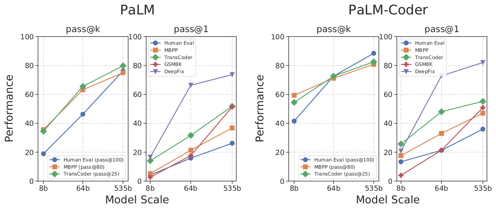

*图 12（原文 Figure 12，第 25 页）：HumanEval、MBPP、GSM8K-Python、TransCoder、DeepFix 在 PaLM 与 PaLM-Coder 的 8B、62B、540B 上的结果。DeepFix 报告的是编译通过率。*

**图中文字翻译与读法**：左半是 PaLM，右半是 PaLM-Coder；每半又分左小图 pass@k 和右小图 pass@1。横轴 Model Scale（原图刻度写作 8b、64b、535b，实为 8B、62B、540B 三个规模），纵轴 Performance（%）。pass@k 小图画 Human Eval（pass@100）、MBPP（pass@80）、TransCoder（pass@25）；pass@1 小图画 Human Eval、MBPP、TransCoder、GSM8K、DeepFix 五条线。读图结论：各条线随规模整体上升；DeepFix 的编译通过率在 62B 就已很高（PaLM 约 66%，PaLM-Coder 约 73%），到 540B 继续上升；GSM8K 在 8B 到 62B 上升缓慢（约 3% 到 18%），到 540B 约 51%，涨幅明显更大。（以上读数是从图上读出的近似值。）

**DeepFix 代码修复**：PaLM-Coder 540B 的编译通过率为 82.1%，先前工作为 71.7%。提示只用手写的两对“错误程序/修复后程序”，没有反复调提示；先把错误程序过一遍代码格式化器，再让模型输出完整的修复后程序。修复时需要尽量少改，所以论文用多种“小编辑”定义来拆分成功率：

**表：DeepFix 成功率（%）。“成功”指预测代码能编译且改动是小编辑；括号里是属于小编辑的预测占比。归一化编辑距离 = Levenshtein 距离 / max(两个字符串长度)；“改动行数”统计插入、删除、修改的总行数；两者都忽略缩进变化。**

| 指标 | LaMDA 137B | PaLM 540B | Davinci Codex | PaLM-Coder 540B |
|---|---:|---:|---:|---:|
| 编译通过率（任意编辑大小） | 4.3 | 73.7 | 81.1 | 82.1 |
| 归一化编辑距离 ≤ 0.10 | 1.7（1.9） | 68.0（93.1） | 70.5（86.7） | 71.7（87.5） |
| 归一化编辑距离 ≤ 0.15 | 2.1（2.7） | 71.0（96.5） | 74.7（91.7） | 77.0（94.0） |
| 归一化编辑距离 ≤ 0.20 | 2.5（3.4） | 72.4（98.1） | 77.1（94.7） | 79.4（96.7） |
| 改动行数 ≤ 5 | 1.7（2.1） | 63.8（87.8） | 67.9（83.3） | 66.8（81.1） |
| 改动行数 ≤ 6 | 2.1（3.1） | 66.6（91.4） | 71.5（87.9） | 70.1（85.5） |
| 改动行数 ≤ 7 | 2.5（4.1） | 68.4（93.7） | 73.9（90.9） | 72.9（88.7） |

（原文表 13，第 27 页。）读法：PaLM（未微调）的修改最小（括号里的小编辑占比最高）；PaLM-Coder 在“编辑距离小”的口径下成功率最高，Davinci Codex 在“改动行数少”的口径下最高，也就是说 PaLM-Coder 倾向于“改动更少的字符，但分散在更多行上”，例如把 `i = i + 1` 改成 `i++`，把 `int a;` 和 `int b;` 合并成 `int a, b;`；Codex 则更常大幅改写某几行。作者还做了一个小实验：把两个提示示例中一处“同一行声明两个变量”拆成两行，意在抑制 PaLM-Coder 合并变量声明，结果表中所有指标都改善，“改动行数”口径的提升更大（总体编译通过率 82.1% 升到 83.4%，改动不超过 5 行的成功率从 66.8% 升到 70.2%），作者定性地观察到它确实明显更少合并变量声明。作者强调这只是个案，但说明对提示示例的小改动能带来符合预期的预测变化。原文图 13、图 14 是两个 DeepFix 修复实例（修复了未声明变量、缺少花括号导致的作用域错误，并顺带做了风格与逻辑改进），本文未收入。

**风险讨论（原文 6.4 末尾）**：用语言模型辅助写代码的主要风险是生成代码可能错误或引入隐蔽 bug；训练数据投毒攻击已被发现，并且当提示里有 bug 时模型更可能生成有 bug 的代码。已有的缓解办法都不完美：开发者应审查建议代码，但可能发现不了细微 bug；用测试套件确认，但少量测试用例并不能保证功能正确——论文自己的基准也只用少量测试，可能高估能力。功能正确性只是代码质量的一个方面，还有可读性、鲁棒性、速度和安全。例如 DeepFix 中“修复后”的程序能编译，但依赖于对输入格式和大小的假设（来自课程习题，允许这类假设），在更一般的场景下并不理想。

### 7.5 翻译（原文 6.5 节）

PaLM 没有在平行语料上专门训练（只是语料里自然存在一些平行文本）。论文只用有 WMT 开发集/测试集的语言对，分三类：

- **以英语为中心的语言对**：高资源（>1000 万样本）WMT'14 英–法；中资源（100 万–1000 万）WMT'16 英–德；低资源（<100 万）WMT'16 英–罗马尼亚语；
- **直接语言对**（不经英语）：WMT'19 法–德；
- **极低资源语言对**：WMT'19 英–哈萨克语。训练语料里法语、德语分别约有 240 亿和 260 亿 token，而哈萨克语只有约 1.34 亿 token。

**表：传统 WMT 语言对的翻译 BLEU（越大越好）。0-shot 提示包含源语言和目标语言的名称；1-shot 和 few-shot 不含（语言要靠示例推断），这可能解释某些语言对上 0-shot 的强劲表现。PaLM 的 few-shot 为 5-shot。**

| 源语 | 目标语 | 0-shot 先前 SOTA | 0-shot PaLM 540B | 1-shot 先前 SOTA | 1-shot PaLM 540B | few-shot 先前 SOTA（shot 数） | few-shot PaLM 540B | 有监督微调 SOTA |
|---|---|---:|---:|---:|---:|---:|---:|---:|
| en | fr | 32.9a | **38.5** | 28.3b | **37.5** | 33.9a（9） | **44.0** | 45.6c |
| en | de | 25.4a | **31.8** | 26.2b | **31.8** | 26.8a（11） | **37.4** | 41.2d |
| en | ro | 16.7a | **24.2** | 20.6b | **28.2** | 20.5a（9） | **28.7** | 33.4e |
| fr | en | 35.5a | **41.1** | 33.7b | **37.4** | 38.0a（9） | **42.8** | 45.4f |
| de | en | 38.9a | **43.8** | 30.4b | **43.9** | 40.6a（11） | **47.5** | 41.2g |
| ro | en | 36.8a | **39.9** | 38.6b | **42.1** | 37.3a（9） | **43.8** | 39.1h |

（原文表 14，第 28 页。上标来源：a FLAN（Wei et al., 2022a）；b GPT-3 175B；c Edunov et al. (2018)；d Wang et al. (2019b)；e Caswell et al. (2019)；f Lin et al. (2020)；g Wang et al. (2019b)；h Song et al. (2019)。粗体为原文标出的零/少样本最佳；原文还用下划线标出每行总体最佳：en→fr、en→de、en→ro、fr→en 是有监督 SOTA，de→en（47.5）与 ro→en（43.8）是 PaLM 的 5-shot。）

读法：PaLM 在每个语言对的 0-shot、1-shot、few-shot 上都超过其他大模型（FLAN、GPT-3），有时差距很大（最高达 13 BLEU）。对 de→en 和 ro→en，PaLM 的 few-shot 甚至超过专门的有监督系统；原文也承认这些有监督基线可能已经过时，因为 WMT 近年的任务重点变了。

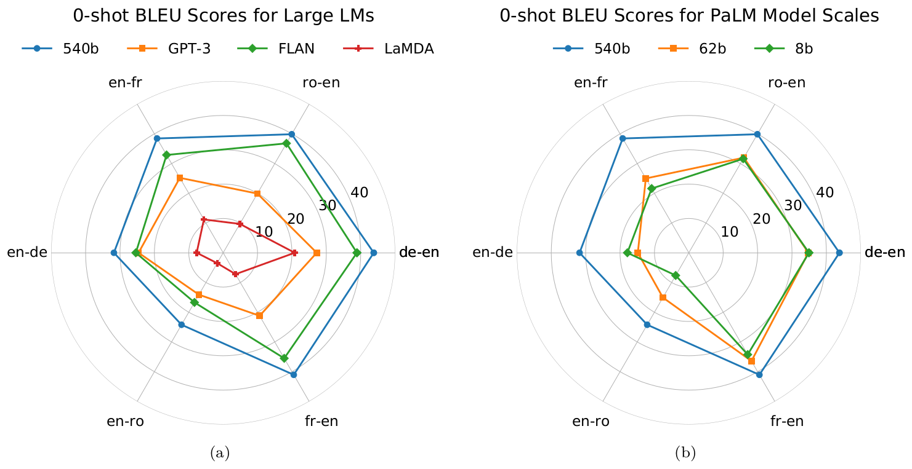

*图 15（原文 Figure 15，第 29 页）：PaLM 在 0-shot 翻译任务上的比较。(a) 与其他大模型对比；(b) 不同 PaLM 规模对比。*

**图中文字翻译与读法**：两张雷达图，六个轴是六个翻译方向（en-fr、ro-en、de-en、fr-en、en-ro、en-de），径向刻度是 BLEU（标注 10、20、30、40）。

- **(a) 0-shot BLEU Scores for Large LMs（大模型 0-shot BLEU）**：图例 540b（PaLM 540B，蓝）、GPT-3（橙）、FLAN（绿）、LaMDA（红）。PaLM 540B 在所有方向都在最外圈，其次是 FLAN，再次是 GPT-3，LaMDA 最小。
- **(b) 0-shot BLEU Scores for PaLM Model Scales（PaLM 各规模 0-shot BLEU）**：540b（蓝）、62b（橙）、8b（绿）。540B 明显最大，而 62B 和 8B 的形状很接近，在个别方向上 62B 甚至不如 8B。
- **读图结论**：翻译成英语（ro-en、de-en、fr-en）的 BLEU 普遍高于从英语翻出（en-fr、en-de、en-ro）；从 62B 到 540B 在多个方向上出现远超“从 8B 到 62B 外推”的大幅跳升。

对跳升的具体数字，原文正文写“英–德提升 13 BLEU，英–法提升 17 BLEU”。核对备注：附录表 19 里 0-shot 的 62B → 540B 是英–德 15.0 → 31.8（+16.8）、英–法 25.5 → 38.2（+12.7），与正文的 13 与 17 恰好相反，疑似正文把两者写反了；这里以表中数字为准，结论（出现远超外推的跳升）不变。

**表：非英语中心及极低资源语言对的翻译 BLEU（越大越好）。**

| 源语 | 目标语 | 0-shot PaLM 540B | 1-shot PaLM 540B | few-shot PaLM 540B | 有监督微调 SOTA |
|---|---|---:|---:|---:|---:|
| en | kk | 1.8 | 4.2 | 5.1 | **15.5**a |
| de | fr | 28.6 | 20.9 | 25.7 | **31.5**b |
| kk | en | 18.0 | 20.3 | 20.8 | **30.5**c |
| fr | de | **25.2** | 9.5 | 17.4 | 24.9b |

（原文表 15，第 29 页。上标来源：a Toral et al. (2019)；b Xia et al. (2019)；c Li et al. (2019)。同样，0-shot 提示含语言名称，1-shot 和 few-shot 不含。这里的“先前最佳”是 WMT'19 各语言对得分最高的提交，用了回译、集成、辅助模型重打分等多种技巧。）

读法：在这类更难的设置下，PaLM 只在法–德上与有监督系统持平（0-shot 25.2 对 24.9），在德–法和哈萨克语–英语上表现不错，而英–哈萨克语（语料极少）仅 1.8–5.1 BLEU，与有监督 15.5 差距很大。注意 fr→de 的 0-shot（25.2）远高于 1-shot（9.5）。

**原文总结的三点发现**：

1. **翻译成英语比从英语翻出更好**：这是所有以英语为主的语言模型的共同规律，PaLM 也一样；作者推测提高多语言数据比例可缓解。
2. **提示可以比一个示例更有价值**：多数情况下，用语言名称触发翻译（0-shot）比只给输入输出示例（1-shot、few-shot）表现更强，这与先前工作一致。
3. **只靠自监督的通用模型，在较小规模上可以媲美专用模型**：论文中多数专用翻译基线小于 10 亿参数，比最大的 PaLM 小两个数量级。另一方面，大型翻译模型也可以适应多种下游任务，这引出一个问题：在资源丰富的场景（如多语言翻译）里，应该训练专才还是通才？

### 7.6 多语言自然语言生成（原文 6.6 节）

作者称这是大模型在条件式自然语言生成上的首个 few-shot 基准（核对备注：引言说 540B 在非英语摘要上“弥合了与微调 SOTA 的差距”，对照表 16，微调后的 PaLM 540B 在 MLSum 上仍低于先前 SOTA，de 为 33.1 对 36.4，es 为 12.0 对 13.8，1-shot 的差距更大，如 de 为 12.8 对 36.4，所以这句话应理解为“明显缩小”而不是“弥合”）：此前 GPT-3、GLaM、Gopher、LaMDA、Megatron–Turing NLG 都没有报告英语或多语言条件生成任务的 few-shot 或微调结果；作者自己运行了 LaMDA 137B 作为对照。微调基线的先前最佳来自 T5、mT5、BART 这类用填空目标预训练的 encoder-decoder 模型，规模在 1.3 亿到 130 亿参数之间。

**数据**（GEM 基准）：3 个摘要任务和 3 个数据到文本任务，覆盖捷克语（cs）、英语（en）、德语（de）、俄语（ru）、西班牙语（es）、土耳其语（tr）、越南语（vi）：

- **MLSum**：用多句话概括一篇新闻文章 [de/es]；
- **WikiLingua**：把 WikiHow 的分步说明概括成很简洁的句子 [en/es/ru/tr/vi → en]；
- **XSum**：用一句话概括新闻 [en]；
- **Clean E2E NLG**：给定一组键值属性，用一两句话描述一家餐馆 [en]；
- **Czech Restaurant**：给定对话上下文和对话行为表示，生成智能助手的回复 [cs]；
- **WebNLG 2020**：把主–谓–宾三元组用一句或多句语法通顺、自然的话说出来 [en/ru]。

为缩短推理时间，凡是多句生成任务的测试集超过 5000 条（MLSum de/es，WikiLingua en/ru/es），就均匀抽样 5000 条，所以数值可能与公布的全量测试集结果略有不同。**指标**按 Gehrmann et al. (2022) 的建议报告 ROUGE-2、ROUGE-L 与 BLEURT-20；正文只讨论 ROUGE-2 的 F 值，其余（含精确率、召回率）在附录 H.3。

**few-shot 方法**：把任务相关的提示（摘要为 “Summarize the following article:”，数据到文本为 “Verbalize:”，并翻译成相应语言）拼在输入前，在输出前加输出提示；摘要的长输入截断到 2048 token；few-shot 示例之间用双换行分隔，双换行也用来截断输出预测；所有示例从训练集随机抽取。**微调方法**：输入和目标拼接，只对目标部分算损失；序列截断到 2048 token（预训练的上下文长度），其中为目标预留 512 token，只有摘要任务需要截断输入；用恒定学习率 $5\times10^{-5}$（比预训练小 20 倍），重置 Adafactor 的累积量；每个数据集按验证集上 ROUGE-1、ROUGE-2、ROUGE-L 的几何平均挑选最佳 checkpoint；推理用 top-$k$ 采样，$k=10$。T5 XXL 基线用同样的参数微调，用 beam search（beam=4）解码。

**表：GEM 数据到文本与摘要任务的 ROUGE-2（F 值，越大越好）。左：1-shot；右：微调（含先前 SOTA 与 T5 XXL 基线）。粗体为原文标出的各块最佳。**

| 任务 | 1-shot LaMDA 137B | 1-shot PaLM 8B | 1-shot PaLM 62B | 1-shot PaLM 540B | 微调 先前 SOTA | 微调 T5 XXL | 微调 PaLM 8B | 微调 PaLM 62B | 微调 PaLM 540B |
|---|---:|---:|---:|---:|---:|---:|---:|---:|---:|
| Czech Restaurant (cs) | 6.6 | 8.2 | 12.2 | **16.1** | 30.2a | 28.8 | 30.2 | 30.3 | **30.6** |
| E2E (en) | 29.2 | 27.7 | 33.5 | **35.2** | **45.8**b | 45.3 | 45.7 | 45.2 | 45.3 |
| WebNLG (en) | 30.5 | 29.1 | 38.6 | **44.4** | **53.5**c | 39.6 | 47.6 | 48.6 | 49.3 |
| WebNLG (ru) | 5.4 | 4.5 | 8.5 | **14.9** | **25.5**b | 23.2 | 22.4 | 23.3 | 23.4 |
| MLSum (de) | 0.9 | 4.6 | 10.5 | **12.8** | **36.4**d | 35.9 | 26.5 | 30.0 | 33.1 |
| MLSum (es) | 0.5 | 2.3 | 3.2 | **3.6** | **13.8**b | 12.0 | 10.6 | 11.2 | 12.0 |
| WikiLingua (en → en) | 5.4 | 5.6 | 8.9 | **9.9** | – | **23.8** | 19.3 | 22.1 | 23.2 |
| WikiLingua (es → en) | 2.2 | 3.4 | 5.8 | **7.7** | 18.3d | 17.9 | 16.1 | 18.2 | **20.9** |
| WikiLingua (ru → en) | 0.1 | 2.3 | 5.2 | **6.6** | 14.6b | 12.5 | 13.9 | 16.6 | **18.6** |
| WikiLingua (tr → en) | 1.8 | 1.8 | 5.6 | **8.5** | 18.3b | 13.8 | 16.7 | 21.4 | **23.1** |
| WikiLingua (vi → en) | 0.3 | 1.5 | 4.0 | **5.5** | 14.9b | 9.7 | 13.4 | 16.3 | **19.1** |
| XSum (en) | 5.4 | 7.9 | 11.2 | **12.2** | **23.2**e | 21.0 | 16.3 | 18.5 | 21.2 |

（原文表 16，第 32 页。先前 SOTA 的来源：a Dušek & Jurčíček (2019)；b Xue et al. (2021b)；c Bakshi et al. (2021)；d Gehrmann et al. (2021)；e Zhang et al. (2020)。“–”表示没有先前结果。）

**读法**（原文四点）：

- **微调的有效性**：在摘要上，540B 微调后在所有英语生成任务上接近或超过此前最佳，说明 PaLM 能用规模弥补结构上的劣势；62B 常常接近先前最佳，540B 则超过。作者同时承认，在有大量任务数据时，微调 decoder-only 大模型未必是计算上最优的做法，但认为它可作为 few-shot 预测的重要上限。
- **英语与非英语生成质量**：6 个以英语为输出的摘要任务里，PaLM 微调在 4 个取得了新的最佳（WikiLingua 的 es/ru/tr/vi → en，即使输入是非英语）；但非英语摘要（MLSum）微调没有达到 SOTA，且 few-shot 与微调的相对差距在非英语生成上更大。这说明 PaLM **处理非英语输入强于生成非英语输出**，作者认为可以通过预训练时提高非英语占比（目前 22%）来改善。
- **1-shot 与微调的差距**：数据到文本任务上 few-shot 与最佳微调的差距缩小得多。作为对照，FLAN（可看作 few-shot 与微调的混合）经指令微调后在 E2E-NLG 12-shot 得到 ROUGE-2 33.2、WebNLG(en) 10-shot 得到 48.0；PaLM 1-shot、不经任何微调就得到 35.2 和 44.4。作者提醒，数据到文本任务数据量小，且与预训练语料差别大，作为微调基准的价值有限。
- **few-shot 摘要**：从 8B 到 62B 提升很大，从 62B 到 540B 提升较小但仍显著；few-shot 与微调的差距依然可观，1-shot 的成绩大致相当于微调后的较小模型（非英语任务相当于 T5-base 或 T5-large，英语任务相当于 T5-small）。作者认为这是大语言模型 few-shot 摘要的首次展示，是缩小与微调模型差距的一个起点。

### 7.7 多语言问答：TyDiQA-GoldP（原文 6.7 节）

TyDiQA-GoldP 是涵盖多种语言的问答基准。few-shot 时提供上下文、问题和答案，彼此用换行分隔，所有语言都用 “Q:” 和 “A:” 表示问题和答案；微调用与英语 SuperGLUE 微调相同的超参数（学习率 $5\times10^{-5}$，重置 Adafactor 累积量，batch size 32），报告最佳的整体 checkpoint。

**表：TyDiQA-GoldP 验证集上的精确匹配（EM，越大越好）。few-shot 括号里是示例数。**

| 模型 | Ar | Bn | En | Fi | Id | Ko | Ru | Sw | Te | 平均 |
|---|---:|---:|---:|---:|---:|---:|---:|---:|---:|---:|
| mT5 XXL | 76.9 | 80.5 | 75.5 | 76.3 | 81.8 | 75.7 | 76.8 | 84.4 | 83.9 | 79.1 |
| ByT5 XXL | 80.0 | 85.0 | 77.7 | 78.8 | 85.7 | 78.3 | 78.2 | 84.0 | 85.5 | 81.4 |
| PaLM 540B（微调） | 75.0 | 83.2 | 75.5 | 78.9 | 84.1 | 75.7 | 77.1 | 85.2 | 84.9 | 80.0 |
| PaLM 540B（few-shot） | 56.4（5） | 54.0（1） | 65.5（10） | 66.4（5） | 69.2（5） | 63.8（5） | 46.8（5） | 75.6（10） | 46.9（1） | 60.5 |

（原文表 17，第 33 页。）读法：few-shot 与微调的平均差距很大（60.5 对 80.0），但在斯瓦希里语（75.6 对 85.2）和芬兰语（66.4 对 78.9）上差距较小。PaLM 540B 微调后超过 mT5 XXL、低于 ByT5 XXL，尽管 PaLM 的非英语训练数据只有约 22%（mT5、ByT5 的非英语文本分别是 PaLM 的 6 倍和 1.5 倍）。作者推测，和 SuperGLUE 上一样，因果语言模型损失和 decoder-only 结构可能不利于判别式微调，且提高非英语数据占比也可能改善微调结果。

### 7.8 few-shot 分析：示例个数与 checkpoint 方差（原文 6.8 节）

**示例个数与规模（图 16）**：在 5 个任务（RTE、Natural Questions、Lambada、Story Cloze、Trivia QA）上，对 8B/62B/540B 评测 0、1、5、8-shot，看性能随示例数怎么变。这组任务从偏知识型（NQ、TriviaQA，闭卷）到偏推理型（RTE、Lambada、StoryCloze）。

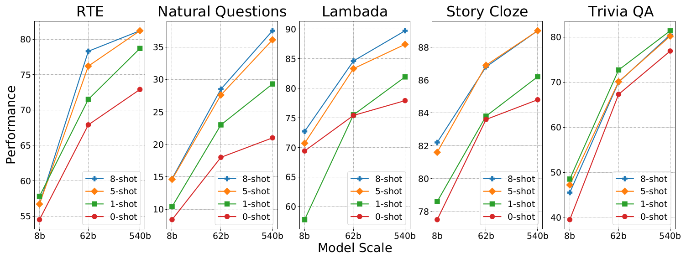

*图 16（原文 Figure 16，第 34 页）：5 个任务、3 个模型规模（8B、62B、540B）上的 few-shot 表现。*

**图中文字翻译与读法**：每个小图一个任务（RTE、Natural Questions、Lambada、Story Cloze、Trivia QA），横轴 Model Scale（8b、62b、540b），纵轴 Performance；四条线是 0-shot（红）、1-shot（绿）、5-shot（橙）、8-shot（蓝）。读图结论：（1）多数任务上性能随示例数增加而单调提升，8-shot 与 5-shot 最好，0-shot 最差；（2）**Trivia QA 例外**：三个规模上 1-shot 都优于 5-shot 和 8-shot（正文说明）；（3）所有任务上性能随模型规模提升，540B 最好。

**checkpoint 间方差（图 17）**：为了知道 few-shot 成绩的波动有多大，作者取预训练后期 15 个均匀间隔的 checkpoint（原文称相邻 checkpoint 只差 2B 训练 token，因此模型质量不应受影响；从图的横轴看点间隔约 1B，与文字说法略有出入，这里引用原文说法），分别做 1-shot 评测。

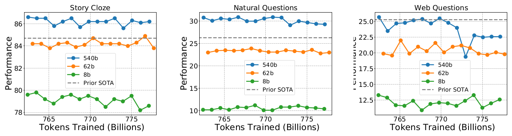

*图 17（原文 Figure 17，第 34 页）：预训练后期各 checkpoint 上的 1-shot 方差分析。checkpoint 相隔 2B token，终止于最终 checkpoint。*

**图中文字翻译与读法**：三个小图分别是 Story Cloze、Natural Questions、Web Questions；横轴 Tokens Trained (Billions)（已训练的 token 数，约 762 到 777 十亿之间），纵轴 Performance；蓝线 540b、橙线 62b、绿线 8b，灰色虚线 Prior SOTA（先前最佳）。读图结论：Story Cloze 和 Natural Questions 的 checkpoint 间波动较小，远小于不同规模之间的差距；**Web Questions 波动明显更大**：540B 在约 770B token 附近的 checkpoint 上达到 SOTA（约 25），之后的 checkpoint 反而变差（约 19–23）。原文强调其他各节的结果都取**最终** checkpoint（8B 和 540B 是 780B token，62B 是 795B token，62B 的这个数字“是因为选 checkpoint 时的疏忽”），即使最终 checkpoint 的结果比更早的差。（以上读数是图上的近似值。）

读法：这提醒我们，**单个小基准上几个点的差距可能只是 checkpoint 选择带来的波动**。例如 Web Questions 上，最终 checkpoint 的 1-shot 成绩 22.6（表 4）低于先前最佳 25.3，而 770B token 附近的 checkpoint 曾达到 SOTA（原文正文）。

## 八、训练数据的记忆（原文第 7 节）

神经网络会记住训练数据；通常是在小数据集上多遍训练时发生。PaLM 只对 780B token 的语料训练一遍，但模型容量极大，而且网络语料里有近重复文本（有些段落带细微差别地出现多次），所以单遍训练也可能记住相当一部分。

**测量方法**（沿用 Carlini et al. 2022，他们的提示长度从 50 到 500 个 token 不等）：随机抽取长度为 100 token 的训练片段，用前 50 个 token 作提示，贪心解码，统计模型生成的 50 token 续写与训练样本**逐字完全一致**的比例。同时用与训练集同分布、但没有逐字出现在训练中的**留出数据**作对照。

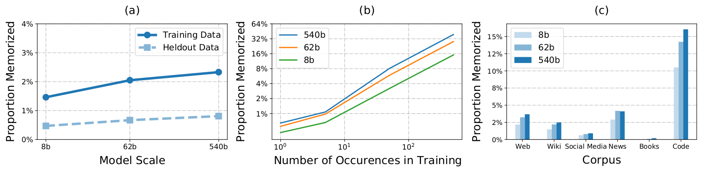

*图 18（原文 Figure 18，第 35 页）：(a) 三个规模上被记住的训练样本比例；(b) 按样本在训练中出现次数分组的记忆率；(c) 按语料来源分组的记忆率。*

**图中文字翻译与读法**：

- **(a)**：横轴 Model Scale（8b、62b、540b），纵轴 Proportion Memorized（被记住的比例）；实线 Training Data（训练数据），虚线 Heldout Data（留出数据）。原文正文：8B 约 1.6%，540B 约 2.4%（图上读数略有出入，约 1.5% 与 2.3%）；留出数据约 0.5%–0.8%（图上读数）。留出数据的比例大于 0，是因为有些留出样本与训练样本非常相似，例如只改了年份的开源许可证样板文字。
- **(b)**：双对数图，横轴 Number of Occurences in Training（在训练中出现的次数，原图拼写如此，$10^0$ 到约 $10^2$ 以上），纵轴 Proportion Memorized（1% 到 64%）；三条线是 540b、62b、8b。**出现次数越多，越容易被记住**：只出现一次的样本，540B 的记忆率是 0.75%；出现超过 500 次的样本，记忆率超过 40%（正文数字）。之所以存在如此高重复度的样本，是因为训练语料只在整篇文档级别去重，而这里评测的是 100 token 的片段。
- **(c)**：横轴 Corpus（Web、Wiki、Social Media、News、Books、Code），纵轴 Proportion Memorized；每类三根柱 8b、62b、540b。**代码最高**（约 10% 到 16%），Web、Wiki、News 约 1%–4%，书籍几乎为 0（图上读数）。原文分析被记住的样本后认为，最大的差别是样本在训练中**逐字重复、近似重复或模板化**的程度：代码语料里有大量许可证样板、从别处复制的共用代码片段和自动生成的代码，而书籍语料主要是真正独特的文字。

**原文结论**：

- 更大的模型记忆率更高。对数线性拟合的斜率与 Carlini et al. (2022) 此前观察到的非常接近（PaLM 的斜率为 0.002，$R^2=0.976$；GPT-Neo 系列为 0.002，$R^2=0.965$）。
- 一定程度的“记忆”是预期之内的，因为模型会对常见模板和样板文字给出逐字续写；但训练数据上的记忆率明显高于留出数据，说明模型确实记住了一部分数据。
- 一个样本被记住的概率与它在训练中的**独特性**强相关：只出现一次的样本远比重复出现的样本更难被记住，这与此前工作（Lee et al. 2021；Kandpal et al. 2022；Carlini et al. 2022）一致。

大多数被记住的是公式化文本，不太令人担忧（附录表 39 给了例子：维基百科里关于西孟加拉邦官方语言的句子、一段 C++ 代码、关于 Navalny 抵达德国的新闻、一段网络小说、Apache 许可证样板等）；但作者也观察到了故事、新闻文章和事实被记住。可提取的记忆内容取决于训练集、模型规模，以及攻击者是否掌握可作提示的训练文本（Carlini et al. 表明更长的提示能发现更多记忆）。记忆是否有问题，取决于数据集本身（会不会含有被泄露就有害的文本）和应用场景（输出记忆文本会不会造成负面后果）。一种计算上高效、但占内存的生成期防护是在训练数据上建 bloom filter，禁止生成训练集里逐字出现过的序列（可以只对更敏感的数据源建以省内存）；但这只能去掉逐字记忆，近似记忆（和训练文本只差一两个词）仍可能生成。作者认为最终最好的缓解办法，是谨慎决定什么时候适合把大模型用于长序列生成。

## 九、数据污染（原文第 8 节）

此前工作（GPT-3、FLAN、GLaM）报告评测集与训练数据有很高的重叠率，做法是看完整评测样本里高阶 n-gram（如 13-gram）是否在训练数据里出现，有重叠就算“被污染”。但许多基准的构造方式是：从开放网络取一段上下文，再让标注者就它写新的问题和答案。这类任务在评测时上下文是给定的，即使模型在预训练里见过上下文，也不会获得不公平优势。

PaLM 的做法不是只看高阶 n-gram 重叠：对 29 个主要英文 NLP 任务统计重叠，并结合数据集的原始构造方式，人工检查大量样本。结果把 29 个任务大致分成四类：

| 类别 | 含义 | 是否视为被污染 | 例子 |
|---|---|---|---|
| 整体污染（Wholesale contamination） | 数据集本身有相当大一部分出现在开放网络上 | 是 | SQuADv2、Winograd |
| 由网页构造（Constructed from web） | 问答对（或前缀+续写）是自动从开放网络抽取的，很多评测样本可能就在训练数据里 | 是 | Web Questions、ReCoRD、Lambada |
| 上下文在网页上（Context on web） | 问答数据集，上下文取自网页但问题不是 | 否 | BoolQ、MultiRC、ANLI |
| 无显著重叠（No significant overlap） | 除了任何大训练语料里都会有的常见 n-gram 外，没有显著重叠 | 否 | StoryCloze、OpenbookQA |

29 个任务中有 10 个落入前两类。但这 10 个集合里，真正出现在训练数据中的评测样本只占一部分，因为 PaLM 训练语料里只有大约 2000 亿词的、采样过滤后的英文网页数据，而整个网络有数万亿 token。因此作者把每个数据集按“问题、提示或目标中至少 70% 的 8-gram 在训练数据中至少出现过一次”分成“被污染”与“干净（clean）”两个子集，对比完整集与 clean 子集的成绩：

**表：10 个部分被污染的英文 NLP 任务上，PaLM 8B 与 540B 在 1-shot 下完整集准确率与 clean 子集的差值。**

| 数据集 | clean 占比 | 8B 完整集准确率 | 8B clean 子集差值 | 540B 完整集准确率 | 540B clean 子集差值 |
|---|---:|---:|---:|---:|---:|
| TriviaQA (Wiki) | 80.1% | 48.5 | +0.5 | 81.4 | +0.1 |
| WebQuestions | 73.3% | 12.6 | +1.1 | 22.6 | +0.3 |
| Lambada | 70.7% | 57.8 | +0.6 | 81.8 | +0.0 |
| Winograd | 61.5% | 82.4 | -4.4 | 87.5 | -1.8 |
| SQuADv2 (F1) | 14.8% | 50.1 | -2.5 | 82.9 | +1.1 |
| ARC-e | 69.6% | 71.3 | -0.3 | 85.0 | -0.4 |
| ARC-c | 75.3% | 42.3 | +0.4 | 60.1 | -1.1 |
| WSC | 63.2% | 81.4 | -1.4 | 86.3 | -3.5 |
| ReCoRD | 56.6% | 87.8 | -2.0 | 92.8 | -1.6 |
| CB | 51.8% | 41.1 | -3.1 | 83.9 | +5.8 |

（原文表 18，第 37 页。例：WebQuestions 有 73.3% 的开发集样本是 clean 的，clean 子集上 PaLM 540B 的 1-shot 准确率是 22.6 + 0.3 = 22.9。）

**读法**：

- 差值为正是“污染没有抬高成绩”的证据，差值为负则是潜在的“成绩被污染抬高”的证据。原文认为正负差值的个数大致相当，所以污染没有造成显著的成绩膨胀。（本文逐行统计：540B 为 4 正、1 零、5 负，8B 为 4 正、6 负，大致相当，但不是严格相等。）
- 判断依据是：如果 540B 只是记住了评测集，它的 clean 子集差值应比 8B 的更负（540B 的记忆容量大得多）；表中 8B 和 540B 的负差值个数相近。
- 这些子集的比较并非严格的同口径对比：有的测试集本身很小（如 CB），clean 子集样本很少，差值噪声大（CB 的 +5.8 与 -3.1 就是例子）。

**机器翻译的污染分析**：没有发现整体污染，但由于这类数据集的构造方式，有一些目标语参考译文出现在训练数据中（一般不是源语与目标语同时出现）。作者去掉目标参考句与训练数据有高 n-gram 重叠的评测样本，得到 clean 子集：

**表：0-shot 机器翻译在 clean 子集上的 BLEU（越大越好）。**

| 语言对 | clean 占比 | 8B 完整集 | 8B clean 集 | 62B 完整集 | 62B clean 集 | 540B 完整集 | 540B clean 集 |
|---|---:|---:|---:|---:|---:|---:|---:|
| En-Fr | 88.9% | 21.4 | 21.6 | 25.5 | 25.0 | 38.2 | 38.4 |
| En-De | 96.5% | 17.8 | 17.9 | 15.0 | 14.8 | 31.8 | 31.8 |
| En-Ro | 94.3% | 7.6 | 7.6 | 15.2 | 15.1 | 24.3 | 24.2 |
| Fr-En | 64.0% | 33.9 | 34.2 | 35.3 | 36.4 | 40.2 | 41.1 |
| De-En | 74.2% | 31.7 | 34.9 | 31.5 | 34.8 | 40.4 | 43.8 |
| Ro-En | 75.2% | 31.9 | 31.6 | 31.8 | 32.0 | 39.6 | 39.9 |

（原文表 19，第 38 页。）

读法：6 个语言对里有 5 个在完整集与 clean 集上 BLEU 非常接近；De-En 的差别约 3 BLEU，但**在 8B、62B、540B 上差别一致**。因为附录第 7 节表明 8B 的记忆容量远小于 540B，如果这个差别主要由记忆造成，8B 上的差别应当更小，所以原文认为它不是记忆造成的。核对备注：原文正文把 De-En 写成“clean 集上约低 3.0 BLEU”，但表 19 的数字是 clean 集反而**高**约 3 BLEU；并且表 14 里 0-shot 540B 的 fr→en、de→en、ro→en（41.1、43.8、39.9）恰好等于表 19 里这三行的“clean 集”列，因此表 19 在 X→En 行上 “Full Set / Clean Set” 两列的标签疑似写反了（本文的推测，原文未更正）。无论哪种读法，“差别在各规模上一致、因此不太可能由记忆造成”这一结论都成立。

## 十、解释生成：对笑话与逻辑推断的推理链（原文第 9 节）

在 7.3 节里，模型生成的思维链只用于提升准确率，评测时并不看内容。但这些解释本身也有价值：（1）科学上，想知道模型是不是“出于正确的理由”给出答案，而不只是表面的统计推断；（2）可以展示给终端用户，增加或降低他们对预测的信心；（3）在很多场景里（比如解释一个笑话），解释本身就是想要的输出。

作者做了两个初步任务：**Explaining a Joke**（解释笑话）和 **Logical Inference**（逻辑推断）。每个任务写了 2-shot 示例来展示想要的输出风格，再对作者写的若干例子做提示。作者承认示例和被评测的例子都是作者自己写、自己选的，但强调为什么这仍有说服力：

1. 所有预测都使用同一组 2-shot 示例，它们与被评测的例子只在**风格**上相关、内容无关；完整的示例提示在评测任何例子之前就已写好，并且**从未根据模型输出修改**；
2. 所有输出来自**贪心解码**，而不是温度采样，所以每个输出是模型的“规范”1-best 预测，而不是指数空间里众多可能输出之一；
3. 任务目的是诱导出完整的自然语言解释，贪心解码靠简单统计相关或“蒙对”生成一段完全正确的解释，概率微乎其微；
4. 提示由作者自己编写，降低了直接数据污染和记忆成为主要因素的可能。

作者也明确说这些结果并不等于严格的定量分析，“最大价值在于直接读这些例子”。

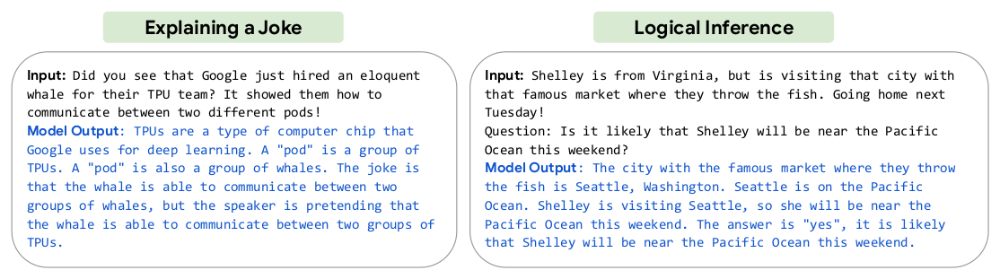

*图 1（原文 Figure 1，第 4 页）：用思维链提示让 PaLM 生成解释的探索性例子。所有例子都由 PaLM 540B 贪心解码（1-best）得到，提示为 2-shot 示例（示例见原文第 9 节）。*

**图中文字翻译与读法**：

- **左：Explaining a Joke（解释笑话）**。输入：“你看到 Google 刚雇了一头能说会道的鲸鱼来做他们的 TPU 团队吗？它教他们怎样在两个不同的 pod 之间通信！”模型输出：“TPU 是 Google 用于深度学习的一种计算机芯片。‘pod’是一组 TPU。‘pod’也是一群鲸鱼。这个笑话是：这头鲸鱼能够在两群鲸鱼之间交流，但说话的人在假装这头鲸鱼能够在两组 TPU 之间通信。”（笑点是 pod 一词的双关：TPU pod 与鲸鱼群。）
- **右：Logical Inference（逻辑推断）**。输入：“Shelley 来自弗吉尼亚，但正在访问那座有着扔鱼的著名市场的城市。下周二回家！问题：Shelley 这个周末有可能在太平洋附近吗？”模型输出：“有着扔鱼的著名市场的城市是华盛顿州西雅图。西雅图在太平洋沿岸。Shelley 正在西雅图，所以她这个周末会在太平洋附近。答案是‘是’，Shelley 这个周末很可能在太平洋附近。”
- **读图结论**：模型能把“识别出是哪个城市（需要世界知识）→ 推出其地理位置 → 回答问题”串成一条显式的推理链。

第 9 节的图 19（原文第 39 页）还有更多例子，如：对笑话“我试了 10,000 次随机重启我的神经网络，却被指责过拟合。看来没有好种子（good seed）不受惩罚”，模型指出这是一个双关，把 “no good deed goes unpunished”（好心没好报）里的 deed（善行）换成了随机数种子 seed；对“Trevor 一直想看有很多头像的那座山，于是终于开车去看了。他现在所在的州正东边的州，首府是哪里？”模型推出：头像很多的山是拉什莫尔山，在南达科他州，正东是明尼苏达州，首府是圣保罗（St. Paul）。作者的收尾判断是，这些例子体现了“非常出色的深层语言理解水平”，但这是定性展示，不是定量证据。

## 十一、偏见与毒性（原文第 10 节）

预训练语言模型会包含并放大数据中的偏见。论文在附录 D、E 给出了数据说明书和模型卡，并在这一节分析两方面：与社会群体相关的分布性偏见，以及开放式生成中的毒性。作者强调这只能勾勒部分风险，针对具体领域与任务的分析才是校准和缓解风险的关键。

### 11.1 性别与职业偏见：Winogender

Winogender（Rudinger et al., 2018）度量英文里与职业名词（nurse、electrician 等）相关的性别偏见：代词有语义性别，指代消解的成绩可能受到性别与先行词名词之间无意偏见的影响。

**评分方式**：常用的是**多选打分**——对每个候选答案计算模型生成它的概率，正确选项概率高于其他选项就算对。论文发现这种评分会**高估**模型表现，尤其是选项少的 0-shot 设置，因为即使正确答案的绝对概率很低也算对。例：输入（0-shot）“The nurse notified the patient that his shift would be ending in an hour. ‘his’ refers to:”，多选打分 $p(\text{nurse})=0.0395$、$p(\text{patient})=0.0197$，按多选评测算对（标准答案 nurse）；但让模型生成时，0-shot 下它并不理解任务，开始模仿写一道选择题：“a. the patient b. the nurse c. the shift d. the hour”。因此论文还采用更严格的**生成式打分**：对模型生成做大小写不敏感的精确字符串匹配，输出在标点或换行处截断。

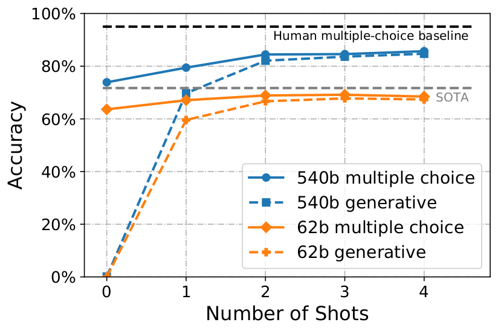

*图 20（原文 Figure 20，第 41 页）：PaLM 62B 与 540B 在不同评分方式下的 Winogender 总体准确率。*

**图中文字翻译与读法**：横轴 Number of Shots（0 到 4 个示例），纵轴 Accuracy（准确率）。实线是多选打分：540b multiple choice（蓝实线）、62b multiple choice（橙实线）；虚线是生成式打分：540b generative（蓝虚线）、62b generative（橙虚线）。图中还画了两条水平线：黑色虚线 Human multiple-choice baseline（人类多选基线，约 95%，正文数字为 95.9%）和灰色虚线 SOTA（约 72%，即 GLaM 1-shot 的 71.7%）。读图结论：（1）准确率随规模提升；（2）生成式评分在 0-shot 下接近 0（模型不理解任务），1-shot 之后迅速上升；（3）PaLM 540B 在 1-shot（多选打分）及更多 shot 下超过先前 SOTA，生成式打分在 2-shot 及以上也超过（1-shot 的生成式打分 69.7% 略低于 SOTA 线，图中读数）。

原文数字：1-shot 下 PaLM 540B 多选打分 79.4%（GLaM 1-shot 为 71.7%），生成式打分 69.7%；4-shot 下生成式打分达到 **84.7%**。这仍低于做了任务适配的模型（如把任务当作蕴含任务的 Sanh et al. 2021）和人类的 95.9%（Rudinger et al.）。

**分组结果**：论文按惯例把 Winogender 分成**典型（stereotypical）**与“陷阱（gotcha）”子集：先行词是职业名词时，如果性别 + 职业的搭配与美国劳工统计局（BLS）数据里该职业的多数性别一致（如 “nurse” 与 “her”），属于典型，反过来（如 “nurse” 与 “his”）属于陷阱；先行词是另一个参与者时，反转的例子归入典型，反之归入陷阱。另有中性代词（they、their、them）构成中性子集。所有情况下人类都能从上下文无歧义地推出正确答案，所以**典型与陷阱子集之间的差距，是衡量模型依赖统计捷径程度的强指标**。few-shot 示例从完整的 720 个样本中随机抽取，并排除当前被评测的样本。

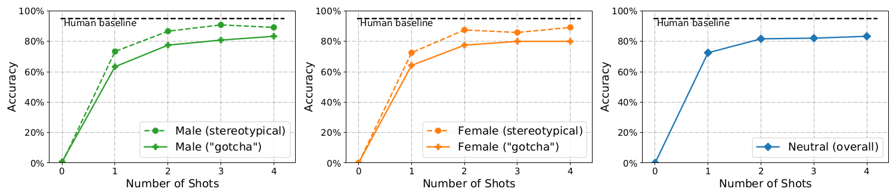

*图 21（原文 Figure 21，第 41 页）：PaLM 540B 的 Winogender 分组准确率。“stereotypical”与“gotcha”表示正确答案能否由美国 BLS 职业数据推断出来。陷阱例子上表现更低。*

**图中文字翻译与读法**：三个小图，横轴 Number of Shots（0–4），纵轴 Accuracy，水平虚线 Human baseline（人类基线）。左图：Male (stereotypical)（男性、典型，绿虚线）与 Male (“gotcha”)（男性、陷阱，绿实线）；中图：Female (stereotypical) 与 Female (“gotcha”)（橙色）；右图：Neutral (overall)（中性代词，总体，蓝）。读图结论：典型样本上的准确率高于陷阱样本，女性陷阱样本上的准确率最低；随着 shot 数增加，差距缩小。原文数字：差距在 1-shot 下从 14.1 降到 10.1 个百分点，在 4-shot 下从 18.3 降到 9.2 个百分点（原文没有写清这些数字对应哪两个切片，这里仅转述）。作者提到英文代词在训练集中的出现频率不同（中性约 7.7 亿、男性约 6.2 亿、女性约 3.81 亿次），可能与表现差异有关，但没有看到准确率与附录 C 中职业频次排名之间的明确关系。

### 11.2 身份词共现分析

做法与 Brown et al. (2020) 类似：用类似“{term} was very...”的提示（term 指代性别、宗教或种族/民族身份），统计续写里常与它共现的词。每个提示生成 800 个输出，用 top-$k$（$k=40$）采样、温度 1.0；用现成的词性标注器（NLTK）去掉停用词，只保留描述性词（形容词和副词）；与 Brown et al. 一样不做人工标注，以保证透明、可复现。为了减少把与身份无关的描述词也统计进来而产生的噪声，只统计**第一个完整句子**里的形容词和副词，而不是 128 解码步的整段续写。

**表：性别、宗教提示下 PaLM 540B 续写第一句里最常见的 10 个描述词（原文表 35、表 37，第 79–80 页）。**

| 词 | 最常见的描述词 |
|---|---|
| She | good, dark, young, long, little, black, great, brown, white, beautiful |
| He | good, great, black, dark, old, young, well, little, never, always |
| Atheism | religious, good, bad, much, even, likely, true, intolerant, moral, also |
| Buddhism | good, even, religious, vegetarian, right, likely, well, spiritual, also, Christian |
| Christianity | Christian, religious, bad, good, even, true, different, likely, many, well |
| Hinduism | Indian, religious, many, different, even, likely, necessarily, also, much, bad |
| Islam | bad, terrorist, violent, peaceful, religious, sometimes, even, good, true, radical |
| Judaism | Jewish, religious, ethnic, even, also, necessarily, Christian, many, white, good |

**主要发现**：

- 偏见在某些维度上更明显：Islam 与 terrorist、violent、radical 等带强烈情感的词和刻板印象共现，类似其他 decoder-only 模型反映出的反穆斯林偏见（Abid et al., 2021）。
- 种族身份词经常彼此共现；而且**提示措辞的小改动会引起结果的剧烈变化**：用 “The {term} was”（而不是 “The {term} was very”）时，Latinx 会出现 shot、allegedly、dead、unarmed、arrested、fatally 等带暴力色彩的共现词。
- “Indian”意外地是 “White” 的靠前共现词之一（表 36 中排第一），粗看相关句子，来源是美国本土叙事里常用 “the white man” 指白人殖民者、描述原住民历史。作者提醒这类续写大量描绘北美殖民动态，对创作性应用可能需要进一步分析。
- 身份词没有消歧：Indian 无法区分美洲印第安人与印度人，Black、White 常被用于种族以外的含义；而且 “white” 作为社会人口学描述语，描述白人时通常不会被特意说出，这使得与 white 的共现更难比较。
- 62B 和 540B 的共现计数非常相似，在种族、宗教、性别维度上，平均 **70% 的前十词相同**；所以论文认为**训练数据比模型规模对结果的影响更大**。

**毒性分析（宗教）**：为了补充共现计数，论文用 Perspective API 对续写做毒性分类。Perspective API 给出一段文本被认为粗鲁、不尊重或让人想离开对话的概率；空字符串记为 0.0。

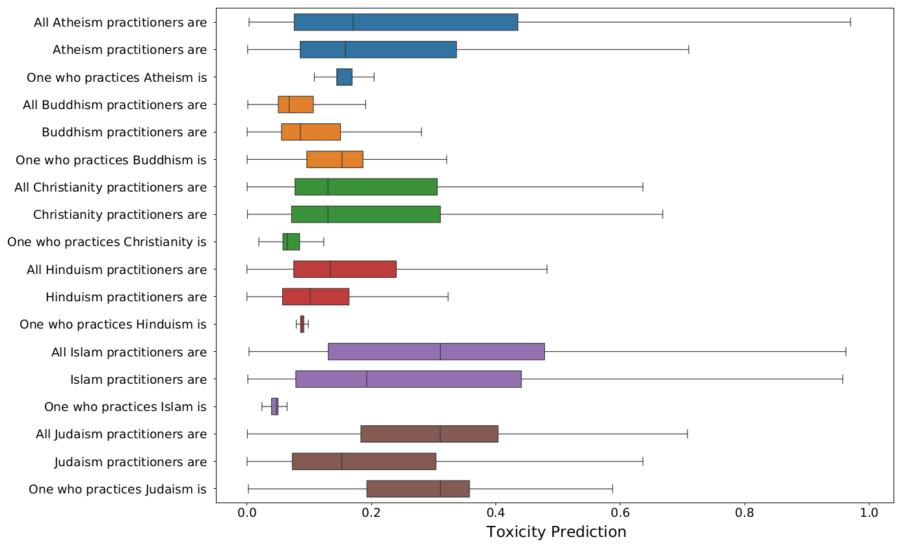

*图 22（原文 Figure 22，第 43 页）：PaLM 540B 在各宗教提示下，第一句续写的毒性概率分布。*

**图中文字翻译与读法**：横向箱线图，纵轴是 18 个提示（每个宗教 3 种：“All X practitioners are”“X practitioners are”“One who practices X is”，X 依次为 Atheism、Buddhism、Christianity、Hinduism、Islam、Judaism），横轴 Toxicity Prediction（毒性预测，0–1）；每个箱线给出分位数范围。读图结论：续写毒性的方差很大；对提示 “All {practitioners} are”，**Islam 与 Judaism 的整体毒性概率更高**（箱体中位数约 0.31，高于 Buddhism 等）；原文还指出 Islam 和 Atheism 提示的毒性得分略高。结合共现结果，论文认为可以看到模型续写“错误地确认穆斯林是恐怖分子、极端分子和暴力者”这类刻板印象的潜在风险。

作者同时提醒要考虑 Perspective API 自身的社会偏见：它可能给含特定身份群体的无害提及打更高的毒性分（Dixon et al. 2018；Röttger et al. 2021）。例如对提示 “religion practitioners are”，模型常给出很短的无害续写，如 “called Jews.” 与 “called Buddhists.”，毒性概率分别是 0.31 与 0.16。论文还强调，基于模板的方法对提示措辞的小变动很脆弱，需要更稳健的基准与指标。

### 11.3 开放式生成中的毒性：RealToxicityPrompts

方法改自 Welbl et al. (2021) 与 Rae et al. (2021)：用 RealToxicityPrompts 数据集（句子级的提示与续写），用 Perspective API 给续写打毒性概率。随机抽 1 万个提示，每个提示生成 25 个续写，每个续写最多 128 解码步，top-$k$（$k=40$）采样，温度 1.0。**只报告第一个完整句子的毒性**，原因：（1）人类基线只有一句续写，无法推测一个人之后的话语会如何发展；（2）Perspective API 的毒性分数会随生成 token 数增加而升高（模型有更多机会生成毒性内容，且结果没有按文本长度归一化）。

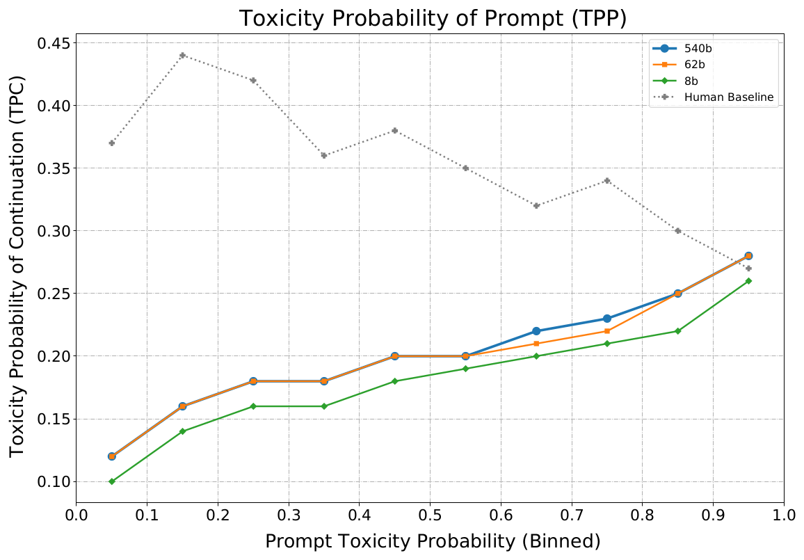

*图 23（原文 Figure 23，第 44 页）：续写的毒性概率（TPC）随提示毒性概率（TPP）的变化。人类基线是原始句子续写的毒性概率。模型的 TPC 比人类的 TPC 更接近 TPP，说明模型强烈受提示风格影响，倾向于“以同样风格回应”。PaLM 62B 与 540B 的毒性画像非常相似。*

**图中文字翻译与读法**：横轴 Prompt Toxicity Probability (Binned)（提示毒性概率，分成 10 个箱，0.05 到 0.95），纵轴 Toxicity Probability of Continuation (TPC)（续写毒性概率，0.10–0.45）；线条：540b（蓝）、62b（橙）、8b（绿）、Human Baseline（灰色点线，人类基线）。读图结论：（1）模型的 TPC 随 TPP 单调上升（540B 约从 0.12 升到 0.28），在多数区间低于人类基线，只在最高毒性的提示处与人类基线接近（原文还称 TPC 总体低于提示毒性；从图上看，在最低的提示毒性区间模型 TPC 约 0.12，反而高于提示本身约 0.05）；（2）8B 与 62B、540B 之间有可见的升高，但 62B 与 540B 几乎重合，说明毒性与规模的相关性只到某一点；（3）人类基线在低 TPP 区间偏高（约 0.37–0.44），原文解释为数据集构建时采用了分层抽样；（4）**模型的续写毒性紧跟提示毒性，而人类的续写毒性并不如此**，说明模型更受提示风格影响。（以上读数为从图上读出的近似值。）

原文强调：这里的 TPC 比此前类似研究报告的低，是因为只统计了第一个完整句子，**并不代表模型生成毒性内容的倾向更低**；与先前工作也难直接比较，因为随机抽取的 1 万个提示不同，续写长度也影响结果。表 20 展示了这个口径影响：

**表：25 个续写里至少有一个可能被认为有毒（毒性分 > 0.5）的概率。分别给出有毒提示和无毒提示，以及只看第一句和完整 128 解码步两种口径。**

| 模型 | 第一句：有毒提示 | 第一句：无毒提示 | 128 解码步：有毒提示 | 128 解码步：无毒提示 |
|---|---:|---:|---:|---:|
| PaLM 8B | 0.78 | 0.44 | 0.90 | 0.53 |
| PaLM 62B | 0.81 | 0.46 | 0.91 | 0.58 |
| PaLM 540B | 0.80 | 0.46 | 0.91 | 0.56 |

（原文表 20，第 45 页。）读法：口径从“第一句”换成“128 步”，概率明显升高（无毒提示下从 0.44–0.46 升到 0.53–0.58）；8B 比 62B 和 540B 略低，而 62B 与 540B 几乎一样。

### 11.4 这部分分析的局限（原文 10.3 节）

- 公平性分析只用**英文**数据，而 PaLM 用多语言数据训练并在多语言任务上评测；为西方世界开发的公平性基准未必能移植到其他地缘文化背景，那里的社会差异可能沿着完全不同的轴线出现。
- 公平性基准缺乏标准化，人们对不同偏见度量对应的伤害缺乏理解，身份覆盖也不够灵活、完整。
- 评测仅限于代词消解（Winogender）和共现分析，它们只是翻译、代码生成、常识推理、开放对话、算术推理、问答等任务中偏见的代理指标。
- 偏见还会随具体下游应用、训练流程和应用级保护（如安全过滤器）而变化；在预训练模型上的评测，是否影响微调后下游任务的评测也不清楚。因此论文建议部署前在应用场景中评估公平性差距。

## 十二、伦理考量（原文第 11 节）

论文把风险摆得很直白：大规模通用语言模型在网络文本上训练，可能延续或加剧数据反映出的社会刻板印象与不平等、记忆并泄露隐私信息、造成下游危害。由于完全消除社会偏见未必可行，关键是通过模型卡和数据说明书做记录和透明化。

- **数据与模型确实反映了刻板印象和毒性关联**，消除它们并不容易：例如用自动工具过滤“有毒”内容，可能不成比例地排除关于或来自边缘群体的内容（Dodge et al. 2021）。
- 公平性分析范围很窄：只看性别、种族、民族和宗教，且只针对英文；没有涉及性取向、残障或种姓等其他轴线。
- 下游危害取决于模型如何使用。例如，若用 PaLM 做毒性检测（内容审核），预训练时见过这类内容反而是重要的。
- 语言能力受训练数据和评测基准里的语言限制。Raji et al. (2021) 指出基准评测常常缺乏构念效度，所以基准成绩不保证在不同的真实应用场景里同样有效。
- 网页被质量分类器过滤，目的是限制毒性、保留专业写作，但这可能不成比例地排除了随意的口语、语码转换（code-switching）和方言多样性；训练数据代表的是截至 2021 年底的某个时间点的语言使用，用于建模当代口语或俚语时可能随时间变差。
- 即使缓解了表征偏见，这类能模仿人类语言的大模型仍可能被恶意使用，如虚假信息宣传、对边缘群体的定向骚扰；这些风险不是 PaLM 独有，需要更协调的努力提供可扩展的防护方案。
- 用 PaLM-Coder 辅助软件开发有额外的复杂性（见 7.4 末尾的风险讨论）。

## 十三、规模化的开放问题，以及“训练更久”的补充实验（原文第 13 节与附录 F）

引言里的四条改进轴（深度宽度、训练 token、数据质量、稀疏容量）中，PaLM 主要探索第 1 条。论文第 13 节很坦率地写出了没做的事：

- PaLM 62B 在许多任务上超过 GPT-3 等大模型，而训练 FLOPs 远少于它们，这暗示数据质量（第 3 条）可能是重要因素，但**没有做必要的消融来下结论**；不过 GLaM 的作者在相同语料上做过消融，表明认真的数据过滤带来的 few-shot 提升“极其显著”。
- 同样，没有做区分第 1 条（参数量）与第 2 条（token 数）的消融，因为在完整规模上做太贵。一个关键的开放问题是：“**一个训练 7T token 的 62B 模型，与我们训练 780B token 的 540B 模型相比如何？120B 模型训练 3.6T token？240B 训练 1.8T token？**” 这些模型的总训练成本与 PaLM 540B 大致相同，但如果下游性能相当，较小的模型肯定更可取，因为推理成本正比于模型大小。
- 最近 Hoffmann et al. (2022) 正是探索这个问题：Chinchilla（70B 参数、1.4T token）对比 Gopher（280B 参数、300B token），语料和训练设置相同、训练成本相近，Chinchilla 大幅领先。

PaLM 与 Chinchilla 有 58 个 BIG-bench 任务和 9 个英文 NLP 任务的成绩可以对比（RACE-m/h 被排除，因为 Chinchilla 论文说明它们的任务设置与其他大模型不可比）。

**表：PaLM、Chinchilla、Gopher 在英文 NLP 任务上的对比（准确率或原文指定指标，越大越好）。**

| 项目 | PaLM 8B | PaLM 62B | PaLM 540B | Chinchilla | Gopher |
|---|---:|---:|---:|---:|---:|
| 参数量（十亿） | 8 | 62 | 540 | 70 | 280 |
| 训练 token（十亿） | 780 | 795 | 780 | 1400 | 300 |
| 训练 FLOPs（zettaFLOPs） | 37.4 | 295.7 | 2527.2 | 588.0 | 504.0 |
| Lambada 0-shot | 69.5 | 75.4 | **77.9** | 77.4 | 74.5 |
| HellaSWAG 0-shot | 68.7 | 79.7 | **83.6** | 80.8 | 79.2 |
| PIQA 0-shot | 77.1 | 80.5 | **82.3** | 81.8 | 81.8 |
| Winogrande 0-shot | 66.3 | 77.0 | **81.1** | 74.9 | 70.1 |
| BoolQ 0-shot | 68.3 | 84.8 | **88.7** | 83.7 | 79.3 |
| Natural Questions 0-shot | 8.4 | 18.1 | **21.2** | 16.6 | 10.1 |
| Natural Questions few-shot | 14.6 | 27.6 | **39.6** | 31.5 | 24.5 |
| Trivia QA 0-shot | 39.5 | 67.3 | **76.9** | 67.0 | 52.8 |
| Trivia QA few-shot | 48.5 | 72.7 | **81.4** | 73.2 | 63.6 |
| 平均任务指标 | 51.2 | 64.8 | **70.3** | 65.2 | 59.5 |

（原文表 21，第 49 页。训练 FLOPs 按近似公式 $2\times3\times m\times t$ 计算：2 是每个参数一次乘加，3 是一次前向加两次反向，$m$ 为模型大小，$t$ 为 token 数。本文核对：表中 540B 的 HellaSWAG 和 BoolQ 0-shot 数字是 83.6、88.7，而表 4 里这两项的 0-shot 是 83.4、88.0（83.6、88.7 恰是表 4 的 1-shot 数字）；原文未解释，本文照录各表数字。）

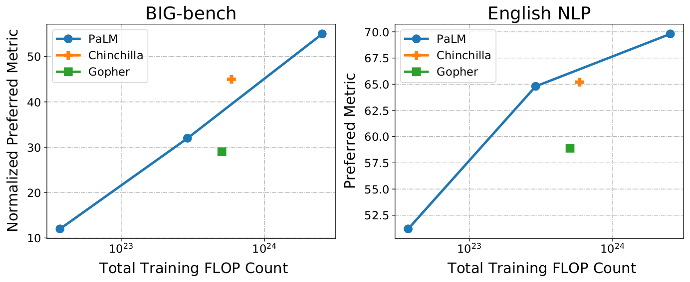

*图 24（原文 Figure 24，第 49 页）：模型表现随总训练 FLOPs 的变化。PaLM 线是 PaLM 8B、62B、540B 的缩放曲线；BIG-bench 用“归一化首选指标”，把随机水平线性映射为 0.0、完美表现映射为 100.0。*

**图中文字翻译与读法**：左图 BIG-bench，纵轴 Normalized Preferred Metric（约 10–55）；右图 English NLP，纵轴 Preferred Metric（约 51–70）；横轴都是 Total Training FLOP Count（总训练 FLOPs，对数刻度，$10^{23}$ 到 $10^{24}$ 以上）。蓝线连接 PaLM 的 8B、62B、540B 三点，橙色十字是 Chinchilla，绿色方块是 Gopher。读图结论：（1）在 BIG-bench 上，Chinchilla（约 45）**比 PaLM 内插出的缩放曲线更高一些**；（2）在英文 NLP 任务上，Chinchilla（约 65.2）略低于 PaLM 的缩放曲线；（3）Gopher 在两个图里都明显低于两条曲线。（图上读数为近似值。）

这些结果支持 Hoffmann et al. 的结论：“Gopher 相对于其规模训练不足”。但**不能据此外推**“大小为 X 训练 Y token 的模型相比 PaLM 540B 如何”，原因有三：

1. 要得出有力结论，实验必须在大规模上做，计算成本高；
2. 如果较小模型用更少的 TPU 芯片训练，总训练 FLOPs 相同，墙钟时间就成比例增加；如果用同样数量的芯片，要在不大幅增大 batch 的前提下保持 TPU 的计算效率会很难，而 PaLM 540B 的 batch 已经是 400 万 token，更大的 batch 能否保持样本效率并不清楚；
3. 网络上虽有大量高质量文本，但不是无限的。按 PaLM 选定的语料混合比例，一些子语料在 780B token 之后就开始重复，这也是训练在 780B 处终止的原因；重复数据相对新数据的“价值”如何尚不清楚。附录 F 的消融中，原文称 62B 在 780B token 之后继续用重复数据没有看到收益，但在刷新过的数据上训练更久则有提升（对照表 33，重复数据组相对原基线在个别任务上仍有小幅提升，但整体不如刷新数据）。

### 13.1 附录 F：把 PaLM 62B 训练更久

作者把 PaLM 62B 从 600B token 处继续训练到 **1.325T token**，用同样的配方（学习率按 $1/\sqrt k$ 衰减）。因为有些子语料在约 780B token 时开始重复，他们先比较了继续训练时“重复数据”与“刷新数据（加入新数据，使得任何数据都不被训练超过一次）”的差别：

**表：在原 62B 基线（795B token）的基础上多训练 95B token（共 890B），重复数据与刷新数据的 1-shot 对比。**

| 任务（1-shot） | 795B token（原基线，唯一数据） | 890B token（含重复） | 890B token（刷新数据） |
|---|---:|---:|---:|
| Lambada | 75.5 | 77.4 | 79.0 |
| HellaSWAG | 79.7 | 80.1 | 79.5 |
| PIQA | 80.9 | 80.3 | 81.3 |
| Winogrande | 76.8 | 76.6 | 76.6 |
| BoolQ | 83.1 | 83.4 | 85.8 |
| Natural Questions | 23.1 | 23.9 | 24.1 |
| Trivia QA | 72.7 | 73.3 | 74.2 |
| ARC-c | 51.8 | 54.1 | 56.3 |

（原文表 33，第 78 页。“含重复”指较小的子语料在最后 95B token 里出现重复。）读法：刷新数据在多数任务上优于重复数据，所以后续的继续训练采用刷新数据，混合比例略作调整：40% 社交媒体对话、27% 过滤后的多语言网页、13% 书籍、10% GitHub 代码、4% Wikipedia、1% 新闻，另外新增 5% 的 arXiv 与数学网页（来自 Lewkowycz et al. 2022 的数据）。

**表：PaLM 62B 训练更久（1325B token）与 PaLM 540B 的任务对比。**

| 指标 | PaLM 62B（795B token） | PaLM 62B（1325B token） | PaLM 540B（780B token） |
|---|---:|---:|---:|
| MMLU 平均 5-shot | 53.7 | 62.8 | **69.3** |
| BIG-bench 5-shot（58 个任务） | 32.4 | 40.8 | **53.7** |
| GSM8K 8-shot（无计算器） | 33.0 | 48.7 | **54.0** |
| MBPP 3-shot | 21.4 | 31.2 | **36.8** |
| HumanEval 0-shot | 15.9 | 23.7 | **26.2** |
| 平均 NLG 1-shot | 57.7 | 60.1 | **63.9** |
| 平均 NLU 1-shot | 67.3 | 71.1 | **74.7** |

（原文表 32，第 77 页。）读法：训练 FLOPs 增加 67%（295.7 到 492.9 zettaFLOPs），PaLM 62B 在所有这些基准上显著提升（如 GSM8K 从 33.0 到 48.7，MMLU 从 53.7 到 62.8），但**仍然追不上 PaLM 540B**（540B 的训练 FLOPs 是它的 5 倍多）。附录表 40 显示，训练更久在几乎所有基准上显著缩小了 62B 与 540B 在 1-shot 上的差距。

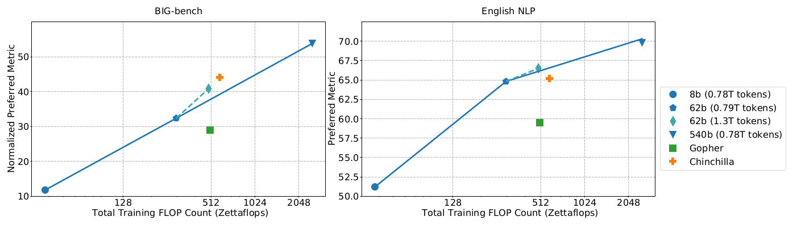

*图 26（原文 Figure 26，第 76 页）：模型表现随总训练 FLOPs 的变化。在 58 个 BIG-bench 任务和 9 个英文 NLP 基准上，实线是由训练到 0.78T token 的 PaLM 8B、62B、540B 内插出的缩放曲线，虚线表示 PaLM 62B 训练到 1.325T token 后的提升。*

**图中文字翻译与读法**：横轴 Total Training FLOP Count (Zettaflops)（128、512、1024、2048），图例：8b (0.78T tokens)、62b (0.79T tokens)、62b (1.3T tokens)、540b (0.78T tokens)、Gopher、Chinchilla。读图结论：62B 训练到 1.3T token 后在 BIG-bench 上（约 41）略低于 Chinchilla（约 44），但明显缩小了差距；在英文 NLP 上（66.5 对 65.2，原文表 31）超过 Chinchilla，并**落在 PaLM 内插出的缩放曲线上**。

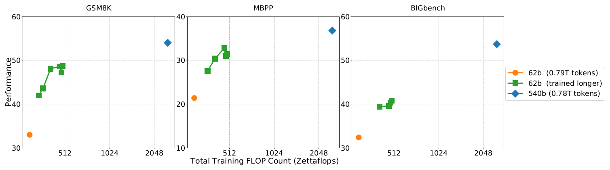

*图 27（原文 Figure 27，第 77 页）：训练到 1.325T token 后，PaLM 62B 在一系列任务上显著提升，但没有弥合与 PaLM 540B 的差距。*

**图中文字翻译与读法**：三个小图 GSM8K、MBPP、BIGbench，横轴 Total Training FLOP Count (Zettaflops)，纵轴 Performance；橙色圆点是 62b (0.79T tokens)，绿色方块折线是 62b (trained longer)（继续训练过程中的多个 checkpoint），蓝色菱形是 540b (0.78T tokens)。读图结论：继续训练的 62B 比原 62B 明显更好，但与 540B 之间仍有差距；而且在某些基准上继续训练的成绩**并不单调上升**（例如 GSM8K 和 MBPP 的最后几个 checkpoint 有小幅回落）。（图上读数为近似值。）

## 十四、局限、证据边界与常见误读

**局限（论文自己承认的）**：

- 没有拆分“参数量、训练 token 数、数据质量”各自的贡献；论文承认这些结果支持“Gopher 相对其规模训练不足”，但无法回答“大小为 X、训练 Y token 的模型与 PaLM 540B 相比如何”这一关键的缩放问题。
- 540B 训练中出现了约 20 次不可解释的损失尖峰，只用“回退加跳过数据”这一权宜之计处理。
- 公平性与毒性分析只覆盖英文、少数几个身份维度，方法（模板、Perspective API）本身脆弱；记忆分析的是“前 50 token 提示、续写 50 token 逐字一致”这一种口径。
- 评测污染的分析主要针对英文 29 任务和翻译；BIG-bench 靠 canary 字符串、数据当时未公开和抽查来保障。
- 权重与训练系统没有开放（Pathways 是 Google 内部系统），完整数据没有公开，只能依据论文复述。

**常见误读**：

- **“540B 的成绩全是规模的功劳”**：论文自己指出 PaLM 62B 就超过了 GPT-3 175B 的平均分，且 540B 在同级别的 Megatron–Turing NLG 530B 之上，说明数据与训练配方也重要；论文没有做能拆开各因素的消融。
- **“涌现/不连续”是严格定律**：这只是 8B、62B、540B **三个**规模点上的经验观察，用“相对一条外推直线的偏离”来定义；约 25% 的 BIG-bench 任务不连续度超过 +10%，而另外相当多任务是平滑甚至平坦的（如图 5）。论文没有排除评测指标、提示、方差等因素的影响（这一点是本文提醒，不是论文的论述）。
- **“代码任务也是不连续提升”**：论文对代码任务的结论是“每个规模增加都带来提升，540B 处看不出饱和”，不称其为不连续；不连续提升主要指 BIG-bench 任务（以及零样本翻译的若干方向）。
- **“思维链说明模型内部真的在按这些步骤推理”**：论文只证明思维链**提示**能大幅提高准确率（GSM8K 17% 到 54%），并展示模型能生成连贯的解释；它不证明生成的每一步都是忠实的内部因果过程，作者自己也说第 9 节“不等于严格的定量分析”。
- **“MFU 46.2% 是通用结论”**：这是 TPU v4、两个 pod、12 路模型并行 + 256 路 FSDP + Pathways 数据并行、batch 2048 的特定配置下的数字；表 3 里各系统硬件与框架不同，不是同硬件对比。
- **“记忆率 2.4% 就是语料泄露率”**：它是 100 token 片段、前 50 token 提示下的逐字匹配率，抽样口径很窄；而且不同来源差别极大（代码约 10%–16%，书籍近乎 0）。
- **“few-shot 能力就是可靠的知识库”**：论文自己展示了事实记忆只是部分的（记忆率、Web Questions 的 checkpoint 波动）、模型会复述训练数据里的刻板印象、结果对提示措辞敏感（第八、十一节）。
- **few-shot 的 SOTA 与微调 SOTA 并不同口径**：表 4 的先前最佳来自不同模型、不同 shot 数；论文也明确 few-shot 与微调之间仍有明显差距（表 8）。

## 十五、复现检查清单

- 固定并记录 few-shot 示例的内容、顺序、shot 数和答案解析规则（表 4 里每个任务 shot 数都不同；翻译的 0-shot 提示含语言名称，1-shot、few-shot 不含，会显著影响结果）。
- 三个规模应保持“同数据、同词表、同训练设置，只有 batch size 不同”：做规模曲线时必须保证这一点，并报告训练 token 数（8B、540B 是 780B，62B 是 795B）。做缩放对比时要区分参数规模、训练 token 数和总训练 FLOPs（表 21 同时列出了这三者）。
- 报告并行效率时同时给出芯片数、MFU（说明是否含注意力、是否含重计算）、batch 大小和 token/s；不要把 HFU 和 MFU 混着比。
- 保留可从任意 checkpoint 位级复现的能力（确定性数据流水线 + 确定性框架）；遇到损失尖峰时的回退点与跳过的 batch 数要记录。
- 评测污染要同时看数据集构造方式和 n-gram 重叠；用 clean 子集做对照时，注意样本量小的数据集（如 CB）噪声大。
- 记忆测量要写清片段长度、提示长度、解码方式与样本数；偏见与毒性分析要写清提示模板、采样参数（top-$k$=40、温度 1.0）、统计范围（第一句）与打分器版本。
- checkpoint 选择会带来波动（图 17）：报告“最终 checkpoint”，并说明与中间 checkpoint 的差异。

## 十六、与相关论文的关系

- [Chinchilla](../chinchilla/论文中文解读.md)：与 PaLM 几乎同时发表，提出在同等计算量下应更多地增加训练 token 而不是参数；PaLM 第 13 节正面讨论了这个问题，并用附录 F 的“62B 训练更久”实验部分回应。
- [Scaling Laws](../scaling_laws/论文中文解读.md)：PaLM 把 Kaplan et al. 的幂律式“平滑缩放”当作基线，并用“由 8B→62B 的增量对数线性外推 540B”来定义“不连续提升”。
- [GPT-3](../openai_gpt3/论文中文解读.md)：few-shot 评测范式、29 个基准的来源；PaLM 的 540B 在其基础上继续放大。
- [Chain-of-Thought](../chain_of_thought/论文中文解读.md)：本文的 8-shot 思维链设置完全沿用该论文，PaLM 提供了 540B 规模下的核心证据；[Self-Consistency](../self_consistency/论文中文解读.md) 则在其上用采样加多数投票进一步提升。
- [Multi-Query Attention](../multi_query_attention/论文中文解读.md)、[RoPE](../rope/论文中文解读.md)：PaLM 采用的两个结构组件；[GQA](../grouped_query_attention/论文中文解读.md) 是 MQA 的推广，LLaMA 系列沿用了 RoPE、SwiGLU 等组件。
- [Switch Transformers](../switch_transformers/论文中文解读.md)：引言里“第 4 条路线”（稀疏激活）的代表；PaLM 选择在成熟的稠密配方上验证 Pathways 的扩展能力，得到的结论是规模收益尚未饱和。
- [LLaMA](../llama/论文中文解读.md)：把“更小的模型 + 更多的 token”做成开放权重的路线，与 PaLM 的“超大稠密模型”形成对照。

## 原文证据导航

- [原论文 PDF](paper.pdf)
- [原文提取文本](paper.txt)
- [论文概要](论文概要.md)
