# 论文中文解读：《Rethinking Attention with Performers》

> **基本信息**：Krzysztof Choromanski、Valerii Likhosherstov、David Dohan、Xingyou Song、Andreea Gane、Tamas Sarlos、Peter Hawkins、Jared Davis 等（Google、University of Cambridge、DeepMind、Alan Turing Institute；前八位为共同一作），ICLR 2021，arXiv:2009.14794（本地 PDF 为 v4，2022 年 11 月）；论文原文 [官方页面](https://arxiv.org/abs/2009.14794)；代码：[performer](https://github.com/google-research/google-research/tree/master/performer)（注意力实现）与 [protein_lm](https://github.com/google-research/google-research/tree/master/protein_lm)（蛋白质实验）。
>
> **本文的读法**：图均为从论文 PDF 裁下的原图，表为逐格核对后的中文转录（数字与原文一致，表头译成中文，模型名、数据集名保持英文）。论文把大部分证明放在附录，本文把核心推导补全；凡属笔者的推导、核算、复算或判断，都标明“笔者”。论文页码：正文 1 至 9 页，附录 15 至 38 页。读完不必再翻英文版。

## 一、一句话结论

标准（softmax）注意力要显式生成 $L\times L$ 的注意力矩阵，时间 $O(L^2d)$、空间 $O(L^2+Ld)$。Performer 的想法是：把核函数 $\exp(q^\top k)$ 写成**随机特征的内积**的期望，$\exp(q^\top k)=\mathbb{E}\big[\phi(q)^\top\phi(k)\big]$，于是可以利用矩阵乘法的结合律，**先**把所有 key 与 value 聚合成一个 $r\times d$ 的小矩阵，**再**让每个 query 去乘它，永远不构造 $L\times L$ 矩阵，时间降到 $O(Lrd)$，空间 $O(Lr+Ld+rd)$。作者把这个机制叫 **FAVOR+**（Fast Attention Via positive Orthogonal Random features），有三个关键点：

- **FA**：先聚合 $K'^\top V$ 再乘 $Q'$（结合律），双向、单向（因果，前缀和）两种情形都适用；
- **R+**：用**正**随机特征（positive random features，PRF）$\exp(\omega^\top x-\lVert x\rVert^2/2)$ 无偏地估计 softmax 核。以前常用的 $\sin/\cos$ 三角特征会出现负值，在核值接近 0 的位置方差很大，会让归一化分母变成负数、训练失败；
- **O**：让随机方向 $\omega_1,\dots,\omega_m$ **彼此正交**，在保持无偏的同时严格降低方差，并给出任意维度 $d$ 都成立的指数小的尾部界。

实验涉及蛋白质序列、图像像素和文本（含 PG-19）。需要特别注意：论文里**大多数“Performer”实验用的是 ReLU 广义注意力（不再是 softmax 的近似）**；真正的 softmax 近似版本叫 Performer-SOFTMAX，它的结果是与 Transformer“持平”（蛋白质双向任务上 33.00 对 33.32 的测试准确率），而不是“更好”。

## 二、背景：标准注意力与已有高效注意力路线

### 2.1 双向与单向注意力（原文式 1、2）

输入 $Q,K,V\in\mathbb{R}^{L\times d}$（$L$ 为序列长度，$d$ 为隐藏维度）。**双向**（非方向性，用于编码器自注意力和 encoder-decoder 注意力）：

$$
\mathrm{Att}_{\leftrightarrow}(Q,K,V)=D^{-1}AV,\qquad A=\exp\!\big(QK^\top/\sqrt d\big),\qquad D=\mathrm{diag}\big(A\mathbf 1_L\big),
$$

其中 $\exp$ 逐元素作用，$\mathbf 1_L$ 是全 1 向量，$\mathrm{diag}(\cdot)$ 把向量放到对角线上。$A$ 必须显式存储，所以时间 $O(L^2d)$、空间 $O(L^2+Ld)$。**单向**（因果，用于自回归生成）：

$$
\mathrm{Att}_{\rightarrow}(Q,K,V)=\widetilde D^{-1}\widetilde AV,\qquad \widetilde A=\mathrm{tril}(A),\qquad \widetilde D=\mathrm{diag}\big(\widetilde A\mathbf 1_L\big),
$$

$\mathrm{tril}(\cdot)$ 取下三角部分（含对角线）。论文称：这个 $A$ 可以在 $O(Ld^2\log d)$ 的时间内被近似到任意精度（对比基于 LSH 的稀疏方法的 $O(Ld^2\log L)$）。

### 2.2 已有路线与论文的评价（第 1 节）

- **稀疏/局部注意力**（局部邻域、Sparse Transformer、滑动窗口 Longformer 等）、**压缩**（Compressive Transformer）、**聚类/哈希**（Routing Transformer 用 k-means、Reformer 用 LSH）：不是在近似原注意力，而是换成更简单的机制，常带额外约束（如 Reformer 要求 query 与 key 集合相同）；论文认为它们缺乏对表示能力的严格保证，有的稀疏模式只能靠试错和手写 CUDA/TVM 算子来验证；
- **截断反向传播**（Transformer-XL）：梯度只在局部窗口内传播，抓不住长距离相关；
- **低秩/核方法**：Linformer（Wang 等 2020）有偏、只适用于非因果情形，且均方误差大；Katharopoulos 等（2020）、Shen 等（2018）的线性注意力要求核能写成有限的正特征向量的点积，但用的是别的核（如 $\mathrm{elu}+1$），不是对 softmax 的近似；
- Performer 声称是第一个能**可证明地、实用地**估计常规 softmax 满秩注意力、且只需线性时空复杂度、不依赖稀疏或低秩先验的架构；并且与已有 Transformer **向后兼容**（只需少量微调）。

可对照 [Linformer 解读](../linformer/论文中文解读.md)（低秩投影路线）。

## 三、方法一：FA——核化注意力与结合律（第 2.2 节）

### 3.1 广义可核化注意力（式 3、4）与图 1

FAVOR+ 适用于所有注意力矩阵形如 $A(i,j)=\mathcal K(q_i^\top,k_j^\top)$ 的情形，其中核 $\mathcal K:\mathbb{R}^d\times\mathbb{R}^d\to\mathbb{R}_+$ 可以通过一个（通常随机的）映射 $\phi:\mathbb{R}^d\to\mathbb{R}^r_+$ 表示成

$$
\mathcal K(x,y)=\mathbb{E}\big[\phi(x)^\top\phi(y)\big].
$$

$\phi$ 叫**随机特征映射**。令 $Q',K'\in\mathbb{R}^{L\times r}$ 的各行分别是 $\phi(q_i^\top)^\top$ 和 $\phi(k_i^\top)^\top$，则注意力可近似为

$$
\widehat{\mathrm{Att}}_{\leftrightarrow}(Q,K,V)=\widehat D^{-1}\Big(Q'\big((K')^\top V\big)\Big),\qquad \widehat D=\mathrm{diag}\Big(Q'\big((K')^\top\mathbf 1_L\big)\Big),
$$

括号表示计算顺序：先算 $(K')^\top V\in\mathbb{R}^{r\times d}$（$O(Lrd)$），再左乘 $Q'$（$O(Lrd)$）；分母同理：先算 $(K')^\top\mathbf 1_L\in\mathbb{R}^{r}$，再乘 $Q'$。空间复杂度 $O(Lr+Ld+rd)$，时间复杂度 $O(Lrd)$，对比标准注意力的 $O(L^2+Ld)$ 与 $O(L^2d)$。

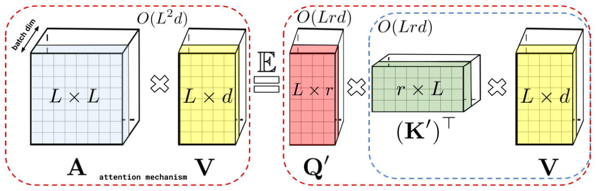

*图 1（原文 Figure 1，第 3 页）：用（随机）特征映射近似常规注意力 $AV$（未做 $D^{-1}$ 归一化）；虚线框表示计算顺序，并标出相应的时间复杂度。*

**图中文字翻译与读法**：

- **左侧红色虚线框（attention mechanism，注意力机制）**：$L\times L$ 的注意力矩阵 $A$（蓝，带 batch dim 即批维度标记）与 $L\times d$ 的 $V$（黄）相乘，代价 $O(L^2d)$；
- **等号上的 $\mathbb{E}$**：右边是左边的期望（随机特征的期望等于真实的核）；
- **右侧红色虚线框**：$Q'$（红，$L\times r$）、$(K')^\top$（绿，$r\times L$）、$V$（黄，$L\times d$）三者连乘；其中**蓝色虚线框**圈出先算的 $(K')^\top V$，代价 $O(Lrd)$，随后 $Q'$ 乘这个结果，也是 $O(Lrd)$；
- **读图结论**：同一个乘积，左边必须先得到 $L\times L$ 矩阵，右边改变结合顺序后任何中间结果都不超过 $L\times r$ 或 $r\times d$，所以与 $L$ 线性相关。

**笔者补充的一个数值感受**：取 $L=4096$、每头 $d=64$、$r=256$：标准注意力的分数矩阵有约 1678 万个元素；FAVOR 的 $Q',K'$ 各约 105 万个元素，$(K')^\top V$ 只有 $256\times64=16384$ 个元素；在乘加次数上，标准做法是 $QK^\top$ 与 $PV$ 各 $L^2d$，合计约 $2L^2d\approx21.5$ 亿；FAVOR 要先算 $Q'$、$K'$（各约 $Lrd\approx6700$ 万），再做 $(K')^\top V$ 与左乘 $Q'$（各约 $Lrd$），合计约 $4Lrd\approx2.7$ 亿。按这个粗算，$L$ 小于约 $2r$（这里是 512）时 FAVOR 没有优势，这与图 3 中短序列时两者耗时相近一致。

### 3.2 单向（因果）情形：前缀和（附录 B.1，算法 1，图 A8）

单向注意力要求位置 $i$ 只能用 $j\le i$ 的 key、value。论文的做法是：令 $C=[V\ \mathbf 1_L]\in\mathbb{R}^{L\times(d+1)}$（把全 1 列并进来，一次算出分子和分母），要计算 $\mathrm{tril}\big(Q'(K')^\top\big)C$ 而不显式构造 $L\times L$ 矩阵。对第 $i$ 行：

$$
\big[\mathrm{tril}\big(Q'(K')^\top\big)C\big]_i=\big(G^{\mathrm{PS}}_{i}\big)^{\!\top}q'_i,\qquad G^{\mathrm{PS}}_{i}=\sum_{j=1}^{i}G_j,\qquad G_j=k'_j\,C_j^\top\in\mathbb{R}^{r\times(d+1)},
$$

其中 $q'_i,k'_j\in\mathbb{R}^r$ 是 $Q',K'$ 的第 $i$、$j$ 行（原文用三维张量 $G,G^{\mathrm{PS}}\in\mathbb{R}^{L\times r\times(d+1)}$ 的记号，式 11）。也就是说，把 key 的随机特征与 value 的外积沿位置做**累加和（prefix sum，前缀和）**，第 $i$ 个位置的输出只用当前前缀和乘以 $q'_i$。

**算法 1（FAVOR+，双向或单向）**：输入 $Q,K,V$ 和 isBidirectional 标志；计算 $Q',K'$，令 $C=[V\ \mathbf 1_L]$；若双向：$\mathrm{Buf}_1=(K')^\top C\in\mathbb{R}^{r\times(d+1)}$，$\mathrm{Buf}_2=Q'\mathrm{Buf}_1\in\mathbb{R}^{L\times(d+1)}$；若单向：按式 11 算前缀和张量 $G^{\mathrm{PS}}$，再逐行乘 $Q'_i$ 得 $\mathrm{Buf}_2$；然后把 $\mathrm{Buf}_2$ 拆成 $\mathrm{Buf}_3\in\mathbb{R}^{L\times d}$（分子）和 $\mathrm{buf}_4\in\mathbb{R}^{L}$（分母），返回 $\mathrm{diag}(\mathrm{buf}_4)^{-1}\mathrm{Buf}_3$。

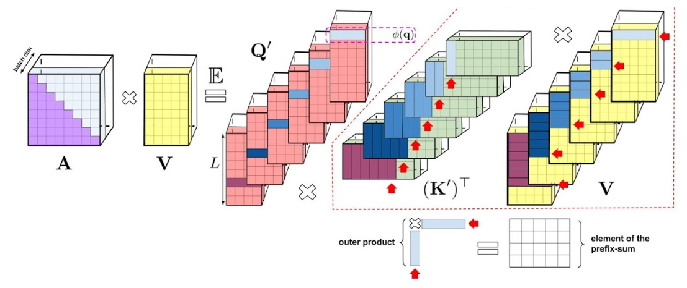

*图 A8（原文 Figure 8，第 17 页）：单向注意力的前缀和算法示意（为清晰起见省略了归一化）。该算法维护一个前缀和矩阵，它由 key 的随机特征与 value 向量的外积逐个累加而成；每一步，把 query 的随机特征向量乘以最新的前缀和（即所有此前 token 的外积之和），得到 $AV$ 的新一行。*

**图中文字翻译与读法**：

- **左半**：下三角的紫色 $A$（因果 mask，只保留 $j\le i$，另标 batch dim 批维度）乘 $V$，等于右边由 $Q'$、$(K')^\top$、$V$ 三组叠片构成的乘积；
- **右半（红色虚线框内）**：沿位置排开的多层叠片，每一层对应一个位置；红色小箭头标出当前位置所用的 key 特征行与 value 行；$Q'$ 顶部的紫色虚线框标 $\phi(\mathbf q)$，即当前 query 的随机特征向量；右下角标出 outer product（外积，key 特征与 value 的外积）与 element of the prefix-sum（前缀和的一个元素）；
- **读图结论**：因果版本的状态是一个固定大小 $r\times(d+1)$ 的矩阵，每来一个新 token 只做一次累加；

复杂度（附录 B.3，笔者整理）：并行的前缀和需要 $O(\log L)$ 的并行时间和 $O(mLd)$ 的空间来存储 $G^{\mathrm{PS}}$；如果改用不并行（沿 $L$ 串行）的累加而不存整个张量，空间可降到 $O(md+Ld+mL)$。笔者注：这个串行形式就是“带固定大小状态的递推”，与后来的线性注意力递推形式一脉相承。

## 四、方法二：R+——如何（以及如何不）近似 softmax 核

### 4.1 随机特征的一般形式（式 5）

取函数 $f_1,\dots,f_l:\mathbb{R}\to\mathbb{R}$、函数 $h:\mathbb{R}^d\to\mathbb{R}$ 和独立同分布采样的 $\omega_1,\dots,\omega_m\sim\mathcal D$，令

$$
\phi(x)=\frac{h(x)}{\sqrt m}\Big(f_1(\omega_1^\top x),\dots,f_1(\omega_m^\top x),\ \dots,\ f_l(\omega_1^\top x),\dots,f_l(\omega_m^\top x)\Big),
$$

特征维度 $r=l\cdot m$。取不同的 $h,f_i$ 和分布 $\mathcal D$（常用各向同性的，通常是高斯）可以表示大多数常用的核：$h=1,l=1,\mathcal D=\mathcal N(0,I_d)$ 得到所谓 PNG 核（如 $f_1=\mathrm{sgn}$ 是夹角核）；$h=1,l=2,f_1=\sin,f_2=\cos$ 得到平移不变核，$\mathcal D=\mathcal N(0,I_d)$ 时是高斯核 $\mathcal K_{\text{gauss}}$（Rahimi & Recht 2007）。

### 4.2 softmax 核与三角随机特征的问题

定义 softmax 核 $\mathrm{SM}(x,y)=\exp(x^\top y)$（不失一般性略去 $1/\sqrt d$：可以等价地把 query 与 key 各乘 $d^{-1/4}$）。注意到

$$
\mathrm{SM}(x,y)=e^{\lVert x\rVert^2/2}\,\mathcal K_{\text{gauss}}(x,y)\,e^{\lVert y\rVert^2/2},\qquad \mathcal K_{\text{gauss}}(x,y)=e^{-\lVert x-y\rVert^2/2},
$$

（笔者验证：$\lVert x\rVert^2/2-\lVert x-y\rVert^2/2+\lVert y\rVert^2/2=x^\top y$。）于是可以用 $\sin/\cos$ 随机特征无偏地估计，取 $h(x)=e^{\lVert x\rVert^2/2}$、$l=2$、$f_1=\sin$、$f_2=\cos$，记作 $\widehat{\mathrm{SM}}^{\mathrm{trig}}_m(x,y)$。

**问题**：注意力给每个 token 构造的是 value 的**凸组合**，系数是归一化后的核分数，所以需要核值非负。随机特征的维度值若可能为负（$\sin/\cos$），则对于核值接近 0（大多数低相关度 token 的情形）的位置，估计量方差很大，可能出现“归一化分母 $D^{-1}$ 的对角元为负”等异常，要么无法训练，要么得到次优模型。作者认为这是此前没有人提出稳健的随机特征 softmax 近似的主要原因之一。

### 4.3 正随机特征（引理 1）

**引理 1（softmax 的正随机特征，PRF）**：对 $x,y\in\mathbb{R}^d$，令 $z=x+y$，则

$$
\mathrm{SM}(x,y)=\mathbb{E}_{\omega\sim\mathcal N(0,I_d)}\Big[\exp\!\Big(\omega^\top x-\frac{\lVert x\rVert^2}{2}\Big)\exp\!\Big(\omega^\top y-\frac{\lVert y\rVert^2}{2}\Big)\Big]=\Lambda\,\mathbb{E}_{\omega}\big[\cosh(\omega^\top z)\big],
$$

其中 $\Lambda=\exp\!\big(-(\lVert x\rVert^2+\lVert y\rVert^2)/2\big)$，$\cosh$ 是双曲余弦。

**证明（附录 F.1，笔者展开）**：先把 $\mathrm{SM}(x,y)=e^{-\lVert x\rVert^2/2}\,e^{\lVert x+y\rVert^2/2}\,e^{-\lVert y\rVert^2/2}$ 写开（展开 $\lVert x+y\rVert^2$ 即可验证）。再对标准高斯做配方：

$$
\mathbb{E}_{\omega\sim\mathcal N(0,I_d)}\big[e^{\omega^\top z}\big]=(2\pi)^{-d/2}\!\int e^{-\lVert w\rVert^2/2+w^\top z}\,dw=e^{\lVert z\rVert^2/2},
$$

（即高斯的矩母函数：把 $-\lVert w\rVert^2/2+w^\top z$ 配成 $-\lVert w-z\rVert^2/2+\lVert z\rVert^2/2$，剩下的积分为 1。）所以 $e^{\lVert x+y\rVert^2/2}=\mathbb{E}\big[e^{\omega^\top x}e^{\omega^\top y}\big]$，代入前式即得第一个等式。第二个等式：$\omega$ 与 $-\omega$ 同分布，所以 $\mathbb{E}[e^{\omega^\top z}]=\mathbb{E}[e^{-\omega^\top z}]=\mathbb{E}[\cosh(\omega^\top z)]$。

于是得到两种无偏的正随机特征估计：

- **$\widehat{\mathrm{SM}}^{+}_m$**：$h(x)=\exp(-\lVert x\rVert^2/2)$，$l=1$，$f_1=\exp$，$\mathcal D=\mathcal N(0,I_d)$，即 $\phi^{+}(x)_i=\frac1{\sqrt m}e^{\omega_i^\top x-\lVert x\rVert^2/2}$；所有分量恒为正，因此估计出的核值恒为正，$D^{-1}$ 不会出现负数；
- **$\widehat{\mathrm{SM}}^{\mathrm{hyp}+}_m$**：$h(x)=\frac1{\sqrt2}e^{-\lVert x\rVert^2/2}$，$l=2$，$f_1(u)=e^{u}$，$f_2(u)=e^{-u}$，同一个 $\mathcal D$；用成对的 $\pm\omega$ 进一步降低方差（上面的 $\cosh$ 形式）。

此外，若把引理 1（原文式 7）中的 $\omega$ 换成 $\sqrt d\,\omega/\lVert\omega\rVert$（即 $\mathcal D$ 换成半径 $\sqrt d$ 球面上的均匀分布，Haar 测度），得到**正则化 softmax 核** $\mathrm{SM}^{\mathrm{REG}}$ 及其估计 $\widehat{\mathrm{SM}}^{+\mathrm{REG}}_m$。

### 4.4 方差：正特征与三角特征的对比（引理 2、图 2）

**引理 2**：对独立采样的 $\omega_i$，均方误差（MSE）为

$$
\mathrm{MSE}\big(\widehat{\mathrm{SM}}^{\mathrm{trig}}_m\big)=\frac1{2m}\,e^{\lVert x+y\rVert^2}\,\mathrm{SM}^{-2}(x,y)\big(1-e^{-\lVert x-y\rVert^2}\big)^2,
$$

$$
\mathrm{MSE}\big(\widehat{\mathrm{SM}}^{+}_m\big)=\frac1m\,e^{\lVert x+y\rVert^2}\,\mathrm{SM}^{2}(x,y)\big(1-e^{-\lVert x+y\rVert^2}\big),
$$

$$
\mathrm{MSE}\big(\widehat{\mathrm{SM}}^{\mathrm{hyp}+}_m\big)=\frac12\big(1-e^{-\lVert x+y\rVert^2}\big)\,\mathrm{MSE}\big(\widehat{\mathrm{SM}}^{+}_m\big).
$$

后者说明双曲版本严格好于用两倍随机特征的 $\widehat{\mathrm{SM}}^{+}_{2m}$。

**笔者对证明的补充（附录 F.2）**：正特征的方差来自 $\mathrm{Var}\big(e^{\omega^\top z}\big)=\mathbb{E}\big[e^{2\omega^\top z}\big]-\big(\mathbb{E}\,e^{\omega^\top z}\big)^2=e^{2\lVert z\rVert^2}-e^{\lVert z\rVert^2}$（用到 $\mathbb{E}\,e^{2\omega^\top z}=e^{\lVert 2z\rVert^2/2}$）；估计量是 $\Lambda$ 乘上 $m$ 个独立项的均值，所以 $\mathrm{MSE}=\frac1m\Lambda^2\big(e^{2\lVert z\rVert^2}-e^{\lVert z\rVert^2}\big)$，再用 $\Lambda^2=\mathrm{SM}^2e^{-\lVert z\rVert^2}$ 就得到上式。三角特征的方差来自 $\mathrm{Var}\big(\cos(\omega^\top\Delta)\big)=\frac12\big(1-e^{-\lVert\Delta\rVert^2}\big)^2$（$\Delta=x-y$；由 $\mathbb{E}\cos u=e^{-s/2}$、$\mathbb{E}\cos 2u=e^{-2s}$，$u\sim\mathcal N(0,s)$ 算出）。

论文由此说：当 $\mathrm{SM}(x,y)\to0$ 时三角估计的 MSE 趋于 $\infty$，而正估计的 MSE 趋于 0。

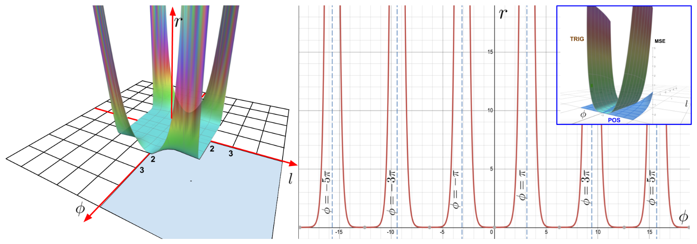

*图 2（原文 Figure 2，第 4 页）：左，关于原点对称化的“效用函数” $r$（定义为三角特征与正特征两种估计量的 MSE 之比），它是输入向量夹角 $\phi$（弧度）与向量长度 $l$ 的函数；$r$ 越大表示在 $(\phi,l)$ 空间的该区域正特征越好。右，固定 $l=1$ 时 $r$ 随夹角 $\phi$ 的切片；右上角小图：在低 softmax 核值区域，两种估计量 MSE 的对比。图的定义域为 $[-\pi,\pi]\times[-2,2]$。*

**图中文字翻译与读法**：

- **左图（三维曲面）**：横向两个坐标轴分别是夹角 $\phi$ 和长度 $l$，竖轴是比值 $r$；曲面在 $\phi$ 较大（核值很小）的区域向上冲高；
- **右图**：横轴 $\phi$（范围约 $-18$ 到 $18$），纵轴 $r$（0 到约 18）；蓝色竖虚线标出 $\phi=\pm\pi,\pm3\pi,\pm5\pi$（两向量反向的位置），红色曲线在这些位置趋于无穷，在 $\phi$ 为 $2\pi$ 的整数倍（两向量同向）处接近 0；
- **右上角小图**：蓝色框，三维曲面上标 TRIG（三角特征）的 MSE 远高于标 POS（正特征）的 MSE；
- **读图结论**：在关键区域（核值很小、需要精细逼近的位置）正特征可以比三角特征精确得多；

**笔者核算（单位向量情形）**：取 $\lVert x\rVert=\lVert y\rVert=1$、夹角 $\varphi$，则 $\mathrm{SM}=e^{\cos\varphi}$，$\lVert x-y\rVert^2=2(1-\cos\varphi)$，$\lVert x+y\rVert^2=2(1+\cos\varphi)$。代入引理 2，下表是乘以特征数 $m$ 之后的 MSE（即 $m\cdot\mathrm{MSE}$）：

| 夹角 $\varphi$ | $\mathrm{SM}(x,y)$ | 三角特征 | 正特征 $+$ | 双曲正特征 $\mathrm{hyp}+$ |
|---:|---:|---:|---:|---:|
| 0°（同向） | 2.718 | 0 | 396.0 | 194.4 |
| 90°（正交） | 1.000 | 2.762 | 6.389 | 2.762 |
| 135° | 0.493 | 3.455 | 0.194 | 0.043 |
| 180°（反向） | 0.368 | 3.560 | 0 | 0 |

笔者另用 $d=8$、40 万个样本做了蒙特卡洛模拟，对 90°、135°、180° 三行核验，与公式在约 2% 以内吻合。读法：**正特征并非处处更准**——同向（核值大）时三角特征几乎无误差，正特征反而误差大（相对误差 $\mathrm{MSE}/\mathrm{SM}^2$ 约 $53.6/m$）；但在反向、核值小的位置，正特征的方差趋于 0（$\varphi=180^\circ$ 时 $x+y=0$，$e^{\omega^\top z}\equiv1$，估计量是常数，无误差），三角特征则仍有 $3.56/m$ 的方差，相对误差约 $26/m$。这与论文的论点一致：低相关度 token 的核值小，需要小的**相对**误差，否则会被归一化放大。

### 4.5 正则化 softmax 核（定理 1）

**定理 1（正则化 softmax 核对 softmax 核）**：设 softmax 核的注意力矩阵满足 $\lVert A\rVert_\infty\le C$（$C\ge1$ 为常数），$A^{\mathrm{reg}}$ 为对应的正则化核的注意力矩阵，则

$$
\inf_{i,j}\frac{A^{\mathrm{reg}}(i,j)}{A(i,j)}\ \ge\ 1-\frac{2}{d^{1/3}}\Big(1+o\big(d^{-1/3}\big)\Big),\qquad \sup_{i,j}\frac{A^{\mathrm{reg}}(i,j)}{A(i,j)}\le1.
$$

并且后一个不等式在 $d\ge2$ 时即使不满足范数条件也成立：正则化 softmax 核是 softmax 核的**通用下界**。因此对 $\mathrm{SM}^{\mathrm{REG}}$ 用正随机特征也可以逼近 softmax 核。（笔者注：$d=64$ 时 $d^{1/3}=4$，下界系数约 $1-2/4=0.5$，对常见的 head 维度并不紧，是渐近结论。）

## 五、方法三：O——正交随机特征（第 2.4 节）

**构造**：为进一步降低估计量的方差（从而能使用更少的随机特征 $r$），让 $\omega_1,\dots,\omega_m$ **彼此严格正交**。只要分布 $\mathcal D$ 是各向同性的（本文所有的核都满足），就可以用标准的 Gram–Schmidt 正交化在保持无偏的前提下做到。要求 $m\le d$；若需要 $m>d$，可以在每个 $d\times d$ 块内使用 ORF（附录 B.2）。（笔者补充：标准做法是对 $d\times d$ 的高斯矩阵做 QR 正交化，再把每一行的模长重新抽成与 $\lVert\omega\rVert$ 同分布的独立值，这样每个 $\omega_i$ 的边缘分布仍是 $\mathcal N(0,I_d)$。）

**理论结果**：

**定理 2（正交降低均方误差）**：若 $\widehat{\mathrm{SM}}^{\mathrm{ort}+}_m$ 是用正交特征（$m\le d$）的 $\widehat{\mathrm{SM}}^{+}_m$，则对任意 $d>0$：

$$
\mathrm{MSE}\big(\widehat{\mathrm{SM}}^{\mathrm{ort}+}_m(x,y)\big)\ \le\ \mathrm{MSE}\big(\widehat{\mathrm{SM}}^{+}_m(x,y)\big)-\frac{2(m-1)}{m(d+2)}\Big(\mathrm{SM}(x,y)-e^{-\frac{\lVert x\rVert^2+\lVert y\rVert^2}{2}}\Big)^2.
$$

对正则化的 $\mathrm{SM}^{\mathrm{REG}}$ 有完全类似的结论。这是**第一个**说明正交随机特征可以对**任意**维度 $d$（而不仅是 $d$ 足够大时的渐近意义）降低 softmax/高斯核估计方差的理论结果。

其余结果：

- **定理 3（正交的尾部界）**：对 $\mathrm{SM}^{\mathrm{REG}}$，对任意 $a>\mathrm{SM}^{\mathrm{REG}}(x,y)$、$\theta>0$、$m\le d$，独立特征的上尾概率有 $\exp(-\theta ma)M_Z(\theta)^m$ 的界（$M_Z$ 为矩母函数），正交特征在此基础上再减去一个正项（含 $\theta^4m(m-1)/(4(d+2))\cdot\lVert x+y\rVert^4$ 的因子）。即正交特征给出**指数小且严格更紧**的尾部界，在核值小的关键区域尤其明显；正特征（正性）在这些界里起关键作用。
- **更一般的结果（附录 F.4，笔者概括）**：论文把这些结果推广到“美丽函数”（beautiful functions）$F_{\Omega,g}(z)=\mathbb{E}_{\omega\sim\Omega}[g(\omega^\top z)]$，其中 $g$ 是幂级数系数非负的整函数；$\mathrm{SM}$ 对应 $g=\exp$。定理 5 与 6 给出任意此类函数的尾部界与 MSE 改进：$\mathrm{MSE}(\widehat F^{\mathrm{ort}}_m)\le\mathrm{MSE}(\widehat F^{\mathrm{iid}}_m)-(1-\frac1m)\frac{2}{d+2}\big(F_{\Omega,g}(z)-a_0\big)^2$，其中 $a_0=g(0)$；定理 2、3 是它们的特例。（代入 $g=\exp$、$a_0=1$、乘以 $\Lambda$，就得到定理 2 的括号 $\mathrm{SM}-\Lambda$，笔者验证。）
- **ORF 的变体（附录 B.2）**：Regular ORF（高斯正交矩阵，$O(md)$ 空间、$Wx$ 需 $O(md)$ 时间、无偏，一次性 $O(md^2)$ 预处理）；Hadamard/Givens ORF（空间 $O(m)$ 或 $O(m\log d)$、$Wx$ 需 $O(m\log d)$ 时间、有小偏差且随 $d\to\infty$ 趋于 0）。

## 六、理论保证总览与边界

### 6.1 均匀收敛（定理 4）

**定理 4**：设 query/key 的 $L_2$ 范数都不超过 $R>0$。令 $l=R\,d^{-1/4}$，$h^*=\exp(l^2/2)$。则对任意 $\epsilon>0$，取 $\delta=\epsilon/(h^*)^2$，随机投影数

$$
m=\Theta\Big(\frac{d}{\delta^2}\log\frac{4d^{3/4}R}{\delta}\Big)
$$

时，用**三角特征加正交特征**的 $\widehat{\mathrm{SM}}^{\mathrm{trig}}$ 近似注意力矩阵，以任意常数概率有 $\lVert\widehat A-A\rVert_\infty\le\epsilon$。要点：$m$ 依赖于维度 $d$、精度 $\epsilon$ 和半径 $R$，**不依赖序列长度 $L$**；论文说由此取 $m=\Theta(d\log d)$ 即可，时间为 $O(Ld^2\log d)$。论文还说，即使是三角特征加 ORF 也只需 $m=\Theta(d\log d)$ 个特征（“如果不是因为注意力的归一化，就不需要 PRF 了”）。

### 6.2 笔者的几点提醒

1. **无偏性只对未归一化的核成立**：$\mathbb{E}\big[\phi(q)^\top\phi(k)\big]=\exp(q^\top k)$，即 $A$ 的每个元素的估计是无偏的；但实际输出 $\widehat D^{-1}\big(Q'(K'^\top V)\big)$ 含一个对随机量的除法，$\mathbb{E}[X/Y]\ne\mathbb{E}[X]/\mathbb{E}[Y]$，所以有限 $m$ 下归一化后的输出是有偏的（一致、近似无偏），摘要里写的是“unbiased or nearly-unbiased”。
2. **定理 4 针对的是三角特征，不是实际使用的 PRF**：PRF 有 MSE 与尾部界（定理 2、3），但论文没有给出 PRF 的均匀收敛定理。
3. **依赖半径 $R$**：论文自己在附录 F.6 指出，查询与键的长度不能随序列增长而无限增大，否则固定 $m$ 下近似质量会下降；FAVOR **不能用固定的 $m$ 近似无限长序列上的硬注意力**（即 softmax 集中到单个元素）。论文说这在其实验的长度范围内没有表现出来。
4. **ORF 要求 $m\le d$**：实际默认 $m=256$、每头维度 $d=512/8=64$（笔者按“regular”配置推算），用的是分块正交，定理对块之间的相关性没有覆盖。
5. **误差可逐层累积**：见下文图 A14，近似很紧的注意力，误差也会经多层放大。

## 七、实验

论文用 Jax 在已有 Transformer 训练代码上实现；除非另行说明，Performer 只替换注意力部分，其余完全相同。记单向/因果为 (U)，双向/掩码语言建模为 (B)。基线包括 Reformer（只支持 (U)）与 Linformer（只支持 (B)）；PG-19 作为 (B) 预训练基准，因为它面向长序列，而 BookCorpus 加 Wikipedia 现已不公开。

### 7.1 默认设置与命名（附录 A，笔者整理）

| 项目 | 取值 |
|---|---|
| 评价指标 | 准确率（(U) 为下一 token 预测准确率；(B) 为 15% 掩码位置上的准确率）、困惑度、BPD/BPC（损失除以 $\ln 2$） |
| 训练默认 | 梯度裁剪 0.5，权重衰减 0.1，dropout 0.1，固定学习率 $10^{-3}$，Adam（$\beta_1=0.9$，$\beta_2=0.98$，$\epsilon=10^{-9}$），batch 尽量大（直到 TPU 内存溢出）；蛋白质 36 层实验均用 16×16 TPU-v2（每片 8GB） |
| softmax 近似默认 | renormalize_attention=True，numerical stabilizer $=10^{-6}$，特征数 256，ortho_features=True，ortho_scaling=0.0 |
| 广义注意力默认（即“Performer”） | renormalize_attention=True，numerical stabilizer $=0.0$，特征数 256，kernel=ReLU，kernel_epsilon $=10^{-3}$ |
| Linformer 基线 | $\delta=10^{-6}$，$k=600$（Linformer 原文默认 256，也大于特征数 256 的两倍），并加了重抽样；作者的 Jax 实现与精确 softmax 输出的误差在各元素 0.02 以内 |
| Reformer 基线 | 蛋白质实验沿用同样超参（无梯度裁剪）；ImageNet64 用其默认配置（含学习率衰减）；LSH 参数用默认值 |
| 网络规模 | “regular”$(n_{\text{heads}},n_{\text{layers}},d_{ff},d)=(8,6,2048,512)$；“small” $(1,6,64,64)$；TrEMBL 36 层 $(8,36,1024,512)$；长蛋白质基线 $(8,\{1,2,3\},256,256)$ |
| PG-19 预处理 | unigram SentencePiece，词表 32768；困惑度按原数据集 token 数折算（训练/验证/测试的折算乘子 1.5634/1.5487/1.5359） |

**命名**：论文里不加后缀的 “Performer” 指**广义注意力 + ReLU 核**这一套默认配置（“optimal setting”，$h(x)=1$、$f=\mathrm{ReLU}$，不再近似 softmax）；近似 softmax 的版本显式写作 Performer-SOFTMAX（其中 TRIG 为三角特征，POS 为正特征，REDRAW 为重抽样，SMREG 为正则化 softmax 核）。

### 7.2 计算成本（第 4.1 节，图 3）

在双向 (B) 设置、regular 规模下比较 Transformer 与 Performer 反向传播（训练的主要瓶颈之一）的速度。

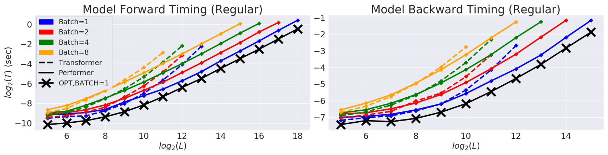

*图 3（原文 Figure 3，第 6 页）：Transformer 与 Performer 的前向、反向耗时及最大序列长度 $L$ 的比较。“X”（OPT）表示注意力直接返回 $V$ 矩阵时的最大可能加速。曲线画到模型在 16GB 的 V100 GPU 上显存溢出为止；词表大小 256。*

**图中文字翻译与读法**：

- **左图 Model Forward Timing (Regular)（regular 规模模型的前向耗时）与右图 Model Backward Timing (Regular)（反向耗时）**：横轴 $\log_2(L)$（序列长度的以 2 为底对数），纵轴 $\log_2(T)$（耗时，秒，取对数）；
- **图例**：Batch=1/2/4/8（蓝、红、绿、橙）；实线为 Performer，虚线为 Transformer；黑色叉号 OPT, BATCH=1 是下界（注意力恒等函数）；
- **读图结论**：Transformer（虚线）每条曲线在较小的 $L$ 处就因显存溢出而终止（batch=1 的前向约在 $\log_2L=13$，反向约在 12，从图上读出）；Performer（实线）把可处理的长度推到前向约 $2^{18}$、反向约 $2^{15}$（batch=1，从图上读出）；在长序列处 Performer 的实线贴近 OPT 叉号，说明几乎达到“除注意力外的开销”这个理论最优；短序列（约 $\log_2L\le8$）两者耗时相近。

论文的文字结论：以 $L$ 论，Performer 达到几乎线性的时间和亚二次的显存（不存显式 $O(L^2)$ 矩阵）；显存和反向速度的同时提高允许更大的 batch 训练和更短的单步训练时间。附录 E 补充了更多实验：改变层数（Performer 可扩展到至少 20 层）、只测注意力本身的耗时（该基准在 Jax 中要构造显式张量，所以最大内存并不代表实际模型）、以及 regular 与 small（$(1,6,64,64)$，注意力占主导的小模型）两种规模的耗时。附录 E 还写到“常规维度下 16GB V100 上可处理的最大 2 的幂长度是 $2^{15}=32768$”，这与图 3 左图的前向曲线（可到约 $2^{18}$）对不上，应是指反向（图 3 右图约到 $2^{15}$），这是笔者的推测。

### 7.3 softmax 注意力的近似误差（第 4.2 节，图 4）

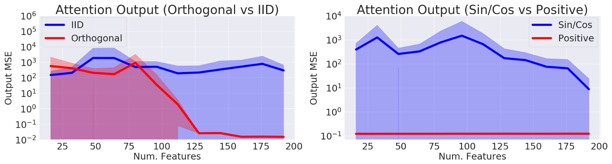

*图 4（原文 Figure 4，第 7 页）：近似输出的 MSE，比较正交特征对 IID（独立同分布）特征、三角（sin/cos）特征对正特征。取 $L=4096$、$d=16$，改变随机样本数 $m$。误差带是 15 份“恰当归一化的随机输入数据”的标准差。*

**图中文字翻译与读法**：

- **左图 Attention Output (Orthogonal vs IID)**：横轴 Num. Features（特征数，约 16 到 192），纵轴 Output MSE（输出均方误差，对数刻度，$10^{-2}$ 到 $10^{6}$）；蓝线 IID，红线 Orthogonal；
- **右图 Attention Output (Sin/Cos vs Positive)**：蓝线 Sin/Cos（三角特征），红线 Positive（正特征）；
- **读图结论**：左图中，IID 的 MSE 大致在 $10^2$ 到 $10^3$ 之间波动；Orthogonal 在特征数较少时与它相当，当特征数超过约 100 后骤降，到 128 以上约为 $10^{-2}$ 量级（均为从图上读出的近似值）；右图中，Sin/Cos 的 MSE 在 $10^{1}$ 到 $10^{3}$ 之间，Positive 约为 $0.1$ 的一条几乎水平的线。论文据此认为：1. 正交特征的误差低于无结构的 IID 特征；2. 正特征的误差低于三角特征；二者共同验证了 PORF 机制。
- **笔者提醒**：原文没有说明左图用的是哪类特征；右图 Positive 的曲线随特征数增加几乎不下降，原文也没有解释；$d=16$ 而特征数到 192，说明用的是分块正交。

论文还指出：为了让多次迭代中注意力块的整体近似更好，随机样本应当**周期性地重新抽取**（redraw）；这个过程很便宜，也可以进一步优化（附录 B.2）。

### 7.4 在 Transformer 里近似 softmax：向后兼容与误差传播（第 4.3 节）

即使注意力近似很紧，小误差也会在多层（MLP、多头）中传播，模型的 Lipschitz 常数会放大近似误差，所以有时需要非常紧的近似。

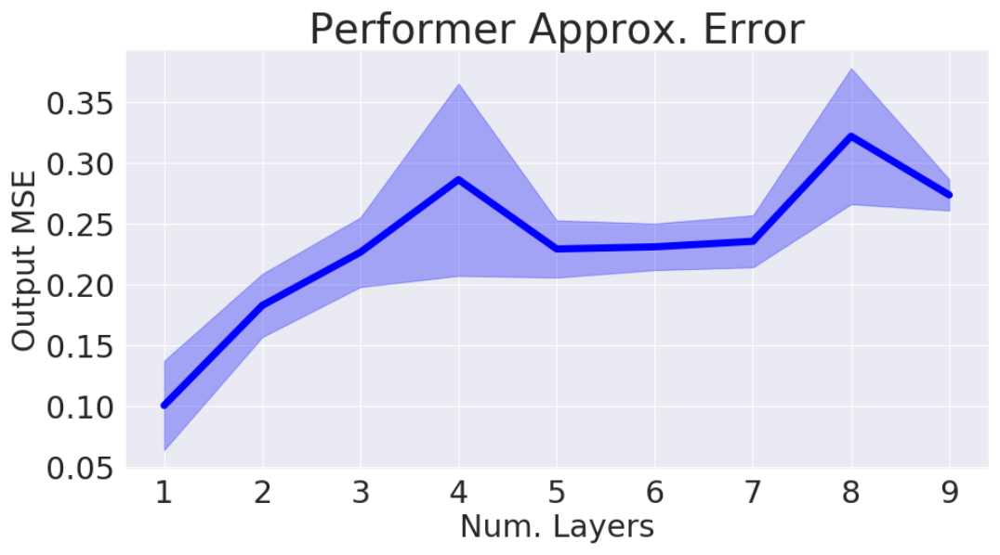

*图 A14（原文 Figure 14，第 23 页）：普通 Transformer 与 Performer（正交特征）的输出近似误差，随层数变化。*

**图中文字翻译与读法**：标题 Performer Approx. Error（Performer 的近似误差）；横轴 Num. Layers（层数 1 到 9），纵轴 Output MSE（输出均方误差）；蓝线为均值，蓝色带是波动范围。**读图结论**：误差随层数整体上升——约从 1 层的 0.10 升到 4 层的 0.29，之后在 0.23 左右波动，8 层处约 0.32，9 层约 0.27（均为从图上读出的近似值）。这是原文说“预训练 Transformer 的权重不能直接在对应的 Performer 上推理、需要小幅微调”的主要原因：非注意力部分会传播误差。

论文由此做了两组实验。

**(a) 向后兼容（图 5 左）**：把预训练好的 Transformer 权重直接装进 Performer，在 LM1B（Chelba 等 2014）上，即使用三角特征，也只需少量微调就能恢复。

**(b) 大数据集上，带重抽样的正特征变得至关重要（图 5 右）**：在更大的 PG-19 上比较各变体。

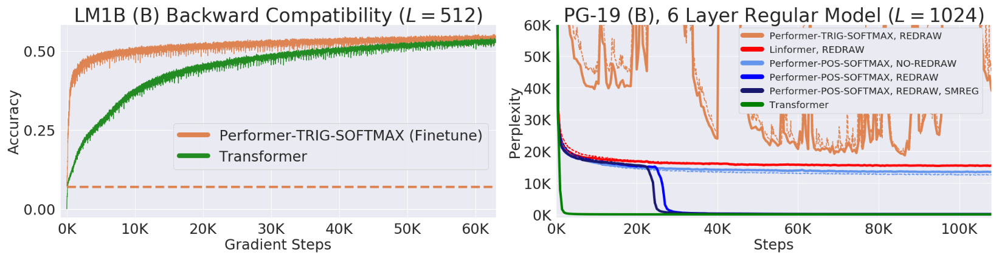

*图 5（原文 Figure 5，第 7 页）：把原来预训练的 Transformer 权重迁移到 Performer，起始准确率非零（约 0.07，橙色点线），但在原始梯度步数的一小部分内就快速恢复。而在 PG-19 上，三角（TRIG）softmax 近似变得极不稳定（完整曲线见附录 D.2）；正特征（POS，不重抽样）与 Linformer（同样近似 softmax，即使重抽样投影）停在同一个困惑度；带特征重抽样的正 softmax 才能追平 Transformer，其中 SMREG（第 3 节的正则化）收敛更快。更多核消融（含三角特征在训练中出现 NaN）见附录 D.3。*

**图中文字翻译与读法**：

- **左图 LM1B (B) Backward Compatibility ($L=512$)（LM1B 双向，向后兼容）**：横轴 Gradient Steps（梯度步数，0 到约 6 万），纵轴 Accuracy（准确率）；橙色 Performer-TRIG-SOFTMAX (Finetune)（装入预训练权重后微调的三角 softmax Performer），绿色 Transformer（原 Transformer 的训练曲线），橙色虚线是装入权重后的起始准确率（约 0.07）；
- **右图 PG-19 (B), 6 Layer Regular Model ($L=1024$)**：横轴 Steps（0 到约 10 万），纵轴 Perplexity（困惑度，0 到 6 万）；图例六条：Performer-TRIG-SOFTMAX, REDRAW（橙）、Linformer, REDRAW（红）、Performer-POS-SOFTMAX, NO-REDRAW（浅蓝）、Performer-POS-SOFTMAX, REDRAW（蓝）、Performer-POS-SOFTMAX, REDRAW, SMREG（深蓝）、Transformer（绿）；
- **读图结论**：左图橙线在约 1 万步内就回到约 0.5，之后一直略高于绿线，约 6 万步时两者都在约 0.53 到 0.55（从图上读出；注意橙线是从已训练好的 Transformer 起步的，而绿线是从头训练）；右图三角特征的橙线在 2 万到 6 万之间剧烈尖峰，Linformer（红，约 1.5 万多）与不重抽样的正特征（浅蓝，约 1.3 万到 1.4 万）停在高位，重抽样的两条正特征曲线（蓝与深蓝）在约 2.2 万到 2.7 万步处陡降，降到与 Transformer（绿线）几乎重合的低位（该纵轴量级下读不出具体值）。

**注意**：原文把“与 Transformer 持平的 PG-19 困惑度”只用曲线展示，没有给出数值；非重抽样的曲线在 10 万步仍停在上万的困惑度（词表有 32768 个 token），说明它们学得很差。重抽样相关的更多证据见下面的图 A15。

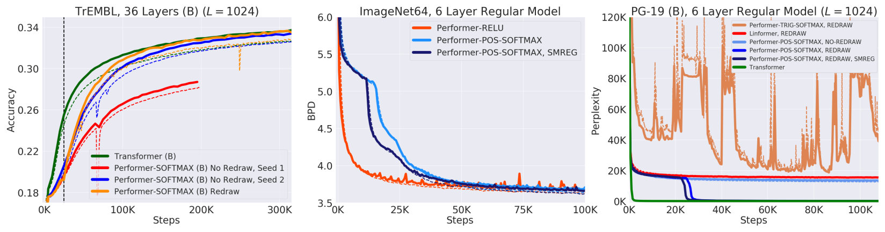

*图 A15（原文 Figure 15，第 23 页，建议放大看）：左，重抽样的重要性。若不重抽样，一组“不走运”的随机特征可能导致训练退化（Seed 1，提前终止的曲线），而一组“走运”的特征则没有问题（Seed 2）；重抽样让训练可以自我纠正，见黑色竖线处。中，在相同的 8×8 TPU-v2 算力和相同的 6 层标准模型下，近似 softmax 的正特征取得与广义 ReLU 注意力相同的结果。右，图 5 右图的放大视图，说明三角 softmax 导致非常不稳定的训练。*

**图中文字翻译与读法**：

- **左图 TrEMBL, 36 Layers (B) ($L=1024$)**：横轴 Steps（0 到约 30 万），纵轴 Accuracy（0.18 到 0.34 附近）；绿 Transformer (B)，红 Performer-SOFTMAX (B) No Redraw, Seed 1，蓝 No Redraw, Seed 2，橙 Redraw；黑色竖虚线约在 2.5 万步；
- **中图 ImageNet64, 6 Layer Regular Model**：纵轴 BPD（每维比特数）；Performer-RELU（橙红）、Performer-POS-SOFTMAX（浅蓝）、Performer-POS-SOFTMAX, SMREG（深蓝）；
- **右图 PG-19 (B), 6 Layer Regular Model ($L=1024$)**：与图 5 右同，但纵轴到 12 万，能看到三角 softmax（橙）的巨大尖峰；
- **读图结论**：左图 Seed 1（红）全程明显低于其他曲线（约 0.285 时停止，对比 Transformer 约 0.335），Seed 2（蓝）和重抽样（橙）最终接近 Transformer；中图三条曲线在约 10 万步后收敛到相近值（正文：Performer-ReLU、Performer-Softmax、Performer-Softmax（SMREG）在 10 万步时分别为 3.67、3.69、3.67 BPD），但 ReLU 在前期明显更快；右图说明三角 softmax 的训练不稳定。

### 7.5 蛋白质：36 层模型（第 4.4 节，图 6，附录表 1、表 2）

**数据与设置**：蛋白质序列来自 TrEMBL（2019 年 1 月版，Consortium 2019），仿照 ProGen（Madani 等 2020）。TrEMBL 共 139,394,261 条序列（其中 106,030,080 条不重复），约占 UniProtKB 总序列数的 99.5%。同时有 OOD（分布外）测试集：留出 20 个 Pfam 蛋白家族（共 29,696 条序列），其余按 IID 随机划分为训练、验证、测试。标准序列建模任务把序列截断到 $L=1024$；长序列任务把序列串接起来（用结束符分隔）并切成互不重叠的 $L=8192$ 段。

TrEMBL 数据集统计（原文附录表 1；长度单位是氨基酸个数）：

| 数据集 | 集合 | 数量 | 最短 | 最长 | 平均 | 标准差 | 中位数 |
|---|---|---:|---:|---:|---:|---:|---:|
| TrEMBL | 训练 | 104,863,744 | 2 | 74,488 | 353.09 | 311.16 | 289.00 |
| TrEMBL | 验证 | 102,400 | 7 | 11,274 | 353.62 | 307.42 | 289.00 |
| TrEMBL | 测试 | 1,033,216 | 8 | 32,278 | 353.96 | 312.23 | 289.00 |
| TrEMBL | OOD | 29,696 | 24 | 4,208 | 330.96 | 269.86 | 200.00 |
| TrEMBL（串接） | 训练 | 4,532,224 | 8,192 | 8,192 | 8,192 | 0 | 8,192 |
| TrEMBL（串接） | 验证 | 4,096 | 8,192 | 8,192 | 8,192 | 0 | 8,192 |

（原文附录表 1，第 19 页。）论文还给出随机基线：均匀分布的准确率为 5%（只含 20 种标准氨基酸）或 4%（含 5 种异常氨基酸）；按训练集经验频率采样的“经验基线”见下表。

**模型**：所有 TrEMBL 实验使用 Madani 等的同一组模型参数 $(n_{\text{heads}},n_{\text{layers}},d_{ff},d)=(8,36,1024,512)$，均用 16×16 TPU-v2，每个训练的 batch 在算力允许范围内尽量大。

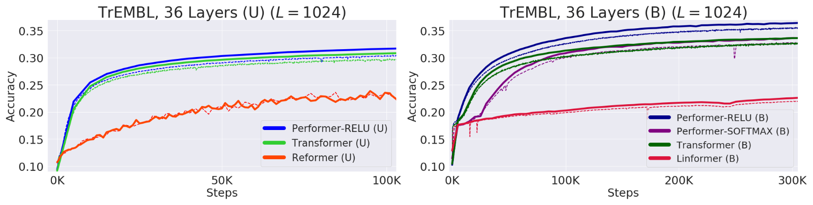

*图 6（原文 Figure 6，第 8 页）：虚线为训练，实线为验证。TrEMBL 上所有运行使用 Madani 等的相同模型参数 $(8,36,1024,512)$；为公平起见所有 TrEMBL 实验都用 16×16 TPU-v2；每次运行的 batch 在算力约束下取最大。超参数见附录 A，数据集统计、OOD 评估和可视化见附录 C。*

**图中文字翻译与读法**：

- **左图 TrEMBL, 36 Layers (U) ($L=1024$)（单向）**：横轴 Steps（0 到约 10 万），纵轴 Accuracy（0.10 到 0.35 附近）；蓝 Performer-RELU (U)，绿 Transformer (U)，橙红 Reformer (U)；
- **右图 TrEMBL, 36 Layers (B) ($L=1024$)（双向）**：横轴 Steps（0 到约 30 万）；深蓝 Performer-RELU (B)，紫 Performer-SOFTMAX (B)，深绿 Transformer (B)，红 Linformer (B)；
- **读图结论**：论文说 Reformer 和 Linformer 在蛋白质数据上准确率大幅下降；广义注意力的有效性体现在 Performer-RELU 在 (U) 与 (B) 中都取得最高准确率；论文提出的 softmax 近似也是紧的，准确率与精确 softmax 的 Transformer 相同。从图上读出的验证准确率（约）：(U) 里 Performer-RELU 约 0.318，Transformer 约 0.31，Reformer 约 0.22；(B) 里 Performer-RELU 约 0.365，Transformer 与 Performer-SOFTMAX 约 0.335，Linformer 约 0.226。

单序列蛋白质建模结果（$L=1024$；UNI 为单向，BID 为双向；Accuracy 为准确率（%），Perplexity 为困惑度；经验基线对 UNI 与 BID 都适用）：

| 模型类型 | 集合 | 模型 | 准确率 | 困惑度 |
|---|---|---|---:|---:|
| UNI | Test（测试） | Empirical Baseline（经验基线） | 9.92 | 17.80 |
| UNI | Test | Transformer | 30.80 | 9.37 |
| UNI | Test | Performer (generalized)（广义） | 31.58 | 9.17 |
| UNI | OOD | Empirical Baseline | 9.07 | 17.93 |
| UNI | OOD | Transformer | 19.70 | 13.20 |
| UNI | OOD | Performer (generalized) | 18.44 | 13.63 |
| BID | Test | Transformer | 33.32 | 9.22 |
| BID | Test | Performer (generalized) | 36.09 | 8.36 |
| BID | Test | Performer (softmax) | 33.00 | 9.24 |
| BID | OOD | Transformer | 25.07 | 12.09 |
| BID | OOD | Performer (generalized) | 24.10 | 12.26 |
| BID | OOD | Performer (softmax) | 23.48 | 12.41 |

（原文附录表 2，第 20 页。）

**读法**：

- **IID 测试集**：广义（ReLU）Performer 优于 Transformer（单向 31.58 对 30.80，困惑度 9.17 对 9.37；双向 36.09 对 33.32，困惑度 8.36 对 9.22）；softmax 近似的 Performer 与 Transformer 基本持平（33.00 对 33.32，困惑度 9.24 对 9.22，**略低**）。
- **OOD 测试集**：Performer 两个版本**都不如** Transformer：单向 18.44 对 19.70，双向广义 24.10、softmax 23.48 对 25.07。论文正文没有讨论这一点。
- **证据边界**（笔者）：图 6 的每次运行 batch 取各自能用的最大值，Performer 因省显存可用更大的 batch，所以同样的步数下看到的样本数并不相同；论文没有给出多次运行的方差。

**注意力的可视化（附录 C.4）**：论文对一个训练了超过 50 万步的双向 Performer 提取注意力矩阵（对 $(Q,K,V^{\circ})$ 再算一次，其中 $V^\circ$ 是位置的 one-hot 指示，从而直接读出注意力矩阵）。对 BPT1_BOVIN 蛋白质序列（100 个氨基酸，原文称它是研究得最充分的球蛋白之一），前 4 层的 8 个头里，许多头呈对角线模式（每个位置关注邻居），另有头呈竖线模式（所有位置关注同样的固定位置）；两个头的细看：Head 1-2（第二层第三个头）呈块状注意力，Head 4-1（第五层第二个头）把注意力集中在起始 token（M）和第 85 个 token（C）上；注意力矩阵同时包含局部与全局模式，这与自然语言 Transformer 以及已有蛋白质 Transformer 的发现一致。

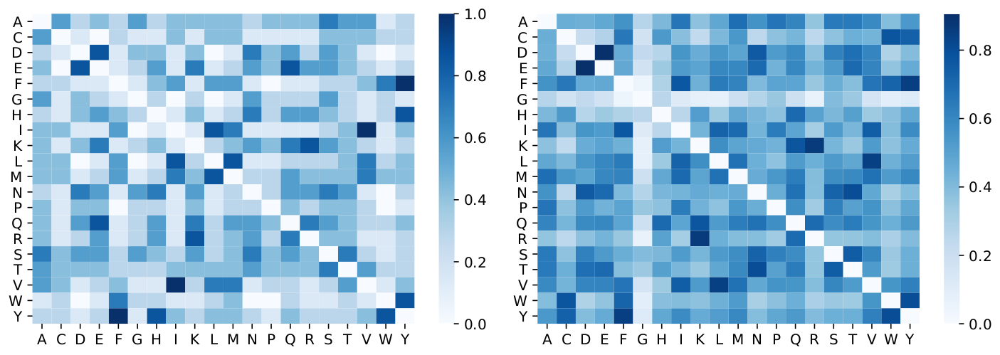

*图 A13（原文 Figure 13，第 22 页）：由一小部分序列的注意力矩阵汇总估计的氨基酸相似度矩阵（方法同 Vig 等 2020）。两个子图分别是：(1) 归一化的 BLOSUM 矩阵；(2) 由训练好的 Performer 估计的氨基酸相似度。可以看到 Performer 能识别很相近的氨基酸对，如 (D, E) 和 (F, Y)。*

**图中文字翻译与读法**：左图是归一化 BLOSUM（氨基酸替换得分矩阵，色标 0 到 1.0），右图是 Performer 的估计（色标 0 到约 0.9）；两张图的横纵轴都是 20 种标准氨基酸（A C D E F G H I K L M N P Q R S T V W Y），颜色越深表示越相似。**读图结论**：原文点名右图中的 (D, E) 和 (F, Y) 呈深色，与左图 BLOSUM 一致；笔者读图，(K, R)、(I, V) 在右图也较深。这是对 800 条序列的注意力汇总的结果。

### 7.6 长序列训练：ImageNet64 与串接蛋白质（第 4.5 节，图 7）

**ImageNet64（单向）**：标准 (U) 基准（Parmar 等 2018），$L=12288$（$64\times64$ 像素 $\times3$ 通道），常规 Transformer 无法训练。所有模型使用相同的 $(n_{\text{heads}},d_{ff},d)=(8,2048,512)$，只改变层数。

**串接 TrEMBL（双向）**：把蛋白质序列串接到 $L=8192$，用来做“预测蛋白质群之间相互作用”的原理验证研究（长度足以建模蛋白质相互作用网络，而不需要现有方法所需的大规模序列比对）。常规 Transformer 在这个设置下即使每片 batch 为 1 也远远超出内存，所以基线被迫缩成 $(n_{\text{heads}},n_{\text{layers}},d_{ff},d)=(8,\{1,2,3\},256,256)$；Performer 则用标准的 $(8,6,2048,512)$ 在每片 batch 为 8 下高效训练。

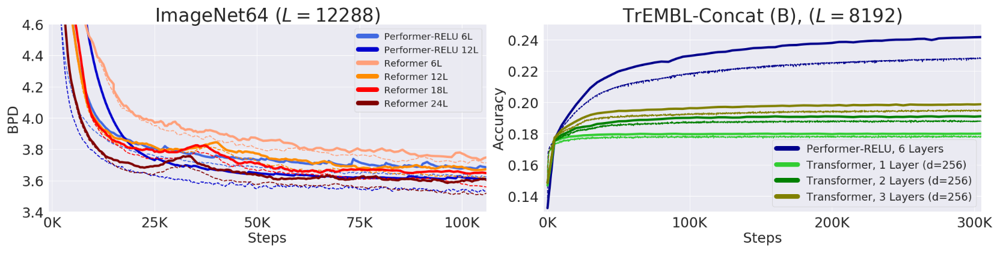

*图 7（原文 Figure 7，第 8 页）：虚线为训练，实线为验证。ImageNet64 的所有模型使用标准的 $(n_{\text{heads}},d_{ff},d)=(8,2048,512)$；附录 D.2 进一步说明正特征的 softmax 近似与 ReLU 的结果相同。串接 TrEMBL 里较小的 Transformer 改变 $n_{\text{layers}}\in\{1,2,3\}$。超参数见附录 A。*

**图中文字翻译与读法**：

- **左图 ImageNet64 ($L=12288$)**：横轴 Steps（0 到约 10 万），纵轴 BPD（每维比特数，3.4 到 4.6，越低越好）；图例 Performer-RELU 6L、12L（蓝），Reformer 6L、12L、18L、24L（浅红到深红）；
- **右图 TrEMBL-Concat (B), ($L=8192$)**：纵轴 Accuracy（0.14 到 0.24）；Performer-RELU, 6 Layers（深蓝），Transformer 1、2、3 层（$d=256$，三种绿色）；
- **读图结论**：论文文字：Performer 6 层与 Reformer 12 层相当，Performer 12 层与 Reformer 24 层相当；从图上读出 10 万步的验证 BPD 约为：Performer 6L 3.68、12L 3.62，Reformer 6L 3.75、12L 3.69、18L 3.65、24L 3.61。右图中较小的 Transformer（3 层）很快停在约 19%（图上约 0.20），Performer 能持续训练到约 24%。文字还说，视硬件（TPU 或 GPU）而定，在 (U) 设置下通过 Jax 的优化，Performer 可以比 Reformer 快 2 倍。
- **证据边界**（笔者）：右图的对比基线是**小得多**的网络（$d=256$、至多 3 层，前馈宽度 256，而 Performer 为 $d=512$、6 层、$d_{ff}=2048$），差距混合了“架构”与“规模”；论文自己也说明这是被迫的。

### 7.7 广义注意力：核的选择与对比 Linear Transformer（附录 D.3、D.4）

论文在 TrEMBL（$L=512$）上用超参数扫描比较多种核函数 $f$（式 5 的 $f$）：sigmoid、exp、ReLU、absolute、gelu、cos（原来的 softmax 近似）、tanh、identity，也比较 renormalization（即除以 $D$）开关等设置，以得到最佳训练配置。

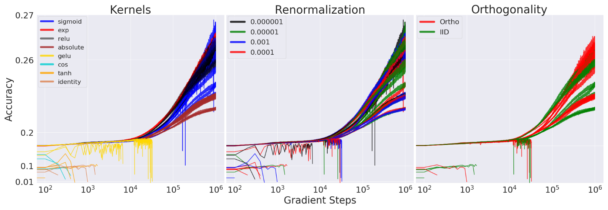

*图 A16（原文 Figure 16，第 24 页）：为强调最高准确率的运行，同时展示某些核出现 NaN 导致运行提前终止，横轴和纵轴都取对数刻度。测试了由不同函数 $f$ 定义的核：sigmoid、exponential、ReLU、absolute、gelu、cosine（原始 softmax 近似）、tanh、identity。所有训练在 2×2 TPU-v2 上，每设备 batch 128。*

**图中文字翻译与读法**：

- **三个面板** Kernels（核）、Renormalization（归一化）、Orthogonality（正交性）：横轴 Gradient Steps（梯度步数，$10^2$ 到 $10^6$），纵轴 Accuracy（准确率，$0.01$ 到 $0.27$，对数刻度）；
- **左面板图例**：sigmoid、exp、relu、absolute、gelu、cos、tanh、identity；**中面板图例**：0.000001、0.00001、0.001、0.0001 四个数值（原文没有说明其含义）；**右面板图例**：Ortho（红）、IID（绿）；
- **读图结论**：左面板里 sigmoid、exp、relu 等核的曲线位于图的最上方（约 0.26 以上），absolute（棕色）明显偏低，gelu、cos、tanh、identity 的运行出现 NaN 而提前终止（曲线停在低位）；右面板里红色（Ortho）的最高曲线略高于绿色（IID），但两者大量重叠，图上是许多次运行的叠加，纵轴为对数刻度，只能做定性读图。正文说明：有效 batch 大小会略微改变排名（2×2 与 4×4 TPU 的差异，图 A17），因此默认使用广义 ReLU 核，其余默认超参数见上表，因为它们在大 batch 运行（8×8 或 16×16 TPU）下经验上最优；关闭归一化不一定降低准确率。

**与 Linear Transformer 对比（附录 D.4）**：Linear Transformer 用 $\phi(x)=\mathrm{elu}(x)+1$ 作特征映射。为公平，作者按 Performer-ReLU 完全相同的 ProGen 设置和超参数训练（MLP 用原始 ReLU 而不是 GeLU）。

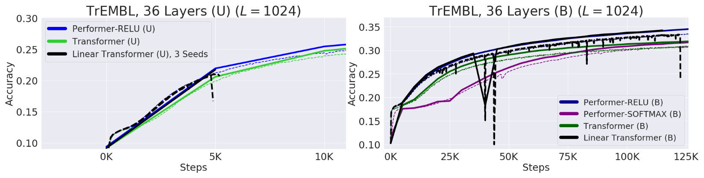

*图 A18（原文 Figure 18，第 24 页）：左，在单向 36 层 ProGen 设置里，作者训练了 3 个随机种子的 Linear Transformer，发现 3 个种子在很早期就出现梯度爆炸，训练终止。右，Linear Transformer 在双向设置中也在训练中途（约 12.5 万步）出现梯度爆炸；梯度爆炸可从 NaN 错误前训练准确率的陡降看出。*

**图中文字翻译与读法**：左图 TrEMBL, 36 Layers (U) ($L=1024$)：蓝 Performer-RELU (U)、绿 Transformer (U)、黑 Linear Transformer (U), 3 Seeds（3 个种子）；右图 (B)：深蓝 Performer-RELU (B)、紫 Performer-SOFTMAX (B)、深绿 Transformer (B)、黑 Linear Transformer (B)。**读图结论**：黑线（Linear Transformer）在单向设置下（3 个种子）图上约 5000 步附近就陡降并终止；双向设置下从约 4 万步起多次陡降，约 12.5 万步处梯度爆炸；其他曲线平稳。**证据边界**（笔者）：这只用了 Performer-ReLU 的超参数，没有为 Linear Transformer 调参；结论是“在这一设置下不稳定”，不是“Linear Transformer 一般不稳定”。

### 7.8 Long Range Arena（附录 D.5，图 19）

论文把 Performer 与 Tay 等（2021）的 Long Range Arena（LRA）中的其他方法（可扩展与不可扩展的）做了比较，图 19 是 LRA 原论文的结果表（不是 Performer 论文自己重新训练的）。任务：(1) 更长的 ListOps 变体（Nangia & Bowman 2018），(2) 字节级文本分类，(3) 字节级文档检索，(4) 像素序列的图像分类，(5) Pathfinder（长距离空间依赖）；所有模型在 Path-X 任务上都学不到任何东西（FAIL）。论文称：在所有被测的**可扩展** Transformer（定义为速度大于每秒 100 个样本）中，Performer 的 LRA 分数最高。

LRA 结果（准确率 %；原文粗体为最优，下划线为次优，本文只保留粗体）：

| 模型 | ListOps | Text | Retrieval | Image | Pathfinder | Path-X | 平均 |
|---|---:|---:|---:|---:|---:|---|---:|
| Transformer | 36.37 | 64.27 | 57.46 | 42.44 | 71.40 | FAIL | 54.39 |
| Local Attention | 15.82 | 52.98 | 53.39 | 41.46 | 66.63 | FAIL | 46.06 |
| Sparse Trans. | 17.07 | 63.58 | **59.59** | **44.24** | 71.71 | FAIL | 51.24 |
| Longformer | 35.63 | 62.85 | 56.89 | 42.22 | 69.71 | FAIL | 53.46 |
| Linformer | 35.70 | 53.94 | 52.27 | 38.56 | 76.34 | FAIL | 51.36 |
| Reformer | **37.27** | 56.10 | 53.40 | 38.07 | 68.50 | FAIL | 50.67 |
| Sinkhorn Trans. | 33.67 | 61.20 | 53.83 | 41.23 | 67.45 | FAIL | 51.39 |
| Synthesizer | 36.99 | 61.68 | 54.67 | 41.61 | 69.45 | FAIL | 52.88 |
| BigBird | 36.05 | 64.02 | 59.29 | 40.83 | 74.87 | FAIL | **55.01** |
| Linear Trans. | 16.13 | **65.90** | 53.09 | 42.34 | 75.30 | FAIL | 50.55 |
| Performer | 18.01 | 65.40 | 53.82 | 42.77 | **77.05** | FAIL | 51.41 |
| Task Avg (Std)（各任务均值与标准差） | 29 (9.7) | 61 (4.6) | 55 (2.6) | 41 (1.8) | 72 (3.7) | FAIL | 52 (2.4) |

（原文图 19 上表，第 25 页。原文的下划线次优值：Transformer 的平均 54.39、Linformer 的 Pathfinder 76.34、Synthesizer 的 ListOps 36.99、BigBird 的 Retrieval 59.29、Performer 的 Text 65.40 与 Image 42.77。平均不含 Path-X；笔者复算：Performer $(18.01+65.40+53.82+42.77+77.05)/5=51.41$。）

效率对比（batch size 32，4×4 TPU-v3；左：每秒步数，括号内为相对 Transformer 的加速倍数；右：每台设备的峰值显存，GB；1K/2K/3K/4K 为序列长度）：

| 模型 | 每秒步数 1K | 2K | 3K | 4K | 峰值显存 1K | 2K | 3K | 4K |
|---|---:|---:|---:|---:|---:|---:|---:|---:|
| Transformer | 8.1 | 4.9 | 2.3 | 1.4 | 0.85 | 2.65 | 5.51 | 9.48 |
| Local Attention | 9.2 (1.1x) | 8.4 (1.7x) | 7.4 (3.2x) | 7.4 (5.3x) | 0.42 | 0.76 | 1.06 | 1.37 |
| Linformer | 9.3 (1.2x) | 9.1 (1.9x) | 8.5 (3.7x) | 7.7 (5.5x) | **0.37** | **0.55** | 0.99 | **0.99** |
| Reformer | 4.4 (0.5x) | 2.2 (0.4x) | 1.5 (0.7x) | 1.1 (0.8x) | 0.48 | 0.99 | 1.53 | 2.28 |
| Sinkhorn Trans | 9.1 (1.1x) | 7.9 (1.6x) | 6.6 (2.9x) | 5.3 (3.8x) | 0.47 | 0.83 | 1.13 | 1.48 |
| Synthesizer | 8.7 (1.1x) | 5.7 (1.2x) | 6.6 (2.9x) | 1.9 (1.4x) | 0.65 | 1.98 | 4.09 | 6.99 |
| BigBird | 7.4 (0.9x) | 3.9 (0.8x) | 2.7 (1.2x) | 1.5 (1.1x) | 0.77 | 1.49 | 2.18 | 2.88 |
| Linear Trans. | 9.1 (1.1x) | 9.3 (1.9x) | 8.6 (3.7x) | 7.8 (5.6x) | **0.37** | 0.57 | **0.80** | 1.03 |
| Performer | **9.5** (1.2x) | **9.4** (1.9x) | **8.7** (3.8x) | **8.0** (5.7x) | **0.37** | 0.59 | 0.82 | 1.06 |

（原文图 19 下表，第 25 页。Synthesizer 在 3K 的 6.6 高于 2K 的 5.7，是原文如此。）

**读法**（笔者核算）：

- Performer 在速度上是表里最快（4K 时每秒 8.0 步，是 Transformer 的 5.7 倍），显存与 Linformer、Linear Trans. 同属最低的一档；
- 论文称 Performer 在“可扩展”模型里 LRA 平均分最高：笔者按 4K 序列、batch 32 估计（每秒样本数 $=32\times$ 每秒步数，要求大于 100，即每秒步数大于约 3.1），满足条件的有 Local Attention、Linformer、Sinkhorn、Linear Trans.、Performer，其中 Performer 的 51.41 略高于 Sinkhorn 的 51.39 与 Linformer 的 51.36，**只差 0.02 至 0.05**，在噪声范围内（论文没有列出哪些模型算“可扩展”）；
- 而 Performer 的平均分**低于**标准 Transformer（54.39）、BigBird（55.01）、Longformer（53.46）、Synthesizer（52.88）；它在 ListOps 上（18.01 对 36.37）明显落后。

## 八、局限、证据边界与常见误读

**论文的主要证据边界**：

1. **“Performer”是什么要看后缀**：多数大实验用的是 ReLU 广义注意力，它并不近似 softmax；而近似 softmax 的 Performer-SOFTMAX 只是“追平”而非超过 Transformer，并且要靠重抽样等技巧才稳定；
2. **理论与实际的距离**：均匀收敛定理针对三角特征；PRF 的保证是 MSE 与尾部界；定理 1 的系数对常见维度并不紧；
3. **向后兼容需要微调**：预训练权重不能直接用，因为误差经多层传播（图 A14），LM1B 上需要在原始步数的一小部分内恢复；
4. **OOD 不占优**：附录表 2 中 Performer 在 OOD 集上都低于 Transformer；
5. **对比的公平性**：batch 取各自最大值；ImageNet64、串接蛋白质的基线规模不同；Linformer 基线用了作者自己的 Jax 实现与 $k=600$；Linear Transformer 只在一组超参数下比较；几乎没有多次运行的方差；
6. **LRA 的数字来自另一篇论文**，且 Performer 的优势只在 0.02 到 0.05 的量级；
7. **短序列没有优势**：按 3.1 节的粗算，序列长度小于约 $2r$ 时 FAVOR 不占优（图 3 的短序列两者耗时相近）；每头维度较大时 $m=\Theta(d\log d)$ 也不小。

**常见误读**：

- Performer 的“线性”是对序列长度而言，代价里仍有 $d$ 与特征数 $r$；它是统计近似，不是对 softmax 的精确重排；“理论无偏”只对未归一化核的每个元素成立，一次有限随机映射不是没有误差；
- Performer 不是“去掉 softmax”：FAVOR+ 的目标是近似 $\exp(q^\top k)$ 核；若换成 ReLU 等核，就是另一种线性注意力（“广义注意力”）；
- 因果版本不能把未来的 key、value 加进全局和；要用前缀和。

## 九、复现检查清单

- 用论文的正随机特征映射 $\exp(\omega^\top x-\lVert x\rVert^2/2)$，并先把 query、key 各乘 $d^{-1/4}$；用 $\sin/\cos$ 的随机傅里叶特征不能直接等价；注意数值稳定化（论文默认 numerical stabilizer $10^{-6}$）；
- 分母必须一并近似：$\widehat D=\mathrm{diag}\big(Q'(K'^\top\mathbf 1_L)\big)$；漏掉归一化就变成另一种线性注意力；
- 因果实现用前缀和（或串行累加），禁止把未来的 $K',V$ 加入全局和；
- ORF：$m\le d$ 时用 Gram–Schmidt（QR），$m>d$ 时分块；周期性重抽样随机矩阵（论文认为这对大规模训练很关键）；
- 记录特征数（默认 256）、核（softmax 近似或 ReLU）、是否重抽样、是否 SMREG、numerical stabilizer；
- 多个随机种子报告方差，并扫描特征数 $r$；比较时保持每步样本数一致，或明确说明 batch 的差异。

## 十、与相关论文的关系

- [Linformer](../linformer/论文中文解读.md)：低秩投影路线，只适用于非因果；本文把它作为 (B) 基线，在蛋白质和 PG-19 上表现较差（用 $k=600$）；Performer 的路线是近似 softmax 核本身；
- [RoPE](../rope/论文中文解读.md)：RoPE 论文第 4.4 节把旋转位置编码加到 Performer 上，证明旋转可以与线性注意力结合；
- [FlashAttention](../flash_attention/论文中文解读.md)：该论文的表 3（Long-Range Arena）里也有 Performer（平均精度 58.9，对标准 Transformer 的 59.3，加速 1.8 倍；来自 FlashAttention 论文自己的复现）；FlashAttention 保持精确注意力、优化访存，与近似路线互补；
- [Longformer](../longformer/论文中文解读.md)、[BigBird](../bigbird/论文中文解读.md)：稀疏图路线；
- Katharopoulos 等 2020（Linear Transformer，$\mathrm{elu}+1$）：线性注意力的另一条路线，本文表明在其设置下它训练不稳定。

## 原文证据导航

- [原论文 PDF](paper.pdf)
- [原文提取文本](paper.txt)
- [论文概要](论文概要.md)
