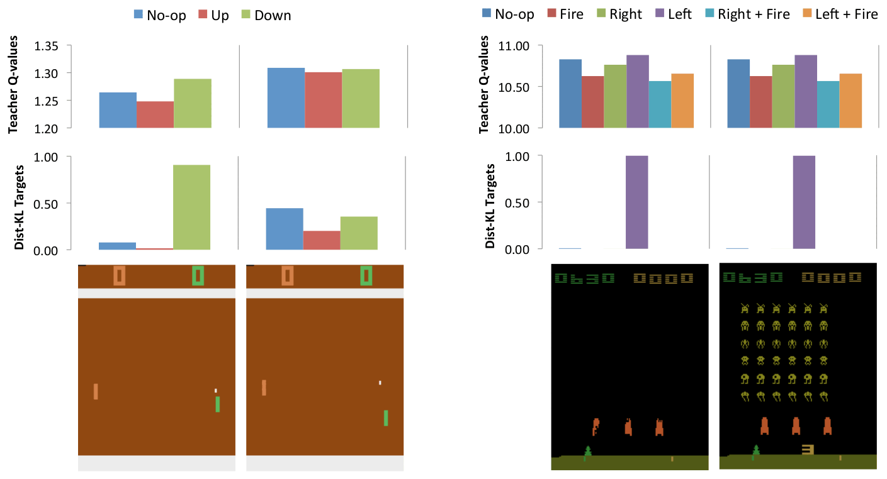
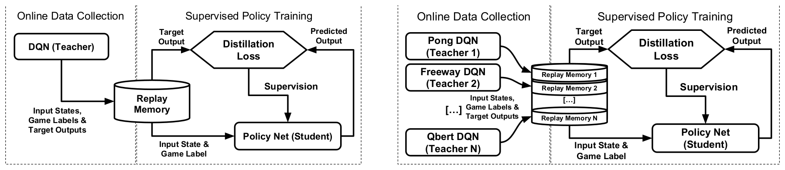
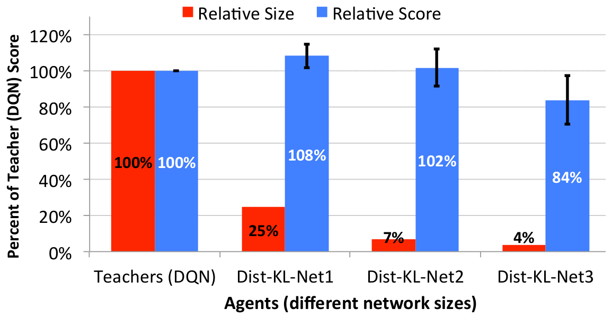
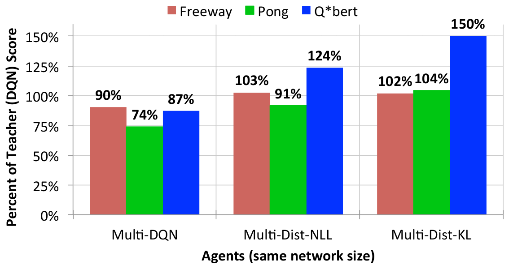
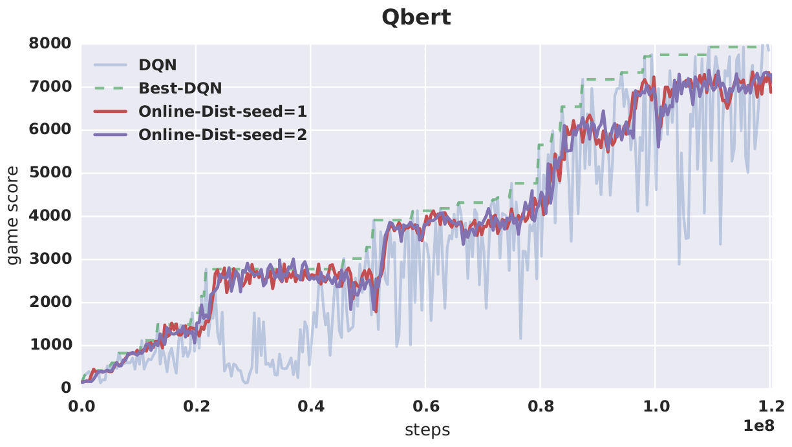
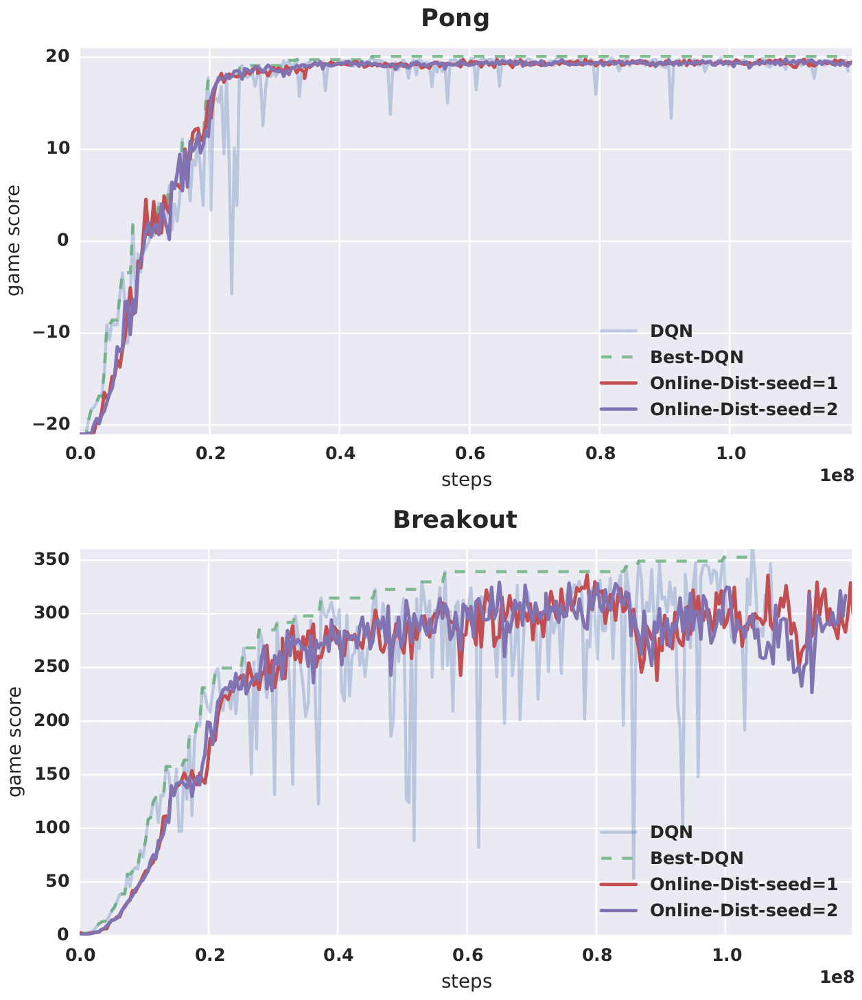
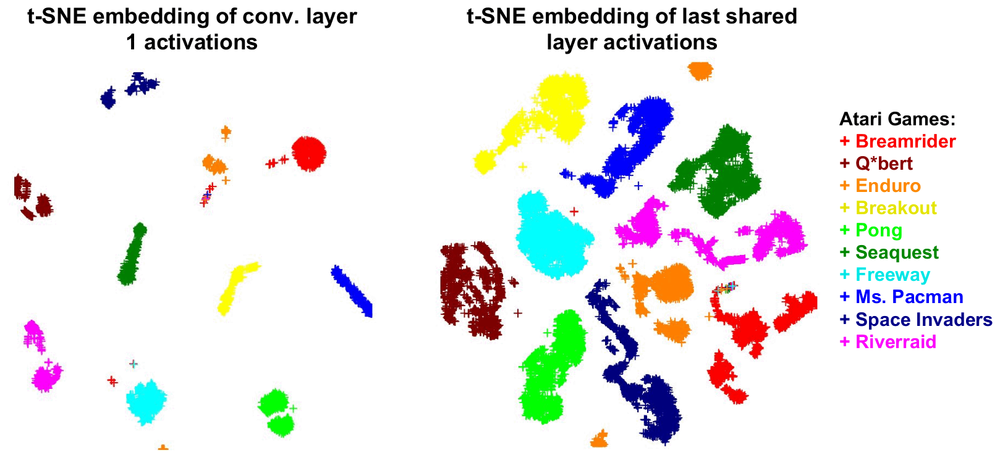

# 论文中文解读：《Policy Distillation》

> **基本信息**：Andrei A. Rusu、Sergio Gómez Colmenarejo、Çağlar Gülçehre、Guillaume Desjardins、James Kirkpatrick、Razvan Pascanu、Volodymyr Mnih、Koray Kavukcuoglu、Raia Hadsell（Google DeepMind，伦敦；Gülçehre 为 DeepMind 实习期间完成，另属蒙特利尔大学），arXiv:1511.06295（本文依据 2016 年 1 月 7 日的 v2），ICLR 2016；论文原文 [官方页面](https://arxiv.org/abs/1511.06295)。
>
> **本文的读法**：图均为从 PDF 中裁出的原图（正文图 1–5，附录图 C1、D2，共 7 张），表为逐格核对后的中文转录（原文共 6 张表：正文表 1–2、附录表 A1、A2、B1、B2）。每张图后有中文图题、图例/坐标轴翻译和读图结论；凡从图上读出的数值都写“约”，以原文正文和表中的数字为准。所有“分数”都是人类起点（human starts）评测下的游戏得分，“%DQN”是学生分数除以对应 DQN teacher 分数。

## 一、一句话结论

DQN 要训练出好策略需要较大的网络和很长的训练，但训练完成后，真正要部署的只是“在当前状态选哪个动作”这个决策函数。Policy Distillation 把已经训练好的 DQN（teacher）当作老师：让它玩游戏，记下每个状态的输入帧和全部动作的 Q 值，再用**监督学习**训练一个新的 student 网络去拟合老师的输出。论文发现：（1）用 KL 散度拟合“低温（$\tau=0.01$）softmax 后的 Q 值”比拟合 Q 值本身（MSE）或只学最优动作（NLL）都好；（2）student 可以比 teacher 小很多（约 25%、7% 参数量仍不低于 teacher，4% 参数量时约为 teacher 的 84%）；（3）可以把多个游戏的 teacher 合并到一个 student 里：3 个游戏时 student 超过各 teacher（几何平均 105.1%、116.9%），远好于联合训练的多任务 DQN（83.5%）；10 个游戏合并进一个 4 倍大的网络时达到 teacher 的 89.3%；（4）可以在 DQN 训练过程中在线地蒸馏当前最好的策略，得到比 DQN 本身更稳定的曲线。

## 二、背景与动机

### 2.1 前置知识：DQN

深度 Q 网络（DQN）是一种无模型（model-free）强化学习方法，面向离散动作环境，已经在大量 Atari 2600 游戏上取得超人表现。环境在时刻 $i$ 提供动作 $a_i\in A=\{1,\dots,K\}$、观测 $x_i\in\mathbb{R}^d$ 和奖励 $r_i\in\mathbb{R}$。定义序列 $s_t=x_1,a_1,x_2,a_2,\dots,a_{t-1},x_t$，折扣为 $\gamma$ 的未来回报为 $R_t=\sum_{t'=t}^{T}\gamma^{t'-t}r_{t'}$。最优 Q 函数是在看到序列 $s$、选择动作 $a$ 之后能得到的最大期望回报：

$$
Q^*(s,a)=\max_\pi\mathbb{E}\big[R_t\mid s_t=s,\,a_t=a,\,\pi\big],
$$

其中 $\pi$ 是从序列到动作的映射。DQN 用卷积网络去逼近 $Q^*$，从经验回放（replay memory）中采样 $(s,a,r,s')$，最小化

$$
L_i(\theta_i)=\mathbb{E}_{(s,a,r,s')\sim U(D)}\Big[\big(r+\gamma\max_{a'}Q(s',a';\theta_i^-)-Q(s,a;\theta_i)\big)^2\Big].
$$

其中 $\theta_i^-$ 是较早版本的参数（target network）。经验回放用来打散样本相关性，target network 用来稳定学习，两者都是 DQN 的关键机制。训练好的 DQN 选择预测回报最高的动作。论文强调，这里提出的方法**不依赖于 DQN**，也可以用在其他 RL 算法训练出的模型上；DQN 在本文里既是性能对比的基线，也是被蒸馏的 teacher。

### 2.2 蒸馏的来龙去脉与相关工作

论文把相关工作分成四个方向：

- **模型压缩/蒸馏**：Bucila 等人（2006）首先提出用 teacher 网络的输出训练 student，把大集成模型压成一个网络；Ba 和 Caruana（2014）用它把深网络的知识迁移到浅网络；Liang 等人（2008）用慢速结构化输出 CRF 标注的数据训练快速逻辑回归模型；Menke 和 Martinez（2009）把模型迁移当作正则化手段；Hinton 等人（2014）提出“distillation”一词，并建议提高 softmax 的温度，让 teacher 把更多知识传给 student（见 [knowledge_distillation](../knowledge_distillation/论文中文解读.md)）。此后蒸馏被用于多种场景，但此前并未用于序列预测或强化学习问题。蒸馏的基本做法是用监督回归训练目标网络，使其输出与原网络相同的输出分布，通常使用被“软化”（更平缓）的目标分布。
- **深度强化学习**：DQN 直接从像素和奖励学习策略，需要很长的训练时间。
- **模仿学习**：RL 里已有多种“向 teacher 信号回归”的方法。teacher 信号常来自基于模型的算法，如基于遗憾的近似策略迭代（Lazaric 等 2010），或把蒙特卡洛树搜索当作 oracle（Guo 等 2014，回归 UCT 给出的策略可得到超人 Atari 分数，但需要知道游戏真实状态的模型，而不是直接从观测学习）。分类式策略迭代 CAPI（Farahmand 等 2012）不需要基于模型的 teacher，其单次迭代可视为一种特定损失（用动作差距 action gap 给动作分类加权）下的策略蒸馏。DAGGER（Ross 等 2010）里 student 自己生成一部分训练轨迹，而本文的轨迹完全由 teacher 产生。
- **多任务学习**：Caruana（1997）的多任务学习通常要求各任务定义在相同的输入分布上。Atari 游戏虽然输入模态一致，图像却千差万别，没有自然图像那样的共同统计基础，所以多任务学习更难。论文声称模型压缩与蒸馏可以缓解这类问题。

### 2.3 为什么在 RL 里蒸馏并不直接

蒸馏传统上用于输出为类别概率的网络。而 RL 里网络输出的是**动作价值**：实数、无界，尺度取决于游戏中的期望未来回报。它们在多个动作后果相近时是模糊的、几乎无法区分的，在动作重要时又是尖锐的、能区分的。这些特点使蒸馏很难直接套用。具体困难：

1. 绝对 Q 值的尺度跨游戏不同，也会在训练中漂移，回归起来难学且不稳定；
2. 对一个固定策略计算其全部动作价值，本质上要解决 Q 值评估问题，计算上很难；
3. 很多连续帧里各动作回报非常接近，真正决定最优动作的是很小的动作差距（action gap）；
4. 只预测唯一最优动作也有问题，因为可能有多个动作 Q 值相近。

解读者补充：分类模型的 logits 只在加常数意义下有意义，softmax 之后就是类别分布；DQN 输出的 Q 值则要受奖励大小、折扣和训练误差影响。

## 三、方法

### 3.1 单游戏策略蒸馏：三种损失

蒸馏是把知识从 teacher 模型 $T$ 迁移到 student 模型 $S$。假设 teacher 已经生成数据集 $D^T=\{(s_i,\mathbf q_i)\}_{i=0}^N$，每个样本由一小段观测序列 $s_i$ 和一个未归一化的 Q 值向量 $\mathbf q_i$（每个动作一个值）组成。论文考虑三种蒸馏方法。图 1 先给出直观例子，说明为什么不能直接回归 Q 值。



*图 1（原文 Figure 1，第 3 页）：两个 Atari 游戏里各取两帧，上排是 DQN 输出的 Q 值（teacher Q-values），中排是 softmax 之后的蒸馏目标（Dist-KL targets），下排是对应的游戏画面。*

**图中文字翻译与读法**：

- **左半（Pong）**：图例 No-op（不动，蓝）、Up（上，红）、Down（下，绿）。两帧画面只差几个像素（右侧球拍与球的位置略有不同），但 Q 值不同：第一帧 Q 值约为 No-op 1.26、Up 1.25、Down 1.29，经 softmax 后目标集中在 Down（约 0.9）；第二帧三个 Q 值非常接近（约 1.31、1.30、1.31），softmax 之后概率更分散（约 0.44、0.20、0.35）。
- **右半（Space Invaders）**：图例 No-op、Fire（开火）、Right（右）、Left（左）、Right + Fire、Left + Fire。两帧画面差别很大（第二帧外星人阵列完整，第一帧没有），但两帧的 Q 值几乎一样（约在 10.6–10.9），softmax 后目标几乎全部集中在 Left（约 1.0）。
- **读图结论**：画面几乎一样的两帧（Pong）Q 值可以不同，画面差别很大的两帧（Space Invaders）Q 值却可以几乎一样，所以不能指望从画面相似性去回归绝对 Q 值；而且 Q 值之间的差距很小（Pong 里只有百分之几），所以 softmax（图题说 “In both games the softmax sharpens the targets”）把它们**锐化**成清晰的动作选择，学生更容易学。解读者的验算：对图中读出的 Q 值按 $\tau=0.01$ 做 softmax，可以大致复现图中的目标（例如 Pong 第一帧：Down 与 No-op 的 Q 值差约 0.025，对应概率比约 $e^{2.5}\approx12$）。原文未单独写出图 1 所用的温度。

三种损失如下。

**（1）NLL：只学 teacher 的最优动作。** 取 $a_{i,\mathrm{best}}=\arg\max(\mathbf q_i)$，训练 student 用负对数似然预测同一动作：

$$
L_{\mathrm{NLL}}(D^T,\theta_S)=-\sum_{i=1}^{|D|}\log P\big(a_i=a_{i,\mathrm{best}}\mid x_i,\theta_S\big).
$$

它直接优化动作分类。理论上这并不算错，因为只要奖励不是随机的，任何最优策略都是确定性的；但如果没有最优的 teacher，最小化 NLL 可能放大 teacher 学习过程中固有的噪声（把它们硬化成唯一正确答案），也无法表达多个近等价动作。

**（2）MSE：拟合全部 Q 值。**

$$
L_{\mathrm{MSE}}(D^T,\theta_S)=\sum_{i=1}^{|D|}\Vert\mathbf q_i^T-\mathbf q_i^S\Vert_2^2.
$$

优点是保留 student 里的完整动作价值集合；缺点是它对数值误差敏感，而决定贪心动作的往往是很小的 Q 值差，这些差异在 MSE 里权重很低。

**（3）KL：采用 Hinton 等人的蒸馏设置，带温度 $\tau$。**

$$
L_{\mathrm{KL}}(D^T,\theta_S)=\sum_{i=1}^{|D|}\sum_{a}\mathrm{softmax}\Big(\frac{\mathbf q_i^T}{\tau}\Big)_a\ln\frac{\mathrm{softmax}\big(\mathbf q_i^T/\tau\big)_a}{\mathrm{softmax}\big(\mathbf q_i^S\big)_a}.
$$

（原文把对动作的求和隐含在向量运算里，这里写成显式的求和。注意学生一侧的 softmax 没有除以 $\tau$。）teacher 的 Q 值经温度 $\tau$ 的 softmax 变成目标分布。

关于温度要特别注意。传统分类设置里，teacher 的输出分布非常尖，所以用更高的温度软化它，让更多次要知识传给 student。但在策略蒸馏里，teacher 的输出并不是分布，而是各动作的期望未来折扣回报，所以作者预期反而可能需要**让目标更尖**。实验里 $\tau=0.01$ 是从 $[1.0,0.1,0.01,0.001]$ 里经验选出的。这与 Hinton 的 KD 并不矛盾，只是 teacher 输出的语义不同（解读者补充：分类 logits 常常过尖，Q 值作为累计回报常常对多个动作过平，所以前者要软化、后者要锐化）。

### 3.2 多任务策略蒸馏（图 2）

多任务策略蒸馏很直接：训练 $n$ 个单游戏 DQN 专家，每个单独训练。它们像单游戏蒸馏那样生成输入和目标，数据存放在**各自独立**的缓冲区里。蒸馏智能体依次从这 $n$ 个数据存储中学习，每个 episode 切换一次。不同游戏的动作集不同，因此每个任务训练一个独立的输出层（称为 controller 层），训练和评测时都用任务 id 切换到正确的输出。多任务实验同样比较 KL 与 NLL 两种蒸馏损失。



*图 2（原文 Figure 2，第 4 页）：左（a），单任务数据收集与策略蒸馏；右（b），多任务数据收集与策略蒸馏。*

**图中文字翻译与读法**：

- **左 (a)**：左半 “Online Data Collection”（在线数据收集）：DQN (Teacher) 玩游戏，把 “Input States, Game Labels & Target Outputs”（输入状态、游戏标签与目标输出）写入 Replay Memory（回放存储）。右半 “Supervised Policy Training”（有监督的策略训练）：从 Replay Memory 取出 Target Output（目标输出）送到 Distillation Loss（蒸馏损失，六边形节点）；同时取出 Input State & Game Label（输入状态和游戏标签）送给 Policy Net (Student)（学生策略网络）；学生的 Predicted Output（预测输出）也回到蒸馏损失，由 Supervision（监督信号）更新学生。DQN 智能体周期性地把新的游戏过程加进回放存储，同时训练学生。
- **右 (b)**：多个 DQN 教师（Pong DQN (Teacher 1)、Freeway DQN (Teacher 2)、……、Qbert DQN (Teacher N)）分别向各自的 Replay Memory 1、2、……、N 写数据，其余流程与左图相同，学生网络 Policy Net (Student) 通过游戏标签选择对应的输出头。
- **读图结论**：与普通 RL 不同，学生**不与环境交互来决定自己的训练分布**，数据完全由 teacher 产生；这使训练变成一个干净的监督学习问题。

**与多任务 DQN 对比**。论文的一个重要贡献是比较多任务 DQN 与多任务蒸馏智能体。多任务 DQN 的做法与单游戏学习类似：网络预测每个动作的平均折扣回报；与多任务蒸馏一样，每个 episode 切换游戏，每个任务保留独立的回放缓冲区，训练在各任务间均匀交错；用游戏标签选择各自的输出层（controller）；损失函数与单任务学习完全一样。即使有独立 controller，多游戏的 DQN 学习仍然极具挑战，通常达不到单游戏性能。作者认为原因是不同策略之间的干扰、不同的奖励缩放，以及学习价值函数本身的不稳定。蒸馏则可能在没有这种破坏性干扰和缩放问题的前提下合并多个策略：策略在蒸馏过程中被压缩、提炼，也许更容易合并到一个网络里；而且策略天然比价值函数方差更低，应有助于性能与稳定性（Greensmith 等 2004）。

### 3.3 在线蒸馏

论文的最后一个贡献是在线策略蒸馏：student 要在 Q 学习进行的同时**跟踪**DQN teacher。这并不显然会成功，因为已经观察到 DQN 策略在训练中会剧烈变化，不同部分的游戏被探索和掌握。做法是：正常训练 DQN，每当它取得新的最高分时就保存当前网络；蒸馏学习器使用这个保存的网络，直到被更高分的 DQN 网络替换。结果见图 5。

## 四、训练与评测设置

### 4.1 训练流程（正文 4.1 与附录 A）

- **数据收集**：与 Mnih 等人（2015）评测智能体的条件类似：DQN 智能体先随机执行至多 30 个 null-op 来初始化 episode，然后按其 Q 函数贪心行动，但有 5% 的动作均匀随机选择。每个 episode 最长 30 分钟实时游戏（108,000 帧）。少量随机动作使游戏轨迹更多样，扩大状态空间覆盖。
- **存储与更新**：把 teacher 的输出（所有有效动作的 Q 值）和输入（模拟器帧）写入容量为 10 小时实时游戏（15 Hz 下 540,000 个控制步）的回放存储；每往存储里新增 1 小时 teacher 游戏，就对 student 做 10,000 次 minibatch 更新。优化器为 RMSProp。结果对主学习率 $1.0\times10^{-4}$ 到 $1.0\times10^{-3}$、最大学习率 $1.0\times10^{-3}$ 到 $1.0\times10^{-1}$ 都稳健；超参数在 4 个游戏的预备实验里选定。
- **数据量**：报告结果里每个 student 消耗 500 小时 teacher 游戏数据，不到训练每个 DQN teacher 所用数据量的 50%。用现代 GPU 刷新存储和训练 student 比实时快得多，通常几天内收敛。
- **多任务**：每个游戏用独立回放存储（同样容量 10 小时），各 DQN teacher 轮流往里添加数据；游戏数据累计 1 小时后，student 做 10,000 次 minibatch 更新（每个 minibatch 取自随机选中的单个游戏的存储）。正文说蒸馏智能体每个 episode 切换一次数据存储，附录说每个 minibatch 取自随机选中的单个游戏存储，两处表述的粒度不同，论文没有进一步说明。除最大的网络外，所有网络都使用同样的 500 小时预算；最大的网络（10 个游戏）使用了 34,000 小时的经验。
- **蒸馏目标**：MSE 用 teacher 的所有动作 Q 值作为监督目标；NLL 只用 teacher 最高值动作的 one-hot 目标；KL 用温度 $\tau=0.01$ 的 softmax 把 Q 值变成“锐化”的动作概率，$\tau$ 在 $[1.0,0.1,0.01,0.001]$ 中经验选出，最小化它与学生输出分布的 KL 散度。多数报告实验使用 KL 且超参数固定，这一选择来自 4.2 节在 10 个游戏中的 4 个上做的实验。
- **网络结构**：在连续两层之间加整流（ReLU）非线性；输出层每个有效动作一个线性单元；用 NLL 与 KL 蒸馏时，最后加一个 softmax。

### 4.2 评测协议：人类起点

由于许多 Atari 游戏高度确定，学习器可能记住并复现从少数起点出发的动作序列。为严格检验 DQN teacher 与蒸馏智能体的泛化能力，论文沿用 Nair 等人（2015）及后续研究引入的评测方法：用职业人类玩家的游戏过程生成每个游戏的**起始状态**：采样 100 个出现在每个 episode 前 20% 长度里的随机位置，丢弃人类玩家在此之前累计的分数；智能体最多玩 30 分钟实时游戏（108,000 帧），$\epsilon$ 取较大的 5%；训练结束后才计算泛化分数。因为智能体不控制起始状态的分布，训练数据也不使用任何人类轨迹，所以论文认为高分意味着良好的泛化。这些分数与以往报告的 null-op 评测不能直接比较。

**游戏选择**：预先固定了 10 个流行 Atari 游戏，水平从超人（如 Breakout、Space Invaders）到低于人类（Q*bert、Ms.Pacman）不等，以覆盖 DQN 在整个游戏集上的不同表现。

**多游戏指标**：由于各游戏的奖励结构和缩放有任意性，跨游戏的算术平均分数没有意义。论文把先前发表的 DQN 泛化分数（van Hasselt 等；Nair 等 2015）作为参照，把 student 分数表示为相对百分比，用**几何平均**汇总（Fleming 与 Wallace 1986）。

### 4.3 网络结构（附录 A 的表 A1、A2）

**表 A1：单任务压缩实验所用的网络结构与参数量**（Conv. 为各卷积层的单元数，F.C. 为全连接层单元数；“输入”列的 4 按 DQN 惯例是堆叠的 4 帧，原文未说明）

| 智能体 | 输入 | Conv. 1 | Conv. 2 | Conv. 3 | F.C. 1 | 输出 | 参数量 |
|---|---:|---:|---:|---:|---:|---|---:|
| Teacher (DQN) | 4 | 32 | 64 | 64 | 512 | 至多 18 | 1,693,362 |
| Dist-KL-net1 | 4 | 16 | 32 | 32 | 256 | 至多 18 | 427,874 |
| Dist-KL-net2 | 4 | 16 | 16 | 16 | 128 | 至多 18 | 113,346 |
| Dist-KL-net3 | 4 | 16 | 16 | 16 | 64 | 至多 18 | 61,954 |

（原文表 A1，第 10 页。）读法：压缩实验保持基本结构不变，只缩小每层单元数，节省的参数绝大部分来自卷积栈上方的全连接层。三种学生的参数量分别是 teacher 的约 25%、7%、4%。

**表 A2：多任务蒸馏实验所用的网络结构与参数量**

| 智能体 | 输入 | Conv. 1 | Conv. 2 | Conv. 3 | F.C. 1 | F.C. 2 | 输出 | 参数量 |
|---|---:|---:|---:|---:|---:|---|---|---:|
| 单个 teacher (DQN) | 4 | 32 | 64 | 64 | 512 | 无 | 至多 18 | 1,693,362 |
| Multi-DQN/Dist（3 个游戏） | 4 | 32 | 64 | 64 | 512 | 128（×3） | 至多 18（×3） | 1,882,668 |
| Multi-Dist-KL（10 个游戏） | 4 | 64 | 64 | 64 | 1500 | 128（×10） | 至多 18（×10） | 6,756,721 |

（原文表 A2，第 11 页。）读法：所有多任务实验的特点是在共享表示之上，为每个游戏接一个不同的 MLP controller 网络。3 游戏实验里所有智能体使用相同、大小与单个 teacher 相近的模型；约 90% 的参数共享，只有 3 个小 MLP controller 是任务专属的，从而允许不同游戏有不同动作集。10 游戏实验的网络约为单个 teacher 的 4 倍（6,756,721 ÷ 1,693,362 ≈ 3.99）。

## 五、实验结果

### 5.1 哪种损失最好（表 1）

这一节说明 KL 损失得到表现最好的 student，且 student 在多数游戏上超过 DQN teacher。表 1 在保持与 DQN 相同的网络结构下，比较了不同蒸馏损失在 4 个 Atari 游戏上的泛化表现。只用 4 个游戏是为了确定损失函数的参数，之后固定到使用 10 个游戏的其他实验里。

**表 1：从 DQN teacher 向结构相同的 student 蒸馏时，不同学习准则的比较**（MSE：均方误差；NLL：负对数似然；KL：KL 散度；人类起点评测。score 为游戏得分，%DQN 为相对 DQN 的百分比；原文用粗体标出最好的相对分数）

| 游戏 | DQN 分数 | Dist-MSE 分数 | Dist-MSE %DQN | Dist-NLL 分数 | Dist-NLL %DQN | Dist-KL 分数 | Dist-KL %DQN |
|---|---:|---:|---:|---:|---:|---:|---:|
| Breakout | 303.9 | 102.9 | 33.9 | 235.9 | 77.6 | 287.8 | **94.7** |
| Freeway | 25.8 | 25.7 | 99.4 | 26.2 | 101.4 | 26.7 | **103.5** |
| Pong | 16.2 | 15.3 | 94.4 | 15.4 | 94.9 | 16.3 | **100.9** |
| Q*bert | 4589.8 | 5607.3 | 122.2 | 6773.5 | 147.6 | 7112.8 | **155.0** |

（原文表 1，第 5 页。）读法：KL 在 4 个游戏上相对分数都最高。MSE 最差，尤其在 Breakout 上只有 teacher 的 33.9%，尽管论文说明 MSE 确实把平方误差成功地最小化了。论文的解释是：贪心动作可以由 Q 值的很小差异决定，这些差异在 MSE 里权重很低；在很多状态里，当控制的时间分辨率很细或奖励很稀疏时，平均折扣未来回报非常相似。这是 Q 函数的固有性质，再加上 DQN 训练里非线性函数逼近的残余误差，使 MSE 成为策略蒸馏的不佳选择。NLL 假设任何时刻只有一个动作是对的，在没有最优 teacher 时可能放大 teacher 学习过程里的噪声。**带温度参数的 softmax 加 KL 在这两个极端之间取得了方便的平衡**；经验上低温 $\tau=0.01$ 最适合这个领域。由于 KL 表现好，作者没有再试其他可能，例如组合 NLL 与 MSE 准则。

Q*bert 的 student 大幅超过 teacher（155.0%）。解读者的提醒：这不应被理解为 student 获得了额外的环境信息。论文给出的解释是蒸馏是一种通用的模型正则化原则（见讨论一节）；其他可能机制（如固定监督比 bootstrap 更稳定、多条 teacher 轨迹平滑偶然错误、策略损失忽略价值偏移）只是解读者的推测，论文并未做因果检验。

### 5.2 模型压缩（图 3、表 B1）

DQN 网络相对较大，一部分原因是局部极小等优化问题可以靠过参数化缓解；另一部分原因是 Q 学习由许多连续的价值迭代与策略改进步骤组成，同一个深度网络在收敛前必须表示一整串不同的策略。实际上 DQN 从增大的网络容量里获益很多，但最终策略很可能并不需要全部、甚至大部分的容量。论文在 10 个 Atari 游戏上评估单游戏蒸馏的 student 与 DQN teacher，student 明显更小（参数量为 DQN 的 25%、7%、4%）。



*图 3（原文 Figure 3，第 6 页）：蒸馏智能体相对各自 DQN teacher 的分数与大小。*

**图中文字翻译与读法**：

- 横轴 Agents (different network sizes)（智能体，不同网络大小）：Teachers (DQN)、Dist-KL-Net1、Dist-KL-Net2、Dist-KL-Net3；纵轴 Percent of Teacher (DQN) Score（占 teacher DQN 分数的百分比，0%–120%）。红色柱 Relative Size（相对大小，即参数量比例）：100%、25%、7%、4%；蓝色柱 Relative Score（相对分数）：100%、108%、102%、84%。
- 图中报告的是 10 个 Atari 游戏上的**几何平均**，误差棒为 95% 置信区间（从图上读出：Net1 约 101%–115%，Net2 约 92%–112%，Net3 约 70%–98%）。
- **读图结论**：小 4 倍的 student（Dist-KL-net1，428,000 参数）反而超过 DQN；参数量少 15 倍的 student（net2）与 teacher 持平；最小的（Dist-KL-net3，62,000 参数）平均仍能达到 teacher 的 84%。注意几何平均下的误差棒并不小，尤其是最小的模型，逐游戏差异很大（见表 B1）。

**表 B1：10 个 Atari 游戏上单任务压缩网络的表现**（人类起点；原文用粗体标出每行最好的相对分数）

| 游戏 | DQN 分数 | net1 分数 | net1 %DQN | net2 分数 | net2 %DQN | net3 分数 | net3 %DQN |
|---|---:|---:|---:|---:|---:|---:|---:|
| Beamrider | 8672.4 | 7552.8 | **87.1** | 7393.3 | 85.3 | 6521.2 | 75.2 |
| Breakout | 303.9 | 321.0 | **105.6** | 298.2 | 98.1 | 238.8 | 78.6 |
| Enduro | 475.6 | 677.9 | **142.5** | 672.2 | 141.3 | 556.7 | 117.1 |
| Freeway | 25.8 | 26.7 | **103.5** | 26.7 | **103.5** | 26.7 | **103.5** |
| Ms.Pacman | 763.5 | 782.5 | **102.5** | 659.9 | 86.4 | 734.3 | 96.2 |
| Pong | 16.2 | 16.3 | 100.6 | 16.8 | **103.7** | 15.7 | 96.9 |
| Q*bert | 4589.8 | 5947.3 | 129.6 | 5994.0 | **130.6** | 4952.3 | 107.9 |
| Riverraid | 4065.3 | 4442.7 | **109.3** | 4175.3 | 102.7 | 3417.9 | 84.1 |
| Seaquest | 2793.3 | 3986.6 | 142.7 | 4567.1 | **163.5** | 3838.3 | 137.4 |
| Space Invaders | 1449.7 | 1140.0 | **78.6** | 716.1 | 49.4 | 302.3 | 20.9 |
| 几何平均 | | | **108.3** | | 101.7 | | 83.9 |

（原文表 B1，第 11 页。）读法：几何平均 108.3 / 101.7 / 83.9 正是图 3 的三根蓝柱。逐游戏看差异很大：Space Invaders 随容量下降快速恶化（78.6 → 49.4 → 20.9），Beamrider 也持续下降，而 Enduro、Seaquest、Q*bert 即使在最小模型上也仍超过 teacher（117.1、137.4、107.9）。解读者复算：表中各列的几何平均与印刷值一致（net3 的复算值 83.96，印刷为 83.9，属舍入差）。

**讨论**：这些结果提示 DQN 也许能从降低容量的模型或正则化中受益。但已有发现表明，直接训练更小的 DQN 在各游戏上表现会明显更差（Mnih 等 2013）。作者推测训练更大的网络可以加速 DQN 的策略迭代循环：一旦 DQN 做出获得高经验回报的动作，必须迅速估计这条新轨迹的价值；容量有限的学习器利用这类机会的效率可能很低，因为高回报往往只出现在与环境交互的一小部分里。所以强正则化可能阻碍 DQN 发现更好的策略。这一“训练容量与部署容量分离”的推测是论文的解释，并未直接验证。

### 5.3 多游戏蒸馏（图 4、表 B2、表 2）

**三个游戏**：训练一个多任务 DQN 智能体（Multi-DQN），对三个游戏的交错经验使用标准 DQN 算法；与用三个不同单游戏 DQN teacher 的目标训练出的蒸馏智能体（Multi-Dist）比较。三个智能体使用相同的多 controller 结构，大小与单个 teacher 网络相近。



*图 4（原文 Figure 4，第 7 页）：网络结构和大小相同的多任务智能体，相对各自单任务 DQN teacher 的表现。*

**图中文字翻译与读法**：

- 横轴 Agents (same network size)（智能体，网络大小相同）：Multi-DQN、Multi-Dist-NLL、Multi-Dist-KL；纵轴 Percent of Teacher (DQN) Score（占 teacher DQN 分数的百分比）。每组三根柱依次是 Freeway（红褐）、Pong（绿）、Q*bert（蓝），柱上数字即为百分比。
- Multi-DQN：90%、74%、87%；Multi-Dist-NLL：103%、91%、124%；Multi-Dist-KL：102%、104%、150%。
- **读图结论**：联合训练的 Multi-DQN 三个游戏都低于 teacher；两种蒸馏智能体在多数游戏上达到或超过 teacher，KL 优于 NLL（Pong 91% 对 104%，Q*bert 124% 对 150%）。

**表 B2：3 个 Atari 游戏上多任务蒸馏智能体的表现**（人类起点；原文用粗体标出每行最好的相对分数）

| 游戏 | DQN 分数 | Multi-DQN 分数 | Multi-DQN %DQN | Multi-Dist-NLL 分数 | Multi-Dist-NLL %DQN | Multi-Dist-KL 分数 | Multi-Dist-KL %DQN |
|---|---:|---:|---:|---:|---:|---:|---:|
| Freeway | 25.8 | 23.3 | 90.3 | 26.5 | **102.7** | 26.3 | **102.0** |
| Pong | 16.2 | 12.0 | 74.1 | 14.8 | 91.4 | 16.9 | **104.4** |
| Q*bert | 4589.8 | 3987.3 | 86.9 | 5678.0 | 123.7 | 6890.3 | **150.1** |
| 几何平均 | | | 83.5 | | 105.1 | | **116.9** |

（原文表 B2，第 11 页；原表 Freeway 行里 102.7 与 102.0 都是粗体，这里照录。）读法：多任务 DQN 只能学到单任务 DQN 性能的 83.5%；两个蒸馏智能体都**好于它们的 DQN teacher**，几何平均分别为 105.1%（Multi-Dist-NLL）和 116.9%（Multi-Dist-KL）。Freeway 和 Pong 上有天花板效应，因为单任务 DQN teacher 几乎已经最优；但 Q*bert 上有显著改善，Multi-Dist-KL 高出多达 50%。

**十个游戏**：用同样的方法把 10 个 Atari 游戏蒸馏进一个比单个 DQN 大 4 倍的 student。

**表 2：蒸馏多任务智能体在 10 个 Atari 游戏上的表现**（该智能体是单个网络，几何平均达到 10 个单任务 DQN teacher 泛化分数的 89.3%）

| 游戏 | DQN 分数 | Multi-Dist-KL 分数 | %DQN |
|---|---:|---:|---:|
| Beamrider | 8672.4 | 4789.0 | 55.2 |
| Breakout | 303.9 | 216.0 | 71.1 |
| Enduro | 475.6 | 613.0 | 128.9 |
| Freeway | 25.8 | 26.6 | 102.9 |
| Ms.Pacman | 763.5 | 681.8 | 89.3 |
| Pong | 16.2 | 16.1 | 99.6 |
| Q*bert | 4589.8 | 6098.3 | 132.9 |
| Seaquest | 2793.3 | 4320.7 | 154.7 |
| Space Invaders | 1449.7 | 461.1 | 31.8 |
| Riverraid | 4065.3 | 4326.8 | 106.4 |
| 几何平均 | | | 89.3 |

（原文表 2，第 7 页。）读法：论文称这相当成功：三个游戏的分数比 teacher 高很多（Enduro、Q*bert、Seaquest），整体相对性能为 89.3%。但游戏间差别很大：Seaquest 154.7% 对 Space Invaders 31.8%，Beamrider 只有 55.2%。解读者说明：10 游戏的 student 参数约是**单个** DQN 的 4 倍，而不是更小；相对 10 个独立 teacher 总参数则是压缩。论文没有给出 10 游戏联合训练 DQN 的对照，因为预备实验里 DQN 在大多数游戏上都没有达到高于随机的水平，这也凸显了多任务强化学习的难度，并支持 3 游戏实验的结论。

### 5.4 在线蒸馏（图 5、图 C1）

在线蒸馏要检验的是：student 能否在 Q 学习进行的同时跟上 DQN teacher。做法见 3.3 节。图 5 的结果如下。



*图 5（原文 Figure 5，第 8 页）：DQN 学习过程中（浅蓝）在 Q*bert 上的在线策略蒸馏。到目前为止最好的 DQN 策略（绿）在 DQN 训练期间被蒸馏进一个新网络。图中是 2 个不同初始随机种子的在线蒸馏实验，所有运行使用相同学习率。*

**图中文字翻译与读法**：

- 标题 Qbert；横轴 steps（训练步数，0–1.2×10⁸），纵轴 game score（游戏得分，0–8000）。
- 图例：DQN（浅蓝实线，高方差的 DQN 当前得分）；Best-DQN（绿色虚线，到目前为止的最佳 DQN 得分）；Online-Dist-seed=1（红色实线）、Online-Dist-seed=2（紫色实线），为两个不同种子的在线蒸馏 student。
- **读图结论**：浅蓝的 DQN 曲线波动剧烈，例如 0.2–0.45×10⁸ 步之间得分多在约 100–1,800 之间，而 Best-DQN（绿）保持在约 2,800 的台阶上、之后阶梯状上升；两条在线蒸馏曲线紧贴 Best-DQN，平滑得多。论文总结：蒸馏智能体比 DQN teacher 稳定得多，在所有游戏上达到相近或相同的表现。读图补充：训练末段（约 1×10⁸ 步之后）两个 student 约在 7,000 上下，略低于 Best-DQN（约 8,000）。

附录 C 的图 C1 补充了 Pong 与 Breakout 两个游戏的在线蒸馏结果（正文说“所有游戏”，附录实际只额外展示这两个例子）。



*图 C1（原文 Figure C1，第 12 页）：DQN 学习过程中（浅蓝）的在线策略蒸馏，当前最好的 DQN 策略（绿）被蒸馏进新网络；两个游戏、两个初始随机种子、所有运行使用相同学习率。*

**图中文字翻译与读法**：上图 Pong、下图 Breakout，坐标轴与图例同图 5（Pong 的得分范围约 −20 到 20，Breakout 约 0 到 350）。Pong 上 DQN 在约 0.2×10⁸ 步后收敛到接近满分（约 20），偶有向下的尖刺，两个 student 与 Best-DQN 几乎重合，稳定在约 19–20。Breakout 上 DQN 当前得分波动极大（常在约 100–350 之间大幅摆动），student 比 DQN 平稳，但自身仍有起伏，末期约在 250–330，略低于 Best-DQN（约 350）。

### 5.5 共享表示的可视化（图 D2，附录 D）

为了看多任务蒸馏学到了什么表示，论文对 Multi-Dist-KL 在 10 个 Atari 游戏数据上的网络激活做了 t-SNE 可视化。



*图 D2（原文 Figure D2，第 12 页）：Multi-Dist-KL 在 10 个 Atari 游戏数据上学到的共享嵌入。展示的是第一个卷积层和最后一个共享的全连接层激活的 t-SNE 可视化。*

**图中文字翻译与读法**：

- 左图 “t-SNE embedding of conv. layer 1 activations”：第 1 个卷积层激活的 t-SNE 嵌入；右图 “t-SNE embedding of last shared layer activations”：最后一个共享层激活的 t-SNE 嵌入。图例 Atari Games 给出 10 种颜色：Breamrider（原图拼写，应为 Beamrider）、Q*bert、Enduro、Breakout、Pong、Seaquest、Freeway、Ms. Pacman、Space Invaders、Riverraid。
- **读图结论**：论文指出，左边的嵌入说明低层表示（第 1 层）的统计量可能是**游戏专属**的，不过这也可能是由于输入本身差异大。右边的嵌入刻画最后共享层的表示：激活仍然是游戏专属的，但能看到同一游戏内部的方差更高（图中同一颜色分成多团、拉长），论文推测这大概反映了输出统计量。这张图只给出一个定性观察，不能证明共享层学到了跨游戏的通用特征。

## 六、讨论（论文第 5 节）

论文把蒸馏用于 DQN 学到的策略，并服务于三个不同目的：（1）把单个游戏上学到的策略压缩进更小的模型；（2）构建能玩多个游戏的智能体；（3）通过在线蒸馏表现最佳的智能体的策略来提高 DQN 算法的稳定性。论文指出，在 RL 里必须特别小心地选择蒸馏损失函数，并观察到最佳结果来自“用动作差距（action gap）的 softmax 给动作分类加权”，这与 CAPI 框架的建议类似。结果表明，蒸馏可以用于强化学习，即使**不使用迭代方法、不让 student 网络控制自己训练所用的数据分布**。蒸馏策略能产生比 teacher 更好的结果，进一步印证了越来越多的证据：蒸馏是模型正则化的一般原则。

## 七、证据边界、局限与常见误读

- **离线模仿的分布偏移**（解读者补充，原文只提到 student 不控制数据分布）：student 只看 teacher 的轨迹，如果 student 在某个状态犯错，就可能进入 teacher 很少访问的区域，此处监督不足，错误会逐步累积（行为克隆里的经典 covariate shift）。论文用 5% 随机动作扩大状态覆盖、用人类起点评测不同起始状态，但 student 本身仍不控制数据收集。可能的扩展方向（解读者建议）包括：让 student 自己 rollout 并由 teacher 重新标注（接近 DAGGER）；混入多个质量/探索水平的 teacher；对不确定状态触发 teacher 查询；蒸馏后继续用环境奖励微调。
- **多任务需要任务身份**：训练与推理都显式提供 game id，并使用任务专属 controller，所以它解决的是“已知任务身份下的共享表示与策略整合”，不是自动识别任务或零样本泛化。
- **10 游戏 student 并不更小**：参数约是单个 teacher 的 4 倍，“单网络”不等于比单个 DQN 更小；它是相对 10 个 teacher 总和的整合。
- **在线蒸馏的局限**（解读者补充）：它跟踪的是 best-so-far 而不是当前 teacher；最好分数可能来自偶然轨迹，best checkpoint 的状态覆盖有限，student 也没有反过来改善 teacher 的探索。Qbert 图里 student 末期仍略低于 Best-DQN。
- **蒸馏不是免费的**：虽然蒸馏阶段不再与奖励交互，但仍需要 teacher 的 rollout、存储和软标签计算（每个 student 消耗 500 小时 teacher 游戏数据）。
- **相对分数的统计**：几何平均比算术平均更适合跨奖励尺度比较，但应同时保留逐游戏表（如表 B1、表 2 里各游戏差异非常大）；超参数先在 4 个游戏上选，再固定到 10 个游戏。
- **评测范围**：Atari 确定性较强，人类起点评测改善了泛化检验，但不等价于开放世界泛化。
- **常见误读**：student 超过 teacher 不等于学到了 teacher 未访问过的新策略；论文自己把它归为蒸馏的正则化效应。

## 八、复现检查清单

- teacher：每个游戏单独训练的 DQN（Mnih 等 2015 的网络与训练），蒸馏时固定不再 Q 学习；
- 数据：teacher 按 Q 贪心、5% 随机动作、开局最多 30 个 null-op；回放存储 540,000 个控制步（约 10 小时，15 Hz）；每新增 1 小时数据做 10,000 次 minibatch 更新（RMSProp）；每个 student 共 500 小时 teacher 游戏（最大的 10 游戏网络 34,000 小时）；
- 损失：KL，$\tau=0.01$（从 $1.0/0.1/0.01/0.001$ 里在 4 个游戏上选），学生一侧 softmax 不除温度；
- 多任务：每个游戏独立缓冲区、独立 MLP controller，用游戏标签选输出头；
- 评测：人类专家起点（每个游戏 100 个，取自 episode 前 20%），5% 随机动作，最长 30 分钟（108,000 帧）；用相对 DQN 泛化分数的百分比，几何平均汇总；
- 结构：表 A1、A2 给出各层通道数与参数量。

## 九、与相关论文的关系

Policy Distillation 是单向、分阶段的：

```text
teacher RL 训练 → 生成状态与 Q → student 监督学习
```

[Distral](../distral/论文中文解读.md) 则在训练中双向耦合：任务策略把共同行为蒸馏进共享策略，共享策略又作为 KL 先验指导任务探索。前者适合压缩和整合已训练专家；后者试图直接提高多任务 RL 的学习效率与稳定性。分类领域的蒸馏起点见 [knowledge_distillation](../knowledge_distillation/论文中文解读.md)，被蒸馏的 DQN 见 [deep_q_network](../deep_q_network/论文中文解读.md)。

论文最深的发现不只是“神经网络可以变小”，而是 **RL 的价值学习复杂度与最终策略复杂度可以显著不同**：部署时只保留决策相关的动作差距，就能丢弃奖励尺度和大量不稳定的价值细节。这也解释了为什么策略蒸馏能帮助多任务：不同任务的 Q 值不可直接比较，转换成条件动作分布后才进入共同的语义空间。

## 原文证据导航

- [原论文 PDF](paper.pdf)
- [原文提取文本](paper.txt)
- [论文概要](论文概要.md)
