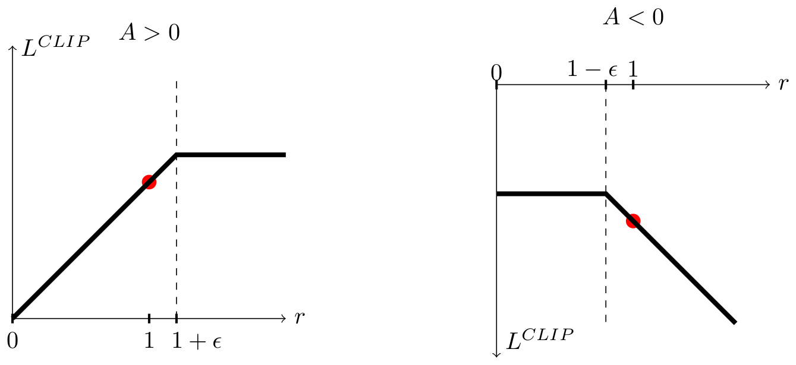
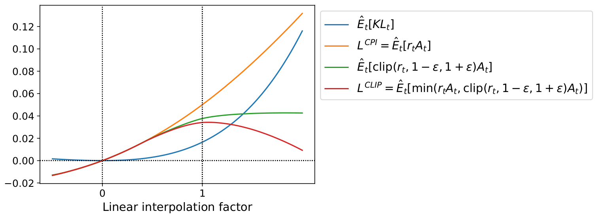
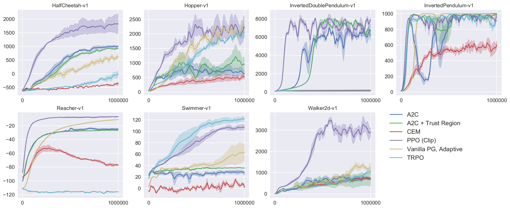
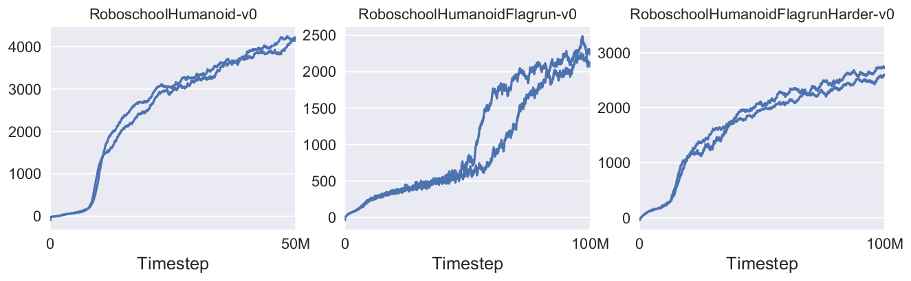
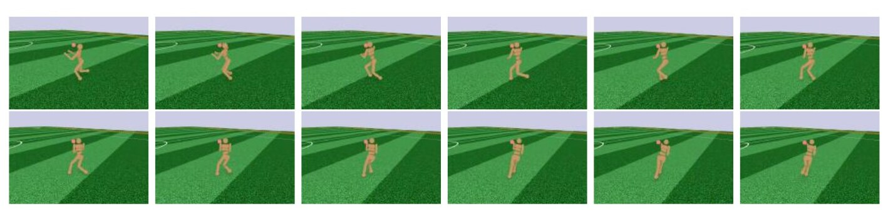
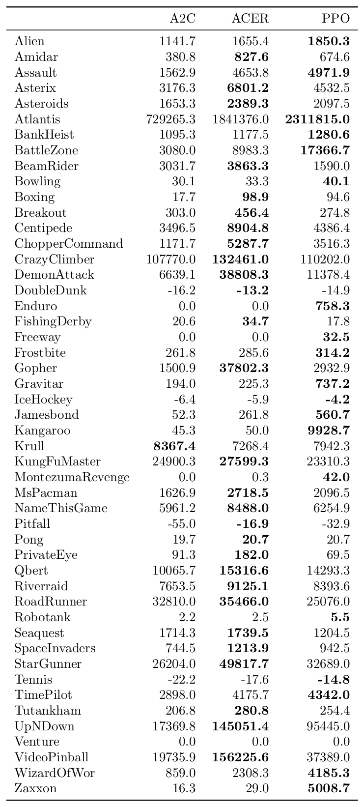

# 论文中文解读：《Proximal Policy Optimization Algorithms》

> **基本信息**：John Schulman、Filip Wolski、Prafulla Dhariwal、Alec Radford、Oleg Klimov（OpenAI），arXiv:1707.06347，本地 PDF 为 v2（2017 年 8 月 28 日，12 页，含附录 A 超参数与附录 B Atari 全部 49 个游戏结果）；[论文官方页面](https://arxiv.org/abs/1707.06347)。
>
> **本文的读法**：图 1–5 取自论文原图；表 1–5 逐格转录；Table 6（49 个 Atari 游戏的整表）附原表截图并摘录关键行；Algorithm 1 转写为代码块并逐行讲解。每张图后有中文图题、图中文字翻译和读图结论。文中“第 N 页”指 PDF 页码。凡是我自己推算、读图估计或补充的内容，都会标注“我的推导”“从图上读出的近似值”或“背景补充”。

## 一、一句话结论

PPO（proximal policy optimization）是一族策略梯度方法：交替“用当前策略采样数据”和“对这批数据用随机梯度上升优化一个 surrogate 目标函数”。它的关键是一个带**概率比裁剪**的目标函数 $L^{\text{CLIP}}$：对同一批数据可以做多个 epoch 的 minibatch 更新，而不会像普通策略梯度那样把策略推得过远；而且只需对普通策略梯度实现改几行代码，用 Adam 之类一阶优化器即可，不需要 TRPO 的共轭梯度和二阶近似。论文在 MuJoCo 连续控制、Roboschool 人形机器人和 49 个 Atari 游戏上验证：连续控制上在几乎所有环境优于所比较的 TRPO、A2C、CEM 等实现；Atari 上样本效率显著好于 A2C，与 ACER 相近，但终局分数不一定更高。

## 二、背景：策略梯度与 TRPO

### 2.1 策略梯度方法

策略梯度方法先算出策略梯度的估计量，再代入随机梯度上升。最常用的估计量形式（论文式 (1)）是

$$
\hat g=\hat{\mathbb E}_t\Big[\nabla_\theta\log\pi_\theta(a_t\mid s_t)\,\hat A_t\Big],
$$

其中 $\pi_\theta$ 是随机策略，$\hat A_t$ 是时刻 $t$ 的优势函数（advantage）估计量；$\hat{\mathbb E}_t[\cdots]$ 表示在一个有限批样本上的经验平均，所用算法在“采样”和“优化”之间交替。用自动微分软件实现时，是构造一个其梯度正是该策略梯度估计量的目标函数，再对它求导（论文式 (2)）：

$$
L^{PG}(\theta)=\hat{\mathbb E}_t\Big[\log\pi_\theta(a_t\mid s_t)\,\hat A_t\Big].
$$

用同一条轨迹对 $L^{PG}$ 做多步优化很有吸引力，但这么做没有很好的理论依据，而且实践中常导致破坏性的过大策略更新（论文在 6.1 节说，结果未展示，与“无裁剪、无惩罚”设置类似或更差）。

### 2.2 信任域方法（TRPO）

TRPO 在对策略更新幅度的约束下最大化一个 surrogate 目标（论文式 (3)、(4)）：

$$
\max_\theta\ \hat{\mathbb E}_t\Big[\frac{\pi_\theta(a_t\mid s_t)}{\pi_{\theta_{\text{old}}}(a_t\mid s_t)}\hat A_t\Big]
\qquad\text{s.t.}\qquad
\hat{\mathbb E}_t\Big[\mathrm{KL}\big[\pi_{\theta_{\text{old}}}(\cdot\mid s_t),\pi_\theta(\cdot\mid s_t)\big]\Big]\le\delta,
$$

其中 $\theta_{\text{old}}$ 是更新前的策略参数。这个问题可以对目标做线性近似、对约束做二次近似后，用共轭梯度算法高效地近似求解。

TRPO 的理论实际上建议用惩罚项而不是约束，即求解无约束问题（论文式 (5)）：

$$
\max_\theta\ \hat{\mathbb E}_t\Big[\frac{\pi_\theta(a_t\mid s_t)}{\pi_{\theta_{\text{old}}}(a_t\mid s_t)}\hat A_t-\beta\,\mathrm{KL}\big[\pi_{\theta_{\text{old}}}(\cdot\mid s_t),\pi_\theta(\cdot\mid s_t)\big]\Big].
$$

这源于一个事实：某个 surrogate 目标（用各状态上的**最大** KL 而不是平均 KL）构成策略性能的下界（悲观界）。TRPO 之所以用硬约束，是因为很难选出一个在不同问题上、甚至在同一问题的不同训练阶段都表现良好的 $\beta$。所以论文指出：为了做出一个模仿 TRPO 单调改进的一阶算法，光选一个固定的惩罚系数 $\beta$ 再用 SGD 优化惩罚目标是不够的，还需要额外的修改。

### 2.3 PPO 要解决的问题

引言的判断是：当时领先的几类方法各有毛病。带函数逼近的 Q-learning 在许多简单问题上失败（脚注：DQN 在离散动作的 Arcade Learning Environment 上表现好，但没有在 OpenAI Gym 的连续控制基准上证明过）且理解不足；“朴素”策略梯度方法数据效率和鲁棒性差；TRPO 相对复杂，而且与带噪声的结构（如 dropout）或参数共享（策略和价值函数之间、或与辅助任务之间）不兼容。论文想要一个**数据效率和可靠性接近 TRPO、但只用一阶优化**的算法。

## 三、PPO 的目标函数与算法

### 3.1 概率比与裁剪目标（论文式 (6)、(7)）

记新旧策略对已采样动作的概率比为 $r_t(\theta)$，则 $r_t(\theta_{\text{old}})=1$：

$$
r_t(\theta)=\frac{\pi_\theta(a_t\mid s_t)}{\pi_{\theta_{\text{old}}}(a_t\mid s_t)}.
$$

TRPO 最大化的 surrogate 目标是（式 (6)，上标 CPI 指 conservative policy iteration，这个目标最早在那里提出）：

$$
L^{CPI}(\theta)=\hat{\mathbb E}_t\Big[\frac{\pi_\theta(a_t\mid s_t)}{\pi_{\theta_{\text{old}}}(a_t\mid s_t)}\hat A_t\Big]=\hat{\mathbb E}_t\big[r_t(\theta)\hat A_t\big].
$$

没有约束时，最大化 $L^{CPI}$ 会导致过大的策略更新。所以论文考虑修改这个目标，去惩罚使 $r_t(\theta)$ 偏离 1 的策略改变。论文提出的主要目标是（式 (7)）：

$$
L^{\text{CLIP}}(\theta)=\hat{\mathbb E}_t\Big[\min\big(r_t(\theta)\hat A_t,\ \operatorname{clip}\big(r_t(\theta),1-\epsilon,1+\epsilon\big)\hat A_t\big)\Big],
$$

其中 $\epsilon$ 是超参数，例如 $\epsilon=0.2$。动机是：$\min$ 里的第一项就是 $L^{CPI}$；第二项把概率比裁剪到 $[1-\epsilon,1+\epsilon]$，**去掉了让 $r_t$ 走出这个区间的激励**；最后取裁剪与未裁剪目标的最小值，使最终目标成为未裁剪目标的下界（悲观界）。这样，只有在概率比的变化会让目标变好时才忽略它，而在会让目标变坏时保留它。注意 $L^{\text{CLIP}}(\theta)$ 与 $L^{CPI}(\theta)$ 在 $\theta_{\text{old}}$ 附近（即 $r=1$ 处）到一阶是相等的，但随着 $\theta$ 远离 $\theta_{\text{old}}$，两者逐渐不同。

下面两张图帮助理解。



*图 1（原文 Figure 1，第 3 页）：surrogate 函数 $L^{\text{CLIP}}$ 的一项（即单个时间步）作为概率比 $r$ 的函数，左为优势为正，右为优势为负。每张图上的红圆点是优化的起点，即 $r=1$。注意 $L^{\text{CLIP}}$ 是许多这样的项之和。*

**图中文字翻译与读法**：

- **左图 $A>0$（优势为正）**：横轴 $r$，刻度 0、1、$1+\epsilon$；纵轴 $L^{CLIP}$。曲线从 $r=0$ 起按直线上升，到 $r=1+\epsilon$ 处（虚线）变成水平线。红点在 $r=1$ 处，位于上升段。读法：优势为正说明这个动作比平均好，希望提高它的概率，即增大 $r$；$r$ 增大使目标上升，直到 $r=1+\epsilon$ 后目标不再增加，所以没有动力把概率推得更高；
- **右图 $A<0$（优势为负）**：横轴 $r$ 画在上方（对应 $L=0$），刻度 0、$1-\epsilon$、1；纵轴 $L^{CLIP}$ 向下延伸，曲线都在横轴下方，即目标值为负。曲线在 $r<1-\epsilon$（虚线左侧）是水平线，$r>1-\epsilon$ 之后随 $r$ 增大向下延伸（目标更负）。红点在 $r=1$ 处，位于下降段。读法：优势为负说明这个动作比平均差，希望降低它的概率，即减小 $r$；$r$ 减小使目标变好，直到 $r=1-\epsilon$ 后不再变好。

我把四种情形用 $\min$ 的取值总结如下（我的推导，可以自己验证）：

| 优势符号 | $r$ 的位置 | $\min$ 取到哪一项 | 对 $r$ 的梯度 |
|---|---|---|---|
| $\hat A_t>0$ | $r<1-\epsilon$ | $r\hat A_t$（未裁剪项更小） | 有梯度，继续提高 $r$ |
| $\hat A_t>0$ | $1-\epsilon\le r\le1+\epsilon$ | 两项相等 | 有梯度 |
| $\hat A_t>0$ | $r>1+\epsilon$ | $(1+\epsilon)\hat A_t$（裁剪项更小） | 梯度为 0，不再有提高 $r$ 的激励 |
| $\hat A_t<0$ | $r>1+\epsilon$ | $r\hat A_t$（未裁剪项更小，更负） | 有梯度，把 $r$ 拉回去，这就是“悲观”的惩罚 |
| $\hat A_t<0$ | $1-\epsilon\le r\le1+\epsilon$ | 两项相等 | 有梯度 |
| $\hat A_t<0$ | $r<1-\epsilon$ | $(1-\epsilon)\hat A_t$（裁剪项更小） | 梯度为 0，不再有降低 $r$ 的激励 |

要点：梯度只在“已经朝有利方向走出区间”时为 0；若朝**不利**方向走出区间，梯度仍在，把它拉回来。所以裁剪不是把 $r_t$ 永远裁进区间后再算损失，也不是所有越界样本的梯度都为零。



*图 2（原文 Figure 2，第 4 页）：在初始策略参数 $\theta_{\text{old}}$ 与 PPO 一次迭代后得到的更新后参数之间做插值，各 surrogate 目标的变化。更新后的策略与初始策略的 KL 散度约为 0.02，这个点就是 $L^{CLIP}$ 最大的地方。此图对应 Hopper-v1 问题上的第一次策略更新，使用 6.1 节的超参数。*

**图中文字翻译与读法**：

- 横轴 Linear interpolation factor（线性插值系数）：0 对应 $\theta_{\text{old}}$，1 对应 PPO 一次迭代后的更新参数，大于 1 是沿同一方向继续外推；纵轴是目标值。
- 四条曲线（图例）：$\hat{\mathbb E}_t[KL_t]$（蓝，平均 KL 散度）、$L^{CPI}=\hat{\mathbb E}_t[r_tA_t]$（橙）、$\hat{\mathbb E}_t[\operatorname{clip}(r_t,1-\epsilon,1+\epsilon)A_t]$（绿，只含裁剪项）、$L^{CLIP}=\hat{\mathbb E}_t[\min(r_tA_t,\operatorname{clip}(r_t,1-\epsilon,1+\epsilon)A_t)]$（红）。
- 从图上读出的近似数值（不是论文给出的数字）：插值系数 1 处，$L^{CPI}$ 约 0.05，裁剪项约 0.038，$L^{CLIP}$ 约 0.034，KL 约 0.016（图注说约 0.02）；$L^{CLIP}$ 在系数略大于 1 处达到最大；系数外推到 2 时，$L^{CPI}$ 继续增大到约 0.13，KL 约 0.115，而 $L^{CLIP}$ 回落到约 0.009。

**读图结论**：$L^{CPI}$ 随更新幅度单调增加，如果不加约束，优化会不断把策略推远；$L^{CLIP}$ 在大约 KL 为 0.02 时达到最大，更大的更新反而使它下降，这就是论文说的“$L^{CLIP}$ 是 $L^{CPI}$ 的下界，对过大的策略更新有惩罚”。这只是第一次更新的一个例子，不是对所有训练阶段的证明。

### 3.2 自适应 KL 惩罚系数（论文第 4 节）

另一种做法，可以替代裁剪目标，也可以与它同时用：对 KL 散度加惩罚，并自适应地调整惩罚系数，使每次策略更新达到某个目标 KL 值 $d_{\text{targ}}$。论文说在实验里这个 KL 惩罚的表现比裁剪目标差，但因为它是重要的基线，所以放进来。最简单的实现是每次策略更新做两步。

**第一步**：用若干个 epoch 的 minibatch SGD 优化带 KL 惩罚的目标（论文式 (8)）：

$$
L^{KLPEN}(\theta)=\hat{\mathbb E}_t\Big[\frac{\pi_\theta(a_t\mid s_t)}{\pi_{\theta_{\text{old}}}(a_t\mid s_t)}\hat A_t-\beta\,\mathrm{KL}\big[\pi_{\theta_{\text{old}}}(\cdot\mid s_t),\pi_\theta(\cdot\mid s_t)\big]\Big].
$$

**第二步**：计算 $d=\hat{\mathbb E}_t\big[\mathrm{KL}[\pi_{\theta_{\text{old}}}(\cdot\mid s_t),\pi_\theta(\cdot\mid s_t)]\big]$：若 $d<d_{\text{targ}}/1.5$，则 $\beta\leftarrow\beta/2$；若 $d>d_{\text{targ}}\times1.5$，则 $\beta\leftarrow\beta\times2$。更新后的 $\beta$ 用于下一次策略更新。

这样偶尔会出现 KL 与 $d_{\text{targ}}$ 差得很多的策略更新，但很少见，而且 $\beta$ 会很快调整。1.5 和 2 是启发式选的，算法对它们不太敏感；$\beta$ 的初值是另一个超参数，但实践中不重要，因为算法会很快调整它。

### 3.3 完整目标：策略、价值与熵

用自动微分时，只要把损失 $L^{PG}$ 换成 $L^{CLIP}$ 或 $L^{KLPEN}$，并对它做多步随机梯度上升，改动很小。大多数降低方差的优势估计器都要用到学得的状态价值函数 $V(s)$（例如广义优势估计 GAE，或 A3C 的有限视野估计器）。如果神经网络结构在策略和价值函数之间共享参数，就必须用把策略 surrogate 与价值函数误差项合在一起的损失；再加上一个熵奖励（entropy bonus）以保证足够的探索。合起来得到每次迭代（近似）最大化的目标（论文式 (9)）：

$$
L_t^{CLIP+VF+S}(\theta)=\hat{\mathbb E}_t\Big[L_t^{CLIP}(\theta)-c_1L_t^{VF}(\theta)+c_2\,S[\pi_\theta](s_t)\Big],
$$

其中 $c_1,c_2$ 是系数，$S$ 表示熵奖励，$L_t^{VF}$ 是平方误差损失 $\big(V_\theta(s_t)-V_t^{\text{targ}}\big)^2$。三项的作用：策略 surrogate 负责策略改进；价值损失学基线 $V$，降低优势估计的方差；熵奖励防止策略过早塌缩。

优势估计器：一种流行的策略梯度实现风格（A3C 推广，适合与循环神经网络一起用）让策略运行 $T$ 个时间步（$T$ 远小于 episode 长度），用收集的样本做一次更新。这需要一个不看 $T$ 步之后的优势估计器。A3C 用的是（论文式 (10)）：

$$
\hat A_t=-V(s_t)+r_t+\gamma r_{t+1}+\cdots+\gamma^{T-t+1}r_{T-1}+\gamma^{T-t}V(s_T),
$$

其中 $t$ 是长度为 $T$ 的轨迹片段内的时间索引，$t\in[0,T]$。推广这一选择，可以用截断版的广义优势估计，当 $\lambda=1$ 时就化为式 (10)（论文式 (11)、(12)）：

$$
\hat A_t=\delta_t+(\gamma\lambda)\delta_{t+1}+\cdots+(\gamma\lambda)^{T-t+1}\delta_{T-1},\qquad
\delta_t=r_t+\gamma V(s_{t+1})-V(s_t).
$$

我的核对：式 (10)、(11) 的末项按求和下标应是 $\gamma^{T-t-1}r_{T-1}$、$(\gamma\lambda)^{T-t-1}\delta_{T-1}$，原文写的指数 $T-t+1$ 与下标对不上，应是笔误（$V(s_T)$ 项的指数 $T-t$ 是对的）。读法：$\delta_t$ 是一步 TD 误差；$\lambda$ 在“偏差小、方差大”（$\lambda=1$，即用 $T$ 步内的蒙特卡洛回报）和“偏差大、方差小”（$\lambda=0$，即一步 TD）之间折中。

### 3.4 Algorithm 1 逐行解释

下面是原文 Algorithm 1（PPO，Actor-Critic 风格，第 5 页）的转写，行号是我加的：

```text
Algorithm 1: PPO, Actor-Critic Style
 1  for iteration = 1, 2, ... do
 2      for actor = 1, 2, ..., N do
 3          Run policy pi_theta_old in environment for T timesteps
 4          Compute advantage estimates A_1, ..., A_T
 5      end for
 6      Optimize surrogate L wrt theta, with K epochs and minibatch size M <= N*T
 7      theta_old <- theta
 8  end for
```

逐行讲解：

1. 外层循环，每个 iteration 是一次“采样加优化”的完整周期；
2. $N$ 个并行的 actor（环境副本）各自独立收集数据；
3. 每个 actor 用**固定的旧策略** $\pi_{\theta_{\text{old}}}$ 在环境里运行 $T$ 个时间步（$T$ 远小于 episode 长度，所以是固定长度的轨迹片段）；
4. 对这 $T$ 步算优势估计 $\hat A_1,\dots,\hat A_T$，用式 (11)(12) 的截断 GAE，需要当前的价值函数 $V$；
5. 结束 actor 循环，此时得到 $NT$ 个时间步的数据；
6. 在这 $NT$ 个样本上构造 surrogate 损失 $L$（式 (9) 的 $L^{CLIP+VF+S}$，或 $L^{KLPEN}$），用 minibatch SGD（通常为获得更好的性能而用 Adam），做 $K$ 个 epoch 的优化，minibatch 大小 $M\le NT$；
7. 把 $\theta_{\text{old}}$ 设为刚优化完的 $\theta$，下一轮用它采样。

这里的“样本复用”只发生在当前这一批 $NT$ 个样本内部：同一批数据被用 $K$ 个 epoch。下一轮必须用更新后的策略重新采样，所以 PPO 仍是 on-policy 算法，与 DQN、SAC 那样的 replay buffer 不同。

## 四、实验

### 4.1 不同 surrogate 目标的比较（6.1 节与表 1）

论文先比较几种 surrogate 目标和它们在不同超参数下的表现：

- 无裁剪、无惩罚：$L_t(\theta)=r_t(\theta)\hat A_t$；
- 裁剪：$L_t(\theta)=\min\big(r_t(\theta)\hat A_t,\operatorname{clip}(r_t(\theta),1-\epsilon,1+\epsilon)\hat A_t\big)$；
- KL 惩罚（固定或自适应）：$L_t(\theta)=r_t(\theta)\hat A_t-\beta\,\mathrm{KL}[\pi_{\theta_{\text{old}}},\pi_\theta]$。

KL 惩罚既可以用固定的系数 $\beta$，也可以用第 4 节的自适应系数（目标 KL 为 $d_{\text{targ}}$）。论文还试过在对数空间里裁剪，但性能没有更好。

实验设置：因为要对每种算法变体搜索超参数，所以选了计算上便宜的基准：OpenAI Gym 里的 7 个仿真机器人任务（用 MuJoCo 物理引擎）：HalfCheetah、Hopper、InvertedDoublePendulum、InvertedPendulum、Reacher、Swimmer、Walker2d（全是 -v1），每个任务训练 100 万个时间步。除要搜索的裁剪（$\epsilon$）和 KL 惩罚（$\beta,d_{\text{targ}}$）超参数外，其他超参数见表 3。策略用全连接 MLP，两个 64 单元的隐藏层，tanh 非线性，输出高斯分布的均值，标准差可变（沿用 TRPO 和 Duan 等人的做法）。策略和价值函数**不共享参数**（所以系数 $c_1$ 无关），**不使用熵奖励**。

评分：每种算法在 7 个环境上各跑 3 个随机种子；每次运行用最后 100 个 episode 的平均总奖励打分；对每个环境，把分数平移并缩放，使随机策略得 0 分、最好的结果为 1 分，再对 21 次运行求平均，得到每个算法设置的一个标量。

下表是原文 Table 1 的转录（原文表 1，第 6 页）。$\beta$ 初始化为 1。越大越好：

| 算法 | 平均归一化分数 |
|---|---:|
| 无裁剪、无惩罚（No clipping or penalty） | -0.39 |
| 裁剪，$\epsilon=0.1$ | 0.76 |
| 裁剪，$\epsilon=0.2$ | **0.82** |
| 裁剪，$\epsilon=0.3$ | 0.70 |
| 自适应 KL，$d_{\text{targ}}=0.003$ | 0.68 |
| 自适应 KL，$d_{\text{targ}}=0.01$ | 0.74 |
| 自适应 KL，$d_{\text{targ}}=0.03$ | 0.71 |
| 固定 KL，$\beta=0.3$ | 0.62 |
| 固定 KL，$\beta=1$ | 0.71 |
| 固定 KL，$\beta=3$ | 0.72 |
| 固定 KL，$\beta=10$ | 0.69 |

读法：

- 没有裁剪或惩罚时得分为负，因为在一个环境（HalfCheetah）里它得到非常负的分数，比最初的随机策略还差。这直接支持“对同一批数据做多轮优化需要某种近端限制”；
- 裁剪目标的最好设置（$\epsilon=0.2$，0.82）高于自适应 KL 的最好设置（$d_{\text{targ}}=0.01$，0.74）和固定 KL 的最好设置（$\beta=3$，0.72）；
- 但要注意：这个表同时承担了超参数搜索和算法比较两个作用，每个设置只有 7 个环境 $\times$ 3 个种子 = 21 次运行，没有给出置信区间；0.82、0.76、0.74 这样的差距可能在噪声范围内。它能说明裁剪目标在这套协议里有效，不能证明 $\epsilon=0.2$ 在所有任务上最优。

### 4.2 与连续控制中其他算法的比较（图 3）

论文把 PPO（用 3.1 节的裁剪目标，$\epsilon=0.2$，沿用上一节的超参数）与文献中被认为对连续问题有效的几种方法的**调好的实现**比较：TRPO、交叉熵方法（CEM）、带自适应步长的朴素策略梯度（每批数据后根据新旧策略的 KL 调整 Adam 步长）、A2C（A3C 的同步版本，作者发现性能与异步版本相同或更好）以及带信任域的 A2C。



*图 3（原文 Figure 3，第 7 页）：几个算法在若干 MuJoCo 环境上的比较，训练 100 万个时间步。*

**图中文字翻译与读法**：

- 七个子图依次是 HalfCheetah-v1、Hopper-v1、InvertedDoublePendulum-v1、InvertedPendulum-v1、Reacher-v1、Swimmer-v1、Walker2d-v1。横轴为时间步（0 到 1000000），纵轴为回报（环境不同则量纲不同；Reacher 的回报为负，越接近 0 越好）；阴影为多次运行的范围（论文没有说明阴影与种子数的对应）。
- 图例（右下）：A2C（蓝）、A2C + Trust Region（绿）、CEM（红）、PPO (Clip)（紫）、Vanilla PG, Adaptive（黄）、TRPO（青）。
- 从图上读出的 100 万步处的近似数值（不是论文给出的数字）：HalfCheetah，PPO 约 1800，A2C 约 1000，A2C+Trust Region 约 900，Vanilla PG 约 600，TRPO 约 0，CEM 约 -350；Walker2d，PPO 约 2900（曲线峰值约 3400），Vanilla PG 约 1200，TRPO 约 1050，其余约 700；Reacher，PPO 约 -7，Vanilla PG 约 -11，A2C 约 -25，CEM 约 -77，TRPO 约 -115；InvertedDoublePendulum，PPO 约 7900 并有较大起伏，A2C、A2C+Trust Region 约 6000–7000，TRPO、CEM、Vanilla PG 几乎没学起来；Swimmer，TRPO 约 120，PPO 约 107，Vanilla PG 约 63，A2C+Trust Region 约 36，A2C 约 27，CEM 约 3；Hopper，PPO 约 2200，Vanilla PG 约 2300，TRPO 约 2050，A2C+Trust Region 约 950，A2C 约 650，CEM 约 500；InvertedPendulum 上多数算法都接近上限 1000，CEM 约 600。

**读图结论**：论文的说法是 PPO 在几乎所有连续控制环境上优于此前的方法。从图上看，PPO 的优势在 HalfCheetah、Walker2d、Reacher、InvertedDoublePendulum 上最明显；在 Swimmer 上 TRPO 更高，在 Hopper 上末期 PPO 与 Vanilla PG、TRPO 相近（PPO 前中期更快），InvertedPendulum 上多种方法已饱和（我的读图补充，即“几乎所有”而不是“全部”）。注意这是当时若干实现之间的比较；深度 RL 对代码细节、归一化和超参数非常敏感，不能把曲线读成算法族的永久排序。

### 4.3 人形机器人的展示（图 4、图 5 与表 4）

为展示 PPO 在高维连续控制问题上的表现，论文在涉及 3D 人形机器人的一组任务上训练：机器人要奔跑、转向、从地上爬起来，有时还要被方块砸。三个任务（Roboschool）：（1）RoboschoolHumanoid：只有向前运动；（2）RoboschoolHumanoidFlagrun：目标位置每 200 个时间步或达到目标时随机变一次；（3）RoboschoolHumanoidFlagrunHarder：机器人被方块砸，需要从地上起来。超参数见表 4。同期工作中，Heess 等人用 PPO 的自适应 KL 变体学习 3D 机器人的运动策略。



*图 4（原文 Figure 4，第 7 页）：PPO 在 3D 人形机器人控制任务（Roboschool）上的学习曲线。*

**图中文字翻译与读法**：三个子图依次是 RoboschoolHumanoid-v0（横轴 Timestep，0 到 50M）、RoboschoolHumanoidFlagrun-v0（0 到 100M）、RoboschoolHumanoidFlagrunHarder-v0（0 到 100M），纵轴为回报；每个子图有两条曲线（论文没有说明它们是什么，可能是两个种子）。从图上读出的近似数值：Humanoid 在约 10M 步后迅速上升，到 50M 步时约 4200；Flagrun 在约 60–80M 步处有一次明显的跃升，到 100M 步约 2100–2300；FlagrunHarder 到 100M 步约 2600–2750。



*图 5（原文 Figure 5，第 8 页）：从 RoboschoolHumanoidFlagrun 上学到的策略的静态帧。前六帧里机器人向一个目标奔跑；然后目标位置被随机改变，机器人转身并向新目标奔跑。*

**读图结论**：人形机器人这三个任务展示了 PPO 能在高维连续动作中学会跑向变化的目标、转向、被方块撞击后起身。它证明并行 on-policy 优化可以扩展到复杂的仿真控制，不能证明真实机器人可以直接部署。图 5 是定性的静态帧，没有量化指标。

### 4.4 Atari 上与 A2C、ACER 的比较（6.4 节、表 2、表 5、表 6）

论文在 Arcade Learning Environment 基准上运行 PPO，并与调好的 A2C 和 ACER 实现比较。三个算法用的策略网络结构与 A3C 论文相同；PPO 的超参数见表 5；另两个算法的超参数是调到在这个基准上性能最大的。全部 49 个游戏的结果表和学习曲线放在附录 B。两个评分指标：

1. 整个训练期间每个 episode 的平均奖励（偏向快速学习）；
2. 训练最后 100 个 episode 的平均奖励（偏向最终性能）。

表 2 给出每个算法“赢”得的游戏数，胜者按三次试验的平均得分判定。下表是原文 Table 2 的转录（原文表 2，第 8 页）：

| 评分指标 | A2C | ACER | PPO | 平局（Tie） |
|---|---:|---:|---:|---:|
| (1) 全部训练期间的平均 episode 奖励 | 1 | 18 | **30** | 0 |
| (2) 最后 100 个 episode 的平均 episode 奖励 | 1 | **28** | 19 | 1 |

读法：按全训练期平均（偏向学得快），PPO 赢 30 个、ACER 赢 18 个；按最后 100 个 episode（偏向最终性能），PPO 赢 19 个、ACER 赢 28 个。“样本效率”“最终性能”“稳定性”是不同的指标，只引用“PPO 赢 30/49”而不说明计分方式，会误导成 PPO 全面压过 ACER。论文引言的措辞也是：PPO 在 Atari 上的样本复杂度显著优于 A2C，与 ACER 相近，但简单得多。

附录 Table 6 给出 49 个游戏的最终分数（最后 100 个 episode 的平均得分，40M 游戏帧即 10M 个时间步后；原文表注只写了 PPO 和 A2C，但表里实际有 A2C、ACER、PPO 三列）。下表摘录关键行，原文用粗体标出每个游戏的最好结果：

| 游戏 | A2C | ACER | PPO |
|---|---:|---:|---:|
| Alien | 1141.7 | 1655.4 | **1850.3** |
| Atlantis | 729265.3 | 1841376.0 | **2311815.0** |
| BattleZone | 3080.0 | 8983.3 | **17366.7** |
| BeamRider | 3031.7 | **3863.3** | 1590.0 |
| Boxing | 17.7 | **98.9** | 94.6 |
| Breakout | 303.0 | **456.4** | 274.8 |
| DemonAttack | 6639.1 | **38808.3** | 11378.4 |
| Enduro | 0.0 | 0.0 | **758.3** |
| Freeway | 0.0 | 0.0 | **32.5** |
| Gopher | 1500.9 | **37802.3** | 2932.9 |
| Kangaroo | 45.3 | 50.0 | **9928.7** |
| MontezumaRevenge | 0.0 | 0.3 | **42.0** |
| Pong | 19.7 | **20.7** | 20.7 |
| Qbert | 10065.7 | **15316.6** | 14293.3 |
| Seaquest | 1714.3 | **1739.5** | 1204.5 |
| SpaceInvaders | 744.5 | **1213.9** | 942.5 |
| Venture | 0.0 | 0.0 | 0.0 |
| VideoPinball | 19735.9 | **156225.6** | 37389.0 |
| Zaxxon | 16.3 | 29.0 | **5008.7** |

（原文 Table 6，第 12 页，从 49 行中摘录；Pong 的 ACER 与 PPO 显示值相同，原文把 ACER 标为最好，应是按未取整的数值比较。）下面是原表的完整截图（49 个游戏）：



*原文 Table 6，第 12 页：每个游戏的最后 100 个 episode 平均得分，粗体为该游戏上的最好结果。*

我对这张表的核对（不是论文的结论）：按这张表的最终分数逐行比较，PPO 单独最高的有 19 个游戏，ACER 单独最高的有 27 个，A2C 单独最高的只有 Krull 一个，Pong 上 ACER 与 PPO 的显示值相同（原文把 ACER 标为最好），Venture 上三者都是 0.0；把 Pong 记为 ACER 获胜、Venture 记为平局，正好得到表 2 第 (2) 行的 A2C 1、ACER 28、PPO 19、平局 1，与表 2 一致。PPO 的赢面里有一些很极端：在 Enduro、Freeway 上 A2C 与 ACER 都是 0，在 Kangaroo（A2C 45.3、ACER 50.0，PPO 9928.7）和 Zaxxon（A2C 16.3、ACER 29.0，PPO 5008.7）上也只有个位数到两位数；而 ACER 的赢面里，Gopher 上约是 PPO 的 13 倍（37802.3 对 2932.9），VideoPinball 与 DemonAttack 上约是 PPO 的 3 至 4 倍（倍数由表中数字相除得到）。这些大差距是“最终性能”指标下 ACER 胜场更多的重要来源，也说明按“赢了多少个游戏”计数会掩盖差距的大小。附录 Figure 6（第 11 页）给出了 49 个游戏上每个算法三个随机种子的学习曲线，每个子图都很小，本文不转录。

## 五、超参数（附录 A）

超参数也是算法的一部分。下面三张表是原文 Table 3、4、5 的转录。

**MuJoCo 100 万时间步基准**（原文表 3，第 10 页）：

| 超参数 | 值 |
|---|---|
| Horizon（$T$） | 2048 |
| Adam 步长 | $3\times10^{-4}$ |
| Epoch 数 | 10 |
| Minibatch 大小 | 64 |
| 折扣（$\gamma$） | 0.99 |
| GAE 参数（$\lambda$） | 0.95 |

**Roboschool 实验**（原文表 4，第 10 页；Adam 步长根据 KL 散度的目标值调整）：

| 超参数 | 值 |
|---|---|
| Horizon（$T$） | 512 |
| Adam 步长 | ∗（见表注：根据 KL 散度的目标值调整） |
| Epoch 数 | 15 |
| Minibatch 大小 | 4096 |
| 折扣（$\gamma$） | 0.99 |
| GAE 参数（$\lambda$） | 0.95 |
| Actor 数 | 32（运动 locomotion），128（flagrun） |
| 动作分布的对数标准差 | LinearAnneal(-0.7, -1.6)（线性退火，从 -0.7 到 -1.6） |

**Atari 实验**（原文表 5，第 10 页；$\alpha$ 在整个学习过程中从 1 线性退火到 0）：

| 超参数 | 值 |
|---|---|
| Horizon（$T$） | 128 |
| Adam 步长 | $2.5\times10^{-4}\times\alpha$ |
| Epoch 数 | 3 |
| Minibatch 大小 | $32\times8$ |
| 折扣（$\gamma$） | 0.99 |
| GAE 参数（$\lambda$） | 0.95 |
| Actor 数 | 8 |
| 裁剪参数 $\epsilon$ | $0.1\times\alpha$ |
| 价值函数系数 $c_1$（式 (9)） | 1 |
| 熵系数 $c_2$（式 (9)） | 0.01 |

读法：$\epsilon=0.2$ 只是 MuJoCo 实验的取值（表 3 本身没有写 $\epsilon$，是 6.1 节的搜索结果和 6.2 节的设置）；Atari 的裁剪参数初值为 0.1，并随 $\alpha$ 线性退火到 0，Adam 步长也随 $\alpha$ 退火。表里还说明两个域的“时间步”不同：Atari 的 40M 游戏帧等于 10M 个时间步（表 6 的表注），即每个时间步对应 4 帧。

我据超参数推算的每次迭代数据量与更新次数（论文没有直接写出）：Atari 每次迭代 $NT=8\times128=1024$ 个样本，minibatch $32\times8=256$，每个 epoch 4 个 minibatch，3 个 epoch 共 12 次梯度步；Roboschool 每次迭代 $NT=32\times512=16384$（locomotion）或 $128\times512=65536$（flagrun），minibatch 4096，分别是每个 epoch 4 个或 16 个 minibatch，共 15 个 epoch；MuJoCo 的 actor 数论文没有给出，若只有 1 个 actor，则 $NT=2048$，minibatch 64，每个 epoch 32 个 minibatch，共 10 个 epoch。

## 六、局限、证据边界与常见误读

论文自己的陈述与边界：

- 论文的结论说：这些方法有信任域方法的稳定性和可靠性，但实现简单得多，相对普通策略梯度实现只需改几行代码，适用于更一般的设置（例如策略和价值函数用联合结构），并且总体性能更好；
- 摘要还说 PPO 在样本复杂度、简单性和 wall-time 之间取得有利的平衡；但正文里没有 wall-clock 时间的对比实验，只有按时间步或帧数的结果。

证据边界与常见误读：

- clipping 只是产生类信任域行为的启发式 surrogate：它约束的是被采样动作的概率比，而不是状态分布上的平均 KL；它不提供严格的 KL 上界，也没有 TRPO 理论对应的单调改进保证。多个样本、多轮 minibatch 更新之后，最终的 KL 并不由 $\epsilon$ 唯一决定（我的概括，论文只说它“forms a lower bound”，并没有证明 KL 上界）；
- $r_t$ 超出区间并不总是梯度归零：只有朝有利方向继续扩大更新时才被截平（见 3.1 节的表）；
- PPO 是 on-policy：同一批数据可以做多个 epoch，但不能像 replay buffer 那样长期、任意复用旧轨迹；
- 论文同时给出了裁剪与自适应 KL 两类 PPO，实验更支持裁剪版；今天说 PPO 通常默认指 PPO-Clip；
- 表 1 的 21 次运行较少，且同一个表同时做了超参数搜索和算法比较；
- 实现之间的比较对代码细节很敏感：基线是“调好的实现”，调参方式不同会影响排名；
- 连续控制只训练 100 万个时间步，Atari 为 40M 帧（10M 个时间步），两者的样本单位不可混用；
- 原论文没有完整规定今天常见的一些实现细节（如 observation 与 advantage 归一化、value clipping、梯度裁剪、KL early stopping），这些来自后续实现，不是这篇短论文的内容。

## 七、复现检查清单

- 明确用的是 PPO-Clip（式 (7)）还是自适应 KL（式 (8)），以及 $\epsilon$ 或 $d_{\text{targ}}$、$\beta$ 的初值；
- 优势估计：截断 GAE（$\gamma=0.99$、$\lambda=0.95$），片段长度 $T$（MuJoCo 2048、Roboschool 512、Atari 128），并行 actor 数 $N$；
- 每次迭代的 epoch 数 $K$ 与 minibatch 大小 $M$（MuJoCo 10 个 epoch、64；Roboschool 15 个 epoch、4096；Atari 3 个 epoch、$32\times8$）；
- 策略与价值是否共享参数（决定 $c_1$ 是否相关）、是否有熵奖励（Atari $c_2=0.01$，MuJoCo 基准不用）；
- 学习率与裁剪参数是否随 $\alpha$ 线性退火（Atari 是）；
- 动作分布的方差参数化（MuJoCo 是可变标准差，Roboschool 的对数标准差线性退火）；
- 计数单位：环境帧、动作重复后的时间步、优化 update 三种单位不同（Atari 40M 帧 = 10M 时间步）；
- 时间限制截断（time limit truncation）与真正的终止，在 bootstrap 时怎么处理（论文未说明）；
- 多个随机种子（论文用 3 个）下报告均值与范围，并说明评分方式（全训练期平均还是最后 100 个 episode）。

## 八、与本仓库其他论文的关系

- [DQN](../deep_q_network/论文中文解读.md)：PPO 是 on-policy，数据用完即弃；DQN 与 [SAC](../soft_actor_critic/论文中文解读.md) 用 replay 复用旧数据，样本效率更高但稳定性问题更复杂；当环境采样可以并行、稳定和实现简单更重要时，PPO 是很强的默认基线，真实交互昂贵时更值得比较 SAC；
- [Deep RL from human preferences](../human_preferences_rl/论文中文解读.md)：偏好 → 奖励模型 → 强化学习的闭环，但该文在 Atari 上用 A2C、在 MuJoCo 上用 TRPO，用的不是 PPO；
- [InstructGPT](../openai_instructgpt/论文中文解读.md)：在奖励模型上用 PPO（加 KL 惩罚，并混入预训练梯度得到 PPO-ptx）优化语言模型。PPO 只解决“怎样稳定地更新策略”，RLHF 通常还需要奖励模型、相对参考策略的 KL 惩罚、token 或序列级的优势与价值模型、奖励归一化等。RLHF 里对参考模型的 KL 与本文 old/new 策略之间的 proximal 关系不同：前者是保持行为接近参考模型的持续正则，后者是控制相邻两次更新，两者可以同时存在，不能混为一谈（这是背景补充，详见这两篇的解读）；
- [DPO](../dpo/论文中文解读.md)：用偏好数据直接优化策略，绕开 PPO 式的在线强化学习循环。

## 原文证据导航

- [原论文 PDF](paper.pdf)
- [原文提取文本](paper.txt)
- [论文概要](论文概要.md)
