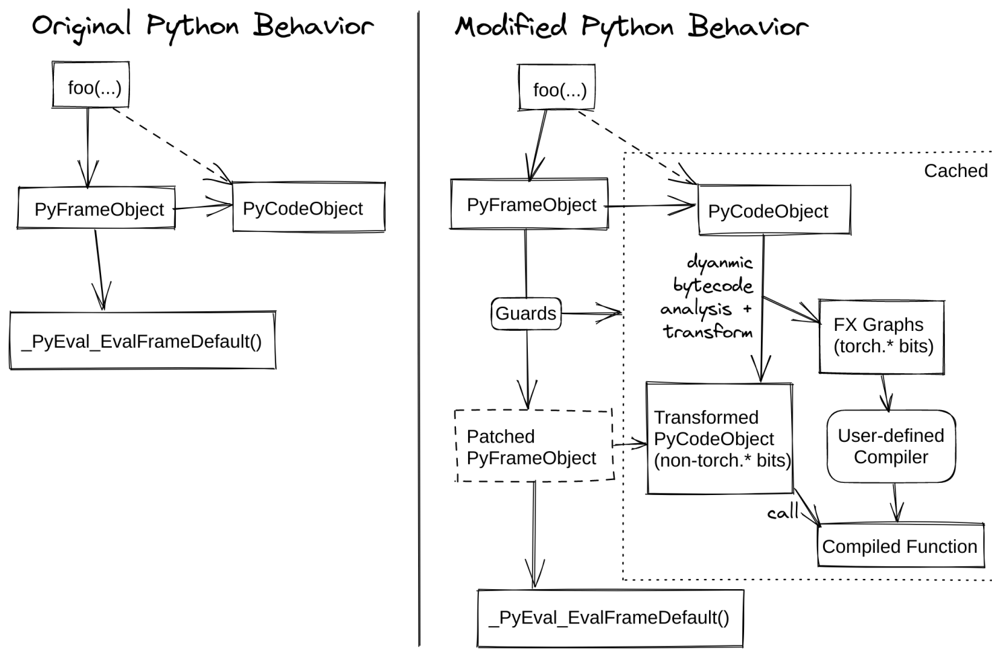
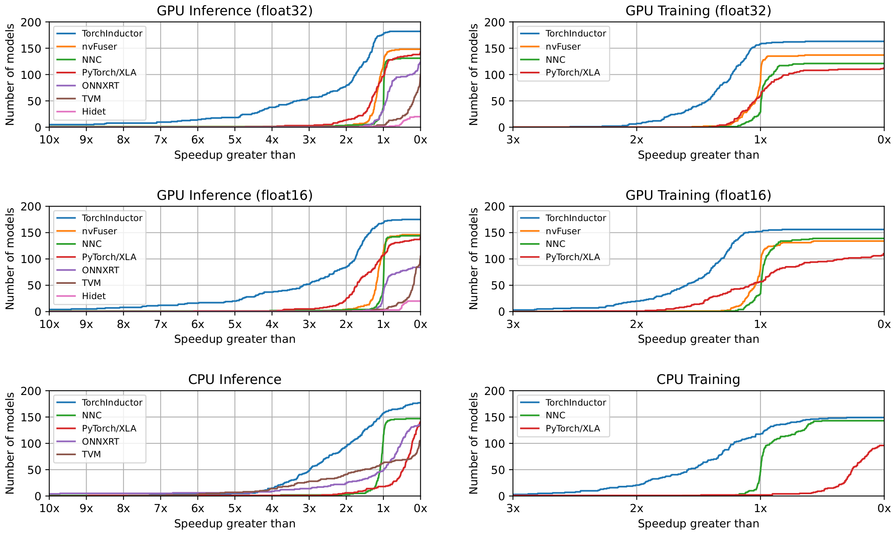

# 论文中文解读：《PyTorch 2: Faster Machine Learning Through Dynamic Python Bytecode Transformation and Graph Compilation》

> **基本信息**：Jason Ansel、Edward Yang、Horace He、Natalia Gimelshein 等 49 位作者（主要来自 Meta，另有 OpenAI、Quansight、Intel、密歇根大学、乔治梅森大学），ASPLOS 2024（第 29 届编程语言与操作系统体系结构支持国际会议，2024 年 4 月 27 日–5 月 1 日，La Jolla），DOI `10.1145/3620665.3640366`；原文 [PyTorch 官方 PDF](https://docs.pytorch.org/assets/pytorch2-2.pdf)。
>
> **本文的读法**：原文有 4 个图（Figure 1 是 CPython 解释器改造示意图，Figure 2、3 是 IR 与 Triton 代码清单，Figure 4 是加速比累积分布曲线）和 4 张表（Table 1–4）。图 1、图 4 为从 PDF 裁出的原图并配中文说明；图 2、3 和正文里的代码转录成代码块并逐行解释；表 1、2、4 逐格转录，表 3 太大，按“设备与精度 × 推理/训练”拆成 6 张小表逐格转录。凡不是出自论文的内容（笔者的复算、读图近似值、调试建议）都标注“笔者补充”。每个性能图表都写明硬件、基线、模型集合和指标。

## 一、先给结论

PyTorch 2 的突破不是发明了某一种 kernel 优化，而是把一个长期被认为很难兼得的组合做成了实用系统：

- 用户继续写动态、命令式、可调试的 Python；
- 编译器在运行时捕获能可靠编译的区域；
- 遇到不支持的行为可以局部退出，而非整个模型报废；
- 后端把大量细粒度算子融合，并在 GPU 上生成 Triton kernel。

论文的两个组件是 **TorchDynamo**（Python 层的即时编译器：在字节码执行前改写它，把 PyTorch 运算序列抽成 FX 图）和 **TorchInductor**（`torch.compile` 的默认后端：把图翻译成 GPU 上的 OpenAI Triton 和 CPU 上的 C++/OpenMP）。摘要报告：TorchInductor 在 NVIDIA A100 上、180 余个真实模型上取得推理 2.27×、训练 1.41× 的几何平均加速，优于另外六个编译器。

这个数字属于 **TorchDynamo + AOTAutograd + decomposition + TorchInductor + Triton/CUDA Graphs/模板** 的完整系统，不是 Triton 单独的加速比。笔者复算：对表 3 中 A100（float32 与 float16）三个套件共 6 个 TorchInductor 推理数字（2.73、1.47、2.48、2.59、1.91、2.77）取不加权的几何平均，约为 2.27×；6 个训练数字（1.38、1.24、1.38、1.50、1.45、1.50）约为 1.41×，与摘要吻合。原文没有说明摘要数字的算法，这只是笔者的推断。

## 二、背景：为什么 PyTorch 的图捕获一直难（论文第 1–2 节）

### 2.1 eager 与 graph 两类框架

论文把机器学习框架分成两类：

- **eager 模式框架**（PyTorch、JAX）：命令式 define-by-run，模型是每次运行时执行的代码；
- **graph 模式框架**（TensorFlow、Caffe、Theano、CNTK）：更声明式的 define-and-run，暴露图构建 API，用户要先构造图、再执行图。

研究者尤其表现出对 eager 编程模型压倒性的偏好：它更容易理解，可以用 Python 里的 `print`、`pdb` 等标准工具调试；这种偏好甚至促使传统的 graph 模式框架转向 eager 编程模型。但 eager 的**缺点**是难以通过编译器施加图级优化：框架一次只看得到单个算子，因此无法自动做跨算子边界的优化，如融合（fusion）或调度。

### 2.2 PyTorch 的特殊难点

在 graph 模式框架里，用户只能使用能在图里表示的构造。而在 PyTorch 这样的 eager 框架里，用户可以在模型里随意嵌入任意代码，包括非 PyTorch 的库。这就导致：

- 频繁把 PyTorch 张量转成 Python 类型（`.item()`、`.tolist()` 等）；
- 使用外部库（`numpy`、`logging` 等）；
- 使用无法映射到固定图抽象的 Python 构造（类、闭包、异常、控制流等）；
- 许多模型作者还用字典、列表、自定义类、磁盘/网络、多进程、手写 kernel 等。

由于 Python/PyTorch 的灵活性与图表示的僵硬性之间的不匹配，PyTorch 之前所有的图捕获尝试都不得不给用户体验加限制。论文的立场是：这种张力由 TorchDynamo 解决，下面先看已有方案。

### 2.3 此前的图捕获尝试（论文第 2 节）

| 方案（论文小节） | 机制 | 论文指出的问题 |
|---|---|---|
| `torch.jit.trace`（2.1） | 用示例输入做 record/replay，生成 TorchScript 图；记录发生在 PyTorch 的 dispatcher 层（C++） | 不捕获 Python 控制流；路径被示例输入特化，换输入会得到错误结果；外部库、`print`、日志、副作用等非 PyTorch 运算被丢弃 |
| `torch.jit.script`（2.2） | 解析 Python AST 做静态分析，生成 TorchScript 图；是 sound 的（不应产生错误结果） | “全有或全无”：遇到任何未实现的 Python 成分，整个程序就不能被捕获；要把整个 Python 当静态语言重新实现是艰巨任务，实际只支持子集；在 TorchBench 上只对约一半真实模型可用，传闻大模型“torchscript 化”要数周甚至数月 |
| Lazy Tensors（2.3，PyTorch/XLA） | C++ 层的图捕获：每次迭代把运算推迟以累积出图，再把图交给 XLA 编译；对图做哈希，相同则避免重编译 | 额外开销高；引入延迟（模型代码执行完之前不发第一个 kernel，主机执行与 GPU 利用被串行化）；每个新哈希都要重编译，可能出现频繁重编译的病态情形 |
| `torch.fx.symbolic_trace`（2.4） | 在 Python 层做 record/replay：用 Proxy 对象记录行为，用 `__torch_function__` 扩展点；引入了 TorchDynamo 共用的 FX 图格式 | 对 Proxy 张量读取值/大小或用于控制流会报错（能检测很多 `jit.trace` 会出错的情形），但仍是“全有或全无”（用户必须改写要追踪的代码），而且**仍不 sound** |
| `torch.onnx.export`（2.5） | 并非真正的图捕获，内部用 `jit.trace` 和 `jit.script` | 继承它们的全部限制；TorchScript 到 ONNX 的转换还可能因 ONNX 不支持所有 PyTorch 算子而失败；支持的模型集是 TorchScript 的子集 |

另外，论文在 2.6 节与 JAX 做了对比：JAX 的初始设计与 XLA 紧密耦合，一直由 XLA 支撑，这迫使 JAX 程序服从 XLA 自下而上带来的约束；JAX 用更简单的捕获机制，并期望用户把程序写得满足这套机制的约束，例如 `jax.jit` 不支持数据依赖的 Python 控制流，要求用户代码函数式纯。相反 PyTorch 起初是一个没有任何面向编译器约束的纯 eager 框架，之上长出大量几乎不考虑捕获与编译难度的模型。实现层面，JAX 的捕获机制类似 `torch.fx.symbolic_trace` 但更简单，因为 JAX 程序是纯函数式的，无需操心状态。

论文用两个小例子说明 record/replay 为什么不可靠。第一个例子（2.1 节）：

```python
def example1(x):
    if len(torch.nonzero(x)) > 1:
        return x + 1
    return x - 1
```

用示例输入 `torch.tensor([0, 0])` 时，`torch.jit.trace` 会捕获出等价于下面的图：

```python
def example1_incorrect_capture(x):
    torch.nonzero(x)
    return x - 1
```

**读法**：`torch.nonzero([0, 0])` 的结果长度是 0，条件 `> 1` 为假，于是走 `return x - 1` 这一支；trace 把这条路径固化了，`if` 本身没有进图，只留下 `torch.nonzero(x)` 这个运算。之后换一个输入（如 `torch.tensor([1, 1])`，本应走 `x + 1`），结果就错了。`torch.jit.script` 能正确捕获这个例子，而 `torch.fx.symbolic_trace` 因为用 Proxy，会在 `len(...)` 或 `if` 处检测到问题，但那样用户就被迫重写这段代码。

第二个例子（2.4 节）说明 `symbolic_trace` 仍然不 sound：

```python
def example3(x):
    global call_count
    call_count += 1
    return torch.rand(10) + x
```

对它运行 `torch.fx.symbolic_trace` 会得到等价于下面的图：

```python
def example3_incorrect_capture(x):
    return _tensor_constant0 + x
```

**读法**：`torch.rand(10)` 的调用被去掉了，它在追踪时产生的结果被**烧成图里的固定常量**，之后每次使用该图都不会有新的随机性，而是复用捕获时生成的那个值；`call_count` 的操作也**完全丢失**，因为它们没有与 Proxy 对象 `x` 交互——`call_count` 在追踪时被加到了 1，之后调用这张图时不会再递增。论文指出，这种错误捕获很难调试，用户可能毫无察觉；而且这也是“任何图表示都不支持”的东西：几乎所有机器学习图格式都没有 Python 全局变量的概念，即使能捕获，下游后端编译器也不支持。

PyTorch/XLA 项目还做了一个与 TorchDynamo 的集成，混合使用 Lazy Tensors 和 TorchDynamo：只运行一次 Lazy Tensors，而不是每次迭代都运行，并用 TorchDynamo 判断何时需要重新捕获，从而隐藏 Lazy Tensors 的开销。后文 PyTorch/XLA 的结果用的就是这个集成。

## 三、TorchDynamo 的设计与实现（论文第 3 节）

TorchDynamo 与 PyTorch 之前的所有图捕获系统思路根本不同：**不去移除或替换 Python，而是与 CPython 协作，对 Python 字节码做即时（JIT）编译**。它是一个“Python 字节码到 Python 字节码”的翻译器：从原字节码里抽出 PyTorch 运算，替换成对已编译产物的调用，这些产物把许多 PyTorch 运算融合在一起。

### 3.1 使用 API

主要 API 是 `torch.compile`，可以对一个 PyTorch `Module` 调用，也可以当函数装饰器使用。关键字参数：

- `backend`：自定义编译函数，输入一个 `torch.fx.Graph` 和一组示例输入，返回一个 Python 可调用对象；默认是 TorchInductor，也可设为许多内置后端之一或用户自定义后端；
- `options`：可选的后端专有配置字典；
- `mode`：一组预定义选项的简写字符串，取值 `"default"`、`"reduce-overhead"`、`"max-autotune"`。

用 `torch.compile` 运行模块时，模块是以图 1 所示的被改过的 CPython 行为执行的：一个自定义的 CPython frame evaluation 钩子会改写每个被执行的 Python 函数的字节码，以抽取并编译 PyTorch 运算序列。这个字节码改写的过程是被缓存的，但分析依赖程序的某些动态属性，后续调用时要用 guard 来检查。

### 3.2 CPython frame evaluation 钩子与图 1

PEP 523 在 CPython 解释器里引入了 frame evaluation API。**frame** 是 CPython 里表示一次函数调用的数据结构；PEP 523 在 `PyInterpreterState` 里加了一个 `eval_frame` 函数指针，允许覆盖 CPython 解释单次函数调用所用的核心函数：CPython 每次调用函数，先创建 `PyFrameObject`，然后调用这个用户定义的 `eval_frame` 钩子。默认情况下 `eval_frame` 指向 `_PyEval_EvalFrameDefault`（CPython 的主解释器循环）。TorchDynamo 修改 `eval_frame`，用一个对 Python frame 做 JIT 编译的循环替换标准解释器循环。图 1 是它的示意：



*图 1（原文 Figure 1，第 4 页）：TorchDynamo 如何修改 CPython 解释器以捕获 FX 图。*

**图中文字翻译与读法**：

- **左半 Original Python Behavior（原始 Python 行为）**：一次调用 `foo(...)` 创建 `PyFrameObject`（frame 对象），frame 指向 `PyCodeObject`（函数的字节码对象，`foo(...)` 也有一条虚线指向它）；frame 由 `_PyEval_EvalFrameDefault()`（默认的解释器循环）执行。
- **右半 Modified Python Behavior（修改后的 Python 行为）**：`foo(...)` 创建的 `PyFrameObject` 先经过 **Guards**（守卫）检查——查的是虚线框 **Cached（已缓存）** 里的东西。缓存里有：`PyCodeObject` 经过 **dynamic bytecode analysis + transform（动态字节码分析与变换）** 之后，分出两路产物：**FX Graphs (torch.* bits)**（字节码里与 `torch.*` 有关的部分，抽成 FX 图），送给 **User-defined Compiler（用户定义的编译器）**，生成 **Compiled Function（编译后的函数）**；以及 **Transformed PyCodeObject (non-torch.* bits)**（变换后的字节码对象，是原字节码里与 `torch.*` 无关的部分）——它通过 `call` 调用 Compiled Function。Guards 通过后，frame 被换成虚线框的 **Patched PyFrameObject**（打过补丁的 frame），指向变换后的字节码对象，并交给 `_PyEval_EvalFrameDefault()` 执行。
- **读图结论**：执行路径仍然是 CPython 解释器，只是执行的字节码被换成了“与 torch 无关的 Python 部分 + 对编译函数的调用”；缓存命中与否由 guard 决定。

**自定义的 eval frame 函数**依次执行以下操作（论文第 3.2 节）：

1. 检查这个 frame 是否应被跳过：因文件名被排除（如 Python 标准库、`numpy` 这类不含 PyTorch 运算的常见库）、之前分析失败过（失败会把该 frame 标记为跳过）或超过缓存大小上限；被跳过的就对原字节码调用 `_PyEval_EvalFrameDefault` 并返回；
2. 检查这个 frame 是否已编译并缓存；若是，对缓存里的每个条目执行已生成的 guard 函数（3.3 节）；某个 guard 函数返回 `True`，就用 `_PyEval_EvalFrameDefault` 运行匹配的缓存编译字节码并返回；
3. 对函数字节码做**逐条指令的符号分析**，抽取出 FX 图、guards 和副作用；分析在遇到不支持的操作时可以在函数中途停止；
4. 用 `torch.compile` 的 `backend=` 参数指定的用户编译函数编译这张 FX 图；
5. 生成并编译一个检查所有 guards 的 Python 函数，若 guards 通过、已有编译产物可复用则返回 `True`；
6. 如果分析没有走到函数末尾，生成 `resume_at_XX` 形式的**续接函数**（continuation function），在新 frame 里运行函数的剩余部分（3.8 节）；
7. 生成新的 Python 字节码，它会：（1）调用编译好的 FX 图；（2）保存并重建局部变量/栈状态；（3）执行原函数本应有的副作用（3.7 节）；（4）要么返回，要么回退到原字节码并调用生成的续接函数，实现一次 graph break；
8. 把生成的字节码和 guard 函数装进缓存，用 `_PyEval_EvalFrameDefault` 运行生成的字节码并返回。

### 3.3 Guards：“这份图何时仍然有效”的合同

**Guards** 是 TorchDynamo 用来重新检查 JIT 编译所依赖的动态属性、以决定缓存的编译结果能否复用的机制。TorchDynamo 为每个被变换的 `PyCodeObject` 生成一个 guard 函数，返回 `True` 表示复用编译产物是安全的；guards 和变换后的代码都用 PEP 523 引入的 `_PyCode_SetExtra` 扩展点存储。

- guards 在分析过程中累积，可以指向源自全局变量/局部变量的变量，或嵌套在 Python 数据结构里的变量；
- 论文写作时共有 **30 种不同类型的 guard**，包括检查大量 `torch.Tensor` 属性、Python 类型、常量特化、属性、dict/list/tuple、`nn.Module` 实例，以及全局 PyTorch 状态；
- guard 系统**横跨** TorchDynamo、AOTAutograd 和 TorchInductor 三层——任何一层都可以引入 guards 来保护它做的特化；
- guards 都是相互独立的检查，除去重之外互不影响。

因此动态图编译的真实性能不只看 kernel 延迟，还要看 shape 是否稳定、guards 是否频繁失效、缓存能否命中。论文中的稳态 benchmark 不等同于每次输入都触发编译的服务负载。

### 3.4 符号求值

TorchDynamo 的一个基础部分是**符号字节码求值器**：分析 Python 字节码，并为每条指令的效果建模。符号求值维护几类数据结构：（1）栈状态；（2）局部变量；（3）异常上下文；（4）累积的 FX 图；（5）累积的 guards；（6）副作用。

算法一次处理一条字节码，为每种 Python 字节码指令类型都有一个对应函数。开始时，函数参数被检查并转成符号表示 `VariableTracker`；如果字节码访问类属性或全局变量这类数据结构，会**惰性地**加入新的符号表示。求值器从函数第一条字节码开始，一条一条处理。论文说这个分析的**可靠性可以用归纳法证明**：只要每条字节码都被正确处理，整个算法就正确。

例如第一条指令是 `LOAD_FAST`（把一个局部变量压栈）：它的处理函数从符号局部变量里取出该变量的表示，压入符号栈；`BINARY_ADD` 的处理函数弹出栈上两个符号变量，再把结果压栈。结果怎么算取决于这两个变量的类型，分派随类型变化；如果值表示的是 PyTorch 张量，就在 FX 图里新增一个 `add` 节点，并创建一个指向结果节点的新的符号张量。

### 3.5 对 Python 数据结构建模

Python 的许多语义在库和数据结构里，所以任何 Python 分析都必须对这些类型的行为建模。TorchDynamo 有一个类层次，对不同数据类型的常见行为建模，每个数据结构是 `VariableTracker` 的子类。重要的有：

| 类型 | 表示什么 |
|---|---|
| `TensorVariable` | `torch.Tensor`；不存底层张量值，而是存一个指向部分构造好的 FX 图的 `fx.Proxy`，以及一个“fake”张量（只含张量元数据、没有实际数据） |
| `ConstDictVariable`、`DataClassVariable` | 键是常量字符串、值可以是任意（包括嵌套 dict/list）的键值对 |
| `ListVariable`、`TupleVariable` | list/tuple，可包含任何其他类型的符号变量 |
| `UserFunctionVariable`、`UserMethodVariable` | 可被内联的用户定义函数；也支持动态构造的、含闭包的函数 |
| `UserDefinedClassVariable`、`UserDefinedObjectVariable` | 用户定义的类及其实例；随着属性被访问而惰性特化，并跟踪对它们的修改（3.7 节） |

另有许多别的变量跟踪器类型表示其他情形。除了与类型相关的数据，每个 `VariableTracker` 实例还含有一组 guards（创建时初始化，并通过取并集沿运算传播），并记录自己的**来源**，以便在输出字节码里能加载或修改它。

### 3.6 内联、控制流与闭包

**内联**。函数调用可以直接来自用户代码，也可以经由 `__getitem__` 这样的魔术方法隐式发生。为收集更大的图，TorchDynamo 会尝试**内联**函数调用并拉平程序：遇到函数调用时，先对当前符号状态做一个检查点；然后递归地尝试符号求值被调函数，传入输入符号状态并记录所做的改变；如果这个递归分析遇到会引起 graph break（3.8 节）的情形或其他错误，就**回滚**到函数调用之前的符号状态，并在这次函数调用处生成一个 graph break；否则递归分析返回，继续分析父函数。

**控制流**。Python 字节码里大多数控制流被**特化**优化掉了：

- 遍历 `torch.nn.Module` 的列表时，TorchDynamo 会 guard 这个列表不变并展开循环；
- 依赖张量的类型、大小、形状的控制流，TorchDynamo 对这些属性加 guard 并去掉控制流；
- 少见的、无法去掉的控制流（例如依据张量的**值**而非元数据分支），会生成 graph break：让分支字节码在 CPython 中运行，分析在跳转之后恢复。

**闭包**。看这个例子：

```python
def closure_example(x):
    y = torch.sigmoid(x)
    return lambda z: y + z
```

变量 `y` 在闭包里，CPython 用“cell”表示它，cell 加了一层间接寻址，使闭包里的变量可以被修改。TorchDynamo 要处理几种闭包情形：

- **在捕获区域之外创建的 cell 变量**：访问方式与其他变量不同。若从顶层函数访问，可以生成 `LOAD_DEREF` 和 `STORE_DEREF` 字节码；内联时不能用这些字节码，TorchDynamo 改为生成直接读写被内联函数 cell 的代码，如 `fn.__closure__[0].cell_contents`。cell 内容被修改时，按其他修改同样的方式跟踪（3.7 节）；
- **在捕获区域内创建并销毁的 cell 变量**：最容易处理也最常见——TorchDynamo 静态地把闭包优化掉；
- **在捕获区域内创建、但逃出了 frame 的 cell 变量**：最难处理。TorchDynamo 把捕获区域内对闭包的所有使用优化掉，然后在生成字节码的最后创建需要的 cell 和要返回的 Python 函数对象；从外部看，调用者无法分辨返回的闭包是以不同方式创建的。

### 3.7 修改与副作用

Python 函数有时有副作用。TorchDynamo 的处理方式是：把副作用**推迟到 FX 图被调用之后**，再生成输出字节码，在最后统一应用所有副作用。为此 TorchDynamo 有一个副作用数据结构，跟踪原代码会产生的所有副作用；如果代码试图读取一个会被某个待处理副作用修改的值，就改为读取那个待处理的值；图生成之后，一个垃圾回收阶段会去掉没有逃出分析上下文的副作用，并生成输出代码来应用其余所需的副作用。这样处理副作用，会使对同一个值的多次写入被合并成一次写入。支持的副作用类型：

- 对**全局变量**的写入：若目标全局变量在同一文件中，生成 `STORE_GLOBAL` 字节码；若在另一个文件中（因内联所致），生成修改另一个模块中全局变量的代码；
- 对**属性**（如类上的属性）的写入：类似处理，映射到输出字节码里的 `STORE_ATTR`；用 `VariableTracker` 上的来源来决定如何加载要被修改的对象的引用；
- 对 **cell/闭包**的写入：被跟踪并以几种方式处理（3.6 节）；
- **类的构造**：创建一个占位符符号对象，内联 `__init__` 方法，并跟踪对这个占位符对象的所有属性修改；若该对象在函数结束时仍存活，输出字节码会创建这个对象（绕过构造函数）并设置所需属性；
- **字典和列表的修改**：如果 dict/list 是作为输入传入或从全局/属性加载的，修改也会引起副作用。`VariableTracker` 对 dict/list 的表示会对这些对象的初始符号状态加 guard，然后在整个函数里符号地跟踪所有改变；捕获的 FX 图里这些操作都被优化掉；输出字节码里会创建一个与最终状态匹配的新 dict/list，并把原来的列表对象修改成与它一致；对于没有逃出捕获区域的 list/dict，其修改不可观察，因此可以被完全去掉，不需要重新创建。

### 3.8 Graph break 与续接函数

TorchDynamo 遇到它无法处理的 Python 字节码（例如调用外部库）时，会生成论文所说的 **graph break**，把正在分析的字节码拆成多段：把编译好的片段混入原 Python 代码，得到混合执行——待处理的部分 FX 图被编译；在输出代码里，当调用这张部分图时，不支持的字节码会被执行，然后对函数剩下的部分**递归地**使用 TorchDynamo 分析。为触发这种递归分析，TorchDynamo 生成一个或多个续接函数，形式如下：

```python
def resume_at_X(... livevars ...):
    ... restore try/except/stack state ...
    JUMP_ABSOLUTE X
    ... original function bytecode ...
```

**逐行解释**：续接函数与原函数非常相似，只有三点不同：（1）参数改成反映跨越 graph break 仍然活跃的变量（`livevars`）；（2）加了一个前缀来恢复栈/异常状态（也可能作为参数传入）；（3）生成一条 `JUMP_ABSOLUTE` 指令，使执行从函数中间恢复。

TorchDynamo 会生成一个这样的函数，或者在遇到控制流时生成两个（所有控制流字节码都恰好有两个分支），来在不支持的字节码之后继续执行。**把续接函数组织成 Python 函数的好处**是：它会通过 frame evaluation API 递归地触发 TorchDynamo——处理续接函数时，TorchDynamo 把它与其他任何 Python 函数同样对待。

graph break 是**兼容性机制，也是一种性能边界**：它避免“一个不支持的算子让整个模型无法编译”的全有或全无失败；但它会缩小可融合范围、增加 launch/dispatch 次数，并可能让中间张量落回全局内存。正确运行不代表性能仍好。

### 3.9 AOTAutograd：训练图怎样进入同一后端

AOTAutograd 是 PyTorch 里一个可复用的组件，被许多 PyTorch 编译器后端调用，用来加入训练支持并使用共享的算子分解（decomposition）。TorchDynamo 捕获模型的前向，但要支持训练，还需要生成反向传播。在 PyTorch eager 中，反向图是由基于 tape 的 autograd 动态生成的；AOTAutograd 把前向图变成一个前向图加一个反向图，并且支持**部分程序图**。

做法是：在 **fake 张量**输入上运行 PyTorch eager 模式的 autograd 引擎，记录出一张前向与反向的**联合图**。数据依赖的运算在 fake 张量上不能工作（因为没有底层数据），所以这些运算在 TorchDynamo 里 graph break，放在图外运行。然后 AOTAutograd 用一种 min-cut 算法把联合图拆成独立的前向图和反向图，目标是优化内存使用；作为这个 min-cut 算法的一部分，会应用后端专有的优化，在反向图里对某些重算代价低的激活做**重新物化（rematerialize）**。

AOTAutograd 还应用其他 dispatcher 层的变换：**decomposition**（分解）把某些 PyTorch 运算映射为更小的一组更原始的运算；它还通过去掉执行修改（mutation）的运算、替换成它们的函数式等价物，使图成为**纯函数式**的（functionalization）。

### 3.10 TorchDynamo 小结（笔者整理，内容均来自第 3 节）

| Python 里的情形 | TorchDynamo 的处理 |
|---|---|
| 遍历 `nn.Module` 的列表 | guard 列表不变，展开循环 |
| 依赖张量类型、大小、形状的分支 | 对这些属性加 guard，去掉控制流 |
| 依赖张量**值**的分支 | graph break：分支字节码在 CPython 中运行，之后恢复分析 |
| 调用外部库（`numpy` 等）、张量转 Python 值（`.item()`、`.tolist()`） | graph break |
| 函数调用 | 内联；若递归分析遇到 graph break 或错误则回滚，在这次调用处 graph break |
| 闭包 | 按“区域外创建、区域内创建并销毁、区域内创建但逃出”三种情形分别处理 |
| 全局变量、属性、类构造、dict/list 的修改 | 延迟到 FX 图调用之后，由输出字节码统一应用（多次写入合并） |
| 训练 | AOTAutograd：fake 张量上跑 autograd，得联合图，min-cut 拆成前向/反向 |

## 四、TorchInductor 的设计与实现（论文第 4 节）

TorchDynamo 解决 PyTorch 里的图捕获问题，但要有用，必须配一个后端编译器，把捕获的 FX 图变成快的代码。论文把 TorchInductor 作为参考编译器后端：设计成通用的，既能被用户直接使用，也能作为其他后端的起点。

### 4.1 设计原则与关键技术

论文列出四条推动设计的原则与技术：

1. **PyTorch Native（原生于 PyTorch）**：PyTorch 做了许多与其他框架和编译器不同的设计选择——张量有暴露出来、用户可以操纵的步长（stride），别名视图（view）普遍存在，数据和元数据都可以原地修改。任何与此模型差别很大的编译器，在表示 PyTorch 程序时都会遇到许多挑战。论文希望 TorchInductor 与 PyTorch eager 共享相似的抽象，只需一个薄的翻译层就能支持全部 PyTorch。
2. **Python First（Python 优先）**：大多数 PyTorch 用户最熟悉 Python；PyTorch 里 Python 部分比 C++ 部分获得多得多的社区贡献。因此 TorchInductor 用 Python 实现，使它易于理解、便于用户改造。
3. **Breadth First（广度优先）**：不是聚焦在一小组已经被充分研究的模型（如 ResNet/BERT）上，而是有意在早期就把重点放在支持各种各样的算子、硬件和优化上，这使 TorchInductor 成为能扩展到许多场景的通用编译器。这也是为什么早期重点放在训练上——训练是比推理难得多的编译问题。
4. **Reuse State-Of-The-Art Languages（复用最先进的语言）**：输出语言的选择受 PyTorch 用户怎样写高性能 kernel 的启发：作者观察到 OpenAI Triton DSL 用于写 GPU kernel 的流行度快速上升，这些 kernel 常常胜过其他编译器和最先进的库；高性能 CPU kernel 通常用 C++/OpenMP 写。TorchInductor 同时生成 Triton 和 C++ 作为输出代码，既能利用这些项目的技术，生成的输出代码也能被 PyTorch 用户看懂。

### 4.2 Decomposition：把大算子分解为小算子

TorchInductor 不为 PyTorch 里所有算子都实现到 IR 的 lowering，而是把许多算子**分解**为更简单、更易处理的算子集合。分解通过 AOTAutograd（3.9 节）完成，TorchInductor 调用它时传入一个希望使用的分解字典。分解被写成“用其他算子表示某个 PyTorch 算子”的 Python 实现，例如下面把 `log2` 分解为 `log` 和 `mul`：

```python
log2_scale = 1 / math.log(2)
@register_decomposition(torch.ops.aten.log2)
def log2(x):
    return torch.log(x) * log2_scale
```

**逐行解释**：`log2_scale` 是 $1/\ln 2\approx1.4427$（数学上 $\log_2 x=\ln x\cdot(1/\ln 2)$）；`@register_decomposition(torch.ops.aten.log2)` 把这个 Python 函数登记为 ATen 算子 `log2` 的分解；函数体用 `torch.log` 和一次乘法表示 `log2`。

这种分解会被递归地追踪和规范化，过程中可能触发更多分解，直到不动点；要求生效的分解集合中**不能含环**。论文写作时 TorchInductor 使用了 **191 个分解（含重载共 387 个）**，其中大多数不是 TorchInductor 专有的，可通过 `torch._decomp` 模块被任何其他后端使用，少数是 TorchInductor 专有的。

### 4.3 Lowering 与 define-by-run 的循环级 IR（图 2）

编译的下一阶段是把 PyTorch 运算的 FX 图 **lowering**（降低）成 TorchInductor 的 **define-by-run IR**。“define-by-run IR”的意思是 IR 用**可执行的 Python 代码**来定义循环体，使 TorchInductor 的 IR 拥有完整 Python 的大部分能力，免去大量样板代码，也让 lowering 能被简洁地书写。

Lowering 是对 FX 图做符号解释，并应用对单个算子做转换的 lowering 函数。论文写作时 TorchInductor 为 **433 个 PyTorch 算子（含重载共 1605 个）**提供了 lowering；遇到未知算子时，会自动转成一个**回退 kernel 节点**，运行原来的 PyTorch 代码。

图 2 是 `torch.log2` 作用在二维张量上的 TorchInductor IR：

```python
def inner_fn_buf0(index):
    i0, i1 = index
    tmp0 = ops.load("arg0_1", i0 * s1 + i1)
    tmp1 = ops.log(tmp0)
    tmp2 = ops.constant(1.4426950408889634, torch.float32)
    tmp3 = ops.mul(tmp1, tmp2)
    return tmp3

buf0_ir = TensorBox(StorageBox(ComputedBuffer(
    name='buf0',
    layout=FixedLayout('cuda', torch.float32,
                       size=[s0, s1], stride=[s1, 1]),
    data=Pointwise(inner_fn=inner_fn_buf0,
                   ranges=[s0, s1], ...))))
```

*图 2（原文 Figure 2，第 9 页）：`torch.log2` 作用在二维张量上的 TorchInductor IR。*

**逐行解释**：

- `inner_fn_buf0` 是一个 Python 函数，定义**张量 `buf0` 的单个元素怎样用 TorchInductor 的原语运算（`ops.*` 命名空间）计算**。它接收一个 SymPy 符号列表 `(i0, i1)`，表示要计算的元素的符号坐标；
- `ops.load("arg0_1", i0 * s1 + i1)`：从输入缓冲区 `arg0_1` 读取，下标是 SymPy 表达式 `i0 * s1 + i1`（行主序、行长 `s1`）；`s0`、`s1` 是表示要计算的张量大小的 SymPy 符号，既用于大小也用于步长，这些大小符号被捕获在 Python 闭包里并登记在图对象上；
- `ops.log`、`ops.constant(1.4426950408889634, ...)`、`ops.mul`：先取对数，再乘常数 $1/\ln 2$（即上一节分解的结果）；
- `buf0_ir`：`TensorBox` 和 `StorageBox` 是与 PyTorch 的 `torch.Tensor`、`torch.Storage` 对应的抽象，使 lowering 过程中能处理视图、别名和修改；`ComputedBuffer` 表示一个将由生成的代码计算的张量（对比回退 kernel 创建的或输入的张量）；`FixedLayout('cuda', torch.float32, size=[s0, s1], stride=[s1, 1])` 描述布局；`Pointwise` 表示这个 `ComputedBuffer` 是数据并行的逐点计算，`ranges=[s0, s1]` 是迭代域。IR 还支持 `Reduction` 和 `Scatter` 来处理其他类型的算子。

**这套 IR 的关键优点**是它很容易构造，因为它拥有完整 Python 的能力：可以把不同的 IR 节点组合起来并在其中嵌入逻辑。上面的例子最初不是作为一个扁平函数构造的，而是由 lowering 过程中定义的许多较小的函数闭包组成：为 `ops.mul` 创建的函数会调用为 `ops.log` 创建的函数，后者又调用为加载输入参数创建的函数。

**虚拟化命名空间**：编译和分析这套 IR 的方法在于 `ops.*` 这个虚拟化的命名空间，它可以被动态覆盖以执行不同的功能：要分析 IR，就让 `ops` 指向一个分析阶段，它可以做记录内存访问、或记录用于强度削减优化的高低水位线等；要做代码生成，就让 `ops` 指向会写出 Triton 或 C++ 代码的东西；要变换这套 IR，则利用 FX 追踪获得这些 Python 函数的图表示。

论文写作时，循环级 TorchInductor IR 由 **54 个原语运算**组成：

- `ops.load` 和 `ops.store`：用给定的缓冲区名和指定符号内存位置的 SymPy 下标访问张量内存；
- `ops.reduction`：像 `ops.store`，但归约隐式发生在写入里，按当前节点的归约维度用给定的归约类型合并存储的值。支持的归约类型：`argmin`、`argmax`、`any`、`max`、`min`、`prod`、`sum`、`xor_sum`、`welford_combine`；
- `ops.index_expr`：把用于下标的 SymPy 表达式转成用于计算的值；
- `ops.indirect_indexing`：通过引入一个动态绑定的新 SymPy 变量，把计算出的值转成用于下标的 SymPy 表达式；
- `ops.masked`：实现条件执行；接收一个条件和一个（递归地使用同一套 IR 的）无参 Python 函数，在 Triton 里映射为 mask，在 C++ 里映射为条件语句；
- `ops.load_seed`、`ops.rand`、`ops.randn`、`ops.randint64`：用于计算随机数；
- 其余是逐元素的数学运算。

**小原语集合的代价**：PyTorch 有大量算子与重载；若每个后端各自实现所有高层算子，维护成本极高。decomposition 把它们展开为 pointwise、reduction、scatter 等更小的语义，Inductor 只需围绕小原语集合建立融合和代码生成。但分解也会把一个原本高度优化的复合算子拆成许多小操作；如果后续融合失败，性能可能比 eager 更差——论文的消融实验（6.4 节）恰好验证了这一点。

### 4.4 Scheduler：融合不是越多越好

**调度阶段**决定哪些算子被融合、kernel 以什么顺序运行，并做内存规划以便缓冲区的移除或复用。调度先把 IR 里的每个缓冲区转成 `BaseSchedulerNode` 的一个子类：

- `SchedulerNode`：标准 kernel，TorchInductor 会为它生成代码体；
- `ExternKernelSchedulerNode`：对库代码或用户自定义 kernel 的调用；
- `NopKernelSchedulerNode`：不对应任何东西，只用来添加依赖边以保证 kernel 的顺序（例如 concatenate kernel 已经通过让生产者直接写入合并后的缓冲区来处理）；
- `FusedSchedulerNode`：把两个或更多 `SchedulerNode` 融合成单个 kernel 的集合。

接着，调度器把每个 kernel 的内存读写集合转成节点之间的**依赖边**，边上标注被读取的**符号内存地址**。符号内存地址对判断哪些融合合法很重要：例如一个 kernel 按正序写 `buf0`，而消费者按逆序读它（用 `ops.load("buf0", s0 - 1 - i0)`），这两个节点就不能融合。

融合由两个关键函数控制：

- `Scheduler.can_fuse(node1, node2)`：两个节点能否融合则返回 `True`。它检查依赖边，也检查许多其他属性以保证融合的正确性；也有一些启发式，例如 `config.aggressive_fusion=False` 时，`can_fuse` 会阻止融合没有任何公共内存访问的节点；还有后端专有逻辑，例如 TorchInductor 对 Triton 支持“归约-广播-归约”融合，对 C++ 不支持；
- `Scheduler.score_fusion(node1, node2)`：给不同的融合可能性排序。有些融合互相排斥，TorchInductor 选得分高的。融合得分依次按：（1）融合的类别（如 pointwise/reduction/template）；（2）估计该融合节省的内存流量字节数；（3）原图中两个节点的距离是否更近。

**贪心算法**：在一个循环里，直到没有更多融合可做（因为有些融合会打开更多融合机会），TorchInductor 执行：（1）找出所有融合机会；（2）给每个融合机会打分并按分排序；（3）对每个融合机会，检查该融合是否仍然合法，若是则应用。两个节点被融合时，所有指向这两个组成节点的待处理融合机会都被更新为指向新的融合节点。

**两个机制要区分**：**inlining** 发生在 lowering 阶段，满足阈值时把 pointwise kernel 的函数体**复制**进它的所有消费者；**fusion** 发生在调度阶段，合并剩下的 kernel，也会做 horizontal 的消费者-消费者融合。它们都在减少中间张量往返全局内存，但位置与实现不同，作用有重叠。

### 4.5 Triton 代码生成（图 3）

Triton 代码生成负责把 TorchInductor 的 IR 映射成输出的 Triton kernel。图 3 是为上面 `log2` 例子生成的代码：

```python
@pointwise(...)
@triton.jit
def kernel(in_ptr0, out_ptr0, xnumel, XBLOCK : tl.constexpr):
    xoffset = tl.program_id(0) * XBLOCK
    xindex = xoffset + tl.arange(0, XBLOCK)[:]
    xmask = xindex < xnumel
    x0 = xindex
    tmp0 = tl.load(in_ptr0 + x0, xmask)
    tmp1 = tl.log(tmp0)
    tmp2 = 1.4426950408889634
    tmp3 = tmp1 * tmp2
    tl.store(out_ptr0 + x0, tmp3, xmask)
```

*图 3（原文 Figure 3，第 10 页）：为图 2 生成的 Triton 代码。*

**逐行解释**：

- `@pointwise(...)` 装饰器编码样板代码，用来支持块大小启发式、自动调优和提前编译 kernel；装饰器的名字是被生成 kernel 的类型（pointwise、reduction 或 template），参数是 kernel 的必要元数据，如数据对齐；
- `@triton.jit`：Triton 的 JIT 装饰器；`kernel(in_ptr0, out_ptr0, xnumel, XBLOCK : tl.constexpr)`：输入输出指针、元素总数 `xnumel` 和编译期常量块大小 `XBLOCK`；
- `xoffset = tl.program_id(0) * XBLOCK`、`xindex = xoffset + tl.arange(0, XBLOCK)[:]`：每个 Triton program（对应一个线程块的工作）处理 `XBLOCK` 个元素，`xindex` 是这些元素的下标；
- `xmask = xindex < xnumel`：元素数不是 `XBLOCK` 的倍数时，末尾的一些元素被 mask 掉；
- `x0 = xindex`：编码生成时对下标做了化简——图 2 里的二维带步长加载在这里被转成了**连续加载**（因为张量是连续的，二维坐标 `(i0, i1)` 被展平成一维下标）；
- `tmp0 ... tmp3`：加载、取对数、乘常数、再存回，变量名以 `tmp` 开头，由一个缓存在打印代码行时分配，借此完成公共子表达式消除（CSE）。

**归约 kernel 的两种代码生成模式**：小归约生成**持久归约**（persistent reduction）——整个归约被加载进单个 block 并保留在寄存器/共享内存里，归约直接映射到 Triton 的归约运算；更大的归约则生成一个循环，用一整个 block 作为累加器，在循环末尾调一次 Triton 归约。

**模板**：对更复杂的运算（矩阵乘和卷积），TorchInductor 有自己的模板系统，生成**手写 Triton 与生成的 Triton 混合**的代码。模板用 Jinja 编写，并有辅助方法与 TorchInductor 的代码生成系统交互。模板可与 cuBLAS/cuDNN 等候选一起由 autotuner 选择。这是一种实用的混合设计：编译器自动处理广泛融合，专家模板覆盖少数高价值结构。论文不能支持“Inductor 完全摆脱手写优化”的说法。

**为什么选 Triton**（4.8 节）：论文给出的核心理由是 Triton 已被证明能用简洁的输入代码生成比手写库更快的 kernel——很少有编译器能一贯做到这一点，许多广泛使用的深度学习编译器只是直接调用这些库，而不尝试在复杂 kernel 的 GPU 代码生成上竞争。从系统分层看，Inductor 决定“融合哪些循环、逻辑索引是什么”，Triton 决定“这个 block 怎样映射到 GPU 线程和内存层级”，两层优化必须配合（后一句是笔者的归纳）。

### 4.6 C++ 代码生成

CPU 后端生成带 OpenMP 的 C++，有两个变体：

- **向量化变体**：做分块（tiling），并把大多数运算映射到 PyTorch 源码里带的 `at::vec::Vectorized` 类。这个类一次对 **16 个元素**操作，这与标准 PyTorch kernel 的向量化方式相同，支持多种 SIMD 指令集；
- **非向量化变体**：生成相对标准的 C++ 代码，使用许多 C++ 标准模板库（STL）函数。

两个变体都用 `#pragma omp for` 标注并行化，并用一些启发式决定并行化几层循环。归约：若归约维度的循环被并行化，则映射为 OpenMP 的 `reduction` 标注，否则映射为带累加器的 C++ 循环。

### 4.7 Wrapper 代码生成与 CUDA Graphs

Wrapper 代码生成负责生成调用 Triton、C++ 和外部来源 kernel 的代码；它还做张量大小计算，并处理内存分配与释放。有两种实现：一种生成 Python 代码，一种生成 C++ 代码。Python 后端更灵活、支持一些 C++ 后端不支持的边角情形；C++ 后端开销更低。

当用 `mode="reduce-overhead"` 启用时，TorchInductor 用 **CUDA Graphs** 完全消除 wrapper 代码的开销：CUDA Graphs 在 CUDA 驱动层记录并重放 kernel 启动，开销比 C++ wrapper 还低。为保证可靠性，只有在满足安全要求时才使用 CUDA Graphs，并在某些情形（动态 shape、非 CUDA 张量等）下自动禁用。这部分加速同样不能算到 Triton kernel 的算力上。

### 4.8 相关的深度学习编译器

作者选 Triton 作为输出目标，主要因为大多数 PyTorch 用户用 GPU，而 Triton 已被证明能用简单的输入代码生成比手写库更快的 kernel。许多编译器采用受 Halide 启发的设计，包括 TVM、nvFuser、NNC：它们把语言分成语义语言和调度语言，使得可以在不改变程序语义的情况下探索不同的调度；研究者探索过许多表达搜索空间的方式，以及自动搜索该空间的方法。XLA 是 TensorFlow 和 JAX 背后的编译器，提供多层 IR，其中高层 IR HLO 已成为 TPU 及类似加速器的标准；MLIR 生态里也出现许多较新的编译器，包括 IREE（现在是 OpenXLA 的一部分）；最新版本的 Triton 也用 MLIR 作其内部表示。

## 五、动态 shape（论文第 5 节）

深度学习编译器通常只对**静态 shape** 有效：生成的编译产物只对单一特定的输入 shape 配置有效，任何输入 shape 改变就必须重编译。这个假设对当今多数常见模型成立，但有几种情形不够用：

- **某些维度会变**，如批大小或序列长度。例如做自适应批处理的推理服务，会按批处理窗口内收到的请求数执行不同批大小的推理请求；也可能想把变长序列只补齐到该批内的最大序列长度，它因批而异；
- **输出 shape 依赖数据**：输出和中间结果的大小可能依赖实际输入数据，而它们在不同次运行中可能不同。例如检测模型可能先生成数量可变的候选边界框，再运行更贵的图像识别模型来判断被摄物是否在框内；稀疏表示（稀疏张量、不规则张量、图神经网络）里要处理的数据量依赖问题的稀疏结构，通常以数据依赖的方式变化。

论文选择**不支持动态 rank** 的程序（输入张量维数会变的程序），因为这种模式在真实深度学习程序里很少出现，并且避免了对 shape 符号列表做归纳推理的需要。

### 5.1 符号 shape 的 guard

TorchDynamo 使用直线型的 trace，动机是要复用已有的、面向 Python/C++ PyTorch API 写的代码；动态 shape 沿用这一理念：不像完全符号化的系统那样可能同时捕获条件的两个分支，TorchDynamo **总是选一个分支**，并在“这条 trace 只在假设成立时才会被复用”的前提下特化它。为此，对每个符号大小维护一个**大小提示（size hint）**，说明在触发 JIT 编译的第一个输入上它的具体值是多少；对张量的 shape 做条件判断时，查询这个提示来决定走哪个分支，并加一个 guard。

这大大简化了生成的符号 shape 公式（不需要表示条件），但也意味着需要一个复杂得多的 guard 管理系统。例如：

```python
def f(x, y):
    z = torch.cat([x, y])
    if z.size(0) > 2:
        return z.mul(2)
    return z.add(2)
```

最终要用 TorchInductor 编译的 IR 会是 `torch.cat([x, y]).add(2)` 或 `torch.cat([x, y]).mul(2)`（条件被拍平消除了），但要确定处于哪个分支，需要知道中间量 `z` 的大小。由于 TorchDynamo 必须事先知道一条已编译的 trace 是否有效（不支持某些 JIT 编译器那样的 bailout，即中途放弃），就必须能把 `z.size(0)` 化简成输入的表达式 `x.size(0) + y.size(0)`。这是通过给 PyTorch 的所有算子写 **meta 函数**做到的：meta 函数把大小信息传播到张量的输出而不真正执行计算。论文写作时 meta 函数的覆盖是 3028 个 PyTorch 算子（含重载）中的 **2657 个**，足以覆盖绝大多数真实模型，因为存在大量很少或从不使用的长尾算子；也有机制让用户为自定义算子定义自己的 meta 函数。

### 5.2 优化动态 shape 推理

动态 shape 的一个主要动机是**减少编译时间**——只支持静态 shape 的编译器必须对每种可能的输入 shape 组合都重编译 kernel。但对符号 shape 做推理本身有代价：极端情况下，输出张量的 shape 表达式可能相当复杂。论文用多种策略降低符号 shape 推理的性能影响：

- **默认 API 不需要任何用户标注**：假设所有输入都可能是动态的、模型权重是静态的，通过逐步执行模型并分析两者的交互来推断真正的动态性；也支持 `assume_static_by_default` 模式，强制所有输入维度默认为静态，除非用户用 `mark_dynamic(tensor, dim)` 显式标成动态；
- **0/1 特化**：PyTorch 代码常测试某个变量的大小是否为 0 或 1（如构造张量时判断是否连续——零元素张量总是连续的）。与其让符号推理系统每次 trace 都重新发现这个事实，不如主动做 0/1 特化：若输入大小为 0 或 1，就不为它分配符号变量，而是当作常量并加相应的 guard；特化到 1 对捕获 PyTorch 的广播语义和性能优化很重要。重要的是，当真的分配了一个符号变量时可以做**否定推断**：任何符号变量都不等于 0/1，所以若测试它是否等于 0/1，可以直接把表达式求值为假，而无需引入额外的 guard；
- **增量化简**：处理用户程序时，随着从 guard 中学到更多事实，逐步化简符号表达式。当前实现即时地化简合一（unification）和整除性，并用 SymPy 判断请求的 guard 是否已经静态已知，是的话就消除它。

### 5.3 无提示（unbacked）符号整数

为解决控制流，TorchDynamo 检查符号整数的实际值来决定走哪个分支并对它 guard。**无提示（unbacked）符号整数**出现在大小变量来自 `.nonzero()` 或 `.item()` 这类数据依赖运算、实际值未知的时候。对这类符号整数做控制流是非法的，所以必须在这些运算处 graph break。朴素地实现，这限制过严、导致过多 graph break。最重要的改进有：（1）张量创建时 PyTorch 会预计算有关该张量的数据——例如用 `empty_strided` 创建张量时会对步长排序并判断张量是否不重叠且稠密，排序会产生大量 guard；而更常见的是用 `empty` 之类更高层 API 直接创建张量，它保证产出不重叠且稠密的张量，所以论文修改了 PyTorch 以避免不必要地重算这些属性；（2）即使确实需要重计算，有时某个属性从未被用到，把这些预计算属性做成**惰性**的就能避免对没用到的属性加 guard；（3）通常不知道整数张量里的数据是否可能为负，所以提供 API `constrain_range`，让用户指定某个大小有已知的上下界。

动态并非无限制：有的优化要求特定整除或上界；shape 范围变化可能触发重编译；过度泛化也可能让 kernel 无法针对固定 shape 优化。实用系统是在特化与复用之间权衡（后一段为笔者的归纳）。

## 六、实验（论文第 6 节）

### 6.0 实验设置

- **三组基准套件**：TorchBench（取自开源仓库、按 Papers with Code 排名选自高引用项目的多样化模型集合）、HuggingFace（Transformer 模型库）、TIMM（视觉模型库）。后两个库为了变成基准套件，作者挑选了覆盖每一类模型的代表性模型。共 **180 余个真实全尺寸模型**：TorchBench 80 个、HuggingFace 46 个、TIMM 62 个（表 1）。基准测试基础设施是开源的，另有 TorchInductor Performance Dashboard 提供逐模型结果和每日更新。
- **硬件与软件**：NVIDIA A100 GPU、CUDA 11.6、Intel Xeon 8275CL CPU（表 2 另用 NVIDIA V100）。TorchInductor 用 2023 年 8 月 30 日的 PyTorch nightly 构建，开启 `max-autotune`、freezing 和 cudagraphs。其他版本：nvFuser 2.0、NNC 2.0、Hidet 0.2.2、TVM 0.11.1、ONNX Runtime（ONNXRT）1.14.1、PyTorch/XLA 2.1。
- **测量方式**：实验重复 100 次以降低噪声，3 次热身迭代；每个模型 30 分钟超时，超时计为失败；训练实验测量**前向加反向**的单步，**不含优化器**。所有结果排除热身迭代，因此测的是稳态性能。
- **指标**：相对 PyTorch eager 的几何平均加速（同精度），**只统计能成功运行的模型**，因此必须同时看“能运行的模型数”。

### 6.1 TorchDynamo 的图捕获能力（表 1）

表 1 的第一部分比较 TorchDynamo 与 TorchScript 在捕获不同基准套件上的能力；第二部分给出 TorchDynamo 所捕获的图的质量统计，以“能运行的模型”的百分比归一。

**表 1：各基准套件上的 TorchDynamo 统计。** 设置：float32 推理，NVIDIA A100 GPU。括号内百分比对第一部分是占模型总数的比例，对 graph break 分类是占 TorchDynamo 能运行的模型数的比例。

| 项目 | TorchBench | HuggingFace | TIMM |
|---|---:|---:|---:|
| 模型总数（Model Count） | 80 | 46 | 62 |
| TorchDynamo 能运行的模型数（Works with TorchDynamo） | 74 (93%) | 46 (100%) | 62 (100%) |
| 对照：TorchScript 能运行的模型数（Compare with TorchScript） | 36 (45%) | 0 (0%) | 61 (98%) |
| 被捕获的算子比例（Operators Captured） | 91.8% | 99.8% | 100% |
| 每张图的平均算子数（Mean Operators per Graph） | 252.8 | 612.6 | 450.7 |
| 每个模型的平均图数（Mean Graphs per Model） | 21.1 | 7.7 | 1 |
| 0 次 graph break 的模型（Models with 0 graph breaks） | 52 (70%) | 41 (89%) | 62 (100%) |
| 1–9 次 graph break 的模型 | 6 (8%) | 1 (2%) | 0 (0%) |
| 10 次及以上 graph break 的模型 | 16 (22%) | 4 (9%) | 0 (0%) |

（原文表 1，第 13 页。）

**读法**：

- **与 TorchScript 比较**：HuggingFace 上 TorchScript 对每个模型都失败，因为 HuggingFace 模型返回一个 `ModelOutput` 容器类，TorchScript 不支持；TIMM 上大多数模型能用 TorchScript，因为 TIMM 的维护者在其工作流里用 TorchScript，并花了精力改造模型；TorchBench 来源最多样，因此对图捕获比较最有代表性，其上 TorchDynamo 能工作的模型数是 TorchScript 的两倍多（74 对 36）。
- **图的质量**：与此前全有或全无的系统不同，TorchDynamo 可以捕获部分程序和多张图。多数时候它能捕获**单张整程序图**，即便有 graph break，典型的图也有数百个算子的规模。graph break 最常见的原因是：使用非 PyTorch 库（如 `numpy`）；转成 Python 类型（如 `tolist()`）；数据依赖的控制流。论文说 `torch.compile` 已支持编译 `numpy` 运算，但本实验未启用。
- TorchBench 的 graph break 更多（22% 的模型有 10 次以上），因为代码来源和 Python 风格更杂。
- “模型能运行”表示在该测试条件下通过正确性/执行标准，不代表任意输入、任意模式和后续版本都无 graph break。

### 6.2 图捕获的开销（表 2）

表 2 测量 TorchDynamo 和 Lazy Tensors 的图捕获引入的**运行时开销**；其他系统是提前（ahead-of-time）的，不引入运行时开销。每个系统都用与 PyTorch eager **相同的 kernel** 运行，所以变慢只来自图捕获开销。计算方式：取 TorchBench 上几何平均的变慢倍数再减 1，得到增加的开销百分比。

**表 2：图捕获开销（越低越好），为 eager PyTorch 执行时间的百分比。** 设置：float32 TorchBench，NVIDIA V100 GPU，排除热身迭代（稳态）。

| 方案 | 推理 | 训练 |
|---|---:|---:|
| TorchDynamo | 5% | 1% |
| Lazy Tensors | 38% | 90% |
| Lazy Tensors + 跨迭代流水（cross-iteration pipelining） | 31% | 86% |

（原文表 2，第 13 页。）

**读法**：

- TorchDynamo 的开销都低于 5%（推理 5%、训练 1%），而 Lazy Tensors 增加大量开销。Lazy Tensor 的开销在各模型间并不均匀：对带跨迭代流水的训练，约三分之一的模型开销低于 10%，三分之一在 10% 到 66% 之间，三分之一在 66% 到 1759% 之间。
- **跨迭代流水**是缓解 Lazy Tensor 开销的一种办法：单次迭代里，GPU 在 CPU 捕获时空闲，CPU 在 GPU 执行已捕获内容时又空闲；多次迭代运行时可以把第 $N$ 次迭代的捕获与第 $N-1$ 次迭代的执行重叠。“Lazy Tensors + 跨迭代流水”一行通过测 10 次迭代而不是 1 次来衡量这种摊销效应，只带来小幅改善。
- 对许多模型，Lazy Tensor 的捕获太慢，喂不饱 GPU，在小模型或算子数量巨大的模型上尤其如此；这时流水无济于事，因为限制因素是 Lazy Tensor 开销本身。有些 PyTorch 模型含有 `if torch.any(torch.isnan(x))` 或 `print(loss.item())` 这类代码：它们从 PyTorch 张量里取值并转成 Python 的 `bool` 或 `float`。这在 eager 里很快，却会破坏任何跨迭代流水——对一个尚未计算的 Lazy Tensor，你无法知道 `torch.any()` 该返回什么（它决定代码走哪个分支）或要打印的值；因为 Lazy Tensors 完全看不到调用它的 Python 代码，这种模式迫使它刷新已累积的运算流水线，并让 CPU 捕获停下来等 GPU 追上。TorchDynamo 能看到 frame，因此可以更精确地恢复执行。
- **证据边界**：这是稳态开销，不是说首次 `torch.compile` 只增加 5%。首次 tracing、codegen、编译和 autotuning 可能远高于这个数；论文的所有结果都排除热身迭代。

### 6.3 TorchInductor 的加速（表 3、图 4）

表 3 给出 TorchInductor 与另外六个 TorchDynamo 后端相对 PyTorch eager 的几何平均加速，覆盖三个基准套件和多种配置。这个实验里 **TorchDynamo（图捕获机制）保持不变，只改变后端编译器**，所以每个后端都接收相同的输入图、承担相同的捕获开销。“None（仅 TorchDynamo）”一行用于估计 TorchDynamo 在不施加任何图优化时的开销（或加速）。

**表 3：不同 TorchDynamo 后端相对 PyTorch eager 的几何平均加速（越大越好）及能运行的模型数。** 比较都使用 eager 模式下相同的精度；只有能运行的模型才计入加速的计算；N/A 表示该后端不支持这种配置；加粗为该列最好的加速。原表为一张横跨三个套件、含推理与训练的大表，这里按“设备与精度 × 推理/训练”拆成 6 张小表，数字与原表一一对应。训练指一步前向加反向（不含优化器）。

**A100 GPU，float32，推理**

| 后端 | TorchBench 可运行 | TorchBench 几何平均加速 | HuggingFace 可运行 | HuggingFace 几何平均加速 | TIMM 可运行 | TIMM 几何平均加速 |
|---|---:|---:|---:|---:|---:|---:|
| None（仅 TorchDynamo） | 74/74 | 0.95× | 46/46 | 1.01× | 62/62 | 1.00× |
| TorchInductor | 74/74 | **2.73×** | 46/46 | **1.47×** | 62/62 | **2.48×** |
| nvFuser | 53/74 | 1.23× | 38/46 | 1.09× | 57/62 | 1.16× |
| NNC | 53/74 | 1.12× | 21/46 | 0.98× | 57/62 | 1.02× |
| PyTorch/XLA | 57/74 | 0.80× | 33/46 | 1.03× | 53/62 | 1.24× |
| ONNXRT | 34/74 | 0.86× | 21/46 | 0.84× | 29/62 | 0.92× |
| TVM | 41/74 | 0.16× | 22/46 | 0.09× | 37/62 | 0.13× |
| Hidet | 15/74 | 0.54× | 0/46 | N/A | 5/62 | 0.30× |

**A100 GPU，float32，训练**

| 后端 | TorchBench 可运行 | TorchBench 几何平均加速 | HuggingFace 可运行 | HuggingFace 几何平均加速 | TIMM 可运行 | TIMM 几何平均加速 |
|---|---:|---:|---:|---:|---:|---:|
| None（仅 TorchDynamo） | 59/59 | 0.99× | 46/46 | 0.98× | 62/62 | 1.00× |
| TorchInductor | 58/59 | **1.38×** | 46/46 | **1.24×** | 62/62 | **1.38×** |
| nvFuser | 45/59 | 1.04× | 36/46 | 1.09× | 56/62 | 1.03× |
| NNC | 42/59 | 1.03× | 21/46 | 0.94× | 58/62 | 0.96× |
| PyTorch/XLA | 42/59 | 0.73× | 18/46 | 0.98× | 52/62 | 1.11× |
| ONNXRT | N/A | N/A | N/A | N/A | N/A | N/A |
| TVM | N/A | N/A | N/A | N/A | N/A | N/A |
| Hidet | N/A | N/A | N/A | N/A | N/A | N/A |

**A100 GPU，float16，推理**

| 后端 | TorchBench 可运行 | TorchBench 几何平均加速 | HuggingFace 可运行 | HuggingFace 几何平均加速 | TIMM 可运行 | TIMM 几何平均加速 |
|---|---:|---:|---:|---:|---:|---:|
| None（仅 TorchDynamo） | 74/74 | 0.95× | 45/45 | 1.00× | 60/60 | 1.00× |
| TorchInductor | 74/74 | **2.59×** | 45/45 | **1.91×** | 60/60 | **2.77×** |
| nvFuser | 53/74 | 1.27× | 37/45 | 1.07× | 56/60 | 1.13× |
| NNC | 53/74 | 1.14× | 35/45 | 0.98× | 56/60 | 1.00× |
| PyTorch/XLA | 56/74 | 0.82× | 33/45 | 1.16× | 53/60 | 1.59× |
| ONNXRT | 34/74 | 0.86× | 21/45 | 0.84× | 29/60 | 0.92× |
| TVM | 40/74 | 0.17× | 31/45 | 0.18× | 34/60 | 0.10× |
| Hidet | 15/74 | 0.57× | 0/45 | N/A | 5/60 | 0.46× |

**A100 GPU，float16，训练**

| 后端 | TorchBench 可运行 | TorchBench 几何平均加速 | HuggingFace 可运行 | HuggingFace 几何平均加速 | TIMM 可运行 | TIMM 几何平均加速 |
|---|---:|---:|---:|---:|---:|---:|
| None（仅 TorchDynamo） | 57/57 | 0.99× | 45/45 | 0.97× | 60/60 | 1.00× |
| TorchInductor | 57/57 | **1.50×** | 45/45 | **1.45×** | 60/60 | **1.50×** |
| nvFuser | 45/57 | 1.04× | 35/45 | 1.04× | 54/60 | 1.01× |
| NNC | 46/57 | 1.03× | 37/45 | 0.94× | 56/60 | 0.95× |
| PyTorch/XLA | 42/57 | 0.80× | 18/45 | 0.24× | 50/60 | 1.27× |
| ONNXRT | N/A | N/A | N/A | N/A | N/A | N/A |
| TVM | N/A | N/A | N/A | N/A | N/A | N/A |
| Hidet | N/A | N/A | N/A | N/A | N/A | N/A |

**Intel Xeon 8275CL CPU，float32，推理**

| 后端 | TorchBench 可运行 | TorchBench 几何平均加速 | HuggingFace 可运行 | HuggingFace 几何平均加速 | TIMM 可运行 | TIMM 几何平均加速 |
|---|---:|---:|---:|---:|---:|---:|
| None（仅 TorchDynamo） | 74/74 | 1.00× | 46/46 | 1.00× | 62/62 | 1.06× |
| TorchInductor | 74/74 | **1.39×** | 45/46 | **2.54×** | 58/62 | **2.55×** |
| NNC | 51/74 | 1.14× | 38/46 | 1.15× | 58/62 | 1.04× |
| PyTorch/XLA | 58/74 | 0.27× | 33/46 | 0.38× | 50/62 | 0.38× |
| ONNXRT | 46/74 | 1.06× | 35/46 | 0.64× | 54/62 | 1.02× |
| TVM | 44/74 | 0.64× | 14/46 | 0.10× | 47/62 | 1.46× |

**Intel Xeon 8275CL CPU，float32，训练**

| 后端 | TorchBench 可运行 | TorchBench 几何平均加速 | HuggingFace 可运行 | HuggingFace 几何平均加速 | TIMM 可运行 | TIMM 几何平均加速 |
|---|---:|---:|---:|---:|---:|---:|
| None（仅 TorchDynamo） | 57/57 | 0.99× | 46/46 | 1.00× | 61/61 | 1.00× |
| TorchInductor | 57/57 | **1.35×** | 40/46 | **1.36×** | 52/61 | **1.42×** |
| NNC | 47/57 | 0.99× | 38/46 | 0.92× | 58/61 | 0.85× |
| PyTorch/XLA | 43/57 | 0.21× | 16/46 | 0.34× | 37/61 | 0.25× |
| ONNXRT | N/A | N/A | N/A | N/A | N/A | N/A |
| TVM | N/A | N/A | N/A | N/A | N/A | N/A |

（原文表 3，第 14 页。）

**读表要点**：

1. **TorchInductor 在原表全部 18 列（3 套件 × 推理/训练 × 3 种设备精度配置）里都是几何平均加速最高的**；A100 float32 推理上，TorchBench 2.73×、TIMM 2.48×、HuggingFace 1.47×。
2. **覆盖率**：TorchInductor 在 A100 上的 12 个套件×推理/训练×精度组合里有 11 个能运行全部模型（唯一例外是 float32 训练的 TorchBench，58/59）；CPU 上只有 TorchBench 的推理与训练是全覆盖，HuggingFace、TIMM 各有若干模型失败（笔者核对表中数字，如 HuggingFace 训练 40/46、TIMM 训练 52/61）。
3. 其他后端的特点（论文第 6.3 节）：nvFuser 与 NNC 的加速都聚集在 1× 附近，因为它们使用 eager 的 PyTorch kernel，只对 PyTorch 的一个子集生成代码；PyTorch/XLA 表现更不均匀，许多情形有大加速，另一些情形有大减速而拉低平均，它在 GPU float16 推理上表现更好，尤其是 TIMM 的视觉模型（1.59×）；ONNX Runtime、TVM、Hidet 只做推理，并且因缺失算子实现等问题在很多模型上运行失败；在 CPU 上 ONNX Runtime 对 5 个模型产生超过 8× 的加速（TorchInductor 只有 1 个），但这些结果没有泛化——超过一半的模型出现变慢；在 GPU 上 TVM 与 Hidet 分别只对 4 个、2 个模型之外的所有模型产生变慢；在 CPU 上 TVM 对某些模型明显更好、对另一些模型大幅变慢，若排除它大幅变慢的那些模型，TVM 本会是 TorchBench 上第二快的 CPU 推理后端（仅次于 TorchInductor）。
4. **“None”一行**的几何平均加速在 0.95×–1.06× 之间，说明仅靠 TorchDynamo 捕获而不优化图时，对性能影响不大。
5. 公平阅读：加速只对每个后端能运行的模型计算。一个后端只跑通少数容易的模型，它的几何平均不能直接与覆盖全部模型的后端比较；论文同时给“能运行的模型数”正是为了防止这一误读。

图 4 用与表 3 相同的数据，画出三个基准套件合并后的加速比累积分布，帮助理解加速是怎样分布的。



*图 4（原文 Figure 4，第 14 页）：相对 PyTorch eager 模式的加速比累积分布函数（CDF）。横轴加速越大越好，PyTorch eager 为 1×。数据与表 3 相同。*

**图中文字翻译与读法**：

- 六个子图：左列自上而下为 **GPU Inference (float32)**、**GPU Inference (float16)**、**CPU Inference**，右列为 **GPU Training (float32)**、**GPU Training (float16)**、**CPU Training**。GPU 为 A100，CPU 为 Intel Xeon 8275CL；三个套件合并。纵轴 Number of models（模型数，0–200）；横轴 Speedup greater than（加速大于），推理子图是 10x 到 0x，训练子图是 3x 到 0x，**坐标方向是从左（大加速）到右（0x）**。
- 图例：蓝 TorchInductor，橙 nvFuser，绿 NNC，红 PyTorch/XLA，紫 ONNXRT，棕 TVM，粉 Hidet（各子图只画该配置支持的后端）。
- **怎么读**：曲线在某个横坐标处的高度，是“加速大于该倍数的模型个数”；曲线向右走到 0x 处的高度，就是该后端**能运行的模型总数**。所以越靠左上、终点越高的曲线越好。
- **读图结论**（图上读出的近似值）：A100 float32 推理上 TorchInductor 的曲线终点约 180（对应表 3 的 74+46+62=182 个模型），在 2× 处约有 80 个模型，在 3× 处约 55 个，在 1× 处约 175 个，也就是几乎所有模型都不慢于 eager；nvFuser、NNC 的曲线在 1× 附近陡直上升后很快走平，终点分别只有约 148 和 131，说明它们的加速集中在 1× 附近且只覆盖一部分模型；训练子图里 TorchInductor 的曲线同样整体在其他后端左上方；CPU 上 ONNXRT 在图的最左端有约 5 个模型加速超过 8×（与正文一致），但曲线其余部分明显落后。
- 均值可以被少数大加速拉高，CDF 能暴露收益是否普遍：部署关心的不只是均值，还关心有多少模型低于 1×、尾部变慢是否严重。

### 6.4 加速来自哪里（表 4）

表 4 通过逐个关闭 TorchInductor 的优化，并测量对 HuggingFace 模型几何平均加速的影响，来探究加速来源：关闭某个优化后变慢得越多，说明它对加速的贡献越大。

**表 4：TorchInductor 的消融实验。** 设置：float16 HuggingFace，NVIDIA A100 GPU，相对 eager PyTorch 的几何平均加速；括号内是与“全部优化”的差。

| 设置 | 推理 | 训练 |
|---|---:|---:|
| 全部 TorchInductor 优化（All TorchInductor optimizations） | 1.91× | 1.45× |
| 去掉循环/布局重排（loop/layout reordering） | 1.91× (-0.00) | 1.28× (-0.17) |
| 去掉矩阵乘模板（matmul templates） | 1.85× (-0.06) | 1.41× (-0.04) |
| 去掉参数冻结（parameter freezing） | 1.85× (-0.06) | 1.45× (-0.00) |
| 去掉模式匹配（pattern matching） | 1.83× (-0.08) | 1.45× (-0.00) |
| 去掉 CUDA Graphs（cudagraphs） | 1.81× (-0.10) | 1.37× (-0.08) |
| 去掉融合（fusion） | 1.68× (-0.23) | 1.27× (-0.18) |
| 去掉内联（inlining） | 1.58× (-0.33) | 1.31× (-0.14) |
| 同时去掉融合和内联（fusion and inlining） | 0.80× (-1.11) | 0.59× (-0.86) |

（原文表 4，第 15 页。）

**读法**：

- **最大的加速来自把逐点（pointwise）、归约（reduction）和散射（scatter）kernel 合并成数量更少的融合 kernel**，这减少了内存流量，因为值可以复用而不需要往返内存。这种合并在两处发生：lowering 阶段的 **inlining**（满足阈值时把逐点 kernel 的函数体复制进所有消费者）和调度阶段的 **fusion**（合并剩余 kernel，也做 horizontal 的消费者-消费者融合）。两个 pass 重叠很多，所以论文还给了同时关闭二者的一行。
- **最关键的是最后一行**：两个 pass 都关掉后，TorchInductor 产生的是**变慢**而不是加速（推理 0.80×、训练 0.59×）。原因是 TorchInductor 做的 decomposition 把较大的优化算子拆成许多较小的原语算子，要靠融合把它们重新组合回来才能恢复 1× 的性能。Triton 提供生成融合 kernel 的载体，但决定组合哪些计算的 Inductor fusion/inlining 才是主要收益来源。
- 其余优化（论文原文列出）：（1）**循环/布局重排**用一个投票算法重排 kernel 里的循环、改变数据布局以匹配使用方式（对训练收益明显：-0.17）；（2）**矩阵乘模板**用带逐点 epilogue 融合的 Triton 模板代替 cuBLAS/cuDNN 做矩阵乘，由 autotuner（用 `mode="max-autotune"` 启用）选择何时使用这些模板；没有这项优化时 TorchInductor 完全不使用模板；（3）**参数冻结**是仅用于推理的优化，把只依赖参数的那部分模型常量折叠掉；（4）**模式匹配**在图被 lowering 到 TorchInductor 之前，用图级的窥孔优化改写输入图；（5）**cudagraphs** 是在 CUDA 驱动层降低 kernel 启动开销的办法，TorchInductor 在静态分析证明安全且配置中启用时自动使用。
- 矩阵乘模板的边际影响在这个套件上较小（推理 -0.06、训练 -0.04），笔者的推测是 eager 基线已有高性能库、而且融合 pointwise/reduction 的内存收益更普遍，不表示 GEMM 不重要；论文本身没有给出这个解释。
- **证据边界**：消融只在 HuggingFace、float16、A100 这一个设置上做；各项优化之间有重叠，不能把单项差值简单相加。

## 七、结论与论文自述的复现信息

论文结论：TorchDynamo 和 TorchInductor 通过 PyTorch 程序的图编译带来加速，同时保留 PyTorch 所以出名的 eager 编程模型的灵活性与易用性。

**附录（Artifact）要点**：源码在 PyTorch 仓库里（TorchDynamo 在 `torch/_dynamo`，TorchInductor 在 `torch/_inductor`），基准代码在 `benchmarks/dynamo`。论文含大量实验，合起来要跑数周，附录只给出复现 TorchInductor 在 GPU 上 HuggingFace 结果的流程，例如：

```text
TORCHINDUCTOR_MAX_AUTOTUNE=1 ./benchmarks/dynamo/huggingface.py \
  --performance --no-skip -dcuda --float16 --inference \
  --inductor --freezing --output=`pwd`/results.csv
```

硬件依赖：为匹配论文配置需要 NVIDIA A100 和 Intel Xeon 8275CL；基准可在 SM80 及以上、40 GB 以上显存的 NVIDIA GPU 上运行，多数基准用更少显存也能跑；CPU 结果无需 GPU。附录还特别说明：**较新版本的 PyTorch 相比论文中的结果，加速与模型覆盖率都有所改进**，并建议未来比较时用最新 PyTorch；性能结果对环境（硬件、CUDA 版本）敏感，会有小的差异。

## 八、证据边界与局限

### 8.1 只统计成功模型

论文明确说明加速只纳入能运行的模型。覆盖率必须与速度一起报告，否则会产生幸存者偏差。

### 8.2 排除热身迭代

主结果测稳态，不含首次捕获、编译和调优。训练数千步时合理；一次性脚本、短服务请求或 shape 持续变化时，编译摊销可能主导。

### 8.3 软件快照会老化

论文使用 2023 年 8 月 30 日的 PyTorch nightly、CUDA 11.6 等环境。Dynamo、Inductor、Triton 与其他后端都变化很快，结果不能视为今天的排行榜（论文自己也这么说）。

### 8.4 数值正确不等于完全语义等价

测试覆盖有限输入。随机性、别名边界、异常、非确定性归约、极端 dtype 值和用户自定义副作用仍可能暴露差异（笔者补充）。

### 8.5 端到端优化归因复杂

一个结果可能同时受 graph 划分、decomposition、布局、融合、Triton 代码生成、厂商库和 CUDA Graphs 影响。仅看到输出是 Triton kernel，不能把收益全部归给 Triton。

### 8.6 稳态 benchmark 不等于所有负载

guards 失效、重新编译与动态 shape 的变化会引起重复编译；graph break 过多时图被切碎，融合机会减少。

## 九、与相关论文的关系

两篇论文处理不同层级：

| 层级 | 主要问题 | 代表系统 |
|---|---|---|
| Python 程序到图 | 哪段动态程序可安全捕获？ | TorchDynamo |
| 前向/反向到原语 | 训练语义怎样函数化与分解？ | AOTAutograd / decomposition |
| 图到融合循环 | 哪些算子合并、怎样调度？ | TorchInductor |
| tile 程序到 GPU 代码 | tile 如何映射到线程和内存？ | Triton |

2019 年 Triton 论文设想 IR 可作为上层 DSL 的后端；PyTorch 2 展示了这种设想在真实动态图框架中的大规模实现。

与本仓库“动态图捕获”这条线上其他论文的关系（笔者对照）：

- 与 [PyTorch 2019](../pytorch_imperative/论文中文解读.md)：本文在“eager 语义是用户契约”的基础上，增加分层捕获与编译；
- 与 [JANUS](../janus_symbolic_graph/论文中文解读.md)：同样用“假设 + 验证 + 回退”的思路，但 Dynamo 直接解释字节码、不需要先 profile 若干轮，且 guard 在进入编译区域前检查；
- 与 [torch.fx](../torch_fx/论文中文解读.md)：Dynamo 产出的就是 FX 图，torch.fx 的符号追踪是本文 2.4 节里批评的“全有或全无”的捕获方式之一；
- 整体路线见 [PyTorch 动态图与 Graph 编译论文阅读索引](../PyTorch动态图与Graph编译论文阅读索引.md)。

## 十、调试 `torch.compile` 时可直接借用的分层方法（笔者建议）

1. **先查图捕获**：确认 graph break 在哪里、guards 是否频繁失效、是否反复重新编译。若图被切得很碎，先解决前端边界，别急着看 PTX；
2. **再查 lowering/回退**：确认关键算子是否被分解、是否落到外部 eager kernel。回退可能正确但阻断融合；
3. **再查融合与内存**：看中间张量是否仍写回全局内存、kernel 启动是否过多、融合是否导致寄存器压力或 occupancy 下降；
4. **最后查 Triton kernel**：分析块大小、`num_warps`、访存连续性、mask、归约、tensor core 使用和 autotune 选择。上层图不合理时，底层微调收益有限。

## 十一、关键数字速查（均出自论文）

| 项目 | 数字 | 出处 |
|---|---|---|
| guard 类型数 | 30 | 3.3 节 |
| decomposition 数 | 191（含重载 387） | 4.2 节 |
| 循环级 IR 原语运算数 | 54 | 4.3 节 |
| 有 lowering 的 PyTorch 算子数 | 433（含重载 1605） | 4.3 节 |
| 有 meta 函数的算子数 | 2657 / 3028（含重载） | 5.1 节 |
| TorchDynamo 能运行的模型 | TorchBench 74/80、HuggingFace 46/46、TIMM 62/62 | 表 1 |
| 图捕获开销（V100，float32，TorchBench） | 推理 5%、训练 1%（Lazy Tensors 38%、90%） | 表 2 |
| 摘要的几何平均加速（A100，180 余个模型） | 推理 2.27×、训练 1.41× | 摘要 |
| 消融：同时去掉融合与内联 | 推理 0.80×、训练 0.59× | 表 4 |

## 十二、最终评价

PyTorch 2 的研究价值在于证明：动态图框架不必为了编译性能彻底牺牲 Python 语义，也不必为了兼容性永远停留在逐算子 eager 执行。它通过字节码捕获、guards、graph break 和后端回退，把“不完美但可渐进”的工程路径做成了优势。

对 Triton 学习者而言，这篇论文展示的是生态位置：Triton 不只是让专家手写几个漂亮 kernel，还成为一个上层编译器可稳定生成的目标语言。与此同时，消融结果也给出清晰警告——真正的系统收益来自跨层协同，任何单一组件都不应独占功劳。

## 十三、原文与关联阅读

- [PyTorch 官方 PDF](https://docs.pytorch.org/assets/pytorch2-2.pdf)
- [PyTorch 官方论文导读](https://pytorch.org/blog/pytorch-pytorch-2-paper-tutorial/)
- [本目录 Triton 时间线](../Triton论文阅读索引.md)
- 上一篇：[Triton 2019 中文解读](../triton_compiler/论文中文解读.md)
- 下一篇：[TritonBench 中文解读](../tritonbench/论文中文解读.md)

## 原文证据导航

- [原论文 PDF](paper.pdf)
- [原文提取文本](paper.txt)
- [论文概要](论文概要.md)
