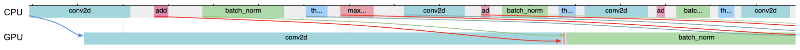
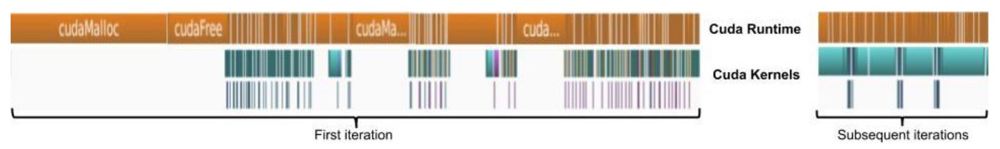
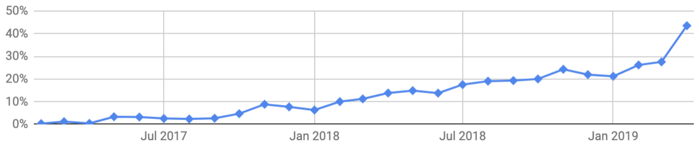

# 论文中文解读：《PyTorch: An Imperative Style, High-Performance Deep Learning Library》

> **基本信息**：Adam Paszke（华沙大学）、Sam Gross、Francisco Massa、Adam Lerer、James Bradbury（Google）、Gregory Chanan、Trevor Killeen（自由职业）、Zeming Lin、Natalia Gimelshein（NVIDIA）、Luca Antiga（Orobix）、Alban Desmaison（牛津大学）、Andreas Köpf（Xamla）、Edward Yang、Zach DeVito、Martin Raison（Nabla）、Alykhan Tejani（Twitter）、Sasank Chilamkurthy（Qure.ai）、Benoit Steiner、Lu Fang、Junjie Bai、Soumith Chintala（其余为 Facebook 或 Facebook AI Research，共 21 位作者），第 33 届神经信息处理系统大会 NeurIPS 2019（温哥华）；论文原文 [NeurIPS 论文集页面](https://proceedings.neurips.cc/paper/2019/hash/bdbca288fee7f92f2bfa9f7012727740-Abstract.html)。
>
> **本文的读法**：原文有 3 幅图（Figure 1–3）、1 张表（Table 1）和 2 段代码清单（Listing 1、2）。图为从 PDF 裁出的原图并配中文说明；Table 1 逐格转录；代码清单转录成代码块并逐行解释。凡不是出自论文的内容（示意代码、对表中数字的换算、对后续 PyTorch 版本的类比）都标注“笔者补充”。论文本体只有 9 页，本文提到的“附录”在这份 PDF 里没有收录，所以基准的批大小等细节无从核对。

## 一、一句话结论

这篇论文要证明：**易用性（动态、命令式、Pythonic）和速度并不矛盾**。PyTorch 的做法是：模型、数据加载、优化器、训练循环都是普通的 Python 程序；张量运算**立即执行**（eager）；自动微分用**运算符重载**，每次执行时现场记录“这一次真正执行了哪些可微运算”，再沿记录反向求梯度；而性能来自一组务实的实现选择——C++ 核心（反向传播引擎不需要 Python 的全局解释器锁）、把控制流和数据流分开并让 GPU 异步执行（CUDA stream）、自定义的缓存式 GPU 显存分配器、引用计数的即时释放、基于共享内存的多进程。在六个训练基准（AlexNet、VGG-19、ResNet-50、MobileNet、GNMTv2、NCF）上，PyTorch 的吞吐都在当时最快框架的 17% 以内。

## 二、背景与动机

### 2.1 引言：静态数据流图的得与失

论文引言的论点是：

- Caffe、CNTK、TensorFlow、Theano 等许多流行框架**构造一张静态数据流图**来表示计算，这张图之后可以反复应用于一批批数据。这样做提供了对整个计算的**事先可见性**，理论上可用来提升性能和可扩展性；但**代价**是易用性、可调试性，以及能表示的计算类型的灵活性。
- 先前的工作已经认识到**动态 eager 执行**对深度学习的价值，也有一些近期框架实现了这种 define-by-run 做法，但它们要么以性能为代价（论文点名 Chainer，见 [Chainer 论文解读](../chainer_define_by_run/论文中文解读.md)），要么使用表达力较弱但更快的语言（Torch、DyNet），这限制了适用范围。
- 论文的主张：通过细致的实现和设计选择，动态 eager 执行**可以在很大程度上不牺牲性能**。PyTorch 是一个 Python 库，对动态张量计算立即执行，带自动微分和 GPU 加速，性能与当时最快的深度学习库相当。这一组合在研究社区非常受欢迎，例如有 296 篇 ICLR 2019 投稿提到 PyTorch。

### 2.2 四个科学计算趋势（论文第 2 节）

PyTorch 建立在科学计算里四个越来越重要的趋势之上：

1. **数组成为一等对象**：自 20 世纪 60 年代起，APL、MATLAB、R、Julia 等领域专用语言把多维数组（常称张量）变成一等对象，并配有一套完整的数学原语（运算符）；NumPy、Torch、Eigen、Lush 等库让数组编程在 Python、Lisp、C++、Lua 这类通用语言里也富有生产力。
2. **自动微分**：自动微分让求导这件繁重的体力活完全自动化，大大方便了尝试不同的机器学习方法，同时仍能做高效的基于梯度的优化。autograd 包使这项技术在 NumPy 数组上流行起来，Chainer、DyNet、Lush、Torch、Jax、Flux.jl 等框架使用类似做法。
3. **开源 Python 生态**：随着自由软件运动，科学界从 Matlab 这类封闭的专有软件转向 NumPy、SciPy、Pandas 等开源 Python 包；这个大生态的网络效应让 Python 成为入门研究的必备技能，所以自 2014 年起大多数深度学习框架都收敛到以 Python 接口为必备特性。
4. **通用大规模并行硬件**：GPU 的普及和商品化提供了深度学习所需的算力；cuDNN 这样的专用库以及一批学术工作产出了一组高性能、可复用的深度学习 kernel，使 Caffe、Torch7、TensorFlow 等框架能利用这些加速器。

PyTorch 的定位：**提供由 GPU 加速、通过自动微分可微、并集成在 Python 生态里的数组编程模型**。

### 2.3 先拆开“动态图”这个词（笔者整理）

讨论 PyTorch 的“图”时至少有四种不同对象：

1. **Python 程序**：用户写的控制流和对象操作；
2. **eager 的运算流**：本次运行实际发出的张量运算序列；
3. **autograd 图**：为反向传播保存的依赖关系；
4. **编译器 IR**：后来由 FX、Dynamo、AOTAutograd 等组件捕获的、可变换的图（本文所在的 2019 年论文**没有**讨论）。

这篇论文主要解释前三项。因此不要把 autograd 图理解为“PyTorch 完整的前向计算图”：Python 的分支在执行时已经选定，被记录下来的只是被选路径上的运算。

## 三、设计原则（论文第 3 节）

论文说 PyTorch 的成功源于把已有的想法织成一个在速度与易用性之间取得平衡的设计，背后有四条原则：

| 原则 | 论文的含义 |
|---|---|
| Be Pythonic（保持 Pythonic） | 数据科学家熟悉 Python 语言、编程模型和工具，PyTorch 应当是这个生态的一等成员：接口简单、一致，最好一件事只有一种惯用写法；与标准的绘图、调试、数据处理工具自然集成。 |
| Put researchers first（研究者优先） | 让写模型、数据加载器、优化器尽量容易、高效；机器学习固有的复杂性应由库在内部处理，并藏在直观的、没有副作用和意外性能悬崖的 API 后面。 |
| Provide pragmatic performance（提供务实的性能） | 必须有可观的性能，但不以牺牲简单易用为代价。**拿 10% 的速度换取显著更简单的模型是可以接受的，100% 则不行**；因此实现可以接受额外的复杂性来换取性能。同时提供让研究者手动控制代码执行的工具，使他们能独立于库的自动优化去找自己的性能改进。 |
| Worse is better（“更糟反而更好”） | 工程资源固定时，保持内部实现简单所节省的时间可以用来实现更多功能、适应新情况、跟上 AI 领域的快速进展，所以**一个简单但略不完整的方案，胜过一个全面但复杂且难以维护的设计**。 |

这四条原则在后文的具体取舍里反复出现：比如不做 copy-on-write 而是对复杂的原地修改报错（4.3 节），一个 CUDA stream 一个显存池（5.3 节）。

## 四、以易用性为中心的设计（论文第 4 节）

### 4.1 深度学习模型就是 Python 程序

机器学习在极短的时间里，从识别单个手写数字发展到自主玩 StarCraft；神经网络本身也从简单的前馈层序列，演化成由许多循环和递归函数构成的、变化多端的数值程序。为支持这种日益增长的复杂性，PyTorch **放弃了基于图的元编程（graph-metaprogramming）的潜在好处，来保留 Python 的命令式编程模型**。这个设计由 Chainer 和 DyNet 开创于模型编写环节，PyTorch 把它扩展到深度学习工作流的所有方面：定义层、组合模型、加载数据、运行优化器、并行化训练，全都用通用编程里熟悉的概念表达。

这保证了任何新的神经网络结构都能容易地用 PyTorch 实现。例如，层（在现代机器学习中应理解为带隐式参数的有状态函数）通常是 Python 类，**构造函数创建并初始化参数，`forward` 方法处理输入激活**；模型通常是组合各个层的类——但论文特别强调，没有任何东西强迫用户这样组织代码。

Listing 1（原文第 4 页）展示如何通过组合 PyTorch 提供的二维卷积、矩阵乘法、dropout 与 softmax 构造完整的模型来分类灰度图像；线性层本来就是库的一部分，这里给出一个示例实现，是为了突出它有多简单：

```python
class LinearLayer(Module):
    def __init__(self, in_sz, out_sz):
        super().__init__()
        t1 = torch.randn(in_sz, out_sz)
        self.w = nn.Parameter(t1)
        t2 = torch.randn(out_sz)
        self.b = nn.Parameter(t2)

    def forward(self, activations):
        t = torch.mm(activations, self.w)
        return t + self.b

class FullBasicModel(nn.Module):
    def __init__(self):
        super().__init__()
        self.conv = nn.Conv2d(1, 128, 3)
        self.fc = LinearLayer(128, 10)

    def forward(self, x):
        t1 = self.conv(x)
        t2 = nn.functional.relu(t1)
        t3 = self.fc(t1)
        return nn.functional.softmax(t3)
```

*Listing 1（原文 Listing 1，第 4 页）：一个自定义层，用作一个简单而完整的神经网络的构件。*

**逐行解释**：

- `class LinearLayer(Module)`：自定义层就是 `Module` 的子类；
- `__init__`：先调用父类构造；`t1 = torch.randn(in_sz, out_sz)` 随机初始化权重张量，`self.w = nn.Parameter(t1)` 把它登记为可学习参数；`t2` 与 `self.b` 同理是长度 `out_sz` 的偏置——“构造函数创建并初始化参数”；
- `forward(self, activations)`：`torch.mm` 是矩阵乘，`t + self.b` 加偏置，即 $y=xW+b$，这里权重形状是 `(in_sz, out_sz)`；
- `class FullBasicModel(nn.Module)`：完整模型；构造里创建一个 `nn.Conv2d(1, 128, 3)`（1 个输入通道、128 个输出通道、$3\times3$ 卷积核）和一个 `LinearLayer(128, 10)`（输出 10 类）；
- `forward(self, x)`：依次经过卷积、ReLU、线性层、softmax——每一行都是真正执行的 Python 语句。
- 两处说明：原文清单里 `t3 = self.fc(t1)` 用的是 `t1` 而不是经过 ReLU 的 `t2`，应是示例的笔误；另外按原样它不能直接运行（卷积输出是四维张量，而 `torch.mm` 只接受二维矩阵），它是展示“组合”方式的示意，此处照原样转录。

“一切都只是程序”的哲学不限于模型，也适用于优化器和数据加载器，这便于试验新的训练技术。例如要实现很流行的生成对抗网络，需要指定两个独立的模型（生成器与判别器）和两个同时依赖这两个模型的损失函数——僵硬的 API 很难应付这种设置，而 PyTorch 的简单设计可以轻松适应，如 Listing 2：

```python
discriminator = create_discriminator()
generator = create_generator()
optimD = optim.Adam(discriminator.parameters())
optimG = optim.Adam(generator.parameters())

def step(real_sample):
    # (1) Update Discriminator
    errD_real = loss(discriminator(real_sample), real_label)
    errD_real.backward()
    fake = generator(get_noise())
    errD_fake = loss(discriminator(fake.detach()), fake_label)
    errD_fake.backward()
    optimD.step()
    # (2) Update Generator
    errG = loss(discriminator(fake), real_label)
    errG.backward()
    optimG.step()
```

*Listing 2（原文 Listing 2，第 4 页）：生成对抗网络的简化训练。（原文第 8 行 `errD_fake = loss(discriminator(fake.detach(), fake_label)` 少一个右括号，此处已按语义补成 `loss(discriminator(fake.detach()), fake_label)`。）*

**逐行解释**：

- 前四行创建两个模型和两个优化器，每个优化器只管一个模型的参数；
- `step` 是一次训练步，先**更新判别器**：对真实样本算损失并反向（`errD_real.backward()`）；让生成器用噪声造 `fake`；`fake.detach()` 把假样本从生成器的计算历史上“摘下”（笔者补充：这样判别器的损失不会把梯度传回生成器），算判别器对假样本的损失并反向，再 `optimD.step()` 更新判别器；
- 再**更新生成器**：`discriminator(fake)` 这次没有 `detach`，并且配的是 `real_label`，使梯度能流回生成器；`errG.backward()` 后 `optimG.step()` 更新生成器。
- **要点**：两个模型、两个损失、交替更新，用的只是普通的函数调用、方法调用和顺序语句，不需要任何特殊的“图构建”API。

由于 PyTorch 程序是 eager 执行的，Python 的所有特性在整个设计过程中都可用：print 语句、标准调试器、matplotlib 这类常用可视化工具都如预期工作；用户不必等待漫长的编译才能开始运行程序，更重要的是可以观察中间计算，以理解模型如何工作、结果是否正确。

### 4.2 互操作性与可扩展性

**互操作**是 PyTorch 的首要任务之一，因为它让用户程序能利用丰富的 Python 库生态。PyTorch 允许与外部库**双向**交换数据：例如用 `torch.from_numpy()` 函数和张量的 `.numpy()` 方法在 NumPy 数组和 PyTorch 张量之间转换；也有类似的功能交换以 DLPack 格式存储的数据。这两种交换都**没有数据拷贝**——两侧的对象只是描述如何解释一块共享的内存区域，所以这些操作极其廉价，无论转换的数组多大都是常数时间。

**可扩展**：许多关键系统被专门设计成可扩展的。

- **自动微分系统**允许用户添加自定义可微函数：定义 `torch.autograd.Function` 的子类，实现 `forward()` 与 `backward()` 方法，分别给出函数及其导数（更正式地说是向量-雅可比积）。下面是**笔者补充的示意代码**（非原文）：

```python
# 示意（非原文）：自定义可微函数
class MyReLU(torch.autograd.Function):
    @staticmethod
    def forward(ctx, x):
        ctx.save_for_backward(x)            # 保存反向需要的张量
        return x.clamp(min=0)

    @staticmethod
    def backward(ctx, grad_out):            # grad_out 是上游梯度，返回对输入的梯度
        x, = ctx.saved_tensors
        return grad_out * (x > 0).to(grad_out.dtype)
```

- **数据集**：继承 `torch.utils.data.Dataset` 并实现两个方法 `__getitem__`（下标运算符）和 `__len__`（长度运算符），使数据集表现得像（可能是惰性的）列表。具体怎么实现完全由实现者决定，许多用户借助其他 Python 包加载数据。`DataLoader` 类消费符合这个接口的对象，并提供数据的迭代器，负责洗牌（shuffling）、批处理（batching）、并行化以及固定（pinned）CUDA 内存的管理以提高吞吐。
- **最重要的是**：用户可以自由替换 PyTorch 中不满足其项目需求或性能要求的任何组件。它们都被设计成完全可互换，PyTorch 十分小心地不强加任何特定方案。

### 4.3 自动微分

基于梯度的优化对深度学习至关重要，所以 PyTorch 必须能自动计算用户所指定模型的梯度，而这些模型可以是**任意 Python 程序**。但 Python 是动态编程语言，允许在运行时改变大部分行为，使得**提前的源到源微分很繁琐**。因此 PyTorch 采用**运算符重载**：每次执行被求导的函数时，现场构建所计算函数的一个表示。

- 在当前实现里，PyTorch 做**反向模式（reverse-mode）自动微分**，计算标量输出对多元输入的梯度。（笔者补充：设 $y=f(x)$，$x\in\mathbb{R}^n$，$y\in\mathbb{R}^m$，雅可比矩阵 $J\in\mathbb{R}^{m\times n}$。反向模式每次计算一个向量-雅可比积 $v^\top J$，输出维 $m$ 小（如标量损失）时最划算；前向模式每次计算一个雅可比-向量积 $Ju$，输入维 $n$ 小时更合适。）
- 对输出多于输入的函数，用**前向模式**自动微分会更高效，但这种用例在机器学习应用里较少。论文说 PyTorch 可以很容易地扩展成用数组级的**对偶数（dual numbers）** 做前向模式微分。

论文还强调了一个有趣而不常见的特性：PyTorch 能**对含有张量原地修改（mutation）的代码求导**，而原地修改正是命令式程序的基本构件之一。为保证安全，实现了**张量的版本系统**（versioning system），用来跟踪张量的修改，确保总是用到预期的数据。下面是**笔者补充的示意**（标准的 PyTorch 行为，非原文）：

```python
# 示意（非原文）：原地修改了反向需要的张量，版本号对不上
x = torch.randn(3, requires_grad=True)
y = x.exp()          # exp 的反向要用到它的输出 y，于是保存了 y
y.add_(1)            # 原地修改 y，y 的版本号加 1
y.sum().backward()   # 反向取用保存的 y 时发现版本号变了，抛出错误而不是静默地给出错误梯度
```

这里有一个有趣的取舍：论文说，可以用 copy-on-write 之类的技术来支持任意程序，但**选择不走这条路**，因为从性能角度，通常让用户重写代码以避免任何拷贝更有利。因此，大多数原地修改是良性的、可以自动处理；真正复杂的情形则报**用户错误**，让用户知道自己很可能想重构程序。这样就避免引入隐蔽而难以发现的性能悬崖。

## 五、以性能为中心的实现（论文第 5 节）

从 Python 解释器里高效地运行深度学习算法是出了名的难：例如全局解释器锁（GIL）实际上保证了任意多个并发线程里同一时刻只有一个在运行。基于静态数据流图的框架通过把计算的求值推迟给一个自定义解释器来绕开这个问题。**PyTorch 的解法不同：细致地优化执行的每一个方面，同时让用户能轻松利用额外的优化策略。**

### 5.1 高效的 C++ 核心

尽管与 Python 生态紧密集成，PyTorch 的大部分是用 C++ 写的以获得高性能。这个核心库 **libtorch** 实现张量数据结构、GPU 与 CPU 运算符、基本并行原语，也提供自动微分系统，包括大多数内建函数的梯度公式。这保证了由核心 PyTorch 运算符组成的函数的**导数计算完全在一个多线程求值器里执行，不需要持有 Python 全局解释器锁**。Python 绑定由 YAML 元数据文件生成；一个有趣的副作用是社区能很快创建多种其他语言的绑定，如 NimTorch、hasktorch 等项目。

这个设计还让团队创建了一等的 C++ 绑定和建模库，可用于 Python 不方便的地方，比如 StarCraft 的游戏引擎或移动平台；甚至可以把描述 PyTorch 模型的 Python 代码用 TorchScript 引擎在没有 Python 的情况下运行。

### 5.2 控制流与数据流分离，GPU 异步执行

PyTorch 严格区分**控制流**（程序分支、循环）与**数据流**（张量及其上的运算）。控制流由 Python 和在主机 CPU 上执行的优化 C++ 代码处理，结果是设备上一条**线性的运算符调用序列**；运算符可在 CPU 或 GPU 上运行。

PyTorch 被设计成利用 **CUDA stream** 机制在 GPU 上**异步**执行运算符：把 CUDA kernel 的调用排进 GPU 硬件的 FIFO 队列。这使系统能让 CPU 上的 Python 代码与 GPU 上的张量运算**重叠**。由于张量运算通常耗时可观，这使得即使在 Python 这种开销相当高的解释型语言里，也能让 GPU 饱和并达到峰值性能。这一机制对用户几乎不可见：除非自己实现多 stream 原语，所有 CPU-GPU 同步都由库处理。

论文说，PyTorch 本来也可以用类似机制在 CPU 上异步执行运算符，但跨线程通信和同步的成本会抵消这种优化的性能收益。

```text
示意（笔者补充，非原文）：主机排队很快，GPU 按 FIFO 顺序慢慢执行
CPU：[Python][排队 conv2d][Python][排队 add][Python][排队 batch_norm] ... 很快排完一长串
GPU：[------------ conv2d ------------][add][------ batch_norm ------] ...
```

### 5.3 自定义的缓存式张量分配器

几乎每个运算符都要动态分配一个输出张量来存放结果，所以优化动态内存分配器的速度至关重要。CPU 上 PyTorch 可以依赖优化过的库（参考文献列出了 Hoard、FreeBSD 的可扩展并发 malloc 实现、tcmalloc）。但在 GPU 上，`cudaFree` 例程可能**阻塞调用者，直到所有 GPU 上此前排队的工作都完成**。为避免这个瓶颈，PyTorch 实现了自定义分配器：**逐步建立一个 CUDA 内存缓存**，并在之后的分配中重新分配这些内存，而不再调用 CUDA API。**增量分配**对互操作性同样关键，因为提前占满所有 GPU 内存会妨碍用户使用其他支持 GPU 的 Python 包。

为进一步提高效果，分配器针对深度学习特定的内存使用模式做了调优：

- 把分配大小**向上取整到 512 字节的倍数**，以避免碎片问题；
- 为**每个 CUDA stream（工作队列）维护一个独立的内存池**。“一个 stream 一个池”的设计假设简化了实现并提高了分配器的性能：因为 CPU 跑在 GPU 前面，内存在 GPU 上的最后一次使用结束之前就已在 CPU 上被释放；由于 stream 会串行化执行，若释放在 CPU 上先于重新分配，则在 GPU 上也会是同样的顺序。所以只要新分配用在与被释放区域**同一个 stream** 上，分配器就可以立即重新分配在 CPU 上被释放的内存。但如果一块分配最后在一个 stream 上使用，然后在另一个 stream 上被分配，就需要额外的同步。

“一个 stream 一个池”的设计看起来有局限，因为分配会按 stream 碎片化，但实际上 PyTorch 几乎从不使用多个 stream：想让 CUDA kernel 协作式地共享 GPU 是出了名的难，因为确切的调度由硬件控制，kernel 编写者通常转向把多个任务合并在一起的单体 kernel。数据加载与分布式计算工具是单 stream 设计的例外，它们会小心地插入额外同步以避免与分配器产生不良交互。论文承认这个设计易受某些边角情形影响，但在实际代码中几乎不出现不想要的行为，大多数用户并不知道它的存在。

### 5.4 多进程

由于 GIL，Python 的默认实现不允许并发线程并行执行。Python 社区建立了标准的 `multiprocessing` 模块来缓解，它提供一些工具让用户容易地派生子进程并实现基本的进程间通信原语。但这些原语的实现使用与磁盘持久化相同的序列化形式，处理大数组时效率很低。因此 PyTorch 把它扩展成 `torch.multiprocessing`：它是内建包的**直接替代品**，会自动把发送给其他进程的张量的数据**移到共享内存**，而不是通过通信信道发送。

这个设计大幅提升性能，也使进程隔离变弱，得到一个更像普通多线程程序的编程模型：用户可以轻松实现在各自独立的 GPU 上运行的高度并行程序，之后用 all-reduce 风格的原语同步梯度。该系统的另一个独特之处是**透明地处理 CUDA 张量的共享**，使得实现 Hogwild 这类技术很容易。

### 5.5 引用计数

用户常常把模型设计成用尽训练时可用的全部内存，增大批大小是加速训练的常用技巧，所以为获得出色性能，PyTorch 必须把内存当作需要小心管理的稀缺资源。具有 eager 语义的库必须在不知道张量将来如何使用的情况下管理张量内存。垃圾回收（GC）是自动处理的典型办法，因为它的均摊性能好：运行时周期性地检查系统状态，枚举在用的对象，释放其余的一切。然而**推迟释放会使程序整体使用更多内存**；考虑到 GPU 内存稀缺，这种开销不可接受。事实上，Torch7 使用 Lua 内置的垃圾回收器，用户中一个常见的反模式是在程序里到处撒显式触发 GC 的调用，指望内存错误消失。

PyTorch 采用不同的办法：依靠**引用计数**方案跟踪每个张量的使用次数，计数一降到零就**立即**释放底层内存。注意，PyTorch 通过与 Python 自身的引用计数机制集成，既跟踪 libtorch 内部的引用，也跟踪用户在 Python 代码里产生的外部引用，这保证了内存恰在张量不再需要时被释放。

一个值得注意的前提：只有在**已经使用引用计数的语言实现**（CPython、Swift，但不包括 PyPy 或 Lua 这类许多脚本语言），以及**允许用户自定义赋值、拷贝和移动行为的语言**（如 C++、Rust）中，才能保证期望的性能特性；对不满足这些条件的实现，绑定必须在 PyTorch 之上自己实现专门的内存管理。

### 5.6 设计取舍小结（笔者整理，内容均来自论文第 4、5 节）

| 设计选择 | 论文给出的理由 | 论文承认的代价或边界 |
|---|---|---|
| 运算符重载的 autograd | Python 太动态，提前的源到源微分繁琐 | 只记录已执行的运算；需要版本系统保护原地修改 |
| 不做 copy-on-write | 避免隐蔽的性能悬崖 | 复杂的原地修改报错，要求用户重构 |
| C++ 核心 | 反向传播在多线程求值器里运行，无需 GIL | 需要用 YAML 元数据生成 Python 绑定 |
| GPU 异步执行 | 让 Python 开销被 GPU 计算隐藏 | 对用户几乎不可见；自写多 stream 原语时要自己同步 |
| 不做 CPU 异步 | 跨线程通信与同步的成本会抵消收益 | CPU 上没有这种重叠 |
| 缓存式显存分配器 | `cudaFree` 会阻塞，直到所有排队工作完成 | 一个 stream 一个池；跨 stream 复用需额外同步；有边角情形 |
| 引用计数而非 GC | GC 推迟释放，GPU 内存稀缺 | 依赖语言实现是否支持引用计数或自定义拷贝语义 |
| 共享内存的多进程 | 标准序列化对大数组低效 | 进程隔离变弱 |

## 六、评测（论文第 6 节）

**硬件**：所有实验在一台工作站上完成，配有两颗 Intel Xeon E5-2698 v4 CPU 和一块 NVIDIA Quadro GP100 GPU。

### 6.1 异步数据流（图 1）

论文先量化 PyTorch 在 GPU 上异步执行数据流的能力：用内建的 profiler 给各种基准加插桩，并记录单个训练步的执行时间线。



*图 1（原文 Figure 1，第 8 页）：ResNet-50 的前几个算子的执行轨迹。上行是在主机 CPU 上运行的控制流的执行，灰色区域是由解释器执行的 Python 代码，彩色区域对应主机 CPU 为排队各个算子（卷积、批归一化等）所做的工作；下行是这些算子在 GPU 上的相应执行；箭头把时间上配对的两个事件连起来。*

**图中文字翻译与读法**：

- 上行标签 **CPU**：依次是 `conv2d`（卷积）、`add`、`batch_norm`、`th…`、`max…`、`conv2d`、`ad…`、`batch_norm`、`th…`、`conv2d`、`ad…`、`batc…`、`th…`、`conv2d`，不同算子用不同颜色；`th…`、`max…`、`ad…`、`batc…` 是被截断的算子名（原图只显示了前几个字母）；灰色空隙是 Python 解释器在运行。
- 下行标签 **GPU**：同色的对应算子——第一个 `conv2d` 占了很长的一段，随后是很窄的 `add` 和较长的 `batch_norm`；
- 红、蓝、绿等曲线箭头从 CPU 上的排队事件指向 GPU 上对应的执行。
- **读图结论**：主机 CPU 排队工作的速度**迅速超过** GPU 上算子的执行速度——在 GPU 还在执行第一个 `conv2d` 时，CPU 已经排完了前八九个算子。这使 PyTorch 能达到几乎完美的设备利用率。论文说，在这个例子中 **GPU 的执行时间大约是 CPU 调度时间的三倍**；确切比例取决于主机 CPU 与 GPU 的相对性能、每个张量的元素数，以及要在 GPU 上执行的浮点计算的平均算术复杂度。

### 6.2 显存管理（图 2）

论文用 NVIDIA profiler 追踪 ResNet-50 一次训练迭代中 CUDA 运行时和所启动的 CUDA kernel 的执行。



*图 2（原文 Figure 2，第 8 页）：ResNet-50 在 GPU 上的执行的标注轨迹。*

**图中文字翻译与读法**：

- 右侧行标签：**Cuda Runtime**（CUDA 运行时，橙色，主机侧的 CUDA API 调用）和 **Cuda Kernels**（CUDA kernel，青色，GPU 上的 kernel 执行）；底部括号：**First iteration**（第一次迭代）与 **Subsequent iterations**（后续迭代）。
- **第一次迭代**：运行时一行开头是很宽的 `cudaMalloc`、`cudaFree` 色块（以及之后较窄的 `cudaMa…`、`cuda…`），这些区间里 Kernel 一行几乎是空的——**GPU 在等**；kernel 只在 CUDA 内存管理调用之间的间隙出现。
- **后续迭代**：运行时一行只剩窄窄的细条（kernel 启动），Kernel 一行几乎被连续地填满，GPU 基本不再空闲。
- **读图结论**：论文说，第一次迭代的行为与后续迭代差别很大：一开始，对 CUDA 内存管理函数（`cudaMalloc` 和 `cudaFree`）的调用会长时间阻塞 CPU 线程，大幅拖慢执行、降低 GPU 利用率；而后续迭代里这一影响消失，因为 PyTorch 的缓存式显存分配器开始**复用之前分配的区域**。所以评测 PyTorch 时要区分首轮（warmup）和稳态。

### 6.3 基准：与其他框架比较（表 1）

最后，论文比较 PyTorch 与三个流行的基于图的深度学习框架（CNTK、MXNet、TensorFlow）、一个 define-by-run 框架（Chainer）和一个面向生产的平台（PaddlePaddle）的**单机 eager 模式性能**。论文说附录列出了复现其设置所需的全部步骤（这份 PDF 里没有附录）。

**表 1：6 个模型使用 32 位浮点数的训练速度。** 吞吐越大越好。单位：AlexNet、VGG-19、ResNet-50、MobileNet 为每秒图像数；GNMTv2 为每秒 token 数；NCF 为每秒样本数。每个模型最快的速度加粗；± 后为不确定度（GNMTv2 与 NCF 以百分比给出）；N/A 表示没有该项数据。硬件：两颗 Xeon E5-2698 v4 + 一块 Quadro GP100。

| 框架 | AlexNet | VGG-19 | ResNet-50 | MobileNet | GNMTv2 | NCF |
|---|---:|---:|---:|---:|---:|---:|
| Chainer | 778 ± 15 | N/A | **219** ± 1 | N/A | N/A | N/A |
| CNTK | 845 ± 8 | 84 ± 3 | 210 ± 1 | N/A | N/A | N/A |
| MXNet | **1554** ± 22 | 113 ± 1 | 218 ± 2 | 444 ± 2 | N/A | N/A |
| PaddlePaddle | 933 ± 123 | 112 ± 2 | 192 ± 4 | **557** ± 24 | N/A | N/A |
| TensorFlow | 1422 ± 27 | 66 ± 2 | 200 ± 1 | 216 ± 15 | 9631 ± 1.3% | 4.8e6 ± 2.9% |
| PyTorch | 1547 ± 316 | **119** ± 1 | 212 ± 2 | 463 ± 17 | **15512** ± 4.8% | **5.4e6** ± 3.4% |

（原文表 1，第 8 页。）

**读法**：

1. **论文的结论**：在所有基准上，PyTorch 的性能都在最快框架的 17% 以内；论文把这个结果归因于这些工具把大部分计算交给了**同一版本的 cuDNN 和 cuBLAS** 库。
2. 笔者按表中数字核对各列 PyTorch 与最快者的差距：AlexNet 比 MXNet 低约 0.5%；VGG-19、GNMTv2、NCF 三列 PyTorch 是最快的（GNMTv2 比 TensorFlow 快约 61%，NCF 快约 12.5%）；ResNet-50 比 Chainer 低约 3.2%；MobileNet 比 PaddlePaddle 低约 16.9%——这就是“17% 以内”的上界来源。
3. AlexNet 一列 PyTorch 的不确定度达 ± 316，PaddlePaddle 也有 ± 123，这几个数字的差别（如 1547 对 1554）在噪声之内，不宜解读成排名。
4. Chainer 只在 AlexNet 和 ResNet-50 两列有数据，其中**ResNet-50 反而是 Chainer 最快（219）**，AlexNet 则最慢（778）；因此引言里“Chainer 以性能为代价”的说法在这张表里只被部分支持。
5. 各列单位不同（图像/秒、token/秒、样本/秒），**不能横向比较绝对数字**。

### 6.4 采用度（图 3）

设计决定的有效性及其对易用性的影响很难度量。作为代理指标，论文统计了机器学习界对 PyTorch 的接受程度：统计自 2017 年 1 月 PyTorch 首次发布以来，各种机器学习工具（Caffe、Chainer、CNTK、Keras、MXNet、PyTorch、TensorFlow、Theano）在 arXiv 预印本里被提及的频率。图 3 给出每月提到“PyTorch”一词的次数占这些深度学习框架所有被提及次数的百分比。在同一篇论文里多次提到的工具只计一次，搜索不区分大小写以兼顾各种拼写。



*图 3（原文 Figure 3，第 9 页）：每月提到常见深度学习框架的 arXiv 论文里，提到 PyTorch 的论文所占的百分比。*

**图中文字翻译与读法**：横轴是时间（刻度 Jul 2017、Jan 2018、Jul 2018、Jan 2019，每月一个点），纵轴是百分比（0%–50%）。曲线从 2017 年初接近 0% 起步，基本单调上升：从图上读出，约 2018 年 1 月 6%，2018 年 7 月 17%，2019 年 1 月 21%，最后一个点约 43%（均为图上读出的近似值）。**读图结论**：PyTorch 在研究论文中被提及的份额快速增长；但这只是“被提及”的份额，不是使用量、性能或用户满意度，也不区分在论文里是正面还是反面提及。

## 七、结论与未来工作（论文第 7 节）

PyTorch 通过把对易用性的关注与对性能的细致考虑结合起来，成为深度学习研究界的流行工具。除了继续支持深度学习的最新趋势与进展，作者计划继续提升 PyTorch 的速度和可扩展性：

- **PyTorch JIT**：一套让 PyTorch 程序能在 Python 解释器之外执行、从而可被进一步优化的工具；
- **分布式计算**：提供数据并行的高效原语，以及基于远程过程调用（RPC）的 Pythonic 模型并行库。

## 八、局限、证据边界与常见误读

**证据边界**（笔者归纳）：

1. **只有单机 eager 性能**：评测是一台工作站、一块 GPU，没有多机多卡、也没有与“编译后”的版本比较；表 1 的模型以 cuDNN、cuBLAS 的重 kernel 为主（论文自己的归因）。
2. **性能结果主要证明“eager 的开销没有压倒重 kernel”**：论文自己把结果归因于各框架共享同一版本的 cuDNN/cuBLAS，所以这不是“eager 调度没有成本”。当模型由大量极小的算子组成、批很小、Python 控制很重时，主机与 launch 开销可能成为瓶颈（笔者补充：后来才有算子融合、CUDA Graph、`torch.compile` 等方案）。
3. **版本与硬件都是 2019 年的环境**：Quadro GP100、当时各框架的版本，不应沿用到今天。
4. **“几乎从不使用多 stream”是分配器的设计假设**：论文承认存在边角情形，跨 stream 复用需要用户或库额外同步。
5. **引用计数的好处依赖语言实现**（CPython、Swift、C++、Rust）。
6. **表 1 的“N/A”没有解释**，不能据此推断某框架做不了这项任务。

**常见误读**：

- “动态图就是每一步把完整的前向图重新建一遍”——更准确地说，**前向立即执行**；autograd 记录反向所需的内容。它不是先构造一张完整的可执行图再运行。
- “Python 的 `if` 会成为 autograd 图里的 If 节点”——通常不会。Python 已经选择了一个分支，autograd 只看到该分支里实际执行的张量运算；要让编译后的图保留数据相关的分支，需要显式的图控制流表示。
- “动态图天然支持任意原地修改”——论文只说**大多数原地修改可自动处理**，复杂情形报用户错误。笔者补充：反向正确性、别名分析和编译器捕获仍会受原地修改影响。
- “eager 一定和编译后一样快”——表 1 并不支持这个结论，见上面的证据边界第 2 条。

## 九、与 Chainer、PyTorch 2 及本仓库其他论文的关系

- 与 [Chainer](../chainer_define_by_run/论文中文解读.md)：本文明确承认模型编写方式的先驱是 Chainer 与 DyNet；PyTorch 把“Python 程序即模型”扩展到数据加载、优化器和并行化，并用 C++ 核心、异步执行、缓存分配器把性能补上。
- 与 [JANUS](../janus_symbolic_graph/论文中文解读.md)、[torch.fx](../torch_fx/论文中文解读.md)：本文解释为什么 eager 是用户语义的基线；后两者研究如何从命令式程序里安全地得到可优化的图。
- 与 [PyTorch 2](../pytorch_2/论文中文解读.md)：笔者补充的后续演进如下，不是本文内容。

```text
Python 字节码 → TorchDynamo（guards + FX 图） → AOTAutograd（前向/反向图） → TorchInductor（kernel）
```

整体路线见 [PyTorch 动态图与 Graph 编译论文阅读索引](../PyTorch动态图与Graph编译论文阅读索引.md)。

## 十、复现与阅读检查清单

- 能否说清 autograd 为什么用运算符重载而不是提前的源到源微分，以及“版本系统 + 报错”替代 copy-on-write 的理由？
- 能否解释 CPU 与 GPU 的异步执行为何能掩盖 Python 开销，以及在什么条件下这个前提会失效？
- 能否说明缓存式分配器为何让第一次迭代与后续迭代的行为不同，并据此在自己的基准里区分 warmup 与稳态？
- 引用表 1 时，是否写明硬件（两颗 Xeon E5-2698 v4 + 一块 Quadro GP100）、32 位浮点、单位各列不同，并避免把“17% 以内”读成“eager 没有成本”？
- 区分“被提及的份额”（图 3）与“真实使用量”。

## 原文证据导航

- [原论文 PDF](paper.pdf)
- [原文提取文本](paper.txt)
- [论文概要](论文概要.md)
