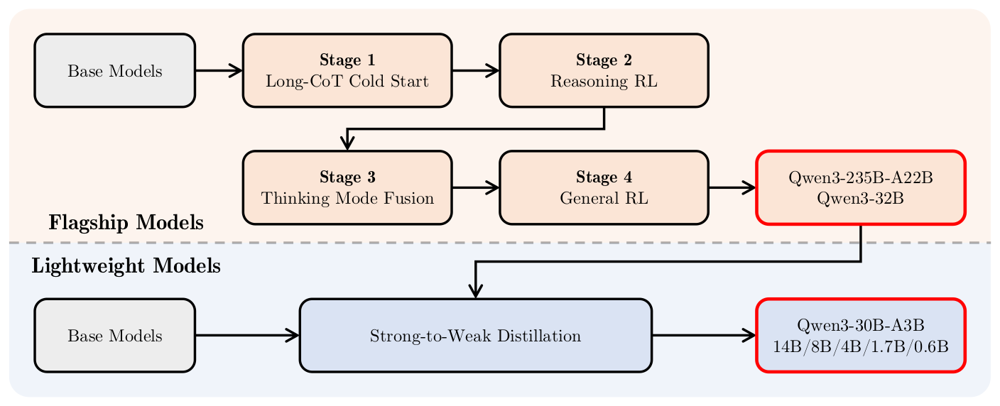
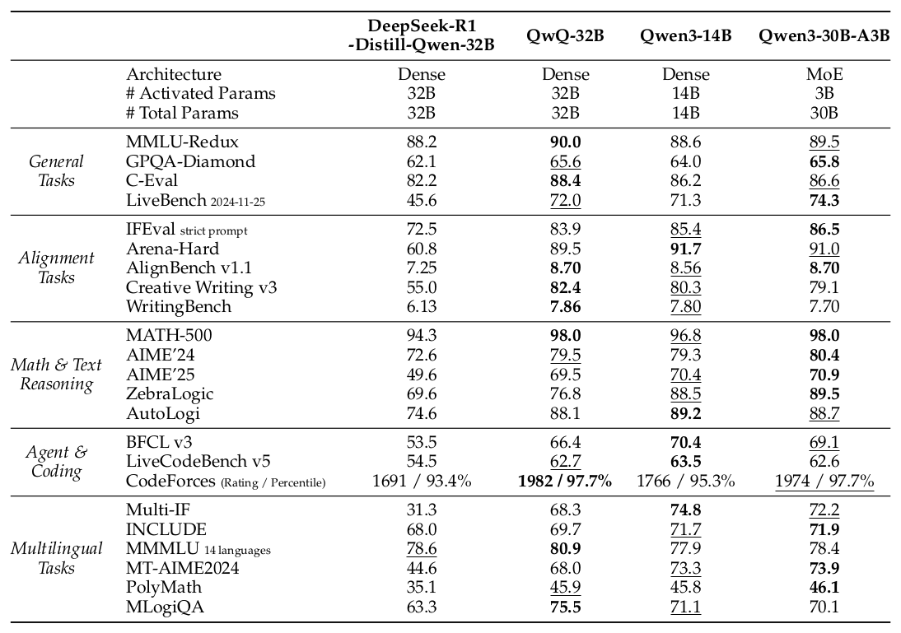
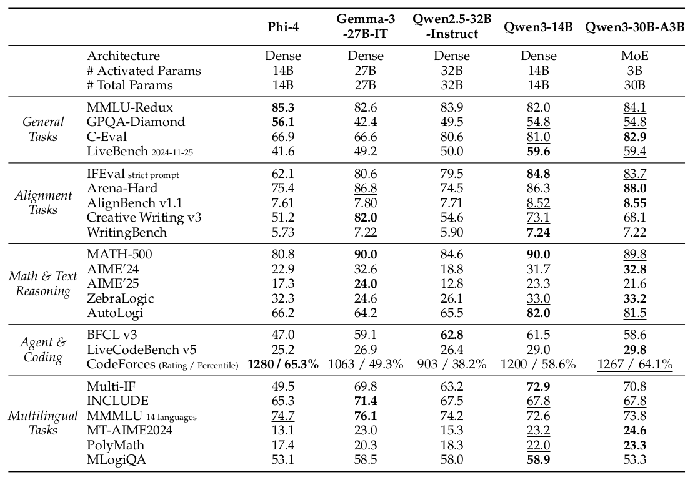
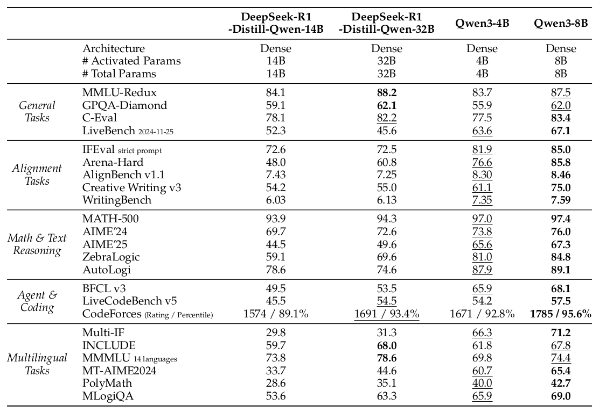
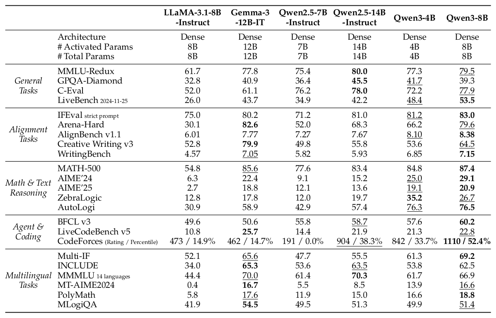
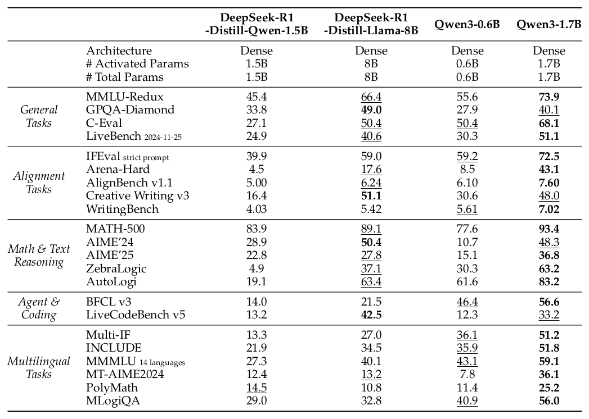
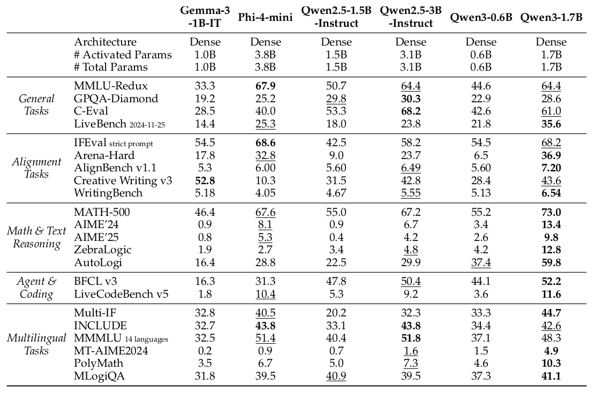
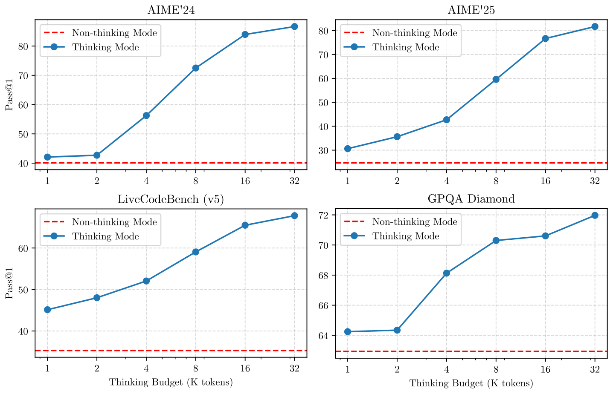

# 论文中文解读：《Qwen3 Technical Report》

> **基本信息**：Qwen Team（原文只署此名；Qwen 系列由阿里巴巴开发），arXiv:2505.09388，2025 年 5 月 14 日（PDF 首页标注 2025-05-15，共 35 页）；模型以 Apache 2.0 许可开放权重（HuggingFace 的 Qwen 组织、ModelScope、GitHub QwenLM/Qwen3）；论文原文 [官方页面](https://arxiv.org/abs/2505.09388)。
>
> **本文的读法**：图为从原文 PDF 中按图裁出的原图；表为逐格核对后的中文转录（模型名、基准名、数字保持原样，表头与行名译成中文），个别很大的表只摘关键行并附原表截图。表中粗体是本文按“该行最高分”标出的，与原文用粗体标最高分、下划线标次高分的做法一致，本文不再标下划线。图中读出的数字都标了“约”，原文正文给出的数字优先。凡是“本文核算”“背景说明”的内容，是笔者由原文数字算出或补充的，不是原文的话。

## 一、一句话结论

Qwen3 是一个开放权重的大模型系列：6 个 dense 模型（0.6B、1.7B、4B、8B、14B、32B）和 2 个 MoE 模型（30B-A3B、235B-A22B），预训练语料约 36T token、覆盖 119 种语言和方言。它的核心做法有三点：（1）把**思考模式**（thinking，先写很长的推理再回答）和**非思考模式**（non-thinking，直接回答）融合进同一个模型，用 `/think`、`/no_think` 标记切换，并提供**思考预算**（thinking budget）让用户按延迟与难度分配推理 token；（2）旗舰模型走“长思维链冷启动 → 推理强化学习 → 思考模式融合 → 通用强化学习”四阶段后训练；（3）小模型不再各走一遍四阶段，而是用**强到弱蒸馏**（先 off-policy 再 on-policy 的 logits 蒸馏）从旗舰模型获得能力，论文报告它比直接做强化学习的效果更好，GPU 小时只有约 1/10。结果上，旗舰 Qwen3-235B-A22B（总参数 235B、激活 22B）在报告的 23 项后训练基准里，思考模式有 17 项超过 DeepSeek-R1（671B 总参数、37B 激活），非思考模式有 18 项超过 GPT-4o-2024-11-20；AIME'24 85.7、AIME'25 81.5、LiveCodeBench v5 70.7、CodeForces 评级 2056、BFCL v3 70.8。

## 二、背景与动机

### 2.1 要解决的问题

引言交代的背景是：GPT-4o、Claude 3.7、Gemini 2.5、DeepSeek-V3、Llama-4、Qwen2.5 等大模型在万亿 token 级数据上训练；o3、DeepSeek-R1 等推理模型又说明，用强化学习优化的模型可以通过**推理时扩展**（inference-time scaling，推理时多花 token 思考）提高水平。开放权重模型与闭源模型的差距在迅速缩小。

在 Qwen3 之前，Qwen 的产品是分开的：面向对话的 Qwen2.5 和专门做推理的 QwQ。用户要在“快而浅”和“慢而深”之间选，就得换模型。Qwen3 想解决的是：

1. **一个模型两种工作方式**：同一个权重既能快速回答，也能做复杂的多步推理，用聊天模板里的标记切换；
2. **让用户控制推理量**：用思考预算在延迟和效果之间连续取舍；
3. **小模型的构建成本**：不对每个小模型重复整套后训练，而是借助旗舰模型；
4. **多语言**：支持的语言从 Qwen2.5 的 29 种扩到 119 种语言和方言（本文核算：约 4.1 倍）。

### 2.2 报告的要点速览

| 要点 | 内容 | 对应章节 |
|---|---|---|
| 模型族 | 6 个 dense + 2 个 MoE，参数 0.6B 到 235B；128K 上下文（0.6B、1.7B 为 32K） | 第三节 |
| 预训练 | 约 36T token、119 种语言；三阶段：通用（S1，>30T）、推理（S2，约 5T）、长上下文（S3，数千亿） | 第四节 |
| 后训练（旗舰） | 长 CoT 冷启动、推理 RL、思考模式融合、通用 RL | 第五节 |
| 后训练（轻量） | 强到弱蒸馏：off-policy + on-policy | 5.7 |
| 思考控制 | `/think`、`/no_think` 标记；思考预算（到阈值就强行结束思考） | 5.4、5.5 |
| 评测 | 基础模型 15 个基准；后训练 23 个基准、含 6 个多语言基准 | 第四、六节 |

## 三、模型家族与架构

### 3.1 八个模型（原文表 1、表 2）

先说为什么看这两张表：它们给出了每个模型的层数、注意力头数（Q 头 / KV 头）、是否共享词嵌入、专家数和上下文长度；这是判断“同样叫 Qwen3，实际结构差在哪”的依据。

**表：Qwen3 dense 模型的结构。**

| 模型 | 层数 | 头数（Q / KV） | 输入输出词嵌入共享 | 上下文长度 |
|---|---:|---|---|---:|
| Qwen3-0.6B | 28 | 16 / 8 | 是 | 32K |
| Qwen3-1.7B | 28 | 16 / 8 | 是 | 32K |
| Qwen3-4B | 36 | 32 / 8 | 是 | 128K |
| Qwen3-8B | 36 | 32 / 8 | 否 | 128K |
| Qwen3-14B | 40 | 40 / 8 | 否 | 128K |
| Qwen3-32B | 64 | 64 / 8 | 否 | 128K |

（原文表 1，第 3 页。）

**表：Qwen3 MoE 模型的结构。**

| 模型 | 层数 | 头数（Q / KV） | 专家数（总数 / 激活数） | 上下文长度 |
|---|---:|---|---|---:|
| Qwen3-30B-A3B | 48 | 32 / 4 | 128 / 8 | 128K |
| Qwen3-235B-A22B | 94 | 64 / 4 | 128 / 8 | 128K |

（原文表 2，第 3 页。）

读法：

- 命名规则：`235B-A22B` 表示总参数 235B、每个 token 激活 22B；`30B-A3B` 表示总参数 30B、激活 3B。激活参数约占总参数的 9%–10%（本文核算：22/235 ≈ 9.4%，3/30 = 10%）。
- 表里只给了层数、头数、专家数和上下文长度。**隐藏维度、专家中间维度等没有在报告里给出**，所以无法像对 PaLM 那样由表自行核算总参数与激活参数；本文不引用报告之外的配置数字。
- Q 头与 KV 头之比就是 GQA 对 KV cache 的压缩倍数（本文核算）：32B 是 64/8 = 8 倍，14B 是 40/8 = 5 倍，4B、8B 是 32/8 = 4 倍，0.6B、1.7B 是 16/8 = 2 倍；MoE 的 30B-A3B 是 32/4 = 8 倍，235B-A22B 是 64/4 = 16 倍。
- 128K 上下文并非从头训练出来的：预训练的长上下文阶段只到 32,768，推理时靠 YARN 与 DCA 外推 4 倍（见 4.2）；0.6B、1.7B 只标 32K。

### 3.2 dense 模型的结构（原文第 2 节）

Qwen3 dense 模型的结构与 Qwen2.5 相近，使用：

- **GQA**（Grouped Query Attention，Ainslie et al., 2023）：多个 Q 头共享一组 K/V 头，减小推理时的 KV cache，见 [GQA 笔记](../grouped_query_attention/论文中文解读.md)；
- **SwiGLU** 激活的前馈层（Dauphin et al., 2017），见 [PaLM 笔记](../palm/论文中文解读.md) 中对 SwiGLU 的说明；
- **RoPE** 旋转位置编码（Su et al., 2024），见 [RoPE 笔记](../rope/论文中文解读.md)；
- **RMSNorm** 且为预归一化（pre-normalization，归一化放在子层之前）。

相对 Qwen2.5 的两处改动：

1. **去掉 QKV 偏置**：Qwen2 里 Q、K、V 的线性投影带偏置，Qwen3 去掉了；
2. **加入 QK-Norm**（Dehghani et al., 2023）：在注意力里对 query 和 key 做归一化，论文给出的理由是“保证训练稳定”。（背景说明：QK-Norm 是在计算注意力打分前对每个头的 query、key 向量各做一次归一化，防止注意力 logits 随训练变得过大；报告没有展开实现细节。）

### 3.3 MoE 模型的结构

Qwen3 的 MoE 模型与 dense 模型的基本结构相同，把前馈层换成专家层。报告给出的选择：

- **128 个专家，每个 token 激活 8 个**；
- 沿用 Qwen2.5-MoE 的**细粒度专家切分**（fine-grained expert segmentation，Dai et al., 2024，即 DeepSeekMoE 的思路，见 [DeepSeekMoE 笔记](../deepseek_moe/论文中文解读.md)）：专家切得小、数量多，每次激活的数量也多，使组合更灵活；
- **不使用共享专家**（shared experts）：与 Qwen2.5-MoE 不同，Qwen3-MoE 的设计里去掉了共享专家；
- 采用**全局 batch 负载均衡损失**（global-batch load balancing loss，Qiu et al., 2025），论文的说法是“鼓励专家专业化”。

背景说明（报告没有展开）：MoE 用路由器对每个 token 给所有专家打分，选 top-$k$ 个专家，把它们的输出加权求和：

$$
y=\sum_{i\in\operatorname{TopK}(g(x),\,8)} w_i(x)\,E_i(x),
$$

其中 $g(x)$ 是对 128 个专家的路由打分，$E_i$ 是第 $i$ 个专家，$w_i(x)$ 是路由权重（权重怎样归一化，报告没有写）。常见的负载均衡损失形如 $N\sum_{i=1}^{N} f_i\,p_i$，$f_i$ 是被分给专家 $i$ 的 token 比例，$p_i$ 是路由器分给专家 $i$ 的平均概率，用来防止少数专家被挤爆。所引文献 Qiu et al. (2025) 的要点是：如果在每个 micro-batch 内部单独算这个损失，会强迫“每个小批内部”都均匀使用专家，抑制专家按领域分化；改成在整个全局 batch 上统计，就允许不同 micro-batch 偏向不同专家，利于专家专业化。以上是对所引文献的概述，不是本报告自己的推导。

### 3.4 分词器

使用 Qwen 的分词器（Bai et al., 2023）：字节级 BPE（byte-level byte-pair encoding），词表大小 151,669。字节级 BPE 能把任何 Unicode 文本拆成字节而不会出现未登录字符，对 119 种语言的覆盖有利。

### 3.5 总参数与激活参数怎么读

MoE 的收益体现在“总容量大、每 token 计算少”。报告用这样几组数字说明（本文已逐项核对）：

- 235B-A22B 的总参数约为 DeepSeek-V3/R1（671B）的 35%（235/671），激活参数约为其 60%（22/37 ≈ 59.5%）；
- 235B-A22B 的激活参数不到 Qwen2.5-72B（dense）的 1/3（22/72 ≈ 30.6%）；
- 30B-A3B 的激活参数约为 Qwen3-14B 的 1/5（3/14 ≈ 21%），约为 Qwen2.5-32B 的 1/10（3/32 ≈ 9.4%）。

注意这是**每 token 计算量**的度量；MoE 的权重要全部放进内存（总参数 235B），专家之间的路由与通信也有开销，所以“激活参数少”并不等于“部署成本等比例降低”。

## 四、预训练

### 4.1 预训练数据（原文 3.1 节）

和 Qwen2.5 相比，Qwen3 的数据在规模和多样性上都大幅扩展：所有 Qwen3 模型都在由 119 种语言和方言组成、共 **36 万亿 token** 的数据上训练（原文写作 twice as many tokens、three times more languages；语言从 29 种增加到 119 种，本文核算约 4.1 倍）。数据包含代码、STEM（科学、技术、工程、数学）、推理类任务、书籍、多语言文本和合成数据等高质量内容。

为了进一步扩充语料，报告用了三类办法：

1. **从 PDF 类文档里提取文本**：先用 Qwen2.5-VL 对大量 PDF 类文档做文字识别，再用 Qwen2.5 对识别出的文本做精修以提高质量，这两步合起来得到了数万亿 token 的额外高质量文本；
2. **用领域模型合成数据**：用 Qwen2.5、Qwen2.5-Math、Qwen2.5-Coder 合成数万亿 token，格式包括教科书、问答、指令和代码片段，覆盖几十个领域；
3. **增加多语言数据和新语言**：这也是支持语言从 29 种扩到 119 种的来源。

**数据标注与混合**：团队开发了一套多语言数据标注系统，用于提高训练数据的质量与多样性，已对超过 30T token 的预训练数据按多个维度做了标注，如**教育价值、领域、主题、安全性**。这些标注让数据过滤与组合更有效。与此前在**数据来源或领域**层面优化混合比例的工作（Xie et al. 2023 的 DoReMi、Fan et al. 2023 的 DoGE、Liu et al. 2024b 的 RegMix）不同，Qwen3 借助细粒度标签，在小型代理模型上做大量消融实验，在**单个样本（instance）级别**优化数据混合。报告没有给出具体的混合比例和消融结果。

### 4.2 三阶段预训练（原文 3.2 节）

| 阶段 | 数据与目标 | token 规模 | 序列长度 | 其他设置 |
|---|---|---|---:|---|
| S1 通用阶段（General） | 打好语言能力和通用世界知识的基础，覆盖 119 种语言和方言 | 超过 30T | 4,096 | – |
| S2 推理阶段（Reasoning） | 提高 STEM、代码、推理和合成数据的占比，使用更高质量的数据 | 约 5T | 4,096 | 加快学习率衰减 |
| S3 长上下文阶段（Long Context） | 高质量长上下文语料：75% 的文本长度在 16,384 到 32,768 之间，25% 在 4,096 到 16,384 之间 | 数千亿（hundreds of billions） | 32,768 | RoPE 基频从 10,000 提到 1,000,000（ABF）；引入 YARN 与 Dual Chunk Attention（DCA）使推理时序列长度容量提高 4 倍 |

（原文第 3.2 节；本文整理成表。本文核对：S1 的“超过 30T”加 S2 的约 5T 再加 S3 的数千亿，与总量约 36T 一致。）

三个阶段里“长上下文”是怎么做的，值得多说一点（背景说明，报告没有展开技术细节）：

- **ABF**（adjusted base frequency，Xiong et al. 2023）：RoPE 的旋转角度由一个“基频” $b$ 决定，$\theta_i=b^{-2i/d}$。把 $b$ 从 10,000 提高到 1,000,000，低频维度转得更慢，使较长位置之间的相对角度仍可区分，是扩展上下文窗口的常见做法；Qwen2.5 已经这样做；
- **YARN**（Peng et al. 2023）与 **DCA**（An et al. 2024）：两者都是在**推理时**使用的长度外推技术，把序列长度能力再放大 4 倍：训练最长 32,768，推理可到 128K（表 1）。附录的 RULER 评测里写明 YARN 的缩放因子为 4（见 6.6）。

**超参数的缩放律**：与 Qwen2.5 类似，报告基于上面三个阶段建立了“最优超参数缩放律”，来预测学习率调度和 batch size 等；做了大量实验系统研究模型结构、训练数据、训练阶段与最优超参数之间的关系，最终为每个 dense 或 MoE 模型设定预测出的最优学习率与 batch size 策略。报告没有给出具体的学习率、batch size 数值；它也没有描述训练基础设施（硬件规模、并行方式、算力利用率）、优化器和训练时长，所以无法像 [PaLM](../palm/论文中文解读.md) 那样讨论 MFU 与系统效率。

### 4.3 基础模型评测（原文 3.3 节）

**评测设置**：基础模型评测聚焦通用知识、推理、数学、科学知识、代码和多语言能力，共 15 个基准：

| 类别 | 基准（设置） |
|---|---|
| 通用任务 | MMLU（5-shot）、MMLU-Pro（5-shot，CoT）、MMLU-redux（5-shot）、BBH（3-shot，CoT）、SuperGPQA（5-shot，CoT） |
| 数学与 STEM | GPQA（5-shot，CoT）、GSM8K（4-shot，CoT）、MATH（4-shot，CoT） |
| 代码 | EvalPlus（0-shot；HumanEval、MBPP、HumanEval+、MBPP+ 的平均）、MultiPL-E（0-shot；Python、C++、Java、PHP、TypeScript、C#、Bash、JavaScript）、MBPP（3-shot）、CRUXEval 的 CRUX-O（1-shot） |
| 多语言 | MGSM（8-shot，CoT）、MMMLU（5-shot）、INCLUDE（5-shot） |

基线包括 Qwen2.5 基础模型和其他领先的开源基础模型：DeepSeek-V3 Base、Gemma-3、Llama-3、Llama-4 系列，**按参数规模**对应比较，并且“所有模型使用同一套评测流程和常用评测设置”。

**报告总结的三条结论**：

1. Qwen3-235B-A22B-Base 在大多数任务上超过此前开源的 SOTA dense 与 MoE 基础模型（DeepSeek-V3 Base、Llama-4-Maverick Base、Qwen2.5-72B-Base），而总参数或激活参数明显更少；
2. 对 Qwen3 的 MoE 基础模型：（a）在相同预训练数据上，MoE 基础模型只用 1/5 的激活参数就能达到与 Qwen3 dense 基础模型相近的性能；（b）由于 MoE 结构改进、训练 token 增加和更先进的训练策略，Qwen3 MoE 基础模型能以不到一半的激活参数和更少的总参数超过 Qwen2.5 MoE 基础模型；（c）仅用 Qwen2.5 dense 基础模型 1/10 的激活参数，Qwen3 MoE 基础模型就能取得相当的性能，在推理和训练成本上优势显著；
3. Qwen3 dense 基础模型的整体表现与参数量更大的 Qwen2.5 基础模型相当，例如 Qwen3-1.7B/4B/8B/14B/32B-Base 分别与 Qwen2.5-3B/7B/14B/32B/72B-Base 相当；在 STEM、代码和推理基准上甚至超过更大规模的 Qwen2.5 基础模型。

下面逐张表核对。所有基准的分数越高越好；“总参数”“激活参数”两行说明了对比的是什么量级。

#### 4.3.1 旗舰 MoE：Qwen3-235B-A22B-Base（表 3）

对比对象是上一代相近规模的 MoE Qwen2.5-Plus-Base、Llama-4-Maverick（约 402B 总参数）、Qwen2.5-72B-Base（dense）和 DeepSeek-V3 Base。

**表：Qwen3-235B-A22B-Base 与其他有代表性的强开源基线的对比（15 个基础模型基准）。**

| 基准 | Qwen2.5-72B Base | Qwen2.5-Plus Base | Llama-4-Maverick Base | DeepSeek-V3 Base | Qwen3-235B-A22B Base |
|---|---:|---:|---:|---:|---:|
| 架构 | Dense | MoE | MoE | MoE | MoE |
| 总参数 | 72B | 271B | 402B | 671B | 235B |
| 激活参数 | 72B | 37B | 17B | 37B | 22B |
| **通用任务** |  |  |  |  |  |
| MMLU | 86.06 | 85.02 | 85.16 | 87.19 | **87.81** |
| MMLU-Redux | 83.91 | 82.69 | 84.05 | 86.14 | **87.40** |
| MMLU-Pro | 58.07 | 63.52 | 63.91 | 59.84 | **68.18** |
| SuperGPQA | 36.20 | 37.18 | 40.85 | 41.53 | **44.06** |
| BBH | 86.30 | 85.60 | 83.62 | 86.22 | **88.87** |
| **数学与 STEM 任务** |  |  |  |  |  |
| GPQA | 45.88 | 41.92 | 43.94 | 41.92 | **47.47** |
| GSM8K | 91.50 | 91.89 | 87.72 | 87.57 | **94.39** |
| MATH | 62.12 | 62.78 | 63.32 | 62.62 | **71.84** |
| **代码任务** |  |  |  |  |  |
| EvalPlus | 65.93 | 61.43 | 68.38 | 63.75 | **77.60** |
| MultiPL-E | 58.70 | 62.16 | 57.28 | 62.26 | **65.94** |
| MBPP | 76.00 | 74.60 | 75.40 | 74.20 | **81.40** |
| CRUX-O | 66.20 | 68.50 | 77.00 | 76.60 | **79.00** |
| **多语言任务** |  |  |  |  |  |
| MGSM | 82.40 | 82.21 | 79.69 | 82.68 | **83.53** |
| MMMLU | 84.40 | 83.49 | 83.09 | 85.88 | **86.70** |
| INCLUDE | 69.05 | 66.97 | 73.47 | **75.17** | 73.46 |

（原文表 3，第 6 页。）

读法（括号里是本文逐行统计的结果）：

- 相对 **DeepSeek-V3 Base**：在 15 个基准中的 14 个上更好，只有 INCLUDE 落后（73.46 对 75.17）；而总参数只有它的约 1/3（235B 对 671B，35%），激活参数约 2/3（原文第 3.3 节写 2/3；本文核算：22B 对 37B 为 59.5%，约 3/5，第 4.6 节写作 60%）；
- 相对 **Llama-4-Maverick Base**（总参数约为 Qwen3 的 1.7 倍，402B）：14/15 更好，INCLUDE 以 73.46 对 73.47 落后 0.01；
- 相对上一代 **Qwen2.5-Plus**（271B 总参数、37B 激活）：15/15 更好，而参数更少；
- 相对 **Qwen2.5-72B Base**（dense）：15/15 更好，激活参数不到其 1/3；论文称在每万亿 token 的训练和推理成本上也便宜得多。

#### 4.3.2 旗舰 dense：Qwen3-32B-Base（表 4）

**表：Qwen3-32B-Base 与其他强开源基线的对比。**

| 基准 | Qwen2.5-32B Base | Qwen2.5-72B Base | Gemma-3-27B Base | Llama-4-Scout Base | Qwen3-32B Base |
|---|---:|---:|---:|---:|---:|
| 架构 | Dense | Dense | Dense | MoE | Dense |
| 总参数 | 32B | 72B | 27B | 109B | 32B |
| 激活参数 | 32B | 72B | 27B | 17B | 32B |
| **通用任务** |  |  |  |  |  |
| MMLU | 83.32 | **86.06** | 78.69 | 78.27 | 83.61 |
| MMLU-Redux | 81.97 | **83.91** | 76.53 | 71.09 | 83.41 |
| MMLU-Pro | 55.10 | 58.07 | 52.88 | 56.13 | **65.54** |
| SuperGPQA | 33.55 | 36.20 | 29.87 | 26.51 | **39.78** |
| BBH | 84.48 | 86.30 | 79.95 | 82.40 | **87.38** |
| **数学与 STEM 任务** |  |  |  |  |  |
| GPQA | 47.97 | 45.88 | 26.26 | 40.40 | **49.49** |
| GSM8K | 92.87 | 91.50 | 81.20 | 85.37 | **93.40** |
| MATH | 57.70 | **62.12** | 51.78 | 51.66 | 61.62 |
| **代码任务** |  |  |  |  |  |
| EvalPlus | 66.25 | 65.93 | 55.78 | 59.90 | **72.05** |
| MultiPL-E | 58.30 | 58.70 | 45.03 | 47.38 | **67.06** |
| MBPP | 73.60 | 76.00 | 68.40 | 68.60 | **78.20** |
| CRUX-O | 67.80 | 66.20 | 60.00 | 61.90 | **72.50** |
| **多语言任务** |  |  |  |  |  |
| MGSM | 78.12 | 82.40 | 73.74 | 79.93 | **83.06** |
| MMMLU | 82.40 | **84.40** | 77.62 | 74.83 | 83.83 |
| INCLUDE | 64.35 | **69.05** | 68.94 | 68.09 | 67.87 |

（原文表 4，第 6 页。）

读法：

- 与同规模的 **Qwen2.5-32B-Base** 相比 15/15 更好；与 **Gemma-3-27B Base** 相比 14/15 更好（INCLUDE 落后）。MMLU-Pro 65.54、SuperGPQA 39.78 明显高于 Qwen2.5-32B-Base（55.10、33.55），代码基准全面领先；
- 与总参数是它 2 倍多的 **Qwen2.5-72B-Base** 相比，在 15 个基准中的 10 个更好（落后的是 MMLU、MMLU-Redux、MATH、MMMLU、INCLUDE），在代码、数学、推理上优势明显；
- 与 **Llama-4-Scout Base**（109B 总参数、17B 激活）相比：原文称“在全部 15 个基准上显著超过”。核对备注：按表中数字是 14/15，INCLUDE 以 67.87 对 68.09 略低，所以“全部 15 个”的说法略宽松，“显著超过”对其余 14 项成立。

#### 4.3.3 14B 与 30B-A3B（表 5）

**表：Qwen3-14B-Base、Qwen3-30B-A3B-Base 与其他强开源基线的对比。**

| 基准 | Gemma-3-12B Base | Qwen2.5-14B Base | Qwen2.5-32B Base | Qwen2.5-Turbo Base | Qwen3-14B Base | Qwen3-30B-A3B Base |
|---|---:|---:|---:|---:|---:|---:|
| 架构 | Dense | Dense | Dense | MoE | Dense | MoE |
| 总参数 | 12B | 14B | 32B | 42B | 14B | 30B |
| 激活参数 | 12B | 14B | 32B | 6B | 14B | 3B |
| **通用任务** |  |  |  |  |  |  |
| MMLU | 73.87 | 79.66 | **83.32** | 79.50 | 81.05 | 81.38 |
| MMLU-Redux | 70.70 | 76.64 | **81.97** | 77.11 | 79.88 | 81.17 |
| MMLU-Pro | 44.91 | 51.16 | 55.10 | 55.60 | 61.03 | **61.49** |
| SuperGPQA | 24.61 | 30.68 | 33.55 | 31.19 | 34.27 | **35.72** |
| BBH | 74.28 | 78.18 | **84.48** | 76.10 | 81.07 | 81.54 |
| **数学与 STEM 任务** |  |  |  |  |  |  |
| GPQA | 31.31 | 32.83 | **47.97** | 41.41 | 39.90 | 43.94 |
| GSM8K | 78.01 | 90.22 | **92.87** | 88.32 | 92.49 | 91.81 |
| MATH | 44.43 | 55.64 | 57.70 | 55.60 | **62.02** | 59.04 |
| **代码任务** |  |  |  |  |  |  |
| EvalPlus | 52.65 | 60.70 | 66.25 | 61.23 | **72.23** | 71.45 |
| MultiPL-E | 43.03 | 54.79 | 58.30 | 53.24 | 61.69 | **66.53** |
| MBPP | 60.60 | 69.00 | 73.60 | 67.60 | 73.40 | **74.40** |
| CRUX-O | 52.00 | 61.10 | 67.80 | 60.20 | **68.60** | 67.20 |
| **多语言任务** |  |  |  |  |  |  |
| MGSM | 64.35 | 74.68 | 78.12 | 70.45 | **79.20** | 79.11 |
| MMMLU | 72.50 | 78.34 | **82.40** | 79.76 | 79.69 | 81.46 |
| INCLUDE | 63.34 | 60.26 | 64.35 | 59.25 | 64.55 | **67.00** |

（原文表 5，第 7 页。）

读法：

- Qwen3-14B-Base 在 15 个基准上都优于同规模的 Qwen2.5-14B-Base 和 Gemma-3-12B-Base，并且与总参数两倍多的 Qwen2.5-32B-Base 相比有 8/15 更好（本文统计），原文称“很有竞争力”；
- **Qwen3-30B-A3B-Base 只用 1/5 的激活（非嵌入）参数，就在所有任务上显著超过 Qwen2.5-14B-Base**（15/15），并与 Qwen3-14B-Base、Qwen2.5-32B-Base 的水平相当（对 Qwen3-14B-Base 是 10/15 更好，对 Qwen2.5-32B-Base 是 8/15 更好；本文统计）；
- 原文第 3.3 节的“不到 Qwen2.5 MoE 一半的激活参数”这句话，按表中数字：Qwen3-30B-A3B（激活 3B）对 Qwen2.5-Turbo（42B 总参数、激活 6B）恰为 1/2，对旗舰的比较里 22B 对 Qwen2.5-Plus 的 37B 约为 59%，措辞偏宽松。

#### 4.3.4 端侧模型：8B、4B、1.7B、0.6B（表 6、7、8）

**表：Qwen3-8B-Base 与其他强开源基线的对比。**（原文表题写作 “Qwen8B-Base”，应为 Qwen3-8B-Base。）

| 基准 | Llama-3-8B Base | Qwen2.5-7B Base | Qwen2.5-14B Base | Qwen3-8B Base |
|---|---:|---:|---:|---:|
| 架构 | Dense | Dense | Dense | Dense |
| 总参数 | 8B | 7B | 14B | 8B |
| 激活参数 | 8B | 7B | 14B | 8B |
| **通用任务** |  |  |  |  |
| MMLU | 66.60 | 74.16 | **79.66** | 76.89 |
| MMLU-Redux | 61.59 | 71.06 | **76.64** | 76.17 |
| MMLU-Pro | 35.36 | 45.00 | 51.16 | **56.73** |
| SuperGPQA | 20.54 | 26.34 | 30.68 | **31.64** |
| BBH | 57.70 | 70.40 | 78.18 | **78.40** |
| **数学与 STEM 任务** |  |  |  |  |
| GPQA | 25.80 | 36.36 | 32.83 | **44.44** |
| GSM8K | 55.30 | 85.36 | **90.22** | 89.84 |
| MATH | 20.50 | 49.80 | 55.64 | **60.80** |
| **代码任务** |  |  |  |  |
| EvalPlus | 44.13 | 62.18 | 60.70 | **67.65** |
| MultiPL-E | 31.45 | 50.73 | 54.79 | **58.75** |
| MBPP | 48.40 | 63.40 | 69.00 | **69.80** |
| CRUX-O | 36.80 | 48.50 | 61.10 | **62.00** |
| **多语言任务** |  |  |  |  |
| MGSM | 38.92 | 63.60 | 74.68 | **76.02** |
| MMMLU | 59.65 | 71.34 | **78.34** | 75.72 |
| INCLUDE | 44.94 | 53.98 | **60.26** | 59.40 |

（原文表 6，第 7 页。）

**表：Qwen3-4B-Base 与其他强开源基线的对比。**

| 基准 | Gemma-3-4B Base | Qwen2.5-3B Base | Qwen2.5-7B Base | Qwen3-4B Base |
|---|---:|---:|---:|---:|
| 架构 | Dense | Dense | Dense | Dense |
| 总参数 | 4B | 3B | 7B | 4B |
| 激活参数 | 4B | 3B | 7B | 4B |
| **通用任务** |  |  |  |  |
| MMLU | 59.51 | 65.62 | **74.16** | 72.99 |
| MMLU-Redux | 56.91 | 63.68 | 71.06 | **72.79** |
| MMLU-Pro | 29.23 | 34.61 | 45.00 | **50.58** |
| SuperGPQA | 17.68 | 20.31 | 26.34 | **28.43** |
| BBH | 51.70 | 56.30 | 70.40 | **72.59** |
| **数学与 STEM 任务** |  |  |  |  |
| GPQA | 24.24 | 26.26 | 36.36 | **36.87** |
| GSM8K | 43.97 | 79.08 | 85.36 | **87.79** |
| MATH | 26.10 | 42.64 | 49.80 | **54.10** |
| **代码任务** |  |  |  |  |
| EvalPlus | 43.23 | 46.28 | 62.18 | **63.53** |
| MultiPL-E | 28.06 | 39.65 | 50.73 | **53.13** |
| MBPP | 46.40 | 54.60 | 63.40 | **67.00** |
| CRUX-O | 34.00 | 36.50 | 48.50 | **55.00** |
| **多语言任务** |  |  |  |  |
| MGSM | 33.11 | 47.53 | 63.60 | **67.74** |
| MMMLU | 59.62 | 65.55 | 71.34 | **71.42** |
| INCLUDE | 49.06 | 45.90 | 53.98 | **56.29** |

（原文表 7，第 8 页。）

**表：Qwen3-1.7B-Base、Qwen3-0.6B-Base 与其他强开源基线的对比。**

| 基准 | Qwen2.5-0.5B Base | Qwen3-0.6B Base | Gemma-3-1B Base | Qwen2.5-1.5B Base | Qwen3-1.7B Base |
|---|---:|---:|---:|---:|---:|
| 架构 | Dense | Dense | Dense | Dense | Dense |
| 总参数 | 0.5B | 0.6B | 1B | 1.5B | 1.7B |
| 激活参数 | 0.5B | 0.6B | 1B | 1.5B | 1.7B |
| **通用任务** |  |  |  |  |  |
| MMLU | 47.50 | 52.81 | 26.26 | 60.90 | **62.63** |
| MMLU-Redux | 45.10 | 51.26 | 25.99 | 58.46 | **61.66** |
| MMLU-Pro | 15.69 | 24.74 | 9.72 | 28.53 | **36.76** |
| SuperGPQA | 11.30 | 15.03 | 7.19 | 17.64 | **20.92** |
| BBH | 20.30 | 41.47 | 28.13 | 45.10 | **54.47** |
| **数学与 STEM 任务** |  |  |  |  |  |
| GPQA | 24.75 | 26.77 | 24.75 | 24.24 | **28.28** |
| GSM8K | 41.62 | 59.59 | 2.20 | 68.54 | **75.44** |
| MATH | 19.48 | 32.44 | 3.66 | 35.00 | **43.50** |
| **代码任务** |  |  |  |  |  |
| EvalPlus | 31.85 | 36.23 | 8.98 | 44.80 | **52.70** |
| MultiPL-E | 18.70 | 24.58 | 5.15 | 33.10 | **42.71** |
| MBPP | 29.80 | 36.60 | 9.20 | 43.60 | **55.40** |
| CRUX-O | 12.10 | 27.00 | 3.80 | 29.60 | **36.40** |
| **多语言任务** |  |  |  |  |  |
| MGSM | 12.07 | 30.99 | 1.74 | 32.82 | **50.71** |
| MMMLU | 31.53 | 50.16 | 26.57 | 60.27 | **63.27** |
| INCLUDE | 24.74 | 34.26 | 25.62 | 39.55 | **45.57** |

（原文表 8，第 8 页。）

读法：Qwen3-8B/4B/1.7B-Base 在一半以上的基准上超过更大的 Qwen2.5-14B/7B/3B Base（本文统计分别为 10/15、14/15、8/15），尤其是 STEM 与代码基准；Qwen3-0.6B-Base 在所有 15 个基准上都高于 Qwen2.5-0.5B-Base。例外集中在 MMLU 系列等知识类、GSM8K 和部分多语言基准：8B 对 Qwen2.5-14B 在 MMLU、MMLU-Redux、GSM8K、MMMLU、INCLUDE 上仍落后；4B 对 Qwen2.5-7B 只有 MMLU 落后；1.7B 对 Qwen2.5-3B 在 MMLU、MMLU-Redux、BBH、GSM8K、CRUX-O（36.4 对 36.5）、MMMLU、INCLUDE 上落后。（Table 6 的原文行名 “IINCLUDE” 是排版笔误，本文写作 INCLUDE。）

**这部分的证据边界**：基础模型的对比是“同一套流程评测”，但基线（如 DeepSeek-V3 Base、Llama-4）的评测数字是否取自它们自己的论文、提示格式是否一致，报告没有逐项说明；而且 Qwen3 与基线的预训练数据、token 数都不同，所以这些表只能说明“成品对成品”的结果，不能拆出架构改进或数据的各自贡献。

## 五、后训练（原文第 4 节）

### 5.1 总览与流水线（图 1）

后训练流水线围绕两个目标设计：

1. **思考控制**（Thinking Control）：把“非思考”和“思考”两种模式整合进一个模型，让用户选择模型是否要推理，并且可以用 token 预算控制思考的深度；
2. **强到弱蒸馏**（Strong-to-Weak Distillation）：简化并优化轻量模型的后训练，借助大模型的知识大幅降低小模型的计算成本和开发工作量。

先说这张图要说明什么：旗舰模型和轻量模型走的是两条不同的路，而且轻量模型的“教师”就是旗舰模型。



*图 1（原文 Figure 1，第 9 页）：Qwen3 系列模型的后训练流水线。*

**图中文字翻译与读法**：

- **上半，Flagship Models（旗舰模型，橙色区）**：Base Models（基础模型）→ Stage 1 Long-CoT Cold Start（长思维链冷启动）→ Stage 2 Reasoning RL（推理强化学习）→（折回左侧）Stage 3 Thinking Mode Fusion（思考模式融合）→ Stage 4 General RL（通用强化学习）→ 红框输出：Qwen3-235B-A22B、Qwen3-32B；
- **下半，Lightweight Models（轻量模型，蓝色区）**：Base Models → Strong-to-Weak Distillation（强到弱蒸馏）→ 红框输出：Qwen3-30B-A3B 与 14B/8B/4B/1.7B/0.6B。从旗舰模型红框到蒸馏框有一条向下的箭头，表示旗舰模型充当教师；
- **读图结论**：旗舰（235B-A22B、32B）经历完整的四阶段，前两个阶段（冷启动、推理 RL）培养“思考”能力，后两个阶段（思考模式融合、通用 RL）把强大的“非思考”功能整合进来；其余 6 个轻量模型（含 MoE 的 30B-A3B）**不再各自跑四阶段**，而是通过蒸馏获得能力。

报告的初步实验结论是：直接把教师模型的输出 logits 蒸馏给轻量学生模型，可以有效提升性能，同时保持对其推理过程的细粒度控制；这样不必对每个小模型都跑一遍完整的四阶段训练。它的收益体现在：当下的表现更好（更高的 Pass@1），探索能力也更强（更高的 Pass@64），而且训练效率高得多，只需四阶段方法约 **1/10 的 GPU 小时**。具体证据见 7.2 节的表 21。

### 5.2 第 1 阶段：长思维链冷启动（Long-CoT Cold Start）

**数据**：先精心整理一个覆盖面广的数据集，类别包括数学、代码、逻辑推理和一般 STEM 问题；每个问题都配有经过验证的参考答案或基于代码的测试用例。这个数据集是长思维链训练“冷启动”阶段的基础。

数据构建分两步严格过滤：

1. **查询过滤（query filtering）**：用 Qwen2.5-72B-Instruct 识别并去掉不易验证的查询，包括含多个子问题的查询、要求做一般文本生成的查询；还要排除“Qwen2.5-72B-Instruct 不用 CoT 就能答对”的查询，避免模型靠表层猜测，确保留下的是确实需要更深推理的难题；另外用 Qwen2.5-72B-Instruct 标注每个查询的领域，以保持数据集的领域均衡；
2. **回答过滤（response filtering）**：留出一部分验证用查询后，用 **QwQ-32B** 为每个剩余查询生成 $N$ 个候选回答。如果 QwQ-32B 一直答不对，就由人工标注者评估回答的准确性。对 Pass@$N$ 为正（即 $N$ 个里至少有一个对）的查询，再用更严格的标准去掉这样的回答：（1）最终答案错误；（2）有大量重复；（3）明显是猜的、没有足够推理；（4）思考内容与总结内容不一致；（5）不恰当的语言混用或风格突变；（6）与潜在的验证集样本过于相似。

之后，从精炼后的数据里**精心挑出一个子集**用于推理模式的初始冷启动训练。这一阶段的目标是**给模型植入基础的推理模式，而不过分强调当下的推理成绩**，从而不限制模型的潜力，给后续强化学习阶段留出灵活提升的空间。要做到这一点，最好把这个准备阶段的训练样本数和训练步数都压到尽量少。

### 5.3 第 2 阶段：推理强化学习（Reasoning RL）

用于这个阶段的“查询—验证器”对（query-verifier pairs）必须满足四条：（1）冷启动阶段没用过；（2）对冷启动后的模型是“可学习的”；（3）尽可能有挑战；（4）覆盖广泛的子领域。最终共收集了 **3,995 对**，用 **GRPO**（Shao et al., 2024）更新模型参数。

训练中的经验：

- 用**大 batch size** 和**每个查询较多的 rollout 数**，再配合 off-policy 训练来提高样本效率，对训练有益；
- 通过控制模型的**熵**，使其稳步上升或保持稳定，来平衡探索与利用，这对维持训练稳定很关键；
- 因而在**单次 RL 运行**中，训练奖励和验证表现都持续提升，不需要对超参数做任何人工干预。例如 Qwen3-235B-A22B 的 AIME'24 分数在共 170 个 RL 训练步中从 70.1 升到 85.1。

背景说明（报告没有给出公式）：GRPO 的要点是不训练价值网络，而是对同一个问题采样一组输出，用组内奖励的相对高低作为优势，$A_i=\dfrac{r_i-\mathrm{mean}(\{r_j\}_{j=1}^{G})}{\mathrm{std}(\{r_j\}_{j=1}^{G})}$；完整目标函数见 [DeepSeek-R1 笔记](../deepseek_r1/论文中文解读.md)。这里的“验证器”就是规则判断（数学答案对不对、代码能不能通过测试），奖励因此可靠、不易被钻空子。

### 5.4 第 3 阶段：思考模式融合（Thinking Mode Fusion）

目标是把“非思考”能力整合进已经具备“思考”能力的模型：对推理 RL 之后的模型做**持续的监督微调（SFT）**，并设计聊天模板来融合两种模式。这样开发者可以管理和控制推理行为，也省去分别部署思考模型和非思考模型的成本与复杂度。作者还发现，能熟练处理两种模式的模型，在不同的思考预算下表现一致地好。

**SFT 数据的构成**：由“思考”数据和“非思考”数据混合而成。

- 为保证第 2 阶段模型的性能不被额外的 SFT 损伤，“思考”数据是用**第 2 阶段模型自己**对第 1 阶段的查询做拒绝采样（rejection sampling）生成的；
- “非思考”数据则精心整理，覆盖多样的任务：代码、数学、指令遵循、多语言任务、创意写作、问答和角色扮演；并用自动生成的**检查清单**（checklists）评估非思考数据的回答质量；
- 为提升低资源语言任务的表现，特意增加了翻译类任务的比例。

**聊天模板设计**：为了融合两种模式并允许用户动态切换，设计了如下模板（原文表 9）：

```text
思考模式：
<|im_start|>user
{query} /think<|im_end|>
<|im_start|>assistant
<think>
{thinking_content}
</think>

{response}<|im_end|>

非思考模式：
<|im_start|>user
{query} /no_think<|im_end|>
<|im_start|>assistant
<think>

</think>

{response}<|im_end|>
```

（原文表 9，第 11 页：“SFT 数据中思考与非思考模式的示例”。表注：思考模式下 `/think` 标记可以省略，因为那是默认行为；这一特性已经实现在 Hugging Face tokenizer 支持的聊天模板里，用额外参数 `enable_thinking=False` 就能关闭思考模式。）

设计要点：

- 样本里用 `/think` 和 `/no_think` 标记（放在用户查询或系统消息里）标明要不要思考，让模型按用户输入选择模式；
- **非思考样本保留一个空的思考块**（`<think>` 与 `</think>` 之间为空）。这使模型内部格式保持一致，并允许开发者在聊天模板里拼接一个空思考块来**阻止模型思考**；
- **默认是思考模式**，所以也加入了一些用户查询里**不带** `/think` 标记的思考样本；
- 对复杂的多轮对话，在用户的各轮查询里**随机插入多个** `/think` 和 `/no_think` 标记，模型的回答遵循**最后出现的那个标记**。

### 5.5 思考预算（Thinking Budget）

思考模式融合还有一个额外好处：模型一旦学会了非思考与思考两种模式，就自然获得了处理“中间情形”的能力——基于**不完整的思考**生成回答。这为实现思考过程的预算控制打下了基础。具体做法：

```text
当模型的思考长度达到用户设定的阈值时：
  1. 人工中止思考过程；
  2. 插入停止思考的指令：
     "Considering the limited time by the user, I have to give the solution based on the thinking directly now.\n</think>.\n\n"
  3. 之后模型基于到目前为止累积的推理继续生成最终回答。
```

原文特别强调：**这项能力不是显式训练出来的，而是应用思考模式融合后自然涌现的**。也就是说，训练数据里并没有“思考到一半被截断再作答”的样本（报告没有提到这类样本），预算控制是推理时的外部干预加上模型对不完整思考的泛化。预算的效果见 7.1 节的图 2。

### 5.6 第 4 阶段：通用强化学习（General RL）

目标是在各种场景下全面提升模型的能力和稳定性。为此建立了一套覆盖 **20 多个不同任务**的奖励系统，每个任务有定制的评分标准，针对下面这些核心能力：

| 能力 | 含义 |
|---|---|
| 指令遵循（Instruction Following） | 准确理解并遵循用户指令，包括内容、格式、长度、结构化输出等要求 |
| 格式遵循（Format Following） | 除显式指令外，遵守特定的格式约定：例如对 `/think`、`/no_think` 标记做出正确的模式切换，并始终用指定的符号（如 `<think>` 与 `</think>`）分隔思考和回答 |
| 偏好对齐（Preference Alignment） | 对开放式问题，改善有用性、参与度和风格，使体验更自然、更满意 |
| 智能体能力（Agent Ability） | 训练模型通过指定接口正确调用工具；在 RL rollout 中允许模型与**真实环境的执行反馈**进行完整的多轮交互，提升长程决策任务中的表现和稳定性 |
| 特殊场景能力 | 为特定场景设计专门任务；例如检索增强生成（RAG）任务里引入奖励信号，引导模型给出准确且符合上下文的回答，减少幻觉 |

为这些任务提供反馈用了三类奖励：

1. **基于规则的奖励（rule-based reward）**：在推理 RL 阶段已被广泛使用，对指令遵循、格式遵守等通用任务也有用；设计良好的规则奖励可以高精度地评估输出正确性，防止奖励投机（reward hacking）；
2. **有参考答案的基于模型的奖励**：给每个查询提供参考答案，让 Qwen2.5-72B-Instruct 对照参考答案给模型回答打分；比纯规则奖励更灵活，不要求严格格式，避免纯规则奖励的误判（false negative）；
3. **无参考答案的基于模型的奖励**：利用人类偏好数据训练一个奖励模型，给模型回答打标量分数；不依赖参考答案，能处理更广泛的查询，并有效提升模型的参与度和有用性。

### 5.7 强到弱蒸馏（Strong-to-Weak Distillation）

这条流水线专为优化轻量模型设计，涵盖 5 个 dense 模型（Qwen3-0.6B、1.7B、4B、8B、14B）和 1 个 MoE 模型（Qwen3-30B-A3B）。它在提升性能的同时，把稳健的模式切换能力也传给了这些小模型。分两个阶段：

1. **Off-policy 蒸馏**：把教师模型在 `/think` 与 `/no_think` 两种模式下生成的输出结合起来，做回答蒸馏（对教师输出做监督学习）。这帮助轻量学生模型建立基本的推理能力和在不同思考模式间切换的能力，为下一阶段打下基础；
2. **On-policy 蒸馏**：让**学生模型自己生成**序列（on-policy）来微调。具体地：采样提示词，学生模型在 `/think` 或 `/no_think` 模式下生成回答；然后让学生的 logits 与教师模型（Qwen3-32B 或 Qwen3-235B-A22B）的 logits 对齐，最小化 **KL 散度**。

背景说明（报告没有给出公式）：on-policy 蒸馏的损失大致是在学生自己采样的序列上，逐位置让学生的下一 token 分布逼近教师的：

$$
\mathcal{L}=\mathbb{E}_{x\sim\mathcal{D},\ y\sim\pi_{S}(\cdot\mid x)}\ \sum_{t}\mathrm{KL}\big(\pi_{T}(\cdot\mid x,y_{<t})\ \big\Vert\ \pi_{S}(\cdot\mid x,y_{<t})\big),
$$

其中 $\pi_S$ 是学生、$\pi_T$ 是教师。KL 的方向和是否逐位置计算，原文只说“对齐 logits、最小化 KL 散度”，没有写明；上式只是一种常见写法。与 off-policy 蒸馏的区别是：序列由**学生**采样而不是教师，所以学生训练时看到的前缀分布，与它推理时自己生成的前缀分布一致，避免了“训练时只见过教师的前缀、推理时却要接着自己的前缀”的分布偏移。教师信号是整个 token 分布，而不是一个采样出的答案；论文把“蒸馏能提升 pass@64、而 RL 不能”归因于借助教师 logits 扩大了学生的探索空间（见 7.2）。相关概念见 [知识蒸馏笔记](../knowledge_distillation/论文中文解读.md)。

## 六、后训练模型的评测（原文 4.6 节）

### 6.1 评测设置

为全面评估指令微调后的模型，报告在思考与非思考两种模式下用自动基准评测，分五个维度：

| 维度 | 基准与设置 |
|---|---|
| 通用任务 | MMLU-Redux、GPQA-Diamond、C-Eval、LiveBench（2024-11-25）。GPQA-Diamond 每个查询采样 10 次，报告平均准确率 |
| 对齐任务 | IFEval（报告 strict-prompt 准确率）、Arena-Hard、AlignBench v1.1、Creative Writing V3、WritingBench（后两者评测写作能力和创造性） |
| 数学与文本推理 | MATH-500、AIME'24、AIME'25、ZebraLogic、AutoLogi。AIME 每年含 Part I 和 Part II 共 30 题，每题采样 64 次取平均准确率 |
| 智能体与代码 | BFCL v3、LiveCodeBench（v5，2024.10–2025.02）、CodeForces 评级（来自 CodeElo，用 Elo 评级衡量与竞赛程序员的差距，每题最多独立推理 8 次） |
| 多语言任务 | 四类：指令遵循（Multi-IF，8 种关键语言）、知识（INCLUDE 的区域知识，44 种语言；MMMLU 的通用知识，14 种语言，排除未优化的约鲁巴语；这两个基准只抽样 10% 的数据以提高评测效率）、数学（MT-AIME2024，55 种语言；PolyMath，18 种语言）、逻辑推理（MLogiQA，10 种语言，来自 Zhang et al. 2024） |

几个评测细节值得注意（它们会影响分数的可比性）：

- **BFCL v3**：所有 Qwen3 模型用 FC（function calling）格式评测，多轮评测时用 YARN 把模型部署到 64k 上下文；部分基线直接取自 BFCL 榜单，取 FC 与 Prompt 两种格式中较高的分数；榜单上没有的模型用 Prompt 格式评测；
- **LiveCodeBench**：非思考模式用官方推荐的 prompt；思考模式则改了 prompt 模板，去掉了“你只能返回程序、不要返回别的”这条限制，让模型能更自由地思考；
- **采样参数**：所有思考模式的 Qwen3 模型用 temperature 0.6、top-p 0.95、top-k 20；Creative Writing v3 与 WritingBench 另加 presence penalty 1.5，鼓励生成更多样的内容。非思考模式用 temperature 0.7、top-p 0.8、top-k 20、presence penalty 1.5。两种模式的最大输出长度都是 32,768 token，只有 AIME'24 和 AIME'25 放宽到 38,912 token，以便给思考留足空间。

**表：多语言基准与包含的语言（IETF 语言标签）。**

| 基准 | 语言数 | 语言 |
|---|---:|---|
| Multi-IF | 8 | en, es, fr, hi, it, pt, ru, zh |
| INCLUDE | 44 | 44 种（原文列出全部语言代码，此处从略） |
| MMMLU | 14 | ar, bn, de, en, es, fr, hi, id, it, ja, ko, pt, sw, zh |
| MT-AIME2024 | 55 | 55 种（原文列出全部语言代码，此处从略） |
| PolyMath | 18 | ar, bn, de, en, es, fr, id, it, ja, ko, ms, pt, ru, sw, te, th, vi, zh |
| MLogiQA | 10 | ar, en, es, fr, ja, ko, pt, th, vi, zh |

（原文表 10，第 13 页；INCLUDE 与 MT-AIME2024 的语言列表较长，原文列有完整代码。）

**报告总结的三条结论**：

1. 旗舰 Qwen3-235B-A22B 在思考和非思考两种模式下，都是开源模型中整体表现最好的，超过 DeepSeek-R1、DeepSeek-V3 等强基线；与闭源的 OpenAI-o1、Gemini2.5-Pro、GPT-4o 也很有竞争力；
2. 旗舰 dense 模型 Qwen3-32B 在大多数基准上超过此前最强的推理模型 QwQ-32B，与闭源 OpenAI-o3-mini 相当；非思考模式下也表现出色，超过此前的旗舰非推理 dense 模型 Qwen2.5-72B-Instruct；
3. 轻量模型（Qwen3-30B-A3B、Qwen3-14B 及更小的 dense 模型）一致地优于参数相近或更大的开源模型，证明了强到弱蒸馏的成功。

### 6.2 旗舰 Qwen3-235B-A22B（表 11、表 12）

对比对象：思考模式下是 OpenAI-o1、DeepSeek-R1、Grok-3-Beta（Think）、Gemini2.5-Pro；非思考模式下是 GPT-4o-2024-11-20、DeepSeek-V3、Qwen2.5-72B-Instruct、LLaMA-4-Maverick。

**表：Qwen3-235B-A22B（思考模式）与其他推理模型的对比。除 CodeForces 外越大越好；AlignBench、WritingBench 为 10 分制；CodeForces 为“评级 / 百分位”。“–”表示没有该数据（原表中 Grok-3-Beta 在 MATH-500 一格为空）。**

| 基准 | OpenAI-o1 | DeepSeek-R1 | Grok-3-Beta (Think) | Gemini2.5-Pro | Qwen3-235B-A22B |
|---|---:|---:|---:|---:|---:|
| 架构 | – | MoE | – | – | MoE |
| 激活参数 | – | 37B | – | – | 22B |
| 总参数 | – | 671B | – | – | 235B |
| **通用任务** |  |  |  |  |  |
| MMLU-Redux | 92.8 | 92.9 | – | **93.7** | 92.7 |
| GPQA-Diamond | 78.0 | 71.5 | 80.2 | **84.0** | 71.1 |
| C-Eval | 85.5 | **91.8** | – | 82.9 | 89.6 |
| LiveBench 2024-11-25 | 75.7 | 71.6 | – | **82.4** | 77.1 |
| **对齐任务** |  |  |  |  |  |
| IFEval strict prompt | **92.6** | 83.3 | – | 89.5 | 83.4 |
| Arena-Hard | 92.1 | 92.3 | – | **96.4** | 95.6 |
| AlignBench v1.1 | 8.86 | 8.76 | – | **9.03** | 8.94 |
| Creative Writing v3 | 81.7 | 85.5 | – | **86.0** | 84.6 |
| WritingBench | 7.69 | 7.71 | – | **8.09** | 8.03 |
| **数学与文本推理** |  |  |  |  |  |
| MATH-500 | 96.4 | 97.3 | – | **98.8** | 98.0 |
| AIME'24 | 74.3 | 79.8 | 83.9 | **92.0** | 85.7 |
| AIME'25 | 79.2 | 70.0 | 77.3 | **86.7** | 81.5 |
| ZebraLogic | 81.0 | 78.7 | – | **87.4** | 80.3 |
| AutoLogi | 79.8 | 86.1 | – | 85.4 | **89.0** |
| **智能体与代码** |  |  |  |  |  |
| BFCL v3 | 67.8 | 56.9 | – | 62.9 | **70.8** |
| LiveCodeBench v5 | 63.9 | 64.3 | 70.6 | 70.4 | **70.7** |
| CodeForces（Rating / Percentile） | 1891 / 96.7% | 2029 / 98.1% | – | 2001 / 97.9% | **2056 / 98.2%** |
| **多语言任务** |  |  |  |  |  |
| Multi-IF | 48.8 | 67.7 | – | **77.8** | 71.9 |
| INCLUDE | 84.6 | 82.7 | – | **85.1** | 78.7 |
| MMMLU（14 种语言） | **88.4** | 86.4 | – | 86.9 | 84.3 |
| MT-AIME2024 | 67.4 | 73.5 | – | 76.9 | **80.8** |
| PolyMath | 38.9 | 47.1 | – | 52.2 | **54.7** |
| MLogiQA | 75.5 | 73.8 | – | 75.6 | **77.1** |

（原文表 11，第 14 页。）

读法：

- 报告的说法：Qwen3-235B-A22B（思考）**在 23 个基准中的 17 个上超过 DeepSeek-R1**，而只有它 60% 的激活参数和 35% 的总参数；特别是在数学、智能体和代码这类需要推理的任务上；它也与 OpenAI-o1、Grok-3-Beta（Think）、Gemini2.5-Pro 很有竞争力，“大幅缩小了开源与闭源模型在推理能力上的差距”。本文逐项核对：17/23 成立；落后于 R1 的 6 项是 MMLU-Redux（92.7 对 92.9）、GPQA-Diamond（71.1 对 71.5）、C-Eval（89.6 对 91.8）、Creative Writing v3（84.6 对 85.5）、INCLUDE（78.7 对 82.7）、MMMLU（84.3 对 86.4）；
- 但按“该行最高分”来数，**23 项里 Gemini2.5-Pro 最高的有 13 项，Qwen3-235B-A22B 有 7 项**（AutoLogi、BFCL v3、LiveCodeBench v5、CodeForces、MT-AIME2024、PolyMath、MLogiQA），OpenAI-o1 有 2 项（IFEval、MMMLU），DeepSeek-R1 有 1 项（C-Eval）。典型差距：GPQA-Diamond 71.1（o1 78.0、Grok-3 80.2、Gemini 84.0）；AIME'24 85.7（Gemini 92.0）；Multi-IF 71.9（Gemini 77.8）。所以“有竞争力”是准确的，“超过闭源”不成立；
- 表中的 o1、Grok-3、Gemini 等闭源模型没有公开结构和参数，所以架构与参数量几行为“–”。

**表：Qwen3-235B-A22B（非思考模式）与其他非推理模型的对比。**

| 基准 | GPT-4o-2024-11-20 | DeepSeek-V3 | Qwen2.5-72B-Instruct | LLaMA-4-Maverick | Qwen3-235B-A22B |
|---|---:|---:|---:|---:|---:|
| 架构 | – | MoE | Dense | MoE | MoE |
| 激活参数 | – | 37B | 72B | 17B | 22B |
| 总参数 | – | 671B | 72B | 402B | 235B |
| **通用任务** |  |  |  |  |  |
| MMLU-Redux | 87.0 | 89.1 | 86.8 | **91.8** | 89.2 |
| GPQA-Diamond | 46.0 | 59.1 | 49.0 | **69.8** | 62.9 |
| C-Eval | 75.5 | **86.5** | 84.7 | 83.5 | 86.1 |
| LiveBench 2024-11-25 | 52.2 | 60.5 | 51.4 | 59.5 | **62.5** |
| **对齐任务** |  |  |  |  |  |
| IFEval strict prompt | 86.5 | 86.1 | 84.1 | **86.7** | 83.2 |
| Arena-Hard | 85.3 | 85.5 | 81.2 | 82.7 | **96.1** |
| AlignBench v1.1 | 8.42 | 8.64 | 7.89 | 7.97 | **8.91** |
| Creative Writing v3 | **81.1** | 74.0 | 61.8 | 61.3 | 80.4 |
| WritingBench | 7.11 | 6.49 | 7.06 | 5.46 | **7.70** |
| **数学与文本推理** |  |  |  |  |  |
| MATH-500 | 77.2 | 90.2 | 83.6 | 90.6 | **91.2** |
| AIME'24 | 11.1 | 39.2 | 18.9 | 38.5 | **40.1** |
| AIME'25 | 7.6 | **28.8** | 15.0 | 15.9 | 24.7 |
| ZebraLogic | 27.4 | **42.1** | 26.6 | 40.0 | 37.7 |
| AutoLogi | 65.9 | 76.1 | 66.1 | 75.2 | **83.3** |
| **智能体与代码** |  |  |  |  |  |
| BFCL v3 | **72.5** | 57.6 | 63.4 | 52.9 | 68.0 |
| LiveCodeBench v5 | 32.7 | 33.1 | 30.7 | **37.2** | 35.3 |
| CodeForces（Rating / Percentile） | 864 / 35.4% | 1134 / 54.1% | 859 / 35.0% | 712 / 24.3% | **1387 / 75.7%** |
| **多语言任务** |  |  |  |  |  |
| Multi-IF | 65.6 | 55.6 | 65.3 | **75.5** | 70.2 |
| INCLUDE | 78.8 | 76.7 | 69.6 | **80.9** | 75.6 |
| MMMLU（14 种语言） | 80.3 | 81.1 | 76.9 | **82.5** | 79.8 |
| MT-AIME2024 | 9.2 | 20.9 | 12.7 | 27.0 | **32.4** |
| PolyMath | 13.7 | 20.4 | 16.9 | 26.1 | **27.0** |
| MLogiQA | 57.4 | 58.9 | 59.3 | 59.9 | **67.6** |

（原文表 12，第 14 页。）

读法：

- 报告的说法：非思考模式的 Qwen3-235B-A22B 超过 DeepSeek-V3、LLaMA-4-Maverick 和 Qwen2.5-72B-Instruct，并且**在 23 个基准中的 18 个上超过闭源的 GPT-4o-2024-11-20**。本文逐项核对：对 GPT-4o 是 18/23（落后的是 IFEval、Creative Writing v3、BFCL v3、INCLUDE、MMMLU）；对 DeepSeek-V3 是 17/23；对 LLaMA-4-Maverick 是 15/23；对 Qwen2.5-72B-Instruct 是 22/23（只有 IFEval 落后）；
- 按“该行最高分”数：Qwen3-235B-A22B 最高的有 11 项，LLaMA-4-Maverick 7 项，DeepSeek-V3 3 项，GPT-4o 2 项。Arena-Hard 96.1 远高于 GPT-4o 的 85.3 和 DeepSeek-V3 的 85.5；
- 与思考模式相比，同一个模型在 AIME'24 上是 40.1 对 85.7，在 AIME'25 上是 24.7 对 81.5，在 LiveCodeBench v5 上是 35.3 对 70.7：思考模式在推理类基准上的提升极大，这是整个“思考/非思考融合”设计的价值所在。

### 6.3 旗舰 dense：Qwen3-32B（表 13、表 14）

对比对象：思考模式下是 DeepSeek-R1-Distill-Llama-70B、OpenAI-o3-mini（medium）和此前最强的推理模型 QwQ-32B；非思考模式下是 GPT-4o-mini-2024-07-18、LLaMA-4-Scout 和此前的旗舰模型 Qwen2.5-72B-Instruct。

**表：Qwen3-32B（思考模式）与其他推理模型的对比。**

| 基准 | DeepSeek-R1-Distill-Llama-70B | QwQ-32B | OpenAI-o3-mini (medium) | Qwen3-32B |
|---|---:|---:|---:|---:|
| 架构 | Dense | Dense | – | Dense |
| 激活参数 | 70B | 32B | – | 32B |
| 总参数 | 70B | 32B | – | 32B |
| **通用任务** |  |  |  |  |
| MMLU-Redux | 89.3 | 90.0 | 90.0 | **90.9** |
| GPQA-Diamond | 65.2 | 65.6 | **76.8** | 68.4 |
| C-Eval | 71.8 | **88.4** | 75.1 | 87.3 |
| LiveBench 2024-11-25 | 54.5 | 72.0 | 70.0 | **74.9** |
| **对齐任务** |  |  |  |  |
| IFEval strict prompt | 79.3 | 83.9 | **91.5** | 85.0 |
| Arena-Hard | 60.6 | 89.5 | 89.0 | **93.8** |
| AlignBench v1.1 | 6.74 | 8.70 | 8.38 | **8.72** |
| Creative Writing v3 | 62.1 | **82.4** | 74.8 | 81.0 |
| WritingBench | 6.08 | 7.86 | 7.52 | **7.90** |
| **数学与文本推理** |  |  |  |  |
| MATH-500 | 94.5 | **98.0** | **98.0** | 97.2 |
| AIME'24 | 70.0 | 79.5 | 79.6 | **81.4** |
| AIME'25 | 56.3 | 69.5 | **74.8** | 72.9 |
| ZebraLogic | 71.3 | 76.8 | **88.9** | 88.8 |
| AutoLogi | 83.5 | **88.1** | 86.3 | 87.3 |
| **智能体与代码** |  |  |  |  |
| BFCL v3 | 49.3 | 66.4 | 64.6 | **70.3** |
| LiveCodeBench v5 | 54.5 | 62.7 | **66.3** | 65.7 |
| CodeForces（Rating / Percentile） | 1633 / 91.4% | 1982 / 97.7% | **2036 / 98.1%** | 1977 / 97.7% |
| **多语言任务** |  |  |  |  |
| Multi-IF | 57.6 | 68.3 | 48.4 | **73.0** |
| INCLUDE | 62.1 | 69.7 | 73.1 | **73.7** |
| MMMLU（14 种语言） | 69.6 | **80.9** | 79.3 | 80.6 |
| MT-AIME2024 | 29.3 | 68.0 | 73.9 | **75.0** |
| PolyMath | 29.4 | 45.9 | 38.6 | **47.4** |
| MLogiQA | 60.3 | 75.5 | 71.1 | **76.3** |

（原文表 13，第 16 页。）

**表：Qwen3-32B（非思考模式）与其他非推理模型的对比。**

| 基准 | GPT-4o-mini-2024-07-18 | LLaMA-4-Scout | Qwen2.5-72B-Instruct | Qwen3-32B |
|---|---:|---:|---:|---:|
| 架构 | – | MoE | Dense | Dense |
| 激活参数 | – | 17B | 72B | 32B |
| 总参数 | – | 109B | 72B | 32B |
| **通用任务** |  |  |  |  |
| MMLU-Redux | 81.5 | 86.3 | **86.8** | 85.7 |
| GPQA-Diamond | 40.2 | **57.2** | 49.0 | 54.6 |
| C-Eval | 66.3 | 78.2 | **84.7** | 83.3 |
| LiveBench 2024-11-25 | 41.3 | 47.6 | 51.4 | **59.8** |
| **对齐任务** |  |  |  |  |
| IFEval strict prompt | 80.4 | **84.7** | 84.1 | 83.2 |
| Arena-Hard | 74.9 | 70.5 | 81.2 | **92.8** |
| AlignBench v1.1 | 7.81 | 7.49 | 7.89 | **8.58** |
| Creative Writing v3 | 70.3 | 55.0 | 61.8 | **78.3** |
| WritingBench | 5.98 | 5.49 | 7.06 | **7.54** |
| **数学与文本推理** |  |  |  |  |
| MATH-500 | 78.2 | 82.6 | 83.6 | **88.6** |
| AIME'24 | 8.1 | 28.6 | 18.9 | **31.0** |
| AIME'25 | 8.8 | 10.0 | 15.0 | **20.2** |
| ZebraLogic | 20.1 | 24.2 | 26.6 | **29.2** |
| AutoLogi | 52.6 | 56.8 | 66.1 | **78.5** |
| **智能体与代码** |  |  |  |  |
| BFCL v3 | **64.0** | 45.4 | 63.4 | 63.0 |
| LiveCodeBench v5 | 27.9 | 29.8 | 30.7 | **31.3** |
| CodeForces（Rating / Percentile） | 1113 / 52.6% | 981 / 43.7% | 859 / 35.0% | **1353 / 71.0%** |
| **多语言任务** |  |  |  |  |
| Multi-IF | 62.4 | 64.2 | 65.3 | **70.7** |
| INCLUDE | 66.0 | **74.1** | 69.6 | 70.9 |
| MMMLU（14 种语言） | 72.1 | **77.5** | 76.9 | 76.5 |
| MT-AIME2024 | 6.0 | 19.1 | 12.7 | **24.1** |
| PolyMath | 12.0 | 20.9 | 16.9 | **22.5** |
| MLogiQA | 42.6 | 53.9 | 59.3 | **62.9** |

（原文表 14，第 16 页。）

读法：

- 思考模式：Qwen3-32B **在 23 个基准中的 17 个上超过 QwQ-32B**（落后的是 C-Eval、Creative Writing v3、MATH-500、AutoLogi、CodeForces、MMMLU），报告称它成为“32B 这个甜点规模上新的 SOTA 推理模型”；与闭源的 o3-mini（medium）相比，在 16/23 项上更好，报告强调的是“对齐与多语言表现更好”：对齐 5 项里除 IFEval（85.0 对 91.5）外都更好，多语言 6 项全部更好；o3-mini 在 GPQA-Diamond、IFEval、MATH-500、AIME'25、ZebraLogic、LiveCodeBench v5、CodeForces 上仍领先；
- 非思考模式：Qwen3-32B 超过 GPT-4o-mini、LLaMA-4-Scout、Qwen2.5-72B-Instruct。报告原话是“在几乎所有基准上都优于所有基线”，核对备注：按“该行最高分”它在 23 项里最高的有 16 项，MMLU-Redux、GPQA-Diamond、C-Eval、IFEval、BFCL v3、INCLUDE、MMMLU 7 项不是最高，所以“几乎所有”略宽松。与 Qwen2.5-72B-Instruct 比，通用任务持平，而在对齐、多语言、推理相关任务上优势明显（对它是 18/23 更好）。

### 6.4 其余轻量模型（表 15–20）

这六张表（每张 23 个基准 × 4–6 个模型）较大，本节每张给出 13 个关键行的中文转录（通用 2 项：MMLU-Redux、GPQA-Diamond；对齐 2 项：IFEval、Arena-Hard；数学 3 项：MATH-500、AIME'24、AIME'25；智能体与代码：BFCL v3、LiveCodeBench v5、CodeForces；多语言：Multi-IF、MMMLU、PolyMath），并附原表截图（完整 23 行，粗体为最高分、下划线为次高分）。表 19、20 的原表没有 CodeForces 一行。

#### 6.4.1 Qwen3-30B-A3B 与 Qwen3-14B（表 15、16）

对比对象：思考模式下是 DeepSeek-R1-Distill-Qwen-32B 与 QwQ-32B；非思考模式下是 Phi-4、Gemma-3-27B-IT 与 Qwen2.5-32B-Instruct。

**表：Qwen3-30B-A3B / Qwen3-14B（思考模式）与其他推理模型的对比（节选）。**

| 基准 | DeepSeek-R1-Distill-Qwen-32B | QwQ-32B | Qwen3-14B | Qwen3-30B-A3B |
|---|---:|---:|---:|---:|
| 架构 | Dense | Dense | Dense | MoE |
| 激活参数 | 32B | 32B | 14B | 3B |
| 总参数 | 32B | 32B | 14B | 30B |
| MMLU-Redux | 88.2 | **90.0** | 88.6 | 89.5 |
| GPQA-Diamond | 62.1 | 65.6 | 64.0 | **65.8** |
| IFEval strict prompt | 72.5 | 83.9 | 85.4 | **86.5** |
| Arena-Hard | 60.8 | 89.5 | **91.7** | 91.0 |
| MATH-500 | 94.3 | **98.0** | 96.8 | **98.0** |
| AIME'24 | 72.6 | 79.5 | 79.3 | **80.4** |
| AIME'25 | 49.6 | 69.5 | 70.4 | **70.9** |
| BFCL v3 | 53.5 | 66.4 | **70.4** | 69.1 |
| LiveCodeBench v5 | 54.5 | 62.7 | **63.5** | 62.6 |
| CodeForces（Rating / Percentile） | 1691 / 93.4% | **1982 / 97.7%** | 1766 / 95.3% | 1974 / 97.7% |
| Multi-IF | 31.3 | 68.3 | **74.8** | 72.2 |
| MMMLU（14 种语言） | 78.6 | **80.9** | 77.9 | 78.4 |
| PolyMath | 35.1 | 45.9 | 45.8 | **46.1** |



*表 15（原文 Table 15，第 17 页）原表截图：每行是一个基准，分组依次为通用（General）、对齐（Alignment）、数学与文本推理（Math & Text Reasoning）、智能体与代码（Agent & Coding）、多语言（Multilingual）；前三行是架构、激活参数、总参数。*

**表：Qwen3-30B-A3B / Qwen3-14B（非思考模式）与其他非推理模型的对比（节选）。**

| 基准 | Phi-4 | Gemma-3-27B-IT | Qwen2.5-32B-Instruct | Qwen3-14B | Qwen3-30B-A3B |
|---|---:|---:|---:|---:|---:|
| 架构 | Dense | Dense | Dense | Dense | MoE |
| 激活参数 | 14B | 27B | 32B | 14B | 3B |
| 总参数 | 14B | 27B | 32B | 14B | 30B |
| MMLU-Redux | **85.3** | 82.6 | 83.9 | 82.0 | 84.1 |
| GPQA-Diamond | **56.1** | 42.4 | 49.5 | 54.8 | 54.8 |
| IFEval strict prompt | 62.1 | 80.6 | 79.5 | **84.8** | 83.7 |
| Arena-Hard | 75.4 | 86.8 | 74.5 | 86.3 | **88.0** |
| MATH-500 | 80.8 | **90.0** | 84.6 | **90.0** | 89.8 |
| AIME'24 | 22.9 | 32.6 | 18.8 | 31.7 | **32.8** |
| AIME'25 | 17.3 | **24.0** | 12.8 | 23.3 | 21.6 |
| BFCL v3 | 47.0 | 59.1 | **62.8** | 61.5 | 58.6 |
| LiveCodeBench v5 | 25.2 | 26.9 | 26.4 | 29.0 | **29.8** |
| CodeForces（Rating / Percentile） | **1280 / 65.3%** | 1063 / 49.3% | 903 / 38.2% | 1200 / 58.6% | 1267 / 64.1% |
| Multi-IF | 49.5 | 69.8 | 63.2 | **72.9** | 70.8 |
| MMMLU（14 种语言） | 74.7 | **76.1** | 74.2 | 72.6 | 73.8 |
| PolyMath | 17.4 | 20.3 | 18.3 | 22.0 | **23.3** |



*表 16（原文 Table 16，第 17 页）原表截图，版式同表 15。*

读法：

- 思考模式下，Qwen3-30B-A3B 与 Qwen3-14B 与 QwQ-32B 相比“很有竞争力，尤其在推理相关基准上”：本文统计 30B-A3B 对 QwQ-32B 是 13/23 更好，14B 是 10/23 更好；两者对 DeepSeek-R1-Distill-Qwen-32B 都是 22/23 更好（只有 MMMLU 落后）。**Qwen3-30B-A3B 用更小的规模和不到 1/10 的激活参数（3B 对 32B）就达到与 QwQ-32B 相当的表现**，报告把它看作强到弱蒸馏有效的证据；
- 非思考模式下，二者在大多数基准上超过非推理基线，并以更少的激活和总参数超过上一代的 Qwen2.5-32B-Instruct（本文统计均为 20/23 更好）；
- 注意 Qwen3-30B-A3B 与 Qwen3-14B 在表里的差距很小（例如思考模式 AIME'24 80.4 对 79.3，非思考模式 MATH-500 89.8 对 90.0），再次说明“激活 3B 的 MoE 约等于 14B dense”。

#### 6.4.2 Qwen3-8B 与 Qwen3-4B（表 17、18）

对比对象：思考模式下是 DeepSeek-R1-Distill-Qwen-14B 与 DeepSeek-R1-Distill-Qwen-32B；非思考模式下是 LLaMA-3.1-8B-Instruct、Gemma-3-12B-IT、Qwen2.5-7B-Instruct 与 Qwen2.5-14B-Instruct。

**表：Qwen3-8B / Qwen3-4B（思考模式）与其他推理模型的对比（节选）。**

| 基准 | DeepSeek-R1-Distill-Qwen-14B | DeepSeek-R1-Distill-Qwen-32B | Qwen3-4B | Qwen3-8B |
|---|---:|---:|---:|---:|
| 架构 | Dense | Dense | Dense | Dense |
| 激活参数 | 14B | 32B | 4B | 8B |
| 总参数 | 14B | 32B | 4B | 8B |
| MMLU-Redux | 84.1 | **88.2** | 83.7 | 87.5 |
| GPQA-Diamond | 59.1 | **62.1** | 55.9 | 62.0 |
| IFEval strict prompt | 72.6 | 72.5 | 81.9 | **85.0** |
| Arena-Hard | 48.0 | 60.8 | 76.6 | **85.8** |
| MATH-500 | 93.9 | 94.3 | 97.0 | **97.4** |
| AIME'24 | 69.7 | 72.6 | 73.8 | **76.0** |
| AIME'25 | 44.5 | 49.6 | 65.6 | **67.3** |
| BFCL v3 | 49.5 | 53.5 | 65.9 | **68.1** |
| LiveCodeBench v5 | 45.5 | 54.5 | 54.2 | **57.5** |
| CodeForces（Rating / Percentile） | 1574 / 89.1% | 1691 / 93.4% | 1671 / 92.8% | **1785 / 95.6%** |
| Multi-IF | 29.8 | 31.3 | 66.3 | **71.2** |
| MMMLU（14 种语言） | 73.8 | **78.6** | 69.8 | 74.4 |
| PolyMath | 28.6 | 35.1 | 40.0 | **42.7** |



*表 17（原文 Table 17，第 18 页）原表截图，版式同表 15。*

**表：Qwen3-8B / Qwen3-4B（非思考模式）与其他非推理模型的对比（节选）。**

| 基准 | LLaMA-3.1-8B-Instruct | Gemma-3-12B-IT | Qwen2.5-7B-Instruct | Qwen2.5-14B-Instruct | Qwen3-4B | Qwen3-8B |
|---|---:|---:|---:|---:|---:|---:|
| 架构 | Dense | Dense | Dense | Dense | Dense | Dense |
| 激活参数 | 8B | 12B | 7B | 14B | 4B | 8B |
| 总参数 | 8B | 12B | 7B | 14B | 4B | 8B |
| MMLU-Redux | 61.7 | 77.8 | 75.4 | **80.0** | 77.3 | 79.5 |
| GPQA-Diamond | 32.8 | 40.9 | 36.4 | **45.5** | 41.7 | 39.3 |
| IFEval strict prompt | 75.0 | 80.2 | 71.2 | 81.0 | 81.2 | **83.0** |
| Arena-Hard | 30.1 | **82.6** | 52.0 | 68.3 | 66.2 | 79.6 |
| MATH-500 | 54.8 | 85.6 | 77.6 | 83.4 | 84.8 | **87.4** |
| AIME'24 | 6.3 | 22.4 | 9.1 | 15.2 | 25.0 | **29.1** |
| AIME'25 | 2.7 | 18.8 | 12.1 | 13.6 | 19.1 | **20.9** |
| BFCL v3 | 49.6 | 50.6 | 55.8 | 58.7 | 57.6 | **60.2** |
| LiveCodeBench v5 | 10.8 | **25.7** | 14.4 | 21.9 | 21.3 | 22.8 |
| CodeForces（Rating / Percentile） | 473 / 14.9% | 462 / 14.7% | 191 / 0.0% | 904 / 38.3% | 842 / 33.7% | **1110 / 52.4%** |
| Multi-IF | 52.1 | 65.6 | 47.7 | 55.5 | 61.3 | **69.2** |
| MMMLU（14 种语言） | 44.4 | 70.0 | 61.4 | **70.3** | 61.7 | 66.9 |
| PolyMath | 5.8 | 17.6 | 11.9 | 15.0 | 16.6 | **18.8** |



*表 18（原文 Table 18，第 18 页）原表截图，版式同表 15。*

读法：思考模式下，Qwen3-8B 对 DeepSeek-R1-Distill-Qwen-14B 是 23/23 全部更好，对 32B 的蒸馏模型是 19/23 更好（落后于 MMLU-Redux、GPQA-Diamond、INCLUDE、MMMLU）；Qwen3-4B 对 14B 的蒸馏模型是 19/23 更好。非思考模式下，Qwen3-8B 对 Qwen2.5-14B-Instruct 是 18/23 更好，Qwen3-4B 对 Qwen2.5-7B-Instruct 是 22/23 更好（只有 C-Eval 落后）；对更大的 Gemma-3-12B-IT，8B 是 15/23 更好、4B 是 11/23 更好。

#### 6.4.3 Qwen3-1.7B 与 Qwen3-0.6B（表 19、20）

对比对象：思考模式下是 DeepSeek-R1-Distill-Qwen-1.5B 与 DeepSeek-R1-Distill-Llama-8B；非思考模式下是 Gemma-3-1B-IT、Phi-4-mini、Qwen2.5-1.5B-Instruct 与 Qwen2.5-3B-Instruct。

**表：Qwen3-1.7B / Qwen3-0.6B（思考模式）与其他推理模型的对比（节选）。**

| 基准 | DeepSeek-R1-Distill-Qwen-1.5B | DeepSeek-R1-Distill-Llama-8B | Qwen3-0.6B | Qwen3-1.7B |
|---|---:|---:|---:|---:|
| 架构 | Dense | Dense | Dense | Dense |
| 激活参数 | 1.5B | 8B | 0.6B | 1.7B |
| 总参数 | 1.5B | 8B | 0.6B | 1.7B |
| MMLU-Redux | 45.4 | 66.4 | 55.6 | **73.9** |
| GPQA-Diamond | 33.8 | **49.0** | 27.9 | 40.1 |
| IFEval strict prompt | 39.9 | 59.0 | 59.2 | **72.5** |
| Arena-Hard | 4.5 | 17.6 | 8.5 | **43.1** |
| MATH-500 | 83.9 | 89.1 | 77.6 | **93.4** |
| AIME'24 | 28.9 | **50.4** | 10.7 | 48.3 |
| AIME'25 | 22.8 | 27.8 | 15.1 | **36.8** |
| BFCL v3 | 14.0 | 21.5 | 46.4 | **56.6** |
| LiveCodeBench v5 | 13.2 | **42.5** | 12.3 | 33.2 |
| Multi-IF | 13.3 | 27.0 | 36.1 | **51.2** |
| MMMLU（14 种语言） | 27.3 | 40.1 | 43.1 | **59.1** |
| PolyMath | 14.5 | 10.8 | 11.4 | **25.2** |



*表 19（原文 Table 19，第 19 页）原表截图，版式同表 15；本表没有 CodeForces 一行。*

**表：Qwen3-1.7B / Qwen3-0.6B（非思考模式）与其他非推理模型的对比（节选）。**

| 基准 | Gemma-3-1B-IT | Phi-4-mini | Qwen2.5-1.5B-Instruct | Qwen2.5-3B-Instruct | Qwen3-0.6B | Qwen3-1.7B |
|---|---:|---:|---:|---:|---:|---:|
| 架构 | Dense | Dense | Dense | Dense | Dense | Dense |
| 激活参数 | 1.0B | 3.8B | 1.5B | 3.1B | 0.6B | 1.7B |
| 总参数 | 1.0B | 3.8B | 1.5B | 3.1B | 0.6B | 1.7B |
| MMLU-Redux | 33.3 | **67.9** | 50.7 | 64.4 | 44.6 | 64.4 |
| GPQA-Diamond | 19.2 | 25.2 | 29.8 | **30.3** | 22.9 | 28.6 |
| IFEval strict prompt | 54.5 | **68.6** | 42.5 | 58.2 | 54.5 | 68.2 |
| Arena-Hard | 17.8 | 32.8 | 9.0 | 23.7 | 6.5 | **36.9** |
| MATH-500 | 46.4 | 67.6 | 55.0 | 67.2 | 55.2 | **73.0** |
| AIME'24 | 0.9 | 8.1 | 0.9 | 6.7 | 3.4 | **13.4** |
| AIME'25 | 0.8 | 5.3 | 0.4 | 4.2 | 2.6 | **9.8** |
| BFCL v3 | 16.3 | 31.3 | 47.8 | 50.4 | 44.1 | **52.2** |
| LiveCodeBench v5 | 1.8 | 10.4 | 5.3 | 9.2 | 3.6 | **11.6** |
| Multi-IF | 32.8 | 40.5 | 20.2 | 32.3 | 33.3 | **44.7** |
| MMMLU（14 种语言） | 32.5 | 51.4 | 40.4 | **51.8** | 37.1 | 48.3 |
| PolyMath | 3.5 | 6.7 | 5.0 | 7.3 | 4.6 | **10.3** |



*表 20（原文 Table 20，第 19 页）原表截图，版式同表 15；本表没有 CodeForces 一行。*

读法：端侧模型整体上“即使参数更多的基线也不如它们，包括上一代 Qwen2.5”（报告原话）。本文统计：Qwen3-1.7B（思考）对 DeepSeek-R1-Distill-Llama-8B 在 22 项中有 18 项更好（落后：GPQA-Diamond、Creative Writing v3、AIME'24、LiveCodeBench v5），对 1.5B 的蒸馏模型 22/22 更好；Qwen3-1.7B（非思考）对 Qwen2.5-3B-Instruct 是 17/22 更好，对 Phi-4-mini 是 18/22 更好；Qwen3-0.6B（非思考）对 Qwen2.5-1.5B-Instruct 是 11/22，约一半。（这里的比较项数为 22，因为两张表都没有 CodeForces。）

### 6.5 多语言能力（原文 4.6 与附录 A.1.2）

报告把多语言结果放在三处：主表里的 6 个多语言基准（表 11–20 的最后 6 行）、附录表 24–35 的分语言结果、附录表 37 的 Belebele。

**分语言结果（表 24–35）**：12 种语言各有一张表，列出每个基准在该语言上的分数和平均。由于各语言能纳入的基准不同（例如泰语只有 MLogiQA、MT-AIME24、PolyMath 三项），**不同语言的平均分不能横向比较，只能在同一种语言内比较模型**。原文每张表有 21 行（思考模式 10 行、非思考模式 11 行），本文只摘出每种语言“平均”一列里最有代表性的模型。

**表：12 种语言上思考模式的平均分（各语言纳入平均的基准见最后一列）。**

| 语言 | Gemini2.5-Pro | QwQ-32B | Qwen3-235B-A22B | Qwen3-32B | 纳入平均的基准 |
|---|---:|---:|---:|---:|---|
| 西班牙语 es | **79.9** | 73.4 | 78.4 | 74.3 | Multi-IF、MLogiQA、INCLUDE、MMMLU、MT-AIME24、PolyMath |
| 法语 fr | 76.8 | 73.5 | **78.8** | 74.4 | Multi-IF、MLogiQA、INCLUDE、MMMLU、MT-AIME24、PolyMath |
| 葡萄牙语 pt | 75.4 | 72.3 | **77.0** | 73.7 | Multi-IF、MLogiQA、INCLUDE、MMMLU、MT-AIME24、PolyMath |
| 意大利语 it | **82.4** | 75.7 | 78.6 | 75.8 | Multi-IF、INCLUDE、MMMLU、MT-AIME24、PolyMath |
| 阿拉伯语 ar | **76.3** | 69.2 | 73.1 | 70.6 | MLogiQA、INCLUDE、MMMLU、MT-AIME24、PolyMath |
| 日语 ja | 73.9 | 67.1 | **76.0** | 73.0 | MLogiQA、INCLUDE、MMMLU、MT-AIME24、PolyMath |
| 韩语 ko | **75.1** | 66.0 | 74.3 | 70.6 | MLogiQA、INCLUDE、MMMLU、MT-AIME24、PolyMath |
| 印尼语 id | **75.2** | 70.2 | **75.2** | 71.1 | INCLUDE、MMMLU、MT-AIME24、PolyMath |
| 俄语 ru | 67.7 | 63.7 | **68.9** | 61.4 | Multi-IF、INCLUDE、MT-AIME24、PolyMath |
| 越南语 vi | 70.9 | 64.9 | **75.2** | 69.2 | MLogiQA、INCLUDE、MT-AIME24、PolyMath |
| 德语 de | 69.0 | 67.2 | **74.0** | 70.2 | INCLUDE、MMMLU、MT-AIME24、PolyMath |
| 泰语 th | 68.2 | 58.8 | **71.4** | 65.8 | MLogiQA、MT-AIME24、PolyMath |

**表：12 种语言上非思考模式的平均分。**

| 语言 | GPT-4o-2024-11-20 | Gemma-3-27b-IT | Qwen2.5-72B-Instruct | Qwen3-235B-A22B | Qwen3-32B | 纳入平均的基准 |
|---|---:|---:|---:|---:|---:|---|
| 西班牙语 es | 52.5 | 58.4 | 54.5 | **61.3** | 58.8 | Multi-IF、MLogiQA、INCLUDE、MMMLU、MT-AIME24、PolyMath |
| 法语 fr | 52.8 | 54.7 | 55.1 | **62.0** | 57.0 | Multi-IF、MLogiQA、INCLUDE、MMMLU、MT-AIME24、PolyMath |
| 葡萄牙语 pt | 51.4 | 55.7 | 52.0 | **61.2** | 56.7 | Multi-IF、MLogiQA、INCLUDE、MMMLU、MT-AIME24、PolyMath |
| 意大利语 it | 55.0 | 57.5 | 55.2 | **62.0** | 59.3 | Multi-IF、INCLUDE、MMMLU、MT-AIME24、PolyMath |
| 阿拉伯语 ar | 47.4 | 48.5 | 44.2 | **56.4** | 49.8 | MLogiQA、INCLUDE、MMMLU、MT-AIME24、PolyMath |
| 日语 ja | 51.3 | 53.3 | 52.2 | **58.8** | 53.9 | MLogiQA、INCLUDE、MMMLU、MT-AIME24、PolyMath |
| 韩语 ko | 50.1 | 49.8 | 45.6 | **56.1** | 51.8 | MLogiQA、INCLUDE、MMMLU、MT-AIME24、PolyMath |
| 印尼语 id | 46.4 | 47.0 | 45.0 | **56.1** | 51.6 | INCLUDE、MMMLU、MT-AIME24、PolyMath |
| 俄语 ru | 41.5 | 43.4 | 38.8 | **49.4** | 45.8 | Multi-IF、INCLUDE、MT-AIME24、PolyMath |
| 越南语 vi | 40.6 | 45.2 | 44.8 | **54.4** | 46.7 | MLogiQA、INCLUDE、MT-AIME24、PolyMath |
| 德语 de | 40.2 | 45.0 | 45.0 | **54.8** | 46.6 | INCLUDE、MMMLU、MT-AIME24、PolyMath |
| 泰语 th | 24.8 | 28.6 | 27.6 | **37.4** | 32.3 | MLogiQA、MT-AIME24、PolyMath |

（原文表 24–35，第 24–29 页；“平均”为各表最后一列，本文逐表摘出。表中 GPT-4o 的写法沿用原文 “GPT-4o-2024-1120”，即 GPT-4o-2024-11-20。）

读法：

- 非思考模式下，Qwen3-235B-A22B 在 12 种语言里的平均分**全部**最高，Qwen3-32B 在全部 12 种语言上也都高于 GPT-4o、Gemma-3-27b-IT 和 Qwen2.5-72B-Instruct；思考模式下，Qwen3-235B-A22B 在 7 种语言里单独最高（法、葡、日、俄、越、德、泰），在印尼语上与 Gemini2.5-Pro 并列，Gemini2.5-Pro 在西、意、阿、韩 4 种语言上更高；
- 几个数值要注意样本量：MT-AIME24 每种语言只有 30 道题，所以得分是 3.3 的倍数（如 10.0、13.3、86.7）；有些 INCLUDE 分语言子集更小（意大利语表里 Gemini2.5-Pro 的 INCLUDE 是 100.0），单格分数的噪声很大，只宜看总体趋势。

**Belebele**：为检验更广的语言覆盖，用 Belebele（一个自然语言理解基准）评测了其支持的 80 种语言（排除 42 种未优化的语言），按语系分组（原文表 36：印欧语系 40 种、汉藏 3、亚非 8、南岛 7、达罗毗荼 4、突厥 4、壮侗 2、乌拉尔 3、南亚语系 2、其他 7，合计 80）。

**表：Belebele 基准上 Qwen3 与其他基线模型的对比，各列为语系平均准确率。**

| 模型 | 印欧 | 汉藏 | 亚非 | 南岛 | 达罗毗荼 | 突厥 | 壮侗 | 乌拉尔 | 南亚语系 | 其他 |
|---|---:|---:|---:|---:|---:|---:|---:|---:|---:|---:|
| Gemma-3-27B-IT | 89.2 | 86.3 | 85.9 | 84.1 | 83.5 | 86.8 | 81.0 | 91.0 | 86.5 | 87.0 |
| Qwen2.5-32B-Instruct | 85.5 | 82.3 | 80.4 | 70.6 | 67.8 | 80.8 | 74.5 | 87.0 | 79.0 | 72.6 |
| QwQ-32B | 86.1 | 83.7 | 81.9 | 71.3 | 69.3 | 80.3 | 77.0 | 88.0 | 83.0 | 74.0 |
| Qwen3-32B (Thinking) | 90.7 | 89.7 | 84.8 | 86.7 | 84.5 | 89.3 | 83.5 | 91.3 | 88.0 | 83.1 |
| Qwen3-32B (Non-thinking) | 89.1 | 88.0 | 82.3 | 83.7 | 84.0 | 85.0 | 85.0 | 88.7 | 88.0 | 81.3 |
| Gemma-3-12B-IT | 85.8 | 83.3 | 83.4 | 79.3 | 79.0 | 82.8 | 77.5 | 89.0 | 83.0 | 81.6 |
| Qwen2.5-14B-Instruct | 82.7 | 78.9 | 80.4 | 69.1 | 66.2 | 74.2 | 72.2 | 83.9 | 77.9 | 70.4 |
| Qwen3-14B (Thinking) | 88.6 | 87.3 | 82.4 | 82.4 | 81.0 | 83.8 | 83.5 | 91.0 | 82.5 | 81.7 |
| Qwen3-14B (Non-thinking) | 87.4 | 82.7 | 80.1 | 80.7 | 78.0 | 81.8 | 80.5 | 87.7 | 81.5 | 77.0 |
| Gemma-3-4B-IT | 71.8 | 72.0 | 63.5 | 61.7 | 64.8 | 64.0 | 61.5 | 70.7 | 71.0 | 62.6 |
| Qwen2.5-3B-Instruct | 58.0 | 62.3 | 57.2 | 47.9 | 36.9 | 45.1 | 49.8 | 50.6 | 56.8 | 48.4 |
| Qwen3-4B (Thinking) | 82.2 | 77.7 | 74.1 | 73.0 | 74.3 | 76.3 | 68.5 | 83.0 | 74.5 | 67.9 |
| Qwen3-4B (Non-thinking) | 76.0 | 77.0 | 65.6 | 65.6 | 65.5 | 64.0 | 60.5 | 74.0 | 74.0 | 61.0 |
| Gemma-3-1B-IT | 36.5 | 36.0 | 30.0 | 29.1 | 28.8 | 27.3 | 28.0 | 32.7 | 33.0 | 30.9 |
| Qwen2.5-1.5B-Instruct | 41.5 | 43.0 | 39.6 | 34.8 | 28.6 | 29.7 | 39.4 | 33.8 | 42.0 | 36.0 |
| Qwen3-1.7B (Thinking) | 69.7 | 66.0 | 59.4 | 58.6 | 52.8 | 57.8 | 53.5 | 70.3 | 63.5 | 53.4 |
| Qwen3-1.7B (Non-thinking) | 58.8 | 62.7 | 50.8 | 53.0 | 43.3 | 48.0 | 46.0 | 54.3 | 54.0 | 43.9 |

（原文表 37，第 30 页。列名：印欧 = Indo-European，汉藏 = Sino-Tibetan，亚非 = Afro-Asiatic，南岛 = Austronesian，达罗毗荼 = Dravidian，突厥 = Turkic，壮侗 = Tai-Kadai，乌拉尔 = Uralic，南亚 = Austroasiatic，其他 = Other。）

读法：报告的结论是 Qwen3 与同规模的 Gemma 模型表现相当，同时显著超过 Qwen2.5。逐行看（本文统计）：Qwen3-32B（思考）在 10 个语系里有 8 个高于 Gemma-3-27B-IT，只有亚非（84.8 对 85.9）和“其他”（83.1 对 87.0）略低；Qwen3-14B（思考）对 Gemma-3-12B-IT 也是 10 个里 8 个更高，但非思考模式的 Qwen3-14B 在多数语系上反而低于 Gemma-3-12B-IT；另外，同一模型的思考模式在 Belebele 上大多不低于非思考模式（本文观察）；4B 与 1.7B 的 Qwen3（思考）远高于同规模的 Gemma-3-4B-IT 与 Gemma-3-1B-IT；对 Qwen2.5 的提升很大（如 Qwen3-1.7B 思考模式的达罗毗荼语系 52.8，对 Qwen2.5-1.5B-Instruct 的 28.6）。

### 6.6 长上下文能力（RULER，附录 A.1.1）

用 RULER 基准（Hsieh et al., 2024）评测长上下文处理能力。为使长度外推，使用 YARN 且缩放因子为 4；思考模式下把思考预算设为 8192 token，以免在极长输入上思考得过于冗长。

**表：Qwen3 模型在 RULER 基准上的表现（各列是不同输入长度下的分数，越大越好）。**

| 模式 | 模型 | 平均 | 4K | 8K | 16K | 32K | 64K | 128K |
|---|---|---:|---:|---:|---:|---:|---:|---:|
| Qwen2.5 对照（非思考） | Qwen2.5-7B-Instruct | 85.4 | 96.7 | 95.1 | 93.7 | 89.4 | 82.3 | 55.1 |
| Qwen2.5 对照（非思考） | Qwen2.5-14B-Instruct | 91.4 | 97.7 | 96.8 | 95.9 | 93.4 | 86.7 | 78.1 |
| Qwen2.5 对照（非思考） | Qwen2.5-32B-Instruct | 92.9 | 96.9 | 97.1 | 95.5 | 95.5 | 90.3 | 82.0 |
| Qwen2.5 对照（非思考） | Qwen2.5-72B-Instruct | 95.1 | 97.7 | 97.2 | 97.7 | 96.5 | 93.0 | 88.4 |
| Qwen3 非思考模式 | Qwen3-4B | 85.2 | 95.1 | 93.6 | 91.0 | 87.8 | 77.8 | 66.0 |
| Qwen3 非思考模式 | Qwen3-8B | 89.1 | 96.3 | 96.0 | 91.8 | 91.2 | 82.1 | 77.4 |
| Qwen3 非思考模式 | Qwen3-14B | 94.6 | 98.0 | 97.8 | 96.4 | 96.1 | 94.0 | 85.1 |
| Qwen3 非思考模式 | Qwen3-32B | 93.7 | 98.4 | 96.0 | 96.2 | 94.4 | 91.8 | 85.6 |
| Qwen3 非思考模式 | Qwen3-30B-A3B | 91.6 | 96.5 | 97.0 | 95.3 | 92.4 | 89.1 | 79.2 |
| Qwen3 非思考模式 | Qwen3-235B-A22B | 95.0 | 97.7 | 97.2 | 96.4 | 95.1 | 93.3 | 90.6 |
| Qwen3 思考模式 | Qwen3-4B | 83.5 | 92.7 | 88.7 | 86.5 | 83.2 | 83.0 | 67.2 |
| Qwen3 思考模式 | Qwen3-8B | 84.4 | 94.7 | 94.4 | 86.1 | 80.8 | 78.3 | 72.0 |
| Qwen3 思考模式 | Qwen3-14B | 90.1 | 95.4 | 93.6 | 89.8 | 91.9 | 90.6 | 79.0 |
| Qwen3 思考模式 | Qwen3-32B | 91.0 | 94.7 | 93.7 | 91.6 | 92.5 | 90.0 | 83.5 |
| Qwen3 思考模式 | Qwen3-30B-A3B | 86.6 | 94.1 | 92.7 | 89.0 | 86.6 | 82.1 | 75.0 |
| Qwen3 思考模式 | Qwen3-235B-A22B | 92.2 | 95.1 | 94.8 | 93.0 | 92.3 | 92.0 | 86.0 |

（原文表 23，第 23 页。）

读法：

- 非思考模式下，Qwen3 在长上下文任务上优于规模相近的 Qwen2.5（报告的说法）。本文逐项核对：Qwen3-8B（89.1）对 Qwen2.5-7B（85.4）、Qwen3-14B（94.6）对 Qwen2.5-14B（91.4）、Qwen3-32B（93.7）对 Qwen2.5-32B（92.9）平均分更高；Qwen3-4B（85.2）略低于 Qwen2.5-7B（85.4）；Qwen3-235B-A22B（95.0）平均分略低于 Qwen2.5-72B（95.1），但在 128K 处更高（90.6 对 88.4）；
- 思考模式下性能略有下降（同一模型的平均分都低于非思考模式，如 235B-A22B 92.2 对 95.0）。作者的假设是：思考内容对这类检索任务没有明显好处，这些任务不依赖推理，思考反而可能干扰检索；报告承诺在未来版本中改进思考模式下的长上下文能力。

## 七、讨论与消融（原文 4.7 节）

这一节有三组实验，分别回答：思考预算有没有用、on-policy 蒸馏比直接做 RL 好在哪、思考模式融合与通用 RL 各带来了什么。

### 7.1 思考预算有效吗（图 2）

为了验证 Qwen3 能否靠增加思考预算提升智能水平，作者在数学、代码和 STEM 领域的四个基准上调整分配的思考预算，得到下面的曲线。报告的结论是：Qwen3 的表现随分配的思考预算呈**可扩展且平滑**的提升；并且如果输出长度进一步超过 32K，模型的表现预计还会提升，这留作未来工作。



*图 2（原文 Figure 2，第 20 页）：Qwen3-235B-A22B 的表现随思考预算（thinking budget）的变化。*

**图中文字翻译与读法**：

- 四个小图：AIME'24、AIME'25、LiveCodeBench (v5)、GPQA Diamond。横轴 Thinking Budget (K tokens)（思考预算，单位千 token，取 1、2、4、8、16、32，按 2 的幂等距），纵轴 Pass@1。蓝色实线带圆点是 Thinking Mode（思考模式，不同预算下的成绩），红色虚线是 Non-thinking Mode（非思考模式，作为参考基线，不随预算变化）。
- **读图结论**（以下数值是从图上读出的近似值）：
  - AIME'24：预算 1K 时约 42，2K 约 43，4K 约 56，8K 约 72，16K 约 84，32K 约 87；非思考模式约 40（与表 12 的 40.1 一致）；
  - AIME'25：约 31、36、43、60、77、82；非思考约 25（表 12：24.7）；
  - LiveCodeBench v5：约 45、48、52、59、65、68；非思考约 35（表 12：35.3）；
  - GPQA Diamond：约 64、64、68、70、71、72；非思考约 63（表 12：62.9）。
- 四条曲线整体随预算上升，且**在预算很小（1K）时就已高于非思考模式**；数学类任务（AIME）提升幅度最大，GPQA 的提升较小（约 8 个点）；曲线在大预算处增速放缓（如 AIME'24 的 16K 到 32K 只涨约 3 个点）。
- 图 2 在 32K 预算处的数值与表 11 不完全相同（图上约 87/82/68/72，对表 11 的 85.7/81.5/70.7/71.1）。原文没有解释，可能与图 2 的预算是“思考部分的 token 上限”、而表 11 用的是总输出长度上限 32,768（AIME 为 38,912）有关，这只是本文的猜测。

### 7.2 on-policy 蒸馏的有效性与效率（表 21）

比较方法：从**同一个 off-policy 蒸馏得到的 8B checkpoint** 出发，分别做（a）直接强化学习和（b）on-policy 蒸馏，比较性能和以 GPU 小时衡量的计算成本。为简单起见，只用数学和代码相关的查询。

**表：Qwen3-8B 上强化学习与 on-policy 蒸馏的对比。括号里是 pass@64 分数；GPU 小时是各自该阶段的成本。**

| 方法 | AIME'24 | AIME'25 | MATH500 | LiveCodeBench v5 | MMLU-Redux | GPQA-Diamond | GPU 小时 |
|---|---|---|---:|---:|---:|---:|---:|
| Off-policy 蒸馏 | 55.0（90.0） | 42.8（83.3） | 92.4 | 42.0 | 86.4 | 55.6 | – |
| 再做强化学习（+ Reinforcement Learning） | 67.6（90.0） | 55.5（83.3） | 94.8 | 52.9 | 86.9 | 61.3 | 17,920 |
| 再做 on-policy 蒸馏（+ On-policy Distillation） | **74.4（93.3）** | **65.5（86.7）** | **97.0** | **60.3** | **88.3** | **63.3** | 1,800 |

（原文表 21，第 21 页。）

读法：

- **效果**：on-policy 蒸馏在全部六个基准上都高于 RL，AIME 上差距最大：AIME'24 74.4 对 67.6（+6.8），AIME'25 65.5 对 55.5（+10.0），LiveCodeBench v5 60.3 对 52.9（+7.4），GPQA-Diamond 63.3 对 61.3；
- **成本**：GPU 小时 1,800 对 17,920，约为 RL 的 1/10（本文核算：17,920/1,800 ≈ 9.96）；
- **探索能力**：蒸馏后 AIME'24、AIME'25 的 pass@64 相对起点 off-policy checkpoint 有所提高（90.0 到 93.3，83.3 到 86.7），而**强化学习没有带来任何 pass@64 的提升**（90.0 与 83.3 不变）。报告据此认为，借助教师 logits 的蒸馏扩大了学生的探索空间、增强了推理潜力，“凸显了借助更强教师指导学生的优势”；
- **证据边界**：这是**单个 8B 模型、仅数学与代码查询**上的一次对照，没有给出多次运行的方差；原文没有写明这里的教师是 Qwen3-32B 还是 Qwen3-235B-A22B，也没有说明 RL 对照用的奖励、数据与超参数细节；pass@64 不变也可能与 RL 配方有关，不能直接推广为“RL 不能扩大探索”。

### 7.3 思考模式融合与通用 RL 的效果（表 22）

为评估后训练里**思考模式融合**（第 3 阶段）和**通用强化学习**（第 4 阶段）的作用，作者在 Qwen3-32B 的各个阶段做了评测。除了前面提到的基准，还引入了几个内部基准来监控其他能力：

- **CounterFactQA**（内部）：含反事实问题，模型需要识别出问题不符合事实，并避免生成幻觉式的回答；
- **LengthCtrl**（内部）：带长度要求的创意写作任务，最终得分取决于生成内容长度与目标长度的差距；
- **ThinkFollow**（内部）：多轮对话中随机插入 `/think` 和 `/no_think` 标记，测试模型能否按用户的要求正确切换思考模式；
- **ToolUse**（内部）：评估模型在单轮、多轮、多步工具调用过程中的稳定性，得分包含工具调用中意图识别的准确率、格式准确率和参数准确率。

**表：Qwen3-32B 在推理 RL（第 2 阶段）、思考模式融合（第 3 阶段）和通用 RL（第 4 阶段）之后的表现。括号里的正负数是相对上一阶段同一模式的变化；标“内部”的是内部数据集。**

| 类别 | 基准 | 阶段 2（思考） | 阶段 3 思考 | 阶段 3 非思考 | 阶段 4 思考 | 阶段 4 非思考 |
|---|---|---:|---:|---:|---:|---:|
| 通用 | LiveBench 2024-11-25 | 68.6 | 70.9（+2.3） | 57.1 | 74.9（+4.0） | 59.8（+2.8） |
| 通用 | Arena-Hard | 86.8 | 89.4（+2.6） | 88.5 | 93.8（+4.4） | 92.8（+4.3） |
| 通用 | CounterFactQA（内部） | 50.4 | 61.3（+10.9） | 64.3 | 68.1（+6.8） | 66.4（+2.1） |
| 指令与格式遵循 | IFEval strict prompt | 73.0 | 78.4（+5.4） | 78.4 | 85.0（+6.6） | 83.2（+4.8） |
| 指令与格式遵循 | Multi-IF | 61.4 | 64.6（+3.2） | 65.2 | 73.0（+8.4） | 70.7（+5.5） |
| 指令与格式遵循 | LengthCtrl（内部） | 62.6 | 70.6（+8.0） | 84.9 | 73.5（+2.9） | 87.3（+2.4） |
| 指令与格式遵循 | ThinkFollow（内部） | – | 88.7（两种模式共用一个值） | （同左） | 98.9（+10.2，两种模式共用一个值） | （同左） |
| 智能体 | BFCL v3 | 69.0 | 68.4（-0.6） | 61.5 | 70.3（+1.9） | 63.0（+1.5） |
| 智能体 | ToolUse（内部） | 63.3 | 70.4（+7.1） | 73.2 | 85.5（+15.1） | 86.5（+13.3） |
| 知识与 STEM | MMLU-Redux | 91.4 | 91.0（-0.4） | 86.7 | 90.9（-0.1） | 85.7（-1.0） |
| 知识与 STEM | GPQA-Diamond | 68.8 | 69.0（+0.2） | 50.4 | 68.4（-0.6） | 54.6（+4.3） |
| 数学与代码 | AIME'24 | 83.8 | 81.9（-1.9） | 28.5 | 81.4（-0.5） | 31.0（+2.5） |
| 数学与代码 | LiveCodeBench v5 | 68.4 | 67.2（-1.2） | 31.1 | 65.7（-1.5） | 31.3（+0.2） |

（原文表 22，第 21 页。ThinkFollow 在原表里是跨思考与非思考两列合并的一个格子，所以这里只写一次；阶段 2 模型还不能做模式切换，没有该项成绩。）

读法（原文三条结论）：

1. 第 3 阶段把非思考模式整合进已有思考能力的模型。ThinkFollow 得分 88.7，说明模型已初步具备在两种模式间切换的能力，但仍偶尔出错。第 3 阶段还增强了思考模式下的通用与指令遵循能力：CounterFactQA +10.9，LengthCtrl +8.0；
2. 第 4 阶段进一步强化了两种模式下的通用、指令遵循和智能体能力；ThinkFollow 提高到 98.9，保证了准确的模式切换；
3. 对知识、STEM、数学和代码任务，思考模式融合和通用 RL **没有带来显著提升**；相反，对 AIME'24 和 LiveCodeBench 这类有挑战的任务，经过这两个阶段后**思考模式的成绩反而下降**（AIME'24 从阶段 2 的 83.8 降到阶段 4 的 81.4，LiveCodeBench v5 从 68.4 降到 65.7；本文核算分别为 -2.4、-2.7）。作者推测，这是因为模型在更广泛的通用任务上训练，可能损害了它处理复杂问题的专项能力；**在 Qwen3 的开发中，他们选择接受这个性能权衡，以换取模型整体的通用性**。

补充观察（本文）：阶段 4 的 Qwen3-32B 数字（思考 AIME'24 81.4、LiveBench 74.9、Arena-Hard 93.8；非思考 AIME'24 31.0）与表 13、表 14 中 Qwen3-32B 的成绩一致，说明这就是最终发布的模型。

## 八、局限、证据边界与常见误读

**报告自己写明的局限与计划**（第 5 节结论）：继续用质量更高、内容更多样的数据扩大预训练；改进模型结构和训练方法，以实现有效压缩、扩展到极长上下文等；增加强化学习的计算投入，尤其是从环境反馈中学习的**智能体 RL 系统**，以构建能处理需要推理时扩展的复杂任务的智能体。第 7.3 节还承认了专项能力的下降，附录 A.1.1 承认了思考模式下长上下文检索的下降。

**证据边界**（本文的归纳）：

- **消融很少**：报告没有给出预训练数据配方（各来源的比例、实例级混合优化的消融）、架构选择（QK-Norm、去掉共享专家、全局 batch 负载均衡损失）、三阶段预训练各自贡献的消融；基础模型表只是“成品对成品”。表 21、22 是仅有的后训练消融；
- **对基线的评测来源混杂**：基础模型表称同一流程评测，但后训练表里部分基线来自榜单（如 BFCL 取 FC 与 Prompt 中较高者）、部分自测，闭源模型的版本、提示和采样设置不能完全统一；
- **分数依赖评测预算**：思考模式的成绩依赖最大输出长度（32,768，AIME 为 38,912）、采样次数（AIME 每题 64 次平均，GPQA-Diamond 每题 10 次）和采样参数；跨论文比较前要对齐这些；
- **内部基准不可复核**：CounterFactQA、LengthCtrl、ThinkFollow、ToolUse 是内部数据集，表 22 中这些行无法由外部复现；
- **没有污染分析**：本文检索全文，没有看到对评测基准的数据污染分析（只在引用 LiveBench、LiveCodeBench 的标题里出现“contamination-free”）；预训练数据和比例也未公开；
- **多语言平均不可横比**：见 6.5，各语言纳入的基准不同，MT-AIME 每语言仅 30 题；
- **开放权重不等于可复现**：权重以 Apache 2.0 开放，但预训练数据、混合比例、学习率与 batch 等关键超参、训练基础设施与优化器、后训练数据、奖励模型都没有公开。

**常见误读**：

- **“思考预算是单独训练出来的控制能力”**：不是。报告明确说这项能力“不是显式训练的，而是思考模式融合后自然涌现的”；预算执行靠推理时强行截断思考并追加固定语句，模型对“不完整的思考”泛化出可用的回答；
- **“MoE 的激活参数就是部署成本”**：激活参数决定每 token 的计算量，但全部 235B 权重都要驻留内存，路由与专家间通信也有开销；
- **“思考模式总是更好”**：思考模式在推理类基准上大幅领先（AIME'24 85.7 对 40.1），但延迟和 token 消耗更高；RULER 这类检索任务上思考模式反而更低；融合与通用 RL 之后，思考模式的 AIME 与 LiveCodeBench 成绩还略有下降；
- **“Qwen3-235B-A22B 全面超过闭源模型”**：思考模式下，23 项里 Gemini2.5-Pro 最高的有 13 项、Qwen3 只有 7 项（6.2 节）；报告的说法是“很有竞争力、缩小了差距”；
- **“Qwen3-32B 超过 o3-mini”**：16/23 更好，但在 GPQA-Diamond、AIME'25、LiveCodeBench v5、CodeForces 等推理基准上 o3-mini 仍领先；
- **“蒸馏取代了强化学习”**：不是。教师（Qwen3-32B、Qwen3-235B-A22B）本身要靠完整的四阶段（含 RL）训练出来，蒸馏是把它的能力转给小模型，所以收益依赖旗舰模型；
- **“thinking token 是忠实的内部推理”**：报告没有检验思考内容是否忠实反映模型内部计算；它只展示了增加思考预算能提高成绩。

## 九、复现检查清单

- **模板与模式**：固定聊天模板与模式开关（`/think`、`/no_think`、`enable_thinking`）；非思考模式要保留空的思考块；多轮对话遵循最后一个标记；
- **思考预算**：说明预算计的是思考部分还是总输出；到阈值时追加的固定语句要原样复现；
- **采样与长度**：思考模式 temperature 0.6、top-p 0.95、top-k 20；非思考模式 temperature 0.7、top-p 0.8、top-k 20、presence penalty 1.5（Creative Writing v3、WritingBench 在思考模式也用 1.5）；最大输出 32,768（AIME 为 38,912）；AIME 每题 64 次采样平均、GPQA-Diamond 每题 10 次；
- **基准细节**：BFCL 的 FC 与 Prompt 格式、64k YARN 部署；LiveCodeBench 思考模式的 prompt 模板；CodeForces 每题 8 次独立尝试；INCLUDE 与 MMMLU 的 10% 抽样、MMMLU 排除约鲁巴语；
- **MoE**：128 个专家、每 token 激活 8 个、无共享专家、全局 batch 负载均衡损失；
- **训练数据与阶段**：推理 RL 的 3,995 个查询—验证器对必须满足四条标准；冷启动样本数与训练步数要尽量少；
- **蒸馏对照**：对比 RL 与 on-policy 蒸馏时，要从同一个 off-policy 蒸馏检查点出发，并用同口径的 GPU 小时；
- **长上下文**：YARN 缩放因子 4、思考预算 8192（RULER）；
- **随机性**：思考模式的数学与代码基准方差大，应报告多次采样的平均。

## 十、与相关论文的关系

- [DeepSeek-R1](../deepseek_r1/论文中文解读.md)：推理后训练的参照。R1 以“可验证奖励的纯 RL”为核心，再用约 80 万条数据蒸馏小模型；Qwen3 则是“冷启动 → 推理 RL → 思考模式融合 → 通用 RL”四阶段，并把非思考能力融合进同一个模型；小模型用 off-policy 加 on-policy 的 logits 蒸馏，表 21 说明后者在同一起点上比直接做 RL 更好也更省；
- [DeepSeek-V3](../deepseek_v3/论文中文解读.md)：Qwen3-235B-A22B 的基础模型与非思考模式的主要对比对象（671B 总参数、37B 激活）；
- [DeepSeekMoE](../deepseek_moe/论文中文解读.md)：Qwen3 的“细粒度专家切分”来自这一思路，不同之处是 Qwen3 去掉共享专家；
- [Kimi K2](../kimi_k2/论文中文解读.md)：另一条开放权重 MoE/agentic 路线；K2 主要以非思考模式评测，强调 agent/tool 使用，Qwen3 则把思考与非思考合在一个模型里；
- [gpt-oss](../openai_gpt_oss/论文中文解读.md)：可调的推理强度（low/medium/high）与 Qwen3 的思考预算都是“让用户控制推理量”的接口，前者是离散档位，后者是 token 级预算，且预算是由推理时截断实现的；
- [GQA](../grouped_query_attention/论文中文解读.md)、[RoPE](../rope/论文中文解读.md)、[PaLM](../palm/论文中文解读.md)：Qwen3 沿用的结构组件（GQA、RoPE、SwiGLU 等）；
- [知识蒸馏](../knowledge_distillation/论文中文解读.md)：强到弱蒸馏的基本概念。

## 原文证据导航

- [原论文 PDF](paper.pdf)
- [原文提取文本](paper.txt)
- [论文概要](论文概要.md)
