# 论文中文解读：《Rammer: Enabling Holistic Deep Learning Compiler Optimizations with rTasks》

> **基本信息**：Lingxiao Ma、Zhiqiang Xie、Zhi Yang、Jilong Xue、Youshan Miao、Wei Cui、Wenxiang Hu、Fan Yang、Lintao Zhang、Lidong Zhou（北京大学 / 上海科技大学 / Microsoft Research；前两位作者同等贡献），OSDI 2020（第 14 届 USENIX 操作系统设计与实现研讨会，2020 年 11 月 4 至 6 日）；论文原文 [官方页面](https://www.usenix.org/conference/osdi20/presentation/ma)；开源代码 [microsoft/nnfusion](https://github.com/microsoft/nnfusion)（artifact 在 osdi20_artifact 分支）。
>
> **本文的读法**：图均为从论文 PDF 中按图裁出的原图，表、代码与算法为逐项核对后的中文转录（数字、代码与原文一致，表头翻译为中文）。每张图后有中文图题、图例/坐标轴翻译和读图结论，因此不必再翻英文版。图中读出的近似数值都写作“约”，原文正文给出的数字优先；文中“第 P 页”指 PDF 页码（论文页脚页码 = PDF 页码 + 879）。

## 一、一句话结论

DNN 计算被表示成数据流图（DFG）：节点是算子（如矩阵乘），边是算子间依赖。图里天然有两层并行：**算子间并行**（互不依赖的算子可同时运行）和**算子内并行**（如矩阵乘内部的数据并行）。现行做法是**两层调度**：框架（TensorFlow、ONNX Runtime）里的 DFG 调度器按依赖逐个“发射”（emit）算子；算子库（cuDNN、MKL-DNN）或硬件（如 GPU 的线程块调度器）里的算子内调度器再把一个算子映射到并行执行单元。

这种两层黑盒有两个根本问题：一是每发射一个算子都有开销，当算子很短（小 batch 推理）时开销不可忽略；二是上下两层互相看不见，无法联合优化（例如为了让两个独立算子同时运行，需要主动降低其中一个算子的并行度）。

Rammer 用一个统一的、纯软件的编译方案取代两层调度：

1. 把算子重新定义为 **rOperator**：由一组相互独立、同构的 **rTask** 组成，rTask 是能在加速器单个执行单元（如 GPU 的一个 SM）上运行的最小可调度单元，于是算子内并行对编译器可见；
2. 把加速器抽象成**虚拟并行设备 vDevice**：它含多个**虚拟执行单元 vEU**，允许把任意算子的 rTask 按指定顺序放到指定 vEU 上，并提供 **barrier-rTask** 做细粒度同步；
3. 因为 DFG 在编译期已知、算子性能基本确定，把调度从运行时搬到**编译期**：编译器生成静态的时空调度计划 **rProgram**（rTask 到 vEU 的二维排布），运行时一次发射一个 rProgram，而不是一个算子。

结果（作者实验）：在 NVIDIA V100 上、batch size 为 1 时，Rammer 相对 TensorFlow 平均快 14.29 倍（最高 33.94 倍，LSTM-TC），相对 TensorFlow-XLA 平均 11.25 倍（最高 20.12 倍），相对 TVM 平均 3.48 倍（最高 6.46 倍），相对 TensorRT 平均 2.18 倍（最高 3.09 倍）；GPU 利用率比 TF 和 TF-TRT 平均高 4.32 倍和 2.45 倍；运行时调度开销平均从 RammerBase 的 2.27 ms 降到 0.37 ms。同一套抽象还被实现到 AMD GPU 和 Graphcore IPU 上。

## 二、背景与动机：两层调度为什么低效

### 2.1 DNN 计算与两层调度

DNN 常被建模成数据流图。随着 GPU、FPGA 和专用 DNN 加速器的性能增长远快于 CPU，“发射一个算子”的固定开销越来越显著；推理场景下 batch 小，单个算子内部的并行度也不足以填满加速器。两层调度只有在“发射开销相比算子执行时间可忽略”且“算子内并行度足以饱和所有处理单元”时才工作良好，而现实中两个条件常常不成立。

下面的动机实验用 TensorFlow 在 NVIDIA GPU 上做（设置与第 5 节相同：V100，六个模型，见本文第五节）。

### 2.2 问题一：硬件管理的算子内调度导致 GPU 利用率低（图 1）

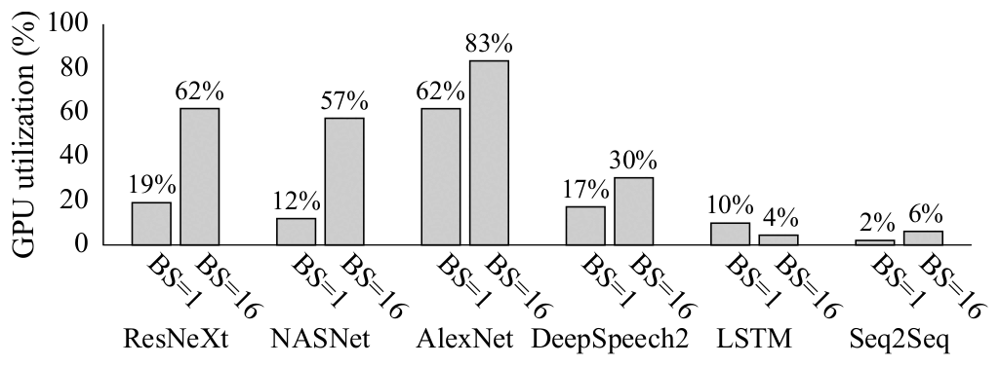

*图 1（原文 Figure 1，第 4 页）：不同 DNN 模型在不同 batch size（BS）下的平均 GPU 利用率。利用率只统计 kernel 执行，不含算子发射等其他阶段。（测量：TensorFlow，V100。）*

**图中文字翻译与读法**：纵轴 GPU utilization (%)（GPU 利用率）；横轴六个模型 ResNeXt、NASNet、AlexNet、DeepSpeech2、LSTM、Seq2Seq，每个模型两根柱子 BS=1 与 BS=16。柱顶数字为图上直接标注：

| 模型 | BS=1 | BS=16 |
|---|---:|---:|
| ResNeXt | 19% | 62% |
| NASNet | 12% | 57% |
| AlexNet | 62% | 83% |
| DeepSpeech2 | 17% | 30% |
| LSTM | 10% | 4% |
| Seq2Seq | 2% | 6% |

**读图结论**：batch size 为 1 时，Seq2Seq 的 GPU 利用率低到 2%；batch size 增到 16 后，六个模型的平均利用率也只有 40%（本文复核：$(62+57+83+30+4+6)/6\approx40.3$）。LSTM 在 BS=1 时利用率略高于 BS=16，原文脚注解释是 TensorFlow 对不同 batch size 用了不同的 GEMM kernel 实现。现代 GPU 的多 stream 机制允许独立算子并发运行，但论文在第 5 节测得多 stream 往往让整体性能变差而不是变好（见本文 6.4 节图 15）。

### 2.3 问题二：算子间调度开销很高（图 2）

这里把“GPU 没有在做实际计算的时间”都算作算子间调度开销，它包括 kernel 启动、context 初始化、host 与 GPU 之间的通信等为发射算子所做的各种操作。

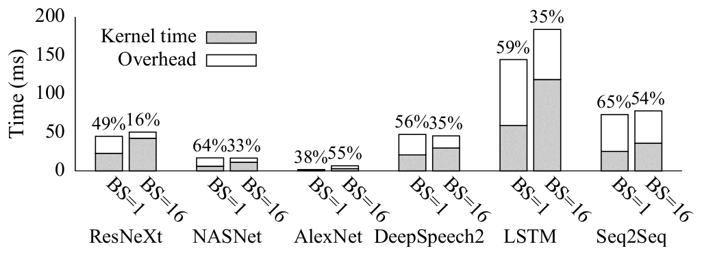

*图 2（原文 Figure 2，第 4 页）：不同 DNN 模型在不同 batch size（BS）下的平均 kernel 时间与端到端执行时间。*

**图中文字翻译与读法**：纵轴 Time (ms)（时间）；每根柱由灰色的 Kernel time（kernel 时间，即 GPU 真正在计算的时间）和白色的 Overhead（开销）堆叠而成；柱顶百分比是开销占整根柱的比例。图上标注：

| 模型 | BS=1 开销占比 | BS=16 开销占比 |
|---|---:|---:|
| ResNeXt | 49% | 16% |
| NASNet | 64% | 33% |
| AlexNet | 38% | 55% |
| DeepSpeech2 | 56% | 35% |
| LSTM | 59% | 35% |
| Seq2Seq | 65% | 54% |

（总时间从图上读出：BS=1 时 ResNeXt 约 45 ms、LSTM 约 145 ms、Seq2Seq 约 73 ms，AlexNet 只有约 1.5 ms；这些是近似读数。）

**读图结论**：batch size 为 1 时，六个模型的平均开销占比为 55%（本文复核：$(49+64+38+56+59+65)/6\approx55.2$）；batch size 增到 16 后只是略有改善，开销仍在 16% 到 55% 之间，不可忽略。现代编译器（包括 TensorFlow 自带的）用 kernel 融合把若干算子合并成一个，但原文第 5 节的结果说明它并不能显著降低这部分开销。

### 2.4 问题三：算子间与算子内调度的相互作用被忽略（图 3）

把调度拆成两层，就看不到两层之间的微妙互动，可能得到次优性能。

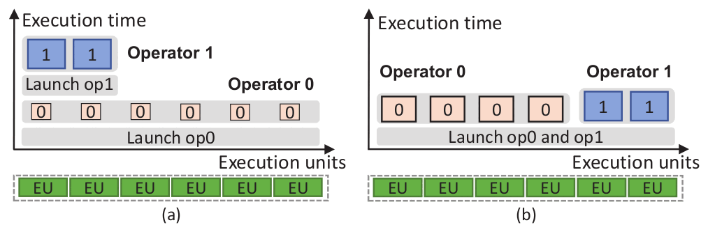

*图 3（原文 Figure 3，第 4 页）：（a）现有方法中的低效调度；（b）一种优化的调度方案。*

**图中文字翻译与读法**：两幅图的纵轴都是 Execution time（执行时间，向上增长），横轴 Execution units（执行单元），下方绿色方块是 6 个 EU（对 GPU 就是 SM）。图中有两个互相独立的算子：Operator 0（橙色小方块 0，共 6 个）和 Operator 1（蓝色方块 1，共 2 个）。

- **(a)**：Operator 0 为了让自己最快，选了并行度很高的最快实现，贪心地铺满了全部 6 个 EU（图中底部 “Launch op0” 之上一整排 6 个 0），每个 EU 本身可能并没有被充分利用；Operator 1 只能等它做完，单独再 “Launch op1”，排在时间轴更上方。
- **(b)**：调度器把 Operator 0 的并行度降到 4（4 个 0 并排），把 Operator 1 的 2 个 rTask 放在剩下的 2 个 EU 上同时运行，两者共用一次 “Launch op0 and op1”，总时间更短。

**读图结论**：为了整体更快，有时应当让某个算子“变慢”（降低它的算子内并行度），以换取更多算子间并行；这需要同时掌握两层信息的调度器。

### 2.5 机会：编译期可知的 DFG 与确定性的算子性能

原文的观察是：大多数 DNN 的 DFG 在编译期就已知，且算子的执行时间基本是确定的，因此可以通过**编译期 profiling**得到运行时性能（该思路来自 Astra）。这既避免不必要的运行时开销，也允许使用代价更高的调度策略，同时挖掘算子间与算子内并行。

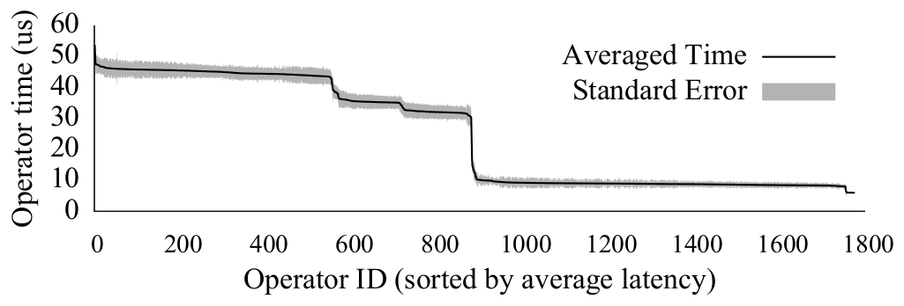

*图 4（原文 Figure 4，第 4 页）：ResNeXt 模型里所有算子的 profile kernel 时间。每个数据点运行 1,000 次。*

**图中文字翻译与读法**：横轴 Operator ID (sorted by average latency)（算子编号，按平均延迟从大到小排序，从图上读出约有 1,770 个算子）；纵轴 Operator time (us)（算子时间，微秒）；黑线 Averaged Time（平均时间），灰色带 Standard Error（标准误差）。从图上读出：平均时间呈台阶状，约 45 μs（前约 550 个算子）、约 35 μs、约 31 μs，到编号约 870 处陡降到约 9 μs，再缓慢降到末尾的约 8 μs；灰色带很窄。

**读图结论**：按 kernel 运行时间加权，所有算子标准差的平均值只有 **7%**。算子耗时足够稳定，因此可以把调度从运行时搬到编译期，离线生成调度计划来降低运行时开销。但一个朴素的“联合管理两层调度”方案，开销可能比现有的算子间调度开销还高；Rammer 的设计就是为了避免这一点。

## 三、Rammer 的设计

### 3.1 总览（图 5）

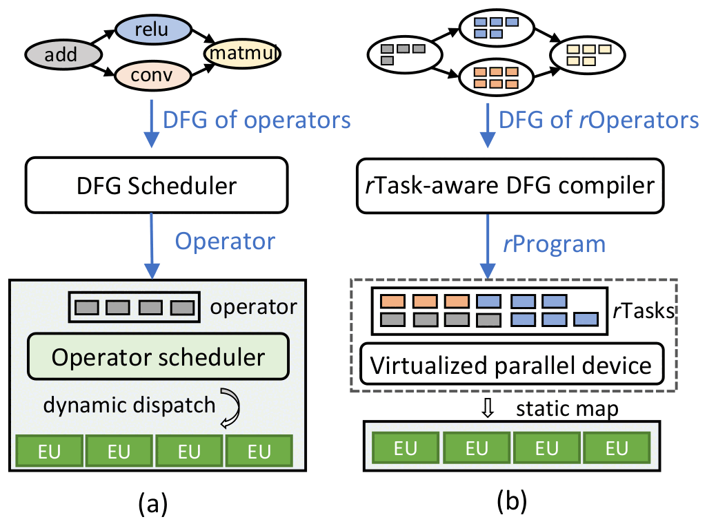

*图 5（原文 Figure 5，第 5 页）：DNN 计算的系统总览：（a）现有 DNN 框架；（b）Rammer，其中 DFG 的每个节点是一个显式暴露算子内并行（通过 rTask）的 rOperator；Rammer 不再动态调度每个 rOperator，而是把 DFG 编译成称为 rProgram（由 rTask 组成）的静态执行计划，并通过称为 vDevice 的软件设备抽象把它映射到硬件。*

**图中文字翻译与读法**：

- **(a) 现有做法**：上方是算子的 DFG（add、relu、conv、matmul 四个节点，每个算子是一个不透明的整体，用不同颜色标出）→ DFG Scheduler（DFG 调度器，软件）→ 每次交出一个 Operator（算子）→ 下方灰色框里是硬件侧：Operator scheduler（算子调度器）做 dynamic dispatch（动态分派）→ 四个绿色 EU（执行单元）。
- **(b) Rammer**：上方是 rOperator 的 DFG，每个节点内部画出了它包含的许多小方块（即 rTask）→ rTask-aware DFG compiler（感知 rTask 的 DFG 编译器）→ 输出 rProgram（执行计划）→ 虚线框里是 Virtualized parallel device（虚拟并行设备），里面排好了各色 rTasks（来自不同算子，两行表示不同 vEU）→ static map（静态映射）→ 四个绿色 EU。

**读图结论**：Rammer 和现有系统的区别是，（1）调度的输入单位从“算子”变成“rOperator 里的 rTask”；（2）算子间与算子内调度合并在编译器这一个地方完成，而不是软件与硬件各管一半；（3）调度结果是一个静态计划，运行时不再动态分派。

原文接着解释：把整个 DNN 计算塞进一次加速器调用往往不高效或不可能，所以执行计划被分成多个 **rProgram**，每个包含要在硬件上执行的一部分计算；Rammer 一次发射一个 rProgram，而不是一个算子。vDevice 在 rTask 层面提供调度与同步能力，使 rProgram 能在编译期映射到对应的 vEU；vEU 与 vDevice 在运行时才被映射到硬件。

### 3.2 rOperator 与 rTask

**定义**：rOperator 是一组相互独立、同构的 rTask（Rammer task 的简称）；rTask 是算子中在加速器的一个处理单元上执行的最小计算单位。rTask 的概念天然对应 DNN 加速器的并行结构（如 GPU 的 SIMD 架构）：要在这类加速器上高效计算，就必须把计算分成多个并行的（同构）任务，每个并行任务就能表示成一个 rTask，从而把算子内并行不仅暴露给硬件，也暴露给 Rammer 编译器。

rTask 在逻辑上等同于一个并行任务，所以 Rammer 依赖外部工具（如 TVM）把一个 rOperator 划分成 rTask，即用外部启发式决定合理的 rTask 粒度。例如矩阵乘可以分成许多同构的 rTask，每个计算输出矩阵的一个 tile，tiling 策略被假定为给定。如果一个复杂算子很难分成相互独立的同构 rTask（如 SeparableConv2D），就把它表示成多个相互依赖的 rOperator，每个再划分成 rTask。

**接口**（原文图 6，第 5 页）：

```text
interface Operator { void compute(); };
interface rOperator {
  void compute_rtask(size_t rtask_id);
  size_t get_total_rtask_num();
};
```

- 传统算子只有一个接口 `compute()`；
- rTask 用逻辑编号 `rtask_id` 标识，一个 rOperator 里的 rTask 连续编号；执行一个 rTask 时，并行执行单元调用 `compute_rtask(rtask_id)`；
- 生成 rProgram 时 Rammer 需要知道算子的 rTask 总数，由 `get_total_rtask_num()` 给出；
- rOperator 的具体实现叫 **rKernel**，它实现 rTask 的具体计算逻辑，并决定 rTask 总数。同一个 rOperator 可以有多个版本的 rKernel，对应不同的 tiling 策略，用于在资源效率与总执行时间之间取舍。

rOperator 抽象让 Rammer 同时暴露算子间与算子内并行，为整体优化 DNN 计算打开新的空间。

### 3.3 虚拟并行设备 vDevice 与 rProgram

现代加速器不提供把 rTask 直接映射到指定执行单元的接口。例如 GPU 一次只允许执行一个算子（以 kernel 的形式）。为此 Rammer 把硬件加速器抽象成软件管理的**虚拟并行设备 vDevice**，它呈现出多个并行的**虚拟执行单元 vEU**，每个 vEU 能独立执行 rTask。

有了 vDevice，Rammer 把感知 rTask 的 DFG 组织成 vDevice 上的 **rProgram**：一个二维数组 `prog[vEU_id][order]`，其中 `vEU_id` 是 rTask 被分配到的 vEU，`order` 是该 rTask 在这个 vEU 内的执行次序。例如 `prog[0][0]` 是 vEU 0 上第一个被执行的 rTask。

为保证计划中相互依赖的 rTask 正确执行，Rammer 引入 **barrier-rTask**：它的参数是一组 `<vEU_id, order>` 对，会一直等待，直到这些索引所指的所有 rTask 完成。barrier-rTask 提供细粒度的同步机制，使 rTask 调度计划得以执行。

### 3.4 感知 rTask 的 DFG 编译器

rTask 抽象和 vDevice 暴露的细粒度 rTask 执行能力打开了很大的优化空间。Rammer 的目标是在这个空间里生成高质量的调度，表示为一串 rProgram。为此编译器把调度的**机制**与**策略**分开：机制侧提供两种能力——（1）供策略生成执行计划的两个调度接口；（2）供策略查询的 profiler。

**调度接口**：

- `Append(task_uid, vEU_id)`：把一个 rTask 追加到指定 vEU 的顺序执行队列末尾。`task_uid` 是 rTask 的全局标识，本质上是算子编号加上算子内的 `rtask_id`；
- `Wait(wtask_uid, list<task_uid>)`：让 `wtask_uid` 指定的 rTask 等待列表里的那些 rTask。`Wait` 会在 `wtask_uid` 之前隐式 `Append` 一个 barrier-rTask。作为优化，若要等待顺序追加到同一个 vEU 的多个连续 rTask $r_1,r_2,\dots,r_n$，等待列表里只需包含最后一个 $r_n$。

**编译期 profiling**：Rammer 的 profiler 提供三类信息：（1）单个 rTask 在 vEU 上的执行时间；（2）rTask 的资源占用，如使用的局部内存或寄存器；（3）整个 rProgram 的执行时间。这些信息用来指导策略生成高效的调度计划。

**调度策略：波前（wavefront）调度**（原文 Algorithm 1，第 6 页）。该策略接收感知 rTask 的 DFG，按“波”（wave）调度算子。一个 wave 是对 DFG 做广度优先搜索时的“边缘”节点集合（依赖都已满足、可以开始的算子）。

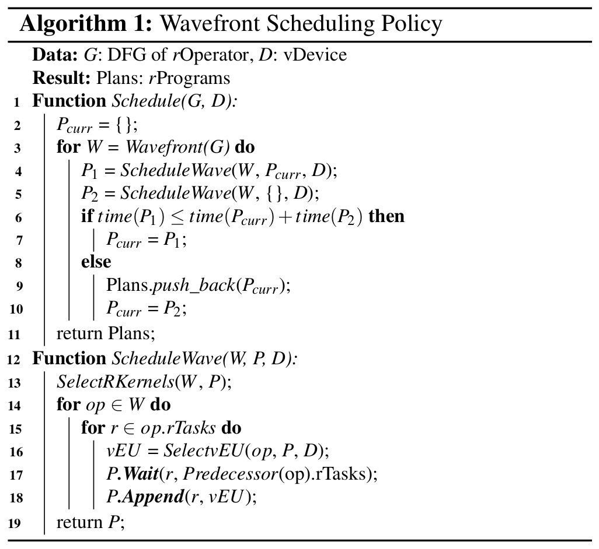

*算法 1（原文 Algorithm 1: Wavefront Scheduling Policy，第 6 页）：波前调度策略。*

下面把原文的伪代码逐行转录，`#` 后是本文的中文说明：

```text
Data: G: DFG of rOperator, D: vDevice
Result: Plans: rPrograms
 1 Function Schedule(G, D):
 2   Pcurr = {};                                   # 当前正在构造的 rProgram，初始为空
 3   for W = Wavefront(G) do                       # 逐个 wave 处理
 4     P1 = ScheduleWave(W, Pcurr, D);             # 方案 1：把这个 wave 接在 Pcurr 后面
 5     P2 = ScheduleWave(W, {}, D);                # 方案 2：这个 wave 单独放进一个新的 rProgram
 6     if time(P1) <= time(Pcurr) + time(P2) then  # profile 结果显示合并不比分开更慢
 7       Pcurr = P1;                               # 合并进当前 rProgram
 8     else
 9       Plans.push_back(Pcurr);                   # 封存当前 rProgram
10       Pcurr = P2;                               # 新开一个 rProgram
11   return Plans;
12 Function ScheduleWave(W, P, D):
13   SelectRKernels(W, P);                         # 为 wave 里每个算子选 rKernel
14   for op in W do
15     for r in op.rTasks do
16       vEU = SelectvEU(op, P, D);                # 选能最早执行这个 rTask 的 vEU
17       P.Wait(r, Predecessor(op).rTasks);        # 等前驱算子的 rTask 做完
18       P.Append(r, vEU);                         # 把 rTask 放到这个 vEU 上
19   return P;
```

**逐步解释**：

1. 对每个 wave，先试两种放法：接在当前 rProgram 之后（P1），或单独新开一个 rProgram（P2）。若 profile 的时间表明合并（`time(P1)`）不超过“当前方案加单独方案”（`time(Pcurr) + time(P2)`），就合并，让这个 wave 与前面的 wave 在同一次发射里；否则封存当前 rProgram，新开一个（第 2 到 10 行，这是原文的说法；以上“合并/分开”的解读是本文对伪代码的理解）。
2. `SelectRKernels`（第 13 行）为 wave 里的每个 rOperator 选实现。原文先假设每个 rOperator 有一个或多个 rKernel，每个是把算子切成 rTask 的一种方式，资源与运行时间的取舍不同。在某个 rOperator 的各 rKernel 中，有**最快**的（运行时间最短），也有**最高效**的（运行时间乘 rTask 总数最小）。启发式规则是：如果把 wave 里所有算子都用最快实现、它们的 rTask 合起来仍不足以占满加速器的全部并行执行单元，就直接选最快的；否则找出最高效的 rKernel 并 profile，若 profile 结果显示整体执行时间更好就选它们，否则仍用最快的。这个启发式通过评估 wave 里的 rOperator（及其 rTask）整体而不是单个算子，考虑了算子间与算子内调度的相互作用。
3. `SelectvEU`（第 16 行）：在当前 rProgram P 下，选能最早执行这个 rTask 的 vEU，依据是 P 中各 rTask 的 profile 执行时间（本质是贪心的“最早可用”分配）。
4. 最后用 `Wait` 保证 DFG 导出的 rTask 级依赖，用 `Append` 把 rTask 分给选中的 vEU（第 17、18 行）。

（原文伪代码在循环结束后只 `return Plans`，没有把最后一个 `Pcurr` 加进 `Plans`，应当是省略。）

这个策略展示了 Rammer 如何把调度机制与调度策略分开。如第 5 节所示，这个简单的策略就已经能超过当前最好的系统，有时幅度很大；作者设想这套机制能支持未来研究更高级的调度策略。

**术语速查**：

| 术语 | 含义 |
|---|---|
| rTask | rOperator 里最小的计算单元，在加速器的一个处理单元上运行；CUDA 上对应一个 thread block |
| rOperator | 一组相互独立、同构的 rTask；接口为 `compute_rtask(rtask_id)` 与 `get_total_rtask_num()` |
| rKernel | rOperator 的一种具体实现（一种切分/tiling 策略），决定 rTask 的计算逻辑与总数 |
| vEU | 虚拟执行单元；CUDA 上用固定在某个 SM 上的持久 thread block（PTB）实现 |
| vDevice | 软件管理的虚拟并行设备，由多个 vEU 组成 |
| rProgram | 二维数组 `prog[vEU_id][order]`，编译成一个设备 kernel，一次发射 |
| barrier-rTask | 等待一组 `<vEU_id, order>` 指定的 rTask 完成的同步 rTask |
| wave | 对 DFG 做广度优先搜索得到的一层“边缘”算子 |

## 四、实现

### 4.1 总体与工作流（图 7）

Rammer 用 **52k 行 C++** 实现，其中 3k 行是核心编译器与调度功能。输入是 TensorFlow frozen graph、TorchScript 或 ONNX 格式的 DNN 模型。Rammer 先把输入模型转成 rOperator 的 DFG；因为输入模型通常没有优化，像其他编译器一样也实现了常见的图优化：常量折叠、公共子表达式消除、基于模式的 kernel 融合等。对优化后 DFG 里的每个 rOperator，Rammer 从不同来源载入一个或多个版本的 rKernel：自动 kernel 生成器（如 TVM）、手工调优的 kernel，或从其他框架里已有算子转换而来。随后 Rammer 编译器把 DFG 划分成子图（例如按算法 1 的策略），每个子图编译成一个 rProgram，rProgram 再被生成为在加速器上运行的设备代码（如 GPU kernel）。

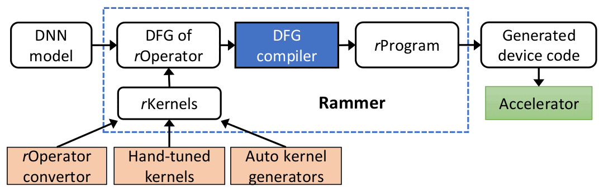

*图 7（原文 Figure 7，第 7 页）：Rammer 的总体工作流。*

**图中文字翻译与读法**：从左到右：DNN model（DNN 模型）→ DFG of rOperator（rOperator 的 DFG）→ DFG compiler（DFG 编译器，蓝色，本文的核心）→ rProgram → Generated device code（生成的设备代码）→ Accelerator（加速器，绿色）。虚线框 Rammer 内另有 rKernels（rKernel 库）通过箭头提供给 DFG of rOperator，它们有三个来源（橙色）：rOperator convertor（rOperator 转换器，把已有算子转成 rOperator）、Hand-tuned kernels（手工调优 kernel）、Auto kernel generators（自动 kernel 生成器）。

Rammer 与现有 DNN 编译器的优化兼容：它能从 TensorFlow 等框架导入 DFG，用传统图优化器优化；rOperator 也可以用现有的 kernel 调优器优化。论文的经验是，在现有优化之上 Rammer 能带来显著的额外提升，尤其是 DNN 推理负载。Rammer 与硬件无关：rTask、rOperator、vEU 等抽象适用于任何带同构执行单元的大规模并行计算设备（几乎所有为 DNN 负载设计的计算设备）。

### 4.2 在 NVIDIA CUDA GPU 上的实现

NVIDIA GPU 由几十到几百个流多处理器（SM）组成，每个 SM 含几十个核，SM 上的计算遵循 SIMT 模型；一个 CUDA 程序（kernel）把多个线程组成 block，每个 thread block 被分给一个 SM 运行，调度由 GPU 硬件完成。Rammer **自然地把每个 vEU 映射到一个 SM，并把一个 rTask 实现成一个 thread block**。

**rOperator 的 CUDA 实现**。原文图 8（第 7 页）是 $M\times K$ 的矩阵 $A$ 乘 $K\times N$ 的矩阵 $B$ 的朴素 rOperator（为简化假设 $M$、$N$ 能被 32 整除）：

```cuda
__device__ void matmul_rTask(float *A, float *B,
    float *C, size_t rtask_id) {
  size_t tile_x = rtask_id / (M/32);
  size_t tile_y = rtask_id % (N/32);
  size_t i = threadIdx.x/32 + tile_x*32;
  size_t j = threadIdx.x%32 + tile_y*32;
  C[i][j] = 0;
  for (size_t k = 0; k < K; k++)
    C[i][j] += A[i][k] * B[k][j];
}

class MatmulROperator {
  __device__ void compute_rtask(size_t rtask_id){
    matmul_rTask(input0,input1,output0,rtask_id);}
  size_t get_total_rtask_num(){return M/32*N/32);}
};
```

**读法**：每个 rTask 计算输出矩阵 $C$ 的一个 $32\times32$ tile。第 1 到 10 行是一个 rTask 里**一个线程**的计算：用 Rammer 分配的 `rtask_id` 确定本 rTask 负责的 tile（第 3、4 行），用 CUDA 内建的 `threadIdx` 确定本线程负责的元素（第 5、6 行），再计算该元素（第 7 到 9 行）。rOperator 对外暴露的接口由 vEU 的并行线程调用；rTask 总数由矩阵维度 $M$、$N$ 决定，通过 `get_total_rtask_num` 取得。**与传统 CUDA 代码的关键区别**：rTask 用 `rtask_id`（由 Rammer 控制的逻辑索引），而不是 `blockIdx`（由 GPU 硬件调度器控制的内建 thread-block 索引）；这使 Rammer 能用合适的 `rtask_id` 调用 `compute_rtask()`，把 rTask 映射到想要的 vEU。（图 8 仅为示意；第 5 节评测用的是更复杂的、利用共享内存与寄存器的 tiled 矩阵乘 rOperator。示意代码里 `tile_x = rtask_id / (M/32)` 只有在 $M=N$ 时才与 `tile_y = rtask_id % (N/32)` 配套，一般应为 `/ (N/32)`，且 `get_total_rtask_num` 的返回语句多了一个右括号，这是本文按行主序 tile 编号对示意代码的核对，原文没有说明。）

**vDevice 与 vEU 的 CUDA 实现**。CUDA GPU 上算子内调度通常由内置调度器管理。为绕开它，Rammer 用**持久 thread block**（PTB，persistent thread block）实现 vDevice 里的 vEU。PTB 是一个其线程持续运行的 thread block，Rammer 能把 PTB “钉”在想要的 SM 上。给定一个 rProgram，PTB（即 vEU）里的每个线程按 rProgram 指定的顺序执行 `compute_rtask()`。为了在一个 PTB 里连续执行多个 rTask 的 `compute_rtask()`，CUDA 要求 `compute_rtask()` 以及其中执行的所有子函数都加 `__device__` 限定符（如图 8 第 1、13 行）。Rammer 在分发时通过 GPU 调度器把每个 vEU（PTB）分给指定的 SM；为提高硬件利用率，一个 SM 可同时运行多个 vEU（PTB）。由于 CUDA 是 SIMT 模型，所有 vEU 同构，一个 SM 能支持的 vEU 数取决于所有 vEU 中要求最苛刻的 rTask（需要线程数、寄存器数、共享内存大小等最多的那个）；实践中按 nvcc 给出的最大活跃 PTB 数来设置每个 SM 上的 vEU 数。有了 vDevice 抽象，Rammer 里的优化与硬件无关。

原文图 9（第 8 页）是一个含两个 vEU（即带两个 PTB 的 CUDA kernel）的 vDevice 的 CUDA 代码，它执行由三个 rOperator（Matmul、Relu、Conv）编译出的 rProgram：

```cuda
// config: <<<(vEU_size,1,1), (vEU#,1,1)>>>
__global__ void vdevice_run() {
  if (Get_vEU_Id() == 0) { // vEU 0
    MatmulrTaskOp.compute_rtask(0);
    MatmulrTaskOp.compute_rtask(1);
    // wait the rTask on vEU 1 with order=3
    BarrierTask({<1, 3>}).compute_rtask();
    Conv2DrTaskOp.compute_rtask(0);
  }
  else if (Get_vEU_Id() == 1) { // vEU 1
    for (auto i : 4)
      RelurTaskOp.compute_task(i);
    // wait the rTask on vEU 0 with order=1
    BarrierTask({<0, 1>}).compute_rtask();
    Conv2DrTaskOp.compute_rtask(1);
  }
}
```

**读法**：按执行计划，vEU 0 先执行 Matmul 算子的两个 rTask（编号 0、1），同时 vEU 1 并行执行 Relu 算子的四个 rTask；然后给两个 vEU 插入一个全局 barrier，各自运行一个 barrier-rTask：vEU 0 等待 vEU 1 上 `order=3` 的 rTask（即第 4 个，Relu 的最后一个），vEU 1 等待 vEU 0 上 `order=1` 的 rTask（即第 2 个，Matmul 的最后一个）；最后两个 vEU 各执行 Conv 算子的一个 rTask（编号 0、1），所以 Conv 的输入依赖 Matmul 和 Relu 的全部输出。每个 vEU 里，Rammer 在一个代码分支里顺序执行 rTask，该分支只有当前 vEU 的 id 与 rProgram 生成的 id 相符时才执行。（原文第 1 行的注释把启动配置写成 `<<<(vEU_size,1,1), (vEU#,1,1)>>>`，按 CUDA 的 `<<<grid, block>>>` 约定，块数应等于 vEU 个数、每块线程数应等于一个 vEU 的线程数，这两项的顺序与注释似乎相反，原文也没有解释这两个记号，疑为笔误，这是本文的推断；第 12 行的 `compute_task` 按图 6 的接口名应为 `compute_rtask`。）在长时间的 DNN 计算之前，Rammer 会先把每个 vEU 分配到想要的 SM 上。

**在 vEU 上执行异构 rTask**。CUDA kernel 里 thread block 的线程数在整个生命周期内固定，这迫使 Rammer 要求同一个 vEU 上的所有 rTask 用相同数目的持久线程。实践中不同 rOperator 为平衡并行度与每线程资源占用，会用不同数目的线程。Rammer 的做法是：把 vEU 的线程数设为该 vEU 里所有 rTask 所用线程数的**最大值**；线程数较少的 rTask，Rammer 给多出来的线程插入**提前退出**（early-exit）逻辑，跳过不必要（且无效）的执行。但提前退出可能导致死锁：全局 barrier 可能永远不会返回，因为提前退出的线程可能跳过了 barrier。为避免这个问题，Rammer 可以利用 CUDA 的**协作组**（cooperative groups）原语，它显式控制同步时线程的作用范围。

**实现 barrier-rTask**。Rammer 引入一个 **step 数组**，每个元素是一个整数，记录对应 vEU 上已完成的 rTask 个数。一个 rTask 结束时，用它的第一个线程把 step 数组里对应元素加 1。当 barrier-rTask 需要等待分布在 $N$ 个 vEU 上的一组 rTask 时，它用前 $N$ 个线程轮询 step 数组里对应的元素，直到 step 值大于这些 rTask 的 order；之后 barrier-rTask 调用 `__syncthreads`，确保本 vEU 的所有线程都已准备好运行下一个 rTask。

**把已有 CUDA 算子转成 rOperator**。很多 DNN 算子已经有 CUDA kernel 代码。为减少开发量，Rammer 提供**源到源转换器**，把已有 CUDA 算子转成 rOperator。关键洞察是：为了利用算子内并行，已有的 CUDA 算子本来就实现成 thread block，只是它们用 `blockIdx` 并让 GPU 硬件直接控制算子内调度；rOperator 只需要从 `rtask_id` 算出想要的 `blockIdx`，而不必改动已有 kernel 的计算逻辑。

这个转换的一个挑战是：已有算子里的 thread block 可能按 1、2 或 3 维形状排列，而 vEU 里的线程是 1 维的，所以 vEU 需要支持不同线程形状的 rTask。原文图 10 展示了一个 vEU 执行两个 rTask，线程形状分别是 $[2\times2]$ 与 $[2\times3]$。

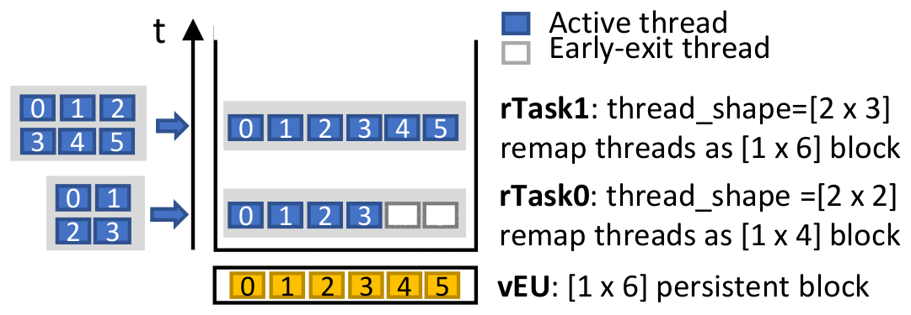

*图 10（原文 Figure 10，第 9 页）：在一个 vEU 上执行两个异构 rTask。*

**图中文字翻译与读法**：下方橙色条 vEU: [1 x 6] persistent block（vEU：$1\times6$ 的持久 block，6 个线程编号 0 到 5）。向上的箭头 t 是时间。图例：蓝色 Active thread（活跃线程）、白色 Early-exit thread（提前退出的线程）。rTask0：thread_shape=$[2\times2]$（遗留 kernel 的线程形状，4 个线程 0 到 3），remap threads as $[1\times4]$ block（重映射成 $1\times4$ 的 block）：在时间轴上它排在前面，6 个线程中前 4 个活跃，后 2 个是白色的提前退出线程；rTask1：thread_shape=$[2\times3]$（6 个线程 0 到 5），remap threads as $[1\times6]$ block：6 个线程全部活跃。

**读图结论**：做法是 vEU 始终保持 1 维的持久线程形状，再对线程索引做**重映射**，由 vEU 的一维 `threadIdx` 算出遗留 kernel 想要的 `threadIdx`。因为 vEU 的线程数是其所有 rTask 线程数的最大值，这样的重映射总是可行的。总结：把遗留 DNN 算子转成 rOperator，需要重映射线程和 block 索引、实现提前退出逻辑，并用 CUDA 协作组原语支持只作用于活跃（未提前退出）线程的局部 barrier。Rammer 在遗留算子 kernel 代码的入口处插入编译器生成的代码段实现这些修改，从而保留遗留算子的实现并把它当作 rTask 算子复用。Rammer 为 70 个 rOperator 转换并实现了共 **150 个 rKernel**。

### 4.3 在其他加速器与 CPU 上的实现

Rammer 的设计不限于 CUDA 与 NVIDIA GPU：rTask、rOperator、vEU 抽象适用于任何带同构执行单元的大规模并行设备。

- **AMD GPU（ROCm）**：与 NVIDIA GPU 类似，也由许多称为 compute unit（CU）的并行执行单元组成；编程模型 HIP 与 CUDA 相似，AMD 的 `hipify` 工具能把 CUDA kernel 转成 HIP kernel，能转换大多数 CUDA rOperator，也能把 vDevice 的 CUDA 实现（即 PTB）转成 HIP 版本。由于架构的细微差别，部分 CUDA kernel 配置（每个 thread block 的线程数、局部内存大小等）没有为 AMD GPU 优化，论文为 AMD GPU 重新实现了 **41 个 rKernel**。唯一的例外是 AMD GPU 不支持协作组原语：为此在 rOperator 里新增一个 API，给出（block 级）同步次数 $S$（即 `__syncthreads` 的调用次数）；对于提前退出的线程，Rammer 不是立刻退出，而是插入代码调用 `__syncthreads` 共 $S$ 次。
- **Graphcore IPU**：IPU 是架构与 GPU 很不同的 DNN 加速器，是带整体同步并行（BSP）通信模型的大规模 MIMD 处理器，每个 IPU 含 1,216 个并行处理单元（称为 tile），每个 tile 由一个超线程计算核加 256 KB 本地内存组成。IPU 上的 DNN 计算被显式地编程成数据流图，每个顶点（vertex）实现在一个 tile 上执行的代码，边表示顶点间的数据传输，由 IPU 编译器负责把每个顶点映射到 tile。Rammer 的 rTask 抽象也可映射到 IPU 的 MIMD 模型：一个 vEU 对应一个 tile，一个 vertex 视为一个 rTask，所以 IPU 上的 rOperator 可以实现成一组 vertex；而且 IPU 编译器允许在编译期控制 vertex 到 tile 的映射，这提供了 vDevice 抽象所需的核心功能。受硬件 BSP 模型限制，IPU 不提供细粒度同步机制，所以 barrier-rTask 用全局 barrier 实现，这可能缩小 Rammer 的调度空间；即使如此，Rammer 仍能在同一计算步里调度不同算子的 rTask 来提高利用率。为评测 Rammer 共实现了 **15 个 rOperator 和 18 个 rKernel**。
- **x86 CPU**：也实现了，但看不到采用 Rammer 抽象的性能收益：x86 上算子运行时间长（x86 核数值计算性能相对较低），核数少，几乎任何 DNN 算子都能占满；而且调度开销不显著，因为 kernel 启动只是一次普通函数调用。所以 Rammer 相比传统两层调度没有额外好处。

## 五、实验设置

**硬件与软件环境**（三台服务器）：

| 平台 | 机器与硬件 | 软件 |
|---|---|---|
| NVIDIA GPU | Azure NC24s_v3 虚拟机，Intel Xeon E5-2690v4 CPU，4 张 NVIDIA Tesla V100（16GB） | Ubuntu 16.04，CUDA 10.0，cuDNN 7.6.5 |
| AMD GPU | Intel Xeon E5-2640 v4 CPU，2 张 AMD Radeon Instinct MI50（16GB） | Ubuntu 18.04，ROCm 3.1.1 |
| Graphcore IPU | Azure ND40s_v3 预览版虚拟机，Intel Xeon Platinum 8168 CPU，16 个 IPU | Poplar-sdk 1.0 |

**对比系统**：TensorFlow（v1.15.2，代表最先进的 DNN 框架）；TVM（v0.7）与 TensorFlow-XLA（代表最先进的 DNN 编译器）；TensorRT（v7.0，TensorFlow 集成版本，NVIDIA 专用推理库，记作 TF-TRT）。为了说明 Rammer 新抽象的收益，还做了一个基线版本 **RammerBase**：它只实现与现有编译器类似的优化，仍使用两层调度，因此可以看作在 Rammer 同一代码库里实现的又一个普通 DNN 编译器。TVM 对每个算子调 1,000 步并选最快的 kernel。

**基准模型**（原文表 1，第 10 页）：覆盖典型的 CNN、RNN 结构，以及图像、NLP、语音多个应用领域。

| 模型 | 数据集 | 类型 | 备注（超参数） |
|---|---|---|---|
| ResNeXt | CIFAR-10 | 计算机视觉 | 29 层，cardinality 16，bottleneck 宽度 64d（16×64d，论文参数） |
| NASNet | CIFAR-10 | 计算机视觉 | 重复 cell 数 6，滤波器数 768（6@768，论文参数） |
| AlexNet | ImageNet | 计算机视觉 | （论文参数） |
| DeepSpeech2 | LibriSpeech | 语音 | 输入长度 300；CNN 层数 2；RNN：单向 LSTM，7 层，hidden size 256 |
| LSTM（-TC） | 合成数据 | 语言模型 | 输入长度 100，hidden size 256，10 层 |
| Seq2Seq（-NMT） | 合成数据 | 语言模型 | 编码器：输入长度 100，单向 LSTM，hidden size 128，8 层；解码器：输出长度 30，单向 LSTM，hidden size 128，4 层 |

其中 ResNeXt 是 ResNet 的改进版；NASNet 是神经架构搜索得到的最先进 CNN；AlexNet 代表结构简单的经典 CNN；LSTM-TC 是用于文本分类的 RNN；DeepSpeech2 是有代表性的语音识别模型；Seq2Seq 用于神经机器翻译。所有这些基准的实现（包括各模型用到的 rKernel）都在 artifact 评估仓库里。评测聚焦**模型推理**；Rammer 没有本质原因不能做训练，只是支持训练需要开发更多算子。所有性能数字都是 **1,000 次运行的平均值**，所有情形下作者观察到的波动都很小。本文各图的纵轴均为端到端推理时间（ms，越小越好），不是吞吐。

## 六、CUDA GPU 上的结果

本节回答五个问题：（1）与最先进的 DNN 框架或编译器相比表现如何？（2）对 GPU 并行资源的利用如何？（3）运行时调度开销降低了多少？（4）利用算子内、外并行的整体调度带来多少收益？（5）细粒度同步的效果如何？

### 6.1 端到端性能：batch size 为 1（图 11）

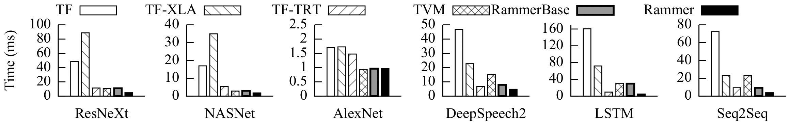

*图 11（原文 Figure 11，第 11 页）：NVIDIA V100 GPU 上 batch size 为 1 的端到端模型推理时间。*

**图中文字翻译与读法**：六个子图依次对应 ResNeXt、NASNet、AlexNet、DeepSpeech2、LSTM（即 LSTM-TC）、Seq2Seq，各子图纵轴 Time (ms) 的量程不同（分别 0 到 100、0 到 40、0 到 2.5、0 到 50、0 到 160、0 到 80）。每个子图六根柱子依次是 TF（白色）、TF-XLA（反斜线）、TF-TRT（斜线）、TVM（网格）、RammerBase（灰色）、Rammer（黑色）。柱子越矮越好。（说明：对 DeepSpeech2、LSTM-TC、Seq2Seq-NMT，TF-TRT 在编译超过 50 小时后仍没有产出结果，所以这三个模型改用 TensorRT 原生 API 重写，图中 TF-TRT 柱对应的是重写版本。）

**结果**（原文数字）：

| 对比对象 | 平均加速（Rammer 相对对方） | 最高 | 说明 |
|---|---:|---:|---|
| TF | 14.29× | 33.94×（LSTM-TC） | TF 在 DFG 层有很重的运行时调度开销，算子执行时间短（小 batch 推理）时尤甚 |
| TF-XLA | 11.25× | 20.12× | XLA 能做 DFG 级优化（如算子融合）与算子级代码特化（定制 kernel 生成），但仍无法避免调度开销；在 ResNeXt、NASNet 等部分 CNN 上开销甚至比 TF 更高 |
| TVM | 3.48× | 6.46× | TVM 靠 kernel 调优为每个算子生成特化 kernel，比 TF、XLA 好很多，但不能像 Rammer 那样利用细粒度并行；唯一例外是 AlexNet，Rammer 只能与 TVM 持平 |
| TensorRT（TF-TRT） | 2.18× | 3.09× | 以延迟衡量，Rammer 在所有基准上都好于 NVIDIA 优化的 TensorRT |
| RammerBase | 2.59× | 6.29× | 同一代码库、同一套 kernel 下，只有调度方式不同 |

AlexNet 上 Rammer 只能与 TVM 持平，是因为 AlexNet 是最早的现代 DNN 之一，结构简单（顺序模型、算子少而大），容易被优化。

（从图上读出的近似值：LSTM-TC 上 TF 约 160 ms，Rammer 约 5 ms，对应 33.94×；ResNeXt 上 TF-XLA 约 89 ms，TF 约 48 ms，Rammer 约 5 ms；AlexNet 上 TF 约 1.7 ms，TVM 与 Rammer 都约 1 ms。）

**读图结论**：batch size 为 1 时，端到端延迟的主要成分是调度开销而非 kernel 本身，所以统一的编译期调度收益最大；RammerBase 这样“只做类似现有编译器优化”的版本已经能追平甚至好于 TF-XLA 和 TVM，因此论文后面把 RammerBase 当作“最先进编译器”的基线，把 TF-TRT 当作“最先进推理库”的基线，并用 RammerBase 消除不同实现带来的干扰。

### 6.2 不同 batch size（图 12）

只在两个有代表性的 CNN 与 RNN 模型（ResNeXt 与 LSTM-TC）上测 batch size 4 和 16。限制基准数量是因为为 Rammer 开发优化的 rOperator kernel 成本很高：需要找到高效的开源算子 kernel，或手工或借助自动调优工具调优，很耗时。

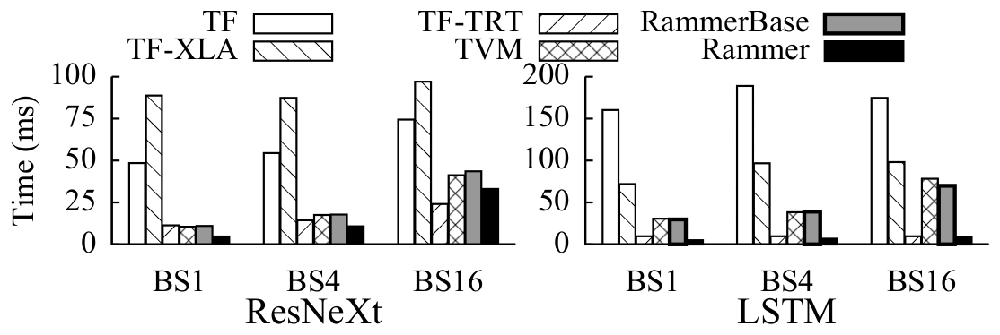

*图 12（原文 Figure 12，第 11 页）：不同 batch size（BS）下的端到端模型推理时间。*

**图中文字翻译与读法**：左子图 ResNeXt，右子图 LSTM；横轴 BS1、BS4、BS16；纵轴 Time (ms)；图例 TF、TF-XLA、TF-TRT、TVM、RammerBase、Rammer。

**结果**：更大的 batch size 因增大了单个算子的执行时间，能降低现有框架的调度开销；即便如此，Rammer 仍胜过所有系统，**唯一例外是 batch size 为 16 的 ResNeXt 上的 TensorRT**：TensorRT 用了一些源码不公开的算子，论文自己的实现还达不到其性能；事实上，实现出能匹敌闭源 kernel 的算子是 Rammer 的主要挑战之一。相对其他开源框架和编译器，Rammer 仍有显著收益：batch size 16 时，ResNeXt 上 Rammer 比 TF 快 2.25 倍、比 TVM 快 1.25 倍；LSTM-TC 上比 TF 快 20.08 倍、比 TVM 快 9.0 倍。（从图上读出：ResNeXt BS16 约 TF 75 ms、TF-TRT 24 ms、TVM 41 ms、Rammer 33 ms；LSTM BS16 约 TF 175 ms、TVM 78 ms、Rammer 9 ms，与正文倍数一致。）

### 6.3 更大的输入尺寸（图 13）

默认设置里 ResNeXt 和 NASNet 在 CIFAR-10 的 $32\times32$ 图像上评测。为展示更大图像上的性能，又在 ImageNet 上评测这两个模型，用其原论文里的模型超参数：ResNeXt 为 101 层、cardinality 64、bottleneck 宽度 4d；NASNet 为 4 个重复 cell、1056 个滤波器。

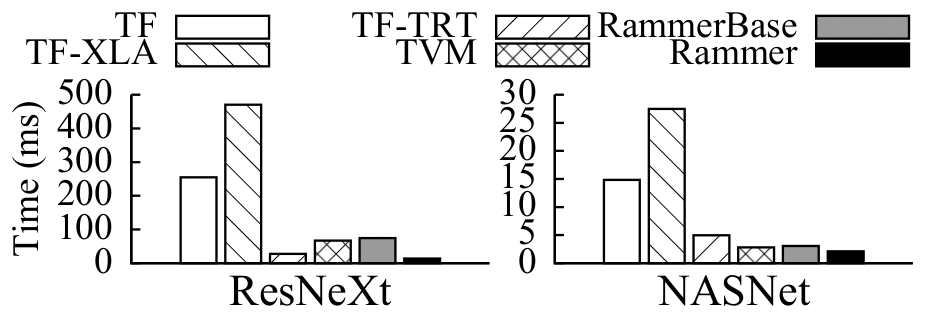

*图 13（原文 Figure 13，第 12 页）：batch size 为 1、ImageNet 数据集（图像尺寸 $224\times224$）上的端到端模型推理时间。*

**图中文字翻译与读法**：左 ResNeXt（纵轴 0 到 500 ms）、右 NASNet（纵轴 0 到 30 ms）；图例同图 12。

**结果**：更大的输入尺寸对 Rammer 的收益影响很小。ImageNet 上，ResNeXt 的 Rammer 仍比 TF 快 18.91 倍、比 TVM 快 4.96 倍、比 TF-TRT 快 2.06 倍；NASNet 上分别快 6.99 倍、1.33 倍和 2.34 倍。原文的解释是：面向大数据集的模型结构通常有更多算子间并行可被 Rammer 的优化更好地利用，例如 ResNeXt 的 cardinality 从 CIFAR-10 的 16 增加到 ImageNet 的 64。（从图上读出：ResNeXt 约 TF 255 ms、TF-XLA 470 ms、TF-TRT 28 ms、TVM 65 ms、Rammer 14 ms。）

### 6.4 GPU 利用率与多 stream（图 14、图 15）

Rammer 的调度让不同算子的 rTask 能并行执行，从而提高 GPU 利用率。论文用 NVIDIA profiler nvprof 的 **SM-efficiency** 指标度量利用率，即至少有一个 warp 在一个多处理器上活跃的时间百分比；只统计 kernel 执行，不含算子发射等其他阶段。

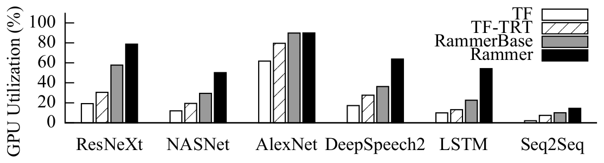

*图 14（原文 Figure 14，第 12 页）：GPU 利用率比较（六个模型，batch size 为 1，按执行时间平均）。*

**图中文字翻译与读法**：横轴六个模型；纵轴 GPU Utilization (%)；四根柱子依次是 TF、TF-TRT、RammerBase、Rammer。从图上读出的近似值（TF / TF-TRT / RammerBase / Rammer，%）：ResNeXt 约 19 / 30 / 58 / 79；NASNet 约 12 / 19 / 29 / 50；AlexNet 约 62 / 80 / 90 / 90；DeepSpeech2 约 17 / 27 / 36 / 64；LSTM 约 10 / 13 / 22 / 54；Seq2Seq 约 2 / 7 / 10 / 15。

**结果**：相对 TF 和 TF-TRT，Rammer 平均把 GPU 利用率提高 **4.32 倍和 2.45 倍**，提升来自更低的运行时调度开销和对算子的协同调度。与使用同一套 kernel 的高度优化的 RammerBase 相比，Rammer 的调度本身平均把利用率提高 **1.61 倍**，LSTM-TC 上最高 **2.39 倍**。（本文用上面的读数复核，三个倍数分别约为 4.4、2.5 和 1.6，与正文一致。）

**多 stream 的效果**：现代 GPU 的多 stream 机制可并发调度独立的 kernel 来提高利用率。论文在 TF 里增加 stream 数来评估其效率。

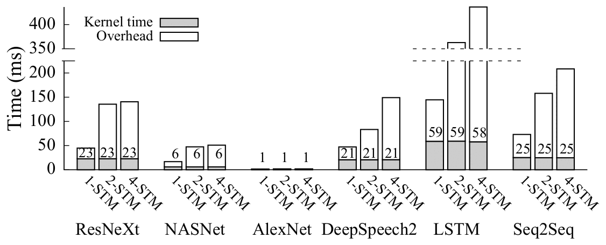

*图 15（原文 Figure 15，第 12 页）：TF 在不同 stream（STM）数下的性能。（注：柱上的数字是 kernel 时间。）*

**图中文字翻译与读法**：横轴每个模型三组柱子，标 1-STM、2-STM、4-STM（stream 数为 1、2、4）；纵轴 Time (ms)，LSTM 一组的纵轴有断开（虚线处）；每根柱子由灰色 Kernel time（kernel 时间）和白色 Overhead（开销）堆叠，柱内数字是 kernel 时间：ResNeXt 23、23、23，NASNet 6、6、6，AlexNet 1、1、1，DeepSpeech2 21、21、21，LSTM 59、59、58，Seq2Seq 25、25、25（单位 ms）。

**结果**：用更多 stream 会损害端到端性能（别人也观察到过这个现象）：用 4 个 stream 平均比 1 个 stream 的端到端时间增加 **2.72 倍**；而且每个模型的 kernel 时间在启用多 stream 后只有极小的下降，说明大多数 kernel 仍是顺序执行，对利用率几乎没有改善。主要原因是多 stream 引入了更高的算子调度开销（图中白色部分显著增大）。

### 6.5 调度开销（图 16）

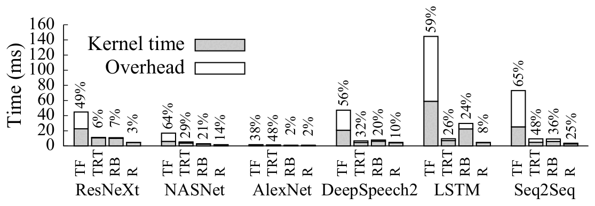

*图 16（原文 Figure 16，第 13 页）：不同模型上的 GPU 调度开销。（柱上的数字是开销占比。TF：TensorFlow；TRT：TF-TRT；RB：RammerBase；R：Rammer。）*

**图中文字翻译与读法**：横轴六个模型，每个模型四根堆叠柱 TF、TRT、RB、R；纵轴 Time (ms)；灰色 Kernel time，白色 Overhead（开销，即不用于实际计算的时间）。柱顶数字为开销占比（图上直接标注）：

| 模型 | TF | TRT | RB | R |
|---|---:|---:|---:|---:|
| ResNeXt | 49% | 6% | 7% | 3% |
| NASNet | 64% | 29% | 21% | 14% |
| AlexNet | 38% | 48% | 2% | 2% |
| DeepSpeech2 | 56% | 32% | 20% | 10% |
| LSTM | 59% | 26% | 24% | 8% |
| Seq2Seq | 65% | 48% | 36% | 25% |

**结果**：

- **RammerBase 对 TF**：把调度时间从平均 **32.29 ms** 降到只有 **2.27 ms**（开销占比平均从 55.41% 降到 18.43%）；对 TF-TRT，把平均调度开销占比从 31.38% 降到 18.43%。RammerBase 做到这点靠的是优化调度的执行代码路径，以及利用算子融合来减少 kernel 启动。如此显著的降幅说明现有 DNN 框架里算子调度的开销很重。
- **Rammer 对 RammerBase**：平均开销从 2.27 ms 进一步降到 **0.37 ms**，降低 **6.14 倍**。原因是静态的编译期算子调度，即把多个算子打包进 rProgram，让若干算子由一次 GPU kernel 启动执行。

### 6.6 算子内与算子间调度的相互作用（图 17）

Rammer 让调度策略能优化算子内与算子间调度的相互作用，而不是只盯着让单个算子变快。这通过为每个 rOperator 选合适的 rKernel 来实现（见 3.4 节）。论文用两套 kernel 评测这种调度的效果：每个算子各自最快的 kernel（fast）和 Rammer 调度策略选出的 kernel（select）。

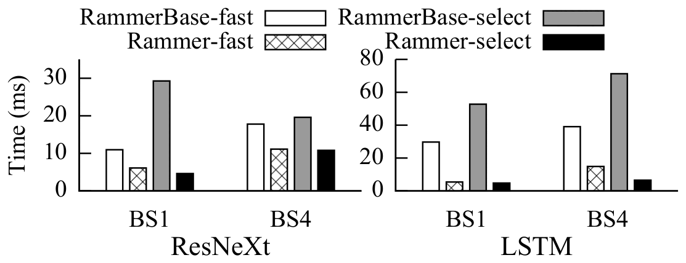

*图 17（原文 Figure 17，第 13 页）：不同 kernel 集合与 batch size（BS）下的性能。*

**图中文字翻译与读法**：左 ResNeXt（纵轴 0 到 30 ms）、右 LSTM（纵轴 0 到 80 ms）；横轴 BS1、BS4；图例四种：RammerBase-fast（白色，RammerBase 用各算子最快 kernel）、RammerBase-select（灰色，RammerBase 用 Rammer 选出的 kernel）、Rammer-fast（网格，Rammer 用最快 kernel）、Rammer-select（黑色，Rammer 用选出的 kernel，即完整 Rammer）。从图上读出的近似值（RammerBase-fast / RammerBase-select / Rammer-fast / Rammer-select，ms）：ResNeXt BS1 约 11 / 29 / 6 / 5，BS4 约 18 / 20 / 11 / 11；LSTM BS1 约 30 / 53 / 5.5 / 5，BS4 约 39 / 71 / 15 / 7。

**结果**：

- 无论用哪套 kernel，Rammer 都能显著提升性能：Rammer 用与 RammerBase 同样的最快 kernel（Rammer-fast 对 RammerBase-fast）平均提升 **2.89 倍**；
- 若 rOperator 有更多 rKernel 可选，Rammer 按其策略选 kernel（Rammer-select），相对 Rammer-fast 平均再提升 **1.44 倍**，最高 **2.28 倍**，尽管选出的 kernel 单独看未必最快；
- 如果把这些选出的 kernel 用在 RammerBase（RammerBase-select）里，性能反而平均下降 **1.84 倍**。

**具体例子**（LSTM-TC，batch size 4 的 MatMul 算子）：最快的 kernel 用 **1,024 个 rTask**，单独运行得到最优的 **4.28 μs**；Rammer 选的 kernel 只含 **16 个 rTask**，单独运行较慢，**7.46 μs**。但 Rammer 选它，是用“更慢的单个 kernel（降低算子内并行度）”换“更好的整体性能（提高算子间并行度）”，这归功于 Rammer 的整体调度能力。

### 6.7 细粒度同步：barrier-rTask（图 18）

作为一种同步机制，barrier-rTask 为结构不规则的 DFG 提供了额外的优化空间，这类 DFG 在神经架构搜索（NAS）生成的模型里很常见。论文用最先进的 NAS 基准 NASBench 随机生成 **5,000 个模块**，每个模块是含最多 9 个算子、7 条边的小 DFG。

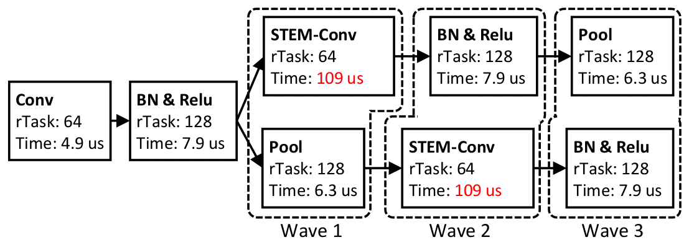

*图 18（原文 Figure 18，第 13 页）：NASBench 生成的一个不规则 DFG。*

**图中文字翻译与读法**：每个方框写着算子类型、rTask 数（rTask）和单独运行时间（Time）。最左是 Conv（64 个 rTask，4.9 μs）→ BN & Relu（128 个 rTask，7.9 μs），之后分成上下两条支路。上支路：STEM-Conv（64 个 rTask，**109 μs**，红色强调）→ BN & Relu（128 个 rTask，7.9 μs）→ Pool（128 个 rTask，6.3 μs）；下支路：Pool（128 个 rTask，6.3 μs）→ STEM-Conv（64 个 rTask，**109 μs**）→ BN & Relu（128 个 rTask，7.9 μs）。虚线框标出调度策略（算法 1）划分的三个 wave：Wave 1 = {上支路 STEM-Conv，下支路 Pool}，Wave 2 = {上支路 BN & Relu，下支路 STEM-Conv}，Wave 3 = {上支路 Pool，下支路 BN & Relu}。

**读图结论**：用全局 barrier 分隔 wave 时，Wave 2 里的下支路 STEM-Conv 必须等 Wave 1 里 109 μs 的上支路 STEM-Conv 做完才能开始，哪怕它真正依赖的 Pool 只需 6.3 μs；用 barrier-rTask 去掉 wave 之间的全局 barrier、改插 rTask 级的细粒度同步，两个 STEM-Conv（分别来自 wave 1 和 wave 2）就可以重叠执行。

**结果**：先比较 Rammer 与 RammerBase 在所有这些模块上的端到端性能：Rammer 平均提升 **1.28 倍**，最高 **3.40 倍**。这些模块中有 **28.3%** 有明显的不规则结构（如算法 1 划分出的一个 wave 里含异构算子）。对这些模块，比较用 barrier-rTask 与用全局 barrier 的端到端性能：barrier-rTask 平均再带来 **1.11 倍**、最高 **1.89 倍**的额外加速。

## 七、其他加速器上的结果

### 7.1 AMD MI50 GPU（图 19）

比较对象是 TF、TVM 和 RammerBase。没有 TF-XLA，因为在实验里无法在 AMD GPU 上成功启用；没有 TensorRT，因为它是闭源的、只面向 NVIDIA。TVM 的自动调优在 ROCm GPU 上没能跑通，所以 TVM 只用默认 kernel。RammerBaseK 与 RammerBase 完全一样，只是使用了 Rammer 选出的 kernel。

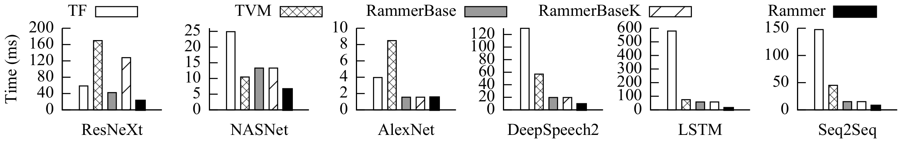

*图 19（原文 Figure 19，第 14 页）：AMD MI50 GPU 上 batch size 为 1 的端到端模型推理时间。*

**图中文字翻译与读法**：六个子图依次对应六个模型（纵轴量程各不同），每个子图五根柱子依次是 TF（白色）、TVM（网格）、RammerBase（灰色）、RammerBaseK（斜线）、Rammer（黑色）。

**结果**：Rammer 平均比 TF 快 **13.95 倍**，LSTM-TC 上最高 **41.14 倍**；平均比 TVM 快 **5.36 倍**，最高 **7.57 倍**；相对 RammerBase，Rammer 的调度平均带来 **2.19 倍**、最高 **4.12 倍**的提升。RammerBaseK 在多数模型上性能变化不大，但在 ResNeXt 上出现 **3.02 倍**的性能下降，说明调度与 kernel 选择的相互作用很重要（Rammer 不一定为 rOperator 选最快的 kernel 实现）。（从图上读出：ResNeXt 上 RammerBase 约 42 ms、RammerBaseK 约 128 ms、Rammer 约 24 ms。）

### 7.2 Graphcore IPU（图 20）

这是一个初步评估：只选了三个 RNN 模型（因为实现高效的 rOperator 以支持其他模型需要工作量），目前 Rammer 只支持单个 IPU 设备（多 IPU 支持留作未来工作）；由于 IPU 的片上内存有限（每个 tile 256 KB），三个 RNN 模型的层数都配置为 4 层才能放进一个 IPU。

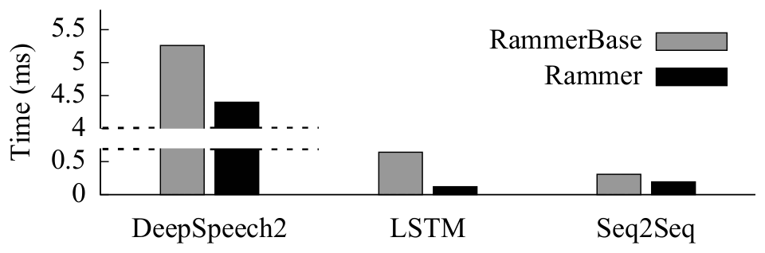

*图 20（原文 Figure 20，第 14 页）：Graphcore IPU 上 batch size 为 1 的端到端模型推理时间。*

**图中文字翻译与读法**：横轴 DeepSpeech2、LSTM、Seq2Seq；纵轴 Time (ms)，DeepSpeech2 一组纵轴有断开（虚线处）；两种柱子：RammerBase（灰色）与 Rammer（黑色）。从图上读出的近似值（RammerBase / Rammer，ms）：DeepSpeech2 约 5.3 / 4.4，LSTM 约 0.64 / 0.12，Seq2Seq 约 0.31 / 0.19。

**结果**：Rammer 的初步实现相对 RammerBase 最高带来 **5.37 倍**的提升（图上约对应 LSTM），说明这套抽象适用于新的加速器架构，并且有效。（注意这里没有与 IPU 厂商库对比，只有 RammerBase。）

## 八、讨论、局限与相关工作

### 8.1 大 batch 与训练（图 21）

Rammer 的收益在算子内并行不足以饱和硬件时更显著，这在 batch 小的在线推理里很常见；论文的初步实验表明，一些大 batch 的模型训练（如 LSTM-TC，batch size 256）也是如此。

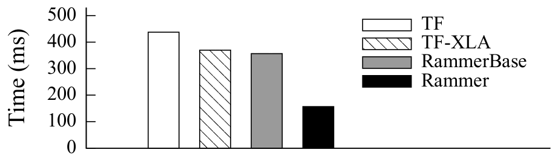

*图 21（原文 Figure 21，第 14 页）：NVIDIA V100 GPU 上 LSTM-TC 在 batch size 为 256 时的端到端模型训练时间。注意 TVM 和 TF-TRT 不支持训练，所以没有对应数据。*

**图中文字翻译与读法**：纵轴 Time (ms)；四根柱子 TF（白色，约 437 ms）、TF-XLA（反斜线，约 370 ms）、RammerBase（灰色，约 357 ms）、Rammer（黑色，约 157 ms）（均从图上读出）。

**结果**：同时优化算子内与算子间并行后，Rammer 比自己的基线 RammerBase 快 **2.28 倍**，比 TF-XLA 快 **2.36 倍**。更详细的分析和进一步优化留作未来工作。

### 8.2 论文自己交代的局限与未来工作

- **动态图**：目前 Rammer 只支持静态图。对带动态控制流的 DFG，可以把每个静态子图（如条件分支的一个分支、循环体）编译成独立的 rProgram，这留待未来实现；
- **任务间调度**：Rammer 专注于优化单个深度学习任务，与任务间调度正交（例如把多个模型成批调度，或用 vDevice 精确控制每个任务的硬件资源）；能否在加速器内同时协同调度来自不同算子乃至不同任务的 rTask 是有趣的课题；
- **多 IPU、更多算子**：IPU 上目前只支持单个设备；为更多模型实现高效的 rOperator 需要工作量；
- **与厂商库形态的关系**：论文的经验强烈暗示，目前业界流行的“厂商以库的形态提供高度优化的 DNN 算子实现（如 cuDNN、MKL-DNN）”是次优的，会给 DNN 负载带来显著的效率代价，未来几年情况只会更糟（加速器可用并行度持续增长，而新的 DNN 架构又倾向于用许多小算子替换大算子）；论文建议厂商以其他形式提供优化实现，如 rOperator 与 vEU 抽象，以实现能充分利用硬件资源的整体优化。

### 8.3 相关工作要点

- **DNN 编译器优化**可按两层表示分成两类：DFG 级优化（如算子融合，见于 TensorFlow、PyTorch、TVM、XLA；TASO 提出自动图替换）与算子级优化（AutoTVM、Tensor Comprehensions、FlexTensor、Tiramisu、Halide 等调优并生成硬件相关的高效算子代码）。Rammer 通过输入优化后的 DFG、并用这些 kernel 生成器生成高效 rKernel，与它们都兼容；
- **DNN 推理优化**：DeepCPU、BatchMaker、GRNN、NeoCPU 针对 RNN 或 CNN 模型在 CPU 或 GPU 上优化推理；Jain 等人用时间与空间多路复用多个推理任务来提高 GPU 利用率。Rammer 与它们的区别在于：（1）可用于一般 DNN 模型与加速器；（2）不只是编译器优化，而是提供新的抽象和更大的优化空间。Astra 利用 DNN 的可预测性做在线优化（针对训练），Rammer 利用同样的性质降低单个 rTask 的调度开销；Nexus、PRETZEL、Clipper、TF-serving 等推理系统在保证查询延迟下优化总吞吐，Rammer 则专注优化单个模型，与它们正交；
- **GPU 社区的软件调度器**：Juggler 提出以任务 DAG 形式动态执行作业的框架；Wu 等人提出用软件方法控制作业在 SM 上的局部性。Rammer 则是由 DNN 负载的性质驱动，提出以 rTask 与 rOperator 为核心的新计算表示，并采用编译期调度来系统地避免运行时开销。

## 九、证据边界与常见误读

**读证据时应注意的边界**（以下是对论文内容的核对，不是论文自己列的局限）：

1. **“最高 20.1×”针对的是 TF-XLA**：摘要把 XLA 与 TVM 放在一起写“最高 20.1×”，但正文里 20.12× 是相对 XLA 的最大值，相对 TVM 在 V100 上最高 6.46×（MI50 上最高 7.57×）；“最高 3.1×”是相对 TensorRT，且三个 RNN 模型上的 TensorRT 是作者用原生 API 重写的版本，不是 TF-TRT 编译出来的。
2. **收益集中在小 batch、短算子、低算子内并行度的场景**：图 12 说明 batch 增大后差距缩小，ResNeXt 的 batch size 为 16 时 TensorRT 反而更快；大 batch 与更多模型的评估受限于开发 rOperator kernel 的成本。
3. **基线的可比性**：Rammer 的 kernel 与 TF/TF-TRT 的 kernel 不同；论文用 RammerBase 消除这一干扰，但 RammerBase 与 Rammer 共享同一代码库与 kernel，也不等价于一个独立的第三方系统；TVM 只调了 1,000 步，且在 AMD GPU 上没能调优。
4. **模型与硬件有限**：六个模型，主要在 V100 与 MI50 这两代较早的 GPU 上，batch 1 为主；AlexNet 上与 TVM 持平；IPU 是初步结果（单设备、三个 RNN 模型、层数减到 4、barrier 用全局 barrier、没有厂商库对比）；x86 CPU 上无收益。论文数字不能直接换算到现代 GPU。
5. **没有误差条**：所有数字是 1,000 次运行的平均值，作者称波动很小，但图中没有给出方差。
6. **静态调度的前提**：依赖 shape 已知与算子耗时确定（图 4 中加权标准差约 7%）；动态 shape、动态控制流、共享 GPU 或执行时间抖动会削弱静态计划的预测。
7. **工程成本**：rOperator 需要 rKernel：来自 TVM 等生成器、手工 kernel 或转换器；论文自己说实现能匹敌闭源 kernel 的算子是主要挑战。

**常见误读**：

- Rammer **不只是更激进的算子融合**：融合是把多个算子合成一个算子；Rammer 改变的是调度单位（算子变成 rTask）与运行时边界（一次发射一个 rProgram），并保留 rTask 边界以便跨算子协同；
- 静态计划**不等于**一定更优：它依赖执行时间可预测；
- 最快的单个 kernel **不等于**整体最快：图 17 中 MatMul 的最快实现用 1,024 个 rTask、4.28 μs，Rammer 却选 16 个 rTask、7.46 μs 的版本；
- rTask **不是**由 Rammer 自己切分：它依赖外部工具（如 TVM）和已有 kernel 提供 rTask 划分，Rammer 管的是怎样调度它们。

## 十、复现检查清单

- 先把 DFG 转成 rOperator 的 DFG，核对每个 rOperator 的 rTask 总数与 rKernel 版本，以及 `rtask_id` 到数据 tile 的映射；
- 记录 vDevice 配置：vEU 总数（按 nvcc 给出的每 SM 最大活跃 PTB 数设置）、每个 vEU 的线程数（取其所有 rTask 线程数的最大值）、哪些 rTask 需要提前退出；
- 从 rProgram 验证每条数据依赖对应的 barrier-rTask（`<vEU_id, order>` 对）是否完整，step 数组更新与轮询是否正确，提前退出线程是否会跳过 barrier（死锁风险）；
- 编译期 profiling 的三类信息：rTask 执行时间、资源占用（局部内存、寄存器）、rProgram 整体时间；调度策略里的“合并/分开”与 `SelectRKernels` 的决策都依赖它；
- 用时间线（timeline）检查并行是否真的发生，不能只看总时间；报告 SM-efficiency 时要说明只统计 kernel 执行；
- 对比时分别报告：TF、TF-XLA、TF-TRT、TVM（调优步数）、RammerBase、Rammer；RNN 模型的 TensorRT 是否用原生 API 重写；
- 对动态 shape、共享 GPU 和执行时间抖动做鲁棒性测试；
- 环境版本：TF 1.15.2、TVM 0.7、TensorRT 7.0、CUDA 10.0、cuDNN 7.6.5、ROCm 3.1.1、Poplar-sdk 1.0。

## 十一、与相关论文的关系

- **Roller**：基于 Rammer 做图级优化与算子协同调度；rTile 的构造补充了 Rammer 里 rTask 的来源（见 [Roller 解读](../roller/论文中文解读.md)）；
- **TVM / Ansor**：Rammer 的 rKernel 可来自 TVM 等自动 kernel 生成器；它们优化“单个算子怎么写”，Rammer 优化“多个算子的 rTask 怎么排”（见 [TVM 解读](../tvm_compiler/论文中文解读.md)、[Ansor 解读](../ansor/论文中文解读.md)）；
- **Tensor Comprehensions**：论文把它归入算子级 kernel 生成器（见 [Tensor Comprehensions 解读](../tensor_comprehensions/论文中文解读.md)）；
- **Nimble**：同样针对框架调度开销与 GPU 并行，但面向动态图编译与多 stream（见 [Nimble 解读](../nimble_dynamic_nn/论文中文解读.md)）；
- **Welder、Korch**：后续在 tile 级融合、全局 kernel 组合上做“整体优化”，层次不同（见 [Welder 解读](../welder/论文中文解读.md)、[Korch 解读](../korch/论文中文解读.md)）。

## 原文证据导航

- [原论文 PDF](paper.pdf)
- [原文提取文本](paper.txt)
- [论文概要](论文概要.md)
