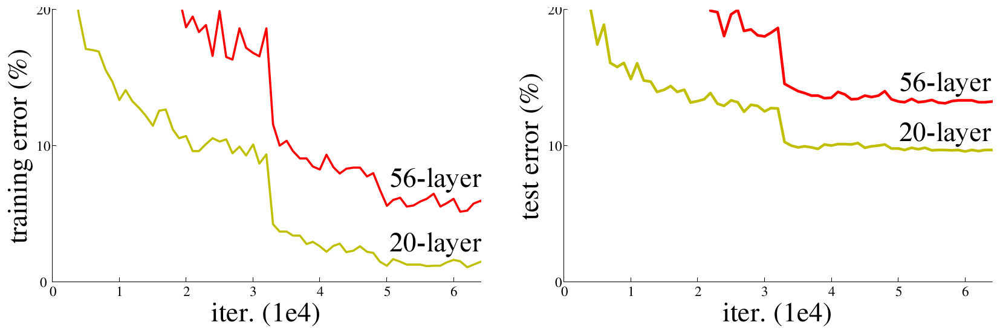
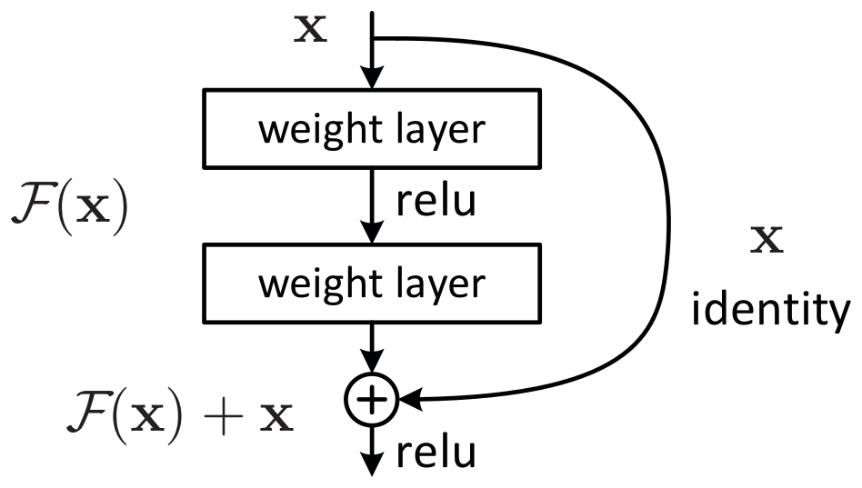
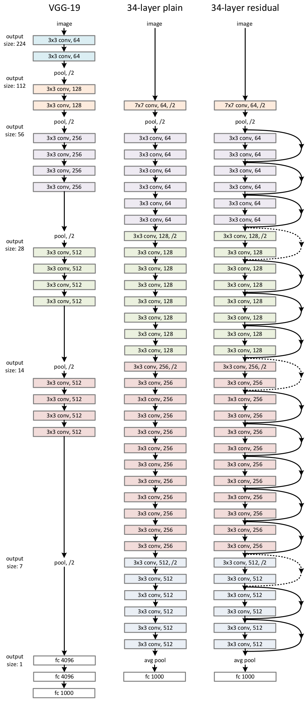
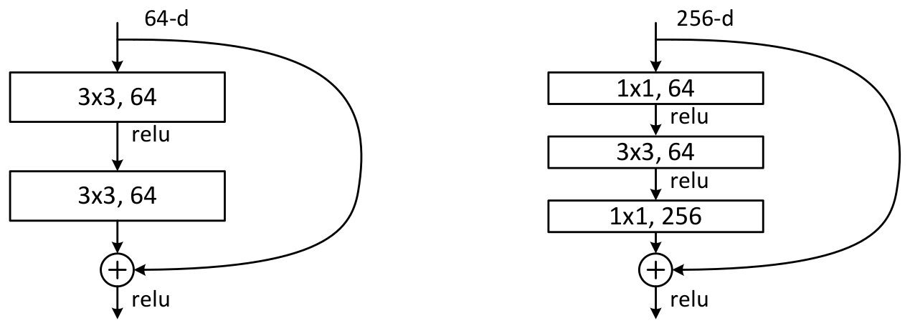
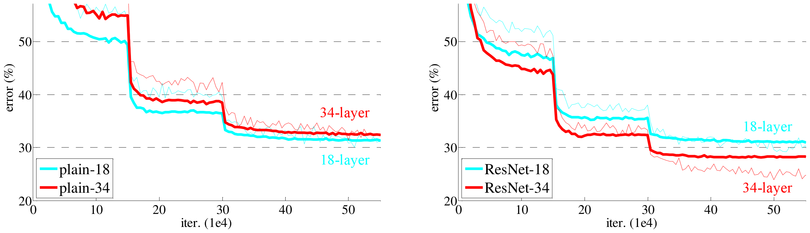
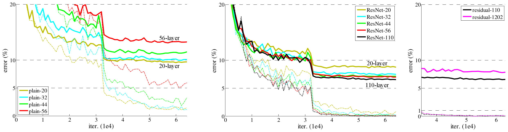
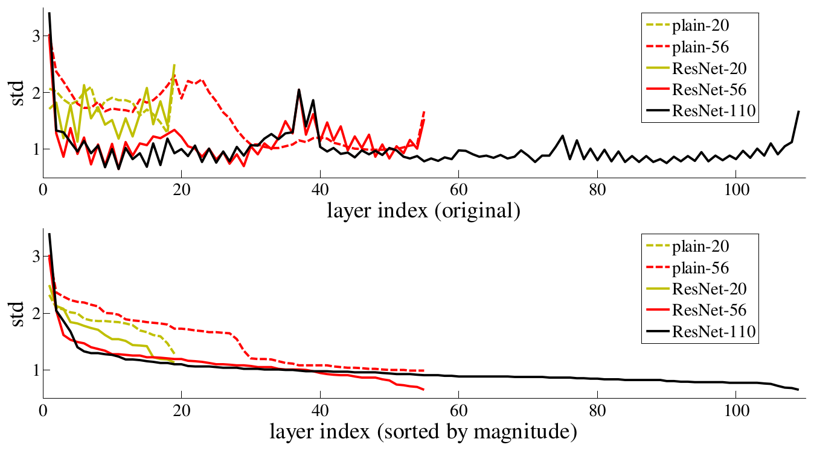

# 论文中文解读：《Deep Residual Learning for Image Recognition》

> **基本信息**：Kaiming He、Xiangyu Zhang、Shaoqing Ren、Jian Sun（Microsoft Research），arXiv:1512.03385（本文依据 v1，2015 年 12 月 10 日；会议版发表于 CVPR 2016）；论文原文 [官方页面](https://arxiv.org/abs/1512.03385)。
>
> **本文的读法**：图为从论文 PDF 中按图裁出的原图，表为逐格核对后的中文转录（数字、模型名、数据集名保持原样，表头译成中文）；从图上读出的近似数值都标了“约”。每张图后有中文图题、图中文字翻译和读图结论，因此不必再翻英文原文。附录里的检测与定位实验也并入对应章节；标明“本文推算”的内容（层数核对、FLOPs 验算等）是用原文数字自行算出的，原文没有直接写出。

## 一、一句话结论

更深的网络本应至少不比浅网络差，但实际训练时，当 plain 网络（直接堆叠卷积层、没有 shortcut 的对照网络）加深到一定程度，**训练误差**反而上升，这个现象叫**退化问题**（degradation problem），不是过拟合。论文的办法是**残差学习**：不让几层网络直接去拟合目标映射 $\mathcal{H}(x)$，而是让它们拟合残差 $\mathcal{F}(x):=\mathcal{H}(x)-x$，再用不含参数的**恒等 shortcut** 把输入加回来，输出 $\mathcal{F}(x)+x$。

主要结果：

- **ImageNet 分类**：34 层 plain 网络比 18 层更差，34 层 ResNet 则比 18 层好（10-crop，top-1 验证误差 25.03% 对 27.88%）；ResNet-152 单模型验证集 top-1 19.38%、top-5 4.49%（表 4）；6 个不同深度模型的集成在测试集上 top-5 为 3.57%，获 ILSVRC 2015 分类任务第一名（表 5）。
- **CIFAR-10**：110 层 ResNet 测试误差 6.43%（5 次中最好的一次，均值 6.61%）；1202 层的网络也能训练（训练误差低于 0.1%），但测试误差 7.93% 比 110 层差，原文归因于过拟合。
- **检测**：Faster R-CNN 里把 VGG-16 换成 ResNet-101，COCO 的 mAP@[.5, .95] 从 21.2 升到 27.2（绝对 +6.0，相对 +28%）；在 ILSVRC & COCO 2015 中还获得 ImageNet 检测、ImageNet 定位、COCO 检测、COCO 分割四项第一。

## 二、背景与动机

### 2.1 深度很重要，而传统障碍已经被缓解

卷积网络在图像分类上不断突破，网络把低、中、高层特征和分类器端到端地整合在一起，特征的“层次”可以靠堆叠层数（深度）来丰富。已有证据显示深度至关重要：ImageNet 上领先的结果都用了“很深”的模型，深度从 16 层（VGG）到 30 层（Ioffe & Szegedy 的 BN-Inception）。由此产生一个问题：**学到更好的网络，是否就像堆叠更多层一样容易？**

回答这个问题的一个障碍是臭名昭著的梯度消失/爆炸，它从一开始就妨碍收敛。但这个问题已经基本被**归一化的初始化**（He 初始化等）和**中间归一化层**（Batch Normalization，BN）解决，使几十层的网络能用带反向传播的 SGD 开始收敛。

### 2.2 退化问题（图 1）

当更深的网络已经能够开始收敛时，暴露出一个新问题：随着深度增加，准确率先饱和（这并不奇怪），然后迅速下降。出人意料的是，**这种下降不是过拟合造成的**：给一个已经足够深的模型再加层，会导致更高的**训练误差**（He & Sun 2015、Srivastava 等 2015 也报告过，本文做了充分验证）。



*图 1（原文 Figure 1，第 1 页）：在 CIFAR-10 上，20 层和 56 层“plain”网络的训练误差（左）与测试误差（右）。更深的网络训练误差更高，因此测试误差也更高。ImageNet 上的类似现象见图 4。*

**图中文字翻译与读法**：

- 左图纵轴 training error (%)（训练误差，0–20），右图纵轴 test error (%)（测试误差，0–20）；横轴都是 iter. (1e4)（迭代次数，单位 $10^4$，0 到约 6.4）。黄绿色曲线标 20-layer（20 层），红色曲线标 56-layer（56 层）。
- 曲线在约 3.2 和 4.8（$\times10^4$ 次迭代）处的陡降对应学习率两次除以 10（CIFAR 的训练日程，见 5.1 节）。
- **读图结论**（以下为从图上读出的近似值）：训练结束时，56 层的训练误差约 6%，而 20 层只有约 1.5%；测试误差 56 层约 13.3%，20 层约 9.7%。更深的网络在**训练集上**就更差，说明问题出在优化而不是过拟合。

### 2.3 构造性的解：为什么这个现象反常

考虑一个浅网络，以及在它后面再加若干层得到的深网络。深网络存在一个**按构造**得到的解：新加的层是恒等映射，其他层直接复制自训练好的浅模型。这个构造解的存在说明：深模型的训练误差**不应该**比浅模型更高。但实验表明，手头的求解器找不到比这个构造解同样好或更好的解（或者在可行时间内做不到）。

### 2.4 相关工作

- **残差表示**：VLAD 对相对于字典的残差向量编码，Fisher Vector 可看作它的概率版本；向量量化中编码残差向量比编码原向量更有效。在低层视觉和图形学里，求解偏微分方程的 Multigrid 方法把系统重写成多个尺度上的子问题，每个子问题负责更粗、更细尺度之间的残差解；层次基预处理（hierarchical basis preconditioning）也依赖表示两个尺度间残差的变量。这些方法比不了解解的残差性质的标准求解器收敛快得多，说明好的重新表述或预处理能简化优化。
- **shortcut 连接**：多层感知机早期的做法是加一条从网络输入连到输出的线性层；GoogLeNet 和 DSN 把若干中间层直接接到辅助分类器上来对付梯度消失/爆炸；还有用 shortcut 实现的对层响应、梯度和传播误差做中心化的方法；Inception 层本身包含一个 shortcut 分支和几个更深的分支。
- **Highway networks**（与本文同期）：带门控函数的 shortcut，门是依赖数据且含参数的，而本文的恒等 shortcut 是无参数的。当门被“关上”（趋于零）时，highway 网络的层表示的是**非残差**函数；而本文的形式始终学习残差函数，恒等 shortcut 永不关闭，所有信息始终通过，再加上要学习的额外残差函数。此外 highway 网络没有显示出极深（超过 100 层）带来的精度提升。

## 三、方法

### 3.1 残差学习

设 $\mathcal{H}(x)$ 是要由几层堆叠网络（不一定是整个网络）拟合的目标映射，$x$ 是这几层中第一层的输入。如果假设多个非线性层可以渐近地逼近复杂函数（原文脚注 2 说这个假设仍是开放问题），那么等价地可以假设它们能渐近逼近**残差函数** $\mathcal{H}(x)-x$（前提是输入输出维度相同）。所以不让堆叠层去逼近 $\mathcal{H}(x)$，而是显式地让它们逼近

$$
\mathcal{F}(x):=\mathcal{H}(x)-x,
$$

原来的函数就变成 $\mathcal{F}(x)+x$。两种形式都应该能渐近逼近目标函数，但**学起来的难易可能不同**。

这个重新表述来自退化问题的反直觉现象（图 1 左）。如果新加的层可以被构造成恒等映射，深模型的训练误差就不应高于浅模型。退化问题暗示求解器在用多个非线性层逼近恒等映射时可能有困难。采用残差表述后，**如果恒等映射是最优的，求解器只需把这些非线性层的权重推向零，就能逼近恒等映射**。

在实际情形里，恒等映射不太可能恰好最优，但这种重新表述可能有助于**预处理**（precondition）问题：如果最优函数更接近恒等映射而不是零映射，求解器围绕恒等映射找扰动，会比把它当作一个全新函数来学容易。作者用实验（图 7）说明，学到的残差函数一般响应较小，暗示恒等映射提供了合理的预处理。

### 3.2 用 shortcut 实现恒等映射（图 2）

对每几层堆叠网络应用残差学习。论文考虑的构建块（building block）定义为

$$
y=\mathcal{F}(x,\{W_i\})+x.
$$

这里 $x$ 和 $y$ 是所考虑层的输入和输出向量，函数 $\mathcal{F}(x,\{W_i\})$ 表示要学习的残差映射。对图 2 这个两层的例子，$\mathcal{F}=W_2\,\sigma(W_1x)$，其中 $\sigma$ 是 ReLU，为简化记号省略了偏置。$\mathcal{F}+x$ 由 shortcut 连接和逐元素加法完成。**第二个非线性放在加法之后**（即 $\sigma(y)$，见图 2）。



*图 2（原文 Figure 2，第 2 页）：残差学习：一个构建块。*

**图中文字翻译与读法**：

- 输入 $\mathbf{x}$ 从上方进入，走两条路：主路经过 weight layer（权重层，指卷积层或全连接层）、relu、再一个 weight layer，输出 $\mathcal{F}(\mathbf{x})$；另一条是右侧的弧线，标 $\mathbf{x}$ 和 identity（恒等），不经过任何层，直接绕到下方。
- 两路在 ⊕ 处逐元素相加，得到 $\mathcal{F}(\mathbf{x})+\mathbf{x}$，再过一个 relu 输出。
- **读图结论**：shortcut 不引入任何参数，也不增加计算量（加法可忽略），所以可以公平地比较“参数、深度、宽度、计算量都相同”的 plain 与残差网络。

**不含参数、不含计算**。式 (1) 的 shortcut 既不引入额外参数，也不增加计算复杂度。这不仅在实践中有吸引力，对 plain 与残差网络的比较也很重要：可以公平地比较同时具有相同参数数、深度、宽度和计算成本的 plain/残差网络（逐元素加法可忽略）。

**维度不一致时**。式 (1) 中 $x$ 与 $\mathcal{F}$ 的维度必须相等。如果不等（例如改变输入/输出通道时），可以通过 shortcut 做一个线性投影 $W_s$ 来匹配维度：

$$
y=\mathcal{F}(x,\{W_i\})+W_sx.
$$

原文也可以在式 (1) 里用方阵 $W_s$，但实验表明恒等映射已足以解决退化问题且更经济，所以 $W_s$ **只用于匹配维度**。

**$\mathcal{F}$ 的形式很灵活**。论文实验里的 $\mathcal{F}$ 有两层或三层（图 5），更多层也可以；但如果 $\mathcal{F}$ 只有一层，式 (1) 就近似于一个线性层 $y=W_1x+x$，没有观察到优势。公式虽然以全连接层写成，但同样适用于卷积层：$\mathcal{F}(x,\{W_i\})$ 可以表示多个卷积层，逐元素加法在两个特征图上逐通道进行。

**为什么说梯度“更直接”只是附带解释**。对式 (1) 求导有 $\partial y/\partial x=I+\partial\mathcal{F}/\partial x$（本文推算），恒等项给信息和梯度提供了一条直接通路。但要注意两点：（1）原文并不是靠“梯度消失”来立论的：第 4.1 节明确说 plain 网络的优化困难“不太可能由梯度消失造成”，因为这些 plain 网络用了 BN，保证前向信号方差非零，作者还验证了反向梯度的范数正常；原文的动机是上面说的预处理/更容易把残差推向零；（2）原文每个块的输出还要再过一次 ReLU（$\sigma(y)$），所以相邻块之间的通路并不是完全干净的恒等通路；把 shortcut 路径做成纯恒等是后来另一篇论文（pre-activation 的 ResNet）的改进，不属于本文。

### 3.3 网络结构

原文测试了各种 plain/残差网络，现象一致。为便于讨论，描述 ImageNet 的两个模型。

**Plain 网络**（图 3 中）。基线主要受 VGG 的设计思想启发（图 3 左）：卷积层大多是 $3\times3$ 滤波器，遵循两条简单规则：（i）对相同的输出特征图尺寸，各层有相同数量的滤波器；（ii）如果特征图尺寸减半，滤波器数量加倍，以保持每层的时间复杂度。下采样直接用步长为 2 的卷积层完成。网络以全局平均池化层和带 softmax 的 1000 路全连接层结束。图 3 中间的网络共有 34 个带权重的层。

这个模型的滤波器数更少、复杂度比 VGG 低：34 层基线有 36 亿 FLOPs（乘加），只有 VGG-19（196 亿 FLOPs）的 18%。

**残差网络**。在上述 plain 网络上插入 shortcut 连接（图 3 右），就把它变成对应的残差版本。当输入输出维度相同时，可以直接用恒等 shortcut（图 3 中的实线）。当维度增加时（图 3 中的虚线），考虑两个选项：

- **选项 A**：shortcut 仍做恒等映射，对增加出来的维度补零。不引入额外参数。
- **选项 B**：用式 (2) 的投影 shortcut 来匹配维度（用 $1\times1$ 卷积实现）。

两种选项下，当 shortcut 跨越两种尺寸的特征图时，都以步长 2 执行。



*图 3（原文 Figure 3，第 4 页）：ImageNet 的网络结构示例。左：作为参考的 VGG-19（196 亿 FLOPs）。中：有 34 个参数层的 plain 网络（36 亿 FLOPs）。右：有 34 个参数层的残差网络（36 亿 FLOPs）。虚线 shortcut 表示增加维度。表 1 给出了更多细节和其他变体。*

**图中文字翻译与读法**：

- 三列从左到右：VGG-19、34-layer plain、34-layer residual。每个方框是一层，如 3x3 conv, 64 表示 $3\times3$ 卷积、64 个滤波器；pool, /2 表示步长 2 的池化；/2 写在卷积后表示该卷积步长为 2；最底下是 avg pool（全局平均池化）、fc 4096 / fc 1000（全连接层）。最左的 output size（输出尺寸）标出各段特征图边长：224、112、56、28、14、7、1。
- **VGG-19**：2 层 64、2 层 128、4 层 256、4 层 512、4 层 512，每段之间有池化，最后是 fc 4096、fc 4096、fc 1000。
- **34 层 plain**：先是 7x7 conv, 64, /2（输出 112）、pool /2（输出 56）；然后 6 个 3x3 conv, 64（56×56）；3x3 conv, 128, /2 加 7 个 3x3 conv, 128（28×28，共 8 层）；3x3 conv, 256, /2 加 11 个 3x3 conv, 256（14×14，共 12 层）；3x3 conv, 512, /2 加 5 个 3x3 conv, 512（7×7，共 6 层）；最后 avg pool 和 fc 1000。层数核对（本文推算）：$1+6+8+12+6+1=34$。
- **34 层 residual**：层的排列与 plain 完全相同，只是每隔两层加一条 shortcut 弧线，共 $3+4+6+3=16$ 条；其中 3 条是虚线（出现在每段第一个块：128、256、512 通道的段首，维度增加、步长 2），其余 13 条是实线（恒等）。
- **读图结论**：残差网络与 plain 网络除 shortcut 外完全一致，所以二者的参数量、深度、宽度、计算量相同；VGG-19 的计算量（19.6 B FLOPs）约为 34 层网络（3.6 B）的 5.4 倍。

**表 1：ImageNet 的网络结构。** 方括号里是构建块，后面的 $\times n$ 是该块堆叠的个数；下采样由 conv3_1、conv4_1、conv5_1 以步长 2 完成。方括号里自上而下的行对应块内的层（下表用换行表示）。

| 层名 | 输出尺寸 | 18 层 | 34 层 | 50 层 | 101 层 | 152 层 |
|---|---|---|---|---|---|---|
| conv1 | 112×112 | 7×7, 64, stride 2 | 7×7, 64, stride 2 | 7×7, 64, stride 2 | 7×7, 64, stride 2 | 7×7, 64, stride 2 |
| （池化） | 56×56 | 3×3 max pool, stride 2 | 3×3 max pool, stride 2 | 3×3 max pool, stride 2 | 3×3 max pool, stride 2 | 3×3 max pool, stride 2 |
| conv2_x | 56×56 | [3×3, 64<br>3×3, 64] ×2 | [3×3, 64<br>3×3, 64] ×3 | [1×1, 64<br>3×3, 64<br>1×1, 256] ×3 | [1×1, 64<br>3×3, 64<br>1×1, 256] ×3 | [1×1, 64<br>3×3, 64<br>1×1, 256] ×3 |
| conv3_x | 28×28 | [3×3, 128<br>3×3, 128] ×2 | [3×3, 128<br>3×3, 128] ×4 | [1×1, 128<br>3×3, 128<br>1×1, 512] ×4 | [1×1, 128<br>3×3, 128<br>1×1, 512] ×4 | [1×1, 128<br>3×3, 128<br>1×1, 512] ×8 |
| conv4_x | 14×14 | [3×3, 256<br>3×3, 256] ×2 | [3×3, 256<br>3×3, 256] ×6 | [1×1, 256<br>3×3, 256<br>1×1, 1024] ×6 | [1×1, 256<br>3×3, 256<br>1×1, 1024] ×23 | [1×1, 256<br>3×3, 256<br>1×1, 1024] ×36 |
| conv5_x | 7×7 | [3×3, 512<br>3×3, 512] ×2 | [3×3, 512<br>3×3, 512] ×3 | [1×1, 512<br>3×3, 512<br>1×1, 2048] ×3 | [1×1, 512<br>3×3, 512<br>1×1, 2048] ×3 | [1×1, 512<br>3×3, 512<br>1×1, 2048] ×3 |
| 输出 | 1×1 | average pool, 1000-d fc, softmax | average pool, 1000-d fc, softmax | average pool, 1000-d fc, softmax | average pool, 1000-d fc, softmax | average pool, 1000-d fc, softmax |
| FLOPs | | 1.8×10⁹ | 3.6×10⁹ | 3.8×10⁹ | 7.6×10⁹ | 11.3×10⁹ |

（原文表 1，第 5 页；原表中 conv1 与最后一行的内容横跨所有列，这里在每列重复；“池化”一行原表写在 conv2_x 的区域内。）

**读法与核对**：

1. **18/34 层用“基本块”**（两个 $3\times3$ 卷积），**50/101/152 层用“瓶颈块”**（$1\times1$、$3\times3$、$1\times1$ 三个卷积，见下面图 5）。四个阶段 conv2_x 到 conv5_x 的特征图边长依次为 56、28、14、7，通道数在基本块里是 64、128、256、512，在瓶颈块里内部宽度同样是 64、128、256、512，输出通道是它的 4 倍（256、512、1024、2048）。
2. **层数核对（本文推算）**：带权重层数 = conv1（1）+ 每块层数 × 各阶段块数之和 + 最后的全连接层（1）。18 层：$1+2\times(2+2+2+2)+1=18$；34 层：$1+2\times(3+4+6+3)+1=34$；50 层：$1+3\times(3+4+6+3)+1=50$；101 层：$1+3\times(3+4+23+3)+1=101$；152 层：$1+3\times(3+8+36+3)+1=152$。投影 shortcut 里的 $1\times1$ 卷积不计入层数。
3. **FLOPs 核对（本文推算）**：按卷积和全连接的乘加数（不含 BN、ReLU、池化）自己算，18 层约 1.79 B、34 层约 3.64 B，与表中 1.8 和 3.6 吻合。50/101/152 层的结果取决于瓶颈块里步长 2 放在哪一层，原文没有写明：放在第一个 $1\times1$ 卷积上，算得约 3.86、7.57、11.28 B，与表中的 3.8、7.6、11.3 基本吻合；放在 $3\times3$ 卷积上则约为 4.09、7.80、11.51 B，对不上。所以原文很可能把下采样放在第一个 $1\times1$ 上（这是本文由 FLOPs 反推的判断；很多后来的实现把步长放在 $3\times3$ 上，复现原文数字时要留意）。
4. 152 层的 ResNet（11.3 B FLOPs）复杂度仍低于 VGG-16/19（15.3/19.6 B）。

### 3.4 更深的瓶颈结构（图 5）

因为担心能负担的训练时间，作者把构建块改成**瓶颈**（bottleneck）设计：对每个残差函数 $\mathcal{F}$，用 3 层堆叠而不是 2 层。三层分别是 $1\times1$、$3\times3$、$1\times1$ 卷积，其中两个 $1\times1$ 层负责先降低、再升回（恢复）维度，让 $3\times3$ 层成为输入/输出维度更小的瓶颈。



*图 5（原文 Figure 5，第 6 页）：为 ImageNet 设计的更深的残差函数 $\mathcal{F}$。左：图 3 中 ResNet-34 的构建块（在 $56\times56$ 特征图上）。右：ResNet-50/101/152 的“瓶颈”构建块。*

**图中文字翻译与读法**：

- **左图（基本块，64-d）**：输入 64-d（64 维通道）→ 3x3, 64 → relu → 3x3, 64 → ⊕（与从输入绕来的恒等 shortcut 相加）→ relu。
- **右图（瓶颈块，256-d）**：输入 256-d → 1x1, 64（降维）→ relu → 3x3, 64 → relu → 1x1, 256（升回）→ ⊕（与恒等 shortcut 相加）→ relu。
- **读图结论**：两种设计的时间复杂度相近（原文）。本文推算每块参数量（忽略 BN 与偏置）：基本块 $2\times3\times3\times64\times64=73{,}728$；瓶颈块 $256\times64+3\times3\times64\times64+64\times256=69{,}632$，确实相近；区别是瓶颈块处理的输入输出是 256 维而不是 64 维。原文采用瓶颈设计主要出于能负担的训练时间这一实际考虑（见下面脚注 4 的说明）。

**为什么恒等 shortcut 对瓶颈块特别重要**：如果把图 5 右的恒等 shortcut 换成投影，可以证明时间复杂度和模型大小都会翻倍，因为 shortcut 连接的是两个高维端点（本文推算：一个 $256\to256$ 的 $1\times1$ 投影有 65,536 个参数，几乎等于整个瓶颈块的 69,632）。所以恒等 shortcut 让瓶颈设计更高效。

**50/101/152 层的构造**：把 34 层网络里每个 2 层块换成 3 层瓶颈块得到 50 层 ResNet（表 1），增加维度时用选项 B，有 38 亿 FLOPs；用更多的 3 层块构造 101 层和 152 层 ResNet（表 1）。原文脚注 4 说：更深的非瓶颈 ResNet（如图 5 左）也能从加深中获得精度（在 CIFAR-10 上展示过），只是不如瓶颈 ResNet 经济，所以采用瓶颈设计主要出于实际考虑；plain 网络的退化问题在瓶颈设计下同样存在。

用文字写出两种块的前向过程（按原文 3.2、3.4 节“BN 紧跟每个卷积、在激活之前”和“第二个非线性在加法之后”整理）：

```text
基本块（用于 18/34 层）：
  out = ReLU(BN(conv3x3(x)))
  out = BN(conv3x3(out))
  out = out + shortcut(x)        # 维度相同：shortcut(x) = x
  y   = ReLU(out)                # 维度增加：选项 A 补零，或选项 B 用 1x1 卷积（步长 2）投影

瓶颈块（用于 50/101/152 层）：
  out = ReLU(BN(conv1x1(x)))     # 降维
  out = ReLU(BN(conv3x3(out)))
  out = BN(conv1x1(out))         # 升回，输出通道为内部宽度的 4 倍
  y   = ReLU(out + shortcut(x))
```

### 3.5 实现细节（原文第 3.4 节）

**ImageNet**：沿用 AlexNet 和 VGG 的做法。

- **图像处理**：图像缩放使短边在 [256, 480] 内随机采样（尺度增广）；从图像或其水平翻转里随机裁一个 $224\times224$ 的块，并减去逐像素均值；使用 AlexNet 的标准颜色增广。
- **BN 与初始化**：BN 紧跟每个卷积、在激活之前；按 He 等人（2015）的方法初始化权重，所有 plain/残差网络从头训练。
- **优化**：SGD，mini-batch 256；学习率从 0.1 开始，误差进入平台期就除以 10；最多训练 $60\times10^4$ 次迭代；权重衰减 0.0001，动量 0.9；不用 dropout。
- **测试**：做对比研究时用标准的 10-crop 测试；为取得最好结果，采用 VGG 和 He 等人的全卷积形式，并在多个尺度上平均得分（图像缩放使短边取 {224, 256, 384, 480, 640}）。

## 四、ImageNet 分类实验

数据集：ImageNet 2012 分类数据集，1000 类；在 128 万张训练图像上训练，在 5 万张验证图像上评测；另在 10 万张测试图像上通过测试服务器取得最终结果；报告 top-1 和 top-5 错误率。

### 4.1 Plain 网络：退化问题（表 2、图 4）

先评测 18 层和 34 层的 plain 网络（34 层的见图 3 中；18 层的形式类似，细节见表 1）。



*图 4（原文 Figure 4，第 5 页）：ImageNet 上的训练。细曲线表示训练误差，粗曲线表示中心裁剪的验证误差。左：18 层和 34 层的 plain 网络。右：18 层和 34 层的 ResNet。在这张图里，残差网络比对应的 plain 网络没有任何额外参数。*

**图中文字翻译与读法**：

- 两个子图横轴都是 iter. (1e4)（迭代次数，单位 $10^4$，0–55），纵轴 error (%)（误差，20–约 57）。图例：左图 plain-18（青色）、plain-34（红色）；右图 ResNet-18（青色）、ResNet-34（红色）。每条线有两根：细线是训练误差，粗线是验证误差（中心裁剪）。
- 曲线上两次陡降对应学习率两次除以 10（约在第 15 万和第 30 万次迭代，从图上读出）。
- **读图结论**（以下为从图上读出的近似值）：左图，plain-34（红）的验证误差最终约 32.4%，高于 plain-18（青）的约 31.3%，其训练误差（细红线）在整个训练过程中也高于 plain-18；右图，ResNet-34（红）的验证误差约 28.2%，低于 ResNet-18（青）的约 31.0%，训练误差（细红线，约 25%）也明显更低。图中的验证误差是中心裁剪结果，所以比表 2 的 10-crop 数字高。

**表：ImageNet 验证集 top-1 错误率（%，10-crop 测试）。** 这里的 ResNet 与对应 plain 网络**没有额外参数**。

| 层数 | plain | ResNet |
|---|---:|---:|
| 18 层 | 27.94 | 27.88 |
| 34 层 | 28.54 | **25.03** |

（原文表 2，第 5 页。）

**读法**：34 层 plain 网络的验证误差比 18 层的更高。要揭示原因，图 4（左）比较了它们训练过程中的训练/验证误差：观察到退化问题，**34 层 plain 网络在整个训练过程中的训练误差都更高，尽管 18 层 plain 网络的解空间是 34 层网络解空间的子空间**。

**这种优化困难不太可能由梯度消失造成**（原文论证）：这些 plain 网络用 BN 训练，BN 保证前向传播的信号有非零方差；作者也验证了反向传播的梯度在 BN 下范数正常，所以前向和反向信号都没有消失。事实上，34 层 plain 网络仍能取得有竞争力的精度（表 3），说明求解器在某种程度上还在起作用。作者推测，深的 plain 网络可能有**指数级低的收敛率**，影响了训练误差的降低；原因留待以后研究。原文脚注 3：把训练迭代数增加到 3 倍，仍然观察到退化问题，所以不能靠简单地多训练来解决。

### 4.2 残差网络（表 2、图 4 右）

接下来评测 18 层和 34 层的残差网络（ResNet）。基线结构与上面的 plain 网络相同，只是给每一对 $3\times3$ 滤波器加一个 shortcut（图 3 右）。第一轮比较（表 2 与图 4 右）对所有 shortcut 用恒等映射、增加维度时用补零（选项 A），因此与 plain 对照网络相比没有额外参数。

原文从表 2 和图 4 得到三点主要观察：

1. **局面反转**：残差学习下，34 层 ResNet 比 18 层 ResNet 好（好 2.8%，即 27.88 对 25.03）。更重要的是 34 层 ResNet 的训练误差显著更低，并且能泛化到验证数据。这表明在这种设置下退化问题得到了很好的解决，也成功地从增加的深度中获得了精度提升。
2. 与对应的 plain 网络相比，34 层 ResNet 把 top-1 误差降低了 3.5%（28.54 对 25.03），这是因为训练误差成功降低了（图 4 右对左）。这个比较验证了残差学习在极深系统上的有效性。
3. 18 层 plain 和残差网络精度相当（27.94 对 27.88），但 18 层 ResNet 收敛更快（图 4 右对左）。当网络“不是过深”（这里是 18 层）时，当前的 SGD 求解器仍能为 plain 网络找到好的解；这种情况下 ResNet 通过在早期提供更快的收敛来缓解优化。

### 4.3 恒等 shortcut 与投影 shortcut

前面表明无参数的恒等 shortcut 有助于训练。接下来研究投影 shortcut（式 2）。表 3 比较三种选项：

- **A**：增加维度时用补零 shortcut，所有 shortcut 都无参数（与表 2 和图 4 右相同）；
- **B**：增加维度时用投影 shortcut，其他 shortcut 是恒等；
- **C**：所有 shortcut 都是投影。

表 3 显示三个选项都明显优于对应的 plain 网络；B 略好于 A，作者的解释是 A 里补零的那些维度确实没有残差学习；C 略好于 B，作者把它归因于多个（13 个）投影 shortcut 引入的额外参数。但 A/B/C 之间的差别很小，说明**投影 shortcut 对解决退化问题不是必需的**。所以本文其余部分不用选项 C，以降低内存/时间复杂度和模型大小。恒等 shortcut 对不增加瓶颈结构的复杂度尤为重要。

**表：ImageNet 验证集上的错误率（%，10-crop 测试）。** VGG-16 是作者自己测的；ResNet-50/101/152 用选项 B（只在增加维度时用投影）。

| 模型 | top-1 错误率 | top-5 错误率 |
|---|---:|---:|
| VGG-16 | 28.07 | 9.33 |
| GoogLeNet | - | 9.15 |
| PReLU-net | 24.27 | 7.38 |
| plain-34 | 28.54 | 10.02 |
| ResNet-34 A | 25.03 | 7.76 |
| ResNet-34 B | 24.52 | 7.46 |
| ResNet-34 C | 24.19 | 7.40 |
| ResNet-50 | 22.85 | 6.71 |
| ResNet-101 | 21.75 | 6.05 |
| ResNet-152 | **21.43** | **5.71** |

（原文表 3，第 6 页；表中第一组（VGG-16、GoogLeNet、PReLU-net）是他人的结果，第二组是 34 层的 plain 与 ResNet 的 A/B/C 三种 shortcut，第三组是更深的 ResNet。）

**读法**：ResNet-34 的 A/B/C 依次从 25.03 降到 24.52、24.19（top-1），差别不到 1 个点，而 plain-34 为 28.54；随着深度从 34 增加到 50、101、152，top-1 从 24.52（B）降到 22.85、21.75、21.43，top-5 从 7.46 降到 6.71、6.05、5.71，没有出现退化。

### 4.4 更深的网络与最终结果（表 3、表 4、表 5）

50/101/152 层 ResNet 比 34 层的精度高出相当多（表 3、表 4）。**没有观察到退化问题，因此能从大幅增加的深度中获得显著精度提升**，深度的益处在所有评价指标上都能看到。

**与当时最好方法的比较**。表 4 把单模型结果与此前最好的单模型结果比较。34 层 ResNet 基线已有很有竞争力的精度；152 层 ResNet 的单模型 top-5 验证误差为 4.49%，**这个单模型结果超过了此前所有集成结果**（表 5）。作者把 6 个不同深度的模型组合成集成（提交时只有其中两个是 152 层），在测试集上得到 3.57% 的 top-5 误差（表 5），这个参赛结果获得了 ILSVRC 2015 的第一名。

**表：ImageNet 验证集上单模型的错误率（%）。** 带 † 的数字是在测试集上报告的。

| 方法 | top-1 错误率 | top-5 错误率 |
|---|---:|---:|
| VGG (ILSVRC’14) | - | 8.43† |
| GoogLeNet (ILSVRC’14) | - | 7.89 |
| VGG (v5) | 24.4 | 7.1 |
| PReLU-net | 21.59 | 5.71 |
| BN-inception | 21.99 | 5.81 |
| ResNet-34 B | 21.84 | 5.71 |
| ResNet-34 C | 21.53 | 5.60 |
| ResNet-50 | 20.74 | 5.25 |
| ResNet-101 | 19.87 | 4.60 |
| ResNet-152 | **19.38** | **4.49** |

（原文表 4，第 6 页。）

**表：集成模型的错误率（%）。** top-5 错误率是在 ImageNet 测试集上、由测试服务器报告的。

| 方法 | top-5 错误率（测试集） |
|---|---:|
| VGG (ILSVRC’14) | 7.32 |
| GoogLeNet (ILSVRC’14) | 6.66 |
| VGG (v5) | 6.8 |
| PReLU-net | 4.94 |
| BN-inception | 4.82 |
| ResNet (ILSVRC’15) | **3.57** |

（原文表 5，第 6 页。）

**读法与注意**：

1. **同一个模型在表 3 与表 4 的数字不同**：例如 ResNet-34 B 在表 3（10-crop）是 24.52/7.46，在表 4 是 21.84/5.71；ResNet-152 表 3 是 21.43/5.71，表 4 是 19.38/4.49。表 3 的题注写明 10-crop，表 4 的题注没有说明；按 3.5 节“为取得最好结果采用全卷积形式并做多尺度平均”理解，表 4 应使用了这种更强的测试方式（这是推断，原文未逐表说明）。因此两张表的数字不能混着比较。
2. “单模型 4.49% 超过此前所有集成结果”这句话比较的是验证集上的数字（4.49%）与表 5 里测试集上的数字（例如 BN-inception 的 4.82%），两者来自不同的数据划分，只能作粗略参考。
3. 表 4 中 VGG (ILSVRC’14) 的 8.43 是在测试集上报告的（标 †），其他行是验证集。

## 五、CIFAR-10 与分析

### 5.1 设置与结构

在 CIFAR-10 上做更多研究：50k 训练图像、10k 测试图像、10 类；在训练集上训练、在测试集上评测。关注的是极深网络的行为，而不是追求最好的结果，所以有意使用简单的结构。

- **输入**：$32\times32$ 图像，减去逐像素均值。
- **结构**：plain/残差结构遵循图 3（中/右）的形式。第一层是 $3\times3$ 卷积；然后是 $6n$ 层 $3\times3$ 卷积，分别放在尺寸为 $\{32,16,8\}$ 的特征图上，每种尺寸 $2n$ 层，滤波器数依次为 $\{16,32,64\}$；下采样由步长为 2 的卷积完成；网络最后是全局平均池化、10 路全连接层和 softmax。一共有 $6n+2$ 个带权重层。
- **shortcut**：连接在成对的 $3\times3$ 层上（共 $3n$ 个）。在这个数据集上所有情形都用恒等 shortcut（选项 A），所以残差模型与对应的 plain 模型有完全相同的深度、宽度和参数数。
- **训练**：权重衰减 0.0001、动量 0.9，采用 He 初始化和 BN，不用 dropout；在两块 GPU 上以 mini-batch 128 训练；学习率从 0.1 开始，在第 32k 和 48k 次迭代时除以 10，64k 次迭代时终止（这个日程由 45k/5k 的训练/验证划分确定）；数据增广沿用 Lee 等人的简单做法：每边补 4 个像素，再从补边后的图像或其水平翻转中随机裁 $32\times32$；测试时只评测原始 $32\times32$ 图像的单个视图。
- 比较 $n=\{3,5,7,9\}$，即 20、32、44、56 层网络。

| 输出特征图尺寸 | 32×32 | 16×16 | 8×8 |
|---|---:|---:|---:|
| 层数 | 1+2n | 2n | 2n |
| 滤波器数 | 16 | 32 | 64 |

（原文第 7 页正文中的结构小表。）按此可核对参数量（本文推算，含全连接层、不含 BN）：$n=3$（20 层）约 0.27M，$n=5$（32 层）约 0.46M，$n=7$（44 层）约 0.66M，$n=9$（56 层）约 0.85M，$n=18$（110 层）约 1.72M，$n=200$（1202 层）约 19.3M，与表 6 一致。

### 5.2 plain 与残差网络的行为（图 6）



*图 6（原文 Figure 6，第 8 页）：CIFAR-10 上的训练。虚线表示训练误差，粗实线表示测试误差。左：plain 网络；plain-110 的误差高于 60%，未显示。中：ResNet。右：110 层和 1202 层的 ResNet。*

**图中文字翻译与读法**：

- 三个子图的横轴都是 iter. (1e4)，纵轴 error (%)，水平虚线标在 5、10、20（右图还标 1）。**左图**图例 plain-20（黄绿）、plain-32（青）、plain-44（绿）、plain-56（红），图中标 56-layer、20-layer；**中图**图例 ResNet-20（黄绿）、ResNet-32（青）、ResNet-44（绿）、ResNet-56（红）、ResNet-110（黑），图中标 20-layer、110-layer；**右图**只画第 3.5 万次迭代之后，图例 residual-110（黑）、residual-1202（品红）。
- **读图结论**（plain 的数值为从图上读出的近似值，ResNet 的测试误差与表 6 一致）：
  - 左图：plain 网络越深，**训练误差越高**（虚线）：56 层约 6%、44 层约 3%，而 20 层和 32 层约 1%；测试误差也随深度上升：20、32、44、56 层约为 9.7%、10.1%、11.4%、13.1%。这与 ImageNet（图 4 左）和 MNIST 上的现象类似，说明这种优化困难是个基本问题。
  - 中图：ResNet 克服了优化困难，随深度增加精度提升：测试误差 20、32、44、56、110 层依次为 8.75%、7.51%、7.17%、6.97%、6.43%（表 6）；训练误差（虚线）都趋近于 0。
  - 右图：1202 层的训练误差与 110 层相近（都很低），但测试误差约 7.9%，比 110 层的约 6.4% 差。

**110 层的训练细节**：对 $n=18$ 的 110 层 ResNet，初始学习率 0.1 稍微偏大，网络难以开始收敛（脚注 5：用 0.1 起步时，几个 epoch 后误差降到 90% 以下才开始收敛，但最终仍达到相近的精度）。所以先用 0.01 来预热，直到训练误差低于 80%（约 400 次迭代），再回到 0.1 继续训练，其余日程不变。这个 110 层网络收敛良好（图 6 中）。

**表：CIFAR-10 测试集上的分类误差（%）。** 所有方法都使用了数据增广。ResNet-110 运行 5 次，按 Srivastava 等人的做法给出“最好（均值±标准差）”。

| 方法 | 层数 | 参数量 | 误差 |
|---|---:|---:|---|
| Maxout | | | 9.38 |
| NIN | | | 8.81 |
| DSN | | | 8.22 |
| FitNet | 19 | 2.5M | 8.39 |
| Highway | 19 | 2.3M | 7.54（7.72±0.16） |
| Highway | 32 | 1.25M | 8.80 |
| ResNet | 20 | 0.27M | 8.75 |
| ResNet | 32 | 0.46M | 7.51 |
| ResNet | 44 | 0.66M | 7.17 |
| ResNet | 56 | 0.85M | 6.97 |
| ResNet | 110 | 1.7M | **6.43**（6.61±0.16） |
| ResNet | 1202 | 19.4M | 7.93 |

（原文表 6，第 7 页。原表前三行（Maxout、NIN、DSN）没有层数和参数量。）

**读法**：

- ResNet-110 的 6.43% 是 5 次运行里最好的一次，均值是 6.61±0.16；Highway-19 同理（7.54 对 7.72±0.16）。比较时更稳妥的是看均值。
- 原文说 110 层网络的参数比 FitNet、Highway 这类“深而窄”的网络更少，但仍属于该数据集上最先进的结果（6.43%）。核对表 6：110 层的 1.7M 比 FitNet 的 2.5M 和 Highway-19 的 2.3M 少，但比 Highway-32 的 1.25M 多，所以这句话只对前两者成立。

### 5.3 层响应的分析（图 7）



*图 7（原文 Figure 7，第 8 页）：CIFAR-10 上各层响应的标准差（std）。响应是每个 $3\times3$ 层的输出，在 BN 之后、非线性之前。上：各层按原始顺序排列。下：各层的响应按幅度降序排列。*

**图中文字翻译与读法**：

- 两个子图纵轴都是 std（标准差，0–3.5）；上图横轴 layer index (original)（层序号，原始顺序，0–110），下图横轴 layer index (sorted by magnitude)（按幅度排序后的序号）。图例：plain-20（黄绿虚线）、plain-56（红虚线）、ResNet-20（黄绿实线）、ResNet-56（红实线）、ResNet-110（黑实线）。
- 要看的是什么：对 ResNet，这个量衡量的是**残差函数的响应强度**（因为取自每个 $3\times3$ 层加到 shortcut 之前、BN 之后、非线性之前的输出）；对 plain 网络是该层的响应。
- **读图结论**（以下为从图上读出的近似值）：ResNet 的响应总体上比对应的 plain 网络小：plain-56 在多数层约 1.0–2.3，而 ResNet-56 多在约 0.7–1.4；ResNet-110（黑线）大多在约 0.7–1.2。下图按幅度排序后可见 plain-56 整条曲线高于 ResNet-56。而且更深的 ResNet 响应更小（ResNet-20、56、110 对比）：层数更多时，单个层对信号的修改倾向于更小。
- 这些结果**支持 3.1 节的基本动机**：残差函数可能一般更接近零，比非残差函数更容易学。

### 5.4 探索超过 1000 层

作者尝试了一个激进的、超过 1000 层的深模型：取 $n=200$ 得到 1202 层网络，训练方式同上。方法没有显示出优化困难：这个 $10^3$ 量级层数的网络能取得低于 0.1% 的训练误差（图 6 右），测试误差也相当好（7.93%，表 6）。

但这种激进的深模型仍有**未解决的问题**：1202 层网络的测试结果比 110 层网络差，尽管两者的训练误差相近。作者认为这是因为过拟合：1202 层网络对这个小数据集可能没有必要这么大（19.4M 参数）；maxout 或 dropout 这类强正则化被用来在该数据集上取得最好结果，而本文不用 maxout/dropout，只通过设计的深而窄的结构来施加正则化，以不偏离“关注优化难点”这个重点。结合更强的正则化可能会改进结果，留待以后研究。

## 六、迁移：目标检测与定位

### 6.1 PASCAL VOC 与 COCO 上的检测基线（第 4.3 节）

论文说明方法在其他识别任务上泛化良好。检测方法采用 Faster R-CNN，关注的是**把 VGG-16 换成 ResNet-101** 带来的改进；两种模型的检测实现（见附录）相同，所以收益只能归因于更好的网络。

**表：PASCAL VOC 2007/2012 测试集上的目标检测 mAP（%），baseline Faster R-CNN。**

| 测试数据 | VOC 07 test | VOC 12 test |
|---|---:|---:|
| VGG-16 | 73.2 | 70.4 |
| ResNet-101 | **76.4** | **73.8** |

（原文表 7，第 8 页；训练数据分别是 07+12 和 07++12。）

**表：COCO 验证集上的目标检测 mAP（%），baseline Faster R-CNN。**

| 指标 | mAP@.5 | mAP@[.5, .95] |
|---|---:|---:|
| VGG-16 | 41.5 | 21.2 |
| ResNet-101 | **48.4** | **27.2** |

（原文表 8，第 8 页。）

**读法**：在 VOC 上 ResNet-101 比 VGG-16 的 mAP 高出超过 3 个点；在更有挑战性的 COCO 上，标准指标 mAP@[.5, .95] 提高 6.0 个点（21.2 到 27.2），相对提高 28%，这个提升完全来自学到的表示。值得注意的是，mAP@[.5, .95] 的绝对提升（6.0）几乎和 mAP@.5 的（6.9）一样大，说明更深的网络既改进了识别也改进了定位。（mAP@.5 是 PASCAL VOC 指标，IoU 阈值 0.5；mAP@[.5, .95] 是 COCO 的标准指标，对 IoU 从 0.5 到 0.95、步长 0.05 取平均。）

### 6.2 检测实现细节与竞赛改进（附录 A、B）

**基线 Faster R-CNN 的做法**（附录 A）：

- 模型由 ImageNet 分类模型初始化，再在检测数据上微调。ResNet 没有 VGG-16 那样的隐藏全连接层，所以采用“卷积特征图上的网络”（NoC）的思想：用步长不超过 16 像素的那些层（conv1、conv2_x、conv3_x、conv4_x，ResNet-101 里共 91 个卷积层，本文核对：$1+3\times3+4\times3+23\times3=91$）计算整图共享的卷积特征图，类比 VGG-16 的 13 个卷积层，这样两者的卷积特征图总步长相同（16 像素）；这些层由区域提议网络（RPN，生成 300 个提议）和 Fast R-CNN 检测网络共享。RoI 池化放在 conv5_1 之前；在 RoI 池化后的特征上，conv5_x 及以上的所有层对每个区域使用，起到 VGG-16 全连接层的作用；最终分类层换成两个并列层（分类和框回归）。
- **BN**：预训练后，在 ImageNet 训练集上计算每层的 BN 统计量（均值和方差），微调检测时固定 BN 层，这使 BN 成为带常数偏移和缩放的线性激活；主要为减少 Faster R-CNN 训练的显存占用。
- **VOC**：VOC 2007 测试集用 07 trainval 的 5k 张加 12 trainval 的 16k 张训练（“07+12”）；VOC 2012 测试集用 07 trainval+test 的 10k 张加 12 trainval 的 16k 张训练（“07++12”）；超参数与 Faster R-CNN 原文相同。
- **COCO**：80 个类别；评测 VOC 指标（mAP@IoU=0.5）和 COCO 标准指标（mAP@IoU=.5:.05:.95）；训练用 train 集的 8 万张，在 val 集的 4 万张上评测；用 8 GPU 实现训练，RPN 步的 mini-batch 是 8 张图（每 GPU 1 张），Fast R-CNN 步是 16 张；两步都先以学习率 0.001 训练 240k 次迭代，再以 0.0001 训练 80k 次迭代。

**竞赛中的改进**（附录 B，基于深度特征，所以应从残差学习中受益）：

1. **框精修（box refinement）**：推理时，对回归后的框重新池化一个新特征，得到新的分类得分和新的回归框，把这 300 个新预测与原来的 300 个预测合并；对并集做 NMS（IoU 阈值 0.3）和框投票。使 mAP 提高约 2 个点。
2. **全局上下文**：在 Fast R-CNN 步里用整图框作为 RoI 做“单层金字塔”的全局空间金字塔池化，得到全局特征，与每个区域的特征拼接后再送入分类和框回归层，端到端训练。使 mAP@.5 提高约 1 个点。
3. **多尺度测试**：在图像金字塔（短边 $s\in\{200,400,600,800,1000\}$）上计算卷积特征图；按 Ren 等人的做法选相邻两个尺度，把两个尺度上的特征用 maxout 合并；只在 Fast R-CNN 步做多尺度测试（RPN 步还没做），没有做多尺度训练（时间有限）。使 mAP 提高超过 2 个点。

**表：COCO 上用 Faster R-CNN 和 ResNet-101 的检测改进（mAP %）。** 左两列训练集为 COCO train、测试集为 COCO val；右两列训练集为 COCO trainval、测试集为 COCO test-dev。

| 系统 | val @.5 | val @[.5, .95] | test-dev @.5 | test-dev @[.5, .95] |
|---|---:|---:|---:|---:|
| baseline Faster R-CNN (VGG-16) | 41.5 | 21.2 | | |
| baseline Faster R-CNN (ResNet-101) | 48.4 | 27.2 | | |
| +box refinement（框精修） | 49.9 | 29.9 | | |
| +context（全局上下文） | 51.1 | 30.0 | 53.3 | 32.2 |
| +multi-scale testing（多尺度测试） | 53.8 | 32.5 | **55.7** | **34.9** |
| ensemble（集成） | | | **59.0** | **37.4** |

（原文表 9，第 11 页；空格是原文未给出。）读法：在 test-dev 上单模型是 55.7 / 34.9，3 个网络的集成是 59.0 / 37.4，这个结果获得了 COCO 2015 检测任务第一名。

**PASCAL VOC 的重访**：在上述模型基础上，把 COCO 上的单模型（55.7% mAP@.5）再在 PASCAL VOC 数据上微调，并采用框精修、上下文和多尺度测试的改进（原文记作 baseline+++），得到 VOC 2007 的 85.6% mAP 和 VOC 2012 的 83.8% mAP；VOC 2012 的结果比此前最好结果高 10 个点。

| 系统 | 网络 | 训练数据 | VOC 2007 test mAP | 训练数据 | VOC 2012 test mAP |
|---|---|---|---:|---|---:|
| baseline | VGG-16 | 07+12 | 73.2 | 07++12 | 70.4 |
| baseline | ResNet-101 | 07+12 | 76.4 | 07++12 | 73.8 |
| baseline+++ | ResNet-101 | COCO+07+12 | **85.6** | COCO+07++12 | **83.8** |

（原文表 10、表 11，第 11 页；原表还给出 20 个类别的逐类 AP，本文不转录，只摘 mAP 列。）

**ImageNet 检测（DET，200 类，mAP@.5）**：检测算法与 COCO 的相同（表 9）；网络先在 1000 类 ImageNet 分类集上预训练，再在 DET 数据上微调；把验证集按 Girshick 等人的方式分为 val1/val2，用 DET 训练集加 val1 微调，val2 用于验证，不用其他 ILSVRC 2015 数据。

| 方法 | val2 | test |
|---|---:|---:|
| GoogLeNet (ILSVRC’14) | - | 43.9 |
| our single model (ILSVRC’15) | 60.5 | 58.8 |
| our ensemble (ILSVRC’15) | **63.6** | **62.1** |

（原文表 12，第 11 页。）读法：单模型 ResNet-101 在 DET 测试集上 58.8% mAP，3 个模型的集成 62.1%，获得 ImageNet 检测任务第一名，比第二名高 8.5 个点（绝对值）。

### 6.3 ImageNet 定位（附录 C）

**任务与做法**：ImageNet 定位（LOC）任务要同时分类和定位物体。沿用 OverFeat 和 VGG 的设定：假设先用图像级分类器预测类别标签，定位算法只负责在预测的类别下预测边界框；采用“每类回归”（per-class regression，PCR）：为每个类别学一个边界框回归器。先预训练 ImageNet 分类网络，再微调做定位。

**RPN 的改动**：基于 Faster R-CNN 的 RPN 框架，但与原来类别无关的 RPN 不同，这里的 RPN 是**每类形式**：RPN 末端是两个并列的 $1\times1$ 卷积层，分别做二分类（cls）和框回归（reg），都是每类形式。具体说，cls 层输出 1000 维，每一维是预测“是不是该类物体”的二元逻辑回归；reg 层输出 $1000\times4$ 维，是 1000 个类别的框回归器。边界框回归参考每个位置的多个平移不变“锚框”。训练时和分类训练一样随机采样 $224\times224$ 的裁剪做数据增广，用 mini-batch 256 张图微调；为避免负样本占优势，每张图随机采样 8 个锚框，正负锚框比例 1:1；测试时网络全卷积地应用在图像上。

**R-CNN 精修**：作者注意到这个数据集里一张图通常含一个占主导的物体，提议区域高度重叠、RoI 池化后的特征非常相似，导致 Fast R-CNN 的“以图像为中心”训练产生变化很小的样本，这对随机训练不理想。因此这里用以 RoI 为中心的原始 R-CNN 代替 Fast R-CNN：对训练图像用上面训练好的每类 RPN 预测真值类别的边界框，作为类别相关的提议；每张训练图取得分最高的 200 个提议作为 R-CNN 的训练样本，把提议区域裁出并变形到 $224\times224$ 后送入分类网络；这个网络的输出是 cls 和 reg 两个并列的每类形式的全连接层，用 mini-batch 256 微调。测试时 RPN 为每个预测类别生成得分最高的 200 个提议，R-CNN 网络更新这些提议的得分和位置。

**表：ImageNet 验证集上的定位误差（%）。** “LOC error on GT class”列使用真值类别；“testing”列里 1-crop 指 $224\times224$ 中心裁剪，dense 指稠密（全卷积）多尺度测试。

| LOC 方法 | LOC 网络 | 测试方式 | 用真值类别时的 LOC 误差 | 分类网络 | 用预测类别时的 top-5 LOC 误差 |
|---|---|---|---:|---|---:|
| VGG’s | VGG-16 | 1-crop | 33.1 | | |
| RPN | ResNet-101 | 1-crop | 13.3 | | |
| RPN | ResNet-101 | dense | 11.7 | | |
| RPN | ResNet-101 | dense | | ResNet-101 | 14.4 |
| RPN+RCNN | ResNet-101 | dense | | ResNet-101 | **10.6** |
| RPN+RCNN | ensemble | dense | | ensemble | **8.9** |

（原文表 13，第 12 页；VGG 一行的 33.1 来自 VGG 论文；空格是原文未给出。）

**表：ImageNet 上定位误差与当时最好方法的比较（top-5 定位误差，%）。**

| 方法 | val | test |
|---|---:|---:|
| OverFeat (ILSVRC’13) | 30.0 | 29.9 |
| GoogLeNet (ILSVRC’14) | - | 26.7 |
| VGG (ILSVRC’14) | 26.9 | 25.3 |
| ours (ILSVRC’15) | **8.9** | **9.0** |

（原文表 14，第 12 页。）

**读法**：先做“oracle”测试，即用真值类别作分类预测（沿用 VGG 的设置）：VGG 报告中心裁剪误差 33.1%，同一设置下 ResNet-101 的 RPN 方法把它降到 13.3%；用稠密多尺度测试进一步到 11.7%。改用 ResNet-101 预测类别（4.6% 的 top-5 分类误差，表 4）后，top-5 定位误差是 14.4%（只用 RPN）。加上 R-CNN 精修后降到 10.6%（单模型、验证集）；对分类和定位都用集成，测试集上的 top-5 定位误差为 9.0%，相对 ILSVRC’14 的结果（25.3%）下降 64%（本文核对：$(25.3-9.0)/25.3\approx64.4\%$），获得 ImageNet 定位任务第一名。

## 七、局限、证据边界与常见误读

- **优化问题，而不是过拟合**：退化现象体现在训练误差上；对 1202 层网络，原文反而认为测试误差上升是过拟合。残差连接主要改变函数的参数化和优化行为，并不是一种防过拟合手段。
- **不是“解决梯度消失”**：原文明确说 plain 网络的优化困难不太可能由梯度消失引起（有 BN，并检查了梯度范数）；给出的解释是求解器难以让多个非线性层逼近恒等映射、以及“指数级低的收敛率”的猜测，后者没有被验证（原文自己说原因“留待以后研究”）。
- **残差并不保证任意深度都易训练**：1202 层的训练误差很低但测试误差比 110 层差；原文提到未来可结合更强的正则化。归一化、初始化、宽度与优化器仍然关键（本文所有实验都用了 BN 和 He 初始化）。
- **ResNet 的优势取决于测试协议**：表 3 是 10-crop，表 4 的数字来自更强的协议（推断为全卷积多尺度）；3.57% 是 6 个不同深度模型的集成（并且按 3.5 节的说法，最好结果用全卷积多尺度测试），不是单模型。
- **“ResNet-110 的 6.43%”是 5 次中最好的一次**，均值是 6.61±0.16。
- **检测与定位结果带有大量工程改进**：表 9、表 12–14 的最好数字包含框精修、全局上下文、多尺度测试和集成，不能全部算作“把 VGG 换成 ResNet”的收益；纯网络替换的收益是表 7、表 8 里的基线对比（VOC +3 点，COCO +6.0 点）。
- **复杂度的说法**：原文说 152 层 ResNet 的复杂度（11.3B FLOPs）低于 VGG-16/19（15.3/19.6B FLOPs）；这里说的是 FLOPs，原文没有给出 ImageNet 模型的参数量。
- **后续改进不要倒写进原文**：原文的块是“卷积 → BN → ReLU … 加法 → ReLU”（BN 紧跟卷积、第二个 ReLU 在加法之后）；把 BN 和 ReLU 移到卷积之前、使 shortcut 路径成为纯恒等映射的 pre-activation ResNet 是后来的另一篇工作。
- 原文称“方法是通用的，期望适用于其他视觉和非视觉问题”，但论文本身的实验只涵盖图像分类、检测、定位和分割竞赛（分割只在摘要和引言中提到名次，正文没有给出分割方法或结果）。

## 八、复现检查清单

- **区分基本块与瓶颈块**：18/34 层是两个 $3\times3$；50/101/152 层是 $1\times1$-$3\times3$-$1\times1$，输出通道是内部宽度的 4 倍。各阶段块数见表 1（18：2/2/2/2；34：3/4/6/3；50：3/4/6/3；101：3/4/23/3；152：3/8/36/3）。
- **下采样位置**：由 conv3_1、conv4_1、conv5_1 以步长 2 完成，conv2_x 之前有 $3\times3$ 最大池化（步长 2）。瓶颈块里步长 2 放在哪个卷积，原文没写；按 FLOPs 反推更像放在第一个 $1\times1$（见 3.3 节核对）。
- **维度变化时的 shortcut**：选项 A（补零恒等，无参数）用于 plain/ResNet 18、34 层的对比和 CIFAR 实验；选项 B（只在增加维度处用 $1\times1$ 卷积投影，步长 2）用于 50/101/152 层；选项 C（全部投影）只是对比。
- **plain 与残差的对照**要保持深度、宽度、参数量、初始化、BN、优化器、学习率日程一致；必须看**训练误差**，才能验证退化问题和残差学习的效果。
- **ImageNet 训练**：短边在 [256, 480] 内随机缩放，$224\times224$ 随机裁剪加翻转、逐像素均值减法、AlexNet 颜色增广；BN 在每个卷积之后、激活之前；He 初始化；SGD、batch 256、学习率 0.1 起、平台期除以 10、权重衰减 0.0001、动量 0.9、不用 dropout，最多约 $60\times10^4$ 次迭代。
- **ImageNet 评测**：10-crop 用于对比研究；报告最好结果时用全卷积、多尺度（短边 {224, 256, 384, 480, 640}）平均；要说明用的是哪一种。
- **CIFAR-10**：$6n+2$ 层；通道 16/32/64；恒等 shortcut（选项 A）；batch 128，学习率 0.1，在 32k、48k 次迭代除以 10，64k 次终止；每边补 4 像素再随机裁剪；110 层需先用 0.01 预热约 400 次迭代直到训练误差低于 80%。
- **检测**：用 Faster R-CNN；ResNet-101 的 conv4_x 及以前共 91 层作为共享特征，conv5_x 放在 RoI 池化之后；BN 统计量用 ImageNet 训练集计算并固定。

## 九、与其他论文的关系

- **VGG**：plain 基线沿用 VGG 的设计原则（大量 $3\times3$ 卷积、尺寸减半则通道加倍）；图 3、表 3、表 4 里 VGG-16/19 是主要对比对象；ResNet-152 的计算量低于 VGG-16/19。
- **GoogLeNet / Inception、BN**：原文用 BN-inception 做对比，并把 BN 作为解决梯度消失/爆炸的手段。
- **Highway networks**：同期的带门控 shortcut，本文的恒等 shortcut 无参数、永不关闭。
- **Transformer**：每个子层的“残差连接加层归一化”继承了这个思想，见 [Transformer 解读](../transformer/论文中文解读.md)。
- **扩散模型**：[DDPM 解读](../ddpm/论文中文解读.md) 的 U-Net 和 [DiT 解读](../dit/论文中文解读.md) 的主干同样大量使用残差连接；U-Net 里还有跨尺度的 skip connection，这是 shortcut 的另一种用法。

## 原文证据导航

- [原论文 PDF](paper.pdf)
- [原文提取文本](paper.txt)
- [论文概要](论文概要.md)
