# 论文中文解读：《Roller: Fast and Efficient Tensor Compilation for Deep Learning》

> **基本信息**：Hongyu Zhu、Ruofan Wu、Yijia Diao、Shanbin Ke、Haoyu Li、Chen Zhang、Jilong Xue、Lingxiao Ma、Yuqing Xia、Wei Cui、Fan Yang、Mao Yang、Lidong Zhou、Asaf Cidon、Gennady Pekhimenko（University of Toronto / Microsoft Research / 中国人民大学 / 上海交通大学 / UCSD / Columbia University / 清华大学），OSDI 2022（USENIX，2022 年 7 月，Carlsbad）；官方页面 [USENIX OSDI '22](https://www.usenix.org/conference/osdi22/presentation/zhu)，PDF [osdi22-zhu.pdf](https://www.usenix.org/system/files/osdi22-zhu.pdf)；开源代码 [microsoft/nnfusion（osdi22_artifact 分支）](https://github.com/microsoft/nnfusion/tree/osdi22_artifact/artifacts)。
>
> **本地文件说明**：本目录原先的 `paper.pdf` 与 `paper.txt` 误放成了另一篇天文学论文（Ishchenko 等，arXiv:2201.12040，旧版概要里的 arXiv 链接也指向它），现已替换为 USENIX OSDI '22 官方 PDF（osdi22-zhu.pdf）及其提取文本。本文所有图、表、数字都取自该 PDF 并逐项核对，文中的页码指 PDF 页码（括号内为论文页脚页码，等于 PDF 页码加 231）。
>
> **本文的读法**：图为从官方 PDF 中按图裁出的原图，表和代码为逐项核对后的中文转录（数字与原文一致，表头翻译为中文）；每张图后有中文图题、图例/坐标轴翻译和读图结论，因此不必再翻英文版。图中读出的近似数值都写作“约”，原文正文给出的数字优先。

## 一、一句话结论

现有张量编译器（TVM/AutoTVM、Ansor 等）把一个 DNN 算子看成多层嵌套循环，要在含数百万种选择的组合空间里用机器学习算法搜索，每一步都要在真实加速器上测量，编译一个算子要小时级、一个模型要几天甚至几周。

Roller 换了一条“构造”而不是“搜索”的路：

1. 把算子计算看成**数据处理流水线**——把数据 tile（张量的一小块）依次 Load、Compute、Store；
2. 提出 **rTile**：与硬件特性（执行单元宽度、访存事务长度、memory bank）和张量形状**对齐**的 tile 抽象，对齐约束把可选的 tile 形状大幅缩小；
3. 用递归的 **scale-up-then-scale-out** 构造算法生成 **rProgram**：先在单个执行单元（如一个 SM）上从小到大放大 rTile 直到饱和，再把结果复制到所有并行执行单元；
4. 因为 tile 已对齐，性能可以由硬件规格和一次性微基准直接推算（**微性能模型**），不必逐个上真机，也不需要复杂的 cost model。

结果（作者实验，6 类共 119 个算子）：在 V100 上，最耗时的算子也只需 43 秒，其余约 13 秒；top-1 内核平均 0.43 秒，比 TVM/Ansor 快三个数量级以上。内核性能与厂商库、Ansor 相当，在一半以上的算子上更好；小算子、不规则形状和 3×3 以上卷积是弱项。端到端模型（V100）上，BERT-Large 与 LSTM 最快，ResNet 与 NASNet 略慢于 TF/TF-XLA/TF-TRT，但编译只要 298 到 668 秒，而 Ansor 要 11.3 到 41.8 小时。同一套 rTile 抽象还能适配 AMD GPU 和 Graphcore IPU。

## 二、背景与动机

### 2.1 编译太慢

- Ansor 对本文的一组算子（设置见第五节）平均每个算子耗时 0.65 小时（原文第 2 节的说法；第 5.1 节另写 TVM 平均 0.65 小时、Ansor 平均 0.66 小时，二者相差无几），其中 ResNet 里的一个卷积要 2.17 小时。一个 DNN 模型含数百个算子，编译就是几天。例如编译 NASNet，调了 41.8 小时也只完成总搜索进度的 32%。
- 在不成熟的设备（如 AMD GPU、Graphcore IPU）上更慢。
- 模型的结构、算子类型、张量形状或配置一变就要重新编译，而训练和推理里经常尝试不同配置，所以编译速度直接拖慢整个 DNN 开发周期。

### 2.2 观察：算子是一条数据处理流水线（图 1）

以矩阵乘 $C_{m,n}=A_{m,k}\times B_{k,n}$ 为例。多数编译器把它当作三层循环（轴 $m,k,n$）；Roller 的观察是它同样可以看成流水线：从 $A$ 和 $B$ 各 **Load** 一个子矩阵（tile），**Compute** 这两个 tile，再把结果 tile **Store** 到 $C$。因此性能取决于数据 tile 在 Load–Compute–Store 流水线里能搬运多快；影响每一步性能的关键因素是 **tile 的形状**以及它在一维内存空间里对应的布局。

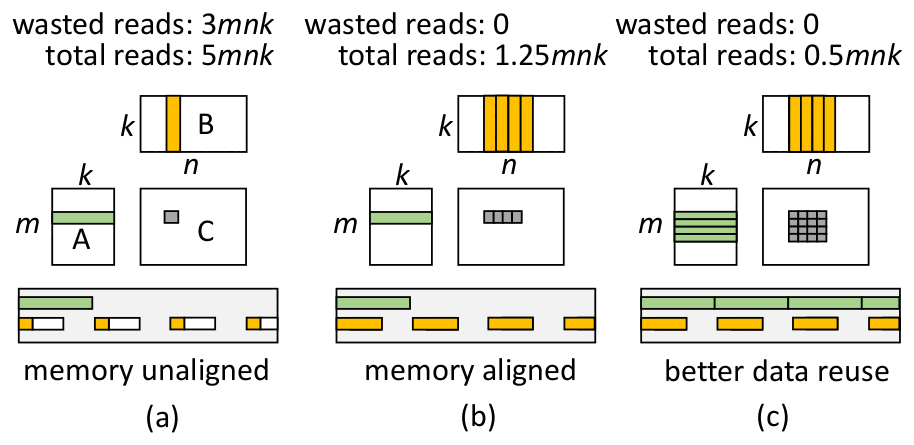

*图 1（原文 Figure 1，官方 PDF 第 3 页，论文页码 234）：不同 tile 形状的访存模式。矩阵乘 $C_{m,n}=A_{m,k}\times B_{k,n}$。*

**图中文字翻译与读法**：三幅小图的上方分别写着 wasted reads（浪费的读取量）和 total reads（总读取量）；每幅图里 $A$ 是 $m\times k$、$B$ 是 $k\times n$、$C$ 是 $m\times n$；绿色条是从 $A$ 读入的行，黄色条是从 $B$ 读入的列，灰色小方块是本次计算的输出 tile；下方灰色长条是内存事务，白色部分表示浪费。

- **(a) memory unaligned（访存未对齐）**：一次只算 $C$ 的一个元素（$1\times1$ tile）。假设矩阵按行主序存放，读 $B$ 的一列是步长为 1 的跳读，若内存事务长度为 4，则每次事务读入的 4 个元素只有 1 个有用，3/4 是冗余读取。wasted reads: $3mnk$，total reads: $5mnk$（有用的是 $A$ 的 $mnk$ 与 $B$ 的 $mnk$，共 $2mnk$；$B$ 因事务浪费实际读了 $4mnk$，加上 $A$ 的 $mnk$ 共 $5mnk$）。
- **(b) memory aligned（访存对齐）**：改成每次算 $1\times4$ 的输出 tile，对 $B$ 读 $1\times4$ 的块，正好填满一个事务，没有带宽浪费；同时 $A$ 的一次读取可复用 4 次。wasted reads: 0，total reads: $1.25mnk$。
- **(c) better data reuse（更好的数据复用）**：把沿 $M$ 方向的 tile 也放大到 $4\times4$，总读取量降到 $0.5mnk$，比 (a) 减少 $10\times$。

**读图结论**：tile 形状同时影响三件事——(1) 与内存事务长度对齐才不浪费带宽，(2) 与硬件执行单元（如并行线程数）对齐才不浪费计算周期，(3) 决定缓存里的数据复用机会。（本文补充的验算：对 $i\times j$ 的输出 tile，读 $A$、$B$ 的总量是 $mnk\,(1/i+1/j)$，代入 $1\times1$、$1\times4$、$4\times4$ 恰好得到 $2mnk$、$1.25mnk$、$0.5mnk$，与图中数字一致。）

### 2.3 三个洞见

1. **算子是数据 tile 在抽象硬件（并行执行单元 + 多层存储）上的流水线**，生成高效内核的目标就是提高流水线吞吐。
2. **tile 形状要与硬件特性对齐**——包括 memory bank、内存事务长度、最小可调度单元（如 GPU 的 warp 大小）。要同时对齐多种硬件特性，可选的 tile 形状本来就很有限；而且以“对齐”为约束时，要最大化流水线吞吐，只需构造一个**能让执行单元饱和**的对齐 tile 形状。这比求解原来无约束的组合优化问题高效得多。
3. **对齐后的流水线性能高度可预测**：对齐流水线下的关键指标（如内存吞吐）可以从硬件规格（或微基准测量）直接推出，因此不需要复杂的 cost model，也不必对每个对齐配置做昂贵的硬件实测。

## 三、系统设计

### 3.1 总览（图 2）

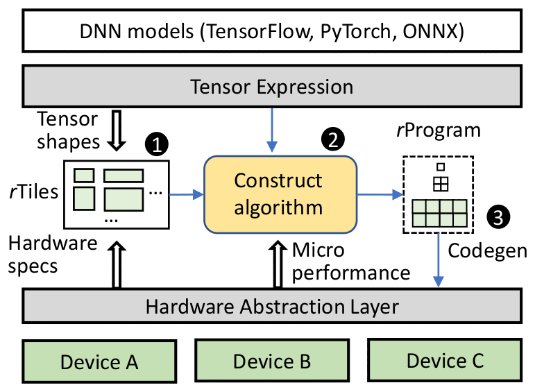

*图 2（原文 Figure 2，官方 PDF 第 4 页，论文页码 235）：Roller 系统总览。*

**图中文字翻译与读法**（自上而下）：

- 最上方 DNN models (TensorFlow, PyTorch, ONNX)（DNN 模型）→ **Tensor Expression**（张量表达式）；表达式由用户编写，或来自图级编译器（TVM、Rammer、Ansor 等），后者可能已把多个算子融合成一个表达式。
- 标号 ❶：Roller 从表达式中取出 Tensor shapes（张量形状），再结合 Hardware specs（硬件规格），构造 **rTiles**（与硬件对齐的构件）。
- 标号 ❷：**Construct algorithm**（构造算法）接收 Tensor Expression 和 rTiles，通过 **Micro performance**（微性能模型，来自 Hardware Abstraction Layer 硬件抽象层）评估所构造的 rProgram，找出好的 rTile 配置。
- 标号 ❸：输出 **rProgram**，经 Codegen（代码生成）生成对应设备的内核代码。
- 底部 Hardware Abstraction Layer（硬件抽象层）之下是 Device A / B / C（不同加速器）。HAL 只暴露与 rTile 相关的接口 Load、Compute、Store。

### 3.2 张量表达式与 rTile

Roller 的输入是索引形式的 lambda 表达式，即**张量表达式**（tensor expression），描述输出张量每个元素如何由输入张量的对应元素算出。例如输出为 $M\times N$ 的矩阵乘：

```text
C = compute((M,N), lambda i,j:sum(A[i,k]*B[k,j])),
```

其中 $(i,j)$ 位置的元素是对 $A$ 的第 $i$ 行与 $B$ 的第 $j$ 列沿归约轴 $k$ 求和。这种表达式能覆盖 DNN 里的大多数算子，也被 TVM、Ansor、FlexTensor 广泛使用。

Roller 引入 **RollingTile（rTile）** 作为组成张量计算的基本计算单元。数据结构如下（原文图 3，官方 PDF 第 4 页）：

```cpp
class rTile {
  TensorExpr expr;
  TileShape shape;
  TileShape storage_padding;
  vector<TileShape> GetInputDataTiles();
  vector<TileShape> GetOutputDataTiles();
};
```

- `expr`：所针对的张量表达式；
- `shape`：沿该表达式每个循环轴定义的多维 tile 形状，是 rTile 的**逻辑形态**；
- `storage_padding`：每个轴上的存储填充大小，是 rTile 的**物理布局**（用于避免 bank 冲突，见下）；
- 给定 `shape` 和 `expr`，rTile 可以**静态推出**涉及的输入、输出数据 tile（`GetInputDataTiles`、`GetOutputDataTiles`）。

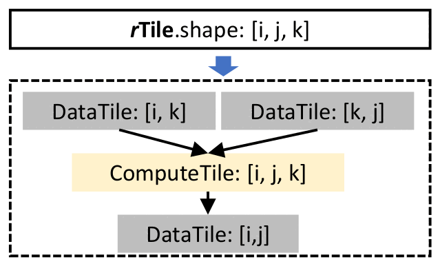

*图 4（原文 Figure 4，官方 PDF 第 4 页，论文页码 235）：由 rTile 为矩阵乘表达式推出的数据 tile 与计算 tile。*

**图中文字翻译与读法**：最上面 rTile.shape: [i, j, k]（rTile 的形状，沿 $i,j,k$ 三个轴）；向下推出两个输入 DataTile（数据 tile）：[i, k]（来自 $A$）和 [k, j]（来自 $B$）；两者汇入 ComputeTile（计算 tile）：[i, j, k]；输出 DataTile：[i, j]（写入 $C$）。

**读图结论**：例如 tile 形状 $[4,4,2]$（沿 $i,j,k$）表示：每个 rTile 从 $A$ 读 $4\times2$ 的数据 tile，从 $B$ 读 $2\times4$ 的数据 tile，做共 $4\times4\times2$ 次乘加，把 $4\times4$ 的结果 tile 写入 $C$。

### 3.3 rTile 的四类对齐（图 5）

rTile 的独特性质是：它的 shape 必须同时与**底层硬件特性**和**输入张量表达式的形状**对齐。所有这些对齐都由 `shape` 与 `storage_padding` 两个字段控制。

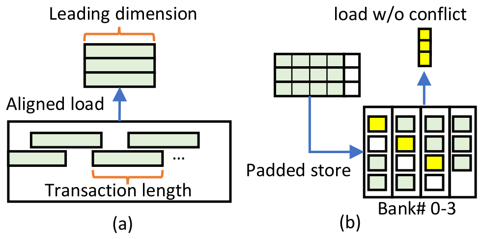

*图 5（原文 Figure 5，官方 PDF 第 5 页，论文页码 236）：（a）按访存事务对齐的读取，（b）无 bank 冲突的填充。*

**图中文字翻译与读法**：

- **(a)**：下方框内是内存里的若干事务（Transaction length，事务长度）；上方是被 Aligned load（对齐读取）取出的数据 tile，其 Leading dimension（主维，即行主序张量里最内层的维度）长度正好是事务长度的整数倍，所以没有浪费的事务读取。
- **(b)**：左上是一个 $3\times4$ 的数据 tile，右侧多出一列白色是填充（Padded store，带填充的存储）；它被存入 4 个 bank（Bank# 0-3），每行错开存放；被上层 tile 以 $[3,1]$ 的形状读取时，黄色格子（要读的 $[3,1]$ 个值）分布在不同的 bank 里，因此 load w/o conflict（读取无冲突）。

四类对齐的具体要求：

1. **与硬件执行单元对齐**：rTile 的 shape 要与它所跑的执行单元的并行度对齐。例如在 GPU 的一个 warp 上，shape 应是 warp 大小（如 32）的倍数以获得最大计算效率；使用 NVIDIA TensorCore 时，shape 应是 $16\times16\times16$ 的倍数；在流多处理器（SM）上执行的 rTile，其大小应是 SM 上执行单元个数的因子。
2. **与访存事务对齐**：对 rTile 的每个数据 tile，要保证其主维（行主序张量的最内维）是内存事务长度的倍数（图 5a）。Roller 以缓存对齐的方式分配张量，所以 shape 对齐就能避免任何浪费的事务读取。
3. **与 memory bank 对齐**：数据 tile 的内存布局应让步长与 bank 对齐，避免读冲突。例如 $[3,4]$ 的数据 tile 存在 4 个 bank 里，被上层存储层的 $[3,1]$ tile 读取时（图 5b），朴素地把 $[3,1]$ 的值都放进同一个 bank 会产生读冲突。rTile 通过**填充**数据 tile 来避免：设数据 tile 的主维长度为 $N$，被另一个主维长度为 $n$ 的 tile 读取，则存储时沿 $N$ 加填充

$$
\big(BL-N\%(BL)+L\lceil n/L\rceil\big)\%(BL),
$$

   其中 $B$ 是 bank 数，$L$ 是 bank 宽度。各轴上的填充大小算出后存入 `storage_padding`。（验算图 5b 的例子：$N=4$、$n=1$，取 $B=4$、$L=1$，填充为 $(4-0+1)\%4=1$，与文中“填充 1 后所有 $[3,1]$ 值落在不同 bank”一致。）
4. **与张量形状对齐**：rTile 的 shape 还要与输入张量表达式的形状对齐，否则计算无法被 rTile 均匀划分，浪费计算资源或带来沉重的边界检查开销。简单办法是沿大小为 $N_i$ 的张量维度 $i$ 加填充 $P_i$，使 $N_i+P_i$ 是 rTile shape 在该轴大小的倍数；但大填充会浪费计算。因此 Roller 把张量填充限制在一个范围 $\varepsilon$ 内：rTile 在轴 $i$ 上的大小 $S_i$ 必须满足

$$
\frac{S_i-N_i\%S_i}{N_i}\le\varepsilon ,
$$

   保证浪费的计算比例不超过 $\varepsilon$；在此限制下可以枚举所有合法的 rTile 形状。（原文按此转录；$N_i$ 恰好被 $S_i$ 整除时无需填充，按含义此时取填充量为 0。）

**推导所有合法 rTile**：对给定的张量表达式和硬件设备，Roller 用下面的接口逐步推出所有符合对齐要求的 rTile：

```text
vector<int> GetNextAlignedAxisSize(rTile T, Dev d)
```

它返回在设备规格 $d$ 下 rTile $T$ 的 shape 中**每个轴的下一个对齐大小**，做法是逐步增大该轴的长度直到满足所有对齐要求。rTile 抽象可以扩展到新的对齐要求（如新的硬件特性）：只要给 `GetNextAlignedAxisSize` 增加新的对齐规则。

**数据复用得分（data reuse score）**：改变 rTile 的 shape 就隐式地控制了内存流量——增大 rTile 通常带来更多数据复用机会，代价是占用更多存储空间。给定 rTile $T$ 及其每个轴的下一个对齐大小，第 $i$ 个轴的数据复用得分为

$$
S_i=\frac{Q(T)-Q(T_i')}{F(T_i')-F(T)},
$$

其中 $T_i'$ 是把轴 $i$ 的大小换成 `GetNextAlignedAxisSize` 给出的下一个对齐大小得到的、新放大的 rTile；$Q(T)$、$F(T)$ 分别是以 $T$ 的粒度执行计算时的**内存流量**和**内存占用**，可直接由张量表达式和硬件存储规格推出（见 3.6 节）。分子是放大后省下的流量，分母是多占的存储，所以 $S_i$ 越大，性价比越高——同样的存储占用能省更多流量。这个得分在构造 rProgram 时起关键作用。

### 3.4 rProgram：Load–Compute–Store 的分层流水线（图 6、图 7）

给定 rTile 和现代加速器的层次化存储结构，张量计算自然就是一条流式数据处理流水线：从**最低**的存储层沿存储层次把 rTile 指定的数据 tile 载入到**最高**层，在加速器的执行单元上做 rTile 计算，再把结果数据 tile 存回最低层存储。每个存储层各有一个与该层特性对齐的 rTile，所以 Roller 把张量计算描述为带分层 rTile 配置的数据处理流水线，称为 **rTile program（rProgram）**。（这里“最低层”指容量最大、离计算最远的存储如 DRAM，“最高层”指离计算最近的寄存器；图 6 写作 Bottom-up：从 L2 到 L0。）

原文图 6 是三层存储（L0、L1、L2）上的 rProgram 伪代码：

```text
for L1_iter in L2_rtile.split(L1_rtile):
  L1_input_tiles = Load(L1_iter); //L2 to L1
  for L0_iter in L1_rtile.split(L0_rtile):
    L0_input_tiles = Load(L0_iter) //L1 to L0
    L0_out_tile = Compute(L0_input_tiles);
    Store(L0_out_tile, L2_out_tile);//L0 to L2
```

含义：外层循环按 L1 层的 rTile 把 L2 的输出 tile 切开，每次把 L1 所需的输入 tile 从 L2 载入 L1；内层循环按 L0 层的 rTile 再切，从 L1 载入 L0（寄存器），在 L0 做 Compute，算出的输出 tile 直接从 L0 存回 L2。

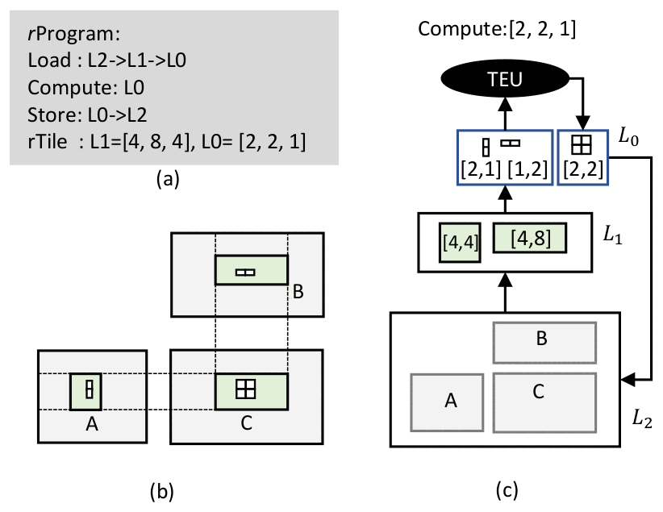

*图 7（原文 Figure 7，官方 PDF 第 6 页，论文页码 237）：Roller 计算模型。(a) 一个 rTile 程序；(b) 矩阵乘上的 rTile；(c) rTile 程序在硬件存储层次上的执行。*

**图中文字翻译与读法**：

- **(a)** rProgram（rTile 程序）：Load: L2->L1->L0（载入路径）；Compute: L0（在 L0 计算）；Store: L0->L2（存储路径）；rTile: L1=[4, 8, 4]，L0=[2, 2, 1]（两层的 rTile 形状，轴顺序为 $i,j,k$）。
- **(b)** 矩阵乘上的 rTile：$A$ 上的小块（$[2,1]$）、$B$ 上的小块（$[1,2]$）与 $C$ 上的小块（$[2,2]$）位置对应。
- **(c)** 执行过程：最下方 $L_2$ 存放完整的 $A$、$B$、$C$；每次把 $A$ 的 $[4,4]$ tile 和 $B$ 的 $[4,8]$ tile 从 $L_2$ 载入 $L_1$；再按 $[2,1]$ 和 $[1,2]$ 的形状从 $L_1$ 载入 $L_0$（即寄存器），交给 TEU（rTile Execution Unit，rTile 执行单元）做 Compute:[2, 2, 1]；每次 Compute 后得到的 $[2,2]$ 结果 tile 直接从 $L_0$ 存回 $L_2$。

**读图结论**：$L_1$ 的 rTile 形状 $[4,8,4]$ 对应 $A$ 的 $4\times4$、$B$ 的 $4\times8$、$C$ 的 $4\times8$；$L_0$ 的 $[2,2,1]$ 对应 $2\times1$、$1\times2$、$2\times2$——两层的 tile 形状逐层嵌套。

**优化目标**：rProgram 的目标是最大化流水线吞吐，可转化为三个条件：（1）计算与访存应充分利用硬件特性；（2）吞吐应使瓶颈阶段饱和；（3）要有足够的并行度来用满所有并行执行单元。据此 Roller 的构造策略是：**先 scale-up**——在一个核（执行单元）上构造单核 rProgram，使该核的硬件利用率饱和；**再 scale-out**——复制到多核利用多核并行。

### 3.5 构造算法：scale-up 与 scale-out（图 8）

**scale-up**。由于 rTile 的对齐性质已保证了硬件效率，Roller 只需专注于在每个存储层通过构造合适的 rTile 形状来最大化吞吐。借助 3.3 节的数据复用得分，单核构造算法从一个初始 rTile 开始，逐步把它**往最划算的轴（数据复用得分最大的轴）放大**。算法不需要得分的绝对值，只要挑出最大者以最大化吞吐。放大过程中，该层的存储性能不断提高，直到触及计算瓶颈或存储容量上限；然后对每个存储层按“从最上层（离计算最近）到最下层”的顺序重复，直到构造出所需的 rProgram。如果某些表达式（如逐元素算子）的数据复用得分恒定，Roller 只为最上层构造 rTile，并直接从最底层存储载入。

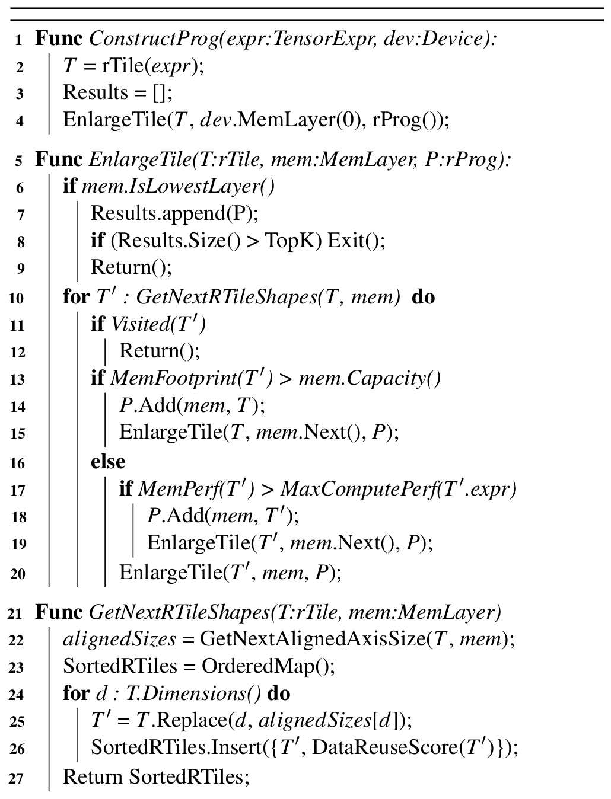

*图 8（原文 Figure 8，官方 PDF 第 6 页，论文页码 237）：Roller 针对单核（如一个 SM）的 rProgram 构造算法。*

下面是算法逐行转录，`#` 后为本文加的中文说明：

```text
1  Func ConstructProg(expr:TensorExpr, dev:Device):
2    T = rTile(expr);                         # 为表达式建立初始 rTile
3    Results = [];
4    EnlargeTile(T, dev.MemLayer(0), rProg());  # 从最上层存储（L0，寄存器）开始放大
5  Func EnlargeTile(T:rTile, mem:MemLayer, P:rProg):
6    if mem.IsLowestLayer()                   # 已到最底层存储：一个 rProgram 完成
7        Results.append(P);
8        if (Results.Size() > TopK) Exit();   # 攒够 K 个就结束
9        Return();
10   for T' : GetNextRTileShapes(T, mem) do   # 按数据复用得分从高到低枚举下一个更大的 rTile
11       if Visited(T')
12           Return();                        # 已访问过则不再重复
13       if MemFootprint(T') > mem.Capacity() # 放大后装不进这一层
14           P.Add(mem, T);                   # 记录当前 T 为这一层的 rTile
15           EnlargeTile(T, mem.Next(), P);   # 去下一个存储层继续
16       else
17           if MemPerf(T') > MaxComputePerf(T'.expr)  # 这一层的搬运吞吐已超过峰值算力
18               P.Add(mem, T');              # 记录 T' 为这一层的 rTile
19               EnlargeTile(T', mem.Next(), P);
20           EnlargeTile(T', mem, P);         # 在本层继续放大
21 Func GetNextRTileShapes(T:rTile, mem:MemLayer)
22    alignedSizes = GetNextAlignedAxisSize(T, mem);   # 每个轴的下一个对齐大小
23    SortedRTiles = OrderedMap();
24    for d : T.Dimensions() do
25       T' = T.Replace(d, alignedSizes[d]);  # 只放大轴 d
26       SortedRTiles.Insert({T', DataReuseScore(T')});  # 以数据复用得分排序
27    Return SortedRTiles;
```

**逐步解释**（对应原文第 3.2 节的叙述）：

1. 给定张量表达式 `expr` 和目标设备 `dev`，算法先在最上层存储建立初始 rTile $T$，然后递归地放大它（`EnlargeTile`，第 4 行）。
2. 每一步枚举下一个更大的 rTile $T'$：在每个轴上取下一个对齐大小，得到若干候选，按数据复用得分排序（`GetNextRTileShapes`，第 10 行与第 21 到 27 行）。
3. 如果 $T'$ 触及存储容量（第 13 行），或者数据 tile 的搬运吞吐 `MemPerf(T')` 超过峰值计算吞吐 `MaxComputePerf(T')`（第 17 行），算法就记录当前 rTile 并转到**下一个存储层**继续放大；否则继续在当前层放大 $T'$（第 20 行）。
4. 到达最底层存储时（第 6 行），得到一个结果；算法重复上述过程，直到得到 $K$ 个 rProgram（原文取 5 到 20，目的是容忍设备编译器带来的隐藏因素）。
5. `MemPerf` 与 `MaxComputePerf` 由微性能模型（3.6 节）基于设备 `dev` 导出。

（注：按图中缩进，第 20 行在第 17 行的 `if` 之外，即满足第 17 行条件时既向下一层推进、也在本层继续放大，从而枚举出多个 rProgram；正文措辞更像二选一。这里以图为准，并保留这一点提示。）

**scale-out**。由于大多数 DNN 算子的计算模式以及加速器内并行执行单元都是**同构**的，Roller 把在一个执行单元上构造的 rProgram 简单地**复制**到其他单元：把计算均匀划分成与最底层 rTile 同样大小的块，再把所有分块均匀分给各执行单元。沿**归约轴**切分出的分块尽量分给同一个执行单元，这样它们可以在较高的存储层共享归约结果。Roller 并不假设一个 rProgram 独占全部计算单元，系统在 scale-out 时可以显式控制 rProgram 的并行度。

**小算子**。scale-out 天然偏向并行度足够的算子（分块数远多于执行单元数）。对小算子，算法可能因执行单元利用率低而性能下降。一般可以通过与其他算子联合调度（如 Rammer）解决，前提是存在足够的算子间并行；否则对每个 rProgram，Roller 会沿**数据复用得分最小**的轴**缩小** rTile 以获得足够的并行度；这个枚举每次也只返回下一个对齐大小，与其他对齐规则一样高效，开销相对整个构造过程可忽略。

**不规则张量形状**。大算子也可能含有尺寸很小的不规则形状，由于对齐要求 Roller 可能构造不出足够多的 rProgram。对此 Roller 先用一个**轴融合**（axis fusion）pass 把张量表达式变成规范形式：对所有涉及的张量，如果某个张量里有两个相邻的轴，它们要么在其他所有张量里仍然相邻，要么在其他所有张量里都不出现，就可以安全地合并这两个轴。例如输入输出张量形状都是 $[17,11,3]$ 的逐元素算子，可变成形状 $[561]$（$17\times11\times3=561$）。除了轴融合，Roller 还会贪心地加大张量填充机制里的参数 $\varepsilon$（3.3 节），直到构造出 $K$ 个 rProgram。

### 3.6 微性能模型与硬件抽象层（图 9）

构造算法需要评估 rProgram 的性能。Roller 不在真机上评估端到端的 rProgram，而只评估对应 rTile 的性能（图 8 中的 `MemPerf` 与 `MaxComputePerf`）。为此，Roller 针对用**硬件抽象层（HAL）**描述的设备建立**微性能模型**。HAL 把加速器建模为多个并行的执行单元加层次化存储，只暴露三个与 rTile 相关的接口 Load、Compute、Store（原文图 9，官方 PDF 第 7 页）：

```cpp
// compute interface
int Load(T* src, rTile st, T* dst, rTile dt);
int Store(T* dst, rTile dt, T* src, rTile st);
int Compute(TensorExpr e, rTile t, T** args);

Spec GetDeviceSpec(); // Spec query interface

// interfaces of the micro-performance model
size_t MemFootprint(rTile t);
size_t MemTraffic(rTile t);
double MaxComputePerf(TensorExpr expr);
double MemPerf(rTile t);
```

- 一个执行单元被抽象成 **rTile Execution Unit（TEU）**，通过 `Compute` 接口计算数据 tile；多个 TEU 可以组织成一组（group），共同 `Load` 与 `Store` tile。
- HAL 把不同存储层（寄存器、共享内存、DRAM 等）统一为一种类型，暴露影响 tile 搬运性能的硬件规格：存储容量、事务长度、cache line 大小、bank 数，可通过 `GetDeviceSpec` 获得。

**微性能模型怎么算**：

1. 给定一个 rTile，由它的张量表达式 `expr` 和 shape **静态推出**所产生的内存占用（含填充）和跨存储层的内存流量（`MemFootprint`、`MemTraffic`）。它们用于计算数据复用得分和检查 rTile 是否超出存储容量。
2. 计算 `MaxComputePerf`：做一次**一次性 profiling**，通过激进地放大计算 tile（如 SM 内 warp 大小的倍数）让 TEU 饱和，测得峰值计算吞吐，并缓存供构造算法查询。
3. 估计 `MemPerf`，即把数据 tile 从某个存储层载入更高层的性能。由于 rTile 里的访存是对齐的，载入一块规整数据的延迟可以简单地用**总流量除以存储带宽**来建模；被所有 TEU 共享的存储层，带宽平均分配；对更小的访问大小，Roller 对每种设备类型做一次性离线 profiling 并缓存结果。

值得强调：微性能模型**只需要在 tile 形状完全对齐时准确**，这正是 Roller 的关键要求。

## 四、实现

- Roller 基于 TVM 和 Rammer 实现，核心机制（表达式优化、构造算法、微性能模型等）约 **8K 行**代码。
- **编译流程**：输入是 ONNX 图或 TensorFlow frozen graph；Roller 先用 Rammer 做图级优化（算子间与算子内的联合调度等）；再从优化后的图里为每个（融合后的）算子导出 TVM 张量表达式；用构造算法生成对应 rProgram，做内核生成；最后把生成的内核注入 Rammer 运行时，得到端到端模型代码。
- **代码生成**：rProgram 的代码结构固定（图 6），所以通过预定义模板生成，模板用 TVM schedule 及其内置原语实现：各存储层的数据 tile 载入、存储用 `cache_read`、`cache_write`，rTile 划分用 `split`、`fuse`，部分原始 rTile 计算用 TVM 的 intrinsic API。有了模板，给定 rProgram 就能直接生成设备代码（如 CUDA 内核）。
- **张量填充**：Roller 靠张量填充让 rTile 与张量形状对齐。实践中最低存储层（如 DRAM）的张量多由外部程序（DNN 框架）分配，所以只在较高的存储层（如共享内存）里做填充。目前要求输入张量表达式声明是否允许填充，以及默认填充值（如矩阵乘为 0）；为 bank 对齐做的存储填充借助 TVM 的 `storage_align` 原语。
- **性能 profiling**：实现了两个 profiler——微性能 profiler（用一组微基准生成设备规格，如存储带宽、计算吞吐，每种设备类型和每类张量表达式只需一次离线 profiling）和**内核 profiler**（在 top-$K$ 个 rProgram 里实测，选出最快的内核；$K>1$ 时用于每个编译结果）。原因是具体内核的性能还会受设备编译器和硬件的隐藏因素影响（指令密度、寄存器分配行为、设备编译器优化、warp 调度开销等），Roller 难以控制；在 NVIDIA GPU 上 Roller 靠 nvcc 把生成的 CUDA 代码编成机器码，而 nvcc 的专有优化可能影响执行行为。更大的 $K$ 通常提高内核质量；评估 top-10、20、50 后，作者的经验是 **top-10 在多数情形下能召回最优结果**。Roller 的内核 profiler 不同于以往编译器里由 ML 算法驱动的评估：后者通常需要成百上千步顺序评估，而 Roller 只**并行**实测几十个候选。作者计划未来直接生成汇编级代码（如 PTX）来缓解高层设备编译器的隐藏问题。

**在不同加速器上实现 HAL**（用户可为每类设备配置 HAL，Roller 也内置了常见设备的配置；带宽等细节配置来自微基准 profiling 或公开规格）：

| 项目 | NVIDIA V100 | NVIDIA K80 | AMD MI50 | Graphcore IPU |
|---|---|---|---|---|
| 存储抽象 | 3 层：L2 = 全局内存与 L2 cache；L1 = 仅共享内存；L0 = 寄存器 | 同 V100 | 与 V100 类似的集中式全局内存；每个 CU 有自己的 scratchpad 与寄存器 | 3 层：L2 = 跨所有核的远端内存；第二层 = 每核本地内存（原文此处也写作 L2，按三层编号疑为 L1）；L0 = 寄存器 |
| 全局内存事务长度 | 32 字节（8 个 float） | 32 字节 | 64 字节 | 未列出 |
| 共享内存 bank | 32 个，bank 长 4 字节 | bank 长 8 字节（个数原文未单列） | 32 个，bank 长 4 字节 | 无 |
| 共享内存/本地内存容量 | 48KB | 48KB | 未列出 | 每核 256KB 片上本地内存，无统一全局内存 |
| TEU | 一个 warp（32 线程），也是 TensorCore WMMA 指令的基本执行单位 | 同左 | 64 线程 | 未列出 |
| TEU group 大小 | 4（等于 warp scheduler 数） | 4 | 未列出 | 未列出 |
| 并行单元数 | 80 个 SM | 13 个 SM | 未列出 | 1216 个并行核 |
| 每线程寄存器上限 | 硬件 255，经验性下调为 96 | 96 | 经验性限制为 70 | 每个上层 rTile 只允许用 10 个寄存器（IPU 寄存器堆大小未公开） |

补充：全局内存/L2 的带宽等规格由作者的微基准测得；NVIDIA 上共享内存容量按 deviceQuery 设为 48KB；寄存器之所以下调，是因为超出上限会发生寄存器溢出（register spilling）造成显著性能下降，而 nvcc 还会隐式声明更多寄存器（循环变量等），这种行为难以预测；IPU 上因为无法预测 IPU 程序编译器的行为，才限制每个上层 rTile 只用 10 个寄存器，以保证不产生非法的 tiling 配置。Graphcore IPU 的峰值访存带宽和计算吞吐借用已有的 benchmark 研究结果。

## 五、实验

### 5.1 设置

- **服务器与软件**：CUDA GPU 用两类服务器——Azure NC24s_v3 虚拟机（Intel Xeon E5-2690v4 CPU，4 张 NVIDIA Tesla V100 16GB）与 Azure NC24_v1 虚拟机（24 个 Intel Xeon E5-2690v3 CPU，4 张 NVIDIA Tesla K80），均运行 Ubuntu 16.04、CUDA 10.2、cuDNN 7.6.5；AMD ROCm GPU 用一台服务器（Intel Xeon E5-2640 v4 CPU，4 张 AMD Radeon Instinct MI50 16GB），Ubuntu 18.04、ROCm 4.0.1；IPU 用 Azure ND40s_v3 虚拟机（Intel Xeon Platinum 8168 CPU，16 个 IPU），Poplar-sdk 1.0。
- **对比对象**：TVM（v0.8，即 AutoTVM + XGBoost 调优算法）、Ansor（v0.8）两个张量编译器；厂商库 cuDNN、cuBLAS、rocBLAS（ROCm GPU）、POPLAR 库（Graphcore IPU）；TensorFlow（v1.15）；TensorFlow-XLA（全模型编译器）；TensorRT（v7.0，TensorFlow 集成版本，NVIDIA 专用推理库）。作者用 Ansor 的结果来验证 Roller 的编译结果。
- **基准**：4 个典型模型——ResNet-50（CNN）、LSTM（RNN）、NASNet（神经架构搜索得到的 CNN）、BERT-Large（Transformer），默认 batch size 128。从每个模型选最常用的算子组成算子基准：**6 类共 119 个算子实例**（7 个 MatMul、44 个 Conv2D、23 个 DepthwiseConv、28 个逐元素算子、13 个池化、4 个归约）。完整配置列表因篇幅被省略（见作者的 artifact）。
- **度量**：为摊销数据送入/取出的开销，每个 TensorFlow session 里把内核重复运行 1,000 次取平均；TVM 与 Ansor 每个算子的调优步数设为 1,000（与 Ansor 论文的评估设置相同），取最好结果；Roller 同时报告 top-1 与 top-10 内核里最好的那个（后者可容忍设备编译器带来的隐藏性能影响）。

**表 1：算子基准的一个子集及其配置**（Operator = 算子类型；Configuration = 配置，$D$ 为输入张量形状，$K$ 为卷积核形状或池化核大小，$S$ 为步长，$I$ 为输入形状；Note = 本文后续图中的简称）

| 算子 | 配置 | 简称 |
|---|---|---|
| MatMul | M=65536, K=2, N=1024 | M0 |
| MatMul | M=128, K=4032, N=1000 | M1 |
| MatMul | M=65536, K=1024, N=4096 | M2 |
| Conv2D | D=(128,128,28,28), K=(128,128,3,3), S=1 | C0 |
| Conv2D | D=(128,128,58,58), K=(128,128,3,3), S=2 | C1 |
| Conv2D | D=(128,256,30,30), K=(256,256,3,3), S=2 | C2 |
| DepthwiseConv | D=(128,84,83,83), K=(84,84,5,5), S=2 | D0 |
| DepthwiseConv | D=(128,42,83,83), K=(42,42,5,5), S=1 | D1 |
| DepthwiseConv | D=(128,84,21,21), K=(336,336,1,1), S=1 | D2 |
| Element(Relu) | I=(128,1008,42,42) | E0 |
| Element(Relu) | I=(128,256,14,14) | E1 |
| Element(Relu) | I=(128,1024,14,14) | E2 |
| Avgpool | D=(128,168,83,83), K=1, S=2, VALID | P0 |
| Avgpool | D=(128,617,21,21), K=3, S=2, SAME | P1 |
| Avgpool | D=(128,42,83,83), K=3, S=1, SAME | P2 |
| ReduceMean | I=(128,512,1024), axis=[2] | R0 |
| ReduceMean | I=(65536,1024), axis=[1] | R1 |
| ReduceMean | I=(128,4032,11,11), axis=[2,3] | R2 |

（原文表 1，官方 PDF 第 9 页，论文页码 240。）

作者先概括了四点发现：（1）编译时间比 TVM 和 Ansor 快**三个数量级**：V100 上最耗时的算子 43 秒，其他算子只需约 13 秒；（2）在大量算子上追平厂商库和其他编译器的性能，超过一半算子上更好；（3）对更小或形状不规则的算子，由于难以与硬件对齐，结果次优，但它们的内核时间通常很短（约 1ms 或更低）；（4）作者做了迄今最广的评估（共 119 个算子，覆盖不同算子类型与不同加速器）。

### 5.2 NVIDIA V100 上的算子性能（图 10）

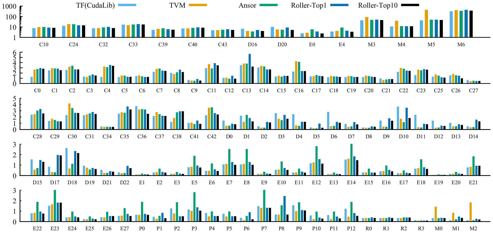

*图 10（原文 Figure 10，官方 PDF 第 10 页，论文页码 241）：V100 GPU 上的算子性能（纵轴：平均内核执行时间，单位 ms）。*

**图中文字翻译与读法**：图例五种柱子（自左到右）：TF(CudaLib)（经 TensorFlow 调用的 CUDA 库，浅蓝）、TVM（橙）、Ansor（绿）、Roller-Top1（深蓝）、Roller-Top10（黑）。119 个算子按类型与编号排序（简称见表 1：C = Conv2D、D = DepthwiseConv、E = 逐元素、P = 池化、R = 归约、M = MatMul）。最上面一行是大算子（内核时间超过 5ms），纵轴是对数刻度；下面四行是中、小算子，纵轴为线性刻度。**柱子越矮越好。**

**结果**（原文正文数字）：

- **对 CUDA 库**（cuBLAS 用于矩阵乘，cuDNN 用于卷积，它们被封装在 TensorFlow 里评估；其余算子用 TensorFlow 自带内核）：Roller 在 **81.5%** 的算子上性能相当（差距在 10% 以内），在 **59.7%** 的算子上更快。Roller 较差的多是 $3\times3$ 或更大卷积核的卷积，因为 cuDNN 对它们用了更高效的数值算法（如 Winograd），难以用张量表达式表达，这也是 Ansor 和 TVM 在这些情形下同样慢于 CUDA 库的原因。
- **对 TVM 与 Ansor**：在 **72.3%** 和 **80.7%** 的算子上性能相当；其余 27.7% 与 19.3% 主要是小算子或不规则形状，天然难与硬件对齐，但它们的内核时间一般较短，平均分别只有 1.65ms 和 1.16ms。在 **54.6%** 和 **65.5%** 的算子上，Roller 甚至比 TVM 和 Ansor 生成更快的内核，这些多是大而耗时的算子：在内核时间超过 5ms（最长到 343ms）的大算子上，Roller 对 TVM、Ansor 平均加速 $1.85\times$ 和 $1.27\times$。

（从图上读出：最上方一行里，如 M5 上 TVM 约 400ms，而 Roller 与 Ansor、CUDA 库都在约 50ms。）

### 5.3 编译时间（图 11）

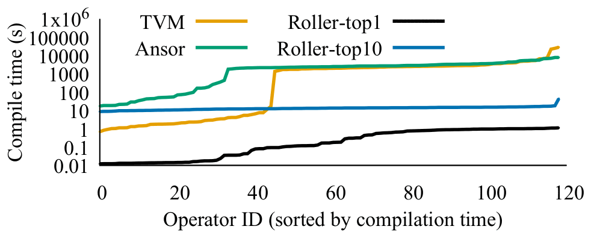

*图 11（原文 Figure 11，官方 PDF 第 11 页，论文页码 242）：每个算子的编译时间。*

**图中文字翻译与读法**：横轴 Operator ID (sorted by compilation time)（算子编号，每条线各自按编译时间排序）；纵轴 Compile time (s)（编译时间，秒，**对数刻度**，从 0.01 到 $10^6$）；四条线：TVM（橙）、Ansor（绿）、Roller-top1（黑）、Roller-top10（蓝）。

**结果**：

- **TVM** 平均 0.65 小时，最长 7.89 小时。前 40 个算子（主要是逐元素、归约、池化）TVM 的编译不到 10 秒，因为这些算子 TVM 用手写代码模板直接出代码，不需要搜索（图上橙线在编号 44 附近突然从个位数秒跃升到千秒量级）。
- **Ansor** 为所有算子生成搜索空间，平均 0.66 小时，最长 2.17 小时。
- **Roller**：top-1 内核对多数算子 1 秒内即可生成，平均 **0.43 秒**，比两者快**三个数量级以上**；时间主要花在递归构造算法上，它随算子大小略增，但很快稳定，因为放大 rTile 的递归深度受有限的存储容量约束。要从 top-10 候选里得到最优内核，平均编译时间只有 **13.3 秒**，主要开销来自设备编译器编译内核代码以及在目标设备上评估。

### 5.4 随算子规模扩展（图 12、13、14）

选一个 BERT 里的 MatMul 和一个 ResNet 里的 Conv2D，通过设置不同的规模（M 维大小或 batch size）与 CUDA 库、TVM、Ansor 比较。

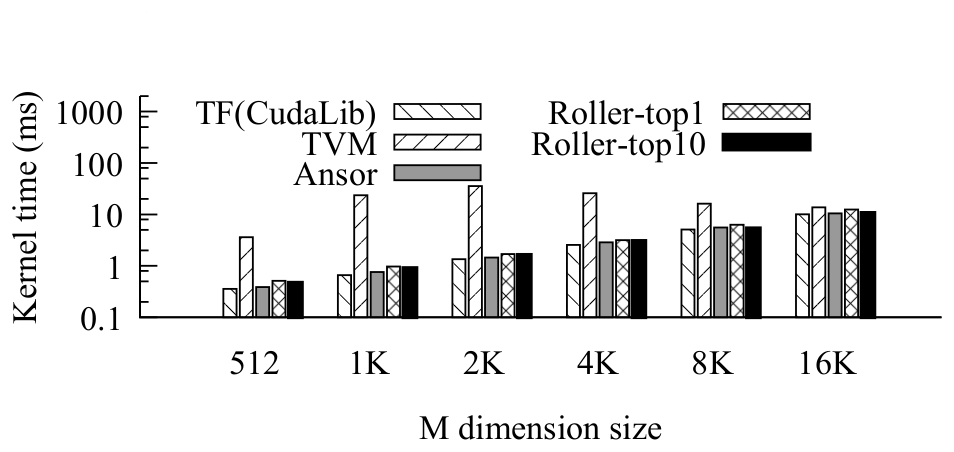

*图 12（原文 Figure 12，官方 PDF 第 11 页，论文页码 242）：BERT-Large 里的 MatMul 算子在不同 M 大小下的内核时间，K=1024，N=4096。*

**图中文字翻译与读法**：横轴 M dimension size（M 维大小：512、1K、2K、4K、8K、16K）；纵轴 Kernel time (ms)（内核时间，对数刻度）；五种柱子 TF(CudaLib)、TVM、Ansor、Roller-top1、Roller-top10。

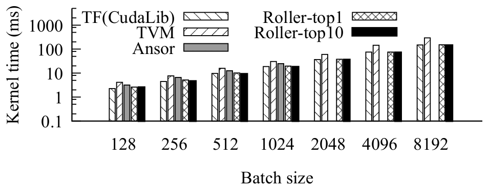

*图 13（原文 Figure 13，官方 PDF 第 11 页，论文页码 242）：Conv2d 算子在不同 batch size（$N$）下的内核时间，其中 C=1024、H=14、F=2048、K=1、S=2。*

**图中文字翻译与读法**：横轴 Batch size（128 到 8192）；纵轴 Kernel time (ms)（对数刻度）；图例同图 12。图中 2048 及更大的 batch 上没有 Ansor 的柱子。

**结果**：

- **MatMul**：Ansor 和 Roller 随 batch 大小都线性扩展，性能与 CUDA 库（即 cuBLAS）相当；TVM 的性能相对不稳定，如在 batch 为 1024 时 Roller 平均比 TVM 快 $11.2\times$，最多 $36.1\times$（原文如此表述）。
- **Conv2D**：Roller 仍线性扩展，比 Ansor 和 TVM 略好（平均 $1.25\times$ 和 $1.54\times$）；**Ansor 在默认配置下无法为超过 2048 的 batch size 搜到有效内核**；TVM 能生成有效内核，但对更大 batch 性能只能次线性扩展，Roller 在 batch 大于 2048 时取得超过 $1.9\times$ 的加速。

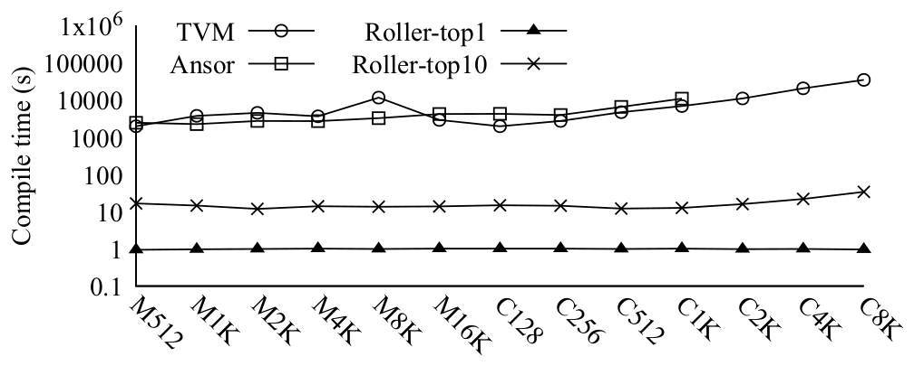

*图 14（原文 Figure 14，官方 PDF 第 11 页，论文页码 242）：MatMul 与 Conv2d 在不同 batch size 下的编译时间。*

**图中文字翻译与读法**：横轴 M512、M1K、M2K、M4K、M8K、M16K（MatMul 的 M 维大小）以及 C128、C256、C512、C1K、C2K、C4K、C8K（Conv2D 的 batch 大小）；纵轴 Compile time (s)（编译时间，对数刻度）；图例 TVM（圆圈）、Ansor（方块）、Roller-top1（实心三角）、Roller-top10（叉）。

**结果**：TVM 和 Ansor 的平均编译时间分别为 2.36 小时（最长 9.55 小时）和 1.19 小时（最长 3.0 小时），并且随 batch 增大持续增长，因为它们都基于 ML 的搜索方法，搜索空间通常随算子大小指数增长。相比之下 Roller 的 top-1 内核 **1 秒**生成，top-10 平均 **16 秒**（最长 34 秒）。

### 5.5 TensorCore（图 15）

Roller 通过让 rTile 形状与硬件指令形状对齐，就能方便地支持 TensorCore 这类硬件张量指令；实验中用 $16\times16\times16$ 的 WMMA 指令。因为据作者所知 Ansor 不支持 TensorCore，该实验去掉了 Ansor。选 4 个对 TensorCore 友好的大 MatMul 算子。

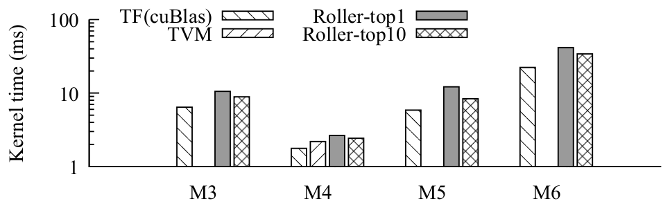

*图 15（原文 Figure 15，官方 PDF 第 12 页，论文页码 243）：TensorCore 上的 Matmul 内核时间。*

**图中文字翻译与读法**：横轴 M3、M4、M5、M6 四个 MatMul 算子；纵轴 Kernel time (ms)（对数刻度）；图例 TF(cuBlas)、TVM、Roller-top1、Roller-top10。没有 TVM 的柱子表示 TVM 没能生成有效内核。

**结果**：通过用对齐的 rTile 形状构造，Roller 能快速生成 TensorCore 上的好内核，与 cuBLAS 的差距在 **43%** 以内（cuBLAS 在 TensorCore 上有大量手工优化）。作为对比，**TVM 在默认配置下对 4 个算子里的 3 个无法生成有效内核**；把调优步数从 1,000 提到 10,000 仍找不到合法内核，原因是它的搜索空间定义不佳。（从图上读出：M4 上四者都有结果，TF 约 1.8ms，TVM 约 2.2ms，Roller-top1/top10 约 2.7ms/2.4ms。）

### 5.6 小算子与不规则形状（图 16、17）

**小算子**。Roller 在并行度不足时通过缩小 rTile 来优化小算子。图 16 比较两个小 MatMul（M1、M2）上原始 rTile 配置（没有足够并行度，Roller-O）与缩小后的 rTile 配置（与 SM 并行度匹配，Roller-S）。

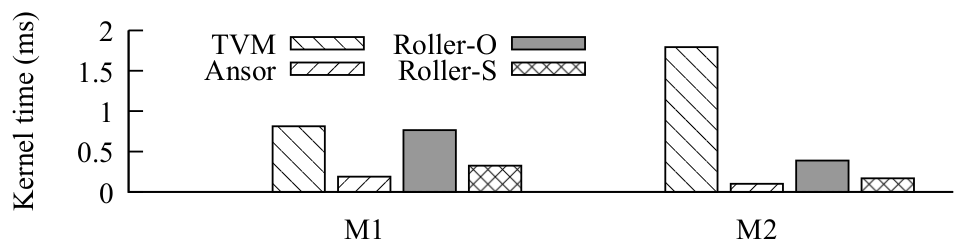

*图 16（原文 Figure 16，官方 PDF 第 12 页，论文页码 243）：小算子的性能。*

**图中文字翻译与读法**：横轴两个小 MatMul 算子 M1、M2；纵轴 Kernel time (ms)（线性刻度）；图例 TVM、Ansor、Roller-O（原始 rTile）、Roller-S（缩小后的 rTile）。

**结果**：缩小 rTile 把性能显著提高，平均 $2.3\times$（从图上读出：M1 上约 0.77ms 降到约 0.33ms，M2 上约 0.39ms 降到约 0.17ms）；但 Roller 在小算子上仍慢于 Ansor，平均约 50%（原文数字），同时显著快于 TVM（$6.6\times$）。对这类算子，可以进一步用基于搜索的方法微调配置。

**不规则张量形状**。Roller 用两个优化来编译不规则形状的算子：**轴融合**与带界限参数 $\varepsilon$ 的**张量填充**。图 17 在一组有代表性的不规则卷积算子上展示其收益。

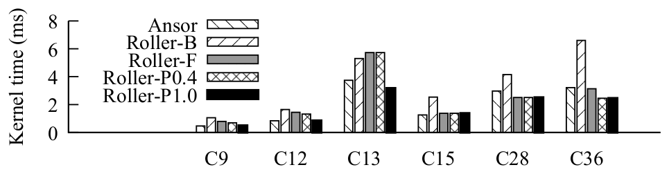

*图 17（原文 Figure 17，官方 PDF 第 12 页，论文页码 243）：不规则形状算子的性能。*

**图中文字翻译与读法**：横轴 C9、C12、C13、C15、C28、C36 六个不规则的卷积算子；纵轴 Kernel time (ms)；图例 Ansor、Roller-B（无任何优化）、Roller-F（加轴融合）、Roller-P0.4 与 Roller-P1.0（在轴融合之上再加张量填充，$\varepsilon$ 分别为 0.4 与 1.0）。所有 Roller 结果都是 top-10 候选里最好的一个。

**结果**：加轴融合后，Roller 得到更多与张量形状对齐的 rTile，内核性能平均提升 $1.5\times$；再加张量填充优化（如 $\varepsilon=1.0$）比 Roller-F 进一步提高 $1.4\times$。这主要是因为不规则形状下 $\varepsilon$ 较小时合法内核数量很有限，增大 $\varepsilon$ 才有机会在更多候选内核里挑选。（从图上读出：C13 上 Roller-B 约 5.3ms、Roller-F 约 5.7ms，到 Roller-P1.0 降到约 3.2ms；C36 上从 Roller-B 的约 6.6ms 降到 Roller-F 的约 3.1ms。）

### 5.7 微性能模型的验证与内核质量（图 18、表 2、表 3）

**微性能模型**。作者做了大量实验，验证全局内存吞吐、共享内存吞吐、计算吞吐在不同内核配置（线程块大小与网格大小）下的估计。

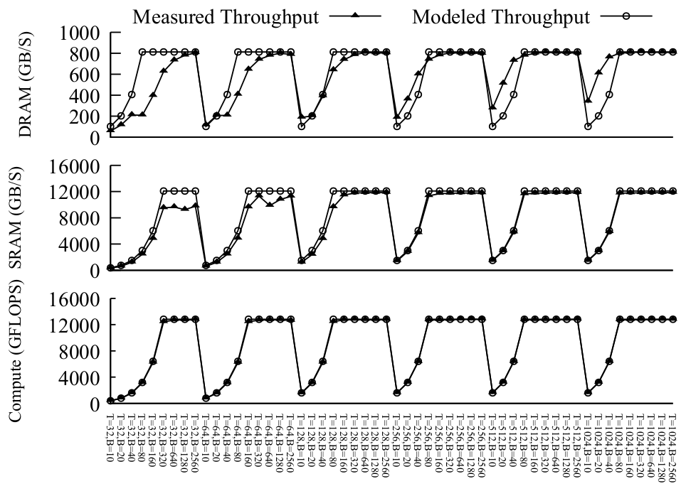

*图 18（原文 Figure 18，官方 PDF 第 12 页，论文页码 243）：微性能模型得到的内存吞吐（DRAM 与共享内存）和计算吞吐，与真实测量的对比（横轴：每块线程数 $T$ 和块数 $B$ 不同的内核配置）。*

**图中文字翻译与读法**：三个子图自上而下：DRAM (GB/S)（DRAM 吞吐）、SRAM (GB/S)（共享内存吞吐）、Compute (GFLOPS)（计算吞吐）；图例 Measured Throughput（实测吞吐，实心三角）、Modeled Throughput（模型估计吞吐，空心圆）；横轴是一串配置 T=32,B=10 … T=1024,B=2560（T 是每个线程块的线程数，B 是线程块个数；先按 T 分组，组内 B 从 10 增到 2560）。

**结果**：当配置没有与执行单元的并行度对齐——即每块线程数小于 128（4 个 warp）——模型的估计误差相对较大，对 DRAM 吞吐尤甚；当并行度不足（块数少于 80）时也一样。因此微性能模型**只对形状对齐的配置（即 rTile）准确**，因为这些配置充分发挥硬件效率；这也正是只选对齐 rTile 的动机，从而大大降低了微性能模型的复杂度。（从图上读出：对齐配置下 DRAM 吞吐的平台约 800 GB/s，共享内存约 12000 GB/s，计算约 12800 GFLOPS，模型与实测在平台处几乎重合。）

**内核性能**。进一步研究 Roller 生成内核距离最优还有多远。Roller 的数据流水线模型可以自然识别瓶颈层（DRAM、共享内存或计算），作者对每个生成的内核做 profiling，把饱和层上的资源利用率与理论硬件上限比较。

**表 2：饱和层上资源利用率的分布**（119 个算子，V100）

| 资源利用率 | 60–70% | 70–80% | 80–90% | 90–100% |
|---|---:|---:|---:|---:|
| 算子数 | 6 | 13 | 22 | 78 |
| 占比 | 5% | 11% | 18% | 66% |

（原文表 2，官方 PDF 第 13 页，论文页码 244。）

多数内核都使硬件资源饱和，如 **66%** 的内核利用了理论上限的 90% 以上；利用率不足的少数内核（尤其是低于 80% 的），经分析主要是并行度不足的小算子。

**对齐规则的消融**：逐个打开每种对齐优化，看它带来的性能提升。

**表 3：不同对齐优化带来的平均累计性能提升**（相对没有任何优化的基线）

| 基线 | MemAlign | EUAlign | ShapeAlign | BankAlign |
|---:|---:|---:|---:|---:|
| 1.0x | 1.42x | 1.88x | 1.92x | 1.94x |

（原文表 3，官方 PDF 第 13 页，论文页码 244；原文表头把第二列写作 “MemAlignn”，是笔误，正文写作 MemAlign。）

**读法**：这些值是**累计**的（逐项叠加）：MemAlign 为访存事务对齐；EUAlign 表示在其之上再加执行单元对齐，二者合计相对基线提升 $1.88\times$；ShapeAlign 为张量形状对齐；BankAlign 为 bank 对齐。bank 对齐的提升相对较小，因为多数内核本来就没有 bank 冲突。

### 5.8 端到端模型性能（表 4）

在 Rammer 里实现了 Roller 的端到端模型编译（记作 Rammer+Roller），做法是把 Roller 生成的内核喂给 Rammer。对比对象：TensorFlow（TF，代表 DNN 框架）、TensorFlow-XLA（TF-XLA，图级编译器）、TensorRT（TF-TRT，厂商提供的 DNN 引擎，也是 NVIDIA Triton 推理服务器的核心引擎）、Ansor（带张量编译的 DNN 编译器）。没有包含 TVM，因为它在端到端模型上的调优通常比 Ansor 长一个数量级。为构造公平基线，作者手工把 TVM 和 Ansor 对同一批算子生成的内核喂给 Rammer，记作 Rammer+TVM 与 Rammer+Ansor。Ansor 的总调优步数设为 1,000 乘以各模型的子图数；但 Ansor 无法为 BERT-Large 生成合法程序，所以该情形用 TVM 编译（TVM 的 BERT-Large 比 Rammer+TVM 慢约 $2.6\times$，因为 TVM 里 dense 算子的默认布局（NT）与 Rammer（NN）不同）。

**表 4：V100 上的端到端模型执行时间（毫秒）与编译时间**（OOM = 显存不足；N/A = 无法运行）

| 系统 | BERT-Large | ResNet | NASNet | LSTM |
|---|---:|---:|---:|---:|
| TF | 5,186 | 131 | 1,041 | 141 |
| TF-XLA | OOM | 112 | OOM | 98 |
| TF-TRT | N/A | 137 | 883 | 31 |
| Ansor | 46,847 (TVM) | 122 | 927 | 84 |
| Rammer+TVM | 17,730 | 143 | 1,168 | 43 |
| Rammer+Ansor | 5466 | 137 | 1036 | 48 |
| **Rammer+Roller** | **4,850** | 142 | 1,005 | **20** |
| Ansor 编译时间 | 30.9h (TVM) | 33.4h | 41.8h | 11.3h |
| Roller 编译时间 | 371s | 352s | 668s | 298s |

（原文表 4，官方 PDF 第 13 页，论文页码 244。TF-XLA 无法编译 BERT-Large 与 NASNet（显存不足）；TF-TRT 因超过 protobuf 2GB 大小限制而无法运行 BERT-Large。粗体为本文标出的该列 Roller 获胜项；原文无粗体。）

**读法**：

- **ResNet、NASNet**：Roller 只能取得相当、且多数更慢的性能（相对 TF-XLA 在 ResNet 上最多慢 26.7%）。主要开销来自它生成的卷积内核不如 cuDNN 高效（前述 Winograd 等原因）。
- **BERT-Large、LSTM**：Roller 超过所有其他框架和编译器，比各自的最强对手快 $1.07\times$（BERT-Large 对 TF）和 $1.55\times$（LSTM 对 TensorRT）。原因是 Roller 的内核构造偏好大而规则的算子形状（BERT-Large 里大量使用）；而且 scale-up 策略生成的是资源高效的内核，让 Rammer 有更多机会把并行内核协同调度到 GPU 上并行的 SM 上，两者合起来产生高效的端到端程序。
- **Ansor** 能为其余 3 个模型生成很高效的程序，但编译时间很长（平均 29.3 小时）；对 NASNet，调优 41.8 小时也只达到总搜索进度的 32%。**Roller** 编译这些模型平均只需 **422 秒**，其中图级优化与 Rammer 里的全模型编译时间约占总时间的 41%。

### 5.9 其他加速器：K80、AMD MI50、Graphcore IPU（表 5、表 6、图 19）

**K80 上的算子性能**。下表是 Roller 生成的算子里“更好”或“相当”的百分比。其中 Better Performance 是 Roller 比对比对象更快的算子占比；Perf. within X% 是 Roller 更快或只慢 X% 以内（如 10% 即慢不超过 1.1 倍）的算子占比，所以随 X 增大单调不减。

**表 5：NVIDIA K80 GPU 上性能更好或相当的算子百分比**（含义见上）

| 比较对象 | TF(CudaLib) | TVM | Ansor |
|---|---:|---:|---:|
| 更好（Better Performance） | 82.4% | 65.5% | 71.4% |
| 更好或慢在 5% 以内 | 82.4% | 67.2% | 75.6% |
| 更好或慢在 10% 以内 | 83.2% | 73.1% | 79.0% |
| 更好或慢在 50% 以内 | 99.2% | 93.3% | 94.1% |
| 更好或慢在 90% 以内 | 100.0% | 100.0% | 100.0% |

（原文表 5，官方 PDF 第 13 页，论文页码 244。）

相对 TVM 的百分比偏低，主要因为 TVM 手写的逐元素内核模板已高度优化。平均编译时间：TVM 0.65 小时、Ansor 0.95 小时；Roller 的 top-1 内核只要 **5.24 毫秒**，top-10 内核 **12.3 秒**。

**AMD ROCm MI50 上的算子性能**。

**表 6：AMD ROCm MI50 GPU 上性能更好或相当的算子百分比**（含义同表 5）

| 比较对象 | TF(RocLib) | TVM | Ansor |
|---|---:|---:|---:|
| 更好（Better Performance） | 73.1% | 58.8% | 70.6% |
| 更好或慢在 5% 以内 | 79.0% | 62.2% | 72.3% |
| 更好或慢在 10% 以内 | 81.5% | 62.2% | 73.9% |
| 更好或慢在 50% 以内 | 94.1% | 84.0% | 86.6% |
| 更好或慢在 90% 以内 | 100% | 100% | 100% |

（原文表 6，官方 PDF 第 14 页，论文页码 245。）

相对 ROCm 库（如 rocBLAS）有 73.1% 的算子 Roller 生成更好的内核，高于 CUDA GPU 上的比例，作者解释是 CUDA 上的库比 ROCm 上的更成熟；相对 TVM 与 Ansor 分别是 58.8% 与 70.6%。与 CUDA GPU 类似，慢超过 10% 的内核多是小算子和不规则形状的算子（TVM、Ansor 对应内核的平均执行时间只有 1.69ms 与 1.57ms）。平均编译时间：TVM 0.85 小时（最长 4.2 小时）、Ansor 0.99 小时（最长 3.4 小时）；Roller top-1 内核平均 **0.24 秒**（最长 0.63 秒），top-10 内核平均 **7.69 秒**（最长 49.0 秒）。（原文在此处写“CUDA GPU 上是 59.7% 和 54.6%（V100 与 K80）”，与表 5 的 K80 数字 82.4% 对不上；54.6% 其实是前文 V100 上对 TVM 的比例，疑为原文笔误。）

**Graphcore IPU 上的算子性能**。受片上内存容量所限，只评估了一组小的 MatMul 与 Conv2D 算子。TVM 和 Ansor 没有 Graphcore 后端，所以这个实验用的是修改版的 Ansor。

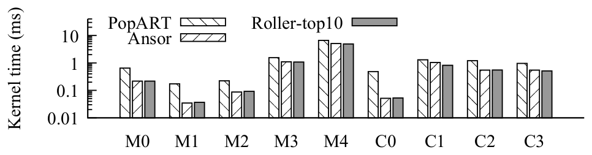

*图 19（原文 Figure 19，官方 PDF 第 14 页，论文页码 245）：Graphcore IPU 上的算子性能（纵轴为对数刻度）。*

**图中文字翻译与读法**：横轴 M0 到 M4（MatMul）和 C0 到 C3（Conv2D）；纵轴 Kernel time (ms)（对数刻度）；图例 PopART（Graphcore 提供的 Poplar-sdk 库）、Ansor、Roller-top10。

**结果**：Roller 对所有算子都比 PopART 生成更快的内核，平均快 $3.1\times$、最高 $9.2\times$；相比 Ansor，Roller 在多数算子上仍构造出相当甚至更好的内核，平均提升 2.9%。Ansor 仍需每个算子数小时调优，因为 IPU 上的设备编译器编译一个程序可能要几分钟；而 Roller 通常几分钟内就能从构造出的 top-10 候选里得到好内核，这段时间主要被不成熟的设备编译器所拖累，这也给在这类设备上采用基于 ML 的张量编译器带来更多挑战。

## 六、讨论与局限

**与基于循环的编译器的优化空间对比**。rTile 与数据处理流水线的抽象，使 Roller 构造出的优化空间与已有 DNN 编译器（如 Ansor）既有重叠又不同。这些编译器把张量编译看作嵌套循环优化，例如 Ansor 只允许沿张量某一维做**可整除**的 tile 大小，以均匀划分循环轴，所以对含质数维度的张量形状通常表现更差；Roller 则从数据处理流水线的视角出发，着眼于最大化硬件效率，允许更激进的优化，例如探索**不可整除但与硬件对齐**的 tile 大小，配合轴融合与张量填充。作者观察到多数 DNN 算子是**访存受限**的，所以 Roller 与现有 DNN 编译器的根本区别是**先优化数据 tile 吞吐**（最大化复用得分、与硬件特性对齐），**再考虑并行度**。这个取舍本身就带来快速编译，并让并行度充足的算子获得好性能。

**优化取舍**。Roller 的设计哲学基于一个观察：大而稠密的算子往往是执行时间的主要贡献者。这导出一个取舍：把优化数据复用（即最大化流水线吞吐）作为主要优化目标，把其他与硬件相关的优化变成对齐约束；这带来快速编译和对主流负载中大多数算子的高内核质量。对小算子，Roller 还用一些自适应机制在不同优化目标间权衡，如在结果不足时用阈值限制冗余工作（$\varepsilon$，3.3 节），采用 rTile 缩小过程增加并行度（3.5 节）等。

**未来工作与局限**（论文第 6 节）：

1. **依赖设备编译器**：Roller 目前依赖 nvcc 这样的高层设备编译器把内核代码编成可执行文件，这有时带来不希望的性能影响，也迫使 Roller 保守地分配寄存器（设备编译器会为中间值如循环变量隐式分配寄存器，Roller 无法预先探测，难以精确估计寄存器用量）。计划直接生成汇编（如 NVIDIA 的 PTX）代码。
2. **硬件信息缺失**：性能的关键硬件信息（存储带宽、容量、事务长度）通常能从硬件规格得到，但仍有些设备（如移动 GPU）缺少这类信息；计划借助 profiling 技术揭示并量化这些硬件特性。
3. **同构假设**：HAL 假设硬件含同构计算单元和对称的存储访问；有些设备有 NUMA 架构，同一个 tile 在不同局部性下表现不同，使微性能模型难以估计 rTile 性能，留作未来工作。
4. **稀疏内核**：稀疏性优化可能破坏 DNN 内核里负载同构的假设，使微性能模型不准（稀疏度更高的 tile 与稠密 tile 表现不同）；Roller 假设更高层的、稀疏感知的编译器（如 SparTA）会解决这个问题。

**证据边界**（以下是本文对论文内容的核对，不是论文自己列的局限）：

- 实验以 V100 为主，K80、MI50、IPU 的结果是算子级的（IPU 只有 9 个小算子且用修改版 Ansor）；端到端模型只在 V100 上评估。
- 算子基准取自 4 个模型的“最常用算子”，且论文称完整配置因篇幅省略；基线 TVM、Ansor 的调优预算固定为每个算子 1,000 步，Ansor 对部分情形（BERT-Large、batch 大于 2048）无法生成有效内核。
- 端到端比较里 Roller 和 Rammer+TVM/Ansor 用同一个 Rammer 运行时，而 TF、TF-XLA、TF-TRT 的运行时不同，所以对这些基线的差异混合了内核与运行时的因素。
- 论文的统计量里个别数字前后不一致：第 2 节写 Ansor 平均编译 0.65 小时、第 5.1 节写 TVM 0.65 小时与 Ansor 0.66 小时；第 5.2 节对 ROCm 与 CUDA 的比较引用的 K80 数字与表 5 不符（见上）。引用时应以表和图为准并注明来源。

## 七、相关工作（论文第 7 节要点）

- **把算子当作嵌套多层循环的张量编译器**：TVM 继承 Halide 的思路，把 DNN 算子描述成循环优化 schedule 原语；AutoTVM 用 ML 方法在手写代码模板中搜索最佳配置；FlexTensor 自动探索空间，无需手写模板；Ansor 进一步自动化，在层次化代码结构上生成更大的搜索空间，并用进化算法找高性能内核。Tiramisu、AKG、Tensor Comprehensions 用多面体技术优化循环，把循环转成整数规划问题并用求解器求配置。它们都依赖巨大的搜索空间，因此编译或求解时间长；Roller 则构造与硬件特性对齐的 rTile。
- **Tensor Processing Primitives（TPP）**：定义一组二维张量算子来组合高维张量上的复杂算子，表达力受限；Roller 不限制 tile 形状的维数，可用于一般张量表达式。
- **OpenAI Triton**：用于开发块级 GPU 内核的编程框架和编译器，依赖程序员决定块大小和块调度；这正是 Roller 通过同时考虑硬件特性和张量形状要解决的问题。MLIR 和 TensorIR 计划在 IR 中支持块级（即 tile）计算表示，与 Roller 的 rTile 抽象和 rProgram 构造兼容。
- **图级 DNN 编译器**（XLA、TVM、Rammer）：专注跨算子优化（融合、协同调度）；Roller 的内核生成与它们兼容，rTile 抽象还补充了 Rammer 的 rTask 概念，提供了一种构造 rTask 的高效方法（见 [Rammer 解读](../rammer/论文中文解读.md)）。
- **算子专用优化**：CUTLASS（矩阵乘模板）、只针对多核 CPU 上卷积算子的分析模型、DREW（用数据压缩优化 Winograd 卷积）。Roller 的方法对各种设备上的 DNN 算子是通用的。

## 八、复现检查清单

- 复现请以官方 PDF 和 artifact 代码为准（本目录的 `paper.pdf` 已换成官方 PDF）；
- 记录目标设备的 HAL 参数：存储层数与容量、事务长度、bank 数与宽度、TEU 大小、SM 数、每线程寄存器上限（论文里有些是经验性下调的，如 V100/K80 为 96、MI50 为 70）；
- 微基准要测：各存储层带宽（含小访问量）、每类算子的峰值计算吞吐；
- 构造算法的参数：$K$（top-K，论文建议约 10）、$\varepsilon$（张量填充上限）；
- 编译时间要拆开报告：构造算法耗时、设备编译器（如 nvcc）耗时、内核 profiler 实测耗时；
- 对小算子、不规则形状、$3\times3$ 以上卷积单独评估，不要只看全局平均；
- 端到端比较要写明基线里的运行时（Rammer 与 TF 系列不同）；
- 论文的单位、批大小、模型版本：TF v1.15、TensorRT v7.0、TVM/Ansor v0.8、CUDA 10.2、cuDNN 7.6.5、batch 128。

## 九、常见误读

- Roller **不是**完全不测量：它用微性能模型筛选，但仍用内核 profiler 对 top-$K$（常取 10）个候选实测，只是候选数是几十个而不是上千步的顺序搜索。
- rTile **不要求**tile 大小整除张量形状：它显式允许在界限 $\varepsilon$ 内填充，并用轴融合处理不规则形状；整除约束是 Ansor 这类循环编译器的特点。
- 微性能模型**并非**对任意配置都准：只有对齐配置才准确，所以才只考虑对齐的 rTile。
- “三个数量级”指的是编译时间（top-1，对 TVM/Ansor 的平均比较），不是内核运行速度；内核性能是“相当且在一半以上算子上更好”，并非全面更快。
- Roller 的弱项是真实存在的：小算子、不规则形状、$3\times3$ 以上卷积（Winograd 等难以用张量表达式表达的算法）；端到端的 ResNet、NASNet 在 V100 上略慢于 TF-XLA 等。

## 十、与相关论文的关系

- **Ansor / MetaSchedule**：它们用 ML 搜索循环变换空间，Roller 用硬件对齐的构造取代搜索，代价是对小算子、不规则形状略逊（见 [Ansor 解读](../ansor/论文中文解读.md)、[MetaSchedule 解读](../metaschedule/论文中文解读.md)）；
- **Rammer**：Roller 基于 Rammer 做图级优化和算子协同调度，rTile 的构造补充了 Rammer 的 rTask（见 [Rammer 解读](../rammer/论文中文解读.md)）；
- **Bolt**：同样以“硬件原生”为切入点减少搜索，但走的是模板（CUTLASS）路线（见 [Bolt 解读](../bolt/论文中文解读.md)）；
- **Tensor Comprehensions**：论文把它放在多面体编译器一类中对照（见 [Tensor Comprehensions 解读](../tensor_comprehensions/论文中文解读.md)）；
- **Triton / TileLang 等**：同样以 tile 为一等公民，但把 tile 大小的选择交给程序员或另行搜索（见 [Triton 编译器解读](../triton_compiler/论文中文解读.md)、[TileLang 解读](../tilelang/论文中文解读.md)）。

## 原文证据导航

- 官方页面与 PDF：[USENIX OSDI '22 页面](https://www.usenix.org/conference/osdi22/presentation/zhu)、[osdi22-zhu.pdf](https://www.usenix.org/system/files/osdi22-zhu.pdf)；
- 本目录的 [paper.pdf](paper.pdf) 与 [paper.txt](paper.txt)：原先误放的是另一篇天文学论文（arXiv:2201.12040），现已替换为 USENIX 官方 PDF 及其文本；
- [论文概要](论文概要.md)
