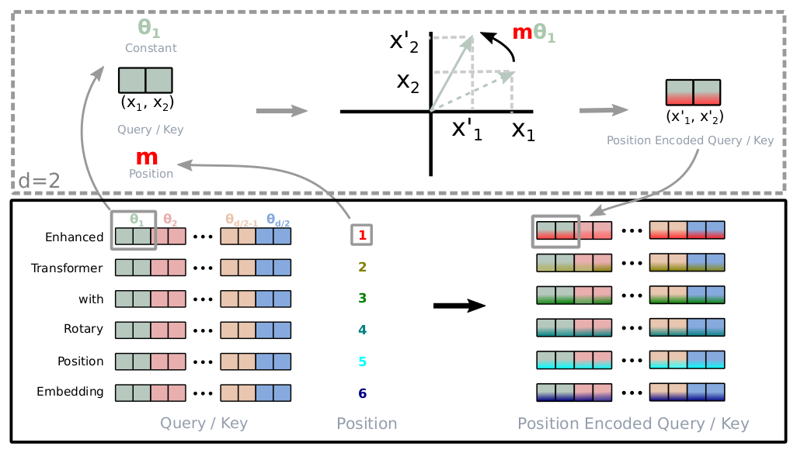
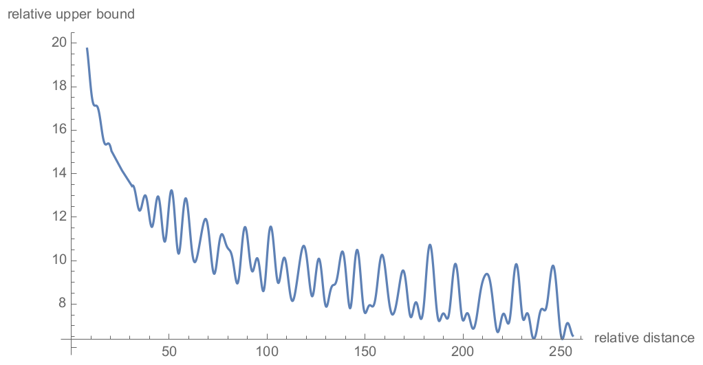
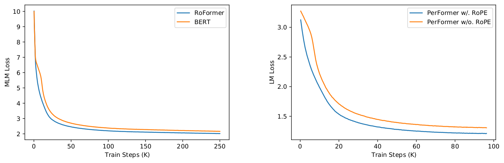

# 论文中文解读：《RoFormer: Enhanced Transformer with Rotary Position Embedding》

> **基本信息**：Jianlin Su、Yu Lu、Shengfeng Pan、Ahmed Murtadha、Bo Wen、Yunfeng Liu（Zhuiyi Technology，深圳），arXiv:2104.09864（本地 PDF 为 v5，2023 年 11 月）；论文原文 [官方页面](https://arxiv.org/abs/2104.09864)；已集成进 Hugging Face（[RoFormer 文档](https://huggingface.co/docs/transformers/model_doc/roformer)），示例代码见 [ZhuiyiTechnology/roformer](https://github.com/ZhuiyiTechnology/roformer)。
>
> **本文的读法**：图为从论文 PDF 裁下的原图，表为逐格核对后的中文转录（数字与原文一致，表头译成中文，模型名、数据集名保持英文）。论文的推导部分较短、步骤跳得快，本文把每一步展开；凡属笔者补充的推导、数值例子、复算或判断，都会标明“笔者”，以便与论文原话区分。读完不必再翻英文版。

## 一、一句话结论

RoPE（Rotary Position Embedding，旋转位置编码）不把位置向量加到词向量上，而是把每个 query、key 向量按“位置 $\times$ 频率”旋转：向量被切成 $d/2$ 个二维小块，位置 $m$ 处第 $i$ 块旋转角度 $m\theta_i$。因为旋转矩阵满足 $R_m^\top R_n=R_{n-m}$，旋转之后 query 与 key 的内积**只依赖相对位置** $n-m$，而绝对位置仍然保存在各自的旋转角里。旋转是正交变换、不改变向量长度，所以也可以放进线性注意力。

论文的实验结论（都是中小规模、单次运行）：WMT 2014 英德翻译 BLEU 27.3 提高到 27.5；BERT 预训练的 MLM 训练损失下降更快；GLUE 六个任务中 RoFormer 三个更好、三个更差；Performer 加 RoPE 后收敛更快、损失更低；中文长文本匹配 CAIL2019-SCM 上，输入长度 512 到 1024 时测试准确率从 68.29% 提高到 69.79%。论文自己也承认，没有找到“为什么收敛更快”和“为什么长文本更好”的可信解释（第 4.5.5 节）。

## 二、背景：位置信息如何进入 self-attention

### 2.1 为什么需要位置信息

纯 self-attention 对输入顺序“无感”（position-agnostic，论文引用 Yun 等 2020）：把输入 token 打乱，输出只是同样被打乱，每个 token 的表示不变。所以必须把位置信息显式注入。循环网络靠沿时间递推隐状态编码顺序；卷积网络在论文看来通常不显式感知位置（但近期工作表明 padding 操作能隐式学到位置信息）；Transformer 则需要专门的位置编码。

### 2.2 记号与注意力公式（原文式 1、2）

设长度为 $N$ 的 token 序列 $S_N=\{w_i\}_{i=1}^{N}$，对应的词向量（不含位置信息）为 $x_i\in\mathbb{R}^d$。self-attention 先把位置信息融合进词向量，再变成 query、key、value：

$$
q_m=f_q(x_m,m),\qquad k_n=f_k(x_n,n),\qquad v_n=f_v(x_n,n).
$$

注意力权重与输出为

$$
a_{m,n}=\frac{\exp\!\Big(\dfrac{q_m^\top k_n}{\sqrt d}\Big)}{\sum_{j=1}^{N}\exp\!\Big(\dfrac{q_m^\top k_j}{\sqrt d}\Big)},\qquad o_m=\sum_{n=1}^{N}a_{m,n}v_n.
$$

位置编码方法的差别，就是怎样选择函数 $f_q,f_k,f_v$。

### 2.3 绝对位置编码（式 3、4）

最常见的选择是把位置向量 $p_i\in\mathbb{R}^d$ 加到词向量上再做线性变换：

$$
f_{t}(x_i,i)=W_t\,(x_i+p_i),\qquad t\in\{q,k,v\}.
$$

$p_i$ 可以是可训练向量（BERT、GPT-2、ALBERT、ELECTRA 等，$p_i\in\{p_t\}_{t=1}^{L}$，$L$ 是最大序列长度），也可以用 Vaswani 等（2017）的正弦函数生成：

$$
p_{i,2t}=\sin\!\big(i/10000^{2t/d}\big),\qquad p_{i,2t+1}=\cos\!\big(i/10000^{2t/d}\big).
$$

（原文式 4 把位置下标写成了 $k$，这里按上下文改写为位置 $i$。）

### 2.4 相对位置编码（式 5 至 10）

另一类方法把**相对位置** $m-n$ 编码进注意力。论文回顾了几种做法，其中 $q_m^\top k_n$ 的形式如下（$\tilde p$ 表示相对位置向量，$u,v$ 是与 query 位置无关的可训练向量，$b_{i,j}$ 是可训练偏置，$\widetilde W_k$ 表示与内容键矩阵 $W_k$ 区分开的“位置键”矩阵）：

| 方法 | 原文式号 | 形式 |
|---|---|---|
| Shaw 等（2018） | 式 5 | $f_q=W_qx_m$，$f_k=W_k(x_n+\tilde p^{k}_{r})$，$f_v=W_v(x_n+\tilde p^{v}_{r})$，其中 $r=\mathrm{clip}(m-n,r_{\min},r_{\max})$，$\tilde p^{k}_r,\tilde p^{v}_r$ 可训练 |
| 绝对位置展开 | 式 6 | $x_m^\top W_q^\top W_kx_n+x_m^\top W_q^\top W_kp_n+p_m^\top W_q^\top W_kx_n+p_m^\top W_q^\top W_kp_n$ |
| Transformer-XL（Dai 等，2019） | 式 7 | $x_m^\top W_q^\top W_kx_n+x_m^\top W_q^\top\widetilde W_k\tilde p_{m-n}+u^\top W_q^\top W_kx_n+v^\top W_q^\top\widetilde W_k\tilde p_{m-n}$，并令 $f_v(x_j)=W_vx_j$（value 不含位置） |
| T5（Raffel 等，2020） | 式 8 | $x_m^\top W_q^\top W_kx_n+b_{i,j}$ |
| 内容与位置用不同投影矩阵 | 式 9 | $x_m^\top W_q^\top W_kx_n+p_m^\top U_q^\top U_kp_n+b_{i,j}$ |
| DeBERTa（He 等，2020） | 式 10 | $x_m^\top W_q^\top W_kx_n+x_m^\top W_q^\top W_k\tilde p_{m-n}+\tilde p_{m-n}^\top W_q^\top W_kx_n$ |

论文的批评是：这些方法都建立在“把位置编码**加到**上下文表示上，再把 $q^\top k$ 展开成若干项”的思路之上，只是对展开式（式 6）中的某几项做替换，因此是**加性**的；这样的位置项很难与线性注意力兼容（见 3.8 节）。RoPE 则反过来：从式 (1) 出发，加上“内积只依赖相对位置”的约束，推出一个**乘性**的编码。

## 三、方法：RoPE

### 3.1 目标：让内积只依赖相对位置（式 11）

希望找到 $f_q,f_k$，使得 query 与 key 的内积只通过词向量 $x_m,x_n$ 和它们的相对位置 $m-n$ 来表达：

$$
\big\langle f_q(x_m,m),\,f_k(x_n,n)\big\rangle=g(x_m,x_n,m-n).
$$

### 3.2 二维情形：旋转（式 12、13）

先看 $d=2$。把二维向量 $(a,b)$ 看成复数 $a+\mathrm{i}b$，论文给出的解是

$$
f_q(x_m,m)=(W_qx_m)\,e^{\mathrm{i}m\theta},\qquad f_k(x_n,n)=(W_kx_n)\,e^{\mathrm{i}n\theta},
$$

$$
g(x_m,x_n,m-n)=\mathrm{Re}\big[(W_qx_m)(W_kx_n)^{*}e^{\mathrm{i}(m-n)\theta}\big],
$$

其中 $\mathrm{Re}[\cdot]$ 取实部，$(\cdot)^*$ 是复共轭，$\theta\in\mathbb{R}$ 是预先设定的非零常数。乘以 $e^{\mathrm{i}m\theta}$ 就是把平面上的向量逆时针旋转角度 $m\theta$，写成矩阵形式即

$$
f_{\{q,k\}}(x_m,m)=
\begin{bmatrix}\cos m\theta&-\sin m\theta\\ \sin m\theta&\cos m\theta\end{bmatrix}
\begin{bmatrix}W^{(11)}_{\{q,k\}}&W^{(12)}_{\{q,k\}}\\ W^{(21)}_{\{q,k\}}&W^{(22)}_{\{q,k\}}\end{bmatrix}
\begin{bmatrix}x_m^{(1)}\\ x_m^{(2)}\end{bmatrix}.
$$

也就是说：**先做线性变换得到 query/key，再把它转一个与位置成正比的角度**。

**为什么内积只依赖相对位置**（笔者逐步验证）。记旋转矩阵 $R(a)=\begin{bmatrix}\cos a&-\sin a\\ \sin a&\cos a\end{bmatrix}$，由三角函数的和角公式可得 $R(a)R(b)=R(a+b)$，并且 $R(a)^\top=R(-a)$。于是对未旋转的 $q=W_qx_m$、$k=W_kx_n$：

$$
\big(R(m\theta)q\big)^\top\big(R(n\theta)k\big)=q^\top R(m\theta)^\top R(n\theta)\,k=q^\top R\big((n-m)\theta\big)\,k.
$$

两个位置各自的绝对角度 $m\theta,n\theta$ 都消失了，只剩差值 $(n-m)\theta$。几何上等价于：设 $q$ 的辐角为 $\alpha$、$k$ 的辐角为 $\beta$，旋转后两者的辐角分别是 $\alpha+m\theta$ 和 $\beta+n\theta$，二维内积等于“两个长度之积乘以夹角的余弦”：

$$
\big\langle R(m\theta)q,\,R(n\theta)k\big\rangle=\lVert q\rVert\,\lVert k\rVert\cos\big(\beta-\alpha+(n-m)\theta\big).
$$

（论文式 12 中的 $\mathrm{Re}[\,\cdot\,]$ 写法与此一致，因为两个复数的实内积 $\langle z_1,z_2\rangle=\mathrm{Re}[z_1z_2^*]$。）

**一个可以手算的例子**（笔者）：取 $\theta=\pi/2$，$q=k=(1,0)$。位置 $m=1$ 的 query 旋转 $90^\circ$ 得 $(0,1)$，位置 $n=3$ 的 key 旋转 $270^\circ$ 得 $(0,-1)$，内积为 $-1$。把两个位置同时右移 1（$m=2,n=4$）：query 转 $180^\circ$ 得 $(-1,0)$，key 转 $360^\circ$ 得 $(1,0)$，内积仍是 $-1$。两次相对距离都是 $n-m=2$，所以分数相同。

### 3.3 推导：为什么偏偏是旋转（第 3.4.1 节）

上面的形式是怎么来的？论文在 $d=2$ 下从式 (11) 出发，加上一个初始条件，推出这个解。下面逐步展开（式号对应原文）。

**设定**：位置 $m$ 的 query 记 $q_m=f_q(x_q,m)$，位置 $n$ 的 key 记 $k_n=f_k(x_k,n)$（式 20）。要求内积只依赖相对位置（式 21，论文这里把相对位置写成 $n-m$）：$\langle f_q(x_q,m),f_k(x_k,n)\rangle=g(x_q,x_k,n-m)$。初始条件（式 22）：$q=f_q(x_q,0)$、$k=f_k(x_k,0)$，即位置 0 处不含位置信息。

**第 1 步，极坐标分解**（式 23）。把 $f_q,f_k,g$ 写成“模长 $\times$ 相位”：

$$
f_q(x_q,m)=R_q(x_q,m)\,e^{\mathrm{i}\Theta_q(x_q,m)},\quad f_k(x_k,n)=R_k(x_k,n)\,e^{\mathrm{i}\Theta_k(x_k,n)},\quad g=R_g\,e^{\mathrm{i}\Theta_g}.
$$

论文把 $g$ 当作复数“内积” $\overline{f_q}\,f_k$：模长相乘、相位相减，得到（式 24）

$$
R_q(x_q,m)\,R_k(x_k,n)=R_g(x_q,x_k,n-m),\qquad \Theta_k(x_k,n)-\Theta_q(x_q,m)=\Theta_g(x_q,x_k,n-m).
$$

（笔者注：这等于要求复数乘积本身只依赖相对位置，比只要求它的实部即内积满足条件更强，所以得到的是满足约束的一个解，论文也只声称“一个解”，没有证明唯一性。）初始条件写成极坐标：$q=\lVert q\rVert e^{\mathrm{i}\theta_q}$，$k=\lVert k\rVert e^{\mathrm{i}\theta_k}$（式 25）。

**第 2 步，令 $m=n$**（式 26）。此时相对位置为 0，代入初始条件：

$$
R_q(x_q,m)R_k(x_k,m)=R_g(x_q,x_k,0)=\lVert q\rVert\lVert k\rVert,\qquad
\Theta_k(x_k,m)-\Theta_q(x_q,m)=\theta_k-\theta_q.
$$

**第 3 步，模长**（式 27）。第一个等式的一个直接解是 $R_q(x_q,m)=\lVert q\rVert$、$R_k(x_k,n)=\lVert k\rVert$、$R_g\equiv\lVert q\rVert\lVert k\rVert$：**位置不改变向量的模长**。

**第 4 步，相位**（式 28）。第二个等式可改写为 $\Theta_q(x_q,m)-\theta_q=\Theta_k(x_k,m)-\theta_k$：左边只含 $x_q$，右边只含 $x_k$，要对任意的一对词向量成立，两边只能是一个只由位置决定的函数，记作 $\phi(m)$：

$$
\Theta_{\{q,k\}}(x,m)=\phi(m)+\theta_{\{q,k\}}.
$$

**第 5 步，$\phi$ 是等差数列**（式 29、30）。在式 (24) 的第二个等式里取 $n=m+1$：

$$
\phi(m+1)-\phi(m)=\Theta_g(x_q,x_k,1)+\theta_q-\theta_k .
$$

右边与 $m$ 无关（$g$ 只依赖相对位置），所以 $\phi$ 在整数位置上是等差数列：$\phi(m)=m\theta+\gamma$，$\theta,\gamma\in\mathbb{R}$ 为常数，且 $\theta\neq0$（否则没有位置信息）。

**第 6 步，汇总**（式 31 至 33）。

$$
f_q(x_q,m)=q\,e^{\mathrm{i}(m\theta+\gamma)},\qquad f_k(x_k,n)=k\,e^{\mathrm{i}(n\theta+\gamma)}.
$$

论文对初始位置的 $f_q(x_m,0)$、$f_k(x_n,0)$ 没有施加任何约束，因此可以自由取成与式 (3) 可比的 $q=W_qx_m$、$k=W_kx_n$；再令 $\gamma=0$ 就得到式 (33)，也就是上面的 $f_q=(W_qx_m)e^{\mathrm{i}m\theta}$、$f_k=(W_kx_n)e^{\mathrm{i}n\theta}$。

### 3.4 推广到任意维度（式 14、15、16）

推广到偶数维 $d$ 很直接：把 $d$ 维空间切成 $d/2$ 个二维子空间（相邻两个维度一组），对每个子空间各旋转一次；内积是各子空间内积之和（内积的线性性），所以整体仍然只依赖相对位置：

$$
f_{\{q,k\}}(x_m,m)=R^{d}_{\Theta,m}\,W_{\{q,k\}}\,x_m,
$$

$$
R^{d}_{\Theta,m}=
\begin{bmatrix}
\cos m\theta_1 & -\sin m\theta_1 & 0 & 0 & \cdots & 0 & 0\\
\sin m\theta_1 & \cos m\theta_1 & 0 & 0 & \cdots & 0 & 0\\
0 & 0 & \cos m\theta_2 & -\sin m\theta_2 & \cdots & 0 & 0\\
0 & 0 & \sin m\theta_2 & \cos m\theta_2 & \cdots & 0 & 0\\
\vdots & \vdots & \vdots & \vdots & \ddots & \vdots & \vdots\\
0 & 0 & 0 & 0 & \cdots & \cos m\theta_{d/2} & -\sin m\theta_{d/2}\\
0 & 0 & 0 & 0 & \cdots & \sin m\theta_{d/2} & \cos m\theta_{d/2}
\end{bmatrix}
$$

这是块对角的旋转矩阵，预设频率为

$$
\Theta=\Big\{\theta_i=10000^{-2(i-1)/d},\ i=1,2,\dots,d/2\Big\}.
$$

把它代入注意力得（式 16）

$$
q_m^\top k_n=\big(R^{d}_{\Theta,m}W_qx_m\big)^\top\big(R^{d}_{\Theta,n}W_kx_n\big)=x_m^\top W_q^\top R^{d}_{\Theta,n-m}W_kx_n,\qquad R^{d}_{\Theta,n-m}=\big(R^{d}_{\Theta,m}\big)^\top R^{d}_{\Theta,n}.
$$

（原文印刷的式 16 漏了 $x$ 的下标 $m$ 和 $W_q$ 的转置，这里按推导补全。）论文指出：$R^{d}_{\Theta}$ 是**正交矩阵**，保证编码位置时的数值稳定（向量的模长不变）；与前面加性的位置编码不同，RoPE 是**乘性**的——相对位置自然来自旋转矩阵的乘积，而不是靠改动加性编码展开式里的某几项。

**每个二维子空间里发生了什么**（笔者）：对第 $i$ 块，设 query 与 key 的这两个维度（未旋转时）的模长为 $a_i,b_i$，辐角为 $\alpha_i,\beta_i$，则式 (16) 等于

$$
q_m^\top k_n=\sum_{i=1}^{d/2}a_i\,b_i\cos\!\big((n-m)\theta_i+\beta_i-\alpha_i\big).
$$

也就是 $d/2$ 个余弦之和，每个余弦的“频率”是 $\theta_i$，自变量是相对距离 $n-m$；内容（$W_qx_m$、$W_kx_n$）决定每个余弦的振幅和初相。

**频率的选择**：$\theta_i$ 沿用 Vaswani 等的正弦位置编码的几何级数。$\theta_1=1$，每个位置转 1 弧度，周期 $2\pi\approx6.28$ 个位置；最后一块 $\theta_{d/2}=10000^{-(d-2)/d}$，取每个 head 维度 $d=64$ 时约 $1.33\times10^{-4}$，周期约 4.7 万个位置，取 $d=128$ 时周期约 5.4 万个位置（笔者计算）。所以高频块对近距离的位置差敏感，低频块则近似不随位置变化。需要注意：RoPE 实际是对每个 attention head 的 $q,k$（维度 $d_{\text{head}}$）单独施加的。

### 3.5 高效实现（式 34）

$R^{d}_{\Theta,m}$ 非常稀疏，直接做矩阵乘法并不高效。论文给出的等价实现是逐元素运算：

$$
R^{d}_{\Theta,m}x=
\begin{bmatrix}x_1\\x_2\\x_3\\x_4\\\vdots\\x_{d-1}\\x_d\end{bmatrix}\otimes
\begin{bmatrix}\cos m\theta_1\\\cos m\theta_1\\\cos m\theta_2\\\cos m\theta_2\\\vdots\\\cos m\theta_{d/2}\\\cos m\theta_{d/2}\end{bmatrix}+
\begin{bmatrix}-x_2\\x_1\\-x_4\\x_3\\\vdots\\-x_d\\x_{d-1}\end{bmatrix}\otimes
\begin{bmatrix}\sin m\theta_1\\\sin m\theta_1\\\sin m\theta_2\\\sin m\theta_2\\\vdots\\\sin m\theta_{d/2}\\\sin m\theta_{d/2}\end{bmatrix}
$$

其中 $\otimes$ 是逐元素乘。第二项的向量是把每一对 $(x_{2j-1},x_{2j})$ 换成 $(-x_{2j},x_{2j-1})$（即旋转 $90^\circ$），所以整个式子就是每一对的 $x\cos m\theta+x^{\perp}\sin m\theta$。

下面是笔者写的示意代码（非论文原文），用的是论文这种“相邻两维配对”的排列：

```python
import torch

def rotate_every_two(x):                      # (x1, x2, x3, x4, ...) -> (-x2, x1, -x4, x3, ...)
    x1, x2 = x[..., 0::2], x[..., 1::2]
    return torch.stack((-x2, x1), dim=-1).flatten(-2)

def apply_rope(x, positions, base=10000.0):   # x: [..., L, d]，d 为偶数；positions: [L]
    d = x.shape[-1]
    theta = base ** (-2.0 * torch.arange(d // 2) / d)             # theta_i = base^(-2(i-1)/d)
    angle = positions[:, None] * theta[None, :]                    # [L, d/2]，每个位置每块的旋转角 m*theta_i
    cos = angle.cos().repeat_interleave(2, dim=-1)                 # 每个频率重复两次，对应 (cos, cos, ...)
    sin = angle.sin().repeat_interleave(2, dim=-1)
    return x * cos + rotate_every_two(x) * sin

# q, k 在乘完 W_q、W_k 之后、做点积之前各调用一次；value 不旋转
```

### 3.6 图 1：RoPE 的实现示意



*图 1（原文 Figure 1，第 5 页）：上方虚线框是 $d=2$ 的情形，下方实线框是一般维度的整句示意。*

**图中文字翻译与读法**：

- **上方 d=2 虚线框**：左侧是二维的 Query / Key $(x_1,x_2)$（查询或键向量），它与常数 $\theta_1$（Constant，旋转频率）和位置 $m$（Position）一起，在中间的坐标平面里被旋转 $m\theta_1$：向量 $(x_1,x_2)$ 转到 $(x'_1,x'_2)$；右侧是 Position Encoded Query / Key（带位置编码的查询或键）。
- **下方实线框**：示例句子 “Enhanced Transformer with Rotary Position Embedding” 的 6 个词（行），位置 1 至 6（中间一列带颜色的数字）。左列 Query / Key 把每个向量切成若干个相邻两维的小块，并标出每块对应的频率 $\theta_1,\theta_2,\dots,\theta_{d/2-1},\theta_{d/2}$（颜色区分不同块）；右列 Position Encoded Query / Key 是旋转后的结果，不同位置的颜色渐变表示旋转角度随位置不同。
- **读图结论**：每个位置的向量被分成 $d/2$ 块，每块以自己的频率 $\theta_i$、按位置 $m$ 旋转 $m\theta_i$；同一个词出现在不同位置，向量方向不同，但向量长度不变。

### 3.7 性质一：长程衰减（第 3.3 节与第 3.4.3 节，图 2）

论文声称，取 $\theta_i=10000^{-2i/d}$ 时，RoPE 有**长程衰减**（long-term decay）：两个 token 的相对距离越大，内积越小。这与“距离远的两个 token 联系较弱”的直觉一致。（笔者注：第 3.3、3.4.3 节把求和下标写成 $0$ 到 $d/2-1$，所以频率写成 $10000^{-2i/d}$；与第 3.2.2 节 $i=1,\dots,d/2$ 的 $10000^{-2(i-1)/d}$ 是同一组频率，只是下标相差 1。）

**论证**。把 $q=W_qx_m$、$k=W_kx_n$ 的各维按相邻两维成对，每对看作一个复数，式 (16) 的内积可写成（式 35，这里用 $\mathrm{i}$ 表示虚数单位、$i$ 表示块的下标）

$$
\big(R^{d}_{\Theta,m}W_qx_m\big)^\top\big(R^{d}_{\Theta,n}W_kx_n\big)=\mathrm{Re}\Big[\sum_{i=0}^{d/2-1}q_{[2i:2i+1]}\,k^{*}_{[2i:2i+1]}\,e^{\mathrm{i}(m-n)\theta_i}\Big],
$$

其中 $q_{[2i:2i+1]}$ 表示 $q$ 的第 $2i$ 到第 $2i+1$ 个分量构成的复数。记 $h_i=q_{[2i:2i+1]}k^{*}_{[2i:2i+1]}$，$S_j=\sum_{i=0}^{j-1}e^{\mathrm{i}(m-n)\theta_i}$，并约定 $h_{d/2}=0$、$S_0=0$。用 Abel 变换（分部求和）：

$$
\sum_{i=0}^{d/2-1}h_i\,(S_{i+1}-S_i)=-\sum_{i=0}^{d/2-1}S_{i+1}\,(h_{i+1}-h_i).
$$

（笔者验证：左边展开为 $\sum h_iS_{i+1}-\sum h_iS_i$，把第二个和平移一个下标并利用 $S_0=0$、$h_{d/2}=0$ 即得右边。）于是

$$
\Big\lvert\sum_{i=0}^{d/2-1}h_ie^{\mathrm{i}(m-n)\theta_i}\Big\rvert\le\sum_{i=0}^{d/2-1}\lvert S_{i+1}\rvert\,\lvert h_{i+1}-h_i\rvert\le\Big(\max_i\lvert h_{i+1}-h_i\rvert\Big)\sum_{i=0}^{d/2-1}\lvert S_{i+1}\rvert .
$$

右边的因子 $\frac{1}{d/2}\sum_{i=1}^{d/2}\lvert S_i\rvert$ 随相对距离 $m-n$ 增大而衰减，论文用图 2 展示。



*图 2（原文 Figure 2，第 8 页）：上界因子 $\frac{1}{d/2}\sum_{i}\lvert S_i\rvert$ 随相对距离的变化。*

**图中文字翻译与读法**：

- **坐标轴**：横轴 relative distance（相对距离，刻度 50 至 250），纵轴 relative upper bound（相对上界，刻度 8 至 20）；
- **曲线**：起点约在相对距离 8、纵轴约 19.8，随后整体下降并带有明显振荡；局部峰值大致依次为：距离 50 附近约 13，100 附近约 11.5，150 附近约 10.5，250 附近约 9.8，谷值也逐步降到 250 附近的约 6.5（均为从图上读出的近似值）；
- **读图结论**：这里被画出来的是内积的**上界**里的那个因子，不是内积本身；它的趋势是随距离下降，但并不单调，且只是“上界”在下降，不保证具体的注意力分数单调衰减。
- **笔者复算**：原文没有说明图 2 用的 $d$。笔者取 $\theta_i=10000^{-2i/d}$、$d=128$（$i=0,\dots,63$）计算 $\frac{1}{d/2}\sum\lvert S_i\rvert$，距离 8 处约 19.8，50 处约 12.6，100 处约 10.2，250 处约 6.5；局部峰值与谷值的位置也与图一致（51 处峰值约 13.2，246 处峰值约 9.8，250 处谷值约 6.5），推测图 2 对应 $d=128$。距离为 0 时各项同相，该值等于 $(d/2+1)/2=32.5$，是最大值。

### 3.8 性质二：与线性注意力结合（式 17 至 19）

加性的位置编码难以用于**线性注意力**（linear attention）；RoPE 由于是对特征做正交旋转，可以直接配合。先把 self-attention 写成更一般的形式：

$$
\mathrm{Attention}(Q,K,V)_m=\frac{\sum_{n=1}^{N}\mathrm{sim}(q_m,k_n)\,v_n}{\sum_{n=1}^{N}\mathrm{sim}(q_m,k_n)}.
$$

原始 self-attention 取 $\mathrm{sim}(q_m,k_n)=\exp(q_m^\top k_n/\sqrt d)$，需要对每一对 token 算内积，复杂度 $O(N^2)$。线性注意力（Katharopoulos 等，2020）把它改写成

$$
\mathrm{Attention}(Q,K,V)_m=\frac{\sum_{n=1}^{N}\phi(q_m)^\top\varphi(k_n)\,v_n}{\sum_{n=1}^{N}\phi(q_m)^\top\varphi(k_n)},
$$

其中 $\phi(\cdot),\varphi(\cdot)$ 通常取非负函数。Katharopoulos 等取 $\phi(x)=\varphi(x)=\mathrm{elu}(x)+1$，并利用矩阵乘法的结合律先算 key 与 value 的乘积；Shen 等（2021）则分别对 query 和 key 做 softmax 归一化，相当于 $\phi(q_i)=\mathrm{softmax}(q_i)$、$\varphi(k_j)=\exp(k_j)$。

（笔者补充为什么这样是线性的：分子 $\sum_n\phi(q_m)^\top\varphi(k_n)\,v_n=\big[\sum_nv_n\varphi(k_n)^\top\big]\phi(q_m)$，方括号里是只与 key、value 有关的矩阵，只需算一次，之后每个 query 只做一次矩阵向量乘，总代价随序列长度线性增长。）

RoPE 因为靠旋转注入位置、不改变隐藏表示的范数，所以可以把旋转矩阵乘在非负函数的输出上：

$$
\mathrm{Attention}(Q,K,V)_m=\frac{\sum_{n=1}^{N}\big(R^{d}_{\Theta,m}\phi(q_m)\big)^\top\big(R^{d}_{\Theta,n}\varphi(k_n)\big)\,v_n}{\sum_{n=1}^{N}\phi(q_m)^\top\varphi(k_n)}.
$$

论文有意保持**分母不变**，以避免出现除以零的风险；代价是分子里的求和可能含负项，每个 $v_i$ 的权重并不是严格归一化的概率。论文的看法是，这样的计算仍可以刻画 value 的重要性。仍是线性复杂度的原因同上：分子中 $\sum_n v_n\big(R^{d}_{\Theta,n}\varphi(k_n)\big)^\top$ 只需累加一次。这个设计在第 4.4 节被实验验证（Performer 加 RoPE）。

## 四、实验

论文在 5 组任务上验证 RoFormer：机器翻译（4.1）、预训练语言模型（4.2）、GLUE 下游微调（4.3）、Performer 加 RoPE（4.4）、中文数据（4.5）。所有实验在两台各有 4 张 V100 的云服务器上完成。

| 实验 | 对比对象 | 指标 | 论文结论 |
|---|---|---|---|
| 机器翻译（WMT 2014 英德） | Transformer-base | BLEU | 27.3 提高到 27.5 |
| BERT 预训练 | BERT | MLM 训练损失 | RoFormer 收敛更快 |
| GLUE 微调 | BERT | 各任务指标 | 6 个任务中 3 个更好、3 个更差 |
| Performer（Enwik8） | 有 / 无 RoPE | LM 训练损失 | 加 RoPE 收敛更快、损失更低 |
| 中文长文本匹配（CAIL2019-SCM） | BERT、WoBERT | 准确率 | 输入 1024 时优于 512 版本 |

### 4.1 机器翻译（原文表 1）

**设置**：WMT 2014 英德数据集，约 450 万句对；基线是 Vaswani 等的 Transformer；对自注意力层做修改以启用 RoPE；词表为联合源/目标 BPE 的 37k；评估时对最后 5 个检查点做平均，beam size 4，length penalty 0.6；用 PyTorch 与 fairseq 实现；Adam（$\beta_1=0.9$，$\beta_2=0.98$），学习率从 $1\mathrm{e}{-7}$ 线性升到 $5\mathrm{e}{-4}$，之后按步数平方根倒数衰减；label smoothing 为 0.1；指标是测试集 BLEU。

WMT 2014 英译德测试集 BLEU（越高越好）：

| 模型 | BLEU |
|---|---:|
| Transformer-base（Vaswani 等，2017） | 27.3 |
| RoFormer | **27.5** |

（原文表 1，第 9 页。）读法：RoFormer 高 0.2 BLEU。论文没有报告多次运行的方差或显著性检验；笔者核对：基线的 27.3 与 Transformer 原文报告的 base 模型英德 BLEU 相同（见 [Transformer 解读](../transformer/论文中文解读.md)中的 BLEU 表），而论文说基线与 RoFormer 是在相同设置下训练的。

### 4.2 预训练语言模型：BERT 与 RoFormer（图 3 左）

**设置**：把 BERT 的位置编码换成 RoPE，并按式 (16) 实现 self-attention。语料是 Hugging Face Datasets 提供的 BookCorpus 与 Wikipedia，按 8:2 切成训练集和验证集；基线是 `bert-base-uncased`；指标是**训练过程中的** MLM（masked language modeling）损失。两个模型都用 batch size 64、最大序列长度 512，AdamW，学习率 $1\mathrm{e}{-5}$，训练 100k 步。



*图 3（原文 Figure 3，第 10 页）：左，BERT 与 RoFormer 的 MLM 训练损失；右，Performer 有 / 无 RoPE 的语言模型训练损失。*

**图中文字翻译与读法**：

- **左图**：横轴 Train Steps (K)（训练步数，单位千步，0 至 250），纵轴 MLM Loss（掩码语言模型损失，2 至 10）；蓝线 RoFormer，橙线 BERT。两条线都从约 10 开始。蓝线始终低于橙线，差距在训练前期最明显；末端约为 2.0（RoFormer）对 2.15（BERT）（从图上读出的近似值）。
- **右图**：横轴 Train Steps (K)（0 至约 96），纵轴 LM Loss（语言模型损失，1.2 至 3.3 之间）；蓝线 PerFormer w/. RoPE（有 RoPE），橙线 PerFormer w/o. RoPE（无 RoPE）。蓝线全程更低，终点约 1.2 对 1.3（近似值）。
- **读图结论**：论文据此说 RoFormer 收敛更快、Performer 加 RoPE 后收敛更快损失更低。

**读这张图时要留意的边界**：

1. 比较的是**训练损失**，不是验证集损失，也不是下游指标，训练损失下降更快不等于泛化更好；
2. 正文写训练 100k 步，而左图横轴一直画到 250K，原文没有解释这一不一致；
3. 笔者核对：论文把 BERT 基线的位置编码称为“正弦位置编码”，但 BERT 使用的是可学习的绝对位置嵌入（BERT 原文附录 A.2 写到用长度 512 的序列训练 10% 的步数“to learn the positional embeddings”，见 [BERT 解读](../bert/论文中文解读.md) 与 `../bert/paper.txt`）。所以这一对比实际上是“可学习绝对位置嵌入对 RoPE”；
4. 单次运行，无误差线。

### 4.3 GLUE 下游微调（原文表 2）

**设置**：把预训练好的 RoFormer 在 GLUE 的六个任务上微调：MRPC、SST-2、QNLI、STS-B、QQP、MNLI。指标：MRPC 与 QQP 用 F1，STS-B 用 Spearman 相关系数，其余用准确率。用 Hugging Face Transformers 微调 3 个 epoch，最大序列长度 512，batch size 32，学习率取 $2,3,4,5\times10^{-5}$ 中的最佳；沿用 Devlin 等的做法，报告验证集上的最佳平均结果。

BERT 与 RoFormer 在 GLUE 上的比较（数字越大越好；粗体为原文标出的 RoFormer 更优项）：

| 模型 | MRPC（F1） | SST-2 | QNLI | STS-B（Spearman） | QQP（F1） | MNLI（m/mm） |
|---|---:|---:|---:|---:|---:|---:|
| BERT（Devlin 等，2019） | 88.9 | 93.5 | 90.5 | 85.8 | 71.2 | 84.6/83.4 |
| RoFormer | **89.5** | 90.7 | 88.0 | **87.0** | **86.4** | 80.2/79.8 |

（原文表 2，第 10 页。）

**读法**：RoFormer 减 BERT 的差值依次为 MRPC $+0.6$、SST-2 $-2.8$、QNLI $-2.5$、STS-B $+1.2$、QQP $+15.2$、MNLI $-4.4/-3.6$。论文正文只说“六个数据集中有三个显著超过 BERT，且提升可观”，没有讨论另外三个任务更差。

**需要警惕的比较方式**（笔者核对）：表中 BERT 一行的数字（MNLI 84.6/83.4、QQP 71.2、QNLI 90.5、SST-2 93.5、STS-B 85.8、MRPC 88.9）与 BERT 原文表 1 中 BERT-base 一行逐项相同，而 BERT 原文表 1 的标题是 “GLUE Test results, scored by the evaluation server”，即**测试集**成绩（见 `../bert/paper.txt`）；RoFormer 一行则是论文自己在**验证集**上微调得到的。两组数字来自不同数据划分，可能还有不同的预训练设置，直接比较并不严格——例如 QQP 上 $+15.2$ 的差距就很可能主要来自这一点。论文没有说明 BERT 一行的来源。

### 4.4 Performer 加 RoPE（图 3 右）

**设置**：在 Enwik8 数据集（含标记、特殊字符和非英文文本的英文维基百科片段）上，把 RoPE 加进 12 层、768 维、12 个 head 的**字符级** Performer（代码来自 lucidrains/performer-pytorch）。两种设置保持一致：学习率 $1\mathrm{e}{-4}$，batch size 128，最大序列长度固定为 1024。比较预训练过程的损失曲线。

**结果**：见图 3 右。加入 RoPE 后收敛明显更快、同样训练步数下损失更低。论文认为，这一改进加上线性复杂度，使 Performer 更有吸引力。这也是 3.8 节“RoPE 可与线性注意力结合”的主要实验证据。Performer 本身见 [Performer 解读](../performer/论文中文解读.md)。

### 4.5 中文数据

**实现**：在 WoBERT（Su 2020，词级中文 BERT）的基础上，把绝对位置嵌入换成 RoPE，得到 RoFormer。下表比较了四个中文预训练模型的分词粒度和位置编码类型：

中文预训练模型对比（abs. 为绝对位置嵌入，rel. 为相对位置嵌入）：

| 项目 | BERT | WoBERT | NEZHA | RoFormer |
|---|---|---|---|---|
| 分词粒度（Tokenization level） | char（字） | word（词） | char（字） | word（词） |
| 位置编码（Position embedding） | abs. | abs. | rel. | RoPE |

（原文表 3，第 11 页。）

**预训练**：约 34 GB 的数据，来自中文维基百科、新闻和论坛。预训练分多个阶段进行，每个阶段使用不同的最大序列长度与 batch size，以适应不同场景：

RoFormer 的中文预训练策略（原文未说明 Loss 与 Accuracy 的具体定义，从上下文看应是预训练任务的损失与准确率）：

| 阶段 | 最大序列长度 | Batch size | 训练步数 | Loss | Accuracy |
|---:|---:|---:|---:|---:|---:|
| 1 | 512 | 256 | 200k | 1.73 | 65.0% |
| 2 | 1536 | 256 | 12.5k | 1.61 | 66.8% |
| 3 | 256 | 256 | 120k | 1.75 | 64.6% |
| 4 | 128 | 512 | 80k | 1.83 | 63.4% |
| 5 | 1536 | 256 | 10k | 1.58 | 67.4% |
| 6 | 512 | 512 | 30k | 1.66 | 66.2% |

（原文表 4，第 11 页。）

论文据此说，RoFormer 的准确率随最大序列长度上升而提高，说明它处理长文本的能力，并把这归因于 RoPE 良好的泛化性。**笔者提醒**：按原文表题，这些是前后连续的训练阶段（consecutive stages），后一阶段应是接着前一阶段继续训练，所以“最大长度”与“已训练总量”混在一起。同样是长度 512，阶段 1 的准确率是 65.0%，阶段 6 是 66.2%；同样是长度 1536，阶段 2 是 66.8%，阶段 5 是 67.4%——同一长度的准确率随阶段推后而上升，说明累计训练量本身也会提高准确率，这张表并不能干净地分离出长度的作用。

**下游任务**：CAIL2019-SCM（中国法律 AI 挑战赛，相似案例匹配），包含最高人民法院发布的 8964 个案件三元组。每个三元组 $(A,B,C)$ 是三个案件的事实描述，任务是判断在预设的相似度度量下 $(A,B)$ 是否比 $(A,C)$ 更接近。文本大多超过 512 个字符，所以现有方法通常难以显著提高。数据按 6:2:2 切分为训练、验证、测试集。

CAIL2019-SCM 的准确率（模型名后的数字是输入的最大截断长度；原文粗体为 RoFormer 两行）：

| 模型 | 验证集 | 测试集 |
|---|---:|---:|
| BERT-512 | 64.13% | 67.77% |
| WoBERT-512 | 64.07% | 68.10% |
| **RoFormer-512** | 64.13% | 68.29% |
| **RoFormer-1024** | **66.07%** | **69.79%** |

（原文表 5，第 12 页。）

**读法**：输入截断到 512 时，RoFormer 与 WoBERT 相当，比 BERT 略好（测试集 68.29% 对 67.77%）；把最大输入长度加到 1024，RoFormer 的验证集提高到 66.07%、测试集提高到 69.79%。论文正文称此时“比 WoBERT 绝对提高 1.5%”，但表里没有 WoBERT-1024，而且笔者对表中数字的核算是：RoFormer-1024 对 WoBERT-512，测试集差 1.69 个点、验证集差 2.00 个点，都不是 1.5。所以这一比较既不是同一输入长度，数字也与正文对不上；只能说明“更长的输入对 RoFormer 有帮助”，并不能说明 RoPE 比 WoBERT 的绝对位置嵌入更擅长长文本，因为表里没有 WoBERT-1024 与之对照。

## 五、论文自述的局限与证据边界

论文第 4.5.5 节自己列出的局限：

1. 虽然在数学上把相对位置关系写成了二维子空间的旋转，但没有充分解释为什么它比采用其他位置编码策略的基线收敛更快；
2. 虽然证明了内积的长程衰减性质，但这与已有的位置编码机制类似，而 RoFormer 在长文本上表现更好，论文没有提出可信的解释；
3. 方法建立在 Transformer 架构之上，预训练需要大量硬件资源。

**笔者补充的证据边界**：

- **没有长度外推实验**。摘要把“序列长度的灵活性”（flexibility of sequence length）列为性质，笔者理解为 RoPE 没有按最大长度预分配的位置参数表、任何位置的旋转角都可直接算出；但论文没有测试超出训练长度的表现。外推需要另行验证——本仓库的 [ALiBi 解读](../alibi/论文中文解读.md)中，作者用自己实现的 rotary 实测，在 $L=512$ 和 $L=1024$ 的训练长度下，只能多外推约 200 和 100 个 token，之后困惑度持续上升。
- **没有与其他相对位置方法的同条件对比**：论文回顾了 Shaw、Transformer-XL、T5、DeBERTa 等，但实验只和绝对位置基线（正弦 / BERT / WoBERT）比较，没有同设置的相对位置基线（NEZHA 只出现在表 3 的特征对比里，没有结果）。
- **没有消融**：没有测试频率底数 10000、配对方式或只旋转 query 等变体。
- **实验规模小、单次运行**：翻译提高 0.2 BLEU，GLUE 有胜有负，且部分数据的可比性存疑（见 4.3 节）。
- **长程衰减是上界性质**：图 2 画的是上界里的一个因子，不能直接读成“距离远则注意力小”。
- **没有计算开销的测量**：论文只说明了逐元素实现，没有报告训练或推理速度的变化。

## 六、复现检查清单

- 维度配对方式要与 checkpoint 一致：论文式 (15) 和式 (34) 是**相邻两维配对**（交错排列，$(x_1,x_2),(x_3,x_4),\dots$）；也有实现把向量前后对半分，再把第 $j$ 维与第 $j+d/2$ 维配对（half-split），两者不可混用，换排列要对 $W_q,W_k$ 的输出维度做对应置换；
- 旋转只作用于 $q,k$，不作用于 $v$；在每个 head 的 head 维度上做；
- 位置下标要与 KV cache 一致：增量解码时，新 token 的位置是它在整个序列中的位置，缓存中的 key 是已旋转的版本还是未旋转的版本，要与位置索引一致；
- 记录频率底数（论文为 10000）、最大训练长度及任何位置缩放方式；
- 做长度外推或位置插值（后来的 position interpolation、NTK-aware、YaRN 等）时，不能把它们的效果归到原论文的保证上；论文本身没有这类实验；
- 把旋转放在线性注意力里时，保持分母不变（式 19），并注意分子可能出现负项。

## 七、与相关论文的关系

- 与 [ALiBi](../alibi/论文中文解读.md)：两类相对位置信号的代表。RoPE 在 $q,k$ 上做乘性旋转，ALiBi 在 logit 上加固定的线性距离偏置；ALiBi 论文的实测表明 rotary 在外推上弱于 T5 bias 和 ALiBi；
- 与 [Transformer-XL](../transformer_xl/论文中文解读.md)：式 (7) 就是 Transformer-XL 的相对位置分解；RoPE 不引入额外的位置项，而是通过旋转让相对位置自然出现；
- 与 [Performer](../performer/论文中文解读.md)：RoPE 能配合线性注意力，论文的第 4.4 节就在 Performer 上验证；
- 论文之外的背景：RoPE 后来被 [LLaMA](../llama/论文中文解读.md) 等大量语言模型采用（原论文并未做这些规模的实验）。

## 原文证据导航

- [原论文 PDF](paper.pdf)
- [原文提取文本](paper.txt)
- [论文概要](论文概要.md)
