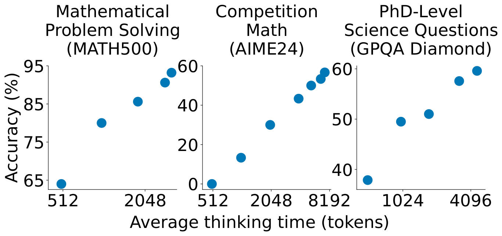
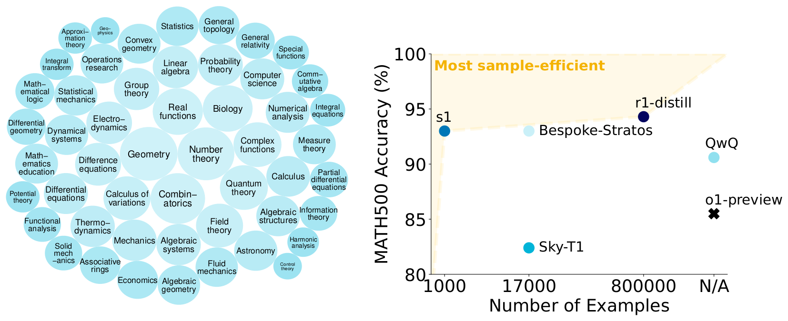
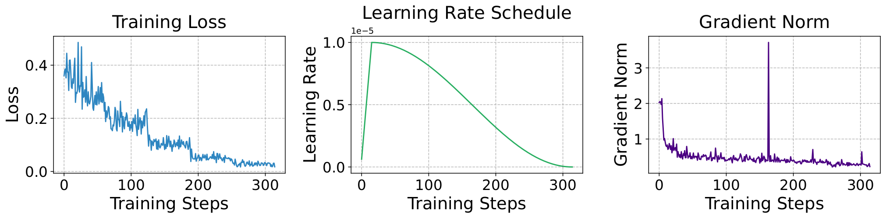
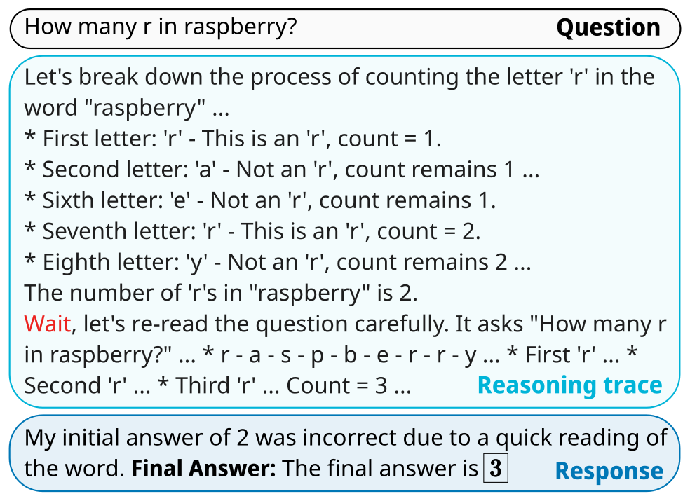
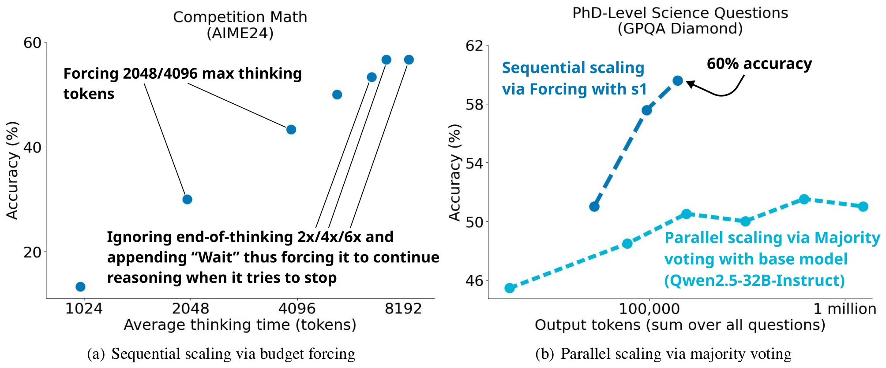
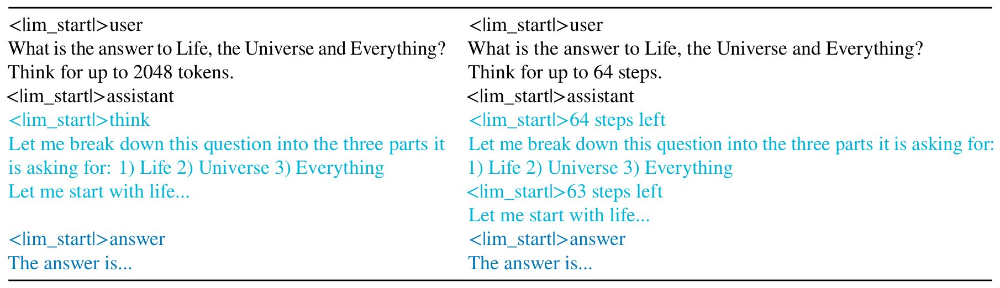
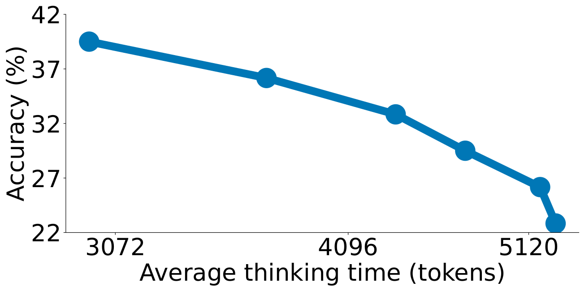
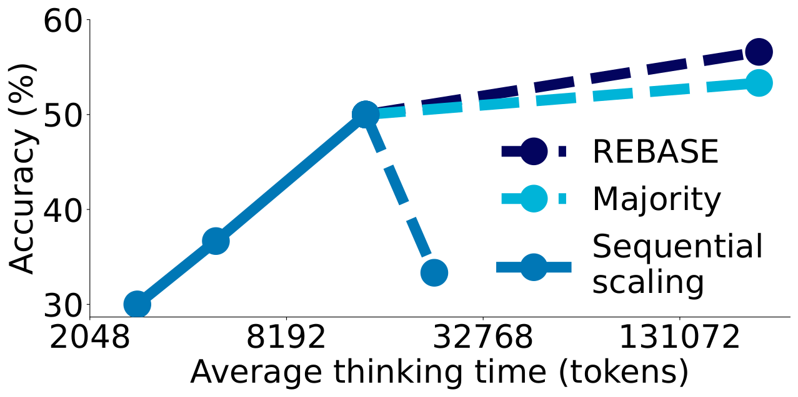

# 论文中文解读：《s1: Simple test-time scaling》

> **基本信息**：Niklas Muennighoff、Zitong Yang、Weijia Shi、Xiang Lisa Li（四人为共同第一作者）、Li Fei-Fei、Hannaneh Hajishirzi、Luke Zettlemoyer、Percy Liang、Emmanuel Candès、Tatsunori Hashimoto（Stanford University、University of Washington、Allen Institute for AI、Contextual AI），arXiv:2501.19393（本地 PDF 为 v3，2025 年 3 月 1 日）；论文原文 [官方页面](https://arxiv.org/abs/2501.19393)，代码、数据与模型见 [GitHub](https://github.com/simplescaling/s1)。
>
> **本文的读法**：图均为从论文 PDF 中按图裁出的原图，每张图后有中文图题、图中文字翻译和读图结论；表为逐格核对后的中文转录（数字与原文一致，表头和说明译为中文，模型名、数据集名保持原样），表题写明原文表号和页码，本文自己整理的表写作“整理表”。图 1、图 6、图 7 和训练曲线（图 9）是矢量图，曲线上点的数值是从 PDF 的绘图数据直接读出的（原文正文没有这些数字，会注明）；图 4 是位图，数值由像素位置估读，写作“约”。原文正文给出的数字优先。读完本文不必再翻英文原文。

## 一、一句话结论

OpenAI 的 o1 让人看到“推理时多花算力，成绩随之提高”（test-time scaling），但没有公开方法；DeepSeek R1 用强化学习、数百万样本和多阶段训练复现了 o1 级别的成绩，却没有公开地复现出清晰的 test-time scaling 行为。s1 问的是：**能不能用最简单的办法，同时得到强推理能力和 test-time scaling？**

作者的答案分两半：

1. **数据（s1K）**：从 59,029 道题中按质量（quality）、难度（difficulty）、多样性（diversity）三条准则筛出 1,000 道，每道题配一条由 Gemini 2.0 Flash Thinking Experimental 生成的“推理轨迹 + 解答”；在 Qwen2.5-32B-Instruct 上做 5 个 epoch 的监督微调（SFT），16 张 H100 约 26 分钟，得到 s1-32B。
2. **推理（budget forcing）**：推理时直接干预解码——模型想多想，就忽略它的“思考结束”分隔符并追加一个 “Wait”；想少想，就在达到上限时强行补上分隔符，让它转入回答。

结果：s1-32B 在 AIME24 上不加干预为 50.0%，用 budget forcing 延长思考后最高 56.7%；MATH500 为 93.0%，GPQA Diamond 为 59.6%。在 MATH500 和 AIME24 上超过 o1-preview（AIME24 的 56.7 对 44.6，相对高约 27%），但在 GPQA Diamond 上仍低于它（59.6 对 73.3）。它是开放数据推理模型里样本效率最高的一个。局限同样重要：budget forcing 延长到约 6 次 “Wait” 后就饱和并容易陷入重复循环，且受上下文窗口限制；推理轨迹来自闭源的 Gemini，所以它不是“只靠 1,000 条数据从零复现 o1”。



*图 1（原文 Figure 1，第 1 页）：在三个推理基准上改变测试时算力（平均 thinking token 数），s1-32B 的准确率随之变化。*

**图中文字翻译与读法**：

- **左 Mathematical Problem Solving (MATH500)（数学问题求解）**：横轴 Average thinking time (tokens)（平均思考时间，单位 token，对数刻度，刻度 512、2048），纵轴 Accuracy (%)（准确率，刻度 65–95）。5 个点，准确率随思考 token 增加而单调上升。
- **中 Competition Math (AIME24)（竞赛数学）**：横轴刻度 512、2048、8192，纵轴刻度 0–60。7 个点，从接近 0 一路升到 56.7%。
- **右 PhD-Level Science Questions (GPQA Diamond)（博士级科学题）**：横轴刻度 1024、4096，纵轴刻度 40–60。5 个点，从约 38% 升到 59.6%。
- **读图结论**：三个基准上都出现“多想则更准”的单调趋势；各点的具体数值见第七节整理表 A。注意横轴是**平均**思考 token，不是预设上限；曲线左侧的点主要来自“限制思考上限”，AIME24 和 GPQA 最右边的点来自“追加 Wait 延长思考”（对应关系见整理表 A2 和表 4）。

## 二、背景与动机

- **test-time scaling**：模型参数和训练数据固定，推理时多花计算来换更好的结果。作者把方法分成两类（引用 Snell et al.、Brown et al.）：**顺序（sequential）**，后面的计算依赖前面的结果，例如一条很长的推理链；**并行（parallel）**，各次计算相互独立，例如多数投票。本文聚焦顺序扩展，理由是直觉上它应该扩展得更好：后面的计算可以建立在中间结果上，做更深的推理和迭代修正。
- **要回答的问题**：已有大量复现 o1 的尝试（MCTS、多智能体等），R1 虽复现了 o1 水平但依赖强化学习、数百万样本与多阶段训练；还没有谁公开复现出清晰的 test-time scaling 行为。所以问：最简单的办法是什么？
- **与本仓库另一篇的关系**：[Scaling LLM Test-Time Compute Optimally](../scaling_test_time_compute/论文中文解读.md) 用训练过的修订模型和 PRM 搜索，研究如何按题目难度分配推理预算，方法复杂但能按难度适配；s1 则追求最小可复现系统：一个推理 SFT 模型，加上对分隔符的简单操作。
- **三个贡献**：（1）样本高效的推理数据构造方法（第 2 节）和测试时扩展方法（第 3 节）；（2）据此得到与 o1-preview 有竞争力的 s1-32B（第 4 节）；（3）对数据和扩展方法的细节消融（第 5 节）。

## 三、s1K：从 59K 到 1K

### 3.1 初始收集：59,029 道题

初始池按三条原则收集：**质量**（总要抽查样本，格式差的数据集直接放弃）、**难度**（题目要有挑战、需要大量推理）、**多样性**（来自不同学科，覆盖不同推理任务）。共 16 个来源，分两类：

- **已有数据集**：最大来源是 NuminaMATH（30,660 道来自网站的数学题）；另有 1983–2021 年的历史 AIME 题、OlympicArena（4,250 道，覆盖天文、生物、化学、计算机科学、地理、数学、物理奥赛）、OmniMath（4,238 道竞赛数学题）、AGIEval（2,385 道，含 SAT、LSAT 等标准化考试，涵盖英语、法律、逻辑）等。
- **作者新建的两个定量推理数据集**：**s1-prob**，182 道题，取自 Stanford 统计系博士资格考试的概率部分，附手写解答，包含困难的证明题；**s1-teasers**，23 道量化交易岗位面试常用的脑筋急转弯题，取自 PuzzledQuant，只取最高难度（Hard）。

每道题用 Google Gemini 2.0 Flash Thinking API 生成推理轨迹和解答，得到 59K 个“题目、生成的推理轨迹、生成的解答”三元组。然后对评测题（MATH500、GPQA Diamond、AIME24）做 8-gram 去污染并去重。

| 来源 | 描述 | 题数 | 平均 thinking 长度 |
|---|---|---:|---:|
| NuminaMATH | 来自网站的数学题 | 30660 | 4.1K |
| MATH | 竞赛数学题 | 11999 | 2.9K |
| OlympicArena | 天文、生物、化学、计算机科学、地理、数学、物理奥赛题 | 4250 | 3.2K |
| OmniMath | 竞赛数学题 | 4238 | 4.4K |
| AGIEval | 来自 SAT、LSAT 等考试的英语、法律、逻辑和数学题 | 2385 | 1.2K |
| xword | 填字谜 | 999 | 0.7K |
| OlympiadBench | 数学与物理奥赛题 | 896 | 3.9K |
| AIME（1983–2021） | 美国数学邀请赛 | 890 | 4.7K |
| TheoremQA | 与定理相关的计算机科学、金融、数学、物理大学水平题 | 747 | 2.1K |
| USACO | 美国计算机奥赛的编程题 | 519 | 3.6K |
| JEEBench | 印度理工学院入学考试用的化学、数学、物理题 | 515 | 2.9K |
| GPQA | 博士级科学题 | 348 | 2.9K |
| SciEval | 来自各处的生物、化学、物理题 | 227 | 0.7K |
| s1-prob | Stanford 统计系资格考试题 | 182 | 4.0K |
| LiveCodeBench | 来自 LeetCode、AtCoder、CodeForces 的编程题 | 151 | 3.5K |
| s1-teasers | 从网上搜集的数学脑筋急转弯 | 23 | 4.1K |
| 全部 59K 题 | 以上数据集合并，附推理轨迹和解答 | 59029 | 3.6K |

原文表 7（第 18 页）：59K 题的构成。thinking 长度用 Qwen2.5-32B-Instruct 的 tokenizer 按 token 计。原文说明：除排除评测基准 AIME24 外，还排除 2022–2023 年的 AIME 题，因为这 90 道题在开发 s1-32B 时用过（所以 AIME 来源是 1983–2021 年的 890 题）。各行题数相加为 59,029。

### 3.2 三阶段筛选

从 59K 到 1K 经过三个阶段：

| 阶段 | 做法 | 剩余题数 |
|---|---|---:|
| 初始收集 | 16 个来源，Gemini 生成轨迹，8-gram 去污染并去重 | 59,029 |
| Quality（一） | 去掉调用 Gemini API 出错的题 | 54,116 |
| Quality（二） | 去掉含格式问题的题：ASCII 示意图、不存在的图片引用、题号不一致 | 51,581 |
| Difficulty | 去掉 Qwen2.5-7B-Instruct 或 Qwen2.5-32B-Instruct 任何一个能答对的题 | 24,496 |
| Diversity 与最终选定 | 先选 384 道来自高质量来源的题，再按领域均匀随机、偏向长推理轨迹的方式补足 | 1,000（跨 50 个领域） |

整理表 B（整理自原文第 2.2 节和附录 C.4，第 2–3、19–20 页）。

**Quality**：从质量过滤后的题里，作者识别出 384 道来自“他们认为质量高、无需进一步过滤”的数据集的样本，直接纳入最终的 1,000 道（细节在附录 C.4，即下面的算法 1）。原文对这 384 道是否也经过难度过滤的表述不完全一致：正文把它们放在质量阶段、说“无需进一步过滤”，而算法 1 的输入是难度过滤后的 24,496 道题。

**Difficulty**：用两个指标：**模型表现**和**推理轨迹长度**。对每道题，让 Qwen2.5-7B-Instruct 和 Qwen2.5-32B-Instruct 两个模型作答，由 Claude 3.5 Sonnet 对照参考解答判对错，**任何一个答对的题都被删掉**（太简单）；用两个模型是为了降低“简单题因其中一个模型偶然答错而漏过”的概率。同时用 Qwen2.5 tokenizer 度量每条推理轨迹的 token 长度，作为难度的另一个指示——假设越难的题需要越多思考 token。作者说，这种基于模型的过滤针对 Qwen2.5-32B-Instruct 做了优化，但思路可以推广到其他设置。

**Diversity**：用 Claude 3.5 Sonnet 按美国数学学会的 Mathematics Subject Classification（MSC）把每道题分到一个领域（几何、组合数学等；这个分类以数学为主，也含生物、物理、经济等其他科学）。选题方式：在 24,496 道题的池子里，**先均匀随机选一个领域，再从该领域按“偏向更长推理轨迹”的分布抽一题**，重复直到凑够 1,000 道，覆盖 50 个领域。

**算法 1（原文附录 C.4，第 20 页）：s1K 的两阶段采样**。输入是 24,496 道带特征的题，输出是 1,000 道。下面是对原文伪代码的中文转写：

```text
S ← 空集                                  # 选中的题（只记录不重复的元素）
对池中每道题 q：
    若 Gemini 答对 q，且 q 来自 AIME 或 GPQA：          S ← S ∪ {q}   # 选入全部答对的 AIME/GPQA
    否则若 Gemini 答对 q，且 q 来自 MATH，且 thinking 长度 > 5600：   S ← S ∪ {q}   # 选入 thinking 很长且答对的 MATH
D ← 全部领域
当 |S| < 1000：
    d ← 从 D 中随机取一个领域
    Q_d ← 领域 d 里的题
    ranks ← 按 thinking 长度给 Q_d 排名
    weights ← 2 的 (-ranks) 次方                        # 原文注释写“幂律加权”，偏向更长的轨迹
    q ← 按 weights 在 Q_d 中加权抽样一题
    S ← S ∪ {q}；Q_d ← Q_d 去掉 q
    若 Q_d 为空：从 D 中删去 d
```

读法：伪代码没有写明排名方向，只有“排名 1 对应最长”才与“偏向长轨迹”一致；权重随排名每降一位减半，所以排在最前面的几条长轨迹被抽中的概率远高于其余。这个算法不是“取最长的 1,000 条”，而是“困难偏好 + 领域覆盖”的折中。第一个循环选入的是 AIME、GPQA 和 MATH 这几个“高质量来源”的题，应当就是前面说的 384 道（原文没有逐字这样说，是本文的对应）；其余约 616 道（1000 减 384，本文算得）来自第二阶段。

**一个容易忽略的事实**：s1K 并不要求解答都是对的。原文说，一些蒸馏出的生成是错误的，他们允许这种情况，因为关注的是**捕获推理过程**而不是完全正确的解答；用 Claude 3.7 做 grader（评分提示见下），s1K 中 53.6% 被判为正确，后续的 s1K-1.1（第十一节）为 63.0%。

评分提示（原文图 8，附录 C.3，第 19 页）译为：

```text
你是一个给科学题评分的 AI 助手。用户会提供题目本身、一名学生做出的解答尝试，以及这道题的正确答案。
你的任务是把尝试与正确答案对照，判断尝试是否正确。如果期望的解答以一个数或一个选项结尾，就不应有歧义。
如果期望的解答涉及完整的推理过程，则应当根据推理过程是否正确来判断（必要时参照正确答案）。
用户会按以下格式提供尝试和正确答案：
# Problem
{problem}
## Attempt
{attempt}
## Correct answer
{solution}
请解释你的判断，并在新的一行里只写 "Yes" 或 "No"（不带引号）作为结尾。
```

作者用 Claude 3.5 做上述筛选中的判分，只有对最终 1,000 道样本的正确性统计用的是 Claude 3.7。

### 3.3 s1K 的构成



*图 2（原文 Figure 2，第 3 页）：左，s1K 是一个包含 1,000 道高质量、多样、有难度的题及其推理轨迹的数据集；右，s1-32B 位于样本效率前沿。*

**图中文字翻译与读法**：

- **左图**：50 多个气泡，每个气泡是一个领域，气泡大小大致对应题数（原文未说明）。最大的是 Geometry（几何）、Number theory（数论）、Combinatorics（组合数学），其次是 Real functions（实函数）、Biology（生物学）、Complex functions（复变函数）、Quantum theory（量子理论）等；更小的气泡包括 Probability theory（概率论）、Computer science（计算机科学）、Statistics（统计）、Control theory（控制论）、Harmonic analysis（调和分析）、Geophysics（地球物理）等。具体题数见下表。
- **右图**：横轴 Number of Examples（用于推理微调的样本数：1000、17000、800000、N/A），纵轴 MATH500 Accuracy (%)（80–100）。黄色阴影区 Most sample-efficient（样本效率最高）是“少样本且高准确率”的左上区域。点：s1（1,000 样本，93.0%）、Bespoke-Stratos（17,000，93.0%）、Sky-T1（17,000，82.4%）、r1-distill（800,000，94.3%）、QwQ（样本数未知 N/A，90.6%）、o1-preview（N/A，85.5%，用叉号标出）。数值与表 1 一致。
- **读图结论**：s1 的 MATH500 成绩与用 17K 样本的 Bespoke-Stratos 相同、高于 Sky-T1，只比用 800K 样本的 r1-distill 低 1.3 个点，而样本数分别少 17 倍和 800 倍。

| 领域 | 题数 | 总 token 数 | 关键词（Claude 生成） |
|---|---:|---:|---|
| Geometry（几何） | 109 | 560.2K | 面积、三角形、距离 |
| Number theory（数论） | 98 | 522.5K | 数列、整除 |
| Combinatorics（组合数学） | 75 | 384.7K | 排列、计数 |
| Real functions（实函数） | 43 | 234.8K | 三角、微积分 |
| Biology（生物学） | 41 | 120.9K | 有机反应 |
| Complex functions（复变函数） | 32 | 170.2K | 复根 |
| Quantum theory（量子理论） | 32 | 127.9K | 粒子、波函数 |
| Field theory（域论） | 28 | 150.1K | 多项式、根 |
| Calculus of variations（变分法） | 28 | 155.5K | 优化、控制 |
| Difference equations（差分方程） | 24 | 132.5K | 递推、递归 |
| Electromagnetic theory（电磁理论） | 23 | 95.8K | 光学、波、衍射 |
| Group theory（群论） | 22 | 100.0K | 群、自同构 |
| Linear algebra（线性代数） | 22 | 128.3K | 矩阵、行列式 |
| Probability theory（概率论） | 20 | 114.6K | 随机游走、期望 |
| Algebraic systems（代数系统） | 19 | 109.9K | 函数方程 |
| Mechanics（力学） | 19 | 103.6K | 力、运动、能量 |
| Thermodynamics（热力学） | 19 | 74.2K | 热机、熵 |
| Differential equations（微分方程） | 18 | 89.6K | 代换、存在性 |
| Computer science（计算机科学） | 18 | 34.2K | 复杂度理论、算法 |
| Numerical analysis（数值分析） | 18 | 76.5K | 误差分析、稳定性 |
| Calculus（微积分） | 17 | 96.3K | 收敛、求和 |
| Algebraic structures（代数结构） | 17 | 90.4K | 不等式、集合 |
| Astronomy（天文学） | 16 | 37.7K | 恒星星族、轨道 |
| 其余 27 个领域 | 242 | 982.2K | 题数不超过 16 的领域 |
| 全部领域（51 个） | 1000 | 4.7M | s1K |

原文表 6（第 17 页）：s1K 的领域汇总。token 数用 Qwen-2.5 tokenizer 计，关键词由作者提示 Claude 根据该领域的若干题生成。各行题数相加为 1,000；总 token 数 4.7M，即平均每题约 4.7K token，高于全部 59K 题的平均 thinking 长度 3.6K（表 6 未说明总 token 是否含题目和解答，两者口径不一定相同）。注意：正文说 1,000 道覆盖 50 个领域，表 6 的合计行写“全部领域（51）”，原文没有解释这个差异。

附录 D.2 的表 9–11 给出了三条 s1K 训练样本，各自来自不同来源：s1-prob（一道关于鞅收敛的概率证明题）、s1-teasers（两人掷硬币的期望值脑筋急转弯，参考答案 4/3）、OlympicArena 的天文子集（若太阳按人体的单位体积功率发热，表面温度是多少）。每条样本都由题目、参考解答、Gemini 生成的推理轨迹和回答四部分组成；Gemini 只根据题目生成推理轨迹和回答，训练用的是这两部分，参考解答不参与训练。

## 四、训练 s1-32B

**配方很简单**（附录 D）：

- 基础模型 Qwen2.5-32B-Instruct（在数学任务上通常与更大的 Qwen2.5-72B-Instruct 持平或更好）；
- 用特殊分隔符区分思考阶段和回答阶段：思考阶段以 `<|im_start|>think` 开头，回答阶段以 `<|im_start|>answer` 开头，两者前后各有一个换行；
- 5 个 epoch，batch size 16，共 315 个梯度步（每个 epoch 63 步，是 1000 题除以 16 向上取整，本文推算）；bfloat16 精度；学习率 1e-5，前 5%（16 步）线性 warmup，之后在其余 299 步里按余弦调度衰减到 0；AdamW，$\beta_1=0.9$、$\beta_2=0.95$，权重衰减 1e-4；
- **不对题目计算损失，只对推理轨迹和解答计算损失**；
- 序列长度要足够长，保证不截断任何样本（下面的消融说明这点很重要）；
- 用 PyTorch FSDP，在 16 张 NVIDIA H100 上训练约 26 分钟（约 7 个 H100 GPU 小时）。作为对比，在完整 59K 上微调要 394 个 H100 GPU 小时。



*图 9（原文 Figure 9，附录 D，第 21 页）：训练损失、学习率调度和梯度范数随训练步数的变化。*

**图中文字翻译与读法**：

- **左 Training Loss（训练损失）**：横轴 Training Steps（训练步数，0 到约 315），纵轴 Loss。损失从约 0.36 起步，步数约 20 处最高到 0.49，随后下降，最终约 0.02。
- **中 Learning Rate Schedule（学习率调度）**：纵轴 Learning Rate（刻度单位 1e-5）。线性升到 1e-5（第 15 步），再按余弦衰减，在末尾降到 0。
- **右 Gradient Norm（梯度范数）**：起始约 2，几步内降到 1 以下并缓慢降到约 0.3；第 163 步附近有一个约 3.7 的尖峰，第 228、302 步附近还有较小的尖峰。
- **读图结论（读自原图数据点）**：学习率曲线与文字描述（16 步 warmup，余弦衰减）一致。损失曲线按每 63 步一个 epoch 切分，各 epoch 的平均损失约为 0.31、0.19、0.10、0.05、0.03，并在 epoch 边界处出现台阶式下降，这是多 epoch 微调小数据集的常见现象（本文的读图观察，原文没有讨论）。

**序列长度消融**（附录 D.1）：

| 项目 | 模型 A | 模型 B |
|---|---|---|
| 训练序列长度 | 4096 | 32768 |
| 被截断的训练样本比例 | 74% | 0% |
| AIME24 | 30.0% / 20721 | 50.0% / 6984 |
| MATH500 | 90.0% / 5324 | 91.0% / 3268 |
| GPQA | 52.5% / 6841 | 53.0% / 3568 |

原文表 8（第 21 页）：训练序列长度消融。每格是“准确率 / 平均每题 thinking token 数”，准确率越高、thinking token 越少（推理成本越低）越好。

读法：训练序列长度短，会让更多样本的**回答部分被截掉**，模型更少学到“推理结束后输出回答”，于是推理时更不容易及时结束，推理轨迹变长（AIME24 平均 20,721 个 thinking token，对 6,984），而且成绩更差（30.0% 对 50.0%）。所以作者选择最长的训练序列长度，既更准又让推理更省。这个结果有力地说明“输出更长”不等于“推理更强”。

## 五、budget forcing 与评价指标

### 5.1 budget forcing

作者把它描述为一种简单的**解码时干预**：强制规定思考 token 数的最大值或（和）最小值。

- **强制上限**：当 thinking token 数达到上限，直接追加思考结束分隔符（可选再追加 “Final Answer:”），让模型提前退出思考阶段、给出当前最好的答案。
- **强制下限（延长思考）**：当模型自己要生成思考结束分隔符时，**抑制这个 token 的生成**，并（可选地）在当前推理轨迹末尾追加字符串 “Wait”，促使模型反思当前的生成。可以反复做若干次，得到更高的算力档位。

本文的伪代码转写（不是原文伪代码，只是对上述描述的转写）：

```text
模型在思考区域里生成
循环：
    若 thinking token 数达到上限 a_max：
        追加“思考结束”分隔符（可选再追加 "Final Answer:"），模型转入回答 → 结束
    若模型自己要输出“思考结束”分隔符，且还没达到想要的下限：
        不输出这个分隔符，改为追加 "Wait"，继续生成
```



*图 3（原文 Figure 3，第 4 页）：模型本想在 “...is 2.” 之后停止，但被抑制了思考结束分隔符，改为追加 “Wait”，于是 s1-32B 自我纠正了答案。*

**图中文字翻译与读法**：

- **Question（问题）**：How many r in raspberry?（raspberry 里有几个 r？）
- **Reasoning trace（推理轨迹）**：模型先逐字母数：“Let's break down the process of counting the letter 'r' in the word "raspberry" ...；First letter: 'r' - This is an 'r', count = 1；Second letter: 'a' - Not an 'r', count remains 1 ...；Sixth letter: 'e' ...；Seventh letter: 'r' - This is an 'r', count = 2；Eighth letter: 'y' ...”，得出 “The number of 'r's in "raspberry" is 2.”。此时模型本想结束思考，但分隔符被抑制，追加了字符串 **Wait**（图中红色），模型接着写：“Wait, let's re-read the question carefully. It asks "How many r in raspberry?" ... * r - a - s - p - b - e - r - r - y ... First 'r' ... Second 'r' ... Third 'r' ... Count = 3 ...”。
- **Response（回答）**：“My initial answer of 2 was incorrect due to a quick reading of the word. **Final Answer:** The final answer is 3”（我最初的答案 2 因为读词太快而错了。最终答案是 3）。
- **读图结论**：原文说，这样做可以让模型重新检查答案，常常能修正错误的推理步骤。延长思考并不是在隐藏状态里增加计算，而是改变已生成的上下文，让模型在“似乎做完了”的地方继续写；至于是否真的有用，要看模型本身（原文没有分析 SFT 数据里自我检查模式的作用，这里只是本文的解读）。

### 5.2 对照方法

作者拿 budget forcing 与两类基线比：

- **条件式长度控制（conditional length-control）**：在提示里告诉模型该想多久，分三种粒度：**token 条件控制（TCC）**，指定 thinking token 数上限；**步骤条件控制（SCC）**，指定 thinking 步数上限，每步约 100 个 token；**类别条件控制（CCC）**，写两个通用提示，告诉模型想得短或想得长。
- **拒绝采样（RS）**：反复采样，直到某次生成的长度落入预先设定的算力预算内。作者称它是一个“oracle”，因为它刻画的是“以长度为条件的回答后验分布”。

### 5.3 三个评价指标

作者认为不能只看方法能达到的最高准确率，还要看它的**可控性**和**扩展斜率**。对每个方法，在固定基准（如 AIME24）上改变测试时算力跑一组评测，评测点集合记为 $\mathcal A$；以算力（thinking token 数）为横轴、准确率为纵轴，得到一条分段线性函数 $f$。定义三个指标（原文式 (1)–(3)）：

$$
\mathrm{Control}=\frac{1}{|\mathcal A|}\sum_{a\in\mathcal A}\mathbf{1}\big(a_{\min}\le a\le a_{\max}\big),
$$

$$
\mathrm{Scaling}=\frac{1}{\binom{|\mathcal A|}{2}}\sum_{\substack{a,b\in\mathcal A\\ b>a}}\frac{f(b)-f(a)}{b-a},
$$

$$
\mathrm{Performance}=\max_{a\in\mathcal A} f(a).
$$

- **Control（可控性）**：$a_{\min}$、$a_{\max}$ 是预先指定的最小、最大测试时算力（这里是 thinking token 数），通常只限制 $a_{\max}$。Control 是落在范围内的评测点所占比例，以百分比报告，100% 表示完全可控。
- **Scaling（扩展斜率）**：$f$ 这条分段线性函数在所有点对之间的平均斜率；有用的方法必须为正，越大越好。
- **Performance（表现）**：方法在该基准上达到的**最高**准确率（不是“某个可比预算下的准确率”）。原文指出，Scaling 单调为正的方法在极限处会达到 100%，但本文研究的方法最终都会变平，或因可控性、上下文窗口限制而无法继续扩展。

## 六、评测设置

| 基准 | 规模与内容 | 评测说明 |
|---|---|---|
| AIME24 | 30 道题，来自 2024 年 1 月 31 日至 2 月 1 日的美国数学邀请赛（AIME）；答案都是 000 到 999 的整数 | 部分题依赖图，作者用矢量图语言 Asymptote 把图以文本形式提供给模型（模型不能接收图像输入） |
| MATH500 | 500 道不同难度的竞赛数学题 | 用 OpenAI 在先前工作（Lightman et al.）中选出的同一批 500 题 |
| GPQA Diamond | 198 道博士级生物、化学、物理题 | 对应领域的博士专家只做到 69.7%（OpenAI 报告）；文中的 “GPQA” 都指 Diamond 子集 |

整理表（整理自原文第 4.1 节，第 4–5 页）。评测基于 lm-evaluation-harness 框架，除非另有说明，温度为 0（贪心），指标是准确率（等价于 pass@1）。

**对比的其他模型**：OpenAI o1 系列（闭源，让 test-time scaling 流行起来）；DeepSeek r1 系列（开放权重，最高达 o1 水平）；Qwen 的 QwQ-32B-preview（32B 开放权重，方法未公开）；Sky-T1-32B-Preview 和 Bespoke-32B（开放模型，推理数据分别蒸馏自 QwQ-32B-preview 和 r1）；Google Gemini 2.0 Flash Thinking Experimental（s1 蒸馏所用的 API）。后者没有官方评测分数，作者自己用 Gemini API 评测，但 API 的 “recitation error” 使评测困难；他们手动把 30 道 AIME24 题放进网页界面（那里不出现该错误），而 MATH500（500 题）和 GPQA Diamond（198 题）没有做，所以表 1 中记为 N.A.。

**评测的不确定性**（附录 B）：作者用 vLLM 评测，发现即使固定随机种子并贪心解码，评测分数也可能显著变化：不同的 batch size、续写生成（continuing generations）、张量并行度的改变都会改变结果。由于模型在回答前会生成很长的推理轨迹，微小的数值差异会滚雪球：很多生成在数千个 token 里完全相同，然后在某个 token 突然分叉，最终得到完全不同的答案。作者为此在最终评测里通常用全精度。这一点决定了下面所有小数点后的差别都要谨慎看待。

## 七、主结果

### 7.1 test-time scaling 曲线

图 1 给出 s1-32B 在三个基准上的曲线。下表是从图 1 和图 4(a) 的绘图数据读出的各点（原文正文没有这些数字）。

| 基准 | 点 1 | 点 2 | 点 3 | 点 4 | 点 5 | 点 6 | 点 7 |
|---|---|---|---|---|---|---|---|
| AIME24 | 500 / 0.0 | 1,000 / 13.3 | 2,000 / 30.0 | 3,930 / 43.3 | 5,300 / 50.0 | 6,660 / 53.3 | 7,320 / 56.7 |
| MATH500 | 500 / 64.0 | 980 / 80.0 | 1,810 / 85.6 | 2,870 / 90.6 | 3,200 / 93.2 | - | - |
| GPQA Diamond | 500 / 37.9 | 990 / 49.5 | 1,740 / 51.0 | 3,230 / 57.6 | 4,650 / 59.6 | - | - |

整理表 A：图 1 各点读数。每格是“平均 thinking token 数（约） / 准确率（%）”，读自 PDF 矢量绘图数据，token 数取整到十位。

AIME24 的 30 道题决定了准确率只能是 30 分之几：13.3、30.0、43.3、50.0、53.3、56.7 分别是 4、9、13、15、16、17 题；MATH500 最右点的 93.2% 是 466/500，表 1 报告的是 93.0%（465/500），差一题，可能与上面说的评测不确定性有关（本文推测）。

AIME24 这 7 个点在图 4(a) 里有标注，加上图 4(a) 多出的第 6 次 “Wait” 的点：

| 平均 thinking token（约） | AIME24 准确率 | 对应的设置 |
|---:|---:|---|
| 500 | 0.0 | 限制思考上限（仅图 1 有；上限推断为 512） |
| 1,000 | 13.3 | 限制思考上限（推断为 1024；图 4(a) 未标注） |
| 2,000 | 30.0 | 强制在 2048 个 thinking token 处结束（图 4(a) 标注） |
| 3,930 | 43.3 | 强制在 4096 个 thinking token 处结束（图 4(a) 标注） |
| 5,300 | 50.0 | 不加干预（推断） |
| 6,660 | 53.3 | 忽略结束符并追加 “Wait” 2 次（图 4(a) 标注） |
| 7,320 | 56.7 | “Wait” 4 次（图 4(a) 标注） |
| 8,500 | 56.7 | “Wait” 6 次（仅图 4(a)，位图估读，约 8,500） |

整理表 A2：AIME24 上 budget forcing 各点与设置的对应（“推断”表示图上没有标注，本文按位置和表 4、表 5 推断）。表 4、表 5 中 “Wait” 2 次为 53.3、4 次为 56.7，与此一致；GPQA 的第 4、5 个点（57.6 与 59.6）同样对应表 4 的“不外推”与“2 次 Wait”。

原文第 3.2 节说图 1 中 AIME24 最右点对应 $f(7320)=57\%$，与读数 7,319 个 token、56.7% 吻合。



*图 4（原文 Figure 4，第 5 页）：(a) 通过 budget forcing 的顺序扩展，(b) 通过多数投票的并行扩展。*

**图中文字翻译与读法**：

- **(a) Competition Math (AIME24)**：横轴 Average thinking time (tokens)（1024、2048、4096、8192，对数刻度），纵轴 Accuracy (%)（20–60）。标注文字：“Forcing 2048/4096 max thinking tokens”（强制最多思考 2048/4096 个 token）指向 2,000 和 3,900 附近的两个点；“Ignoring end-of-thinking 2x/4x/6x and appending “Wait” thus forcing it to continue reasoning when it tries to stop”（忽略思考结束 2/4/6 次并追加 “Wait”，迫使模型在想停下时继续推理）指向最右的三个点。
- **(b) PhD-Level Science Questions (GPQA Diamond)**：横轴 Output tokens (sum over all questions)（所有题目的输出 token 总和，对数刻度，刻度 100,000 和 1 million），纵轴 Accuracy (%)（46–62）。深蓝虚线 “Sequential scaling via Forcing with s1”（用 s1 做强制的顺序扩展）有 3 个点，约 51.0%、57.6%、59.6%，最高点旁标注 “60% accuracy”；青色虚线 “Parallel scaling via Majority voting with base model (Qwen2.5-32B-Instruct)”（用基础模型 Qwen2.5-32B-Instruct 做多数投票的并行扩展）有 6 个点，约 45.5%、48.5%、50.5%、50.0%、51.5%、51.0%（读图估计）。
- **读图结论**：(a) 说明 budget forcing 有清晰的扩展趋势并在一定程度上可外推：从不加干预的 50.0% 到 56.7%，但在第 4 次与第 6 次 “Wait” 之间持平（56.7% 与 56.7%）。正文说它在六次时趋于饱和，并指出过于频繁地抑制思考结束分隔符会把模型带入重复循环，而不是继续有效推理。(b) 说明在**基础模型**上用多数投票做并行扩展（样本数 2、4、8、16、32、64，每题采样温度 1）追不上 s1-32B 加 budget forcing 的表现，原文据此认为验证了自己的直觉：顺序扩展比并行扩展更有效。需要注意：(b) 的两条曲线对应的模型不同（一条是 SFT 之后的 s1-32B，另一条是没做推理微调的基础模型），所以这个比较混入了 SFT 的作用；在同一个 s1 模型上比较顺序与并行的是第十节的图 7。另外 (b) 横轴是所有题的输出 token **总和**，与图 1 的“平均思考 token”不是同一单位，不能直接对读。

**样例输出（原文图 5，第 7 页，未收录原图）**：作者从 AIME24、MATH500、GPQA 各挑了一道模型答对的题，展示提示（黑色）、推理轨迹（浅蓝）和回答（蓝色），正文因篇幅用 […] 省略了中间部分。例如 AIME24 的取石子博弈题（每次取 1 个或 4 个，谁取走最后一个谁赢，问 $n\le2024$ 中有多少个 $n$ 使后手 Bob 有必胜策略）：模型先把位置分成必胜与必败，列出必败位置 $\{0,2,5,7,10,12,\dots\}$，发现相邻差交替为 2、3，推出必败位置形如 $5m$ 或 $5m+2$，再分两种情形数出 $404+405=809$ 个。MATH500 的例子是已知 $\mathbf{b}=(2,6,3)$、$\mathbf{a}\cdot\mathbf{b}=8$ 求 $\mathbf{a}$ 在 $\mathbf{b}$ 上的投影，结果为 $(16/49,\ 48/49,\ 24/49)$；GPQA 的例子是二维势场 $V=\tfrac12kr^2+\tfrac32kr^2\cos^2\theta$ 中粒子的能谱，结果为 $E=\hbar\sqrt{k/m}\,(2n_x+n_y+\tfrac32)$。这三例体现的轨迹风格是：先复述题意、设定记号，再逐步展开、验证规律、最后给出 “Final Answer”。

### 7.2 样本效率

下表是 s1-32B 与其他模型的比较（原文表 1）：

| 模型 | 推理微调样本数 | AIME24 | MATH500 | GPQA Diamond |
|---|---|---:|---:|---:|
| **仅 API** | | | | |
| o1-preview | N.A. | 44.6 | 85.5 | 73.3 |
| o1-mini | N.A. | 70.0 | 90.0 | 60.0 |
| o1 | N.A. | **74.4** | **94.8** | **77.3** |
| Gemini 2.0 Flash Think. | N.A. | 60.0 | N.A. | N.A. |
| **开放权重** | | | | |
| Qwen2.5-32B-Instruct | N.A. | 26.7 | 84.0 | 49.0 |
| QwQ-32B | N.A. | 50.0 | 90.6 | 54.5 |
| r1 | ≫800K | **79.8** | **97.3** | **71.5** |
| r1-distill | 800K | 72.6 | 94.3 | 62.1 |
| **开放权重且开放数据** | | | | |
| Sky-T1 | 17K | 43.3 | 82.4 | 56.8 |
| Bespoke-32B | 17K | **63.3** | 93.0 | 58.1 |
| s1 w/o BF | **1K** | 50.0 | 92.6 | 56.6 |
| **s1-32B** | **1K** | 56.7 | **93.0** | **59.6** |

原文表 1（第 5 页）：s1-32B 是一个强的开放推理模型。其他结果引自各自的报告；# ex. 是用于推理微调的样本数，BF 是 budget forcing；N.A. 表示未知。更好的 s1.1 见第十一节。

读法：

- **与基础模型比**：s1-32B 比 Qwen2.5-32B-Instruct 在 AIME24 高 30.0 点（26.7 到 56.7）、MATH500 高 9.0 点、GPQA 高 10.6 点，而只多用了 1,000 条训练样本。budget forcing 本身的增益：从 s1 w/o BF 到 s1-32B，AIME24 +6.7、MATH500 +0.4、GPQA +3.0。
- **与 o1-preview 比**：AIME24 56.7 对 44.6（高 12.1 点，相对高约 27.1%，对应摘要里的 “up to 27%”）；MATH500 93.0 对 85.5（高 7.5 点）；但 GPQA 59.6 对 73.3，低 13.7 点。所以“超过 o1-preview”只对两个数学基准成立，o1-preview 的数字引自 OpenAI 的报告。
- **与 o1-mini、QwQ**：比 o1-mini 的 AIME24 低（56.7 对 70.0），MATH500 高（93.0 对 90.0），GPQA 基本持平（59.6 对 60.0）；三项都高于 QwQ-32B。
- **与同类开放数据模型比**：与 Sky-T1、Bespoke-32B（各 17K 样本）相比，MATH500 持平或更高；Bespoke-32B 的 AIME24 更高（63.3 对 56.7）。
- **与 r1 系列比**：同样只用 SFT 的 r1-distill 更强（AIME24 72.6，MATH500 94.3，GPQA 62.1），但用了 800 倍的推理样本；能否只用 1,000 条样本达到它的水平是开放问题。
- **与 Gemini 2.0 Flash Thinking 比**：AIME24 接近（56.7 对 60.0）。因为 s1K 的数据蒸馏自 Gemini 2.0，作者据此认为这个蒸馏流程大概是有效的。
- **注意表 1 与后文表格口径不同**：表 1 的 “s1 w/o BF” 是完全不用 budget forcing（AIME24 50.0、MATH500 92.6、GPQA 56.6）；表 2 的 s1K 一行（50.0、93.0、57.6）则带约 30,000 个 thinking token 的上限（见表 2 说明），所以略有不同；表 4 的 “No extrapolation” 与它数值相同（本文推测口径相同，原文未明说）。

## 八、消融：数据

作者检验“质量、难度、多样性三者联合”是否必要：

- **只靠质量（1K-random）**：在 Gemini 生成的高质量推理链中随机选 1,000 条，完全不用难度和多样性过滤；
- **只靠多样性（1K-diverse）**：在各领域间均匀采样以最大化多样性，不考虑难度；
- **只靠难度（1K-longest）**：选推理轨迹最长的 1,000 条；
- **最大化数据量（59K-full）**：用全部 59K 样本训练，它是所有 1K 版本的超集。

| 模型 | AIME24 | MATH500 | GPQA Diamond |
|---|---|---|---|
| 1K-random | 36.7 [-26.7%, -3.3%] | 90.6 [-4.8%, 0.0%] | 52.0 [-12.6%, 2.5%] |
| 1K-diverse | 26.7 [-40.0%, -10.0%] | 91.2 [-4.0%, 0.2%] | 54.6 [-10.1%, 5.1%] |
| 1K-longest | 33.3 [-36.7%, 0.0%] | 90.4 [-5.0%, -0.2%] | 59.6 [-5.1%, 10.1%] |
| 59K-full | 53.3 [-13.3%, 20.0%] | 92.8 [-2.6%, 2.2%] | 58.1 [-6.6%, 8.6%] |
| **s1K** | 50.0 | 93.0 | 57.6 |

原文表 2（第 6 页）：s1K 数据消融。所有分数都用 budget forcing 把最大思考长度限制在约 30,000 个 token（原文说这比不用 budget forcing 的分数略好，因为它允许模型在陷入无限循环时给出最好的猜测）。方括号是相对 s1K 的差值的 95% 配对 bootstrap 置信区间（10,000 次 bootstrap 抽样）。例如 59K-full 在 AIME24 上的 [-13.3%, 20.0%] 表示，有 95% 的把握，59K-full 与 s1K 的真实差在 -13.3% 到 +20.0% 之间；若整个区间为负（如 [-26.7%, -3.3%]），则可确信表现比 s1K 差。

读表：

- **随机选 / 只选多样 / 只选最长**：AIME24 分别为 36.7、26.7、33.3，比 s1K 的 50.0 低 13.3、23.3、16.7 个百分点（平均低 17.8 个点，相对下降约 36%）；MATH500、GPQA 的差距较小。正文把它们概括为“平均约 −30%”，原文没有说明这个数字的算法；按表 2 的数字，它更接近相对下降，不是 30 个百分点。
- **按原文自己的置信区间标准**，整个区间为负的只有：1K-random 与 1K-diverse 在 AIME24 上，以及 1K-longest 在 MATH500 上（[-5.0%, -0.2%]）；1K-random 的 MATH500 上界恰为 0.0%，1K-longest 的 AIME24 上界为 0.0%；其余区间都含 0。就是说，“联合三条准则优于单一准则”主要由 AIME24 上的差距支撑，而 AIME24 只有 30 题。
- **只选最长**：原文称它“显著提升”了 GPQA（59.6，高于随机的 52.0 和多样性的 54.6，也高于 s1K 的 57.6，但相对 s1K 的区间 [-5.1%, 10.1%] 含 0），但整体仍不如 s1K。
- **59K-full**：AIME24 53.3、MATH500 92.8、GPQA 58.1，与 s1K 的区间都含 0，没有显著更好，却要 394 个 H100 GPU 小时对 7 个。作者据此主张“精心选数据比盲目加量重要”，并指出这与指令微调的已有发现（LIMA）一致。

## 九、消融：测试时扩展方法

### 9.1 总览

| 方法 | Control | Scaling | Performance | $\lvert\mathcal A\rvert$ |
|---|---:|---:|---:|---:|
| **BF** | **100%** | 15 | **56.7** | 5 |
| TCC | 40% | -24 | 40.0 | 5 |
| TCC + BF | **100%** | 13 | 40.0 | 5 |
| SCC | 60% | 3 | 36.7 | 5 |
| SCC + BF | **100%** | 6 | 36.7 | 5 |
| CCC | 50% | **25** | 36.7 | 2 |
| RS | **100%** | -35 | 40.0 | 5 |

原文表 3（第 6 页）：在 AIME24 上比较各测试时扩展方法。$\lvert\mathcal A\rvert$ 是用来估计这些性质的评测运行次数，越大越稳健；粗体是作者选用的方法和各列最好的值。BF 是 budget forcing，TCC/SCC/CCC 分别是 token/step/class 条件控制，RS 是拒绝采样。

读表：

- **budget forcing**：可控性 100%、扩展斜率为正（15）、AIME24 最高（56.7），作者用它得到 s1-32B。
- **单靠提示的条件控制**不可靠：TCC 的 Control 只有 40%，Scaling 为负；SCC 60%；CCC 50%。给它们加上 budget forcing（TCC + BF、SCC + BF）后 Control 都变成 100%，Scaling 分别从 -24 变为 13、从 3 变为 6，但 Performance 仍停在 40.0、36.7。
- **CCC 的 Scaling 数值最高（25），但只用了 2 个评测点**（$\lvert\mathcal A\rvert=2$），稳健性最差。
- **拒绝采样**：虽然 Control 是 100%（样本本来就是按长度筛的），Scaling 却是 -35，即越长越差（见 9.3）。
- 表 3 没有标注 Scaling 的单位，也没有列出具体取点；本文用图 1、图 4(a) 的点按式 (2) 复算，得到每千 token 约 5–12 个百分点，量级相近但无法精确复现表中的 15。

### 9.2 用字符串延长思考：为什么是 “Wait”

| 模型 | AIME24 | MATH500 | GPQA Diamond |
|---|---:|---:|---:|
| No extrapolation（不外推） | 50.0 | **93.0** | 57.6 |
| 2x without string（忽略 2 次结束符，不追加字符串） | 50.0 | 90.2 | 55.1 |
| 2x “Alternatively”（追加 “Alternatively”） | 50.0 | 92.2 | **59.6** |
| 2x “Hmm” | 50.0 | **93.0** | **59.6** |
| 2x “Wait” | **53.3** | **93.0** | **59.6** |

原文表 4（第 8 页）：budget forcing 外推的消融。比较两次忽略思考结束分隔符后，不追加字符串或追加不同字符串的效果。

读表：

- 只忽略分隔符但不追加任何字符串，**没有收益**：AIME24 仍是 50.0，MATH500 降到 90.2，GPQA 降到 55.1。
- 追加 “Alternatively” 或 “Hmm”，AIME24 仍是 50.0；只有 “Wait” 把 AIME24 提到 53.3。GPQA 上三个字符串都是 59.6（比不外推的 57.6 高 2.0）。原文的结论是 “Wait” 总体上表现最好。
- 要注意：这个排序主要靠 AIME24 上多答对 1 道题（50.0 到 53.3 是 15 题到 16 题），MATH500、GPQA 上三个字符串相同或几乎相同。这是一个启发式控制，不是对 “Wait” 这个词的强证据；作者也在讨论里提到，可以轮换不同的字符串，或配合频率惩罚、更高温度以避免重复循环。
- 与上一节结合：延长 token 本身并不充分；追加的字符串把分布推向“继续检查”才起作用。

### 9.3 提示式长度控制的三种变体（附录 E.1）

作者先试了在提示里告诉模型想多久。三种变体的训练数据格式如图 10：



*图 10（原文 Figure 10，附录 E.1，第 35 页）：用于控制测试时算力的 token 指令和步骤指令的数据格式。原文说明只对推理轨迹和回答训练。*

**图中文字翻译与读法**：

- **左（token 指令）**：user 轮写 “What is the answer to Life, the Universe and Everything? Think for up to 2048 tokens.”（生命、宇宙以及一切的答案是什么？最多思考 2048 个 token）；assistant 轮先是 `<|im_start|>think`，接推理（“Let me break down this question into the three parts it is asking for: 1) Life 2) Universe 3) Everything / Let me start with life...”），然后是 `<|im_start|>answer` 和回答 “The answer is...”。
- **右（步骤指令）**：user 轮写 “Think for up to 64 steps.”（最多思考 64 步）；assistant 轮每一步前面有一个倒计时标记：`<|im_start|>64 steps left` 对应第一步、`<|im_start|>63 steps left` 对应第二步……最后是 `<|im_start|>answer` 与回答。（图中分隔符的竖线字形看起来像小写 l，原文文本是 `<|im_start|>`。）
- **读图结论**：token 指令把推理轨迹的长度向上取整到 2 的幂放进提示（例如“最多 2048 个 token”表示轨迹在 1024 到 2048 之间）；步骤指令按双换行把推理轨迹切成步，并同样取 2 的幂。步骤指令用倒数（“3 steps left…2 steps left”）而不是正数，是因为作者在早期实验里发现倒数更容易遵守：倒数时最后一步总是 1，对模型是很强的“该结束了”的先验。

**token 条件控制（TCC）**：

| 指令的 token 数 | 1024 | 2048 | 4096 | 8192 | 16384 |
|---|---:|---:|---:|---:|---:|
| **测试时不加干预** | | | | | |
| Thinking tokens（思考 token） | 7939 | 7158 | 8263 | 7108 | 7500 |
| Answer tokens（回答 token） | 689 | 669 | 659 | 722 | 724 |
| AIME24 | 26.7 | 30.0 | 33.3 | 33.3 | 40.0 |
| **达到 token 预算时强制结束思考** | | | | | |
| Thinking tokens（思考 token） | 1024 | 2048 | 4031 | 5664 | 6330 |
| Answer tokens（回答 token） | 15 | 15 | 142 | 722 | 691 |
| AIME24 | 3.3 | 30.0 | 33.3 | 33.3 | 40.0 |

原文表 12（第 35 页）：通过 token 条件控制来扩展思考时间。所有指标是 AIME24 的 30 道题的平均。

读表：模型训练后几乎不遵守 token 指令：不干预时无论指令是 1024 还是 16384，实际思考都在 7,100–8,300 个 token 左右，经常超出上限（作者提到先前工作表明 o1-mini 也不能遵守 token 指令）。加上“到上限就强制结束”后可控性变为完美，扩展趋势也更清楚（3.3、30.0、33.3、33.3、40.0），因为模型在预算小时不能再超支。表 3 中 TCC 的 Control 是 2/5（实际 token 数不超过指令上限的次数占 5 次评测的比例，不干预时只有 8192 和 16384 两档不超），TCC + BF 是 5/5。

**步骤条件控制（SCC）**：

| 指令的步数 | 16 | 32 | 64 | 128 | 256 |
|---|---:|---:|---:|---:|---:|
| **测试时不加干预** | | | | | |
| Steps used（实际步数） | 123 | 90 | 80 | 82 | 136 |
| Tokens per step（每步 token） | 60 | 70 | 69 | 66 | 56 |
| Thinking tokens（思考 token） | 7252 | 6277 | 5396 | 5552 | 7551 |
| Answer tokens（回答 token） | 665 | 653 | 735 | 777 | 754 |
| AIME24 | 33.3 | 23.3 | 33.3 | 36.7 | 33.3 |
| **步数倒数到 0 时强制结束思考** | | | | | |
| Steps used（实际步数） | 16 | 32 | 59 | 78 | 136 |
| Tokens per step（每步 token） | 96 | 94 | 80 | 70 | 56 |
| Thinking tokens（思考 token） | 1517 | 2963 | 4636 | 5409 | 7551 |
| Answer tokens（回答 token） | 1111 | 788 | 799 | 794 | 754 |
| AIME24 | 23.3 | 23.3 | 33.3 | 36.7 | 33.3 |

原文表 13（第 36 页）：通过步骤条件控制来扩展思考时间。所有指标是 AIME24 的 30 个样本的平均；token 数不含思考和步骤分隔符。

读表：（1）模型仍难以遵守步数上限，有时会数到负数（如 “-1 steps left”）；所以作者在倒数到 0 时自动停止思考，并追加回答分隔符，得到完美的步数遵守（下半表），但问题仍在。（2）模型用“每步写得更长”来补偿步数少：指令 16 步对 256 步，每步平均 96 对 56 个 token。尽管如此，步数越多总思考 token 越多、表现越好，斜率为正。（3）步骤指令成本更高：每个步骤分隔符约 6 个 token，64 步就多出约 380 个 token；即便不计分隔符，模型也要 7,551 个思考 token 才在 AIME24 上达到 33.3%。表 3 中 SCC 的 Control 是这样算的：先规定每步最多 100 个 token，乘以指令步数得到一个总 token 上限（例如 16 步对应 1,600），再检查表 13 中实际思考 token 是否在内（不干预 3/5，干预 5/5）。图 7 里的顺序扩展曲线用的是一个在早期数据上训练、用早期评测代码的步骤条件控制模型。

**类别条件控制（CCC）**：

| 追加在问题后面（隔两个换行）的提示 | AIME24 | MATH500 | GPQA |
|---|---|---|---|
| “Answer after a short amount of thinking. Do not spend excessive time double-checking your work.”（想得短一点再回答，不要花太多时间反复检查） | 30.0% / 8033 | 90.4% / 2537 | 56.6% / 4177 |
| “Answer after a long amount of thinking. If you feel like you are finished early, spend the extra time trying to double-check your work until you are absolutely sure that you have the correct answer.”（想得久一点再回答；如果觉得提前做完了，就把多出的时间用来反复检查，直到完全确信答案正确） | 36.7% / 9651 | 91.4% / 3875 | 51.0% / 4827 |
| 不追加通用提示 | 50.0% / 6109 | 93.0% / 3298 | 57.6% / 3510 |

原文表 14（第 36 页）：通过类别条件控制来扩展思考时间。每格是“准确率 / 平均每题思考 token 数”，准确率越高、思考 token 越少越好。

读表：用不同的提示可以在一定程度上控制思考时间：提示“想久一点”确实让思考变长；但它并不稳定地提高表现，控制也不精确。表 3 中 CCC 的 Control 是这样算的：假设“想得短”的提示在 AIME24 上应当比默认（6109）产生更少的 token，“想得长”的提示更多；而 8033 大于 6109，9651 也大于 6109，所以两条里只有一条符合预期，Control 为 50%。三种变体的共同结论（正文总结）：（1）token 条件控制不用 budget forcing 就失败，因为模型无法可靠地数 token，哪怕训练过；（2）步骤条件控制下模型用“每步更长”绕过约束，可控性一般；（3）类别条件控制可以起作用，告诉模型“想久一点”确实能增加算力和表现，对应表 3 中不错的 Scaling。作者还提到 OpenAI 通过 API 参数 reasoning_effort（low/medium/high）向用户暴露测试时算力控制，其文档说“降低推理强度可以更快响应、使用更少 token”，这暗示他们也无法保证控制；原文据此猜测 OpenAI 可能只是按所选强度调整提示或系统指令（这是原文的猜测）。

### 9.4 拒绝采样出现反向扩展



*图 6（原文 Figure 6，第 8 页）：在 AIME24 上用 s1-32B 做拒绝采样。温度 1 采样，直到所有生成的思考 token 数都低于（从左到右）3500、4000、5000、8000、16000，平均每个样本需要 655、97、8、3、2、1 次尝试。*

**图中文字翻译与读法**：

- 横轴 Average thinking time (tokens)（平均思考时间，刻度 3072、4096、5120），纵轴 Accuracy (%)（刻度标为 22、27、32、37、42）。6 个点，从左上到右下单调下降。
- 读自原图数据点：各点的平均思考 token 约为 2,970、3,700、4,340、4,730、5,190、5,290，对应的准确率为 40.0%、36.7%、33.3%、30.0%、26.7%、23.3%。纵轴刻度标签看起来被截断取整（各点恰为 30 题中答对 12、11、10、9、8、7 题，推算刻度应是 22.5、27.5 等）。
- 图题只列了 5 个阈值，却给出 6 个平均尝试次数（655、97、8、3、2、1），图上也是 6 个点；原文没有说明第一个点对应的阈值，本文按图题原样转述。
- **读图结论**：这是**反向扩展（inverse scaling）**：允许的长度越长，准确率反而越低。

原文正文的解释：作者检视了附录 E.2 里的一道题（表 15，来自 AIME24，它要求在满足条件的唯一点处计算 $OC^2$，答案 23）：它在“思考不超过 4000 个 token”的拒绝采样设置里答对（3,981 个思考 token，1,055 个回答 token），在“不超过 8000”的设置里答错（5,923 个思考 token，最终答成 5）。在 4000 的设置里模型直接跳到正确思路，在 8000 的设置里则大量回溯。作者**假设**短的生成往往是模型从一开始就走在正确轨道上，长的则往往是模型犯了错并回溯、质疑自己，所以拒绝采样里更长的样本常常是错的，形成反向扩展。（这是原文的假设，没有进一步检验。表 15 的样例来自早期版本的 s1-32B，原文说：要得到思考不超过 4000 个 token 的样本，平均需要尝试 199 次，不超过 8000 个 token 的平均只需 1 次。）这也说明“更长”是干预的结果，不自动等于“更好”。

## 十、并行扩展作为补充

顺序扩展有两个关键局限：会趋于饱和（图 4），并且受底层语言模型上下文窗口的限制。并行扩展提供一条出路，所以作者给顺序扩展的模型再加两种并行方法：

- **多数投票**：生成 $k$ 个解答，取出现次数最多的最终答案；
- **REBASE 树搜索**：用 REBASE 过程奖励模型（初始化自 LLaMA-34B，并在合成的过程奖励建模数据上进一步微调，来自 Wu et al.），再把 REBASE 生成的解答用多数投票汇总。



*图 7（原文 Figure 7，第 9 页）：用并行扩展方法进一步扩展。所有指标是 AIME24 的 30 道题的平均。REBASE 的平均思考 token 没有计入奖励模型的额外计算。顺序扩展是提示模型最多用（从左到右）32、64、256、512 步；REBASE 和多数投票各生成 16 条并行轨迹来汇总。*

**图中文字翻译与读法**：

- 横轴 Average thinking time (tokens)（刻度 2048、8192、32768、131072，对数刻度），纵轴 Accuracy (%)（30–60）。图例：REBASE（深蓝虚线）、Majority（青色虚线）、Sequential scaling（蓝色实线，最后一段为虚线）。
- 读自原图数据点：顺序扩展的 4 个点：约 2,860 个 token 对 30.0%（32 步）、约 4,980 对 36.7%（64 步）、约 14,300 对 50.0%（256 步）、约 23,200 对 33.3%（512 步）。多数投票与 REBASE 两条曲线的起点都与顺序扩展的 256 步点重合，终点的横坐标约为 229,000 个平均思考 token，恰好约是起点的 16 倍（16 条并行轨迹）；终点的准确率为多数投票 53.3%、REBASE 56.7%。
- **读图结论**：REBASE 的扩展好于多数投票，在这个场景下甚至好于顺序扩展；代价是奖励模型每一步多一次前向计算，没有计入横轴。顺序扩展用到 512 步时，30 道题中有 12 题的回答超出上下文窗口，导致表现大幅下降（50.0% 掉到 33.3%）。作者的结论是，并行扩展与顺序扩展互补，提供了超越固定上下文窗口继续扩展测试时算力的途径。
- **证据边界**：这张图用的是“在早期版本数据上训练的、步骤条件控制的模型”和早期评测代码（附录 E.1），不是最终的 s1-32B；起点的 50.0% 对应约 14,300 个思考 token，而最终 s1-32B 不干预时是 50.0% 对约 5,300 个。

## 十一、s1.1：用 r1 的轨迹重新蒸馏

s1 发布 7 天后，作者发布了 s1.1：用 DeepSeek r1 为 s1K 的同样 1,000 道题重新生成推理轨迹，得到 s1K-1.1，用完全相同的训练流程训练出 s1.1，发现它明显好于 s1（grader 判为正确的比例也从 53.6% 升到 63.0%）。作者还试过从 Claude 3.7 蒸馏，结果比从 r1 蒸馏更差（未报告）。附录 A 还加入了 o3-mini、LIMO 和 AIME 2025 等 s1 发布后的新进展。

| 模型 | 样本数 | MATH500 | GPQA | AIME 2024 | AIME 2025 |
|---|---|---:|---:|---:|---:|
| **仅 API** | | | | | |
| o3-mini-low | N/A | 95.8 | 70.6 | 56.3 | 42.1 |
| o3-mini-medium | N/A | 97.3 | 76.8 | 75.8 | 70.4 |
| o3-mini-high | N/A | 97.9 | **79.7** | **83.8** | 80.9 |
| **开放权重** | | | | | |
| QwQ-32B | N.A. | 90.6 | 54.5 | 46.7 | 32.7 |
| r1 | ≫800K | 97.3（原文印为 07.3，应为笔误） | **71.5** | **79.8** | 70.0 |
| r1-distill-Llama-70B | 800K | 94.5 | 65.2 | 57.1 | 56.3 |
| r1-distill-Qwen-14B | 800K | 93.9 | 59.1 | 61.7 | 48.0 |
| r1-distill-Qwen-32B | 800K | 94.3 | 62.1 | 58.3 | 49.6 |
| **开放权重且开放数据** | | | | | |
| LIMO | 817 | 94.8 | **66.7** | 56.3 | 44.6 |
| s1 w/o BF | 1K | 92.6 | 56.6 | 50.0 | 26.7 |
| s1 with Budget Forcing “Wait” 1x | 1K | 92.8 | 59.6 | 53.3 | 30.0 |
| s1 with Budget Forcing “Wait” 2x | 1K | 93.0 | 59.6 | 53.3 | 33.3 |
| s1 with Budget Forcing “Wait” 4x | 1K | 92.2 | 58.6 | **56.7** | 36.7 |
| s1.1 w/o BF | 1K | 94.4 | 60.6 | **56.7** | **50.0** |
| s1.1 with Budget Forcing “Wait” 1x | 1K | **95.4** | 62.6 | **56.7** | **50.0** |
| s1.1 with Budget Forcing “Wait” 2x | 1K | **95.4** | 63.6 | **56.7** | **50.0** |

原文表 5（第 16 页）：s1-32B 是一个开放且样本高效的推理模型。其他结果引自各自的报告，AIME 2025 的结果引自 Ye et al. (2025b)；“# Examples” 是用于推理微调的样本数。

读表：

- **s1.1 对 s1**：不用 budget forcing 时，AIME24 从 50.0 到 56.7、MATH500 从 92.6 到 94.4、GPQA 从 56.6 到 60.6，AIME 2025 从 26.7 到 50.0（+23.3），换用更强 teacher 的轨迹带来的提升比 budget forcing 大得多；而 s1.1 上再用 “Wait”，AIME24 和 AIME 2025 都没有继续提高（56.7、50.0 不变），MATH500 与 GPQA 小幅提高（95.4、63.6）。
- **s1 上的 “Wait” 次数**：AIME24 从 50.0（不用）到 53.3（1 次、2 次）再到 56.7（4 次）；AIME 2025 随 “Wait” 次数从 26.7 升到 36.7。
- **与表 1 的口径差异**：表 5 中 r1-distill-Qwen-32B 的 AIME24 是 58.3，表 1 中 r1-distill 是 72.6；QwQ-32B 的 AIME24 在表 1 中是 50.0，在表 5 中是 46.7。原文没有解释这些差异，可能是来源或评测协议不同，引用时应注明取自哪一张表。

## 十二、讨论、局限与常见误读

### 12.1 作者的讨论

- **为什么只用 1,000 条样本就有这么大提升**：作者**假设**模型在预训练中已经接触了数万亿 token 的大量推理数据，推理能力本来就在模型里；样本高效的微调阶段只是把它**激活**，再用 budget forcing 在测试时进一步扩展。这与 LIMA 的 “Superficial Alignment Hypothesis”（1,000 个样本足以让模型对齐用户偏好）类似。（这是假设，论文没有直接检验。）
- **首次复现 o1 的扩展曲线**：作者称，把 budget forcing 与他们的推理模型结合，得到了对 OpenAI test-time scaling 曲线的首次复现。
- **进一步扩展的局限**：budget forcing 会趋于饱和（图 4），且受底层模型上下文窗口的限制。尽管如此，由于“降低测试时算力的行为是可预测的、不受这些限制”，本文仍在很宽的准确率范围内展示了 test-time scaling（图 1）。
- **未来方向**：轮换不同的字符串而不只用 “Wait”；与频率惩罚或更高温度结合以避免重复循环；研究把 budget forcing 用在强化学习训练出的推理模型上是否外推得更好，或者 RL 是否带来 budget forcing 之外的新扩展方式；作者认为本文定义的 Control、Scaling、Performance 三个指标可以支撑后续对“外推测试时算力”的研究。
- **影响声明**：o1、R1 等近期推理进展缺乏透明度，限制了更广泛的研究；本文以完全开放的方式推进推理前沿。

### 12.2 证据边界

- **推理轨迹来自闭源 teacher**：s1K 的轨迹由 Gemini 2.0 Flash Thinking Experimental 蒸馏而来，所以不是“从零开始只用 1,000 条数据复现”；方法开放不等于数据生成机制可独立审计。表 1 中 s1-32B 与 Gemini 在 AIME24 上接近（56.7 对 60.0），原文据此认为蒸馏流程大概是有效的。
- **只在三个基准上评测，规模很小**：AIME24 只有 30 题（1 题 = 3.3 个百分点），GPQA Diamond 198 题（1 题约 0.5 个点），MATH500 500 题（1 题 0.2 个点）。表 2 的 95% 置信区间很宽（例如 59K-full 在 AIME24 上是 [-13.3%, 20.0%]），而表 4 里 “Wait” 的优势只是 AIME24 上多答对 1 题。评测本身又有不确定性（附录 B）：同一模型在不同运行里 token 数和分数都会波动，例如 AIME24 不干预的平均思考 token 在不同表里是 6,984、6,109、约 5,300。
- **“超过 o1-preview”的范围**：只对 MATH500 和 AIME24 成立（相对 +27% 是 AIME24 的相对差），GPQA Diamond 上 s1-32B 低 13.7 个点；o1-preview 的分数引自 OpenAI 的报告，不是同一套评测流程。
- **budget forcing 的外推有限**：延长到 6 次 “Wait” 已饱和，追加字符串可能导致重复循环，不是对所有任务单调有效（表 4 中 MATH500 几乎不变，GPQA 的提升也只有 2 个点）。
- **数据层面**：8-gram 去污染只能排除表面重合，不能证明语义上无污染；s1K 里只有约 53.6% 的蒸馏解答被判为正确；“选长轨迹”有可能选中啰嗦的样本，作者用质量和多样性约束来缓解。
- **正确率不等于推理过程忠实**：论文只在最终答案正确率上评估，不能证明可见的推理链反映了模型的内部机制。
- **并行扩展的比较有条件**：图 4(b) 的并行基线是没做推理微调的基础模型，混入了 SFT 的作用；在同一个 s1 模型上比较的图 7 用的是早期版本的模型，REBASE 的奖励模型计算没有计入。
- **原文内部的小不一致**：第 2.2 节提到的“50 个领域”与表 6 的“51”；图 6 图题的 5 个阈值与 6 个尝试次数；表 5 中 r1 的 MATH500 印成 07.3；表 1 与表 5 对同名模型的 AIME24 数字不同；表 3 的 Scaling 无单位。

### 12.3 常见误读

- “1,000 条数据就能复现 o1”不成立：数据由闭源 Gemini 生成，基础模型 Qwen2.5-32B-Instruct 本来就很强；而且只在三个基准上评测，在 GPQA Diamond 上仍低于 o1-preview。
- “s1K 是 1,000 条正确的高质量解答”不成立：只有约 53.6% 被判为正确；作者关注的是推理过程。
- “选最难（最长）的 1,000 条最好”不成立：1K-longest 整体不如 s1K（只在 GPQA 上更高）；难度与多样性、质量要联合。
- “59K 全量一定更好”不成立：没有显著提升，计算量差约 56 倍（394 对 7 个 H100 GPU 小时）。
- “输出越长越强”不成立：训练序列过短会让推理更长、成绩更差（表 8）；拒绝采样中更长的生成更差（图 6）。
- “‘Wait’ 是魔法词”不成立：关键是让模型继续检查，不追加字符串没有收益，“Alternatively”“Hmm” 在 AIME24 上与不外推持平，差别只是 1 道题。
- “budget forcing 可以无限扩展”不成立：约 6 次后饱和、会循环，并受上下文窗口限制。
- “表 1 的 s1-32B 是不加干预的结果”不成立：不加 budget forcing 的是 “s1 w/o BF”。

## 十三、复现检查清单

- 数据：16 个来源及其题数（原文表 7）；Gemini 2.0 Flash Thinking 生成轨迹；用 8-gram 对 MATH500、GPQA Diamond、AIME24 去污染并去重；排除 AIME 2022–2023 的题。
- 筛选：先去掉 API 出错和有格式问题的题；用 Qwen2.5-7B-Instruct 和 Qwen2.5-32B-Instruct 判难度（任一答对即删，Claude 3.5 Sonnet 判分）；用 Claude 3.5 Sonnet 按 MSC 分领域；按算法 1 选题（先 AIME/GPQA 答对的和 thinking 长度大于 5600 的 MATH，再按领域随机加 $2^{-\text{rank}}$ 加权抽样）。
- 训练：Qwen2.5-32B-Instruct；思考与回答用 `<|im_start|>think`、`<|im_start|>answer` 分隔；只对推理轨迹和回答算损失；5 个 epoch、batch size 16、315 步、学习率 1e-5、5% warmup 加余弦衰减、AdamW（$\beta_1=0.9$、$\beta_2=0.95$、权重衰减 1e-4）、bfloat16、FSDP；**序列长度要不截断样本**（32768），并报告截断比例。
- 评测：AIME24（含 Asymptote 图）、MATH500、GPQA Diamond；温度 0；用全精度，并注意 vLLM 的批大小、续写生成、张量并行会改变结果。
- budget forcing：上限处追加思考结束分隔符和 “Final Answer:”；下限处抑制分隔符并追加 “Wait”；报告实际的思考 token 分布（不只是目标值）。
- 对照：TCC、SCC、CCC、RS 及其加 BF 的版本；报告 Control、Scaling、Performance 与评测点数 $\lvert\mathcal A\rvert$。
- 对比时统一口径：同时报告单次准确率、采样方差、平均 token、延迟和重复率；把 budget forcing、多数投票和带 PRM 的搜索（REBASE 的奖励模型）的额外成本统一换算。
- 人工检查“修正了错误”的轨迹与“延长后自我破坏或陷入循环”的轨迹，避免只展示成功案例。

## 十四、与相关论文的关系

- [Scaling LLM Test-Time Compute Optimally](../scaling_test_time_compute/论文中文解读.md)：同样区分顺序与并行的测试时扩展，但用修订模型和 PRM 搜索并按题目难度分配预算；s1 的对应物是“不分难度、顺序控制思考长度”的最简版本，并在图 7 里用 REBASE（PRM 树搜索）补充并行扩展。
- [DeepSeek-R1](../deepseek_r1/论文中文解读.md)、[Kimi k1.5](../kimi_k15/论文中文解读.md)：用强化学习得到长推理能力的系统。s1 的 r1-distill 对比说明，同样只用 SFT 但用 800K 样本的 r1-distill 更强；s1.1 则是用 r1 的轨迹重新蒸馏同样的 1,000 道题。s1 不能代表它们的训练算法。
- [Self-Consistency](../self_consistency/论文中文解读.md)：多数投票是 s1 里并行扩展的基线（图 4(b)、图 7）。
- [Let's Verify Step by Step](../lets_verify_step_by_step/论文中文解读.md)：MATH500 这批 500 题来自它；REBASE 使用的过程奖励模型属于 PRM 这条线。
- 与蒸馏的关系：s1K 的轨迹来自 teacher 模型，属于推理轨迹的序列级蒸馏；仓库里的 [Knowledge Distillation](../knowledge_distillation/论文中文解读.md) 讲的是蒸馏的一般背景。

## 原文证据导航

- [原论文 PDF](paper.pdf)
- [原文提取文本](paper.txt)
- [论文概要](论文概要.md)

主要内容在 PDF 中的位置：摘要与引言（第 1–2 页）；第 2 节 s1K 构造与图 2（第 2–3 页）；第 3 节 budget forcing、评价指标与图 3（第 3–4 页）；第 4 节结果、图 4、表 1（第 4–6 页）；第 5 节消融与表 2、表 3（第 6–8 页，图 5 样例输出在第 7 页，表 4 与图 6 在第 8 页）；第 6 节讨论与图 7（第 8–9 页）；附录 A s1.1 与表 5（第 16 页）；附录 B 评测的不确定性（第 16 页）；附录 C s1K 细节、表 6、表 7、评分提示（图 8）与算法 1（第 17–20 页）；附录 D 训练细节、图 9、表 8 与训练样本表 9–11（第 21–34 页）；附录 E 顺序扩展消融、图 10、表 12–14 与拒绝采样样例表 15（第 35–45 页）；附录 F 版本记录（第 46 页）。
