# 论文中文解读：《Segment Anything》

> **基本信息**：Alexander Kirillov、Eric Mintun、Nikhila Ravi、Hanzi Mao、Chloe Rolland、Laura Gustafson、Tete Xiao、Spencer Whitehead、Alexander C. Berg、Wan-Yen Lo、Piotr Dollár、Ross Girshick（Meta AI Research, FAIR），arXiv:2304.02643，2023 年 4 月；论文原文 [官方页面](https://arxiv.org/abs/2304.02643)；项目主页 segment-anything.com（SAM 采用 Apache 2.0 许可，SA-1B 数据集为研究用途许可）。
>
> **本文的读法**：图为从论文 PDF 中按图裁出的原图，表为逐格核对后的中文转录（数字、模型名、数据集名保持原样，表头译成中文）；从图上读出的近似数值都标了“约”。每张图后有中文图题、图中文字翻译和读图结论，因此不必再翻英文原文。附录中的实现细节（超参数、自动掩码生成、人评设计）也一并整理在对应章节里。

## 一、一句话结论

SAM（Segment Anything Model）把图像分割改写成一个可以“提示”的任务（promptable segmentation）：给定一张图和任意提示（点、框、粗掩码，初步还支持文本），模型必须返回一个“有效”的分割掩码，提示含糊时也一样。论文围绕这个任务同时交付三样东西：

1. **任务**：可提示分割，既当预训练目标，也当零样本迁移的接口；
2. **模型**：重型图像编码器（每张图只跑一次）加轻量提示编码器与掩码解码器（每次提示约 50 ms，在浏览器 CPU 上），一个提示输出 3 个候选掩码和各自的 IoU 预测；
3. **数据**：“模型参与标注”的三阶段数据引擎，产出 SA-1B：1,100 万张授权、做过隐私处理的图像，约 11 亿个掩码，其中 99.1% 由模型全自动生成。

在 23 个训练时没见过的数据集上，只给一个中心点，SAM 在其中 16 个数据集上的 mIoU 高于最强的单点交互分割基线 RITM；人工评分中 SAM 的平均分落在 7–9 分。不做任何微调，只靠“写提示”，SAM 还能做边缘检测、目标提议、实例分割，以及初步的文本到掩码。论文自己也承认：细结构、边界锐度和多点高 IoU 场景不如专门方法，整体也并非实时（图像编码器很重）。

## 二、背景与动机

### 2.1 NLP 给出的范式

大语言模型在网络规模语料上预训练后，靠**提示工程**（prompt engineering：写一段文本引导模型给出合适的输出）就能在新任务和新数据分布上做零样本（zero-shot）或少样本（few-shot）泛化，这类模型被称为“基础模型”（foundation models）。视觉里最突出的例子是 CLIP、ALIGN：用对比学习对齐图像和文本，训练后可以用工程化的文本提示做零样本识别，也能和别的模块组合（例如 DALL·E 用 CLIP 做图文对齐部件）。

但计算机视觉里有很多问题不属于“图文对齐”这个范围，而且这些问题往往**没有现成的海量训练数据**。分割就是典型：像素级掩码不会像图文对在互联网上那样自然地大量存在。

### 2.2 论文要回答的三个相互纠缠的问题

作者想做“图像分割的基础模型”：可被提示的模型，在大规模数据上用一个能带来强泛化的任务预训练，再用提示工程解决新数据分布上的下游分割任务。这取决于三件事：

1. 什么**任务**能带来零样本泛化？ 答：可提示分割（第三节）。
2. 对应的**模型**结构是什么？ 答：SAM（第四节）。
3. 什么**数据**能支撑该任务与模型？ 答：数据引擎与 SA-1B（第五节）。

### 2.3 读本文需要的基础概念

- **分割掩码**（mask）：与图像同尺寸的二值图，标出某个物体或区域占据的像素。
- **IoU**：交并比 $\mathrm{IoU}(A,B)=\dfrac{\lvert A\cap B\rvert}{\lvert A\cup B\rvert}$，衡量预测掩码 $A$ 与真值掩码 $B$ 的重合程度；**mIoU** 是对许多物体（或许多数据集）取平均。
- **交互式分割**（interactive segmentation）：用户逐步点击前景点、背景点或画框，模型不断修正掩码，直到满意为止。
- **零样本迁移**（zero-shot transfer）：评测用的数据集和任务在训练中都没出现过，也不做微调（用法沿用 CLIP）。
- **stuff 与 things**：stuff 指天空、地面这类无固定形状的区域，things 指可数的物体；SAM 的标注不区分二者。

## 三、任务：可提示分割

### 3.1 任务定义

**提示**（prompt）就是指明“要分割什么”的任意信息：一组前景/背景点、一个粗略的框或掩码、一句自由文本，或者一般地说，任何能指示图像中目标的信息。**可提示分割任务**要求：对任意提示返回一个有效的分割掩码。

“有效”的含义很宽松：即使提示有歧义、可以指向多个物体（例如衬衫上的一个点，既可以指衬衫，也可以指穿衬衫的人，见图 3），输出只要是其中**至少一个物体**的合理掩码就行。这类似于要求语言模型对含糊的提示也要给出连贯的回答。

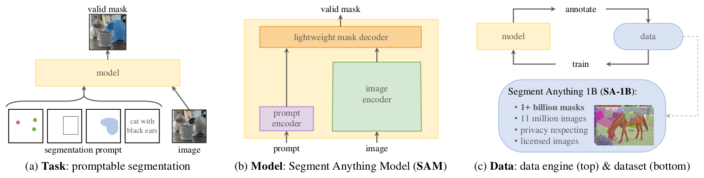

*图 1（原文 Figure 1，第 1 页）：论文引入的三个相互关联的部分：可提示分割任务、SAM 模型、数据引擎与 SA-1B 数据集。*

**图中文字翻译与读法**：

- **(a) Task: promptable segmentation（任务：可提示分割）**：下方方框里是“分割提示”（segmentation prompt）的几种形式，从左到右依次是：点（一个红点、两个绿点，按惯例绿色为前景点、红色为背景点）、框、粗略的掩码涂鸦、文本“cat with black ears”（有黑耳朵的猫）；它们和图像（image）一起送入 model，输出 valid mask（有效掩码）。
- **(b) Model: Segment Anything Model (SAM)（模型）**：图像（image）进入绿色的 image encoder（图像编码器），提示（prompt）进入紫色的 prompt encoder（提示编码器），二者的输出一起进入橙色的 lightweight mask decoder（轻量掩码解码器），得到 valid mask。
- **(c) Data: data engine (top) & dataset (bottom)（数据：上为数据引擎，下为数据集）**：上方是 model 与 data 之间的循环，model 对 data 做 annotate（标注），data 再用来 train（训练）model；下方是 Segment Anything 1B（SA-1B）：1+ billion masks（超过 10 亿个掩码）、11 million images（1,100 万张图像）、privacy respecting（尊重隐私）、licensed images（授权图像）。
- **读图结论**：这张图是全文的地图。任务决定模型必须支持“灵活提示 + 近实时 + 能处理歧义”；模型决定了“重编码器 + 轻解码器”的拆分；模型反过来又是数据引擎里的标注工具，这个循环才造出了 SA-1B。

### 3.2 为什么选这个任务：预训练与零样本迁移

**预训练**。可提示分割自然导出一个预训练算法：对每个训练样本**模拟一串提示**（点、框、掩码），把模型的预测与真值比较。这是从交互式分割改编来的，但目标不同：交互式分割希望在“足够多的用户输入之后”最终得到有效掩码，而这里要求**对任何提示，包括有歧义的提示，一开始就给出有效掩码**。这保证预训练出的模型在含歧义的场合同样可用，数据引擎里的自动标注就是这样的场合。作者也指出，要在这个任务上做好并不容易，需要专门的模型设计和损失选择（第四节）。

**零样本迁移**。预训练让模型在推理时能对任意提示作出合适的响应，因此下游任务可以靠**设计提示**来解决。例如有一个猫的框检测器，把它输出的框当作提示交给 SAM，就得到猫的实例分割。许多实际的分割任务都可以写成“提示”，论文在第七节检验了五个任务。

**与多任务分割系统的区别**。多任务系统（例如联合语义、实例、全景分割）里，单个模型执行**固定的任务集合**，训练和测试的任务相同。可提示分割训练出的模型，在推理时可以作为更大系统里的一个**部件**去完成新的、不同的任务（例如与已有检测器组合做实例分割），这是一种任务泛化。作者的类比是：CLIP 是 DALL·E 图像生成系统中的图文对齐部件；他们预期，由提示工程驱动的可组合系统，比为固定任务集合训练的系统能覆盖更多应用。

### 3.3 歧义与“有效掩码”（图 3）

一个点往往对应多个合理的掩码。如果模型只输出一个掩码，它会倾向于在多个合理答案之间取“平均”，得到谁也不像的结果。论文的做法是让模型对一个提示输出多个掩码（见下文 4.5 节）。

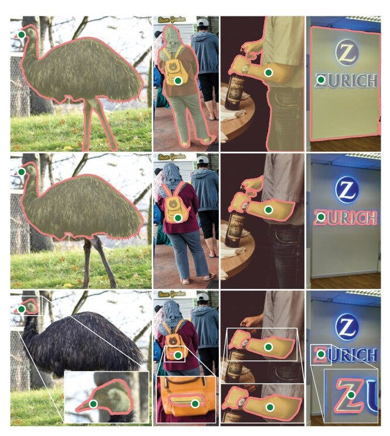

*图 3（原文 Figure 3，第 4 页）：每一列是一张图，绿色圆点是唯一的点提示，从上到下是 SAM 对这个点给出的 3 个有效掩码。*

**图中文字翻译与读法**：

- 共 4 列 3 行；每一列是同一张图上的同一个绿点（白边绿色圆点），3 行分别是 SAM 给出的 3 个掩码（粉红色轮廓，内部淡黄色覆盖），从上到下由大到小，对应“整体、部分、子部分”（whole / part / subpart）。最下面一行带有放大的局部小图。
- 第 1 列：一只大型走禽，绿点在头部。三个掩码依次是整只鸟（含腿）、鸟的身体（不含腿）、鸟的头部（放大图）。
- 第 2 列：一个背着双肩包的人，绿点在背包上。依次是整个人、背包、背包前面的口袋（放大图）。
- 第 3 列：一个人伸手拿酒瓶，绿点在前臂上。依次是整个人（身体和手臂）、手臂和手、前臂与手腕处（放大图）。
- 第 4 列：墙上的 ZURICH 招牌，绿点在字母 Z 上。依次是整块招牌板、单词 ZURICH、字母 Z（放大图）。
- **读图结论**：同一个点本来就对应多个都说得通的目标，这些目标常常是嵌套的，而嵌套深度通常不超过三层。这正是 SAM 默认输出 3 个掩码的依据（原文：嵌套的掩码通常最多三层深：整体、部分、子部分）。

## 四、模型：SAM 的三个部件

### 4.1 总体结构（图 4）

模型要满足三个约束：支持灵活的提示；能以“摊销后实时”的速度算出掩码，以便交互使用；能感知歧义。论文发现一个简单设计就能同时满足：一个**强大的图像编码器**算一次图像嵌入（image embedding），一个**提示编码器**把提示变成嵌入，再由一个**轻量掩码解码器**把两路信息合并，预测分割掩码。图像嵌入可以复用，所以同一张图上的每次新提示只需运行轻量部分。

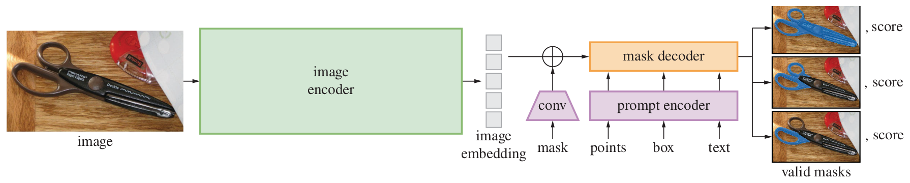

*图 4（原文 Figure 4，第 5 页）：重型图像编码器输出图像嵌入，之后可被各种提示高效查询，以摊销后的实时速度产生物体掩码；提示有歧义时，SAM 输出多个有效掩码和相应的置信分数。*

**图中文字翻译与读法**：

- 最左：image（输入图像，一把剪刀的照片），进入绿色的 image encoder（图像编码器），输出 image embedding（图像嵌入，图中以一列灰色方块表示）。
- 提示分两路：mask（掩码，稠密提示）先过 conv（卷积），再与图像嵌入做逐元素相加（图中的 ⊕）；points（点）、box（框）、text（文本）这几种稀疏提示进入紫色的 prompt encoder（提示编码器）。
- 两路汇入橙色的 mask decoder（掩码解码器），右侧输出 3 个 valid masks（有效掩码），每个都带一个 score（分数）。
- **读图结论**：左边“重”的部分（编码器）每张图只执行一次，右边“轻”的部分（提示编码器、掩码解码器）每次提示执行一次。这个拆分是整个设计的核心。

下面是一次推理的数据流（形状来自原文附录 A 与图 14）：

```text
输入图像 → 缩放并补边为 1024×1024
        → 图像编码器（MAE 预训练的 ViT-H/16）→ 16 倍下采样 → 64×64 的特征图
        → 1×1 卷积（到 256 通道）+ 3×3 卷积（256 通道），各接 LayerNorm
        → 图像嵌入：256×64×64                        【每张图只算一次，可缓存】

提示 → 稀疏提示（点、框、文本）：每个提示变成若干个 256 维 token
     → 稠密提示（掩码）：下采样成 256×64×64，与图像嵌入逐元素相加（没有掩码提示时加一个“无掩码”学习嵌入）

输出 token + 提示 token（N 个 token，每个 256 维）
     + 图像嵌入（看作 64² 个 256 维向量）
     → 两层“双向”Transformer 解码器 → 4 倍上采样 → 动态掩码头
     → 3 个掩码（相对输入图像 1/4 分辨率）+ 3 个 IoU 预测            【每次提示约 50 ms】
```

### 4.2 图像编码器

- **选型**：可扩展性好、有强预训练方法，因此用 **MAE** 预训练的 **Vision Transformer（ViT）**，做了最小改动以处理高分辨率输入。具体是 **ViT-H/16**，使用 $14\times14$ 的窗口注意力，外加四个等间隔的全局注意力块（沿用 ViTDet 的做法）。
- **输入与输出**：输入统一为 $1024\times1024$（缩放图像并补齐较短的边）。编码器输出是输入的 16 倍下采样，因此图像嵌入为 $64\times64$。为降低通道数，接一个 $1\times1$ 卷积到 256 通道，再接一个同为 256 通道的 $3\times3$ 卷积，每个卷积后都有 LayerNorm。
- **为什么敢用这么重的编码器**：运行时目标是“每个提示实时”，而图像编码器的 FLOPs 只在每张图上算一次，不随提示数量增加，所以可以放心地加大。

### 4.3 提示编码器

提示分两类：稀疏提示（点、框、文本）和稠密提示（掩码）。

- **点**：用“该点位置的位置编码”加上“两个学习到的嵌入之一”（分别表示前景点、背景点）。
- **框**：用一对嵌入表示。一个是左上角的位置编码加上学习到的“左上角”嵌入，另一个是右下角的位置编码加上学习到的“右下角”嵌入。
- **文本**：用 CLIP 的文本编码器（原则上任何文本编码器都可以）。第 7.5 节才用到文本。
- 稀疏提示统一映射成 **256 维**向量。
- **掩码（稠密提示）**：与图像有空间对应关系。输入的掩码分辨率是输入图像的 1/4，再用两个 $2\times2$、步长 2 的卷积（输出通道依次为 4、16）下采样 4 倍，最后用 $1\times1$ 卷积把通道数映射到 256；各层之间用 GELU 激活和 LayerNorm 隔开。这个结果与图像嵌入**逐元素相加**。若没有掩码提示，则在图像嵌入的每个位置加一个学习到的“无掩码”嵌入。

### 4.4 轻量掩码解码器（图 14）

解码器的任务：高效地把图像嵌入和一组提示嵌入映射成输出掩码。设计受 DETR、MaskFormer 这类 Transformer 分割模型启发，并修改了标准 Transformer 解码器。

解码前，先在提示嵌入集合里插入学习到的**输出 token** 嵌入（类似 ViT 里的 `[class]` token），解码结束后用它们来产生输出：每个要预测的掩码对应一个输出 token，另有一个输出 token 专门给 IoU 预测用（见 4.5 节和图 14）。原文把这些嵌入（不含图像嵌入）统称为 token。

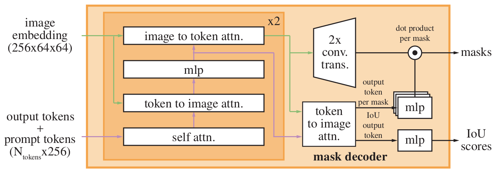

*图 14（原文 Figure 14，第 16 页）：两层解码器通过交叉注意力同时更新图像嵌入和提示 token；随后图像嵌入被上采样，更新后的输出 token 用来动态预测掩码。*

**图中文字翻译与读法**：

- 左侧输入：image embedding (256×64×64)（图像嵌入）；output tokens + prompt tokens (N_tokens × 256)（输出 token 加提示 token）。
- 中间深色框（右上角标 x2，表示重复 2 层）自下而上依次是：self attn.（token 之间的自注意力）→ token to image attn.（token 作查询，到图像嵌入里取信息的交叉注意力）→ mlp（对每个 token 逐点更新）→ image to token attn.（图像嵌入作查询，到 token 里取信息的交叉注意力，用提示信息更新图像嵌入）。绿色线是图像嵌入的流向，紫色线是 token 的流向。
- 右侧：两层之后，图像嵌入进入 2x conv. trans.（两个转置卷积，4 倍上采样）；token 再做一次 token to image attn.；其中 output token per mask（每个掩码对应的输出 token）各经一个 mlp，与上采样后的图像嵌入做 dot product per mask（逐掩码的点积），得到 masks（掩码）；IoU output token（IoU 输出 token）经 mlp 得到 IoU scores（IoU 分数）。
- 原文说明（图中没画）：每个注意力层里，都会把图像位置编码加到图像嵌入上，并把**原始的提示 token（含其位置编码）重新加回**到 token 的查询和键上，使解码器强依赖于提示的几何位置与类型。
- **读图结论**：这是“双向”注意力：先让提示去图像里找证据，再让图像特征吸收提示信息，两次交替，只做两层，所以很轻。

**逐步解释**（原文附录 A）：

1. 每个解码层做 4 步：对 token 做自注意力；token（查询）到图像嵌入的交叉注意力；逐点 MLP 更新每个 token；图像嵌入（查询）到 token 的交叉注意力。交叉注意力时，图像嵌入被看作 $64^2$ 个 256 维向量。
2. 每个自/交叉注意力和 MLP 都有残差连接、LayerNorm，训练时 dropout 为 0.1。下一层使用上一层更新后的 token 和图像嵌入。共 **2 层**。
3. 解码后，用两个转置卷积把更新后的图像嵌入上采样 4 倍（此时相对输入图像是 4 倍下采样，即输入的 1/4 分辨率）。
4. token 再对图像嵌入做一次注意力；把更新后的输出 token 嵌入送入一个小的 **3 层 MLP**，得到一个与上采样图像嵌入通道数相同的向量。
5. 掩码预测：该向量与上采样图像嵌入在每个空间位置做点积，得到前景概率。因为这个“线性分类器”的权重由提示决定，原文称之为**动态线性分类器**（dynamic linear classifier）、**动态掩码预测头**。

用公式写：设上采样后的图像嵌入为 $F\in\mathbb{R}^{C'\times H'\times W'}$，第 $k$ 个输出 token 经 MLP 得到的向量为 $w_k\in\mathbb{R}^{C'}$，则该掩码在位置 $(i,j)$ 的 logit 为

$$
z_k(i,j)=w_k^{\top}F(:,i,j),\qquad p_k(i,j)=\sigma\big(z_k(i,j)\big).
$$

（按附录给出的两个转置卷积输出通道数 64、32，这里 $C'=32$；图像嵌入从 $64\times64$ 上采样 4 倍，所以 $H'=W'=256$，正好是 $1024$ 的 1/4。这两个具体数字是由文中数据推出的，原文没有直接写成一句话。）

**维度细节**：Transformer 的嵌入维度为 256；MLP 块的隐藏维度较大，为 2048，但只作用于提示 token（数量很少，很少超过 20 个）。在图像嵌入（$64\times64$）参与的交叉注意力里，查询、键、值的通道数减半为 128 以节省计算。所有注意力层都用 8 个头。上采样的转置卷积为 $2\times2$、步长 2，输出通道依次为 64 和 32，带 GELU，中间用 LayerNorm 隔开。

### 4.5 让模型感知歧义：3 个掩码加 1 个

只输出一个掩码时，模型面对歧义提示会学到在多个有效掩码之间“取平均”。做法：用少量输出 token，同时预测多个掩码。

- **默认预测 3 个掩码**，因为整体、部分、子部分三层通常足以描述嵌套的掩码。
- **只对损失最小的那个反向传播**：训练时分别计算真值与每个预测掩码之间的损失，但只让最小的那一个产生梯度（这是多输出模型的常见做法）。
- **排序**：为了在应用中给掩码排序，增加一个小的头（作用于额外的输出 token），估计每个预测掩码与它所覆盖物体之间的 IoU，即置信分数。
- **多提示时只出 1 个掩码**：提示增多后歧义少见得多，三个输出会趋同。为避免计算退化的损失、并保证唯一无歧义的那个掩码能得到正常梯度，**当提示超过一个时只预测单个掩码**。实现方式是再加第 4 个输出 token，专门预测一个掩码：这个第 4 个掩码**从不在单提示时返回**，也**是多提示时唯一返回的掩码**。

### 4.6 损失函数

- **掩码损失**：焦点损失（focal loss）与 dice 损失的线性组合，二者比例为 **20 : 1**（沿用 MaskFormer / DETR 一类工作）。焦点损失降低容易像素的权重，dice 损失直接优化区域重合度，这是通用背景，原文未展开。
- **IoU 预测头**：用均方误差（MSE）回归“预测掩码与真值掩码的实际 IoU”，以固定系数 1.0 加到掩码损失上。
- 与 MaskFormer 等不同，作者发现在每个解码层之后加辅助的深度监督**没有帮助**。

合起来（只对最小损失的那个掩码反传，写成公式便于记忆，符号为本文所设）：

$$
\mathcal{L}=\min_{k\in\{1,2,3\}}\Big[\,20\,\mathcal{L}_{\mathrm{focal}}(\hat m_k,m)+\mathcal{L}_{\mathrm{dice}}(\hat m_k,m)\,\Big]+1.0\cdot\mathcal{L}_{\mathrm{IoU}},
$$

其中 $\hat m_k$ 是第 $k$ 个预测掩码，$m$ 是真值掩码。

### 4.7 训练算法：模拟交互式分割（11 轮）

训练时按交互式分割的方式随机采样提示，让模型无缝融入数据引擎。每个训练掩码的流程：

1. **初始提示**：以相同概率随机选**一个前景点**或**一个框**。点从真值掩码内均匀采样；框取真值掩码的外接框，并在每个坐标上加噪声，噪声标准差为框边长的 10%，最大 20 像素（这个噪声分布折中了“实例分割给出紧框”与“交互分割里用户画松框”两种场景）。
2. **后续点**：做出第一次预测后，之后的点在“上一次预测与真值之间的错误区域”里均匀采样；错误区域是漏检（假阴性）则新点为前景点，是误检（假阳性）则为背景点。
3. **把上一轮的掩码预测作为额外提示**喂回模型，为了给下一轮最大的信息量，传的是未阈值化的掩码 logits，而不是二值掩码。若上一轮返回多个掩码，则取预测 IoU 最高的那个，用它来传给下一轮并采样下一个点。
4. 在 8 个迭代采样的点之后收益递减（论文测试到 16 个）。为鼓励模型利用传入的掩码，另外再加两轮**不加任何新点**的迭代：其中一轮随机插在 8 个采样点之间，另一轮固定放在最后。
5. 总共 **11 轮**：1 个初始提示、8 个迭代采样的点、2 轮不引入新外部信息的迭代（让模型学会细化自己的预测）。

能负担这么多轮迭代，是因为轻量掩码解码器的计算量**不到图像编码器的 1%**，每多一轮只增加很小的开销；以往的交互式方法每次优化器更新只做一到几轮交互。

### 4.8 训练配方与代价

默认 SAM（ViT-H）的训练配方，以及论文用来做消融的 ViT-B、ViT-L 配方：

| 项目 | 默认 SAM（ViT-H） | ViT-B（消融用） | ViT-L（消融用） |
|---|---|---|---|
| 训练迭代数 | 90k（约 2 个 SA-1B epoch） | 180k | 180k |
| batch size | 256 张图 | 128 | 128 |
| GPU 数 | 256 | 128 | 128 |
| 初始学习率（预热后） | 8e-4 | 8e-4 | 4e-4 |
| 分层学习率衰减 | 0.8 | 0.6 | 0.8 |
| weight decay | 0.1 | 0.1 | 0.1 |
| drop path | 0.4 | 0.6 | 0.4 |

（据原文附录 A，第 17–18 页整理。）其余设置：优化器 AdamW（$\beta_1=0.9$，$\beta_2=0.999$）；前 250 次迭代线性学习率预热，之后分段衰减，在第 60k 和第 86666 次迭代各降为原来的 1/10；不使用数据增强；用 MAE 预训练的 ViT-H 初始化；每块 GPU 最多随机采样 64 个掩码以限制显存；另外轻度过滤 SA-1B，丢掉覆盖超过 90% 图像面积的掩码（定性上有提升）。仅用第 1、2 阶段数据训练时，加入尺度范围 [0.1, 2.0] 的大尺度抖动（large-scale jitter）数据增强。

**训练代价**（原文表 9 模型卡，第 28 页）：256 块 A100 GPU 训练 68 小时，约耗电 6963 kWh，估计约 2.8 吨二氧化碳当量。

**模型规模**（原文图 13 右，第 12 页）：图的横轴标出 ViT-B、ViT-L、ViT-H 三种图像编码器对应的参数量，分别为 91M、308M、636M。

### 4.9 效率

给定预先算好的图像嵌入，提示编码器与掩码解码器在**浏览器里、CPU 上约 50 ms** 完成一次提示。整个设计的出发点就是这个：图像编码器 FLOPs 很大但只算一次，用户每次点击只触发 50 ms 级的轻量部分，所以交互是无缝的。注意这是“摊销后的实时”：对一张新图，第一次仍要付图像编码器的代价，论文在局限里明确说，使用重编码器时 SAM 的整体性能不是实时的。

## 五、数据引擎与 SA-1B 数据集

### 5.1 为什么需要数据引擎

分割掩码在互联网上并不丰富，没有现成的网络规模数据源，所以不能照搬基础模型“从网上抓数据”的常规做法。论文的办法是**数据引擎**（data engine）：模型与数据集协同开发，用模型辅助标注，再用新标注的数据重训模型，来回迭代。引擎分三个阶段，从“人主导、模型辅助”逐步过渡到“模型全自动”。

### 5.2 三个阶段

下表据原文第 4 节整理（非原文表格，是把正文中的数字对齐成表）：

| | 阶段 1：辅助人工（assisted-manual） | 阶段 2：半自动（semi-automatic） | 阶段 3：全自动（fully automatic） |
|---|---|---|---|
| 掩码从哪来 | 专业标注员在由 SAM 驱动的浏览器交互分割工具里点前景/背景点，并用像素级“画笔”“橡皮擦”修改 | 先自动检测置信的掩码并预填到图里，标注员只标注其余未标注的物体 | SAM 全自动生成，无人工输入 |
| 具体机制 | 一开始用公开分割数据集训练 SAM，数据够多后只用新标注的掩码重训；编码器由 ViT-B 逐步扩到 ViT-H；共重训 6 次 | 用阶段 1 的全部掩码、以单一的通用“object”类别训练一个框检测器（Faster R-CNN）来找置信掩码；定期重训（5 次） | 用 $32\times32$ 规则点网格提示 SAM，每点预测一组可能的有效掩码；歧义感知模型保证点落在部件上时给出子部分、部分、整体 |
| 每个掩码的平均标注时间 | 从 34 秒降到 14 秒 | 回升到 34 秒（不含自动掩码），因为剩下的物体更难标 | 不适用 |
| 每张图的平均掩码数 | 从 20 增到 44 | 从 44 增到 72（含自动掩码） | 约 100 |
| 本阶段规模 | 来自 12 万张图的 430 万个掩码 | 来自 18 万张图的 590 万个掩码，累计 1,020 万个 | 对全部 1,100 万张图生成，共 11 亿个掩码 |

阶段 1 的几个细节：不施加语义约束，标注员自由地标 stuff 和 things；建议标注员标他们“能叫出名字或描述”的物体，但并不收集这些名称；按显著程度的顺序标注；一个掩码标注超过 30 秒就鼓励转到下一张图。原文还给了参照：14 秒比 COCO 的掩码标注快 6.5 倍，仅比用极值点标注边界框慢 2 倍。

阶段 2 的目的是提高掩码**多样性**，让模型更能“分割任何东西”；因此先用自动检出的置信掩码占住显著物体，把标注员的精力引到不太显著的物体上。

阶段 3 之所以可行，原文给了两条理由：一是此时已积累了足够多的掩码（包含阶段 2 的多样掩码），模型大幅改进；二是已经做出了**歧义感知**模型，因此在歧义情形下也能预测有效掩码。

### 5.3 全自动阶段的细节（附录 B）

**多尺度裁剪**：在整张图上用 $32\times32$ 点网格生成掩码；另外再取 20 个放大的图像裁剪，来自 $2\times2$ 和 $4\times4$ 的部分重叠窗口（共 $4+16=20$ 个），分别配 $16\times16$ 与 $8\times8$ 的点网格。裁剪用的是原始高分辨率图像（这是唯一用到原图的地方）。碰到裁剪内部边界的掩码会被删除。这样做是为了提高小物体掩码的质量。

**NMS**：采用标准的贪心、基于框的非极大值抑制（为了效率用框计算 IoU），分两步：先在每个裁剪内部做，再跨裁剪做。裁剪内部按模型预测的 IoU 给掩码排序；跨裁剪时，按来源裁剪从最放大（$4\times4$ 的裁剪）到最不放大（原图）排序。两种情况 NMS 阈值都是 0.7。

**三个过滤条件**（阈值是为了同时获得大量掩码和较高质量，由专业标注员按第 5.4 节的方法评估后选定）：

1. **置信度**：预测 IoU 不低于 88.0；
2. **稳定性**（stable）：对同一个软掩码用不同阈值二值化，比较得到的两个二值掩码。默认的预测是 logit 阈值取 0 得到的二值掩码，只有当 logit 阈值取 −1 与 +1 得到的两个掩码之间的 IoU 不低于 95.0 时才保留。正文的描述是：概率图在 $0.5-\delta$ 和 $0.5+\delta$ 阈值化后得到相近的掩码就算稳定；
3. **去掉整图掩码**：删除覆盖图像 95% 及以上面积的掩码（它们通常没什么意义）。

**后处理**：约 4% 的掩码含有细小的伪连通分量，就删除面积小于 100 像素的连通分量（最大分量也小于该阈值时整个掩码删除）；另有约 4% 的掩码含有小的伪孔洞，就填充面积小于 100 像素的孔洞（孔洞按反转掩码的连通分量识别）。

**自动生成专用的模型**：为全自动阶段训练了一个特殊版本的 SAM，牺牲一点推理速度来换取更好的掩码生成性质。与默认 SAM 的差别：只用手工与半自动数据训练；训练更久（177,656 次迭代而不是 90k），并加大尺度抖动数据增强；模拟交互训练只用点和掩码提示（不用框）、每个掩码只采样 4 个点（默认是 9 个，对 1 点性能无影响，但多点评测时会损伤 mIoU）；掩码解码器用 3 层而不是 2 层。

### 5.4 SA-1B 数据集

- **图像**：从直接和摄影师合作的供应商那里授权了一套新的 1,100 万张图像；分辨率高，平均 $3300\times4950$ 像素，所以发布的是**降采样版本，短边为 1500 像素**（作为对比，COCO 图像约 $480\times640$）。发布的图像中，人脸和车牌已被模糊处理。
- **掩码**：数据引擎共产出约 11 亿个掩码，其中 **99.1% 是全自动生成**；作者因此特别强调自动掩码的质量，并决定 **SA-1B 只包含自动生成的掩码**（第 1、2 阶段的手工/半自动掩码不发布）。每张图平均约 100 个掩码。掩码没有类别，也没有文本。
- **质量验证**：随机抽 500 张图（约 5 万个掩码），请专业标注员借助模型和像素级画笔/橡皮擦工具把这些图里**所有**掩码改到最好，得到“自动预测 / 人工修正”的成对掩码。计算每对的 IoU：**94% 的掩码对 IoU 大于 90%，97% 的掩码对 IoU 大于 75%**。作为参照，已有工作估计标注员之间的一致性为 85–91% IoU。第七节的实验还用人评证实：用自动掩码训练的模型，几乎和用数据引擎产出的全部掩码训练一样好。

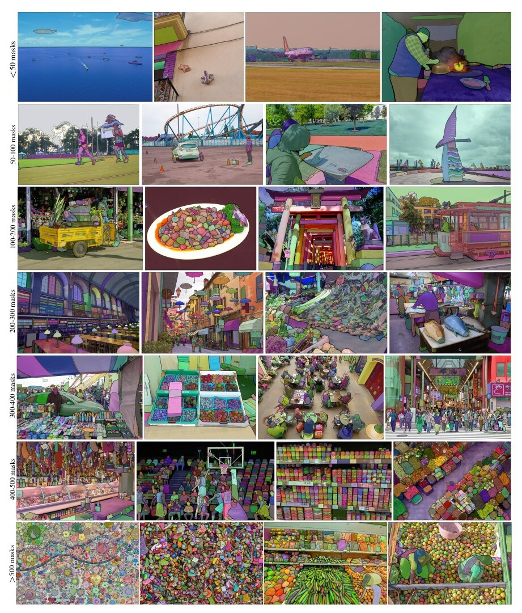

*图 2（原文 Figure 2，第 3 页）：SA-1B 中的示例图像与叠加的掩码。图像按每张图的掩码数分组展示。*

**图中文字翻译与读法**：

- 每一行是一个分组，左侧文字是该组每张图的掩码数：`<50 masks`、`50-100 masks`、`100-200 masks`、`200-300 masks`、`300-400 masks`、`400-500 masks`、`>500 masks`；每个掩码用一种随机颜色叠加在图像上。
- 原文图注：SA-1B 包含 1,100 万张多样、高分辨率、已授权且保护隐私的图像和 11 亿个高质量分割掩码，这些掩码由 SAM 全自动标注，并经人评和大量实验验证质量与多样性；平均每张图约 100 个掩码。
- **读图结论**：掩码数少的图（第一行）多是只有少数物体的开阔场景，例如海面上的几条船、攀岩墙、停机坪上的飞机；掩码数最多的图（最后一行）是密集的花纹图案、成堆的小石子或小物件、蔬菜水果摊位等，一张图可达几百个掩码，连很细碎的物体也被分出来。这说明 SA-1B 的“掩码密度”远高于常见分割数据集。

### 5.5 与已有分割数据集的比较

SA-1B 的图像是 LVIS v1、COCO、ADE20K、Open Images 的 11 倍以上，掩码是最大的 Open Images 的 **400 倍**。下面是图 6 图例里给出的规模：

| 数据集 | 图像数 | 掩码数 |
|---|---:|---:|
| SA-1B | 11M | 1129M（即 1.1B） |
| LVIS v1 | 0.120M | 1.5M |
| COCO | 0.123M | 0.9M |
| ADE20K | 0.028M | 0.7M |
| Open Images | 1M | 2.7M |

（据原文图 6 图例，第 7 页。）正文还给出：每张图的平均掩码数是 Open Images 的 36 倍；最接近的 ADE20K 仍比 SA-1B 少 3.5 倍。

**物体中心的空间分布**（原文图 5，第 6 页，本文未放图）：所有数据集都有摄影师带来的偏置，但 SA-1B 对图像四角的覆盖比最相似的 LVIS v1 和 ADE20K 更好，COCO 和 Open Images V5 则有更明显的中心偏置。

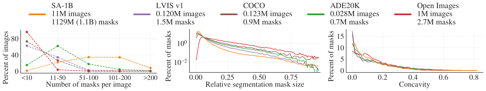

*图 6（原文 Figure 6，第 7 页）：数据集的掩码属性。图例给出每个数据集的图像数和掩码数。*

**图中文字翻译与读法**：

- 顶部图例：橙色 SA-1B、紫色 LVIS v1、棕色 COCO、绿色 ADE20K、红色 Open Images（图像数与掩码数见上表）。
- **左图**（折线图，每个点对应一个分组）：横轴 Number of masks per image（每张图的掩码数，分组 `<10`、11-50、51-100、101-200、`>200`），纵轴 Percent of images（图像占比，%）。以下均为从图上读出的近似值：SA-1B（橙）的图像主要集中在 51–100 和 101–200 两组（各约 35%），11–50 组约 22%，超过 200 个的约 8%；Open Images（红）几乎全部（约 96%）每张图不到 10 个掩码；COCO（棕，`<10` 约 73%）和 LVIS（紫，`<10` 约 63%）主要在 `<10` 与 11–50 两组；ADE20K（绿）集中在 11–50 组（约 62%）。
- **中图**：横轴 Relative segmentation mask size（相对掩码大小，即掩码面积除以图像面积再开方），纵轴 Percent of masks（掩码占比，对数刻度）。SA-1B 的曲线在小尺寸端最高、随尺寸增大下降最快，也就是说小和中等相对大小的掩码占比更大。
- **右图**：横轴 Concavity（凹度，定义为 1 减去“掩码面积与其凸包面积之比”），纵轴 Percent of masks。各数据集的凹度分布大体相似。论文为排除掩码大小的影响，先按掩码大小分箱做了分层抽样，再比较凹度。
- **读图结论**：SA-1B 的特点是每张图里的掩码更多、更偏小物体，而形状复杂度（凹度）与其他数据集相近。

### 5.6 地理与收入分布（图 7、表 1）

SA-1B 的图像没有地理标签，但每张图带一段描述内容和拍摄地点的说明文字。作者用基于 ELMo 的命名实体识别模型从说明文字里抽取地点，依次按国家、省、市的顺序归到某个国家；这种方法有歧义（例如 Georgia 可指国家也可指美国的州），所以只用来做整体分析，推断出的地点和说明文字都不发布。收入水平按世界银行的分级查，并把中高收入与中低收入合并成“中等收入”。

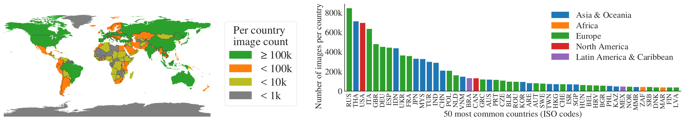

*图 7（原文 Figure 7，第 7 页）：SA-1B 图像的估计地理分布。世界上大多数国家在 SA-1B 中都有超过 1000 张图像，图像最多的三个国家来自不同的地区。*

**图中文字翻译与读法**：

- **左图**：世界地图，按 Per country image count（每个国家的图像数）着色：绿色 ≥ 100k、橙色 `< 100k`、黄绿色 `< 10k`、灰色 `< 1k`。
- **右图**：横轴是 50 most common countries (ISO codes)（图像最多的 50 个国家，用 ISO 代码），纵轴 Number of images per country（每个国家的图像数）。柱的颜色是所属地区：蓝 Asia & Oceania（亚洲和大洋洲）、橙 Africa（非洲）、绿 Europe（欧洲）、红 North America（北美）、紫 Latin America & Caribbean（拉丁美洲和加勒比）。
- **读图结论**：从图上读出，前三名是 RUS（约 85 万张）、THA（约 72 万张）、USA（约 70 万张），分属欧洲、亚洲和北美，对应正文“前三名来自世界不同地区”的说法。地图上非洲多数国家处在 `<100k`、`<10k` 甚至 `<1k` 的较低档位，这与下面表 1 里非洲占比偏低（2.8%）是一致的。

**表：地理与收入代表性对比**（# countries 为各区域国家数；SA-1B 栏给出图像数与掩码数；右侧三列为各数据集中图像的占比）：

| 区域 / 收入档 | 国家数 | SA-1B 图像数 | SA-1B 掩码数 | SA-1B 占比 | COCO 占比 | Open Images 占比 |
|---|---:|---:|---:|---:|---:|---:|
| Africa（非洲） | 54 | 300k | 28M | 2.8% | 3.0% | 1.7% |
| Asia & Oceania（亚洲和大洋洲） | 70 | 3.9M | 423M | 36.2% | 11.4% | 14.3% |
| Europe（欧洲） | 47 | 5.4M | 540M | 49.8% | 34.2% | 36.2% |
| Latin America & Carib.（拉美和加勒比） | 42 | 380k | 36M | 3.5% | 3.1% | 5.0% |
| North America（北美） | 4 | 830k | 80M | 7.7% | 48.3% | 42.8% |
| high income countries（高收入国家） | 81 | 5.8M | 598M | 54.0% | 89.1% | 87.5% |
| middle income countries（中等收入国家） | 108 | 4.9M | 499M | 45.0% | 10.5% | 12.0% |
| low income countries（低收入国家） | 28 | 100k | 9.4M | 0.9% | 0.4% | 0.5% |

（原文表 1，第 7 页；表中 O.I. 即 Open Images，COCO 与 Open Images 的地理信息来自 Flickr API，仅检索到 COCO 训练集的 24%（19,562 张）和 Open Images 训练集的 18%（493,517 张），所以只是近似。）

**读法**：SA-1B 中欧洲（49.8%）和亚洲及大洋洲（36.2%）占比较高，中等收入国家占 45.0%，远高于 COCO 与 Open Images 的 10–12%；北美占比（7.7%）则远低于 COCO（48.3%）与 Open Images（42.8%）。所有数据集对非洲和低收入国家都代表不足。但在 SA-1B 里，每个区域（包括非洲）都至少有 2,800 万个掩码，是以往任何数据集掩码总数的约 10 倍；每张图的平均掩码数在各地区和收入档之间相当一致（94–108 个，原文称“未在表中展示”）。

## 六、负责任 AI：SAM 在人群上的公平性

作者用“模拟交互分割”（随机采样 1 个和 3 个点）评估 SAM 对不同人群的分割表现差异。性别呈现和年龄用 MIAP（More Inclusive Annotations for People）数据集，皮肤色调用一个专有数据集（采用 Fitzpatrick 皮肤类型，1 为最浅，6 为最深）。MIAP 只有框标注，作者按“框相对边长误差在 1% 以内”的条件，从 Open Images 里匹配出人物类别的掩码，共 3.9k 个。

**表：SAM 分割人物时在不同感知性别呈现、年龄组和皮肤色调上的 mIoU（含 95% 置信区间）**

| 分组 | 1 点 mIoU | 3 点 mIoU |
|---|---:|---:|
| 感知性别呈现：feminine（女性化） | 54.4 ±1.7 | 90.4 ±0.6 |
| 感知性别呈现：masculine（男性化） | 55.7 ±1.7 | 90.1 ±0.6 |
| 感知年龄：older（较年长） | 62.9 ±6.7 | 92.6 ±1.3 |
| 感知年龄：middle（中年） | 54.5 ±1.3 | 90.2 ±0.5 |
| 感知年龄：young（较年轻） | 54.2 ±2.2 | 91.2 ±0.7 |
| 感知皮肤色调：1（最浅） | 52.9 ±2.2 | 91.0 ±0.9 |
| 感知皮肤色调：2 | 51.5 ±1.4 | 91.1 ±0.5 |
| 感知皮肤色调：3 | 52.2 ±1.9 | 91.4 ±0.7 |
| 感知皮肤色调：4 | 51.5 ±2.7 | 91.7 ±1.0 |
| 感知皮肤色调：5 | 52.4 ±4.2 | 92.5 ±1.4 |
| 感知皮肤色调：6（最深） | 56.7 ±6.3 | 91.2 ±2.4 |

（原文表 2，第 8 页。）读法：每一组内部，除“较年长”与“中年”之外，置信区间都相互重叠，所以没有发现显著差异；“较年长”在 1 点上最高（置信区间也很大）；3 点时各组都在 90 以上，差距更小。作者认为这与任务本身的性质有关，并提醒当 SAM 作为更大系统的部件时仍可能产生偏差。

**表：SAM 分割服装时在不同感知性别呈现和年龄组上的 mIoU**

| 分组 | 1 点 mIoU | 3 点 mIoU |
|---|---:|---:|
| 感知性别呈现：feminine | 76.3 ±1.1 | 90.7 ±0.5 |
| 感知性别呈现：masculine | 81.0 ±1.2 | 92.3 ±0.4 |
| 感知年龄：older | 81.9 ±3.8 | 92.8 ±1.6 |
| 感知年龄：middle | 78.2 ±0.8 | 91.3 ±0.3 |
| 感知年龄：young | 77.3 ±2.7 | 91.5 ±0.9 |

（原文表 6，附录 C，第 19 页；数据是 Open Images 里属于服装超类、且位于 MIAP 人物框内的全部 6.5k 个真值掩码。）读法：1 点时，对“男性化呈现”者的服装分割更好，两个性别的置信区间不相交；3 点时差距缩小；年龄组之间差异不显著。作者据此认为，单点提示下服装分割存在跨性别呈现的偏差，并提醒使用者留意。

## 七、零样本迁移实验

### 总体设定

论文一共考察五个任务，其中四个与训练用的可提示分割任务显著不同，是靠“提示工程”实现的：边缘检测、目标提议（segment everything）、实例分割，以及作为概念验证的文本到掩码；最先检验的是核心任务本身，即单个前景点的有效掩码。除非另有说明，实验用的 SAM 使用 MAE 预训练的 ViT-H 图像编码器，并在 SA-1B 上训练（即仅含第 3 阶段的自动掩码）。

### 7.1 单点有效掩码评测（含附录 D.1、E）

**任务**：由单个前景点分割一个物体。这个任务本身是病态的，因为一个点可以指向多个物体，而大多数数据集的真值并不会列出所有可能的掩码，所以自动指标有时不可靠。因此除了标准的 mIoU，论文还补充了人工评分（标注员对掩码质量打 1 分“无意义”到 10 分“像素级完美”）。

**点的选取**：默认取真值掩码的“中心”，即掩码内部距离变换的最大值处，这是交互分割的标准评测协议。多点时，第一个点取离物体边界最远的点，之后每个点取“真值与上一次预测之间错误区域”中离该区域边界最远的点。有些实验用更难的设置：第一个点随机，之后同上（更接近视线注视这类不能保证点中心的场景）。

**评测指标**：对 $N\in\{1,2,3,5,9\}$ 个点，计算预测与真值掩码之间的 IoU；每个数据集的 mIoU 是该数据集内所有物体的 IoU 的平均，总指标是 23 个数据集 mIoU 的平均。这与标准交互分割评测（测量达到 X% IoU 所需的平均点数，最多 20 点）不同；作者只关心一个点或少数几个点的结果。

**SAM 的评测方式**：SAM 能输出多个掩码，但默认只评价**它自己最自信（预测 IoU 最高）的那一个**；基线都是单掩码方法。另报告“oracle”结果：从 SAM 的 3 个预测里，用真值挑出最匹配的那个，作为歧义的影响分析，不是可部署的结果。

**基线**：RITM（HRNet32 IT-M，在 COCO 与 LVIS 的组合上训练）、FocalClick（SegFormerB3-S2，在包含 8 个分割数据集的“组合数据集”上训练）、SimpleClick（ViT-H448，在 COCO 与 LVIS 组合上训练），都使用作者公开发布的最大模型、按其建议的默认预处理，不做调整；在 1 点评测下 RITM 最强，因此默认基线是 RITM。

**23 个数据集**（图 8 展示了每个数据集的样图，本文未放图）覆盖第一人称、显微镜、X 光、水下、航拍、仿真、驾驶、绘画等不同领域，下表据原文表 7（第 20 页）列出核心列；为了评测效率，掩码总数超过 15k 的数据集被抽样，使抽样图像里的掩码总数约为 10k；所有数据集中人脸都已模糊处理。

| 缩写 | 图像类型 | 内容 | 掩码类型 | 来源划分 | 抽样图像数 | 抽样掩码数 |
|---|---|---|---|---|---:|---:|
| PPDLS | Plants（植物） | 烟草和 ara 植物的叶片分割 | Instance | N/A | 182 | 2347 |
| BBBC038v1 | Microscopy（显微镜） | 多种环境下的细胞图像，测试细胞核分割的鲁棒性 | Instance | Train | 227 | 10506 |
| DOORS | Boulders（巨石） | 球形网格表面上单个巨石的掩码 | Instance | DS1 | 10000 | 10000 |
| TimberSeg | Logs（原木） | 各种环境下木材堆中的单根原木，操作员视角 | Instance | N/A | 220 | 2487 |
| NDD20 | Underwater（水下） | 水面上和水下拍摄的两种海豚 | Instance | N/A | 4402 | 6100 |
| LVIS | Scenes（场景） | COCO 的附加标注，用于长尾检测与分割 | Instance | Validation (v0.5) | 945 | 9642 |
| STREETS | Traffic camera（交通摄像头） | 交通摄像头画面中的汽车 | Instance | N/A | 819 | 9854 |
| ZeroWaste-f | Recycling（回收） | 杂乱场景中变形的回收垃圾 | Instance | Train | 2947 | 6155 |
| iShape | Irregular shapes（不规则形状） | 天线、原木、栅栏、衣架等不规则形状 | Instance | Validation | 754 | 9742 |
| ADE20K | Scenes | 来自 SUN 与 Places 的图像，物体与部件掩码 | Instance | Validation | 302 | 10128 |
| OVIS | Occlusions（遮挡） | 视频实例分割，侧重被遮挡的物体 | Instance | Train | 2044 | 10011 |
| Hypersim | Simulation（仿真） | 照片级真实的合成室内场景 | Instance | Evermotion archinteriors volumes 1-55（去掉 20、25、40、49） | 338 | 9445 |
| NDISPark | Parking lots（停车场） | 昼夜、不同天气和相机角度下的停车场画面，车辆分割 | Instance | Train | 111 | 2577 |
| VISOR | Egocentric（第一人称） | EPIC-KITCHENS 烹饪视频中的手和活动物体 | Instance | Validation | 1864 | 10141 |
| Plittersdorf | Stereo images（立体图像） | SOCRATES 立体相机陷阱拍摄的野生动物 | Instance | Train, validation, test | 187 | 546 |
| EgoHOS | Egocentric | 第一人称细粒度手与物体分割 | Instance | Train（仅含 Ego4D 与 THU-READ） | 2940 | 9961 |
| IBD | Drones（无人机） | 高分辨率无人机图像，屋顶实例 | Instance | Train (2D annotations) | 467 | 11953 |
| WoodScape | Fisheye driving（鱼眼驾驶） | 四路环视鱼眼相机的驾驶图像 | Instance | Set 1 | 107 | 10266 |
| Cityscapes | Driving（驾驶） | 街景立体视频 | Panoptic | Validation | 293 | 9973 |
| PIDRay | X-ray（X 光） | 行李 X 光图像中的违禁品 | Instance | Test (hard) | 3733 | 8892 |
| DRAM | Paintings（绘画） | 艺术画作语义分割的域适应数据集 | Semantic | Test | 718 | 1179 |
| TrashCan | Underwater | 水下 ROV 拍到的垃圾（图像来自 J-EDI） | Instance | Train (instance task) | 5936 | 9540 |
| GTEA | Egocentric | 4 名受试者做 7 类日常活动的视频，手部分割 | Instance | Train (segmenting hands task) | 652 | 1208 |

（原文表 7；“来源划分”列为原文 source split，保持英文。）人评使用其中 7 个数据集（LVIS v0.5、VISOR、DRAM、IBD、NDD20、OVIS、iShape），选择标准是兼顾场景级、第一人称、绘画、俯拍、水下、合成图像，并且既包含 SAM 按自动指标优于 RITM 的数据集，也包含不如 RITM 的数据集。

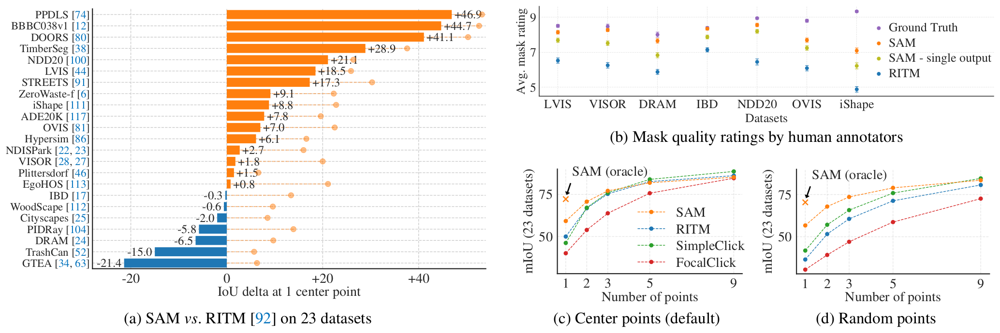

*图 9（原文 Figure 9，第 9 页）：23 个数据集上的点到掩码评测。(a) SAM 与最强的单点分割器 RITM 的 mIoU 之差；(b) 人工标注员给出的掩码质量评分；(c, d) 随点数变化的 mIoU。*

**图中文字翻译与读法**：

- **(a) SAM vs. RITM on 23 datasets**：横轴 IoU delta at 1 center point（用 1 个中心点时 SAM 比 RITM 多出的 IoU），每个条是一个数据集，橙色向右是 SAM 更好，蓝色向左是 RITM 更好；数字写在条旁：PPDLS +46.9、BBBC038v1 +44.7、DOORS +41.1、TimberSeg +28.9、NDD20 +21.1、LVIS +18.5、STREETS +17.3、ZeroWaste-f +9.1、iShape +8.8、ADE20K +7.8、OVIS +7.0、Hypersim +6.1、NDISPark +2.7、VISOR +1.8、Plittersdorf +1.5、EgoHOS +0.8、IBD −0.3、WoodScape −0.6、Cityscapes −2.0、PIDRay −5.8、DRAM −6.5、TrashCan −15.0、GTEA −21.4。每条旁的浅橙色圆点是 SAM 的 oracle 结果（挑出 3 个掩码里与真值最接近的），均落在右侧，也就是 oracle 下 SAM 在所有数据集上都优于 RITM。
- **(b) Mask quality ratings by human annotators**：纵轴 Avg. mask rating（平均掩码评分，1 最差 10 最好），横轴 7 个数据集；紫色点是 Ground Truth（真值），橙色是 SAM，黄绿色是 SAM - single output（只输出单个掩码的“歧义无感知”SAM），蓝色是 RITM；误差棒为 95% 置信区间。所有方法都以真值掩码的中心点为提示。
- **(c) Center points (default)**（中心点，默认）与 **(d) Random points**（随机点）：横轴 Number of points（点数，1、2、3、5、9），纵轴 mIoU (23 datasets)（23 个数据集的平均 mIoU）。曲线为 SAM（橙）、RITM（蓝）、SimpleClick（绿）、FocalClick（红）；左上角橙色叉号标注 SAM (oracle)，即 1 点时的 oracle 结果。
- **读图结论（c，数字为从图上读出的近似值）**：1 点时 SAM 约 59、RITM 约 50、SimpleClick 约 46、FocalClick 约 40，SAM oracle 约 72；随着点数增加，各方法的差距缩小，9 点时 SimpleClick 约 89、RITM 约 86、SAM 约 85、FocalClick 约 85，SimpleClick 略高于 SAM，这与原文“任务变简单后差距变小，且 SAM 并未针对极高 IoU 区间优化”的说法一致。**(d)**：随机取第一个点时，SAM 与基线的差距反而变大（1 点时 SAM 约 57，SimpleClick 约 42，RITM 约 37，FocalClick 约 31，oracle 约 70），而 SAM 在两种取点方式下的结果相近，对点的位置不太敏感（原文：两种取点方式下都能取得可比的结果）。1 点时的绝对 mIoU 偏低，原因是歧义：真值只有一个掩码，而 SAM 的最自信掩码可能是另一个同样有效的掩码。

**结果要点**：

1. 在 23 个数据集的自动评测中，SAM 在其中 **16 个**数据集上高于 RITM，最多高约 47 个 IoU（PPDLS +46.9）；用 oracle 消除歧义后，SAM 在**全部**数据集上都优于 RITM。
2. 人评中（图 9b 与下表），标注员对 SAM 掩码的评分一致高于最强基线 RITM；“歧义无感知”的单输出 SAM 评分稳定低于 SAM，但仍高于 RITM。SAM 的平均评分在 7 到 9 之间，对应评分指南里的“高分（7–9）：物体可辨认，错误小而且少”。
3. 在 DRAM 和 IBD 这两个自动指标上 SAM 不如 RITM 的数据集里，人评反而一致更高：说明自动指标会因歧义和真值偏置而低估 SAM。

**附录 E 的人评细节与各数据集评分**。评分标准：1 分，看不出掩码对应哪个物体（包括根本没有掩码）；2–4 分，物体基本可辨认但掩码质量极差；5–6 分，物体可辨认、边界大体正确，但有重大错误；7–9 分，错误小而且少；10 分，像素级完美、没有可见错误。评分员是同一家标注公司的 30 名专业标注员，每个任务看同一个掩码的 5 个视图（无掩码原图、掩码叠加图、纯掩码图、物体放大图、放大叠加图）；并从三个方面判断：掩码是否对应一个有效物体、边界是否干净、是否与输入的点或框一致。每个数据集随机选 1000 个掩码（面积小于 $24^2$ 像素的不参与抽样），单点实验中 RITM、单输出 SAM、SAM 与真值各评 1000 次，每个任务只由一名评分员完成；初测中同一任务交给 5 名评分员，评分的平均标准差为 0.83；平均每个任务用时 90 秒。输入统一为最靠中心的点。

| 数据集 | RITM | SAM - single output | SAM | 真值（GT） |
|---|---:|---:|---:|---:|
| LVIS v0.5 | 6.5 ±0.15 | 7.7 ±0.12 | 8.1 ±0.10 | 8.5 ±0.09 |
| VISOR | 6.3 ±0.16 | 7.5 ±0.13 | 8.3 ±0.09 | 8.5 ±0.13 |
| DRAM | 5.9 ±0.14 | 6.8 ±0.15 | 7.7 ±0.13 | 8.0 ±0.15 |
| IBD | 7.1 ±0.12 | 7.9 ±0.11 | 8.3 ±0.08 | 8.4 ±0.09 |
| NDD20 | 6.4 ±0.17 | 8.2 ±0.11 | 8.6 ±0.10 | 8.9 ±0.06 |
| OVIS | 6.1 ±0.15 | 7.7 ±0.12（图例所印，见下） | 7.2 ±0.13（图例所印，见下） | 8.8 ±0.09 |
| iShape | 4.9 ±0.16 | 6.2 ±0.17 | 7.1 ±0.15 | 9.3 ±0.06 |

（据原文附录图 18 各子图图例整理，第 24 页，平均评分 ± 95% 置信区间。）OVIS 一行请谨慎使用：图 18(f) 图例里印的是 SAM 7.2、单输出 SAM 7.7；但图 9(b) 上 OVIS 的 SAM 约 7.7、单输出 SAM 约 7.2（从图上读出），表 8 也显示 SAM 比单输出 SAM 高（差值的 99% 置信区间为 (0.27, 0.63)），所以图 18(f) 图例里这两个数字应当是印反了；本表照录图例所印，不据此下结论。

**统计检验**（原文表 8，第 24 页）：对“SAM 评分高于基线”和“SAM 评分高于单输出 SAM”两个假设做配对 t 检验，并用 1 万次抽样的配对自助法（bootstrap）求均值差的 99% 置信区间。

| 数据集 | SAM > 基线：p 值 | SAM > 基线：均值差的 99% CI | SAM > SAM single out.：p 值 | SAM > SAM single out.：均值差的 99% CI |
|---|---:|---|---:|---|
| 点输入（基线为 RITM）：LVIS v0.5 | 4e-69 | (1.40, 1.84) | 2e-11 | (0.29, 0.64) |
| 点输入（RITM）：VISOR | 7e-98 | (1.81, 2.24) | 7e-26 | (0.58, 0.94) |
| 点输入（RITM）：DRAM | 1e-76 | (1.54, 2.00) | 2e-24 | (0.62, 1.03) |
| 点输入（RITM）：IBD | 2e-57 | (1.03, 1.39) | 1e-15 | (0.32, 0.62) |
| 点输入（RITM）：NDD20 | 2e-86 | (1.88, 2.37) | 5e-08 | (0.19, 0.55) |
| 点输入（RITM）：OVIS | 2e-64 | (1.38, 1.84) | 3e-10 | (0.27, 0.63) |
| 点输入（RITM）：iShape | 2e-88 | (1.97, 2.47) | 7e-23 | (0.65, 1.10) |
| 框输入（基线为 ViTDet-H）：LVIS v1 | 2e-05 | (0.11, 0.42) | N/A | N/A |

读法：所有检验都显著，所有置信区间都不含 0。

### 7.2 零样本边缘检测（含附录 D.2）

**做法**：用 SAM 自动掩码生成流程的简化版：用 $16\times16$ 的前景点网格提示 SAM，得到 768 个预测掩码（每点 3 个）；不按预测 IoU 或稳定性过滤，只做 NMS 去冗余；对剩下掩码的**未阈值化概率图**做 Sobel 滤波，并把不与掩码外边界像素相交的值置零；对所有预测逐像素取最大，线性归一化到 [0,1]，最后做边缘 NMS 让边缘变细。**评测**：BSDS500，真值来自 5 位标注者的手工标注，用其中 200 张测试图，报告 ODS（最优数据集尺度）、OIS（最优图像尺度）、AP（平均精度）、R50（精度为 50% 时的召回率）四个标准指标，越高越好。

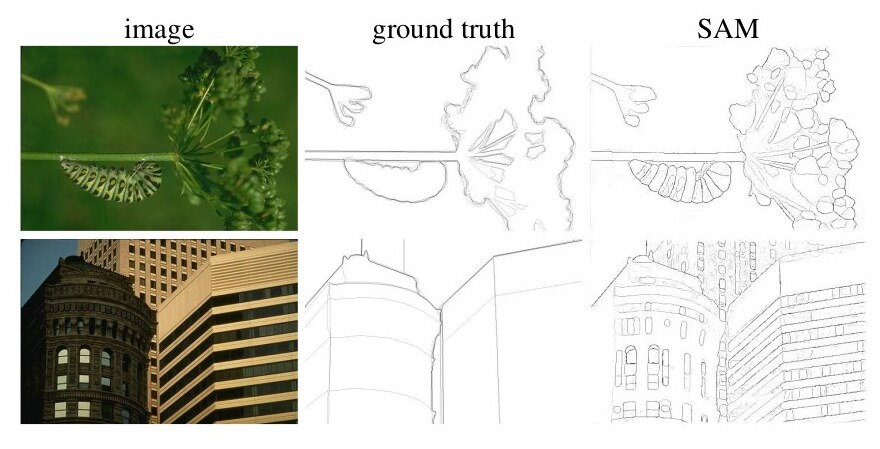

*图 10（原文 Figure 10，第 10 页）：BSDS500 上的零样本边缘预测。SAM 没有被训练预测边缘图，训练时也没有接触过 BSDS 的图像或标注。*

**图中文字翻译与读法**：三列分别是 image（图像）、ground truth（真值边缘）、SAM（SAM 预测的边缘）；第一行是一只趴在植物茎上的幼虫，第二行是高楼。SAM 的边缘图整体合理，物体轮廓与人工标注对得上，但比真值多出许多边缘：第一行里幼虫身上的体节和花序上细小的单元，第二行里大楼的窗户和立面纹理，这些边缘本身是合理的，只是没有被 BSDS500 的标注者标出来。

**表：BSDS500 上的零样本边缘检测**（ODS、OIS、AP、R50 越高越好；“-”表示原文未给出）

| 方法 | 年份 | ODS | OIS | AP | R50 |
|---|---:|---:|---:|---:|---:|
| HED | 2015 | .788 | .808 | .840 | .923 |
| EDETR | 2022 | .840 | .858 | .896 | .930 |
| **零样本迁移方法** | | | | | |
| Sobel filter | 1968 | .539 | - | - | - |
| Canny | 1986 | .600 | .640 | .580 | - |
| Felz-Hutt | 2004 | .610 | .640 | .560 | - |
| SAM | 2023 | .768 | .786 | .794 | .928 |

（原文表 3，第 10 页。EDETR 为原文表中的写法，对应参考文献 [79] 的 EDTER；前两行是在 BSDS500 上训练的方法，原文正文明确说明 HED 也在 BSDS500 上训练。）读法：SAM 比以往的零样本方法（Sobel、Canny、Felz-Hutt）好很多，也与早期深度方法 HED 接近，但仍落后于最先进的、会学习 BSDS500 标注偏好（哪些边缘该抑制）的方法。它的 R50 很高（.928，与 EDETR 的 .930 接近），原文的解释是 SAM 预测出更多边缘（包括 BSDS500 没有标注的合理边缘），因此召回高、代价是精度低；精度受影响的指标上它落后更多，例如 AP 为 .794，低于 HED 的 .840 和 EDETR 的 .896。

### 7.3 零样本目标提议（含附录 D.3）

**做法**：目标提议（object proposal）是检测研究里的经典中间步骤。使用略作修改的自动掩码生成流程，把输出掩码当作提议。修改点：不处理图像裁剪（使推理时间与 ViTDet 可比）；去掉按预测 IoU 和稳定性的过滤；为了得到每张图约 1000 个掩码，调整输入点网格和 NMS 阈值，选用 $64\times64$ 点网格和 0.9 的 NMS 阈值，平均每张图约 900 个掩码；若某张图提议超过 1000 个，就按置信度与稳定性分数的平均值排序，取前 1000。**指标**：LVIS v1 验证集上、1000 个提议时的平均召回率（AR@1000），LVIS 有 1203 个类别、质量高，是个有挑战的测试；还按物体大小（small/medium/large）和类别频率（frequent/common/rare）分开报告。**基线**：级联的 ViTDet-H（cascade Mask R-CNN ViT-H），它对应“检测器冒充提议生成器”（DMP）的做法，这种做法被证明会“刷高”AR，因此是个很苛刻的对比。**消融**：“SAM - single out.”（单输出 SAM）：因为它产生的掩码少，就把点网格增至 $128\times128$、NMS 阈值增至 0.95，每张图约 950 个掩码，也没有 IoU 分数可用于排序，改为随机排序。

**表：LVIS v1 上的零样本目标提议（mask AR@1000，越高越好）**

| 方法 | all | small | med. | large | freq. | com. | rare |
|---|---:|---:|---:|---:|---:|---:|---:|
| ViTDet-H | 63.0 | 51.7 | 80.8 | 87.0 | 63.1 | 63.3 | 58.3 |
| **零样本迁移方法** | | | | | | | |
| SAM - single out. | 54.9 | 42.8 | 76.7 | 74.4 | 54.7 | 59.8 | 62.0 |
| SAM | 59.3 | 45.5 | 81.6 | 86.9 | 59.1 | 63.9 | 65.8 |

（原文表 4，第 10 页；列 small / med. / large 按物体大小划分，freq. / com. / rare 按 LVIS 类别频率划分。SAM 未针对目标提议训练，也没有访问过 LVIS 的图像或标注。）读法：ViTDet-H 总体最好（63.0 对 59.3），这在预料之中，因为它在 LVIS 上训练、能学到 LVIS 特有的标注偏好。SAM 在中等物体（81.6 对 80.8）、常见（63.9 对 63.3）和罕见（65.8 对 58.3）类别上更高，在小物体（45.5 对 51.7）和高频（59.1 对 63.1）类别上更低；单输出 SAM 在所有 AR 指标上都显著更差，说明多掩码输出对召回很有价值（从一个点就能得到多个尺度的提议）。**一个小出入**：原文正文写 SAM 在“中等和大物体”上优于 ViTDet-H，但表中大物体一栏 SAM 为 86.9，反而比 ViTDet-H 的 87.0 低 0.1，实际应视为持平。

### 7.4 零样本实例分割（含附录 D.4）

**做法**：把 SAM 当作实例分割器的分割模块：先运行一个目标检测器（前面用的 ViTDet-H），再把检测框作为提示交给 SAM，用来说明 SAM 可以组合进更大系统。附录说明：额外做一次掩码细化，即把最自信的预测掩码连同框提示再输入一次解码器，得到最终预测。注意 SAM 本身没有学过 COCO 或 LVIS 的标注习惯，这一点会在下面的人评分析里用到。

**表：实例分割（掩码 AP，越高越好）。SAM 用 ViTDet 的框作提示。**

| 方法 | COCO AP | COCO AP^S | COCO AP^M | COCO AP^L | LVIS v1 AP | LVIS v1 AP^S | LVIS v1 AP^M | LVIS v1 AP^L |
|---|---:|---:|---:|---:|---:|---:|---:|---:|
| ViTDet-H（全监督） | 51.0 | 32.0 | 54.3 | 68.9 | 46.6 | 35.0 | 58.0 | 66.3 |
| **零样本迁移（仅分割模块）** | | | | | | | | |
| SAM | 46.5 | 30.8 | 51.0 | 61.7 | 44.7 | 32.5 | 57.6 | 65.5 |

（原文表 5，第 11 页；AP^S、AP^M、AP^L 分别是小、中、大物体上的 AP。）读法：全监督的 ViTDet-H 优于 SAM，但在质量更高的 LVIS 掩码上，差距缩小：COCO 上 AP 差 4.5（51.0 对 46.5），LVIS v1 上只差 1.9（46.6 对 44.7）。

但观察输出发现，SAM 的掩码常常比 ViTDet 的**质量更好、边界更清晰**（附录图 16）。为验证这一点，论文做了人评：

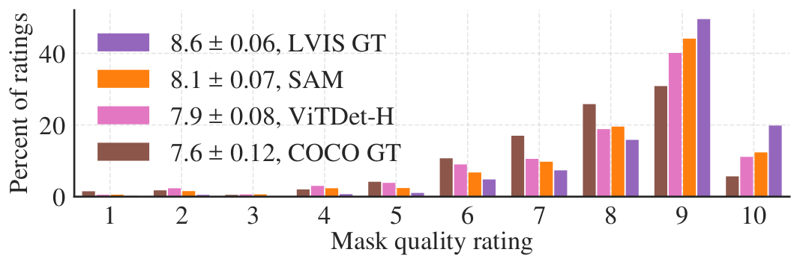

*图 11（原文 Figure 11，第 11 页）：人工评分的分布，ViTDet 与 SAM 都以 LVIS 真值框为输入。图例还给出 LVIS 与 COCO 真值的质量。*

**图中文字翻译与读法**：

- 横轴 Mask quality rating（掩码质量评分，1–10），纵轴 Percent of ratings（该评分所占百分比）。每个评分处有 4 根柱：紫色 LVIS GT、橙色 SAM、粉色 ViTDet-H、棕色 COCO GT。
- 图例中的数字是平均评分 ± 95% 置信区间：**LVIS GT 8.6 ± 0.06；SAM 8.1 ± 0.07；ViTDet-H 7.9 ± 0.08；COCO GT 7.6 ± 0.12**。
- **读图结论**：虽然 AP 更低（表 5），SAM 的人评分却一致高于 ViTDet-H，甚至高于 COCO 自己的真值掩码（8.1 对 7.6）。论文据此推测：ViTDet 利用了 COCO 与 LVIS 训练数据中的偏置。注意图 11 为了与 COCO 真值公平比较，把 LVIS 上各模型的结果降采样到与 COCO 真值相同的 794 个输入；表 8 的统计检验则用完整的 1000 个评分，SAM 对 ViTDet 的提升同样显著（p 值 2e-05，均值差 99% CI 为 (0.11, 0.42)）。

作者的解释：在 COCO 上 mask AP 差距更大，而 COCO 真值质量相对较低，ViTDet 学到了 COCO 掩码的特定偏置，而零样本的 SAM 无法利用这些（通常也并不希望有的）偏置。LVIS 的真值质量更高，但仍有一些特性，例如掩码没有孔洞（因构造上是简单多边形）、模态（modal）与非模态（amodal）掩码的偏置：SAM 对盘子等有孔洞的物体做出合理的模态预测，而 LVIS 因为掩码不能有孔洞，把盘子标成了非模态的。这些都是 ViTDet 可以学、SAM 学不到的。这是论文的解释，并非逐项验证过的结论。

### 7.5 零样本文本到掩码（含附录 D.5）

**做法**：这是处理自由文本提示能力的概念验证。前面所有实验用的是同一个 SAM，只有这个实验例外：训练过程被改造成“能感知文本”，但**不需要新的文本标注**。具体来说，对每个面积大于 $100^2$ 的人工标注掩码，提取它的 **CLIP 图像嵌入**；训练时把这个嵌入作为 SAM 的**第一次提示**，之后再叠加迭代的点提示。关键观察是：CLIP 的图像嵌入与文本嵌入是对齐的，所以**训练用图像嵌入、推理用文本嵌入**。推理时把文本送进 CLIP 的文本编码器，把得到的文本嵌入作为提示给 SAM。

**附录细节**：用公开可得的最大 CLIP（ViT-L/14@336px）计算图文嵌入，并做 $\ell_2$ 归一化；训练只用数据引擎前两阶段的掩码，且丢弃面积小于 $100^2$ 像素的掩码，加尺度抖动，训练 120k 次迭代、batch size 128，其余参数与默认相同。生成训练提示时：先把每个掩码的外接框随机放大 1 到 2 倍，再裁成正方形并缩放到 $336\times336$ 像素；送入 CLIP 图像编码器前，以 50% 概率把掩码之外的像素置零；为了让嵌入聚焦于物体，在最后一层用掩码注意力，把输出 token 的注意力限制在掩码内的图像位置；最终的提示就是该输出 token 的嵌入。

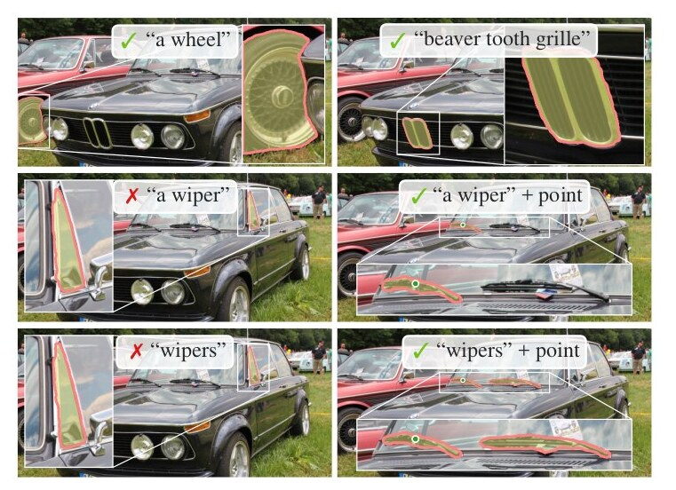

*图 12（原文 Figure 12，第 11 页）：零样本文本到掩码。SAM 既能处理简单的文本提示，也能处理较细致的短语；当 SAM 没有给出正确预测时，再加一个点提示往往能纠正。*

**图中文字翻译与读法**：

- 第一行（成功，绿色对勾）：文本 “a wheel”（一个车轮）和 “beaver tooth grille”（海狸牙形的进气格栅，指车头那两个并排的长条格栅）；每个小图都有一个放大的子图展示掩码细节。
- 第二行：文本 “a wiper”（一个雨刮器）失败（红色叉号），放大图里被分割出来的是车窗角上的一块三角形区域，不是雨刮器；加上一个点提示后 “a wiper + point”（绿色圆点落在雨刮器上）成功，放大图里分出了雨刮器。
- 第三行：文本 “wipers”（复数）同样仅凭文字失败（红叉，同样选中了那块三角形区域）；加一个点后 “wipers + point” 成功，两个雨刮器都被分割出来。
- **读图结论**：文本提示能解决简单名词和短语，但不稳健；加一个点往往就能修复。这只是定性展示，论文没有给出文本到掩码的定量结果，作者也在局限里说明这部分是探索性的。

### 附：SAM 的潜在空间探测（附录 D.6）

作者做了一个初步的定性探测：对一个掩码，取其所在图像裁剪（及其水平翻转）的 SAM 图像嵌入，乘上二值掩码并在空间上平均，得到“掩码嵌入”。在同一张图内用它找最近邻（附录图 17）：最近的邻居在形状与语义上都有一定（但不完美）的相似，尽管 SAM 并没有语义监督。作者因此猜测，SAM 的表示可能用于进一步标注数据、理解数据集内容，或作为下游特征，但这个结果是初步的。

### 7.6 消融

消融在 23 个数据集的单中心点提示协议下进行，并同时报告“oracle”（与真值最匹配的那个掩码），因为零样本下 SAM 的最高排名掩码与数据标注规范产生的掩码之间可能存在系统性偏差。

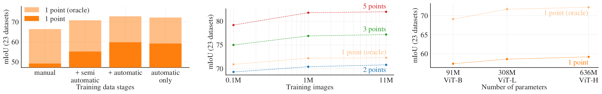

*图 13（原文 Figure 13，第 12 页）：数据引擎各阶段、图像编码器规模和训练数据量的消融。*

**图中文字翻译与读法**（以下数值是从图上读出的近似值）：

- **左图**：横轴 Training data stages（训练数据阶段）：manual（仅手工）、+ semi automatic（加半自动）、+ automatic（再加自动）、automatic only（仅自动，默认）；纵轴 mIoU (23 datasets)；深橙为 1 point，浅橙为 1 point (oracle)。约为：manual 1 点 49、oracle 66；加半自动 1 点 55、oracle 71；全部三阶段 1 点 60、oracle 73；仅自动 1 点 59、oracle 72。
- **中图**：横轴 Training images（训练图像数，对数坐标：0.1M、1M、11M）；四条曲线分别标为 5 points（红）、3 points（绿）、1 point (oracle)（浅橙）、2 points（蓝），图中没有单独的“1 point”曲线。0.1M 张图时所有曲线都明显偏低（约为 79、75、71、69）；1M 与 11M 张图时几乎重合（约为 82、77、72、70–71）。
- **右图**：横轴 Number of parameters（参数量）：91M（ViT-B）、308M（ViT-L）、636M（ViT-H）；纵轴为 mIoU。1 点：约 57.5、58.5、59；1 点 oracle：约 69、72、72。

**结论**：

1. **每个阶段的数据都带来提升**。三阶段数据全用时，自动掩码数量远多于手工和半自动掩码，论文发现把手工与半自动掩码**过采样 10 倍**效果最好，但这使训练配置变复杂；于是测试了第四种设置，只用自动生成的掩码：只比全部数据略低（约 0.5 mIoU），因此默认只用自动掩码，以简化训练。
2. **数据量**：完整的 SA-1B 有 1,100 万张图，均匀降采样到 100 万张（约 10%，仍含约 1 亿个掩码）与 10 万张来做消融；10 万张时 mIoU 在所有设置下都明显下降，但 100 万张时与完整数据集相当，这对许多使用场景是个现实可行的数据规模。
3. **编码器规模**：ViT-H 比 ViT-B 提升明显，但相对 ViT-L 只有微小增益；继续放大图像编码器目前看没有前景。在某些场景，较小的编码器可能更合适。

## 八、局限与讨论

**论文自述的局限**（第 8 节）：

- SAM 总体表现好但并不完美：可能漏掉细结构、有时会幻觉出小的不连通成分，边界不如“放大再预测”的计算更重的方法（如 FocalClick）锐利。
- 当给定很多个点时，专门的交互分割方法（如 SimpleClick）预计会超过 SAM；SAM 追求的是通用性与使用面的广度，而不是高 IoU 的交互分割。
- SAM 处理提示是实时的，但使用重编码器时，整体并不实时。
- 文本到掩码只是探索性的、不够稳健。
- 如何设计简单的提示去实现语义分割和全景分割，尚不清楚。
- 在各自领域里，一些领域专用工具预期仍会胜过 SAM。

**关于“基础模型”的讨论**：作者承认图像分割作为基础模型的范围本身有限（只是计算机视觉的一个重要但局部的子集）；SAM 用 MAE 这一自监督方法初始化，但它的绝大部分能力来自大规模**有监督**训练，只要数据引擎能扩大标注规模，有监督训练就是有效的方案。**可组合性**：论文举了两个例子，MCC 可以用 SAM 分割感兴趣物体，从单张 RGB-D 图像做 3D 重建；SAM 也可以用可穿戴设备检测到的注视点作为提示，在第一人称图像这类新领域里不经额外训练就能用。

**证据边界与常见误读**：

- SAM 输出的是**无类别的掩码**，不是开放词汇的语义识别：掩码没有名称，文本提示只是初步探索。
- 不能只把这篇论文读成一个网络结构：任务定义、数据引擎和 SA-1B 与模型同等重要，图 13 的消融也显示数据阶段和数据量对结果影响很大。
- 零样本“强”不等于处处强：23 个数据集的结果差别很大（图 9a 里 SAM 在 7 个数据集上不如 RITM，GTEA 上低 21.4 个 IoU）；论文自己也指出，领域专用工具（例如生物图像分析软件 ilastik）预期在各自领域胜过 SAM。
- 1 点 mIoU 的绝对值较低（约 59，从图上读出），这是歧义造成的，不应直接读成“掩码质量差”；人评分 7–9 分。oracle 数字是用真值选掩码的上界，不是可部署的结果。
- 实例分割 AP 不及全监督 ViTDet-H（COCO 上 46.5 对 51.0），但人评更高；AP 与人评的分歧，论文归因于全监督方法利用了数据集标注偏置，这是推测。
- 论文的评测里，目标提议用的是“检测器冒充提议生成器”这个本身会刷高 AR 的基线，所以 SAM 与它的差距是在苛刻对比下得到的。
- “数据引擎里的模型偏差会被放大”这类说法在论文中没有实验证据；论文自己承认的是：掩码由分割模型生成，可能存在错误或不一致，而且 SA-1B 的地理与收入代表性并非均衡。

## 九、复现检查清单

- **点的选取协议**：中心点取掩码内部距离变换的最大值处；多点时用“错误区域里离边界最远的点”；随机点协议要单独标注。
- **评价哪个掩码**：默认用预测 IoU 最高的那个；oracle 结果必须与默认结果分开报告。
- **多掩码输出不能省**：训练时 3 个输出只对最小损失反传，另有第 4 个 token 专管多提示；预测 IoU 头不能省，目标提议和自动标注都靠它排序。
- **区分延迟**：图像编码器延迟（每张图一次）与每次提示的解码器延迟（约 50 ms，浏览器 CPU 上）要分开测。
- **自动掩码生成的阈值**：预测 IoU 阈值 88.0、稳定性阈值 95.0（logit ±1）、NMS 阈值 0.7、$32\times32$ 点网格加 20 个裁剪、小于 100 像素的碎片和孔洞处理、去掉覆盖 95% 以上图像的掩码，这些都会改变掩码分布。
- **训练**：1024×1024 输入；11 轮模拟交互；焦点损失与 dice 损失 20 : 1；IoU 头的 MSE 系数 1.0；AdamW，学习率 8e-4，batch size 256，90k 次迭代；MAE 预训练的 ViT-H 初始化。
- **人评**：1–10 分制、5 个视图、同一批输入给所有方法；报告置信区间和配对检验。

## 十、与其他论文的关系

- **ViT / MAE / ViTDet**：SAM 的图像编码器是 MAE 预训练的 ViT（本仓库的 [ViT 解读](../vit/论文中文解读.md)），采用 ViTDet 的窗口注意力加少量全局注意力的设计来适应高分辨率；
- **CLIP 与 DALL·E**：基础模型的范式来源，也是 SAM 文本提示的接口（用 CLIP 对齐图文嵌入，见 [CLIP 解读](../clip/论文中文解读.md)）；SAM 想与 CLIP 一样成为可组合系统里的一个部件；
- **DETR / MaskFormer**：掩码解码器的设计来源（输出 token、动态掩码预测、focal 加 dice 损失）；
- **RITM、FocalClick、SimpleClick**：交互分割的基线，也是模拟点击训练策略的来源；
- 视觉 backbone 方面还可对照 [Swin Transformer 解读](../swin_transformer/论文中文解读.md)。

## 原文证据导航

- [原论文 PDF](paper.pdf)
- [原文提取文本](paper.txt)
- [论文概要](论文概要.md)
