# 论文中文解读：《Scaling Laws for Neural Language Models》

> **基本信息**：Jared Kaplan、Sam McCandlish（二人为共同一作）、Tom Henighan、Tom B. Brown、Benjamin Chess、Rewon Child、Scott Gray、Alec Radford、Jeffrey Wu、Dario Amodei（Johns Hopkins University 与 OpenAI），arXiv:2001.08361，2020 年 1 月；论文原文 [官方页面](https://arxiv.org/abs/2001.08361)。
>
> **本文的读法**：图均为从论文 PDF 中按图裁出的原图，表为逐格核对后的中文转录（符号和数字与原文一致，表头和行名译成中文）。每张图后附中文图题、图中文字翻译和读图结论；从图上读出的数值一律标“约”，正文给出的数字以原文为准。标有“自行验算”的数字，是用论文给出的公式和常数代入算出的，不是原文结论。页码是论文页码（与 PDF 页码一致）。

## 一、一句话结论

作者在 WebText2 文本上训练了大量 Transformer 语言模型（非 embedding 参数从约 $10^3$ 到 $1.5\times10^9$），发现测试交叉熵损失 $L$ 在不被另外两个因素限制时，随非 embedding 参数量 $N$、数据量 $D$、最优分配的训练计算量 $C_{\min}$ 都呈**幂律**下降：$L(N)=(N_c/N)^{0.076}$、$L(D)=(D_c/D)^{0.095}$、$L(C_{\min})=(C_c^{\min}/C_{\min})^{0.050}$；而层数、宽度、注意力头数等形状超参数在很宽的范围内几乎不影响结果。把这些关系联立，可以推出过拟合程度的公式、训练曲线的公式，以及固定计算预算下的最优分配：算力每增加 10 倍，模型应增大约 5 倍，训练处理的数据只需增大约 2 倍，并且应在远未收敛时就停止训练，即“大模型比大数据更重要”。这个具体的分配比例后来被 Chinchilla 修正，但“用小规模实验拟合幂律、再外推来规划大规模训练”的方法影响了之后的大模型训练规划。

## 二、背景与动机

### 2.1 论文要回答的问题

语言模型好不好，可以用测试集上每个 token 的交叉熵损失 $L$（单位 nat，自然对数）来衡量。直觉上它可能取决于四类因素：模型架构、模型大小、训练用的计算量、可用的数据量。2020 年之前，“预算该花在哪里”基本靠经验。作者只研究 Transformer（以 decoder-only 为主），把这些因素逐个系统扫描，目标是得到 $L$ 对它们的**定量**依赖关系，并回答下面这些问题：

1. 网络形状（深度、宽度、注意力头数、前馈层宽度）重要吗？
2. 模型变大、数据变多、算力变多，损失各自会降多少？
3. 过拟合什么时候出现，它和模型大小、数据量是什么关系？
4. 训练需要多少步，batch size 该多大？
5. 给定固定的计算预算，模型大小、batch size、训练步数和数据量应当怎样分配？

语言任务的“天花板高、地板低”，因此能在七个以上数量级的范围内观察趋势（摘要）。

### 2.2 幂律应该怎么读

如果 $L(X)=(X_c/X)^{\alpha}$，两边取对数得 $\ln L=\alpha\ln X_c-\alpha\ln X$：在双对数坐标里这是一条斜率为 $-\alpha$ 的直线。把资源 $X$ 放大 $k$ 倍，损失就乘以 $k^{-\alpha}$，与当前处在哪个规模无关。代入论文的指数（自行验算）：

| 资源变化 | 指数 | 损失乘以 | 损失下降 |
|---|---:|---:|---:|
| 参数量 $N$ 加倍 | 0.076 | 0.949 | 约 5.1% |
| 参数量 $N$ 放大 10 倍 | 0.076 | 0.840 | 约 16.1% |
| 数据量 $D$ 加倍 | 0.095 | 0.936 | 约 6.4% |
| 数据量 $D$ 放大 10 倍 | 0.095 | 0.804 | 约 19.7% |
| 最优计算量 $C_{\min}$ 放大 10 倍 | 0.050 | 0.891 | 约 10.9% |

原文自己给的例子是“参数量加倍，损失乘以 $2^{-\alpha_N}=0.95$”。指数都很小，所以每降低同样比例的损失，需要成倍增加资源，这就是“收益递减”。同时要注意：论文拟合的式子里**没有**加性的“不可约损失”常数项，作者的说法是趋势在损失降到零之前必然变平（因为自然语言的熵非零），但在所测范围内没有看到变平的迹象。

### 2.3 这些结论的适用范围

所有数值（指数和常数）都来自“WebText2 + BPE 词表 50257 + Transformer decoder + 上下文 1024”这一组具体设定。作者明确说，$N_c$、$C_c^{\min}$、$D_c$ 的具体数值依赖词表大小和分词方式，所以没有基本的物理含义；换词表会让损失整体缩放一个因子。关系的“形状”（幂律）才是论文的主要发现。

## 三、符号、术语与计数方式

### 3.1 符号（原文 1.3 节）

| 符号 | 含义 |
|---|---|
| $L$ | 交叉熵损失，单位 nat；一般对一个上下文内的 token 取平均，个别地方报告上下文中某个位置 token 的损失 |
| $N$ | 模型参数量，**不含**词表 embedding 和位置 embedding |
| $D$ | 数据集大小，以 token 计 |
| $C\approx 6NBS$ | 估计的非 embedding 训练计算量；$B$ 为 batch size（以 token 计，常用 $2^{19}=524{,}288$ token，即 512 条序列 × 1024 token），$S$ 为训练步数（参数更新次数）。数值用 PF-day 表示：1 PF-day $=10^{15}\times24\times3600=8.64\times10^{19}$ 次浮点运算 |
| $B_{\mathrm{crit}}$ | 临界 batch size（critical batch size，来自 McCandlish 等 2018），在训练时间与计算效率之间取近似最优折中，原文 5.1 节定义（本文 8.1 节） |
| $C_{\min}$ | 达到给定损失所需最小非 embedding 计算量的估计，即以远小于 $B_{\mathrm{crit}}$ 的 batch size 训练时用的计算量 |
| $S_{\min}$ | 达到给定损失所需最少训练步数的估计，即以远大于 $B_{\mathrm{crit}}$ 的 batch size 训练时用的步数 |
| $\alpha_X$ | 幂律指数，$L(X)\propto 1/X^{\alpha_X}$，$X$ 可取 $N,D,C,S,B,C_{\min}$ |

### 3.2 Transformer 的参数量与计算量（原文 2.1 节、表 1）

超参数：层数 $n_{\text{layer}}$，残差流维度 $d_{\text{model}}$，前馈层中间维度 $d_{\text{ff}}$，注意力输出维度 $d_{\text{attn}}$，每层注意力头数 $n_{\text{heads}}$，上下文长度 $n_{\text{ctx}}$（除特别说明外为 1024）。模型大小 $N$ 定义为非 embedding 参数量：

$$
N\approx 2d_{\text{model}}\,n_{\text{layer}}\,(2d_{\text{attn}}+d_{\text{ff}})=12\,n_{\text{layer}}\,d_{\text{model}}^{2}\qquad(\text{标准设置 }d_{\text{attn}}=d_{\text{ff}}/4=d_{\text{model}})
$$

这里略去了偏置等次要项。模型另有 $n_{\text{vocab}}d_{\text{model}}$ 个词表 embedding 参数和 $n_{\text{ctx}}d_{\text{model}}$ 个位置 embedding 参数，但讨论“模型大小”时都不计入：后文图 6 显示，这样得到的规模律明显更干净。一次前向传播约需

$$
C_{\text{forward}}\approx 2N+2\,n_{\text{layer}}\,n_{\text{ctx}}\,d_{\text{model}}
$$

次加乘运算，其中的因子 2 来自矩阵乘法里的“乘加”（multiply-accumulate）。表 1 给出逐项明细：

**表 1：Transformer 的参数量与每 token 前向计算量（原文表 1，第 7 页；略去非线性、偏置、层归一化等次要项）**

| 操作（Operation） | 参数量（Parameters） | 每 token 的 FLOPs |
|---|---|---|
| Embed（词嵌入与位置嵌入） | $(n_{\text{vocab}}+n_{\text{ctx}})\,d_{\text{model}}$ | $4d_{\text{model}}$ |
| Attention: QKV（注意力：QKV 投影） | $n_{\text{layer}}\,d_{\text{model}}\,3d_{\text{attn}}$ | $2n_{\text{layer}}\,d_{\text{model}}\,3d_{\text{attn}}$ |
| Attention: Mask（注意力：打分与掩码） | — | $2n_{\text{layer}}\,n_{\text{ctx}}\,d_{\text{attn}}$ |
| Attention: Project（注意力：输出投影） | $n_{\text{layer}}\,d_{\text{attn}}\,d_{\text{model}}$ | $2n_{\text{layer}}\,d_{\text{attn}}\,d_{\text{embd}}$ |
| Feedforward（前馈层） | $n_{\text{layer}}\,2d_{\text{model}}\,d_{\text{ff}}$ | $2n_{\text{layer}}\,2d_{\text{model}}\,d_{\text{ff}}$ |
| De-embed（输出层） | — | $2d_{\text{model}}\,n_{\text{vocab}}$ |
| 合计（不含 embedding） | $N=2d_{\text{model}}\,n_{\text{layer}}\,(2d_{\text{attn}}+d_{\text{ff}})$ | $C_{\text{forward}}=2N+2n_{\text{layer}}\,n_{\text{ctx}}\,d_{\text{attn}}$ |

读法：原表第三行写作 $d_{\text{embd}}$，指的就是 $d_{\text{model}}$。把表中 QKV、输出投影、前馈三行的参数量相加，恰好得到合计行的 $N$（自行验算：$3d_{\text{attn}}d_{\text{model}}+d_{\text{attn}}d_{\text{model}}+2d_{\text{model}}d_{\text{ff}}$ 乘以 $n_{\text{layer}}$）。当 $d_{\text{model}}>n_{\text{ctx}}/12$ 时，与上下文长度有关的那一项只占总计算的一小部分；作者研究的模型主要满足 $d_{\text{model}}\gg n_{\text{ctx}}/12$，所以训练计算量里不含这一项。反向传播约为前向的两倍，于是每个训练 token 的非 embedding 计算量为

$$
C\approx 6N\ \text{FLOPs/token}\quad\Longrightarrow\quad C=6NBS
$$

（$B$ 以 token 计，$S$ 为步数。）这个 $6N$ 近似在后文反复使用。

## 四、实验设置

**数据**：WebText2，是 GPT-2 所用 WebText 的扩展版。WebText 抓取了 Reddit 上截至 2017 年 12 月、获得至少 3 个 karma 的外链；WebText2 又加入 2018 年 1 月到 10 月、同样至少 3 个 karma 的外链（karma 阈值是“人们是否觉得这个链接有趣或有用”的启发式），网页正文用 Newspaper3k 提取。共 2030 万篇文档、96 GB 文本、$1.62\times10^{10}$ 个词（按 `wc` 统计），用 GPT-2 的可逆分词器（BPE，词表 $n_{\text{vocab}}=50257$）得到 $2.29\times10^{10}$ 个 token，其中 $6.6\times10^{8}$ 个 token 留作测试集。此外还在 Books Corpus、Common Crawl、英文 Wikipedia 和一批公开的网络图书上做类似处理，用来测试分布外泛化。脚注：按 `wc` 的词计，WebText2 平均每词 1.4 个 token，每 token 4.3 个字符。

**目标**：对 1024 个 token 的上下文取平均的自回归对数似然（即交叉熵损失），是唯一的主指标。

**模型**：以 decoder-only Transformer 为主，另训练 LSTM 和 Universal Transformer 做对照。

**扫描范围**（原文第 3 节开头）：模型大小从 768 到 15 亿个非 embedding 参数；数据集从 2200 万到 230 亿 token；形状（层数、宽度、头数、前馈维度）；上下文长度（多数为 1024，也做了更短的）；batch size（多数为 $2^{19}$ token，另外为测量临界 batch size 而改变）。

**训练**：除特别说明外，Adam 优化器，固定 $2.5\times10^{5}$ 步，batch 为 512 条、每条 1024 个 token（所以一次默认训练共处理约 $1.3\times10^{11}$ 个 token，自行验算）；因显存限制，超过 10 亿参数的最大模型改用 Adafactor。学习率调度：3000 步线性 warmup，之后余弦衰减到零。作者试过多种学习率和调度，结论是收敛时的结果基本与调度无关（附录 D.6）；并给出经验公式 $\mathrm{LR}(N)\approx 0.003239-0.0001395\log N$（式 D.1，对 $N>10^{10}$ 不再适用；原文写作 log，自行验算：取自然对数时 $N=3\times10^{6}$ 的结果约为 $1.2\times10^{-3}$，与图 22 中该规模模型的峰值学习率同量级）。第 4 节研究有限数据时，所有模型用 10% dropout，并监测测试损失、不再下降就停止训练（early stopping）。

## 五、核心结果总览（原文第 1 节）

### 5.1 八条主要发现

1. **性能主要取决于规模，几乎不取决于形状**：规模指三个量，非 embedding 参数量 $N$、数据量 $D$、训练计算量 $C$。在合理范围内，深度与宽度之比等其他架构超参数影响很小。
2. **平滑的幂律**：当不被另外两个因素限制时，性能与 $N$、$D$、$C$ 各自呈幂律，趋势跨越六个以上数量级（图 1）；在大的一端没有观察到偏离，但损失降到零之前趋势必然变平。
3. **过拟合的普适性**：只要 $N$ 和 $D$ 同步放大，性能就可预测地提高；固定其中一个、只放大另一个，就进入收益递减区。性能惩罚可预测地取决于比值 $N^{0.74}/D$：模型每增大 8 倍，数据只需增大约 5 倍就能避免惩罚。
4. **训练的普适性**：训练曲线服从幂律，其参数大体与模型大小无关；外推训练曲线的早期部分，可以大致预测训练久得多时的损失。
5. **迁移随测试性能一起提升**：在与训练分布不同的文本上评测，损失与训练验证集上的损失强相关，只差一个大致恒定的偏移，即迁移到别的分布付出一个固定代价，其余随训练集上的性能同步改善。
6. **样本效率**：大模型比小模型样本效率更高，用更少的优化步数（图 2）和更少的数据（图 4）就能达到同样的水平。
7. **收敛是低效的**：计算预算 $C$ 固定、对模型大小 $N$ 和可用数据 $D$ 没有其他限制时，最优做法是训练非常大的模型，并在远未收敛处停止（图 3）。数据需求随训练计算增长得很慢，$D\sim C^{0.27}$。
8. **最优 batch size**：理想 batch size 大致只是损失的幂函数，可用梯度噪声尺度（gradient noise scale）测得；对能训练的最大模型，收敛时约为 100 万到 200 万个 token。

### 5.2 图 1：三条基本幂律

先看全文最重要的一张图：它把 $N$、$D$、$C$ 三个量各自与测试损失的关系画在一起，后面所有章节都是对它的展开。

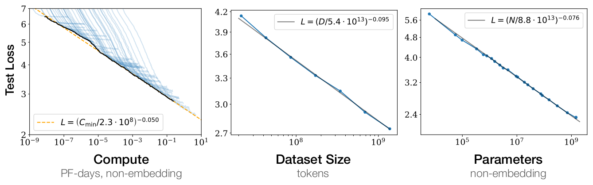

*图 1（原文 Figure 1，第 3 页）：语言建模性能随模型大小、数据集大小和训练计算量平滑提升。要获得最优性能，三者必须同步放大；当不被另外两者限制时，性能与每个因素单独呈幂律关系。*

**图中文字翻译与读法**：

- **左图 Compute（计算量，PF-days，非 embedding）**：横轴为训练计算量（对数刻度，约 $10^{-9}$ 到 $10^{1}$ PF-day），纵轴 Test Loss（测试损失，刻度 2 到 7）。浅蓝色细线是各个模型尺寸各自的训练曲线，黑色粗线是它们的下包络线（该计算量下能达到的最低损失），橙色虚线是幂律拟合，图例为 $L=(C_{\min}/2.3\cdot10^{8})^{-0.050}$。原文脚注 2 说明，这里显示的是“用足够小的 batch size 时所预测的计算量”，与纯经验数据的对比见图 13。
- **中图 Dataset Size（数据集大小，tokens）**：同一个 36 层、$d_{\text{embd}}=1280$ 的模型在 WebText2 的不同大小子集上训练到测试损失不再下降（early stopping）。数据量从约 $2\times10^{7}$ 到约 $1.4\times10^{9}$ token，损失由约 4.1 降到约 2.7；灰线为拟合 $L=(D/5.4\cdot10^{13})^{-0.095}$。
- **右图 Parameters（参数量，非 embedding）**：横轴约 $10^{4}$ 到 $1.5\times10^{9}$ 个非 embedding 参数，纵轴损失由约 6 降到约 2.4；灰线为拟合 $L=(N/8.8\cdot10^{13})^{-0.076}$。
- **读图结论**：三个量各自在双对数坐标下都是几乎笔直的线，跨越很多数量级而没有弯曲；这是“平滑幂律”的核心证据。条件是每次只看一个量，且另外两个量没有成为瓶颈（例如右图的模型要训练到收敛、数据足够多）。注意图 1 左图图例里的常数 $2.3\times10^{8}$ 与正文式 (1.3) 的 $3.1\times10^{8}$ 不同，见本文末尾“原文内部数字不一致备查”。

### 5.3 三条单变量幂律（式 1.1 至 1.3）

下面三式在各自的条件下成立（原文第 1.2 节）。

**(1) 参数受限**：模型参数有限、在足够大的数据集上训练到收敛：

$$
L(N)=\left(\frac{N_c}{N}\right)^{\alpha_N},\qquad \alpha_N\approx0.076,\quad N_c\approx8.8\times10^{13}\ \text{（非 embedding 参数）}\tag{1.1}
$$

**(2) 数据受限**：大模型、有限数据、early stopping：

$$
L(D)=\left(\frac{D_c}{D}\right)^{\alpha_D},\qquad \alpha_D\approx0.095,\quad D_c\approx5.4\times10^{13}\ \text{（tokens）}\tag{1.2}
$$

**(3) 计算受限**：有限计算、足够大的数据集、大小最优的模型、足够小的 batch size（即最优地使用计算）：

$$
L(C_{\min})=\left(\frac{C_c^{\min}}{C_{\min}}\right)^{\alpha_C^{\min}},\qquad \alpha_C^{\min}\approx0.050,\quad C_c^{\min}\approx3.1\times10^{8}\ \text{（PF-days）}\tag{1.3}
$$

脚注 3：用固定 batch size 训练时，对实际计算量 $C$ 也能观察到经验幂律（图 1），但做预测应当用 $C_{\min}$ 的趋势，二者由式 (5.5) 联系。作者总结这些关系在 $C_{\min}$ 上跨越八个数量级、在 $N$ 上六个数量级、在 $D$ 上两个多数量级。

### 5.4 图 2 和图 3：样本效率与计算分配的直觉

幂律只给出“损失随资源怎么降”。图 2 与图 3 从训练曲线的角度给出两个直觉：大模型更省样本；算力增加时，增量主要应该花在模型大小上。

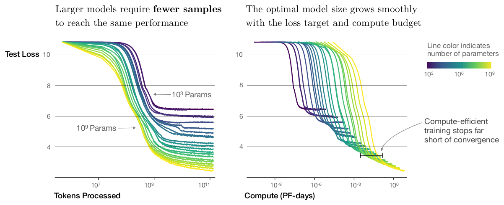

*图 2（原文 Figure 2，第 4 页）：一系列语言模型训练曲线，模型大小从 $10^{3}$ 到 $10^{9}$ 个参数（不含 embedding）。*

**图中文字翻译与读法**：

- **左图 “Larger models require fewer samples to reach the same performance”（更大的模型达到同样的性能需要更少的样本）**：横轴 Tokens Processed（已处理的 token 数，对数刻度，刻度 $10^{7}$、$10^{9}$、$10^{11}$），纵轴 Test Loss（测试损失）。右端约为 $1.3\times10^{11}$，正是默认训练 $2.5\times10^{5}$ 步、每步 $2^{19}$ token 处理的总量（自行验算）。每条线是一个模型尺寸的训练曲线，颜色表示参数量，由深紫（$10^{3}$）到黄色（$10^{9}$）；箭头标出最小的 “$10^{3}$ Params” 与最大的 “$10^{9}$ Params” 两条线。所有曲线起点都约为 10.8，约等于 $\ln 50257\approx10.82$，即模型一开始对 50257 个词做均匀预测时的损失（自行验算）。黄色的大模型在相同 token 数下损失明显更低，最终停在更低的平台。
- **右图 “The optimal model size grows smoothly with the loss target and compute budget”（最优模型大小随损失目标和计算预算平滑增长）**：横轴 Compute (PF-days)（计算量，对数刻度，刻度 $10^{-9}$、$10^{-6}$、$10^{-3}$、$10^{0}$），纵轴同样是 Test Loss。同一批曲线改用计算量作横轴，颜色条 “Line color indicates number of parameters”（线的颜色表示参数量，$10^{3}$ 到 $10^{9}$）。各条曲线的左下包络就是“在某个计算预算下能得到的最低损失”，处在包络上的模型大小随预算平滑增大；括号旁的标注 “Compute-efficient training stops far short of convergence”（计算最优的训练远在收敛之前就停止）指的是：计算最优的位置落在各条曲线走到平台（收敛）之前很远处。
- **读图结论**：同样 token 数下大模型损失更低（样本效率），而同样计算量下最优点并不在“小模型训练到收敛”处。这张图是原文第 6 节（本文第九节）结论的直观版本。

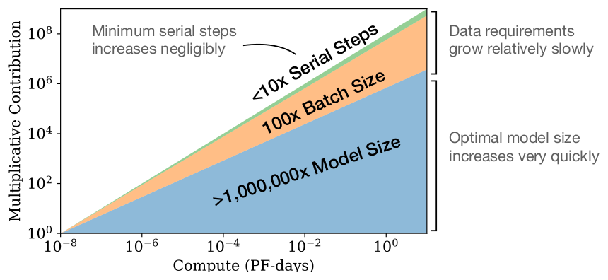

*图 3（原文 Figure 3，第 4 页）：随着计算量增加，可以选择把多少用于训练更大的模型、使用更大的 batch、训练更多步。图中展示计算量增加十亿倍的情形。*

**图中文字翻译与读法**：

- **坐标**：横轴 Compute (PF-days)，从 $10^{-8}$ 到约 $10^{1}$，纵轴 Multiplicative Contribution（乘性贡献，对数刻度，$10^{0}$ 到 $10^{9}$）。堆叠的三块面积对应三个因素对“计算增长”的贡献，三者的乘积等于总计算增长。
- **三块面积**：蓝色 “>1,000,000x Model Size”（模型大小增大 100 万倍以上）；橙色 “100x Batch Size”（batch size 约 100 倍）；绿色 “<10x Serial Steps”（串行步数不到 10 倍）。右侧括号标注：蓝色部分 “Optimal model size increases very quickly”（最优模型大小增长得非常快）；橙色加绿色部分合起来是 “Data requirements grow relatively slowly”（数据需求增长相对缓慢）；左上方文字 “Minimum serial steps increases negligibly”（最少串行步数的增长可以忽略）。
- **读图结论**：与式 (1.7) 的指数对照（自行验算）：$N\propto C_{\min}^{0.73}$，计算增长 $10^{9}$ 倍时模型约增大 $10^{9\times0.73}\approx3.7\times10^{6}$ 倍；$B\propto C_{\min}^{0.24}$ 对应约 145 倍；$S\propto C_{\min}^{0.03}$ 对应约 1.9 倍；三者相乘 $\approx10^{9}$。图中标注的“>1,000,000x”“100x”“<10x”是这些量的取整说法。

### 5.5 联合公式与最优分配（式 1.4 至 1.8）

单变量的幂律还不够，因为实际训练同时涉及 $N$、$D$、训练步数和 batch size。作者给出了下面几组联合关系，后面各节会逐一展开和验证。

**临界 batch size**，它决定了数据并行的速度与效率之间的折中（$B_{\mathrm{crit}}$ 的定义见本文 8.1 节）：

$$
B_{\mathrm{crit}}(L)=\frac{B_*}{L^{1/\alpha_B}},\qquad B_*\approx2\times10^{8}\ \text{tokens},\quad\alpha_B\approx0.21\tag{1.4}
$$

**有限的 $N$ 与 $D$ 同时出现**时，式 (1.1) 与 (1.2) 提示数据量应随模型大小次线性增长：$D\propto N^{\alpha_N/\alpha_D}\sim N^{0.74}$。实际上存在一个把两者合并、并描述过拟合程度的单一公式：

$$
L(N,D)=\left[\left(\frac{N_c}{N}\right)^{\alpha_N/\alpha_D}+\frac{D_c}{D}\right]^{\alpha_D}\tag{1.5}
$$

作者推测这一函数形式也可能适用于其他生成式建模任务的对数似然。

**有限的训练步数**（无限数据下，经过初始瞬态之后）：

$$
L(N,S)=\left(\frac{N_c}{N}\right)^{\alpha_N}+\left(\frac{S_c}{S_{\min}(S)}\right)^{\alpha_S},\qquad S_c\approx2.1\times10^{3},\ \alpha_S\approx0.76\tag{1.6}
$$

其中 $S_{\min}(S)$ 是“以很大 batch size 训练所需的最少优化步数”，由式 (5.4) 估计。

**固定计算预算 $C$** 且没有其他约束时，由式 (1.6) 得到最优模型大小 $N$、最优 batch size $B$、最优步数 $S$ 和数据量 $D$ 应按下式增长：

$$
N\propto C^{\alpha_C^{\min}/\alpha_N},\quad B\propto C^{\alpha_C^{\min}/\alpha_B},\quad S\propto C^{\alpha_C^{\min}/\alpha_S},\quad D=B\cdot S\tag{1.7}
$$

$$
\alpha_C^{\min}=\frac{1}{1/\alpha_S+1/\alpha_B+1/\alpha_N}\tag{1.8}
$$

原文称这与经验最优结果 $N\propto C_{\min}^{0.73}$、$B\propto C_{\min}^{0.24}$、$S\propto C_{\min}^{0.03}$ 吻合得很好。三个指数之和恰为 1，因为 $C=6NBS$。算力增加时应主要花在更大的模型上，训练时间和数据集大小不需要显著增加；这也意味着模型越大，样本效率越高。现实中研究者出于硬件限制，常把小模型训练得比“最大化计算效率”所需更久。

下面的图 4 是 (1.5) 与 (1.6) 的拟合效果。

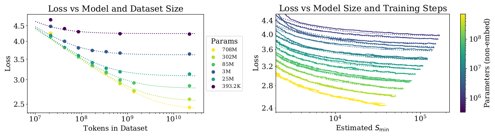

*图 4（原文 Figure 4，第 5 页）：左，早停后的测试损失 $L(N,D)$ 随数据集大小 $D$ 和模型大小 $N$ 的变化，按式 (1.5) 可预测；右，经过初始瞬态之后，所有模型大小的学习曲线都能用式 (1.6) 拟合，式中用的是在大 batch size 下训练的步数 $S_{\min}$（细节见本文 8.1 节）。*

**图中文字翻译与读法**：

- **左图 “Loss vs Model and Dataset Size”（损失与模型、数据集大小）**：横轴 Tokens in Dataset（数据集 token 数，约 $10^{7}$ 到 $10^{10}$，对数刻度），纵轴 Loss（约 2.5 到 4.5）；图例 Params 给出六个模型规模：708M、302M、85M、3M、25M、393.2K（原图图例顺序如此）。点是实测的早停损失，虚线是式 (1.5) 的拟合。大模型（黄色、绿色）随数据量增加持续下降；393.2K 的小模型（紫色）几乎与数据量无关，因为它受限于容量而不是数据。
- **右图 “Loss vs Model Size and Training Steps”（损失与模型大小、训练步数）**：横轴 Estimated $S_{\min}$（估计的最少步数，约 $2\times10^{3}$ 到 $2\times10^{5}$，对数刻度），纵轴 Loss（约 2.4 到 4.4）；颜色条 Parameters (non-embed)（非 embedding 参数量，约 $10^{6}$ 到 $10^{8}$ 以上）。实线是各模型实测学习曲线，点线是式 (1.6) 的拟合。曲线随步数下降，越大的模型整体越低。
- **读图结论**：同一个解析式族既描述“有限数据”（左），也描述“有限步数”（右）的情况，拟合在初始瞬态之后相当好；表 2 和表 3 给出了拟合参数。

## 六、基础幂律：形状、embedding、LSTM 与泛化（原文第 3 节）

### 6.1 形状几乎不重要（图 5）

固定非 embedding 参数量 $N$，只改变一个形状超参数：改 $n_{\text{heads}}$ 最简单；改 $n_{\text{layer}}$ 时同时改 $d_{\text{model}}$ 以保持 $N\approx12n_{\text{layer}}d_{\text{model}}^{2}$ 不变；改 $d_{\text{ff}}$ 时同样要同时调整 $d_{\text{model}}$（参数量按表 1 计算）。作者提到，若“更深的 Transformer 实际表现为更浅模型的集成”（ResNet 的类似说法见 Veit 等 2016），层数无关性就是自然的。

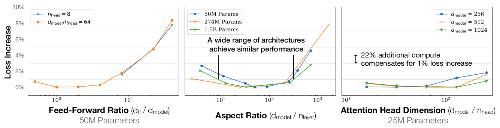

*图 5（原文 Figure 5，第 8 页）：非 embedding 参数量 $N$ 固定时，性能对模型形状的依赖非常温和。在很宽的形状范围内损失只变化几个百分点；参数量的微小差异用 $L(N)$ 的拟合作为基线来补偿。*

**图中文字翻译与读法**：

- **纵轴**都是 Loss Increase（损失增加，相对于基线，百分数）。
- **左图 Feed-Forward Ratio $(d_{\text{ff}}/d_{\text{model}})$（前馈比例），50M Parameters**：两条线，$n_{\text{head}}=8$（蓝色 ×）与 $d_{\text{model}}/n_{\text{head}}=64$（橙色圆点）。比值在 1 到 4 之间时损失增加不超过约 0.3%，比值增大到约 20 至 40 时增加约 5% 至 8%（图上读出的近似值）。
- **中图 Aspect Ratio $(d_{\text{model}}/n_{\text{layer}})$（宽深比）**：三个模型规模 50M、274M、1.5B Params。图中标注 “A wide range of architectures achieve similar performance”（很宽范围的架构取得相近的性能）：宽深比从约 5 到约 300，损失增加都在约 3% 以内；宽深比继续增大到约 700 至 1700 时，增加到约 3% 至 8%（均为从图上读出的近似值）。
- **右图 Attention Head Dimension $(d_{\text{model}}/n_{\text{head}})$（注意力头维度），25M Parameters**：$d_{\text{model}}=256,512,1024$ 三组；头维度从约 16 到 256，损失增加都在约 2% 以内。图中标注 “22% additional compute compensates for 1% loss increase”（多 22% 的计算量可以补偿 1% 的损失增加）。
- **图题与正文给出的数字**：宽深比可以变化 40 倍而对性能只有轻微影响；$(n_{\text{layer}},d_{\text{model}})=(6,4288)$ 的损失在 GPT-2 所用的 $(48,1600)$ 模型的 3% 以内（宽深比分别约为 715 与 33）。
- **读图结论**：形状不是首要变量。“22% 计算补偿 1% 损失”与式 (1.3) 相容：$L\propto C_{\min}^{-0.050}$，要把损失降 1% 需要计算量乘以 $1.01^{1/0.05}\approx1.22$（自行验算）。

### 6.2 为什么要把 embedding 参数排除在 $N$ 之外（图 6）

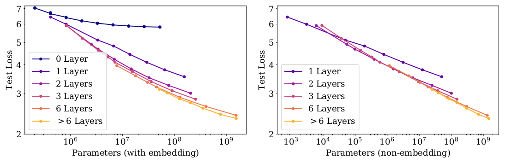

*图 6（原文 Figure 6，第 8 页）：左，把 embedding 参数算入时，性能看起来除了参数量之外还强烈依赖层数；右，排除 embedding 参数后，不同深度的模型汇聚到单一趋势。只有层数少于 2 层或宽深比极端的模型才明显偏离这一趋势。*

**图中文字翻译与读法**：

- **左图**：横轴 Parameters (with embedding)（参数量，含 embedding，约 $2\times10^{5}$ 到 $1.5\times10^{9}$），纵轴 Test Loss（测试损失，对数刻度，刻度 2 到 7）；图例 0 Layer、1 Layer、2 Layers、3 Layers、6 Layers、&gt;6 Layers（0 层、1 层、2 层、3 层、6 层、6 层以上）。各层数的曲线明显分开，0 层模型（只有 embedding 和输出层）基本平坦。
- **右图**：横轴 Parameters (non-embedding)（参数量，不含 embedding，约 $8\times10^{2}$ 到 $1.5\times10^{9}$），图例从 1 Layer 开始（已没有 0 层模型）。除 1 层之外，2 层、3 层、6 层、6 层以上的点基本落在同一条直线上。
- **读图结论**：只有用非 embedding 参数量 $N$ 作横轴，趋势才干净；这也暗示 embedding 矩阵可以做得小一些而不影响性能（原文引用 ALBERT 的结论）。对应到 $L(N)\approx(N_c/N)^{\alpha_N}$（式 3.1）。

### 6.3 与 LSTM 和 Universal Transformer 的比较（图 7、图 17）

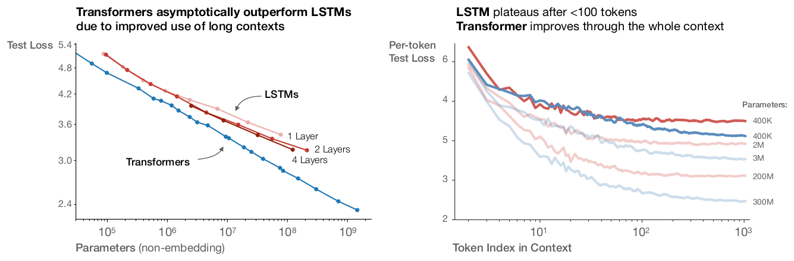

*图 7（原文 Figure 7，第 9 页；原文没有图题，只有 “Figure 7” 字样）：比较 LSTM 与 Transformer 随非 embedding 参数量 $N$ 的表现，LSTM 用相同数据集和上下文长度训练。*

**图中文字翻译与读法**：

- **左图，标题 “Transformers asymptotically outperform LSTMs due to improved use of long contexts”（由于更好地利用长上下文，Transformer 渐近地优于 LSTM）**：横轴 Parameters (non-embedding)（约 $10^{5}$ 到 $10^{9}$），纵轴 Test Loss（约 2.4 到 5.4）。蓝线为 Transformers；红色系线为 LSTMs，标注 1 Layer、2 Layers、4 Layers。LSTM 的曲线始终在 Transformer 之上（损失更高），而且更平缓，所以参数量越大差距越大。
- **右图，标题 “LSTM plateaus after &lt;100 tokens; Transformer improves through the whole context”（LSTM 在 100 个 token 之后就停滞，Transformer 在整个上下文中持续改进）**：横轴 Token Index in Context（token 在上下文中的位置，约 1 到 1000，对数刻度），纵轴 Per-token Test Loss（逐 token 的测试损失）；右侧标注 Parameters（参数量）：400K、400K、2M、3M、200M、300M，从上到下与曲线在右端的高低对应。其中两条 400K 的粗线，红色为 LSTM、蓝色为 Transformer；浅红色的 2M 与 200M 是 LSTM，浅蓝色的 3M 与 300M 是 Transformer（颜色约定与左图一致）。红色（LSTM）曲线在位置约 100 以后基本变平，蓝色（Transformer）仍继续下降。原图右图纵轴刻度印成 6、4、5、3、2（4 与 5 的位置互换，应为 6、5、4、3、2），读图时请只看曲线的相对高低。
- **读图结论**：LSTM 对上下文靠前的 token 表现得和 Transformer 一样好，但无法在靠后的 token 上匹配 Transformer，原因是 Transformer 更好地利用了长上下文。位置与损失的幂律关系见附录 D.5（图 20、图 21），更大的模型指数更大，说明它们能更快识别模式。

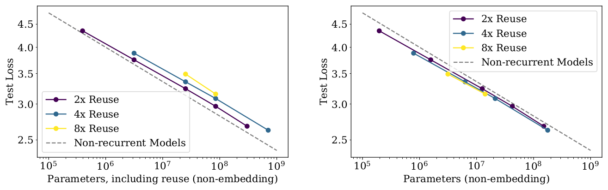

*图 17（原文 Figure 17，第 24 页）：把循环 Transformer（recurrent Transformers，Universal Transformer 的做法，复用参数）与标准 Transformer 比较。按参数量比较时循环 Transformer 略好；但把复用计入后按每 FLOP 比较则略差。*

**图中文字翻译与读法**：两幅图纵轴都是 Test Loss，图例 2x Reuse、4x Reuse、8x Reuse（参数复用 2 倍、4 倍、8 倍），灰色虚线是 Non-recurrent Models（非循环的标准模型）。**左图**横轴 Parameters, including reuse (non-embedding)（参数量，把复用计入，即按“有效参数”计）：循环模型的点位于灰色虚线之上，即每个有效参数略差（因为实际独立参数更少、计算更多）。**右图**横轴 Parameters (non-embedding)（只数独立参数）：循环模型的点位于灰色虚线之下，即按独立参数量比较略好。结论（附录 D.2）：复用参数使它们在按 $N$ 比较时略好，代价是每个参数需要更多计算。

### 6.4 对其他数据分布的泛化（图 8）

作者还在 Books、Wikipedia、Common Crawl、Internet Books 等分布上测试了只在 WebText2 上训练的模型。

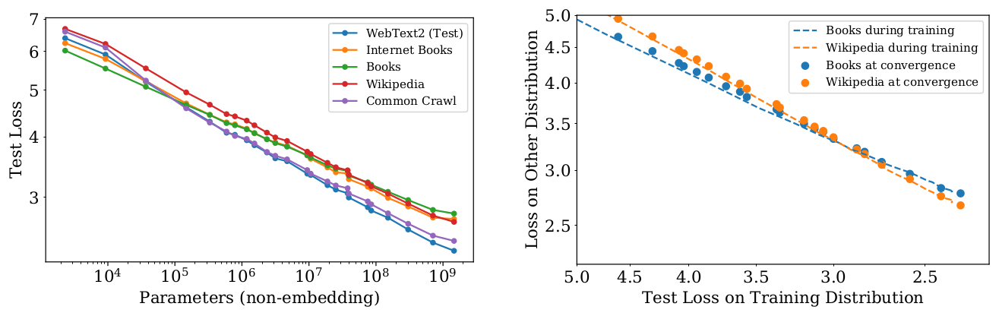

*图 8（原文 Figure 8，第 10 页）：左，对其他数据分布的泛化性能随模型大小平滑提升，与 WebText2 训练分布相比只有一个很小且增长很慢的偏移。右，泛化性能只取决于训练分布上的性能，而与训练所处的阶段无关：把收敛后的模型（点）与单个大模型训练过程中的曲线（虚线）进行对比。*

**图中文字翻译与读法**：

- **左图**：横轴 Parameters (non-embedding)（约 $10^{3}$ 到 $10^{9}$），纵轴 Test Loss（约 2.4 到 7）；图例 WebText2 (Test)、Internet Books、Books、Wikipedia、Common Crawl。五条线几乎平行下降，其他分布只是比 WebText2 测试集整体高一点。
- **右图**：横轴 Test Loss on Training Distribution（训练分布上的测试损失，从 5.0 降到约 2.3，刻度向右递减），纵轴 Loss on Other Distribution（其他分布上的损失）。虚线 Books during training、Wikipedia during training 是单个大模型训练过程中的轨迹；圆点 Books at convergence、Wikipedia at convergence 是不同大小的、已收敛模型的结果。两者落在同一条曲线上。
- **读图结论**：泛化几乎只取决于训练分布上的验证损失，而不取决于训练时长或是否接近收敛；也与模型深度无关（见本文 10.4 节图 24）。因此在其他分布上的表现“随训练集上的性能同步提升，只差一个近似恒定的损失偏移”。

### 6.5 数据量与计算量的趋势（式 3.2、3.3）

**$L(D)$**：训练一个 $(n_{\text{layer}},n_{\text{embd}})=(36,1280)$ 的模型，在 WebText2 的固定子集上训练，测试损失不再下降时停止；所得损失可用 $L(D)\approx(D_c/D)^{\alpha_D}$（式 3.2）拟合，数据和拟合见图 1 中图。

**$L(C)$**：$C=6NBS$（因子 6 计入前向与反向）。对给定的 $C$，扫描各个 $N$，找出在步数 $S=C/(6BS)$ 处表现最好的模型，得到 $L(C)\approx(C_c/C)^{\alpha_C}$（式 3.3，图 1 左图中的黑色粗线）。注意这里所有模型的 batch size $B$ 固定，因此这些经验结果并不是真正最优的；后文用修正后的 $C_{\min}$ 得到更干净的趋势。

## 七、有限数据与过拟合：$L(N,D)$（原文第 4 节）

### 7.1 提出的 $L(N,D)$ 方程及其三个原则

目标是同时改变 $N$ 和 $D$，看早停后的最优测试损失如何依赖两者，进而回答“训练一个大小为 $N$ 的模型需要多少数据才不过拟合”。作者选择的式 (4.1) 就是前面的式 (1.5)：

$$
L(N,D)=\left[\left(\frac{N_c}{N}\right)^{\alpha_N/\alpha_D}+\frac{D_c}{D}\right]^{\alpha_D}
$$

选它基于三条原则：

1. **词表或分词的变化只会使损失整体缩放一个因子**：$L(N,D)$（以及所有损失模型）必须允许这样的重新缩放。本式满足，因为可以随词表变化重新缩放 $N_c$、$D_c$；这也说明 $N_c$、$D_c$ 的数值没有基本含义。
2. **极限行为**：固定 $D$、令 $N\to\infty$，损失应趋近 $L(D)$；反过来固定 $N$、令 $D\to\infty$，应趋近 $L(N)$。直观上，有限的 $D$ 使任何模型都无法逼近最佳损失（文本熵），而固定大小的模型受容量限制。知道无限 $D$ 时的 $L(N)$ 和无限 $N$ 时的 $L(D)$，就完全确定了 $L(N,D)$ 的所有参数。
3. **在 $D=\infty$ 处解析**：$L(N,D)$ 应在 $D=\infty$ 处有关于 $1/D$ 的整数次幂级数展开。这一条更具推测性，理论支持明显弱于前两条。理由是过拟合应与数据集的方差或信噪比有关，而这按 $1/D$ 变化；但前提是 $1/D$ 的修正项比有限 batch size 等其他方差来源占优。第三条也解释了 $N$ 与 $D$ 在式中地位的不对称；形如 $[(N_c/N)^{\alpha_N}+(D_c/D)^{\alpha_D}]^{\beta}$ 的对称式（脚注 4）则没有整数次幂的 $1/D$ 展开，还需要额外参数。

作者强调，真正的理由是这个式子对数据拟合得很好。

### 7.2 拟合结果（图 9、表 2）

对 $N$ 和 $D$ 的网格做实验：所有模型用 10% dropout，并用测试损失早停；数据集最小缩小到原来的 1/1024（约 $2\times10^{7}$ token，此时一个 epoch 只有约 40 次参数更新）。

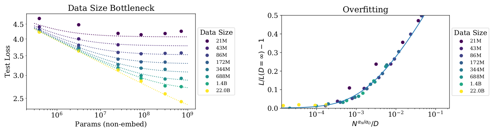

*图 9（原文 Figure 9，第 11 页）：早停后的测试损失 $L(N,D)$ 按式 (1.5) 可预测地依赖数据集大小 $D$ 和模型大小 $N$。左：$D$ 很大时，性能随 $N$ 呈直线幂律；$D$ 较小且固定时，性能随 $N$ 增大不再改善、模型开始过拟合（反过来也成立，见图 4）。右：过拟合程度主要取决于比值 $N^{\alpha_N/\alpha_D}/D$，与式 (4.3) 的预测一致；实线是对该式的拟合。*

**图中文字翻译与读法**：

- **左图 “Data Size Bottleneck”（数据规模瓶颈）**：横轴 Params (non-embed)（非 embedding 参数量，约 $4\times10^{5}$ 到 $7\times10^{8}$），纵轴 Test Loss（约 2.4 到 4.6）；图例 Data Size（数据集大小）：21M、43M、86M、172M、344M、688M、1.4B、22.0B（token）。最下面黄色的 22.0B 线接近一条直线（视作 $D=\infty$ 的 $L(N)$）；数据集越小，曲线越早在大模型一端变平，变平之后继续加大模型没有收益（在最小的 21M 数据集上，大模型一端的点甚至略有回升）。
- **右图 “Overfitting”（过拟合）**：横轴 $N^{\alpha_N/\alpha_D}/D$（约 $10^{-4}$ 到 $10^{-1}$，对数刻度），纵轴 $L/L(D=\infty)-1$（相对无限数据损失的增量，0 到 0.5）。不同数据集大小、不同模型大小的点落在同一条曲线上：横坐标在 $10^{-4}$ 以下时几乎为 0，之后逐渐上升，约 $10^{-2}$ 处约 0.25，约 $4\times10^{-2}$ 处约 0.5（图上读出的近似值）。
- **读图结论**：过拟合程度不是分别由 $N$ 与 $D$ 决定，而是主要由 $N^{\alpha_N/\alpha_D}/D$ 一个组合量决定。作者用 $L(N,D)$ 的四参数 $(\alpha_N,\alpha_D,N_c,D_c)$ 拟合（表 2）。

**表 2：$L(N,D)$ 的拟合参数（原文表 2，第 11 页）**

| 参数 | $\alpha_N$ | $\alpha_D$ | $N_c$ | $D_c$ |
|---|---:|---:|---:|---:|
| 取值 | 0.076 | 0.103 | $6.4\times10^{13}$ | $1.8\times10^{13}$ |

读法：这里 $\alpha_D=0.103$，与式 (1.2) 单独拟合 $L(D)$ 得到的 0.095 不同；原文说明，这是因为这里拟合的是完整的 $L(N,D)$，而不只是 $L(N,\infty)$ 或 $L(\infty,D)$，所以参数与原文第 3 节的值略有出入。除数据集缩小到 1/1024 的那组外拟合都很好；那一组可能代表语言建模的另一种状态，因为过拟合发生得很早（见图 16）。

### 7.3 过拟合的度量与数据需求（式 4.2 至 4.4）

用 22B token 的完整 WebText2 来代表 $D=\infty$（对最大的模型之外都看不到过拟合），定义相对于无限数据的损失增量：

$$
\delta L(N,D)\equiv\frac{L(N,D)}{L(N,\infty)}-1\tag{4.2}
$$

由式 (1.5) 可得：

$$
\delta L\approx\left(1+\left(\frac{N}{N_c}\right)^{\alpha_N/\alpha_D}\frac{D_c}{D}\right)^{\alpha_D}-1\tag{4.3}
$$

实验上 $\delta L$ 确实只依赖组合量 $N^{\alpha_N/\alpha_D}/D$（图 9 右；原文此处引用的是 Figure 16，应为笔误）；式 (4.3) 在大 $D$ 时同样有 $1/D$ 的幂级数展开。作者估计不同随机种子造成的损失变化约为 0.02，因此要把训练收敛程度控制在这个阈值内而不过拟合，需要

$$
D\gtrsim(5\times10^{3})\,N^{0.74}\tag{4.4}
$$

（原文用 $\gtrsim$，意为大致不小于。）有了它：小于 $10^{9}$ 个参数的模型可以在 22B token 的 WebText2 上训练而几乎不过拟合（自行验算：$N=10^{9}$ 时 $5\times10^{3}\times N^{0.74}\approx2.3\times10^{10}$ token），而最大的模型会遇到轻微过拟合。更一般地，数据集可以随模型大小次线性增长而避免过拟合；但原文提醒，这通常不是计算上最优的训练方式，并且作者没有在变化 $D$ 和 $N$ 的同时优化正则化（如 dropout 概率）。自行验算：用表 2 的参数取 $\delta L=0.02$ 反解 (4.3)，系数约 $5.5\times10^{3}$，与原文的 $5\times10^{3}$ 同量级。

## 八、训练时间与临界 batch size：$L(N,S_{\min})$（原文第 5 节）

### 8.1 为什么要引入 $B_{\mathrm{crit}}$ 与 $S_{\min}$

多数模型并不是在最优的 batch size 下训练的，所以先要把训练步数“标准化”。McCandlish 等（2018）的经验理论认为：训练存在一个临界 batch size $B_{\mathrm{crit}}$。$B$ 增大到 $B_{\mathrm{crit}}$ 以内时，几乎不损失计算效率；$B>B_{\mathrm{crit}}$ 后增大 $B$ 收益递减。梯度噪声尺度提供了对 $B_{\mathrm{crit}}$ 的简单预测，并且它们都不直接依赖模型大小，只通过已达到的损失来依赖。原文的表述是：$B\ll B_{\mathrm{crit}}$ 训练时计算用得最省（但步数多），$B\gg B_{\mathrm{crit}}$ 训练时步数最少（但处理了更多样本，计算被浪费）。

对很多网络和任务，训练到某个固定损失 $L$ 时，步数 $S$ 与处理的样本数 $E=BS$ 满足：

$$
\left(\frac{S}{S_{\min}}-1\right)\left(\frac{E}{E_{\min}}-1\right)=1\tag{5.1}
$$

这里 $S_{\min}$ 是达到 $L$ 所需的最少步数，$E_{\min}$ 是所需的最少样本数。据此定义

$$
B_{\mathrm{crit}}(L)\equiv\frac{E_{\min}}{S_{\min}}\tag{5.2}
$$

它是目标损失的函数。在 $B_{\mathrm{crit}}$ 下训练是近似最优的时间与计算折中，需要 $2S_{\min}$ 步、处理 $E=2E_{\min}$ 个样本。作者在 Transformer 上验证了式 (5.1)（图 18），并测得 $B_{\mathrm{crit}}$ 与模型大小无关、只取决于损失（图 10），可用幂律拟合：

$$
B_{\mathrm{crit}}(L)\approx\frac{B_*}{L^{1/\alpha_B}},\qquad B_*\approx2\times10^{8},\ \alpha_B\approx0.21\tag{5.3}
$$

采用这个形式，是因为损失接近最小值 $L_{\min}$ 时梯度噪声尺度预期会发散，而 $B_{\mathrm{crit}}$ 应跟随它。作者不知道 $L_{\min}$（模型还看不到逼近它的迹象），只知道 $L_{\min}>0$；因为 $L_{\min}$ 显然远小于已达到的损失，所以干脆采用 $L\to0$ 时发散的形式。

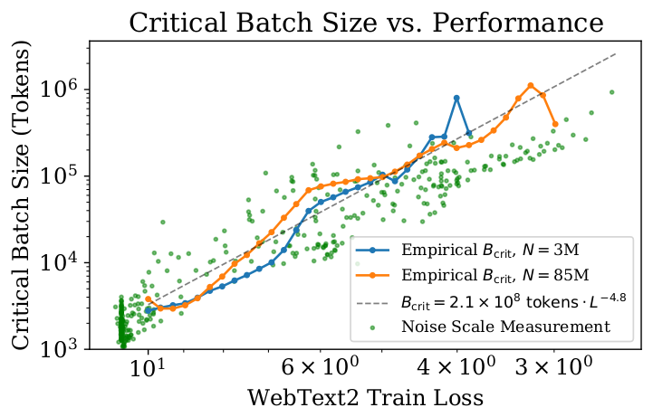

*图 10（原文 Figure 10，第 12 页）：临界 batch size $B_{\mathrm{crit}}$ 随性能提高按损失的幂律增长，并且不直接依赖模型大小。损失每下降 13%，临界 batch size 大约翻倍。$B_{\mathrm{crit}}$ 由图 18 的数据经验测得，也大致可由梯度噪声尺度预测。*

**图中文字翻译与读法**：

- **标题 “Critical Batch Size vs. Performance”（临界 batch size 与性能）**；横轴 WebText2 Train Loss（WebText2 训练损失，刻度 $10^{1}$、$6\times10^{0}$、$4\times10^{0}$、$3\times10^{0}$，向右损失递减），纵轴 Critical Batch Size (Tokens)（临界 batch size，token，$10^{3}$ 到 $10^{6}$ 以上，对数刻度）。
- **图例**：Empirical $B_{\mathrm{crit}}$, $N=3\text{M}$（蓝色折线）和 $N=85\text{M}$（橙色折线）是两个模型大小下经验测得的 $B_{\mathrm{crit}}$；灰色虚线是拟合 $B_{\mathrm{crit}}=2.1\times10^{8}\text{ tokens}\cdot L^{-4.8}$；绿色小点 Noise Scale Measurement（噪声尺度测量）是由梯度噪声尺度估计的值。
- **读图结论**：两个不同大小的模型落在同一条趋势上，说明 $B_{\mathrm{crit}}$ 只由损失决定；损失从约 10（训练初期，$B_{\mathrm{crit}}$ 约 $3\times10^{3}$ token）降到约 3（约 $10^{6}$ token）。代入公式（自行验算）：$0.87^{-4.8}\approx1.95$，即损失下降 13% 对应 $B_{\mathrm{crit}}$ 约翻倍，与图题一致；$L=3$ 时 $B_{\mathrm{crit}}\approx1.1\times10^{6}$ token，与摘要中“最大模型收敛时约 100 到 200 万 token”同量级。

用 $B_{\mathrm{crit}}(L)$ 可以把训练步数换算到“大 batch”下的步数，也可以把计算换算到“小 batch”下的计算。设训练用的 batch size 为 $B=2^{19}$ token，对任意目标损失：

$$
S_{\min}(S)\equiv\frac{S}{1+B_{\mathrm{crit}}(L)/B}\qquad(\text{最少步数，对应 }B\gg B_{\mathrm{crit}})\tag{5.4}
$$

$$
C_{\min}(C)\equiv\frac{C}{1+B/B_{\mathrm{crit}}(L)}\qquad(\text{最少计算，对应 }B\ll B_{\mathrm{crit}})\tag{5.5}
$$

其中 $C=6NBS$ 是在 batch size $B$ 下估计的非 embedding 计算量。这两式可以由式 (5.1) 推出（自行验算）：由 (5.1) 得 $S=S_{\min}(1+B_{\mathrm{crit}}/B)$，$E=BS=E_{\min}(1+B/B_{\mathrm{crit}})$，而 $C$ 与 $E$ 成正比。

### 8.2 $L(N,S_{\min})$ 的拟合（式 5.6、表 3、图 11）

用 $S_{\min}$ 对稳定的、用 Adam 优化的训练运行（包含 warmup 之后的所有步）拟合：

$$
L(N,S_{\min})=\left(\frac{N_c}{N}\right)^{\alpha_N}+\left(\frac{S_c}{S_{\min}}\right)^{\alpha_S}\tag{5.6}
$$

**表 3：$L(N,S)$ 的拟合参数（原文表 3，第 14 页）**

| 参数 | $\alpha_N$ | $\alpha_S$ | $N_c$ | $S_c$ |
|---|---:|---:|---:|---:|
| 取值 | 0.077 | 0.76 | $6.5\times10^{13}$ | $2.1\times10^{3}$ |

读法：这一组的 $\alpha_N$、$N_c$ 与表 2、式 (1.1) 的值都略有差异（原文对表 2 的说明是拟合的函数不同，对这一组没有逐项解释）；原文说拟合并不完美，但考虑到式 (5.6) 的简单程度，它们“相当有说服力”。用这组参数得到图 4 右侧的学习曲线拟合。

式 (5.6) 的含义：第一项是模型大小 $N$ 决定的“收敛后能达到的最低损失”，第二项是“训练还没跑够”的惩罚，随 $S_{\min}$ 按幂律消失。这样，损失 = 容量项 + 训练时间项。

图 11 换一个角度展示同样的拟合：固定总计算量或固定步数，看测试损失随模型大小的变化。

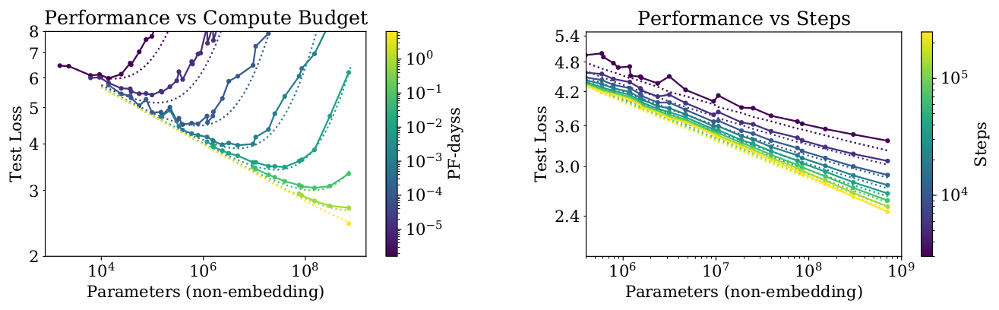

*图 11（原文 Figure 11，第 14 页）：固定总计算量或固定训练步数时，性能服从式 (5.6) 的 $L(N,S)$。每个计算预算都有一个使性能最大的最优模型大小。小 $S$ 处拟合平庸并不意外，因为学习曲线的幂律方程在训练很早期就失效。*

**图中文字翻译与读法**：

- **左图 “Performance vs Compute Budget”（性能与计算预算）**：横轴 Parameters (non-embedding)（约 $10^{3}$ 到 $10^{9}$），纵轴 Test Loss（2 到 8）；颜色条 PF-dayss（原图拼写如此，即 PF-days，计算预算，约 $10^{-5}$ 到 $10^{0}$）。每个计算预算对应一条 U 形曲线：模型太小，容量不足；模型太大，在这个预算内训练步数不够。曲线最低点就是该预算下的最优模型大小，并且随预算增大向右移。点线是式 (5.6) 的预测。
- **右图 “Performance vs Steps”（性能与步数）**：横轴同样是非 embedding 参数量，纵轴 Test Loss（约 2.4 到 5.4）；颜色条 Steps（步数，约 $10^{4}$ 到 $10^{5}$）。固定步数时损失随模型增大单调下降。
- **读图结论**：固定计算时存在最优模型大小，固定步数时模型越大越好；这与式 (5.6) 一致，也是本文第九节“最优分配”的出发点。

关于幂律形式的来源，原文给出的是推测：损失对 $S_{\min}$ 的幂律依赖反映了优化器动力学与损失景观的相互作用；拟合在训练后期最好，此时损失可能近似二次，所以该幂律应当包含损失 Hessian 谱的信息；其普适性（与 $N$ 无关）暗示 Hessian 特征值密度大致与模型大小无关。这一点论文没有进一步验证。

### 8.3 早停步数的下界（式 5.7、图 16）

用 $L(N,S_{\min})$ 可以导出数据受限时早停步数的一个下界（也是粗略估计）：有限 $D$ 和无限 $D$ 的学习曲线在 $S_{\min}\approx S_{\text{stop}}$ 之前非常接近，所以过拟合应当正比于“在 $S_{\text{stop}}$ 提前结束训练”带来的修正，即 $L(N,D)-L(N,\infty)\approx(S_c/S_{\text{stop}})^{\alpha_S}$（这一步是对原文思路的展开，自行整理）。这会低估 $S_{\text{stop}}$，因为现实中有限数据下测试损失下降更慢，需要更多步才到最优点。由此

$$
S_{\text{stop}}(N,D)\gtrsim\frac{S_c}{\left[L(N,D)-L(N,\infty)\right]^{1/\alpha_S}}\tag{5.7}
$$

其中 $L(N,\infty)$ 是用无限数据时收敛后的损失，由 $L(N,D)$ 的拟合在 $D=\infty$ 处取值得到。与经验数据的比较见图 16（附录图，见本文 10.4 节）。

## 九、计算预算的最优分配（原文第 6 节）

### 9.1 修正后的计算趋势与最优分配（图 12 至 14）

前面的经验趋势（图 1）是在固定 batch size 下训练得到的，而实际可以在 $B_{\mathrm{crit}}$ 下训练得更高效：损失大时可用更少的样本、损失小时可用更少的步数。把这种低效按 $B_{\mathrm{crit}}$ 标准化后，趋势会更干净。更重要的是，用原文第 5 节的结果确定计算在“模型大小 $N$”和“训练处理的数据量 $2B_{\mathrm{crit}}S_{\min}$”之间的最优分配，并且既用经验方法、也用 $L(N,S_{\min})$ 的理论预测，看二者是否一致。

先看以最优分配的计算 $C_{\min}$ 为横轴的损失（图 13）。

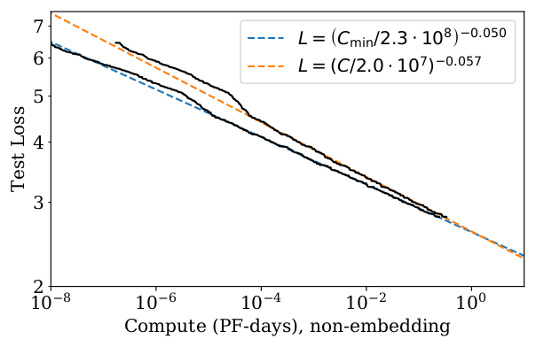

*图 13（原文 Figure 13，第 15 页）：把性能调整为模拟远小于临界 batch size 的训练后，得到的 $L(C_{\min})$ 幂律与纯经验结果略有不同。$10^{-5}$ PF-day 附近明显的小突起标志着从 1 层到 2 层网络的过渡；幂律拟合排除了 1 层网络。我们期望可靠外推到更大计算量的是 $L(C_{\min})$ 趋势。*

**图中文字翻译与读法**：

- 横轴 Compute (PF-days), non-embedding（计算量，PF-day，不含 embedding，$10^{-8}$ 到约 $10^{1}$），纵轴 Test Loss（2 到 7，对数刻度）。两条黑色实线：下面一条是经修正的 $L(C_{\min})$，上面一条是未修正（固定 batch size）的经验 $L(C)$。两条虚线是对它们的幂律拟合，图例：$L=(C_{\min}/2.3\cdot10^{8})^{-0.050}$（蓝）与 $L=(C/2.0\cdot10^{7})^{-0.057}$（橙）。
- **读图结论**：未修正的曲线指数更大（0.057）且在小计算量处明显更弯，修正后趋势更平直、指数 0.050。两条线在约 $10^{-4}$ PF-day 以上靠得较近，在更小的计算量处固定 batch 的结果明显偏高。原文第 6 节开头给出的解释是：损失大时本可以用更少的样本达到、损失小时本可以用更少的步数达到，按临界 batch size 标准化就去掉了这种低效。这里的常数 $2.3\times10^{8}$ 与 $2.0\times10^{7}$ 与式 (1.3) 和表 5 的 $3.1\times10^{8}$、$1.6\times10^{7}$ 不一致，见文末备查表。

由 $L(C_{\min})$ 可以问：给定计算量，使损失最小的最优模型大小是多少？

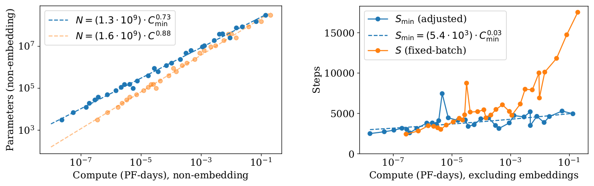

*图 14（原文 Figure 14，第 16 页）：左，每个计算预算 $C_{\min}$ 对应一个最优模型大小 $N$；最优模型大小随 $C_{\min}$ 增长得非常快，计算量每增加 10 倍，模型大小增加 5 倍，处理的数据样本数构成其余的增长，只缓慢增长约 2 倍。右，经 batch 修正的优化步数也增长得很慢，甚至可能完全不增长，这意味着处理的数据样本数的绝大部分增长可以用于增大 batch size。*

**图中文字翻译与读法**：

- **左图**：横轴 Compute (PF-days), non-embedding（约 $10^{-8}$ 到 $10^{0}$），纵轴 Parameters (non-embedding)（约 $10^{3}$ 到 $10^{9}$）。蓝色点和虚线：每个计算预算下的最优模型大小，拟合 $N=(1.3\cdot10^{9})\cdot C_{\min}^{0.73}$。浅橙色点和虚线对应图例 $N=(1.6\cdot10^{9})\cdot C^{0.88}$；原文正文没有单独讨论这条线，从右图图例 S (fixed-batch) 推断，它对应未做 batch 修正的固定 batch 数据，仅作对照。
- **右图**：横轴 Compute (PF-days), excluding embeddings（计算量，不含 embedding），纵轴 Steps（步数，0 到约 17500）。蓝色实线 $S_{\min}$ (adjusted)（修正后的最少步数）大多在约 2500 到 5300 之间缓慢变化（个别点到约 7500），蓝色虚线是拟合 $S_{\min}=(5.4\cdot10^{3})\cdot C_{\min}^{0.03}$；橙色线 S (fixed-batch)（固定 batch size 的步数）则随计算量明显增长，到约 0.2 PF-day 时约 17500（均为图上读出的近似值）。
- **读图结论**：$N(C_{\min})\propto C_{\min}^{0.73}$（式 6.1）。又因 $C_{\min}\equiv6NB_{\mathrm{crit}}S$，且已知 $B\propto L^{-4.8}$ 与 $L\propto C_{\min}^{-0.05}$，所以 $B_{\mathrm{crit}}\propto C_{\min}^{0.24}$（$0.05\times4.8=0.24$），于是 $S_{\min}\propto C_{\min}/(NB_{\mathrm{crit}})\propto C_{\min}^{1-0.73-0.24}$，即最优步数

$$
S_{\min}\propto(C_{\min})^{0.03}\tag{6.2}
$$

与图 14 右图一致；测得的指数小到甚至与零相容。结论：随着计算最优地放大语言建模，应当主要增大模型 $N$，同时通过 $B\propto B_{\mathrm{crit}}$ 增大 batch size，而串行步数几乎不增加。由于计算最优训练用的优化步数很少，作者认为加速训练早期动力学的工作可能值得做。

用表 6 的参数可以做一个简单的自洽检验（自行验算，见下文表 6）：取 $C_{\min}=1$ PF-day，则 $N=1.3\times10^{9}$、$B_{\mathrm{crit}}=2.0\times10^{6}$ token、$S_{\min}=5.4\times10^{3}$ 步，于是 $6NB_{\mathrm{crit}}S_{\min}\approx8.4\times10^{19}$ FLOPs $\approx0.97$ PF-day；训练处理的数据量 $2B_{\mathrm{crit}}S_{\min}\approx2.2\times10^{10}$ token，与表 6 的 $D_e=2\times10^{10}$ 一致。

### 9.2 用 $L(N,S_{\min})$ 做的预测（式 6.3 至 6.5）

$L(C_{\min})$ 与各分配也可以从原文第 5 节的 $L(N,S_{\min})$ 预测出来：代入 $S_{\min}=C_{\min}/(6NB)$，在固定训练计算下对 $N$ 求损失的最小值（详细推导见附录 B，本文第十节）。预测：

$$
L(C_{\min})=\left(\frac{C_c^{\min}}{C_{\min}}\right)^{\alpha_C^{\min}}\tag{6.3}
$$

$$
\alpha_C^{\min}\equiv\frac{1}{1/\alpha_S+1/\alpha_B+1/\alpha_N}\approx0.054\tag{6.4}
$$

“与图 13 的指数符合得很好”（原文）；同时预测

$$
N(C_{\min})\propto(C_{\min})^{\alpha_C^{\min}/\alpha_N}\approx(C_{\min})^{0.71}\tag{6.5}
$$

“与图 14 的比例在百分之几以内吻合”。作者据此说：“我们的规模律为语言建模的性能提供了一个有预测力的框架。”自行验算：把表 3 的 $\alpha_N=0.077$、$\alpha_S=0.76$、$\alpha_B=0.21$ 代入式 (6.4) 得 0.0525（附录式 B.7 给的是 0.052），而不是 0.054，对应的 $N$ 指数约 0.68；原文不同位置的数值略有出入，见文末备查表。

### 9.3 矛盾与猜想（图 15）

规模律在 $N$、$D$、$C$ 的大值处没有看到偏离直线，但趋势终究必须变平，因为自然语言的熵非零。事实上计算最优训练的趋势本身就已包含一个表面上的矛盾：在比文中研究的尺度高几个数量级处，$L(C_{\min})$ 的预测会低于“按训练数据增长得很慢”所允许的水平。

要控制过拟合，原文第 4 节的结果要求数据集随模型这样增长：

$$
D\propto N^{0.74}\propto C_{\min}^{0.54}\tag{6.6}
$$

（其中用了图 14 的 $N(C_{\min})$，$0.73\times0.74\approx0.54$。）而计算最优训练实际用到的数据量：如果在临界 batch size 下训练（即 $C=2C_{\min}$）并且从不重复使用数据，数据用量随计算增长为

$$
D(C_{\min})=\frac{2C_{\min}}{6N(C_{\min})}\approx(4\times10^{10}\ \text{tokens})\,(C_{\min}/\text{PF-Day})^{0.26}\tag{6.7}
$$

这是数据集随计算能“有效”增长的最大速率（只训练一个 epoch），但它比 (6.6) 慢得多。这似乎意味着：即使训练过程从不重复使用数据，计算最优训练最终也会遇到过拟合问题。按图 1，当受数据集大小限制时 $L(D)\propto D^{-0.095}$，于是 $L(D(C_{\min}))\propto C_{\min}^{-0.03}$（指数 $0.095\times0.26\approx0.025$，原文写 $-0.03$）。这条线最终会与图 13 的 $L(C_{\min})\propto C_{\min}^{-0.050}$ 相交，又是一个矛盾。

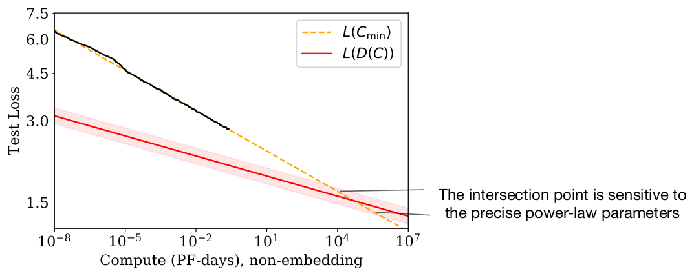

*图 15（原文 Figure 15，第 17 页）：远超实证研究的模型规模处，$L(C_{\min})$ 与 $L(D)$ 的方程出现矛盾，原因是计算最优训练所需的数据增长缓慢。交点标志着我们预计预测会失效的位置之前的界限；该点位置对拟合出的幂律指数极其敏感。*

**图中文字翻译与读法**：

- 横轴 Compute (PF-days), non-embedding（$10^{-8}$ 到 $10^{7}$），纵轴 Test Loss（约 1 到 7.5，对数刻度）。黑色实线是实测的 $L(C_{\min})$（约到 0.3 PF-day 为止），橙色虚线 $L(C_{\min})$ 是它向右的外推；红色实线 $L(D(C))$ 是“计算最优训练只训练一个 epoch 时，数据量所限定的损失下界”，周围的浅红色带原文没有单独说明，结合图题强调交点对指数极其敏感，推测是表示拟合不确定性的范围。右侧标注 “The intersection point is sensitive to the precise power-law parameters”（交点对精确的幂律参数很敏感）。
- **读图结论**：两条线在约 $10^{4}$ PF-day、损失约 1.5 到 1.7 处相交；在交点之前，我们预期规模律会失效。

作者给出交点的估计：

$$
C^*\sim10^{4}\ \text{PF-Days},\quad N^*\sim10^{12}\ \text{parameters},\quad D^*\sim10^{12}\ \text{tokens},\quad L^*\sim1.7\ \text{nats/token}\tag{6.8}
$$

数值高度不确定：取决于幂律拟合的确切指数，可以向任一方向变化一个数量级。（自行验算：$C=10^{4}$ PF-day 时 $(C_c^{\min}/C)^{0.050}$ 约 1.68，与 $L^*\sim1.7$ 相符；按表 6 的 $N=1.3\times10^{9}C_{\min}^{0.73}$ 得 $N^*\approx1.1\times10^{12}$。）最直接的解释是：规模律在这个点或之前就会失效，而这个点在计算和模型大小上仍然远在当前之外。

作者还做了一个更大胆的猜想：这个交点可能有更深的含义。如果不改变数据需求的性质就无法把模型增大到 $N^*$ 以上，也许意味着一旦到达 $C_{\min}^*$ 和 $N^*$，自然语言数据中可靠的信息就被提取完了。在这种解释下 $L^*$ 能粗略估计自然语言每个 token 的熵（脚注 7），并预期损失趋势在 $L^*$ 或之前变平。若把数据集加入人工噪声（例如在每个上下文末尾附加一串随机 token，使损失整体抬高一个常数），那么“离噪声底的距离” $L-L_{\text{noise}}$ 才是更有意义的性能指标，其很小的下降也可能对应质的变化；噪声对所有趋势的影响相同，所以式 (6.8) 的临界点（除了 $L^*$ 的绝对值）不变。注意这只是猜想，并不是论文用实验证实的结论。

### 9.4 次优模型大小的代价（图 12）

计算最优的 $N$ 并不要求精确命中。图 12 给出采用偏离最优大小的模型所付出的代价（推导见附录 B.4）。

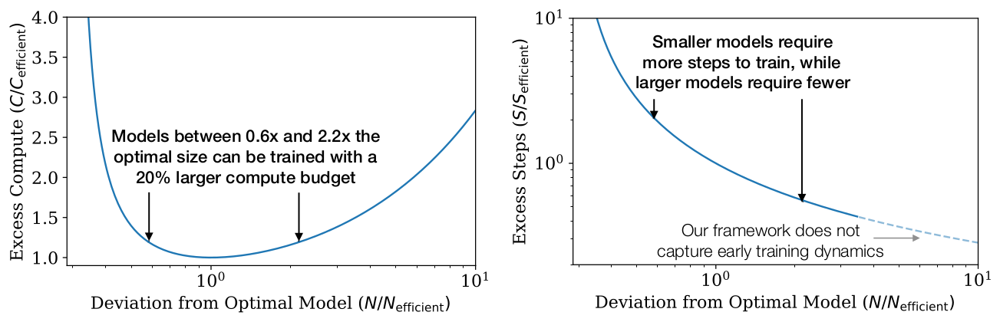

*图 12（原文 Figure 12，第 15 页）：左，给定固定的计算预算，存在一个最优模型大小，但稍大或稍小的模型只需很少的额外计算就能训练到同样的损失。右，大于计算最优大小的模型需要更少的步数，如果有额外的并行度，就可能训练得更快。注意该方程不应在非常大的模型上采信，它只在学习曲线的幂律区域（初始瞬态之后）有效。*

**图中文字翻译与读法**：

- **左图**：横轴 Deviation from Optimal Model $(N/N_{\text{efficient}})$（相对最优模型大小的偏离，对数刻度，约 0.3 到 10），纵轴 Excess Compute $(C/C_{\text{efficient}})$（额外计算，1.0 到 4.0）。曲线在 1 处最低（为 1），向两边升高；两个箭头标在约 0.6 倍与 2.2 倍处，标注 “Models between 0.6x and 2.2x the optimal size can be trained with a 20% larger compute budget”（大小在最优值 0.6 到 2.2 倍之间的模型，只需要多 20% 的计算预算）。
- **右图**：同样的横轴，纵轴 Excess Steps $(S/S_{\text{efficient}})$（额外步数，对数刻度，约 0.3 到 10）。曲线单调下降；标注 “Smaller models require more steps to train, while larger models require fewer”（更小的模型需要更多步，更大的模型需要更少步）；右端的虚线段标注 “Our framework does not capture early training dynamics”（我们的框架没有刻画早期训练动力学）。
- **读图结论**：附录给出的公式 (B.16) 与 (B.17)，代入 $\alpha_N=0.076$、$\alpha_S=0.76$ 可验证（自行验算）：模型大小为最优的 0.6 倍时额外计算约 1.16 倍，2.2 倍时约 1.20 倍；2.2 倍大的模型步数只需约 0.55 倍，即少约 45% 的步数，代价是多约 20% 的计算量（原文：“A 2.2x larger model requires 45% fewer steps at a cost of 20% more training compute”）。因此如果还要考虑推理成本，选稍小的模型是合理的；想要更快的墙钟训练且硬件并行度足够，则可选更大的模型。

## 十、附录要点

### 10.1 幂律汇总表（附录 A，表 4 至表 6）

**表 4：关键趋势方程（原文表 4，第 20 页）**

| 参数 | 数据 | 计算 | batch size | 方程 |
|---|---|---|---|---|
| $N$ | $\infty$ | $\infty$ | 固定 | $L(N)=(N_c/N)^{\alpha_N}$ |
| $\infty$ | $D$ | 早停（Early Stop） | 固定 | $L(D)=(D_c/D)^{\alpha_D}$ |
| 最优（Optimal） | $\infty$ | $C$ | 固定 | $L(C)=(C_c/C)^{\alpha_C}$（naive，朴素版） |
| $N_{\text{opt}}$ | $D_{\text{opt}}$ | $C_{\min}$ | $B\ll B_{\mathrm{crit}}$ | $L(C_{\min})=\left(C_c^{\min}/C_{\min}\right)^{\alpha_C^{\min}}$ |
| $N$ | $D$ | 早停（Early Stop） | 固定 | $L(N,D)=\left[(N_c/N)^{\alpha_N/\alpha_D}+D_c/D\right]^{\alpha_D}$ |
| $N$ | $\infty$ | $S$ 步 | $B$ | $L(N,S)=(N_c/N)^{\alpha_N}+\left(S_c/S_{\min}(S,B)\right)^{\alpha_S}$ |

读法：前三个量（参数、数据、计算）各列表示“该量是瓶颈”的情形，$\infty$ 表示不受限。

**表 5：趋势拟合的关键参数（原文表 5，第 20 页；“规模常数”依赖分词方式）**

| 幂律指数 | 规模常数（依赖分词） |
|---|---|
| $\alpha_N=0.076$ | $N_c=8.8\times10^{13}$ 参数（非 embedding） |
| $\alpha_D=0.095$ | $D_c=5.4\times10^{13}$ tokens |
| $\alpha_C=0.057$ | $C_c=1.6\times10^{7}$ PF-days |
| $\alpha_C^{\min}=0.050$ | $C_c^{\min}=3.1\times10^{8}$ PF-days |
| $\alpha_B=0.21$ | $B_*=2.1\times10^{8}$ tokens |
| $\alpha_S=0.76$ | $S_c=2.1\times10^{3}$ steps |

**表 6：计算最优训练的最优参数（原文表 6，第 20 页）**

| 计算最优的量 | 幂律指数 | 规模常数 |
|---|---:|---|
| $N_{\text{opt}}=N_e\cdot C_{\min}^{p_N}$ | $p_N=0.73$ | $N_e=1.3\cdot10^{9}$ 参数 |
| $B\ll B_{\mathrm{crit}}=\dfrac{B_*}{L^{1/\alpha_B}}=B_eC_{\min}^{p_B}$ | $p_B=0.24$ | $B_e=2.0\cdot10^{6}$ tokens |
| $S_{\min}=S_e\cdot C_{\min}^{p_S}$（下界） | $p_S=0.03$ | $S_e=5.4\cdot10^{3}$ 步 |
| $D_{\text{opt}}=D_e\cdot C_{\min}^{p_D}$（1 个 epoch） | $p_D=0.27$ | $D_e=2\cdot10^{10}$ tokens |

读法：表 6 就是“给定计算预算该怎么训”的速查表。算力放大 10 倍：模型 $\times10^{0.73}\approx5.4$，batch $\times10^{0.24}\approx1.7$，步数 $\times10^{0.03}\approx1.07$，数据 $\times10^{0.27}\approx1.9$（自行验算）。表中 $p_N+p_B+p_S=1$。注意表 5 里 $\alpha_C$（固定 batch 的朴素版）与 $\alpha_C^{\min}$（修正版）是两个不同的量，对应图 13 的两条线。

### 10.2 计算最优前沿的推导（附录 B）

本节把正文式 (1.8) 与 (6.3) 至 (6.5) 的来历写清楚。附录中所有 $C$、$S$、$\alpha_C$ 都已按临界 batch size 调整，省略了 “adj” 标记。

**B.1 定义方程**：从式 (1.6) 出发，用临界 batch size 下的步数 $S$：

$$
L(N,S)=\left(\frac{N_c}{N}\right)^{\alpha_N}+\left(\frac{S_c}{S}\right)^{\alpha_S},\qquad B(L)=\frac{B_*}{L^{1/\alpha_B}}\tag{B.1, B.2}
$$

为了在固定计算预算下求最优训练参数，把 $S$ 换成 $C/(6NB(L))$：

$$
L(N,C)=\left(\frac{N_c}{N}\right)^{\alpha_N}+\left(6B_*S_c\,\frac{N}{L^{1/\alpha_B}\,C}\right)^{\alpha_S}\tag{B.3}
$$

令 $\partial_N L\big|_C=0$ 求最优条件，得到

$$
\frac{\alpha_N}{\alpha_S}\left(\frac{N_c}{N}\right)^{\alpha_N}=\left(6B_*S_c\,\frac{N}{L^{1/\alpha_B}\,C}\right)^{\alpha_S}\tag{B.4}
$$

式 (B.3) 与 (B.4) 一起决定计算最优前沿。

**B.2 高效训练**：把 (B.4) 代入 (B.3)：

$$
L\bigl(N_{\text{eff}}(C),C\bigr)=\left(1+\frac{\alpha_N}{\alpha_S}\right)L(N_{\text{eff}},\infty)\tag{B.5}
$$

意思是：计算最优训练应当训练到比收敛损失高一个固定百分比 $\alpha_N/\alpha_S\approx10\%$ 的位置就停下。这就是“远未收敛”的定量含义（自行验算：$0.077/0.76\approx0.10$）。消去 $N$ 得到损失随计算的幂律：

$$
L(C)=\left(\frac{C_c}{C}\right)^{\alpha_C},\qquad \alpha_C=\frac{1}{1/\alpha_S+1/\alpha_B+1/\alpha_N}\approx0.052\tag{B.6, B.7}
$$

$$
C_c=6N_cB_*S_c\left(1+\frac{\alpha_N}{\alpha_S}\right)^{1/\alpha_S+1/\alpha_N}\left(\frac{\alpha_S}{\alpha_N}\right)^{1/\alpha_S}\tag{B.8}
$$

类似地，消去 $L$ 得到最优模型大小和步数：

$$
\frac{N(C)}{N_c}=\left(\frac{C}{C_c}\right)^{\alpha_C/\alpha_N}\left(1+\frac{\alpha_N}{\alpha_S}\right)^{1/\alpha_N}\tag{B.9}
$$

$$
S(C)=\frac{C_c}{6N_cB_*}\left(1+\frac{\alpha_N}{\alpha_S}\right)^{-1/\alpha_N}\left(\frac{C}{C_c}\right)^{\alpha_C/\alpha_S}\tag{B.10}
$$

从 (B.9) 看出 $N\propto C^{\alpha_C/\alpha_N}$，从 (B.10) 看出 $S\propto C^{\alpha_C/\alpha_S}$，而 $B\propto L^{-1/\alpha_B}\propto C^{\alpha_C/\alpha_B}$；三个指数之和为 $\alpha_C(1/\alpha_N+1/\alpha_B+1/\alpha_S)=1$，这就是式 (1.7) 与 (1.8)。

**B.3 与“低效”训练的比较**：研究者通常训练到接近收敛。定义收敛因子 $f$ 为偏离收敛损失的百分比：$L(N,C)=(1+f)L(N,\infty)$（B.11）。计算最优训练为 $f=\alpha_N/\alpha_S\approx10\%$；作者取典型做法的 $f'=2\%$ 作估计。对相同的最终损失预测：

$$
\frac{N_f}{N_{f'}}=\left(\frac{1+f}{1+f'}\right)^{1/\alpha_N}\approx2.7,\qquad
\frac{S_f}{S_{f'}}=\left(\frac{1+1/f}{1+1/f'}\right)^{1/\alpha_S}\approx0.13,\qquad
\frac{C_f}{C_{f'}}=\frac{N_f}{N_{f'}}\frac{S_f}{S_{f'}}\approx0.35
$$

（B.12 至 B.14）。因此计算最优训练比“训练到接近收敛”少用 7.7 倍的参数更新、多用 2.7 倍的参数、少用 65% 的计算就能达到同样的损失（自行验算：$1.1/1.02$ 的 $1/0.076$ 次方约 2.70；$(11/51)^{1/0.76}\approx0.133$；乘积约 0.36，原文取 0.35）。

**B.4 次优模型大小**：求解达到损失 $L$ 所需的计算量，用它推出使用非最优大小 $N$（相对最优 $N_{\text{eff}}$）时的额外计算与额外步数，即图 12 的曲线：

$$
\frac{C(N,N_{\text{eff}})}{C(N_{\text{eff}},N_{\text{eff}})}=\frac{N}{N_{\text{eff}}}\left[1+\frac{\alpha_S}{\alpha_N}\left(1-\left(\frac{N_{\text{eff}}}{N}\right)^{\alpha_N}\right)\right]^{-1/\alpha_S}\tag{B.16}
$$

$$
\frac{S(N,N_{\text{eff}})}{S(N_{\text{eff}},N_{\text{eff}})}=\left[1+\frac{\alpha_S}{\alpha_N}\left(1-\left(\frac{N_{\text{eff}}}{N}\right)^{\alpha_N}\right)\right]^{-1/\alpha_S}\tag{B.17}
$$

原文的 B.4 小节里留有“Figure X”“Figure Y”“A.1”“A.6”“A.9”这类未更新的占位引用，对应的应是图 12、图 14 及式 (B.1)、(B.6)、(B.9)。

### 10.3 原文列出的注意事项（附录 C）

- 目前对所提出的任何规模律都没有扎实的理论理解；与模型大小和计算有关的关系尤其神秘。也许可以用带噪声的二次模型理解固定模型大小下的大 $D$ 规模关系，以及训练后期学习曲线的形状；但“很大模型下随 $D$ 的规模关系”仍是谜。没有理论或对修正项的系统了解，就难以判断规模律在何种情形下可信。
- 对远超所探索范围的损失，$B_{\mathrm{crit}}(L)$ 的预测信心不足；$B_{\mathrm{crit}}$ 的变化会显著影响数据并行与串行训练步数之间的权衡，从而显著影响训练时间。
- 没有彻底研究小数据区域；对最小的 $D$（一个 epoch 只有 40 步）$L(N,D)$ 的拟合很差；也没有试验正则化和数据增强，它们的改进可能在数量或性质上改变结果。
- 训练计算估计 $C\approx6NBS$ 不含与 $n_{\text{ctx}}$ 成比例的项，所以在很大的 $n_{\text{ctx}}$（$n_{\text{ctx}}\gtrsim12d_{\text{model}}$）时，计算的规模关系实际上可能被混淆。
- 调过学习率、试过学习率调度，但可能遗漏了某些对规模有重要影响的超参数（如初始化尺度或动量）。
- 最优学习率对目标损失敏感：接近收敛时可能需要更小的学习率以避免发散；而做短训练时可能可以用更大的学习率；作者没有对没跑到收敛的训练尝试更高的学习率。

### 10.4 补充图（附录 D）

补充图用来支撑正文中的几处论断。下面逐张给出。

**图 16：早停步数下界与过拟合运行的训练曲线（附录 D.1，对应本文 8.3 节）**

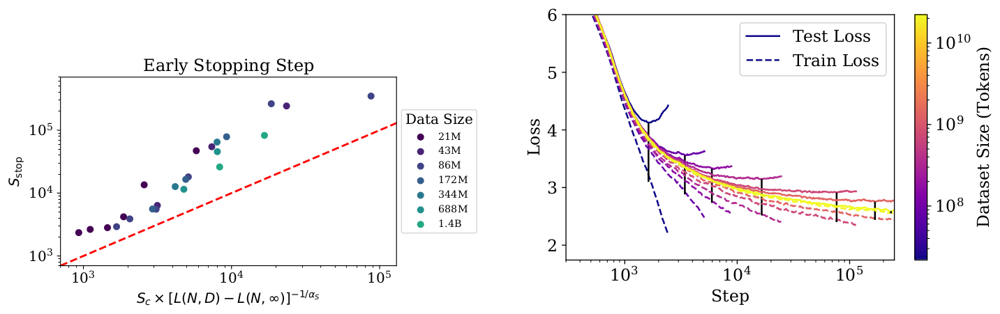

*图 16（原文 Figure 16，第 23 页）：左，早停发生的步数随过拟合程度变化，红线是原文 5.3 节导出的早停下界。右，在不同大小的数据集子样本上训练一系列 3 亿参数模型的训练损失与测试损失；测试损失通常先跟随无限数据运行的曲线，直到分叉。注意 $L_{\text{test}}-L_{\text{train}}$（每条运行用一根黑色竖条标出）明显高估了相对无限数据极限的过拟合程度。*

**图中文字翻译与读法**：

- **左图 “Early Stopping Step”（早停步数）**：横轴为 $S_c\times[L(N,D)-L(N,\infty)]^{-1/\alpha_S}$（式 5.7 右端），纵轴 $S_{\text{stop}}$（早停步数）；图例 Data Size：21M、43M、86M、172M、344M、688M、1.4B。红色虚线是下界。所有点都在红线上方，符合“这是下界”的说明。
- **右图**：横轴 Step（步，约 $10^{3}$ 到 $2\times10^{5}$），纵轴 Loss（2 到 6）；实线 Test Loss（测试损失）、虚线 Train Loss（训练损失）；颜色条 Dataset Size (Tokens)（数据集大小，约 $10^{7}$ 到 $2\times10^{10}$）。数据集小的运行，训练损失一路降低，而测试损失在某一步后上翘（过拟合）。
- **读图结论**：用“训练损失与测试损失之差”衡量过拟合会严重高估，应当与无限数据下的运行对比（式 4.2）。

**图 17**（循环 Transformer 与标准 Transformer）已在本文 6.3 节给出。

**图 18：batch size 扫描（附录 D.3，对应式 5.1 与图 10）**

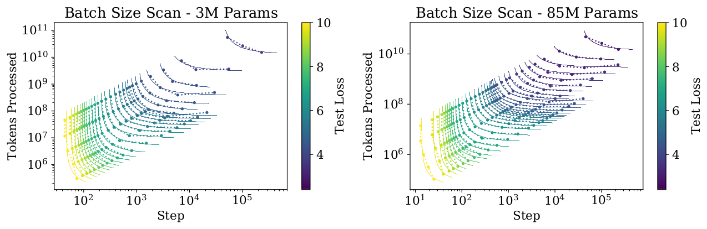

*图 18（原文 Figure 18，第 24 页）：对大量不同的损失 $L$ 值、两个不同大小的 Transformer，展示对式 (5.1) 的拟合；这些拟合被用来测量图 10 中的 $B_{\mathrm{crit}}(L)$。*

**图中文字翻译与读法**：左、右两图分别为 “Batch Size Scan - 3M Params”（3M 参数）与 “Batch Size Scan - 85M Params”（85M 参数）；横轴 Step（步数，对数刻度），纵轴 Tokens Processed（已处理 token 数，对数刻度），颜色条 Test Loss（测试损失，约 2.5 到 10）。每种颜色（同一个目标损失）对应一条“达到该损失所需的步数与 token 数”的曲线，点是不同 batch size 的运行，虚线是式 (5.1) 的拟合。每条曲线是一条直角双曲线形状：左上段步数少而 token 多（大 batch，$S\to S_{\min}$），右下段 token 少而步数多（小 batch，$E\to E_{\min}$），两条渐近线分别是 $S=S_{\min}$ 与 $E=E_{\min}$，在“拐弯处”（$S=2S_{\min}$、$E=2E_{\min}$）训练的 batch size 就是 $B_{\mathrm{crit}}=E_{\min}/S_{\min}$。

**图 19：样本效率与模型大小（附录 D.4）**

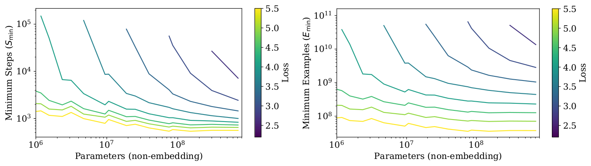

*图 19（原文 Figure 19，第 24 页）：达到任一固定测试损失所需的最少串行步数随模型大小急剧下降。样本效率（此处为远低于临界 batch size 的训练）也大幅提高：从最小的可能模型到非常大的模型，提高近 100 倍。*

**图中文字翻译与读法**：横轴都是 Parameters (non-embedding)（约 $10^{6}$ 到 $7\times10^{8}$）。**左图**纵轴 Minimum Steps ($S_{\min}$)（最少步数，约 $10^{3}$ 到 $10^{5}$），**右图**纵轴 Minimum Examples ($E_{\min}$)（最少样本数，约 $10^{8}$ 到 $10^{11}$）；颜色条 Loss（损失，约 2.5 到 5.5），每条线对应一个固定的目标损失。同一目标损失下，模型越大，所需的步数和样本数都越少；目标损失越低（颜色越深）整体越高。这是“大模型样本效率更高”的直接证据。

**图 20 与图 21：逐 token 位置的损失（附录 D.5）**

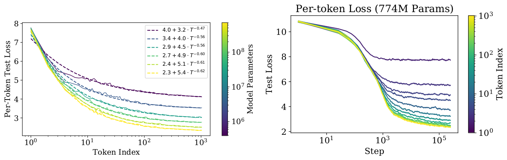

*图 20（原文 Figure 20，第 25 页）：逐 token 的性能随模型大小和训练时间的变化。左：损失随 token 在 1024 token 上下文中的位置 $T$ 变化，按幂律可预测地下降。右：每个 token 的测试损失随训练步数的变化。*

**图中文字翻译与读法**：

- **左图**：横轴 Token Index（token 位置，1 到 1000，对数刻度），纵轴 Per-Token Test Loss（逐 token 测试损失）；颜色条 Model Parameters（模型参数量，约 $10^{6}$ 到 $10^{8}$ 以上）。每条实线对应一个模型大小，虚线是形如 $a+b\cdot T^{-c}$ 的拟合，图例（从小到大六个模型）依次为 $4.0+3.2\cdot T^{-0.47}$、$3.4+4.0\cdot T^{-0.56}$、$2.9+4.5\cdot T^{-0.56}$、$2.7+4.9\cdot T^{-0.60}$、$2.4+5.1\cdot T^{-0.61}$、$2.3+5.4\cdot T^{-0.62}$。模型越大，渐近值 $a$ 越低、指数 $c$ 越大。
- **右图 “Per-token Loss (774M Params)”**：横轴 Step（步，对数刻度），纵轴 Test Loss；颜色条 Token Index（位置，$10^{0}$ 到 $10^{3}$）。位置靠前的 token（深色）损失停在较高的平台，位置靠后的 token（黄色）降得更低。
- **读图结论**：固定模型大小，损失随位置 $T$ 近似幂律下降，可能是语言中幂律相关性的反映，也可能是模型结构与优化的更一般特征；更大的模型不仅在 $T=1024$ 处收敛得更好，在靠前的 token 处也改进得更快，说明更大的模型能在更少上下文信息下更有效地发现模式。作者的描述是：模型先学短程信息，较晚才学到长程相关。

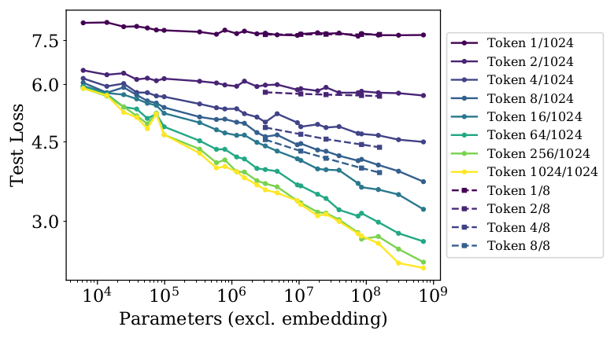

*图 21（原文 Figure 21，第 25 页）：除了平均损失，1024 token 上下文中的单个 token 的损失也随模型大小平滑改善。用更短上下文 $n_{\text{ctx}}=8$ 训练的运行（虚线）在靠前的 token 上表现更好，因为它们能把全部容量用在这些 token 上。*

**图中文字翻译与读法**：横轴 Parameters (excl. embedding)（不含 embedding 的参数量，约 $10^{3}$ 到 $10^{9}$），纵轴 Test Loss。图例 Token 1/1024、2/1024、4/1024、8/1024、16/1024、64/1024、256/1024、1024/1024 表示 $n_{\text{ctx}}=1024$ 的模型在上下文位置 1、2、4、8、16、64、256、1024 处的损失（实线）；Token 1/8、2/8、4/8、8/8 是 $n_{\text{ctx}}=8$ 的模型在位置 1 到 8 处的损失（虚线）。位置 1 的损失几乎不随模型大小变化（约 7.5 左右，该 token 没有上文）；其余位置随 $N$ 稳定下降，位置越靠后下降越多。$n_{\text{ctx}}=8$ 的中等大小模型在最靠前几个 token 上就能超过最大的 $n_{\text{ctx}}=1024$ 模型，这也暗示更大的上下文配更大的模型还有改进空间（原文 D.5）。

**图 22：学习率调度（附录 D.6）**

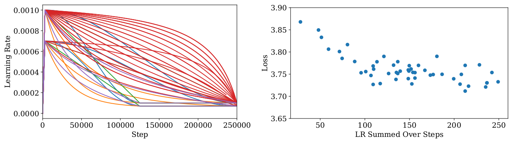

*图 22（原文 Figure 22，第 26 页）：在 300 万参数的模型上测试多种学习率调度，包括余弦衰减、线性衰减以及其他更快或更慢的衰减调度（左）。这些实验中不衰减到零，因为作者发现衰减到零通常会在训练接近结束时带来一个固定的改进。只要学习率不太小、衰减不太快，性能就不强烈依赖学习率。运行间的波动约为 0.05 的损失，因此要验证小于这一水平的性能变化，需要对多次运行取平均。*

**图中文字翻译与读法**：左图横轴 Step（0 到 250000），纵轴 Learning Rate（学习率，0 到 0.001），每条线是一个调度（都有 warmup，起始最大学习率约 0.001 或 0.0007，之后以不同形状衰减）；右图横轴 LR Summed Over Steps（学习率对步数的累加，约 30 到 250），纵轴 Loss（约 3.71 到 3.87）。累加学习率较小（不足约 100）时损失偏高，累加到约 100 以上之后损失基本在 3.71 到 3.79 之间波动，看不出对调度形状的依赖。结论（D.6）：只要总学习率足够大，调度包含 warmup 并最终衰减到接近零，选择哪种调度基本无关紧要；各调度间的差异看起来是统计噪声，可作为不同训练运行之间变化尺度的粗略度量。此外，大模型需要更小的学习率以防发散，小模型可以容忍较大的，正文的经验公式见第四节。

**图 23：幂律拟合与对数拟合的比较（附录 D.7）**

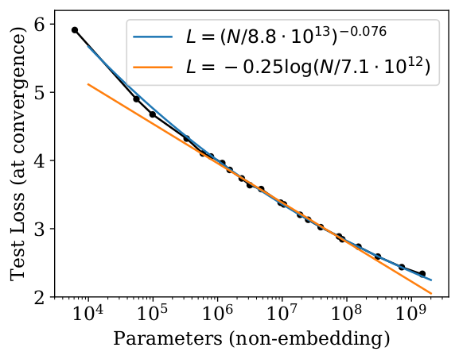

*图 23（原文 Figure 23，第 26 页）：在定性上，$L(N)$ 随参数量的趋势用幂律拟合优于对数等其他函数。*

**图中文字翻译与读法**：横轴 Parameters (non-embedding)（约 $10^{4}$ 到 $2\times10^{9}$），纵轴 Test Loss (at convergence)（收敛时的测试损失，2 到 6）。蓝线是幂律 $L=(N/8.8\cdot10^{13})^{-0.076}$，橙线是对数拟合 $L=-0.25\log(N/7.1\cdot10^{12})$。幂律在整个范围内贴合数据点；对数拟合只在中段吻合，在小模型端和 $10^{9}$ 附近明显偏离（低于数据点）。拟合细节（D.7）：$L(C)$ 的拟合不含只有 1 层的小模型（1 层到 2 层的过渡造成图 13 中的小突起）；$L(N)$ 的拟合也排除很小的 1 层模型，并排除没有完全收敛的最大模型。若把它们包含进去，拟合参数变化很小，趋势向两个方向的外推也都良好。

**图 24：泛化与深度（附录 D.8）**

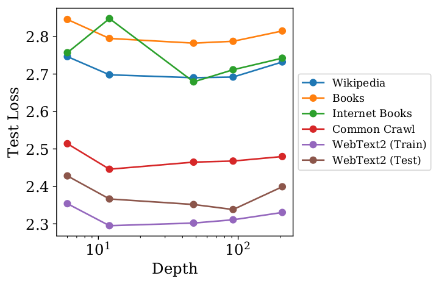

*图 24（原文 Figure 24，第 27 页）：在一系列数据集上评估约 15 亿参数的模型。没有观察到深度对泛化的影响；泛化性能主要取决于训练分布上的性能。12 层的模型在 Internet Books 数据集上发生了过拟合，图中显示的是早停后的结果；作者在其他实验中没有再见到这种令人意外的结果。*

**图中文字翻译与读法**：横轴 Depth（层数，对数刻度，约 6 到 207），纵轴 Test Loss（约 2.3 到 2.85）。图例：Wikipedia、Books、Internet Books、Common Crawl、WebText2 (Train)、WebText2 (Test)。参数量固定（约 1.5B）时，各数据集上的损失随深度基本是平的，各数据集之间保持稳定的高低顺序；各条线随深度的小幅起伏大体同向（训练分布上的损失变化时，其他分布上的损失同向变化），这支持“泛化主要取决于训练分布上的性能，而不取决于深度”。12 层处 Internet Books 的突起，是原文注明的早停后结果。

## 十一、讨论、局限与证据边界

### 11.1 与已有工作的关系（原文第 7 节）

- 幂律有许多来源；密度估计和随机森林里的模型与数据规模幂律可能与本文相关，指数大致可以解释为“数据中相关特征个数”的倒数（非常粗略）。
- 早期工作（Banko 与 Brill 2001、Goodman 2001）已发现性能与数据集大小的幂律；Hestness 等（2017、2019）研究模型与数据规模的关系，是文献中最接近本文的工作，但其中 Hestness 等 2017 发现数据集随模型大小**超线性**增长，而本文发现的是**次线性**。Komatsuzaki 2019 在计算最优分配上与本文有相似之处（包括幂律学习曲线）；EfficientNet 的精度与模型大小也近似服从幂律；Rosenfeld 等 2019 研究了多个数据集上的模型与数据规模，拟合的函数形式与本文类似。
- EfficientNet 主张深度和宽度按不同系数指数缩放；本文对语言模型发现宽度/深度之比应保持不变（幂次大约为 1），更重要的是，精确的架构超参数相对整体规模并不重要。Veit 等的“深层网络是浅层网络的集成”可能解释这一发现。
- 在高度过参数化的模型中，一些工作发现模型大小达到数据集大小时有“堵塞转变”（jamming transition），但那可能需要训练到远超常规的程度且不使用早停；本文没有观察到这种转变，且发现所需数据随模型大小次线性增长。
- 模型宽度很大时的展开（NTK 等）可能为部分规模关系提供框架；优化相关的结果（如学习曲线形状）也许可用带噪声的二次模型解释，要定量化需要对 Hessian 谱的刻画。

### 11.2 作者的讨论与展望（原文第 8 节）

- 观察到语言模型对数似然损失与非 embedding 参数量 $N$、数据集大小 $D$、优化的训练计算 $C_{\min}$ 之间一致的规模关系（式 1.5、1.6），而对许多架构和优化超参数的依赖很弱。因为是幂律，规模增大有收益递减。
- 作者把这些规模关系比作理想气体定律：与大部分微观成分的细节无关，以通用方式联系宏观性质；并期待有一个“统计力学”解释所观察到的“热力学”。
- 他们推测这些规模关系适用于其他以最大似然为损失的生成建模任务（图像、音频、视频等），“目前我们不知道哪些结果依赖自然语言数据的结构，哪些是普适的”。
- 重要的开放问题：损失的持续改进是否转化为相关语言任务的改进。“平滑的量变可能掩盖重大的质变：more is different。”就像经济总量的平滑增长不能说明支撑它的具体技术发展，语言模型损失的平滑改善也可能掩盖看似质变的能力变化。
- 结论性判断：“更大的模型会继续表现更好，并且比以往认识到的更加样本高效。大模型可能比大数据更重要。”因此应当进一步研究模型并行：深度模型可用流水线并行，但需要随设备数增大 batch；宽网络更适合并行；稀疏或分支结构、训练中增长网络的方法可能让整个训练保持在计算最优前沿上。

### 11.3 证据边界

- **经验规律，不是定理**：作者自己说没有理论解释（附录 C）。外推要检查是否仍处在同一状态：架构（decoder-only Transformer）、tokenizer、数据分布（WebText2）、上下文长度、优化设置。
- **范围**：非 embedding 参数 $768$ 到 $1.5\times10^{9}$，数据 $2.2\times10^{7}$ 到 $2.3\times10^{10}$ token。式 (6.8) 的交点和附录 B 的公式都是对这个范围之外的外推，原文明确说其数值高度不确定。
- **指标是损失，不是下游任务表现**：论文没有测量下游任务，只在其他文本分布上测了损失；损失的平滑改善与能力的涌现之间的关系，作者明确留作开放问题。
- **计算量的定义**：$C=6NBS$ 不含 embedding 与上下文相关项；结论“应主要增大模型”依赖这个口径。

## 十二、常见误读

- **误读一**：“规律是 $L=L_\infty+(N_c/N)^{\alpha}$，趋近一个不可约损失。”实际上论文的拟合式没有加性常数项，在所测范围内是纯幂律；变平只是作者对更大尺度的预期，附录 D.7 与图 23 还说明幂律比对数等函数拟合得好。
- **误读二**：“过拟合由 $N/D$ 触发。”实际由 $N^{\alpha_N/\alpha_D}/D\approx N^{0.74}/D$ 决定（图 9 右），所以数据只需随模型次线性增长。
- **误读三**：“指数和常数是普适常数。”它们依赖 WebText2、分词方式和模型族，原文说 $N_c$、$D_c$ 等没有基本含义。
- **误读四**：“$N$ 是总参数量。”论文的 $N$ 不含 embedding；含 embedding 时趋势会被各层数曲线分叉所遮蔽（图 6）。引用指数时要同时说明口径。
- **误读五**：“论文建议 $N\propto C^{0.73}$、$D\propto C^{0.27}$ 是最终答案。”这是在固定设置、训练远未收敛的前提下得到的，后来被 Chinchilla 的更充分训练实验修正；它的数据增长很慢，也恰好是本文 9.3 节“矛盾”的来源。
- **误读六**：“幂律意味着性能可以无限提升，或者能预测具体能力。”论文预测的是损失；更大的模型是否出现新能力，原文只作为开放问题提出。
- **误读七**：把 $C$ 和 $C_{\min}$ 混用。两者对应图 13 的两条线（指数 0.057 与 0.050），做预测应该用 $C_{\min}$。

## 十三、与相关论文的关系

- **GPT-2**（见 [gpt2](../gpt2/论文中文解读.md)）：本文所用的 WebText 数据与分词方式来自 GPT-2，WebText2 是它的扩展。
- **Transformer**（见 [transformer](../transformer/论文中文解读.md)）：本文研究 decoder-only Transformer，并与 LSTM（见 [lstm](../lstm/论文中文解读.md)）比较。
- **Chinchilla**（见 [chinchilla](../chinchilla/论文中文解读.md)）：紧接着读。Chinchilla 重新估计计算最优的参数与数据配比，得出两者应近似等比例增长，与本文“主要加大模型、数据缓慢增长”的结论不同。
- **GPT-3**（见 [openai_gpt3](../openai_gpt3/论文中文解读.md)）：参数量扩大到 1750 亿；GPT-3 论文明确依据本文的分析，选择“比常规做法更大的模型、更少的 token”，并把验证损失随训练计算的幂律趋势在本文基础上外推了约两个数量级。
- **GPT-4 的“可预测扩展”**（见 [openai_gpt4](../openai_gpt4/论文中文解读.md)）：该篇解读说明 GPT-4 技术报告用算力小 1,000 到 10,000 倍的小模型拟合幂律，预测最终损失；它采用的是带不可约损失项的拟合式，与本文拟合的纯幂律式（无加性常数项）不同。这是对本文“用小规模实验外推大规模训练”思路的延续，不是本文的内容。

## 十四、复现检查清单

- 统一分词器与每 token 损失的定义；注明 $N$ 是否排除 embedding，$C$ 是按 $6NBS$ 估计还是实测 FLOPs。
- 同时记录实际 FLOPs、训练 token、参数量、batch size 和是否提前停止；$S_{\min}$、$C_{\min}$ 的转换需要 $B_{\mathrm{crit}}(L)$，因此要测 $B_{\mathrm{crit}}$ 而不是照抄 $2.1\times10^{8}\cdot L^{-4.8}$。
- 拟合时区分数据受限、参数受限和优化未收敛的样本，排除 1 层小模型和没有收敛的最大模型。
- 给出指数的置信区间，并测试删除端点后是否稳定；对数拟合作为对照。
- 要验证 $\Delta L<0.05$ 量级的变化，需要多个随机种子取平均（图 22）。
- 学习率随模型大小调整（附录式 D.1），大模型需要更小的学习率。
- 外推前检查 $n_{\text{ctx}}$ 是否仍满足 $d_{\text{model}}\gg n_{\text{ctx}}/12$。

## 十五、原文内部数字不一致备查

下面是核对原文时发现的、论文内部彼此不一致或笔误的地方。引用具体数值时请注明取自哪一处。

| 量 | 位置 A | 位置 B | 备注 |
|---|---|---|---|
| $C_c^{\min}$ | 式 (1.3)、表 5：$3.1\times10^{8}$ PF-days | 图 1 左图、图 13 图例：$2.3\times10^{8}$ | 指数都是 0.050 |
| $C_c$（固定 batch） | 表 5：$1.6\times10^{7}$ PF-days | 图 13 图例：$(C/2.0\cdot10^{7})^{-0.057}$ | 指数都是 0.057 |
| $\alpha_N$、$N_c$ | 式 (1.1)、表 5：0.076，$8.8\times10^{13}$ | 表 2：0.076，$6.4\times10^{13}$；表 3：0.077，$6.5\times10^{13}$ | 原文说明不同拟合参数略有出入 |
| $\alpha_D$ | 式 (1.2)、表 5：0.095，$D_c=5.4\times10^{13}$ | 表 2：0.103，$D_c=1.8\times10^{13}$ | 同上 |
| $D\propto N^{\alpha_N/\alpha_D}$ 的指数 | 引言说由 (1.1)(1.2) 得 0.74 | 用 0.076/0.095 算得 0.80；0.74 来自表 2 的 0.076/0.103 | 自行验算 |
| $\alpha_C^{\min}$ | 式 (1.3)、表 5：0.050（经验） | 式 (6.4)：0.054；式 (B.7)：0.052（均为由 (1.8) 预测） | 自行代入表 3 得 0.0525 |
| $N(C_{\min})$ 的指数 | 式 (6.1)、表 6：0.73（经验） | 式 (6.5)：0.71（预测） | 自行代入得约 0.68 |
| 数据用量 $D(C_{\min})$ | 表 6：$D_e=2\times10^{10}$，$p_D=0.27$；第 1 节：$D\sim C^{0.27}$ | 式 (6.7)：$4\times10^{10}\cdot(C_{\min}/\text{PF-Day})^{0.26}$ | 用 $N_e=1.3\times10^{9}$ 代入 $2C_{\min}/(6N)$ 得约 $2.2\times10^{10}$，与表 6 一致 |
| $B_*$ | 式 (1.4)、(5.3)：约 $2\times10^{8}$ | 表 5、图 10 图例：$2.1\times10^{8}$ | 取整 |
| 随机波动大小 | 第 4.2 节：不同种子造成约 0.02 的损失变化 | 图 22 说明：运行间波动约 0.05 | 前者用于推式 (4.4)，后者来自 3M 参数模型的学习率实验 |
| 趋势跨越的数量级 | 摘要：有的趋势超过七个数量级 | 第 1.1 节：超过六个；第 1.2 节：$C_{\min}$ 八个、$N$ 六个、$D$ 两个多 | 对应不同的量 |
| 图 7 右图纵轴刻度 | 印成 6、4、5、3、2 | 应为 6、5、4、3、2 | 4 与 5 的位置互换 |
| 附录 B.4 的引用 | “Figure X”“Figure Y”“A.1”“A.6”“A.9” | 应为图 12、图 14、式 (B.1)、(B.6)、(B.9) | 未更新的占位引用 |
| 第 4.2 节对 $\delta L$ 的引用 | 说 $\delta L$ 只依赖组合量，“如图 16 所示” | 该组合量的图是图 9 右图（图 16 左图的横轴是 $S_{\text{stop}}$ 的下界） | 图号笔误 |

## 原文证据导航

- [原论文 PDF](paper.pdf)
- [原文提取文本](paper.txt)
- [论文概要](论文概要.md)
