# 论文中文解读：《Scaling LLM Test-Time Compute Optimally can be More Effective than Scaling Model Parameters》

> **基本信息**：Charlie Snell（UC Berkeley，工作完成于 Google DeepMind 实习期间）、Jaehoon Lee、Kelvin Xu、Aviral Kumar（Google DeepMind；Kelvin Xu 与 Aviral Kumar 为共同指导），arXiv:2408.03314，2024 年 8 月；论文原文 [官方页面](https://arxiv.org/abs/2408.03314)。
>
> **本文的读法**：图均为从论文 PDF 中按图裁出的原图，每张图后有中文图题、图中文字翻译和读图结论。原文所有实验结果都以图给出，没有编号的数据表；本文的表是把正文数字、超参数和图上数值整理成表。凡不是原文正文给出的数字（曲线上的点、柱子的高度），都是从 PDF 中该图的矢量数据点读出的，保留一位小数，表题里会注明；原文正文给出的数字优先。读完本文不必再翻英文原文。

## 一、一句话结论

如果允许一个 LLM 在推理时使用固定、且不算小的额外算力，它在难题上最多能提高多少？这笔算力该怎么花？花在推理上，和花在预训练一个更大的模型上相比，哪个更划算？本文在 MATH 数学题上用 PaLM 2-S\* 系列模型回答这三个问题。结论可以压缩成三句：

1. 论文研究了两条扩展测试时算力（test-time compute）的路线。一是**搜索验证器**：用过程奖励模型（PRM）给解答的每一步打分，做 best-of-N、beam search、lookahead search；二是**改进提议分布**：微调一个“修订模型”，让它在上下文里看到自己之前的错误答案后再次作答（顺序修订）。两条路线的效果都强烈依赖于“这道题对基础模型有多难”。
2. 因此提出 **compute-optimal** 策略：先把题目按基础模型的难度分成五档，再为每一档、每个预算选择最合适的策略和并行/顺序配比。与纯并行的 best-of-N 相比，修订路线用 64 个样本就能超过 256 个样本的 best-of-N；搜索路线用 16 个生成接近 64 个生成的 best-of-N，即“最多约 4 倍”的测试时算力节省。
3. 在 FLOPs 对齐的比较中（对手是参数量约 14 倍、不做额外测试时计算的预训练模型），基础模型已有一定成功率的简单/中等题，或推理负载很低（推理 token 远少于预训练 token）时，小模型加测试时算力常常更好；最难的题，或推理负载很高时，更大的预训练模型更好。测试时算力与预训练算力不能一比一互换。

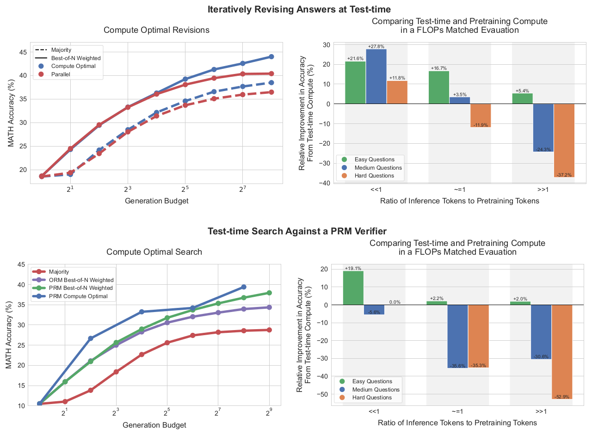

*图 1（原文 Figure 1，第 2 页）：左列为 compute-optimal 策略与基线在修订（上）和 PRM 搜索（下）两种设定下的准确率随预算变化；右列为与约 14 倍参数模型的 FLOPs 对齐比较。*

**图中文字翻译与读法**：

- **左上 Iteratively Revising Answers at Test-time / Compute Optimal Revisions（测试时迭代修订答案 / 按算力最优分配的修订）**：横轴 Generation Budget（生成预算，即总共采样的答案条数，对数刻度，$2^0$ 到 $2^8$），纵轴 MATH Accuracy（MATH 准确率，%）。实线是 Best-of-N Weighted（验证器加权选择），虚线是 Majority（多数投票）；蓝点 Compute Optimal（按难度自适应的最优策略），红点 Parallel（纯并行采样）。预算很小时两者重合，预算增大后蓝线逐渐高于红线；在最右端（预算 256）：Best-of-N Weighted 为 44.0% 对 40.4%，Majority 为 38.5% 对 36.5%（读自原图数据点）。
- **右上 Comparing Test-time and Pretraining Compute in a FLOPs Matched Evaluation（FLOPs 对齐下比较测试时算力与预训练算力）**：横轴 Ratio of Inference Tokens to Pretraining Tokens（推理 token 与预训练 token 之比，记作 $R$），分 $\ll1$、$\approx1$、$\gg1$ 三组；纵轴 Relative Improvement in Accuracy From Test-time Compute（%）：用测试时算力的小模型相对于约 14 倍参数模型贪心解码的准确率相对提升，正值表示测试时算力更好。绿、蓝、橙柱分别是 Easy、Medium、Hard Questions。柱上数字已转录为本文表 11。
- **左下 Test-time Search Against a PRM Verifier / Compute Optimal Search（用 PRM 验证器做测试时搜索 / 最优分配的搜索）**：横轴为生成预算（$2^0$ 到 $2^9$），纵轴为 MATH 准确率。红线 Majority，紫线 ORM Best-of-N Weighted，绿线 PRM Best-of-N Weighted，蓝线 PRM Compute Optimal。蓝线在中小预算处明显高于其他线，最右端（预算 256）为 39.4%，已高于 PRM best-of-N 在预算 512 处的 38.0%（读自原图数据点）。
- **右下**：与右上相同，对象换成 PRM 搜索。

**读图结论**：compute-optimal 的收益来自“按题选策略”，而不是某个新算法；右列说明与大模型比较时，结论随题目难度和推理负载（$R$）反转：简单题处处占优，难题只在推理负载很低时才打平或占优。所有数字只对 MATH 与 PaLM 2-S\* 成立。

## 二、先备知识

| 术语 | 含义 |
|---|---|
| pass@1 | 单次采样答对的概率；本文用每题 2048 个样本估计它，并据此给题目分难度档 |
| best-of-N | 独立采样 N 个完整解答，用验证器打分，取分数最高者 |
| majority voting（多数投票） | 不用验证器，在 N 个解答的最终答案中取出现次数最多者（即 self-consistency 的做法） |
| ORM / PRM | 都是验证器（verifier）。ORM（outcome reward model）只对完整解答整体打一个分；PRM（process reward model）对解答的每一步打分 |
| best-of-N weighted | 先把验证器分数在“最终答案相同”的解答之间求和，再选总分最大的答案；与“选单个最高分解答”不同 |
| proposal distribution（提议分布） | 模型对给定 prompt 生成答案的概率分布。本文把“改变这个分布”和“在样本上做选择/搜索”看作两条独立的轴 |
| MATH | 高中数学竞赛水平题库，人工标注难度 1–5 级。本文沿用 Lightman et al. 的划分：12k 训练题、500 测试题 |
| FLOPs | 浮点运算次数，用来统一衡量预训练与推理的算力；常用近似：预训练约 $6ND$，推理约 $2ND$（$N$ 为参数量，$D$ 为 token 数） |

作者选择数学推理的理由是：测试时算力最有用的场景，是模型已经具备回答所需的“知识”、主要困难在于从这些知识做复杂推断；MATH 的答案可以自动判定，也适合做这种分析。

## 三、问题设定与统一视角

### 3.1 要回答的问题

原文把问题表述为（译）：给定一个 prompt 和一个测试时算力预算，如何确定对这个 prompt 最有效的算力用法？与直接使用大得多的预训练模型相比，效果又如何？

同一预算下，用法有很多种。例如用“修订模型加 ORM 验证器”时，可以把全部预算花在 $N$ 条独立并行样本上再做 best-of-N；也可以让修订模型顺序生成 $N$ 次修订，再用 ORM 从序列里选最好的一个；或者介于两者之间。用 PRM 时，还要在 beam search、lookahead search、best-of-N 之间选择。作者的直觉是：简单题的初始样本大多方向正确，只需要进一步打磨，更适合顺序修订；难题可能需要在多种高层解法之间探索，更适合独立并行采样或更复杂的搜索。后面的实验检验的就是这些直觉。

### 3.2 两个旋钮：改提议分布，或优化验证器

任何测试时算力方法都可以看成在“修改模型对该 prompt 的输出分布”。有两个旋钮：

- **输入层（改 proposal distribution）**：在 prompt 后追加额外 token（例如之前的答案、批评），使模型的条件分布发生变化；或者直接微调模型得到更好的分布（STaR、ReSTEM 等 RL 风格的微调，它们不增加输入 token）。测试时的 self-critique 属于前者。但直接提示现成模型自我纠错在推理题上通常无效，所以本文专门微调了一个修订模型（做法借鉴 Qu et al. 的 on-policy 数据加 best-of-N 引导改进）。
- **输出层（用 verifier）**：从标准 LM 采样多个候选，再对候选做“手术”（选择、重排）。最经典的是 best-of-N；进一步可以训练过程验证器 PRM，它预测解答中每个中间步骤是否正确，从而在解答空间做树搜索，比朴素 best-of-N 更有效率。

作者把这个过程类比为 MCMC 采样：用一个简单的提议分布加一个打分函数，去逼近复杂的目标分布。两个旋钮彼此独立，所以论文分别在第五、六节研究，再在第七节比较它们与预训练算力的交换。

### 3.3 compute-optimal 策略的形式化

设 $\mathrm{Target}(\theta,N,q)$ 为：对提示 $q$，使用测试时超参数 $\theta$（例如搜索算法及其参数、并行与顺序的配比）和预算 $N$ 时，模型输出的分布。**测试时 compute-optimal 扩展策略**就是使正确率最高的超参数：

$$
\theta^*_{q,y^*(q)}(N)=\operatorname*{arg\,max}_{\theta}\Big(\mathbb{E}_{y\sim\mathrm{Target}(\theta,N,q)}\big[\mathbf{1}_{y=y^*(q)}\big]\Big),
$$

其中 $y^*(q)$ 是题目 $q$ 的真值答案，$\mathbf{1}_{y=y^*(q)}$ 是答对时取 1 的指示函数，期望即“用此策略答对的概率”。（原文式 (1) 左边下标误印为 $a^*(q)$，正文说明为 $y^*(q)$，含义相同。）

这个定义依赖真值 $y^*(q)$，部署时拿不到。作者因此用一个关于题目的统计量近似它：**题目难度**。

### 3.4 难度怎么估计

- **难度的定义**：沿用 Lightman et al.，难度是相对于具体基础 LLM 的。对测试集每道题，用 2048 个样本估计基础模型的 pass@1，再把 500 道题按 pass@1 分成五个分位数档（第 1 档最容易，第 5 档最难）。从图中数值反推，各档题数约为 100、100、100、105、95（原文未写）。作者发现这种“模型特定”的难度档比 MATH 数据集自带的人工难度标签更能预测测试时算力的效果。
- **oracle difficulty（真值难度）**：上面的做法需要真值答案来判对错，只适合分析，部署时没有。
- **model-predicted difficulty（预测难度）**：用同样的 2048 个样本，但不看真值，而是对每题取验证器最终答案分数的平均，再用同样的方式分成五档。
- **成本**：预测难度也要额外的推理算力。作者说这个一次性成本可以并入实际策略的计算里（例如用验证器时，同一批计算也可用于搜索），也类似强化学习里的探索—利用权衡；但本文的实验**没有把难度估计的成本计入预算**，只是为了展示“有效分配算力”能做到什么。
- **选策略的流程**：为每个难度档独立地选出表现最好的测试时策略。为避免用同一个测试集既算难度档又选策略造成的混淆，作者在测试集每个难度档内做**两折交叉验证**：在一折上选出最好的策略，再在另一折上度量它的表现，反过来再做一次，两折结果取平均。

因此，难度档在这里扮演“题目的充分统计量”的角色：同一档里的题共用同一个策略。

## 四、实验设置

| 项目 | 设置 |
|---|---|
| 数据 | MATH，12k 训练题 / 500 测试题（Lightman et al. 的划分）；指标为测试集准确率 |
| 基础模型 | PaLM 2-S\*（原文括号注明为 Codey 基座模型）；在 MATH 上有非平凡的成绩但尚未饱和 |
| 采样提示 | 4-shot：随机选自 PRM800K 第 1 阶段训练划分的正确解答（GPT-4 生成、带分步格式）；换成 Lewkowycz et al. 的提示结果相近 |
| 用途 | 同一提示用于生成 PRM 训练数据、修订模型训练数据，以及测试集上的 PRM 搜索 |
| 分步 | 基础模型被提示输出“换行分隔”的逐步解答，用简单的换行切分得到步骤 |
| 判分 | 使用 Lightman et al. 发布的判分函数 |

表 1：实验设置（整理自原文第 4 节和附录 G，第 6、25 页）。修订与验证能力在现成模型中几乎不存在，所以两条路线都用**针对这些能力专门微调过**的 PaLM 2-S\*（原文脚注 1）；作者预期未来模型会在预训练阶段直接获得这些能力。

## 五、路线一：用 PRM 做搜索

### 5.1 PRM 的训练

- **不用 PRM800K 的人工标签**：作者试过 Lightman et al. 发布的 PRM800K，发现用它训练的 PRM 对本文设定“基本无效”，即使最朴素的 best-of-N 也很容易利用（exploit）这个 PRM。推测原因是 PRM800K 里是 GPT-4 生成的样本，与 PaLM 2 的样本分布不同。
- **改用 Monte Carlo rollouts 的无人工标注监督**（Wang et al.，Math-Shepherd）：对解答中的每一步，从该步出发再采样若干条后续解答，用“最终答对的比例”估计该步的“续做正确率”作为步级标签。所以 PRM 每一步的预测，是对基础模型采样策略的 reward-to-go（后续回报）估计；由于奖励只在终局给出（稀疏），它也等同于“从该前缀出发最终答对的概率”。
- **损失**：PRM 是一个二分类器，每步输出 0 到 1 的值，用软标签 $y$ 训练二元交叉熵 $-\big(y\log\hat y+(1-y)\log(1-\hat y)\big)$，其中 $\hat y$ 是预测值。数据规模与超参数见 6.7 节的表 8。
- **与 ORM 比较**：作者也训练了 ORM 作为基线，PRM 始终更好，所以第五节所有搜索实验都用 PRM（附录 F）。

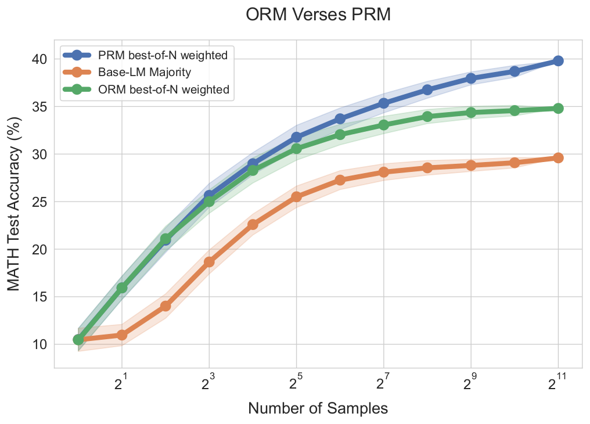

*图 14（原文 Figure 14，附录 F，第 25 页）：用 PaLM 2-S\* 基础模型少样本采样，比较两者作为验证器做 best-of-N weighted 的效果。*

**图中文字翻译与读法**：

- 标题 ORM Verses PRM（ORM 对比 PRM）；横轴 Number of Samples（样本数，$2^0$ 到 $2^{11}$），纵轴 MATH Test Accuracy（%）；阴影为原文图中的误差带（原文正文未说明其统计定义）。蓝线 PRM best-of-N weighted，绿线 ORM best-of-N weighted，橙线 Base-LM Majority（基础模型多数投票，无验证器）。
- **读图结论**：样本很少时 PRM 与 ORM 几乎重合（8 个样本时 25.7% 对 25.0%）；样本越多差距越大，在 $2^{11}$ 个样本处 PRM 为 39.8%，ORM 为 34.8%，多数投票为 29.6%（读自原图数据点）。原文的结论是“PRM 明显优于 ORM，且差距随样本数增大”。

### 5.2 答案聚合：用最后一步，再按答案加权

测试时每个解答有一串步级分数，要先聚成一个整题分数，再在多个解答之间选出最终答案：

- **逐步聚合（step-wise aggregation）**：不取各步分数的乘积或最小值，而是直接用 **PRM 在最后一步的预测**作为整个解答的分数。附录 E 比较了三种聚合，“最后一步”最好。
- **跨答案聚合（inter-answer aggregation）**：采用 Li et al. 的 **best-of-N weighted**：对每个候选最终答案 $a$，把所有以 $a$ 为最终答案的解答的验证器分数相加，选总分最大的答案：

$$
\hat a=\operatorname*{arg\,max}_{a}\ \sum_{i=1}^{N}\mathbf{1}[a_i=a]\,s_i,
$$

其中 $a_i$ 是第 $i$ 个解答的最终答案，$s_i$ 是它的整题分数。（公式按原文文字描述写出。）

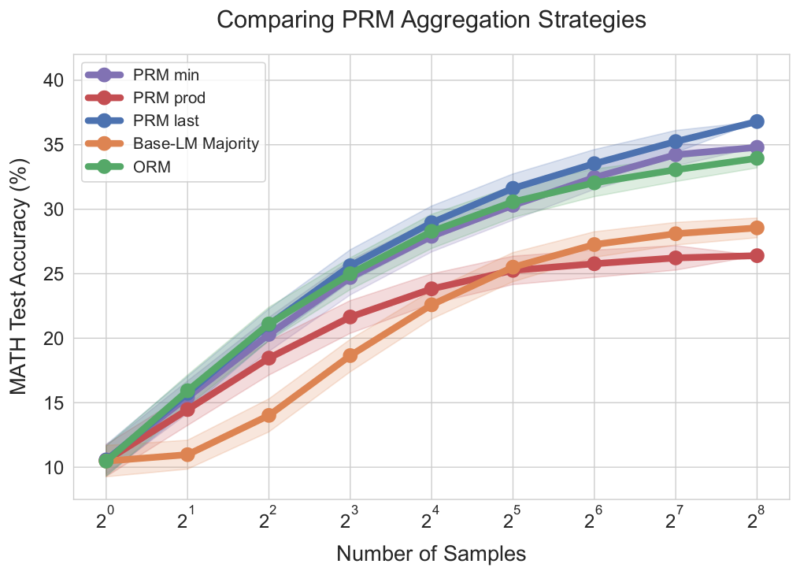

*图 13（原文 Figure 13，附录 E，第 24 页）：比较把步级 PRM 分数聚合成整题分数的三种方式。*

**图中文字翻译与读法**：

- 标题 Comparing PRM Aggregation Strategies（比较 PRM 聚合策略）；横轴 Number of Samples（样本数，$2^0$ 到 $2^8$），纵轴 MATH Test Accuracy（%）。图例：PRM min（取各步最小分）、PRM prod（各步正确概率连乘）、PRM last（只用最后一步）、Base-LM Majority（基础模型多数投票）、ORM。
- **读图结论**：样本很少时 PRM last、PRM min 和 ORM 几乎重合，PRM prod 已略低（4 个样本时 18.5%，另三者为 20.3%–21.1%）；样本数增大后 PRM last 最好，在 $2^8$ 个样本处为 36.8%，之后依次是 PRM min（34.8%）、ORM（34.0%）、多数投票（28.6%），PRM prod 最差（26.4%）；prod 从 $2^5$ 个样本起就低于多数投票（读自原图数据点）。
- 原文指出，此前的工作（Lightman et al.、Wang et al.）发现取 min 最好，与本文不同；作者推测原因是本文的验证器用软的 Monte Carlo 回报标签训练，其数值分布与二值正确性标签很不一样，所以其他聚合方式未必有同样的效果。另一个有趣的发现：取最后一步等于把 PRM 当 ORM 用，但它仍优于单独训练的 ORM，说明逐步训练也许主要起到**表示学习**的作用，而不只是推理时的工具（原文推测，留待未来研究）。

### 5.3 三种搜索算法

作者研究三种从少样本提示的基础 LLM 采样的搜索方式（图 2）。

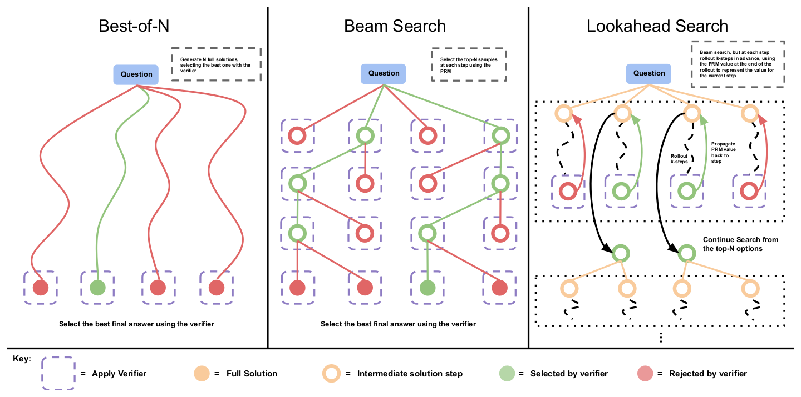

*图 2（原文 Figure 2，第 8 页）：Best-of-N、Beam Search、Lookahead Search 的示意图。*

**图中文字翻译与读法**：

- **左 Best-of-N（最优 N 选一）**：从 Question 出发并行生成 N 条完整解答（图中 4 条），用验证器（紫色虚线框 Apply Verifier）给最终结果打分，选最好的。旁注：Generate N full solutions, selecting the best one with the verifier（生成 N 个完整解答，用验证器选出最好的）。
- **中 Beam Search（束搜索）**：每一层有 4 个候选步骤，验证器给每个打分，绿色（Selected by verifier）保留，红色（Rejected by verifier）丢弃；每个保留的步骤再各扩展出 2 个下一步，如此逐层向下，最后在终点用验证器选最好的最终答案。旁注：Select the top-N samples at each step using the PRM（每步用 PRM 选出前若干个样本）。图例说明：空心橙圈是中间步骤（Intermediate solution step），实心橙圈是完整解答（Full Solution）。
- **右 Lookahead Search（前瞻搜索）**：与 beam search 相同，但每一步先向前 rollout $k$ 步（图中黑色虚线波浪），用 rollout 末端的 PRM 值回传（Propagate PRM value back to step）作为当前这一步的价值，再从前 N 个选项继续搜索（Continue Search from the top-N options）。旁注：Beam search, but at each step rollout k-steps in advance, using the PRM value at the end of the rollout to represent the value for the current step。
- **读图结论**：三者的差别在“在哪里、多早使用验证器”。best-of-N 只在终点评估；beam 在每一步评估并剪枝；lookahead 在每一步先模拟未来再评估，评估更准但更贵（所以图题说 lookahead 需要更多算力）。

三种方法的细节如下。

**Best-of-N weighted**：独立采样 $N$ 个答案，用 PRM 的最终答案判断（最后一步分数）选最好的，按 5.2 的方式加权。

**Beam search**（实现类似 BFS-V）：固定 beam 数 $N$ 和束宽 $M$，重复如下步骤：

1. 采样 $N$ 个解答第一步的候选；
2. 用 PRM 给这些步骤打分，分数是它预测的步级 reward-to-go（奖励稀疏，所以等价于该前缀的总回报）；
3. 只保留得分最高的 $N/M$ 个步骤；
4. 对每个保留的候选，各采样 $M$ 个下一步，又得到 $N/M\times M=N$ 个候选前缀，回到第 2 步。

一直运行到解答结束或达到最大扩展轮数（本文为 40 轮），最后得到 $N$ 个最终候选，再用上面的 best-of-N weighted 选出最终答案。图 2 没有标出 $N$ 和 $M$；按所画的 4 个候选、每个保留者扩展 2 个读出，相当于 $N=4$、$M=2$：每一轮都是“4 个候选里留 2 个，每个再扩 2 个，仍是 4 个候选”。（图 2 的英文图题把保留数写成“前 $M$ 个”，与正文的“前 $N/M$ 个”不一致，在这个例子里两者恰好相同；以正文步骤为准。）若 $N=256$、$M=4$，则每轮保留 64 个、各扩 4 个；若 $M=\sqrt N=16$，则每轮保留 16 个、各扩 16 个。

**Lookahead search**：改变 beam search 评估每一步的方式。在搜索的每一步，不直接用当前步的 PRM 分数选前几名，而是模拟：向前 rollout 最多 $k$ 步（遇到解答结束就提前停止），并用 PRM 在 rollout 末端的预测给当前步打分。为降低模拟的方差，rollout 用温度 0。因此 beam search 就是 $k=0$ 的特例。若 PRM 足够准，增大 $k$ 能提高每步价值估计的准确度，代价是额外算力。这个版本的 lookahead 是 MCTS 的特例：MCTS 里为促进探索而设计的随机成分在这里都被去掉了，因为 PRM 已经训练好并被冻结，测试时要“利用”而非“探索”。所以 lookahead 基本代表了 MCTS 类方法在测试时的用法。

**成本核算**：作者把一次“生成”（generation）定义为从基础 LLM 采样一个答案。best-of-N 的预算是 $N$，beam search 的预算是 beam 数 $N$；lookahead 每步额外向前采样 $k$ 步，所以成本定义为 $N\times(k+1)$ 个样本。预算最大为 256，实验扫描了下面几组设置（对应图 3 左图的曲线）：

| 配置 | 方法 | 束宽 $M$ | 前瞻步数 $k$ | 成本（样本数） |
|---|---|---|---:|---|
| 基线 | best-of-N weighted | - | - | $N$ |
| 基线 | 多数投票（无验证器） | - | - | $N$ |
| (1) | beam search | $\sqrt N$ | 0 | $N$ |
| (2) | beam search | 4 | 0 | $N$ |
| (3a) | lookahead（对 (1) 加前瞻） | $\sqrt N$ | 3 | $4N$ |
| (3b) | lookahead（对 (2) 加前瞻） | 4 | 3 | $4N$ |
| (4) | lookahead（对 (1) 加前瞻） | $\sqrt N$ | 1 | $2N$ |

表 2：搜索实验的配置（整理自原文第 5.3 节，第 8–9 页）。成本只统计从基础模型采样的答案数；原文只按采样数计成本，没有讨论 PRM 打分本身的开销。

### 5.4 结果：搜索不是越复杂越好

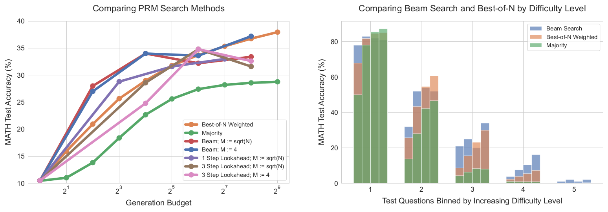

*图 3（原文 Figure 3，第 9 页）：左，不同搜索方法随生成预算的准确率；右，按难度档比较 beam search（$M=4$）与 best-of-N。*

**图中文字翻译与读法**：

- **左图 Comparing PRM Search Methods（比较 PRM 搜索方法）**：横轴 Generation Budget（生成预算，对数刻度 $2^1$ 到 $2^9$），纵轴 MATH Test Accuracy（%）。图例七条线：Best-of-N Weighted；Majority；Beam, $M:=\sqrt N$（束宽取预算的平方根）；Beam, $M:=4$；1 Step Lookahead, $M:=\sqrt N$；3 Step Lookahead, $M:=\sqrt N$；3 Step Lookahead, $M:=4$。
- **右图 Comparing Beam Search and Best-of-N by Difficulty Level（按难度档比较 beam search 与 best-of-N）**：横轴 Test Questions Binned by Increasing Difficulty Level（测试题按难度从低到高分五档），纵轴 MATH Test Accuracy（%）。每档有四组柱，从左到右对应预算 4、16、64、256 个生成；每组里 Beam Search（蓝）、Best-of-N Weighted（橙）、Majority（绿）三色半透明叠放在同一位置，看柱顶露出的颜色和高度来比较。叠放使得不易直接读数，下面两张表给出读自原图矢量数据点的数值。

| 生成预算（成本） | best-of-N weighted | majority | beam，$M=\sqrt N$ | beam，$M=4$ | 1 步 lookahead，$M=\sqrt N$ | 3 步 lookahead，$M=\sqrt N$ | 3 步 lookahead，$M=4$ |
|---|---:|---:|---:|---:|---:|---:|---:|
| 4 | 20.9 | 13.8 | 28.0 | 27.0 | - | - | - |
| 8 | 25.7 | 18.4 | - | - | 28.8 | - | - |
| 16 | 29.0 | 22.7 | 34.0 | 34.0 | - | 28.6 | 24.8 |
| 32 | 31.8 | 25.6 | - | - | 31.6 | - | - |
| 64 | 33.7 | 27.4 | 32.2 | 33.6 | - | 34.8 | 34.8 |
| 128 | 35.3 | 28.2 | - | - | 33.0 | - | - |
| 256 | 36.8 | 28.6 | 33.4 | 37.2 | - | 31.6 | 32.6 |

表 3：图 3 左图的 MATH 测试准确率（%），读自原图矢量数据点，保留一位小数。每行是一个生成预算（lookahead 按成本 $N(k+1)$ 对齐），“-”表示该方法在此预算处没有数据点；预算 1 时所有方法都是 10.5%。

| 难度档（题数） | 预算 4 | 预算 16 | 预算 64 | 预算 256 |
|---|---|---|---|---|
| 1（最易，100 题） | 78.0 / 67.9 / 50.0 | 83.0 / 81.8 / 78.0 | 82.0 / 84.7 / 85.6 | 81.0 / 85.1 / 87.3 |
| 2（100 题） | 32.0 / 25.7 / 13.7 | 52.0 / 43.4 / 28.0 | 54.0 / 54.7 / 42.3 | 52.0 / 60.7 / 46.7 |
| 3（100 题） | 21.0 / 8.6 / 4.3 | 25.0 / 15.5 / 6.3 | 20.0 / 23.2 / 8.3 | 34.0 / 30.0 / 8.0 |
| 4（105 题） | 3.8 / 2.3 / 1.0 | 7.6 / 3.9 / 0.9 | 10.5 / 5.5 / 0.9 | 16.2 / 7.3 / 0.9 |
| 5（最难，95 题） | 1.1 / 0.1 / 0.1 | 2.1 / 0.2 / 0.0 | 1.1 / 0.2 / 0.0 | 2.1 / 0.3 / 0.0 |

表 4：图 3 右图各难度档上的 MATH 准确率（%）。每格三个数依次为 beam search（$M=4$）/ best-of-N weighted / majority，读自原图矢量数据点；每档题数按图中数值反推，原文未写。

**读表 3（左图）**：

- 预算 4：beam 为 28.0%（$M=\sqrt N$）和 27.0%（$M=4$），明显高于 best-of-N 的 20.9%；预算 16：两种 beam 都是 34.0%，best-of-N 是 29.0%。
- 预算 64：beam 为 32.2% 和 33.6%，与 best-of-N 的 33.7% 持平或略低；预算 256：$M=\sqrt N$ 的 beam 只有 33.4%，比 best-of-N 的 36.8% 低 3.4 个点，$M=4$ 的 beam 为 37.2%，略高于 best-of-N。
- lookahead 同成本下多数点落后（成本 16 处 28.6% 和 24.8%，成本 256 处 31.6% 和 32.6%），但成本 64 处 3 步 lookahead 为 34.8%，是该预算下最高的一个点。
- 多数投票始终最低：预算 256 处 28.6%，比 best-of-N 低 8 个点以上。

**读表 4（右图）**：

- 第 1 档（最易）：预算 4 时 beam 为 78.0%，远高于 best-of-N 的 67.9% 和 majority 的 50.0%；但随预算增大 beam 不升反降（83.0、82.0、81.0），best-of-N 和 majority 持续上升到 85.1% 和 87.3%，从预算 64 起反超 beam。
- 第 2 档：beam 在预算 4、16 领先（32.0、52.0 对 25.7、43.4），预算 64 持平（54.0 对 54.7），预算 256 落后（52.0 对 60.7）。
- 第 3 档：beam 在预算 4、16、256 领先（21.0、25.0、34.0 对 8.6、15.5、30.0），预算 64 处略低（20.0 对 23.2）。
- 第 4 档：beam 全程领先，预算 256 处 16.2% 对 7.3%，是 best-of-N 的两倍多。
- 第 5 档：各方法都在 0–2% 之间，没有有意义的进展。
- 读数观察：beam 的各个数值恰好是题数的整数倍（单次运行；例如第 4 档的 4/105、8/105、11/105、17/105），而 best-of-N 与 majority 带小数（看起来是多次重采样的平均），所以 beam 的曲线噪声更大，第 3 档预算 64 处的回落（25.0 到 20.0）很可能含噪声（本文推断，原文未说明）。

**原文的结论与解释**：

1. 预算小时 beam search 显著优于 best-of-N；预算增大后，这些改进大幅缩小，beam 常常不如 best-of-N 基线；lookahead 同预算下一般不如其他方法。
2. 搜索收益递减的原因，作者认为主要是**对 PRM 预测的过度利用（exploitation）**：搜索是比 best-of-N 更强的优化器，会把 PRM 的错误放大。例如图 29 里，搜索让解答在末尾生成了低信息量的重复步骤；还有些情况下，过度优化会得到只有 1–2 步的过短解答。这也解释了为什么最强的搜索方法（lookahead）落后最多。
3. 按难度档分析：在**易题**（第 1、2 档）上，更强的优化器 beam search 随预算增大性能下降，说明在利用 PRM 信号；而在**较难题**（第 3、4 档）上 beam search 稳定优于 best-of-N；在最难的第 5 档，没有任何方法取得有意义的进展。
4. 直观解释：易题上验证器大多判断正确，再用 beam search 去优化，只会放大验证器学到的虚假特征，导致退化；难题上基础模型很少一开始就采到正确答案，搜索可以帮助模型更多地走向正确答案。

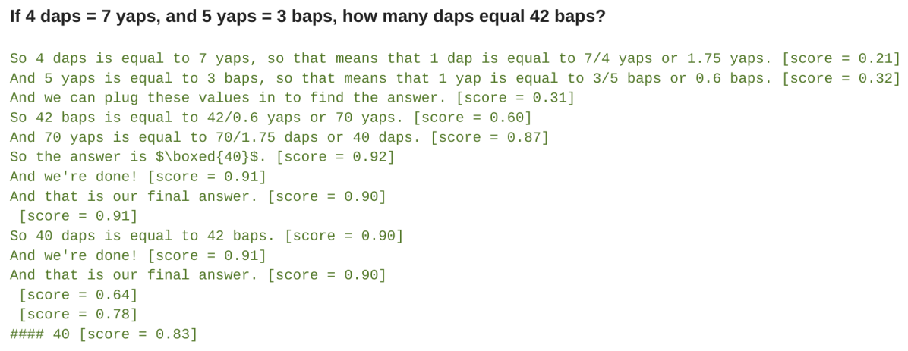

*图 29（原文 Figure 29，附录 M，第 37 页）：PRM beam search 样例 6，每一步后面的方括号是该步的 PRM 分数（0 到 1）。*

**图中文字翻译与读法**：

- 题目（图 5 同一道玩具题）：If 4 daps = 7 yaps, and 5 yaps = 3 baps, how many daps equal 42 baps?（若 4 daps = 7 yaps，5 yaps = 3 baps，42 baps 等于多少 daps？）解答先换算：1 dap = 7/4 yaps（分数 0.21），1 yap = 3/5 baps（0.32），再代入（0.31）；42 baps = 42/0.6 = 70 yaps（0.60）；70 yaps = 70/1.75 = 40 daps（0.87）；写出 boxed 答案 40（0.92）。
- 答案 40 是对的，但此后解答继续输出 “And we're done!”“And that is our final answer.” “So 40 daps is equal to 42 baps.” 这类没有信息量的重复步骤，PRM 对它们一直给 0.90–0.91 的高分，最后几步有 0.64、0.78，整体收尾为 “#### 40 [score = 0.83]”。
- **读图结论**：这是搜索“利用” PRM 的具体表现：为了保持高 PRM 分数，解答被拖长到无意义的重复。正文把它作为搜索收益递减的证据之一。

### 5.5 compute-optimal 搜索

既然最优搜索策略随难度和预算而变，就为每一个难度档取该预算下表现最好的搜索设置，得到“compute-optimal”曲线（图 4）。

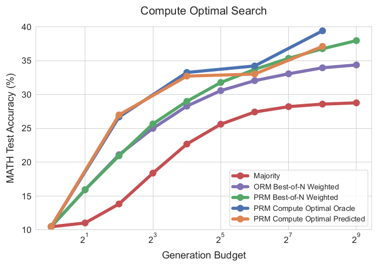

*图 4（原文 Figure 4，第 10 页）：按题目难度分配搜索策略，对比 PRM best-of-N、ORM best-of-N 与多数投票。*

**图中文字翻译与读法**：

- 标题 Compute Optimal Search（最优分配的搜索）；横轴 Generation Budget（对数刻度 $2^1$ 到 $2^9$），纵轴 MATH Test Accuracy（%）。图例：Majority（多数投票）、ORM Best-of-N Weighted、PRM Best-of-N Weighted、PRM Compute Optimal Oracle（用真值难度分桶）、PRM Compute Optimal Predicted（用 PRM 预测的难度分桶）。
- **读图结论**：见下表。

| 生成预算 | Majority | ORM best-of-N weighted | PRM best-of-N weighted | PRM compute-optimal（oracle） | PRM compute-optimal（predicted） |
|---|---:|---:|---:|---:|---:|
| 1 | 10.5 | 10.5 | 10.5 | 10.5 | 10.5 |
| 2 | 11.0 | 15.9 | 15.9 | - | - |
| 4 | 13.8 | 21.1 | 20.9 | 26.7 | 27.0 |
| 8 | 18.4 | 25.0 | 25.7 | - | - |
| 16 | 22.7 | 28.3 | 29.0 | 33.3 | 32.7 |
| 32 | 25.6 | 30.6 | 31.8 | - | - |
| 64 | 27.4 | 32.1 | 33.7 | 34.2 | 33.0 |
| 128 | 28.2 | 33.1 | 35.3 | - | - |
| 256 | 28.6 | 34.0 | 36.8 | 39.4 | 37.1 |
| 512 | 28.8 | 34.4 | 38.0 | - | - |

表 5：图 4 的 MATH 测试准确率（%），读自原图矢量数据点，保留一位小数；compute-optimal 只在预算 1、4、16、64、256 处有数据点（搜索设置的预算上限为 256）。

**读表 5**：低预算下，两种分桶的 compute-optimal 都明显高于 PRM best-of-N：预算 4 时 26.7%/27.0% 对 20.9%；预算 16 时 oracle 为 33.3%、predicted 为 32.7%，而 PRM best-of-N 要到预算 64 才达到 33.7%，所以是“用 16 个生成接近 64 个生成的 best-of-N”，约 4 倍节省，但只是**接近**。高预算时，predicted 分桶的优势缩小（预算 64 处 33.0%，预算 256 处 37.1%，与 best-of-N 的 33.7% 和 36.8% 接近），而 oracle 分桶仍继续改善（预算 256 处 39.4%，已高于 best-of-N 在预算 512 处的 38.0%）。ORM best-of-N 在预算很小时与 PRM 相当（预算 4 处 21.1 对 20.9，略高），预算 8 起一直低于 PRM best-of-N，差距随预算增大；多数投票最低。

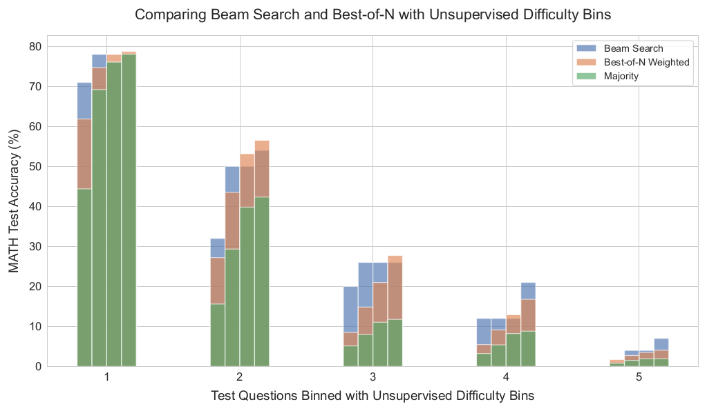

*图 12（原文 Figure 12，附录 C，第 23 页）：用 PRM 预测的难度分桶（无需真值）重画图 3 右图。*

**图中文字翻译与读法**：标题 Comparing Beam Search and Best-of-N with Unsupervised Difficulty Bins（用无监督难度档比较 beam search 与 best-of-N）；横轴 Test Questions Binned with Unsupervised Difficulty Bins（测试题按无监督难度档分组，1–5），纵轴 MATH Test Accuracy（%）；每档四组柱对应预算 4、16、64、256，蓝为 Beam Search、橙为 Best-of-N Weighted、绿为 Majority。**读图结论**：整体趋势与图 3 右图（真值难度档）相似：易档上 beam 的优势随预算增大消失，较难的档上 beam 更占优，最难的第 5 档几乎都接近 0。原文的结论是“预测分桶与真值分桶表现出相似的趋势”。

**搜索路线小结**（原文 Takeaways）：任何验证器搜索方法的效果，都严重依赖预算和题目。beam search 在更难的题和较低预算下更有效，best-of-N 在更简单的题和较高预算下更有效；按难度和预算选择最合适的搜索设置，可以用最多约 4 倍更少的测试时算力接近甚至超过 best-of-N。

## 六、路线二：用修订改进提议分布

只提示现成的 LLM 去修正自己的错误，在推理题上基本没有收益（Huang et al.）。所以作者借鉴 Qu et al. 的做法，对模型做微调，让它能顺序地基于自己之前的尝试再次作答。

### 6.1 修订模型的训练数据

微调需要“若干个错误答案，后面跟一个正确答案”的轨迹，并且希望正确答案与上下文里的错误答案**相关**：这样模型学到的是“识别上下文里的错误并做修改”，而不是“无视上下文、从头再来”。

- **数据来源**：Qu et al. 的 on-policy 多轮 rollout 在作者的基础设施上成本太高，所以作者改为在较高温度下**并行采样 64 个回答**，事后用这些独立样本拼出多轮轨迹。
- **配对方式**（附录 H）：先滤掉没有有效最终答案的回答；对每个正确答案，在 $0$ 到 $4$ 之间均匀随机取一个数，表示放几个错误答案在上下文；正确答案作为轨迹的最后一个答案，也是训练要产出的目标；如果取的数大于 0，就用**字符级编辑距离**找出与这个正确答案最接近的错误答案，作为上下文里最后一个错误答案；其余错误答案从可用样本中随机抽取；错误答案不足 4 个时，把均匀分布的上界截到可用数量。编辑距离不是相关性的完美度量，但作者发现它足以让上下文里的错误答案与目标正确答案相关，训练出有意义的修订模型，而不是把错误和正确答案随机配对。
- **训练**：对这些轨迹里的正确答案做监督微调；修订模型的超参数见 6.7 节的表 8。检查点的选取很特别：验证损失不能指示修订能力（验证集相对模型自身是 off-policy 数据），作者发现在验证损失开始上升很久之后的检查点修订能力反而更强，因此选择“刚过过拟合点一点”的检查点。

### 6.2 推理时怎么用修订模型

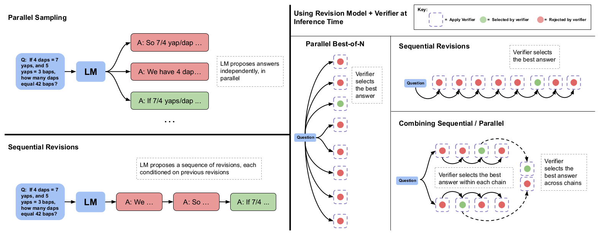

*图 5（原文 Figure 5，第 11 页）：左，并行采样与顺序修订；右，推理时把修订模型与验证器结合的三种方式。*

**图中文字翻译与读法**：

- **左上 Parallel Sampling（并行采样）**：问题 Q: If 4 daps = 7 yaps, and 5 yaps = 3 baps, how many daps equal 42 baps?（玩具题）输入 LM，LM 独立地并行提出多个答案（A: So 7/4 yap/dap …；A: We have 4 dap…；A: If 7/4 yaps/dap …），旁注 LM proposes answers independently, in parallel（LM 独立并行地提出答案）。
- **左下 Sequential Revisions（顺序修订）**：同一个问题，LM 先给出第一个答案（A: We …），再基于它给出修订（A: So …），再修订（A: If 7/4 …）；旁注 LM proposes a sequence of revisions, each conditioned on previous revisions（LM 提出一串修订，每个都以前面的修订为条件）。红色是被拒绝的答案，绿色是被选中的。
- **右 Using Revision Model + Verifier at Inference Time（推理时使用修订模型加验证器）**：Parallel Best-of-N（并行 best-of-N）：一个问题发出多条并行答案，验证器选最好的（Verifier selects the best answer）；Sequential Revisions（顺序修订）：同一条链上依次修订，验证器在整条链里选最好的；Combining Sequential / Parallel（并行顺序组合）：问题发出多条链，验证器先在每条链内选最好答案（Verifier selects the best answer within each chain），再在链间选最好（Verifier selects the best answer across chains）。图例：紫色虚线框 Apply Verifier，绿色 Selected by verifier，红色 Rejected by verifier。
- **读图结论**：并行采样是“全局搜索”，顺序修订是“局部精修”，预算可以在两者之间任意切分，这是后面“顺序/并行比例”实验的框架。

推理时的要点：

- **链的长度**：修订模型训练时上下文里只放最多 4 个之前的答案；测试时若想采样更长的链，就把上下文截断为最近 4 个修订。
- **分布偏移**：训练时上下文里只有错误答案，但测试时上下文里可能出现正确答案，这时模型可能无意中把正确答案改错。作者发现与 Qu et al. 相似，用朴素方式时约 **38%** 的正确答案会在后续修订里被改回错误。所以不能直接取链上最后一个答案，而是用**顺序多数投票**或**基于验证器的选择**从整条修订链里选最佳答案。
- **验证器**：基于基础模型训练的 PRM 用在修订模型的输出上不如专门训练的 ORM 有效（图 15 左，原文归因于分布偏移）；作者没有为修订模型再训练 PRM（逐步标注成本高），而是单独训练了一个 **ORM**，并在其上下文里放入之前的修订，使验证器与修订模型看到相同的上下文（附录 J）。
- **选择机制**（附录 I）：用验证器时采用分层策略：先在每条修订链内做 best-of-N weighted，选出该链的最佳答案；再对各链的最佳答案做第二轮 best-of-N weighted，得到最终答案。用多数投票时不分层：因为样本太少时分层多数投票选不好，所以直接把所有链上的所有答案放在一起取多数；这样的扩展曲线也平滑得多。

### 6.3 顺序修订确实在逐步改进

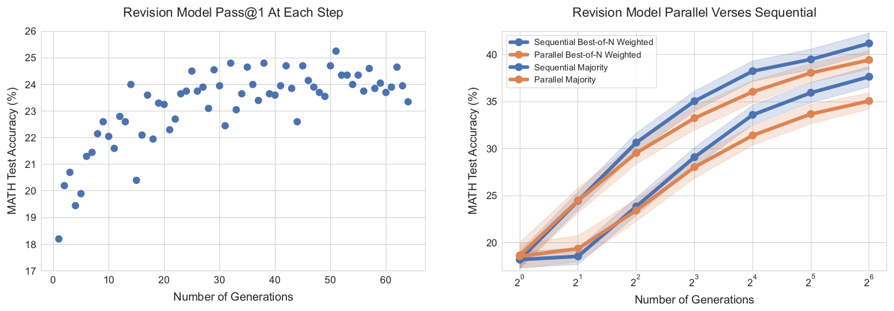

*图 6（原文 Figure 6，第 12 页）：左，修订模型在每个修订步的 pass@1；右，从修订模型顺序采样与并行采样的对比。*

**图中文字翻译与读法**：

- **左图 Revision Model Pass@1 At Each Step（修订模型每一步的 pass@1）**：横轴 Number of Generations（生成数，这里是修订链上的第几步，1–64），纵轴 MATH Test Accuracy（%，约 17–26）。每个点是该步的 pass@1，估计方法是：对测试集每题采样 4 条长度为 64 的修订轨迹再取平均。
- **右图 Revision Model Parallel Verses Sequential（修订模型：并行对顺序）**：横轴 Number of Generations（$2^0$ 到 $2^6$），纵轴 MATH Test Accuracy（%）。蓝色是 Sequential（顺序生成 N 次修订），橙色是 Parallel（并行生成 N 个初始答案）；上面一组是用验证器选择（Best-of-N Weighted），下面一组是多数投票（Majority）；阴影为误差带。
- **读图结论（读自原图数据点）**：左图中 pass@1 从第 1 步的 18.2% 逐渐升高，25 步之后在约 22.5%–25.3% 之间波动，**超过了训练时见过的 4 步**，说明模型确实学会了从上下文里的错误中改进。右图中，从 $2^2$ 个生成起，验证器选择与多数投票两种选择方式下顺序都**略优于**并行：$2^4$ 个生成处，验证器选择为 38.3% 对 36.1%，多数投票为 33.6% 对 31.4%；$2^6$ 个生成处，验证器选择为 41.2% 对 39.4%，多数投票为 37.7% 对 35.1%。

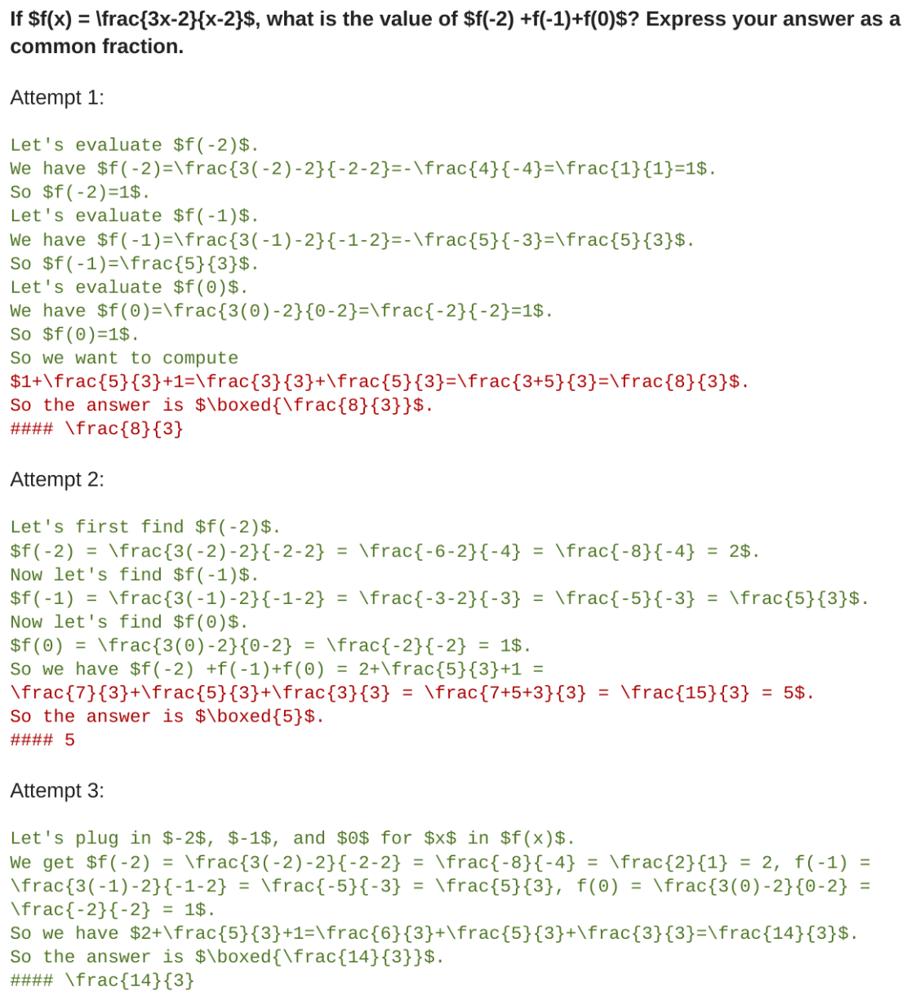

*图 17（原文 Figure 17，附录 L，第 29 页）：修订模型样例 1。原文图题：前两次在最后求和时算错，第三次算对。*

**图中文字翻译与读法**：

- 题目：设 $f(x)=\frac{3x-2}{x-2}$，求 $f(-2)+f(-1)+f(0)$ 的值，答案写成最简分数。
- **Attempt 1（第 1 次尝试）**：把 $f(-2)$ 算成 1（应为 $\frac{-8}{-4}=2$），最后求和还把 $1+\frac53+1$ 写成 $\frac33+\frac53=\frac83$，答案 $\frac83$。
- **Attempt 2**：$f(-2)=2$ 对了，$f(-1)=\frac53$、$f(0)=1$ 也对，但求和时把 2 写成 $\frac73$，得到 $\frac{15}{3}=5$，答案 5。
- **Attempt 3**：$2+\frac53+1=\frac63+\frac53+\frac33=\frac{14}{3}$，答案 $\frac{14}{3}$，正确。
- **读图结论**：修订模型能保留已经做对的步骤（例如第 2 次保留了前两个函数值），只针对错误的地方改动，这正是 6.1 里“让错误答案与目标答案相关”想教会模型的行为。原文附录 L 共有 7 个这类样例（图 17–23），错误类型包括：求和算错、解题方向选错、最终答案格式有误、进制转换出错、直角坐标转极坐标出错、求真因数之和出错、分数加法算错；本文只选图 17。

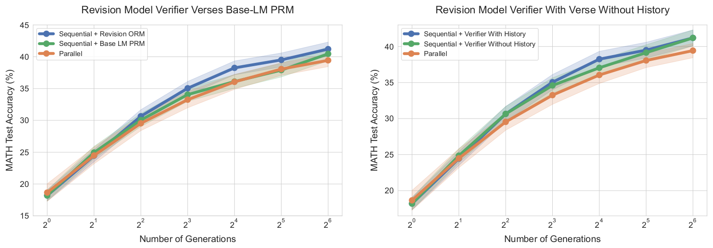

*图 15（原文 Figure 15，附录 J，第 27 页）：左，在修订模型输出上，比较专门训练的 ORM 与基础模型 PRM；右，验证器上下文里是否放入之前的修订。*

**图中文字翻译与读法**：

- **左图 Revision Model Verifier Verses Base-LM PRM（修订模型验证器对比基础模型 PRM）**：横轴 Number of Generations（$2^0$ 到 $2^6$），纵轴 MATH Test Accuracy（%）。蓝线 Sequential + Revision ORM（顺序修订，用专门的修订 ORM 选择），绿线 Sequential + Base LM PRM（顺序修订，用基础模型 PRM 选择），橙线 Parallel（并行）。
- **右图 Revision Model Verifier With Verse Without History（修订模型验证器：有对无修订历史）**：蓝线 Sequential + Verifier With History（验证器上下文含修订历史），绿线 Sequential + Verifier Without History（不含），橙线 Parallel。
- **读图结论（读自原图数据点）**：左图中专门训练的修订 ORM 在中大预算下高于基础模型 PRM：16 个生成处 38.3% 对 36.1%，而基础模型 PRM 与并行（36.1%）几乎相同；64 个生成处 41.2% 对 40.5%（并行 39.4%）。原文说明这很可能是分布偏移所致。右图中，有修订历史略好（16 个生成处 38.3% 对 37.1%）；去掉历史后顺序仍略优于并行（37.1% 对 36.1%），说明顺序修订的好处并不只是因为验证器看到了上下文。

### 6.4 顺序与并行：存在最优比例，且随难度变化

顺序和并行有不同性质：并行采样像**全局搜索**，原则上能覆盖完全不同的解法；顺序采样像**局部精修**，适合已经大致在正确方向上的回答。两者互补，所以应该把预算在两者之间切分，例如 $\sqrt N$ 条并行链、每条 $\sqrt N$ 步修订。

**怎么读比例**：图 7 的横轴“Sequential/Parallel Ratio”，原文没有给出公式；从图上各点的横坐标可以验证，它是：把预算 $N$ 拆成 $P$ 条并行链、每条链 $L$ 步顺序修订（$N=P\times L$），则比例 $=L/P=L^2/N$。例如预算 128 的八个点依次是 $L=1,2,4,\dots,128$，比例为 $2^{-7},2^{-5},\dots,2^{7}$：最左是全并行（128 条链、每条 1 步），最右是全顺序（1 条链、128 步），比例 1 表示 $\sqrt N$ 条链、每条 $\sqrt N$ 步。

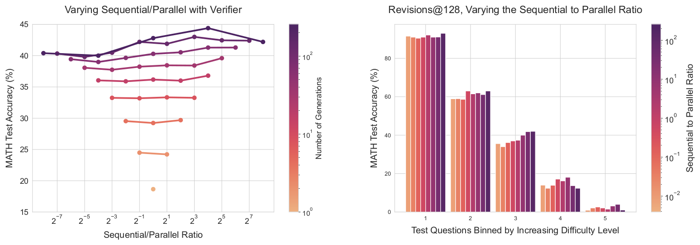

*图 7（原文 Figure 7，第 13 页）：左，用验证器选答案时，固定生成预算下改变顺序与并行的比例；右，预算 128 下按难度档分别改变该比例。*

**图中文字翻译与读法**：

- **左图 Varying Sequential/Parallel with Verifier（用验证器，改变顺序/并行比例）**：横轴 Sequential/Parallel Ratio（顺序/并行比例，对数刻度 $2^{-7}$ 到 $2^{7}$ 以上），纵轴 MATH Test Accuracy（%），颜色条 Number of Generations（生成数，对数刻度，下端为 1，上端略高于 $10^2$，最大预算 256）。每条线对应一个固定的生成预算，沿线从左到右比例从“全并行”变为“全顺序”。
- **右图 Revisions@128, Varying the Sequential to Parallel Ratio（预算 128 的修订，改变顺序/并行比例）**：横轴 Test Questions Binned by Increasing Difficulty Level（按难度从低到高分五档），纵轴 MATH Test Accuracy（%），颜色条 Sequential to Parallel Ratio（$10^{-2}$ 到 $10^{2}$）；每档 8 根柱，从浅到深比例由小到大（依次为 $2^{-7},2^{-5},\dots,2^{7}$）。
- **左图读法（读自原图数据点）**：预算 16 及以下基本是平的，比例影响很小（预算 8 处四个点都在 33.2%–33.3%）；预算越大，偏向顺序的一侧越高。预算 128 处：纯并行（比例 $2^{-7}$）为 40.3%，在比例 $2^{3}$ 处最高 43.0%，纯顺序（比例 $2^{7}$）为 42.4%；预算 256 处：纯并行 40.4%，比例 $2^{4}$ 处最高 44.4%（约 4 条链、每条 64 步），纯顺序 42.2%。原文表述：同一生成预算下，增加顺序修订通常优于增加并行计算，但在较高预算下存在一个折中两者的最优比例。

| 难度档（题数） | $2^{-7}$（全并行） | $2^{-5}$ | $2^{-3}$ | $2^{-1}$ | $2^{1}$ | $2^{3}$ | $2^{5}$ | $2^{7}$（全顺序） |
|---|---:|---:|---:|---:|---:|---:|---:|---:|
| 1（100 题） | 91.6 | 91.0 | 90.5 | 91.0 | 92.1 | 91.0 | 91.1 | 93.0 |
| 2（100 题） | 58.9 | 59.0 | 58.7 | 63.0 | 61.5 | 62.0 | 61.1 | 63.0 |
| 3（100 题） | 35.6 | 34.0 | 36.2 | 37.0 | 37.4 | 40.0 | 41.9 | 42.0 |
| 4（105 题） | 14.0 | 12.4 | 13.9 | 17.1 | 16.2 | 18.1 | 13.7 | 12.4 |
| 5（95 题） | 0.9 | 2.1 | 2.6 | 2.1 | 1.5 | 3.2 | 4.0 | 1.1 |

表 6：图 7 右图（预算 128，验证器选择）各难度档在不同顺序/并行比例下的 MATH 准确率（%），读自原图矢量数据点，保留一位小数；列头是比例。

**读表 6**：第 1 档几乎不受比例影响，全顺序略高（93.0%）；第 2 档偏顺序一侧（比例不低于 $2^{-1}$，61.1%–63.0%）比偏并行一侧（58.7%–59.0%）高约 2–4 个点；第 3 档总体随顺序比例增大而升高（仅第二个点略有回落），从 35.6% 到全顺序的 42.0%；第 4 档在中间比例最高（比例 $2^{3}$ 处 18.1%），两端更低（全并行 14.0%，全顺序 12.4%）；第 5 档在 1%–4% 之间，没有规律。原文表述：简单题在全顺序时达到最好表现，较难的题存在最优的顺序/并行比例。

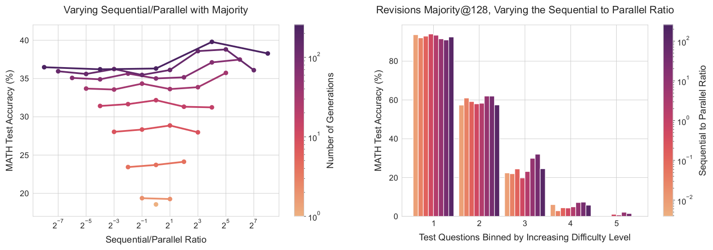

*图 10（原文 Figure 10，附录 B，第 22 页）：与图 7 相同的实验，但用多数投票而非验证器选答案。*

**图中文字翻译与读法**：左图 Varying Sequential/Parallel with Majority（用多数投票，改变顺序/并行比例）；右图 Revisions Majority@128, Varying the Sequential to Parallel Ratio（预算 128 的修订，多数投票，改变比例）；坐标与颜色条含义同图 7。**读图结论**：与验证器选择时相似，同一预算下存在最优比例：预算 256 处纯并行 36.5%，比例 $2^{4}$ 处最高 39.8%，纯顺序 38.3%（读自原图数据点）。按难度看，容易的题对比例基本不敏感，较难的题存在最优比例（第 3 档在偏顺序一侧最好，最高约 32%；第 4 档最高约 7%，也在偏顺序一侧）。原文只给出定性结论。

### 6.5 compute-optimal 修订

既然顺序/并行的最优比例随难度档变化，就为每个难度档选最优比例（同样用两折交叉验证），得到 compute-optimal 修订曲线（图 8）。

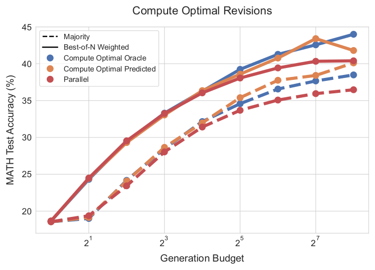

*图 8（原文 Figure 8，第 13 页）：按难度分配修订的顺序/并行比例，对比纯并行基线。*

**图中文字翻译与读法**：

- 标题 Compute Optimal Revisions（最优分配的修订）；横轴 Generation Budget（$2^0$ 到 $2^8$），纵轴 MATH Test Accuracy（%）。线型：实线是 Best-of-N Weighted（验证器选择），虚线是 Majority（多数投票）。颜色：蓝 Compute Optimal Oracle（真值难度分桶）、橙 Compute Optimal Predicted（预测难度分桶）、红 Parallel（纯并行基线）。
- **读图结论**：见下表。

| 生成预算 | 验证器选择：Parallel | 验证器选择：oracle | 验证器选择：predicted | 多数投票：Parallel | 多数投票：oracle | 多数投票：predicted |
|---|---:|---:|---:|---:|---:|---:|
| 1 | 18.7 | 18.7 | 18.7 | 18.6 | 18.6 | 18.6 |
| 2 | 24.5 | 24.3 | 24.4 | 19.4 | 19.0 | 19.1 |
| 4 | 29.5 | 29.4 | 29.3 | 23.4 | 24.2 | 24.1 |
| 8 | 33.3 | 33.3 | 33.0 | 28.0 | 28.5 | 28.7 |
| 16 | 36.1 | 36.3 | 36.4 | 31.4 | 32.2 | 32.0 |
| 32 | 38.1 | 39.2 | 38.6 | 33.7 | 34.6 | 35.4 |
| 64 | 39.4 | 41.3 | 40.8 | 35.1 | 36.6 | 37.8 |
| 128 | 40.3 | 42.6 | 43.4 | 35.9 | 37.7 | 38.4 |
| 256 | 40.4 | 44.0 | 41.8 | 36.5 | 38.5 | 40.1 |

表 7：图 8 的 MATH 测试准确率（%），读自原图矢量数据点，保留一位小数；“oracle”“predicted”即 compute-optimal 在真值与预测难度分桶下的结果。

**读表 7**：预算 8 及以下，三种做法几乎相同；之后 compute-optimal 逐渐拉开，而并行基线在预算 128 到 256 处进入平台（40.3%、40.4%）。验证器选择下，oracle 分桶在预算 64 处为 41.3%，已高于并行在预算 256 处的 40.4%；predicted 分桶在预算 64 处为 40.8%，同样略高于 40.4%。这就是原文的“用最多 4 倍更少的测试时算力（64 对 256）超过 best-of-N”。oracle 在预算 256 处为 44.0%；predicted 在预算 128 处为 43.4%，在最右端回落到 41.8%（原文没有解释）。多数投票的趋势相同：预算 256 处 38.5%/40.1% 对 36.5%。

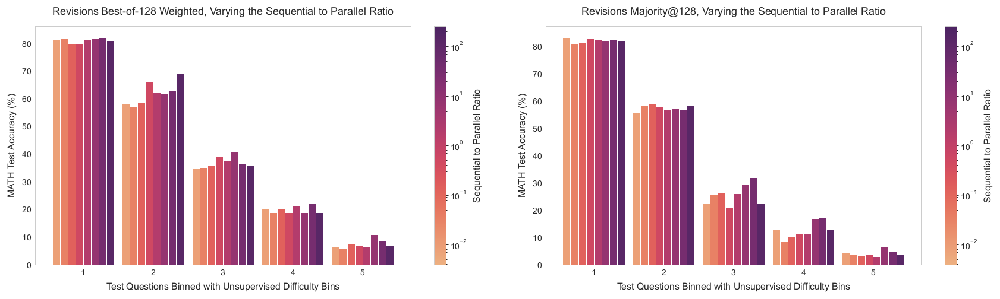

*图 11（原文 Figure 11，附录 C，第 23 页）：用 PRM 预测的难度分桶（无需真值）重画图 7 右图与图 10 右图。*

**图中文字翻译与读法**：左图 Revisions Best-of-128 Weighted, Varying the Sequential to Parallel Ratio（预算 128，验证器选择，改变比例），右图 Revisions Majority@128（预算 128，多数投票）；横轴 Test Questions Binned with Unsupervised Difficulty Bins（按无监督难度档分组，1–5），纵轴 MATH Test Accuracy（%），颜色条为顺序/并行比例。**读图结论**：整体趋势与真值难度档下的图 7、图 10 相近：容易的档对比例不敏感，较难的档存在中间最优比例。原文的结论同样是“预测分桶与真值分桶表现出相似的趋势”。

**修订路线小结**（原文 Takeaways）：顺序（修订）与并行（标准 best-of-N）的测试时计算之间存在权衡，理想的比例严重依赖预算与具体题目：较容易的题受益于纯顺序计算，较难的题通常在某个顺序/并行比例处最好；按难度选最优设置，可以用最多约 4 倍更少的测试时算力超过并行 best-of-N 基线。

### 6.6 一个失败的尝试：用 ReSTEM 进一步优化修订模型

作者还尝试用简化的 RL 算法 ReSTEM 进一步优化修订模型：在 MATH 训练集上对每题生成 64 条最长 5 步的修订轨迹，在第一次答对时停止；用这些数据中的正确答案微调基础 LM，并显式平衡轨迹长度分布。

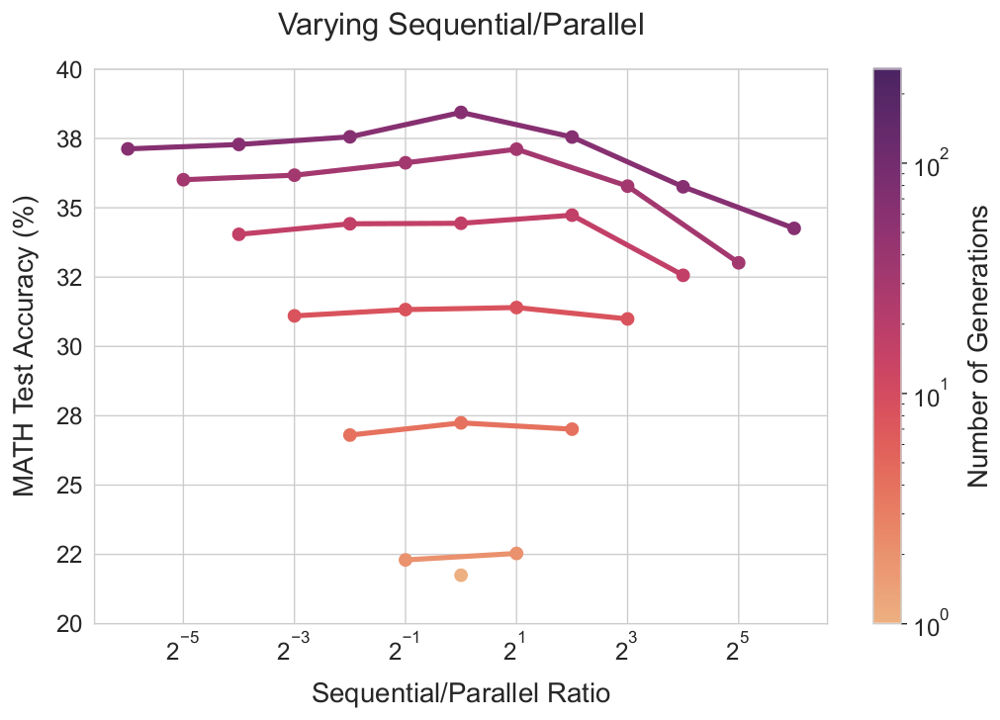

*图 16（原文 Figure 16，附录 K，第 28 页）：用 ReSTEM 优化的修订模型，改变顺序/并行比例（多数投票选答案）。*

**图中文字翻译与读法**：标题 Varying Sequential/Parallel（改变顺序/并行）；横轴 Sequential/Parallel Ratio（$2^{-5}$ 到 $2^{5}$ 附近），纵轴 MATH Test Accuracy（%），颜色条 Number of Generations（对数刻度，下端为 1，上端略高于 $10^2$；图中实际画出的最大预算为 64）。**读图结论**：预算最大的那条线（64 个生成，共 7 个点）在比例 1 处最高（38.4%），向全顺序一端明显下降（比例 $2^{6}$ 处 34.3%），向全并行一端为 37.1%（读自原图数据点）。与图 7 左图的趋势相反：更多顺序修订**大幅损害**性能。作者推测原因是 ReSTEM 的在线数据加剧了修订数据里的伪相关，使模型没能学会修订任务；认为像 Qu et al. 那样更离线的数据收集可能更有效，留给未来。

### 6.7 训练与实现细节汇总

| 项目 | PRM | 修订模型 |
|---|---|---|
| 初始化 | PaLM 2-S\* 基础模型 | PaLM 2-S\* 基础模型 |
| 训练数据 | 每题 16 个少样本采样的解答；每步 16 次 Monte Carlo rollouts 得软标签；过滤无可解析最终答案的样本 | 每题 64 个高温并行采样；对每个正确答案配 0–4 个错误答案做上下文；过滤无效最终答案 |
| 训练目标 | 二元交叉熵（软标签 $y$） | 对轨迹中的正确答案做监督微调 |
| 优化器 | AdamW，学习率 3e-5，batch size 128，dropout 0.05，Adam betas (0.9, 0.95) | AdamW，学习率 1e-5，batch size 128，dropout 0.0，Adam betas (0.9, 0.95) |
| 选检查点 | 验证损失最低（验证集为 PRM800K 训练划分中随机 10% 的题） | 验证损失开始上升（过拟合）之后一点的检查点 |
| 配套验证器 | PRM 自身，聚合用最后一步 | 单独训练的 ORM，上下文含之前的修订，其余训练细节与 PRM 相同 |

表 8：PRM 与修订模型的训练细节（整理自原文附录 D、H、J，第 22、25–27 页）。

## 七、预训练算力与测试时算力的交换

### 7.1 问题

设一个模型预训练用了 $X$ FLOPs，计划部署后再做 $Y$ FLOPs 的推理。若想把总 FLOPs 预算扩大到 $M(X+Y)$，应该把额外算力花在更多预训练上，还是花在测试时计算上？

预训练还要决定是增加数据还是增加参数。作者只研究“**数据量不变、放大参数**”（类似 LLaMA 系列的做法），因为这是扩大预训练算力的典型做法；数据与参数同比例放大的 compute-optimal 预训练留给未来。

### 7.2 FLOPs 汇率的推导

用常见近似：预训练 $X=6ND_{\text{pretrain}}$（Hoffmann et al.），推理 $Y=2ND_{\text{inference}}$（Sardana and Frankle）。$N$ 是模型参数量，$D_{\text{pretrain}}$ 是预训练 token 数，$D_{\text{inference}}$ 是推理时生成的 token 总数。

把参数量乘以 $M$，则预训练 FLOPs 和（贪心解码的）推理 FLOPs 都乘 $M$，总计 $M(X+Y)$。若保持小模型，用测试时计算把总 FLOPs 补到同样的量，就要把小模型的推理计算乘以因子 $K$，使 $X+KY=M(X+Y)$。解得原文给出的因子：

$$
K=M+3\,\frac{D_{\text{pretrain}}}{D_{\text{inference}}}\,(M-1)=M+\frac{3(M-1)}{R},\qquad R=\frac{D_{\text{inference}}}{D_{\text{pretrain}}}.
$$

（推导：由 $X+KY=M(X+Y)$ 得 $K=M+(M-1)X/Y$，再代入 $X/Y=3D_{\text{pretrain}}/D_{\text{inference}}$ 就是第一个等号；第二个等号只是把 $D_{\text{pretrain}}/D_{\text{inference}}$ 写成 $1/R$。）所以小模型能用多少测试时算力来抵消大模型，取决于 **推理 token 与预训练 token 之比 $R$**。原文对 $R$ 的取值有两类典型场景：大规模生产服务里推理 token 通常远多于预训练 token，$R\gg1$；而用测试时算力改进模型的自我提升（self-improvement）流程里，推理 token 远少于预训练 token，$R\ll1$。

### 7.3 实验：取 $R=0.16,\ 0.79,\ 22$

作者与参数量约 14 倍的预训练模型（原文未给出具体型号）比较，取三个 $R$：0.16（$R\ll1$）、0.79（$R\approx1$）、22（$R\gg1$），每个对应一个推理预算。取 $M\approx14$ 代入上式，可以算出小模型在三种 $R$ 下可用的推理计算倍数：

| $R$ | 场景 | 小模型可用的推理计算倍数 $K=14+39/R$ | 对应图 9 横轴 |
|---|---|---|---|
| 0.16 | $R\ll1$（推理负载很低） | 约 258 | $2^8=256$ |
| 0.79 | $R\approx1$ | 约 63 | $2^6=64$ |
| 22 | $R\gg1$（推理负载很高） | 约 16 | $2^4=16$ |

表 9：本文根据原文公式代入 $M\approx14$ 的计算，不是原文给出的表格；计算值与图 9 中竖直虚线所在位置吻合。

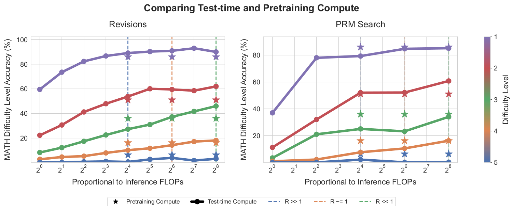

*图 9（原文 Figure 9，第 15 页）：每条线是某难度档上 compute-optimal 测试时扩展的准确率；星标是约 14 倍参数模型的贪心 pass@1。左，修订；右，PRM 搜索。*

**图中文字翻译与读法**：

- 总标题 Comparing Test-time and Pretraining Compute（比较测试时算力与预训练算力）；左子图 Revisions（修订），右子图 PRM Search（PRM 搜索）。横轴 Proportional to Inference FLOPs（与推理 FLOPs 成正比，$2^0$ 到 $2^8$，单位是小模型一次采样的计算量），纵轴 MATH Difficulty Level Accuracy（%）（该难度档上的准确率）。颜色条 Difficulty Level（难度档）1（紫，最易）到 5（蓝，最难）。
- 圆点实线（图例 Test-time Compute，测试时算力）：小模型在相应难度档上用 compute-optimal 策略随算力增长的准确率。星标（图例 Pretraining Compute，预训练算力）：约 14 倍参数模型的贪心解码准确率，被放在三条竖直虚线（图例 $R\gg1$ 蓝、$R\approx1$ 橙、$R\ll1$ 绿）所在的位置：$2^4$、$2^6$、$2^8$。
- **读法**：星在线**下方**，说明用测试时算力比放大参数更有效；星在线**上方**，说明放大参数更有效。

下表把图 9 的数据点整理出来：

| 难度档 | 14 倍模型贪心（星标） | 修订 $R\gg1$（$2^4$） | 修订 $R\approx1$（$2^6$） | 修订 $R\ll1$（$2^8$） | 搜索 $R\gg1$（$2^4$） | 搜索 $R\approx1$（$2^6$） | 搜索 $R\ll1$（$2^8$） |
|---|---:|---:|---:|---:|---:|---:|---:|
| 1（最易） | 86.0 | 89.1 | 90.9 | 90.0 | 79.3 | 84.7 | 85.2 |
| 2 | 51.0 | 53.8 | 59.5 | 62.0 | 52.0 | 52.1 | 60.7 |
| 3 | 36.0 | 27.3 | 37.3 | 46.0 | 25.0 | 23.2 | 34.0 |
| 4 | 16.2 | 10.2 | 14.3 | 18.1 | 7.6 | 10.5 | 16.2 |
| 5（最难） | 6.3 | 0.6 | 3.9 | 3.2 | 2.1 | 0.1 | 0.2 |

表 10：图 9 各难度档上的 MATH 准确率（%），读自原图矢量数据点，保留一位小数；星标取值为对应难度档上 14 倍模型的贪心准确率（两张子图中数值相同）。比较同一行里星标与各列，列值高于星标表示测试时算力更好。

从表 10 可见：

- 修订路线：第 1、2 档在三种 $R$ 下都高于星标；第 3 档只在 $R\ll1$ 明显高于星标（$R\approx1$ 基本持平）；第 4 档只在 $R\ll1$ 略高；第 5 档都低于星标。
- 搜索路线：第 2 档在 $R\ll1$ 明显高于星标（60.7 对 51.0），在另两个 $R$ 下仅高约 1–2 个点；第 3 档、第 5 档在所有 $R$ 下都不如星标；第 4 档仅在 $R\ll1$ 与星标打平；第 1 档略低于星标。

图 1 右列把同样的比较画成了柱状图，表 11 是柱上标注的数字：

| 设置 | 难度组 | $R\ll1$ | $R\approx1$ | $R\gg1$ |
|---|---|---:|---:|---:|
| 修订 | Easy | +21.6 | +16.7 | +5.4 |
| 修订 | Medium | +27.8 | +3.5 | -24.3 |
| 修订 | Hard | +11.8 | -11.9 | -37.2 |
| PRM 搜索 | Easy | +19.1 | +2.2 | +2.0 |
| PRM 搜索 | Medium | -5.6 | -35.6 | -30.6 |
| PRM 搜索 | Hard | 0.0 | -35.3 | -52.9 |

表 11（原文 Figure 1 右列，第 2 页，柱上标注逐一转录；数值是测试时算力的准确率相对于约 14 倍参数模型贪心准确率的相对提升，单位 %，正值表示测试时算力更好）。

原文没有说明 Easy、Medium、Hard 对应哪几个难度档。用表 10 的数据复算，星标取 51.0、36.0、16.2：例如修订、$R\ll1$ 时 $62.0/51.0-1\approx+21.6\%$、$46.0/36.0-1\approx+27.8\%$、$18.1/16.2-1\approx+11.7\%$；搜索、$R\approx1$ 时 $52.1/51.0-1\approx+2.2\%$、$23.2/36.0-1\approx-35.6\%$、$10.5/16.2-1\approx-35.2\%$。表 11 的 18 个数字都能这样复现（用表 10 取整后的数字复算，误差在 0.2 个百分点以内；用原图未取整的数据点则完全吻合），所以 Easy、Medium、Hard 对应的是难度档 2、3、4（本文复算得出，原文未明说）。

**原文的结论**（Takeaways）：测试时算力与预训练算力不是一比一可互换的。在简单和中等难度的题（在模型能力范围内）或推理需求很小时，测试时算力能很容易地弥补额外的预训练；但在具有挑战性的题（超出基础模型能力）或推理需求较高时，预训练更有效。

具体对应：如果预期遇到的大多是很难的题（难度档 4、5），或推理量很大（$R$ 很大），把预算用在预训练上通常更有效；如果大多是简单或中等难度的题（档 1、2、3，有时包括档 4），或推理要求较低（例如自我提升流程），用测试时算力更好。作者据此提出：与其只扩大预训练，在某些设定下，先预训练更小的模型再用测试时算力改进输出可能更有效；长远看，预训练的 FLOPs 可能变少、推理的 FLOPs 变多。

## 八、综合：按难度档选策略

下表把第五到七节的结论按难度档合并（综合表 4、表 6、表 10，定性结论）：

| 难度档 | 搜索路线：beam 与 best-of-N | 修订路线：顺序与并行（预算 128） | FLOPs 对齐对 14 倍模型 |
|---|---|---|---|
| 1–2（易） | 预算增大后 best-of-N 反超，beam 受 PRM 过度利用而退化 | 全顺序最好或持平 | 修订在所有 $R$ 下占优；搜索仅第 2 档占优（$R\ll1$ 时明显，另两个 $R$ 下仅高约 1–2 个点） |
| 3 | beam 总体更好（预算 64 处 best-of-N 略高） | 越偏顺序越好，全顺序最好 | 修订仅在 $R\ll1$ 明显占优；搜索不占优 |
| 4 | beam 持续更好 | 中间比例最好 | 修订仅在 $R\ll1$ 略占优；搜索仅 $R\ll1$ 持平 |
| 5（最难） | 几乎没有进展 | 几乎没有进展 | 都不如大模型 |

表 12：本文整理，不是原文表格。这张表是“按题选策略”的直观版本：没有一种策略在所有难度档都最优，也没有一种“算力换参数”的汇率对所有难度都成立。

## 九、讨论、局限与常见误读

### 9.1 原文第 8 节的讨论与局限

- **总体结论**：测试时算力的效果与基础 LLM 能力视角下的题目难度高度相关；compute-optimal 策略可以把测试时算力扩展的效率提高 2–4 倍；在 FLOPs 对齐的比较中，首次显示出用看似简单的方法（修订和搜索）在某些题上已经能比把同样的 FLOPs 花在预训练上更好。
- **进一步改进测试时算力扩展**：只研究了验证器和修订两种机制；虽然第六节把验证器与修订结合了，但没有试过把 PRM 树搜索与修订结合，也没有研究 critique-and-revise 等；而且这些方法在难题上提升都很小，需要新的方法来突破。
- **快速评估题目难度**：本文的难度估计本身就要用不少测试时算力；未来可以考虑更高效的估计（例如预训练或微调模型直接预测难度），或者在“评估难度”和“尝试解题”之间动态切换。
- **测试时与训练时算力的交织**：作者设想把测试时计算的输出蒸馏回基础 LLM，形成一个在开放自然语言上运行的迭代自我提升回路。

### 9.2 证据边界（读完需要记住的限定）

- **范围很窄**：只用了 MATH 和 PaLM 2-S\*；修订能力和验证能力都经过专门微调，不能认为普通聊天模型靠提示就能获得。
- **两条路线的起点不同**：搜索设定的基础模型是少样本提示的 PaLM 2-S\*（预算 1 时 10.5%），修订设定用的是微调后的修订模型（预算 1 时约 18.7%）；图 4 与图 8 的绝对准确率不能直接比较。
- **难度估计的成本没有计入**：真值难度要 2048 个样本加真值；预测难度要 2048 个样本加验证器打分，原文的实验都没有把这部分算进预算，也没有解决“如何便宜地判断难度”。
- **成本只统计采样数**：预算是基础模型采样的答案条数；原文没有单独计入 PRM/ORM 的打分开销。FLOPs 近似 $6ND$ 和 $2ND$ 也不含注意力的二次项和实际硬件效率（本条是本文的补充，不是原文说法）。
- **统计噪声**：测试集共 500 题，难度档每档约 100 题，所以单个点上 1–2 个百分点的差异不宜过度解读；原文图中的阴影带没有说明具体统计定义。
- **基线的选择**：图 8 与图 1 的基线是**纯并行**的 best-of-N；如果把“同一预算下最佳的单一顺序/并行比例”作为基线，难度自适应的增益在读数上很小：图 7 左图里预算 64、128、256 处的最佳单一比例分别为 41.3%、43.0%、44.4%，而表 7 中 oracle 分桶为 41.3%、42.6%、44.0%（前者是在测试集上直接取最大值，偏乐观，两者选择方式不同，有噪声；这是本文的读数对比，不是原文结论）。原文没有单独报告难度自适应相对于“最佳单一比例”的增益。
- **“4 倍”的措辞**：摘要写“more than 4×”，图 4 与图 8 的表述是“up to 4× less compute（例如 16 对 64、64 对 256）”，结论节写“2–4×”。引用时应以图示为准，并说明基线是 best-of-N、取自特定模型与策略集合。
- **选策略不是独立验证集**：compute-optimal 策略是在测试集的每个难度档内用两折交叉验证选出的，而不是在单独的验证集上选。

### 9.3 常见误读

- “推理算力比参数更有效”不成立：标题里的 can be more effective 要连同条件读，条件是题目在基础模型能力范围内，或推理负载小（$R$ 小）。题目很难或 $R\gg1$ 时，预训练更划算。
- “更复杂的搜索一定更好”不成立：lookahead 同预算下一般更差；beam 在易题和高预算下反而会被 PRM 的误差带偏。
- “顺序修订总比并行好”不成立：按难度而定。易题偏好顺序；较难题需要两者折中；最难题几乎都没有改善。而且用 ReSTEM 训练的修订模型上，更多顺序修订还会明显变差。
- “PRM 与 ORM 只是同一信号”不成立：即使只用 PRM 的最后一步，它也优于单独训练的 ORM，而且差距随样本数增大。
- “难度可以免费得到”不成立：分桶需要大量样本；原文的实验没有计入估计难度的成本，只是演示这种分配能做到什么。
- “修订等于提示模型自我检查”不成立：现成模型靠提示做自我纠错在推理题上通常无效，修订模型要用专门的数据微调；而且约 38% 的正确答案会被它改错，必须靠选择机制兜底。
- 最难题几乎无增益，是原文的实验观察；“测试时算力只能重排基础能力附近的概率质量、不能创造新知识”是读者常见的推断，**原文没有这样表述**，只是说这类方法在难题上提升都很小，需要新方法。

## 十、复现检查清单

- 数据：MATH 12k 训练 / 500 测试划分；4-shot 提示（PRM800K 第 1 阶段训练划分的 GPT-4 正确解答）；按换行切分步骤；用 Lightman et al. 的判分函数。
- PRM：每题 16 个样本、每步 16 次 rollouts 得到软标签，过滤没有可解析答案的样本；二元交叉熵；以 PRM800K 训练划分的 10% 题目作验证集早停（超参数见表 8）。
- 搜索：beam 最多 40 轮；预算按“样本数”计，lookahead 计 $N(k+1)$；最终都用 best-of-N weighted 选答案，整题分数用 PRM 最后一步。
- 修订模型：每题 64 个高温样本，上下文错误答案数在 $0$ 到 $4$ 之间均匀随机，用字符级编辑距离配对；测试时截断为最近 4 条；用刚过过拟合点的检查点；验证器是在修订输出上单独训练的、上下文里带修订历史的 ORM；分层选择（验证器）或全体多数（多数投票）。
- 难度：每题 2048 样本；oracle 与 predicted 分开报告，不能混用；每档两折交叉验证选策略。
- FLOPs：写明 $M$、$D_{\text{pretrain}}$、$D_{\text{inference}}$ 与 $R$；预算单位要明确到“样本数”还是“token 数”。
- 报告时同时给：基础模型的 pass@1、各难度档结果、各种基线（纯并行、纯顺序、混合、PRM 搜索），而不只是总体准确率。

## 十一、与相关论文的关系

- [Let's Verify Step by Step](../lets_verify_step_by_step/论文中文解读.md)：PRM 与 PRM800K 的来源。本文沿用它的 MATH 划分、基于模型的难度分桶和判分函数，但不用其人工标注，改用 Monte Carlo rollouts 训练 PRM，并发现“最后一步”聚合优于它采用的 min。
- [Self-Consistency](../self_consistency/论文中文解读.md)：多数投票是本文中不使用验证器的基线。
- [Tree of Thoughts](../tree_of_thoughts/论文中文解读.md)：本文 beam search 的实现类似 BFS-V（原文引用了 ToT 与 Feng et al.）。
- [Scaling Laws](../scaling_laws/论文中文解读.md)、[Chinchilla](../chinchilla/论文中文解读.md)：预训练 FLOPs 近似 $6ND$ 的来源；本文固定数据量、只放大参数，没有采用 Chinchilla 式的参数与数据同比例放大。
- [s1](../s1_test_time_scaling/论文中文解读.md)、[DeepSeek-R1](../deepseek_r1/论文中文解读.md)：后续工作让单个模型输出很长的推理链，把测试时计算内化到序列长度里；它们同样要面对“顺序（更长的链）与并行（多次采样）如何分配”和“按题目难度分配推理量”的问题，本文的框架可以作为阅读它们的参照。这是本文的定位，不是原文的论述。
- 与加速解码的关系：本文决定“为了答对该生成或搜索多少”，[Speculative Decoding](../speculative_decoding/论文中文解读.md) 之类方法降低“生成这些 token 的墙钟成本”，两者互补（本文的看法）。
- **原文附录 A 的相关工作**（第 21 页）：（1）语言模型数学推理的进步可归因于几类因素：在大量数学语料上继续预训练；改进提议分布（用 RL 风格的微调针对具体推理任务优化，或让模型批评并修订自己的答案）；微调验证器以便受益于额外的测试时算力。本文建立在后两类之上。（2）关于训练算力与测试时算力的权衡：Jones 曾在棋类游戏 Hex 上用 MCTS 研究；Villalobos 与 Atkinson 的综述多关注真值答案已知的设定，而本文关注真值未知的设定；RL 文献里 MCTS 等方法也在探索这种权衡以实现某种迭代自我博弈，本文的发现可以帮助在开放的自然语言上设计类似算法。（3）其他用测试时算力增强 LLM 的方法：分层假设搜索、工具增强、无监督地学习“思考 token”（如 pause token、Quiet-STaR）；原文认为按题目难度分配算力的思路原则上也适用于这些方法。

## 原文证据导航

- [原论文 PDF](paper.pdf)
- [原文提取文本](paper.txt)
- [论文概要](论文概要.md)

主要内容在 PDF 中的位置：第 2 节统一视角（第 3–4 页）；式 (1) 与第 3.2 节难度估计（第 5–6 页）；第 4 节实验设置（第 6 页）；第 5 节 PRM 训练、聚合与搜索（第 6–10 页，图 2 在第 8 页，图 3 在第 9 页，图 4 在第 10 页）；第 6 节修订模型（第 10–13 页，图 5–8）；第 7 节 FLOPs 交换（第 14–15 页，图 9）；第 8 节讨论（第 15–16 页）；附录 A 相关工作（第 21 页）、B 与 C 难度档（第 21–22 页）、D PRM 训练细节（第 22 页）、E–F 聚合与 ORM（第 24–25 页）、G 提示（第 25 页）、H–J 修订模型细节（第 25–27 页）、K ReSTEM（第 27 页）、L–M 样例（第 28–37 页）。
