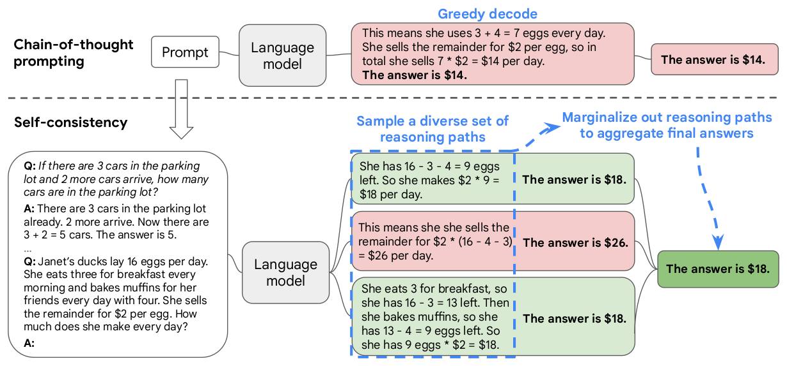
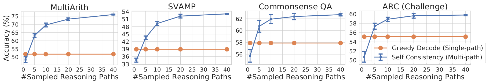
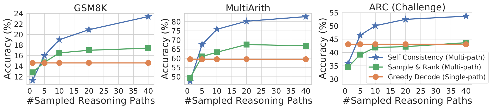
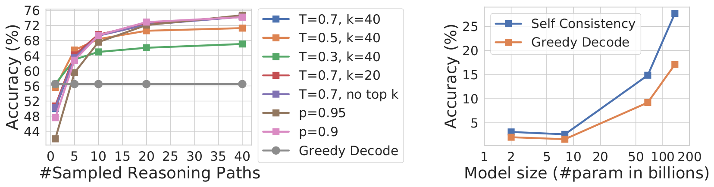
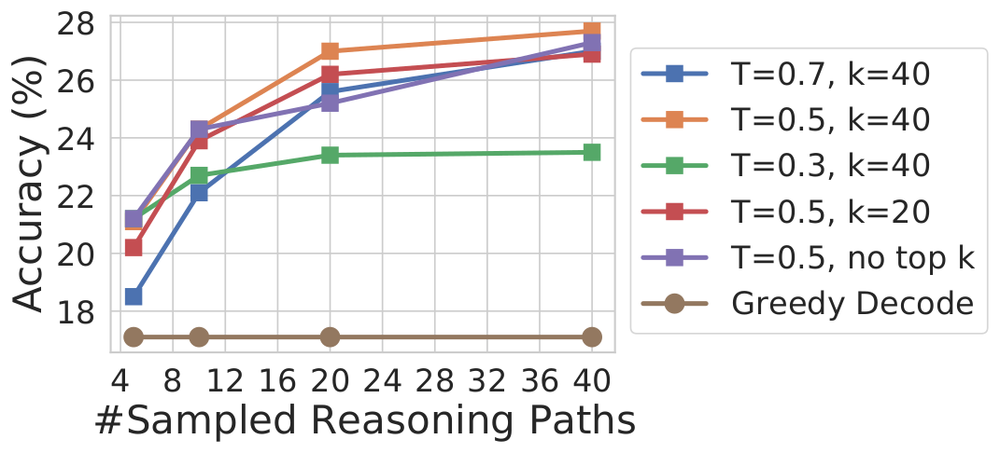
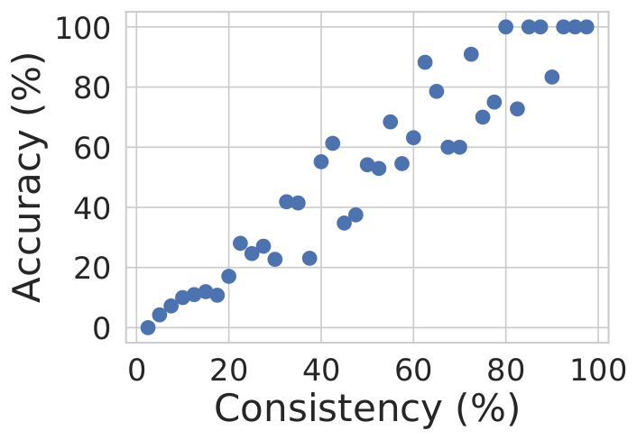
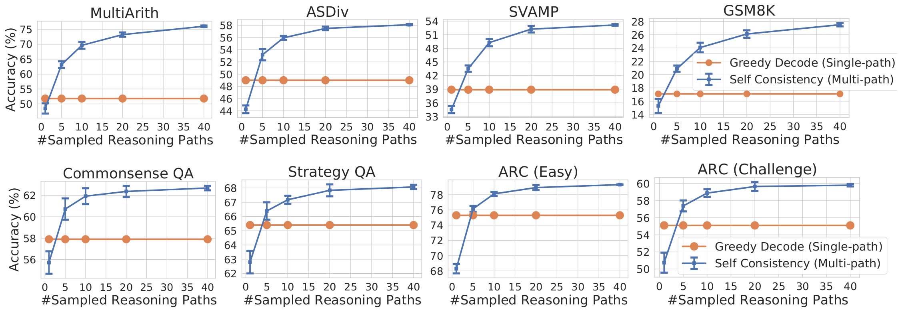
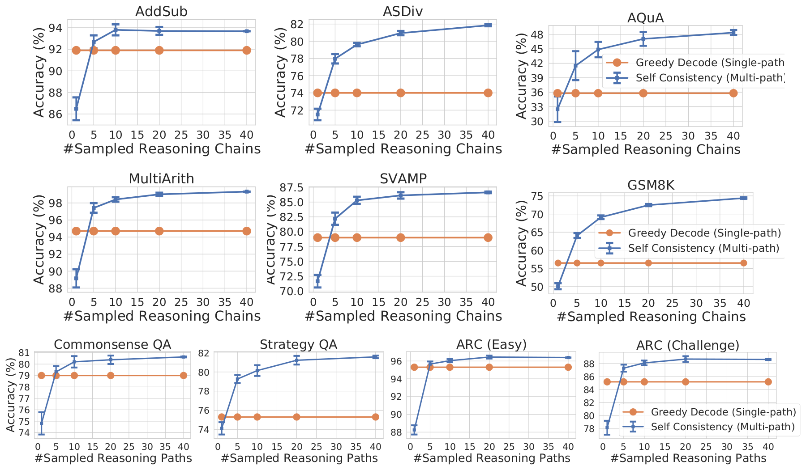

# 论文中文解读：《Self-Consistency Improves Chain of Thought Reasoning in Language Models》

> **基本信息**：Xuezhi Wang、Jason Wei、Dale Schuurmans、Quoc Le、Ed H. Chi、Sharan Narang、Aakanksha Chowdhery、Denny Zhou（Google Research, Brain Team），ICLR 2023，arXiv:2203.11171（本文依据 v4，2023 年 3 月）；论文原文 [官方页面](https://arxiv.org/abs/2203.11171)。
>
> **本文的读法**：图为从论文 PDF 中裁出的原图，表为逐格核对后的中文转录（数字与原文一致，表头和行名译成中文）。每张图、表前后都有中文图题、图例翻译和读法结论。附录里的 prompt 和示例输出只摘取关键的，其余用文字概括。文中标“读者注”的是整理者的补充理解，不是论文原话。前置阅读：[Chain-of-Thought 提示](../chain_of_thought/论文中文解读.md)。

## 一、一句话结论

Chain-of-thought（CoT，思维链）提示让模型先写推理再给答案，但通常用**贪心解码**，只走一条路径。本文提出 **self-consistency（自洽性）** 解码：CoT 提示保持不变，把贪心解码换成“采样加聚合”——先从模型的解码器里采样出一批**不同的**推理路径，再对这些路径的最终答案做边缘化（实际做法就是多数投票），选出最“一致”的那个答案。不训练、不加验证器、不需要额外标注。主要结论：

- 在四个模型（UL2-20B、GPT-3 的两个 code-davinci 引擎、LaMDA-137B、PaLM-540B）和多个算术、常识、符号推理基准上，自洽性都不低于贪心 CoT，绝大多数明显更高（只有 CoT 本身失效的少数格子增益为零，如 UL2-20B 和 LaMDA-137B 的末字母拼接）。摘要报告的绝对提升：GSM8K +17.9、SVAMP +11.0、AQuA +12.2、StrategyQA +6.4、ARC-challenge +3.9 个百分点；例如 PaLM-540B 的 GSM8K 从 56.5% 升到 74.4%；
- 论文观察到，模型越大，绝对提升往往越大（UL2-20B 约 +3 到 +7，LaMDA-137B 约 +9 到 +24）；
- 采样路径越多越好（实验取 1、5、10、20、40 条），但很快趋于饱和；论文建议先用 5 或 10 条；
- 在相同采样数下，优于 sample-and-rank、beam search 以及 prompt 顺序/多 prompt 集成；
- 在 CoT 反而不如标准提示的 NLP 任务上，自洽性也能把成绩拉回并超过标准提示；
- “有多少条路径同意最终答案”（一致率）与正确率强相关，可以当作粗略的不确定性信号；
- 代价：计算量随路径数近似线性增长；只适用于最终答案来自固定集合的问题。

## 二、背景：贪心 CoT 缺了什么

CoT 把中间推理写出来，但原论文用贪心解码：每一步都取概率最大的 token，整条链只有一次机会。论文的说法是，贪心解码有“重复性和局部最优”的毛病，而一次采样又带有随机性。读者注：具体来说，一是第一步选错，整条链会被锁进错误前缀；二是低概率但正确的路径根本没有机会出现。

论文的直觉来自人类思考：复杂的推理题通常有多种解法都能通向同一个正确答案（Stanovich and West, 2000），需要的深思越多（Evans, 2010），可恢复答案的推理路径就越多样。如果几种不同的思路得出同一个答案，人会更有把握。由此得到论文的核心假设：**正确的推理过程，即使各不相同，其最终答案也往往比错误的推理过程更一致**——错误路径各错各的，答案分散；正确路径殊途同归。

和已有做法比：Cobbe et al. (2021) 训练一个 verifier 来给候选解打分，Thoppilan et al. (2022) 用额外的人工标注训练 re-ranker；自洽性则完全无监督，直接用现成的预训练模型，不需要额外标注、训练或辅助模型。它也不同于典型的模型集成（训练多个模型再汇总输出），更像是在**单个**语言模型上做的“自我集成”（self-ensemble）。

## 三、方法

### 3.1 三步流程（图 1）



*图 1（原文 Figure 1，第 2 页）：自洽性方法包含三步：（1）用 CoT 提示条件化语言模型；（2）把 CoT 提示里的“贪心解码”换成从解码器采样，生成一批多样的推理路径；（3）对推理路径做边缘化，在最终答案集合里选出最一致的答案。*

**图中文字翻译与读法**：

- **上半部分 Chain-of-thought prompting（思维链提示）**：Prompt → Language model（语言模型）→ 标为 Greedy decode（贪心解码）的输出（红色，表示错误）：“这意味着她每天用掉 3 + 4 = 7 个鸡蛋。她把剩下的以每个 2 美元卖出，所以一共每天卖 7 × 2 = 14 美元。答案是 14 美元。”
- **下半部分 Self-consistency（自洽性）**：左边是同一个提示——先给示例“Q：停车场里有 3 辆车，又来了 2 辆，停车场里有几辆车？A：停车场里本来有 3 辆车。又来了 2 辆。现在有 3 + 2 = 5 辆车。答案是 5。”，省略号表示其余示例，最后是待回答的问题“Janet 的鸭子每天下 16 个蛋。她每天早上吃 3 个，并用 4 个给朋友烤松饼。剩下的她以每个 2 美元卖出。她每天赚多少钱？”。语言模型生成三条采样路径：（1）绿色：“她还剩 16 - 3 - 4 = 9 个蛋。所以她每天赚 2 × 9 = 18 美元。”答案是 18 美元；（2）红色：“这意味着她把剩下的以 2 × (16 - 4 - 3) = 26 美元每天卖出。”答案是 26 美元；（3）绿色：“她早餐吃 3 个，所以剩 16 - 3 = 13 个。然后烤松饼，所以剩 13 - 4 = 9 个蛋。所以她有 9 个蛋 × 2 美元 = 18 美元。”答案是 18 美元。蓝色虚线标注两个动作：Sample a diverse set of reasoning paths（采样一批多样的推理路径），以及 Marginalize out reasoning paths to aggregate final answers（边缘化掉推理路径、汇总最终答案）。最终右侧深绿色框给出“答案是 18 美元”。
- **读图结论**：贪心路径得到 14 美元（错），采样的三条路径里有一条错（26 美元），但有两条殊途同归地得到 18 美元，多数票选出 18 美元（对）。错误路径互相不一致，正确路径互相一致，这就是方法的全部直觉。

### 3.2 符号与形式化

设模型一共采样了 $m$ 个候选输出，第 $i$ 个输出被拆成两部分：推理路径 $r_i$（一串 token）和最终答案 $a_i$，$a_i$ 属于一个固定的答案集合 $\mathcal A$。论文把 $r_i$ 看成一个**潜变量**，并把两者的生成耦合起来，$r_i\to a_i$——生成推理路径是可选的，只是为了得到最终答案。以图 1 的第三条输出为例：前面几句“她早餐吃 3 个……所以她有 9 个蛋 × 2 美元 = 18 美元”是 $r_i$，最后一句 `The answer is $18` 里解析出来的 18 是 $a_i$。

对 $r_i$ 做边缘化的实现，就是对 $a_i$ 做多数投票：

$$
\hat a=\arg\max_{a}\sum_{i=1}^{m}\mathbb 1(a_i=a).
$$

即选出在 $m$ 个采样输出中出现次数最多的答案，论文称之为最“一致”（consistent）的答案。把它写成步骤（读者注：对论文第 2 节的整理）：

```text
输入：问题 x，CoT 提示 P，路径数 m，采样参数（温度 T，top-k 或 top-p）
对 i = 1, ..., m：
    以 P 加 x 为上下文，按采样参数从语言模型解码，得到一条完整输出 o_i
    从 o_i 中解析 "The answer is ..." 之后的答案 a_i（推理文字 r_i 不再使用）
统计每个答案 a 的出现次数 count(a)
返回 count 最大的 a
```

读者注：理想的“对路径求和”是 $p(a\mid x)=\sum_r p(r,a\mid x)$，枚举所有 $r$ 不可能，于是用采样近似——采样 $(r_i,a_i)$ 再按答案计数，等价于用经验频率估计每个答案的概率质量。论文本身没有写出这个求和式，只说“marginalizing out the sampled reasoning paths”；它也没有声称语言模型在做贝叶斯推断。理解时的要点是：**对路径求和，而不是挑联合概率最大的单条路径**。

自洽性与常见的采样算法都兼容：温度采样（temperature sampling）、top-$k$ 采样、nucleus（top-$p$）采样。论文把它放在“开放式文本生成”和“答案固定的最优文本生成”之间：推理任务通常有固定答案，所以以往大家倾向贪心解码；但论文发现，即使答案固定，在推理过程中引入多样性也很有益，所以借用开放式生成里常用的采样。

### 3.3 答案聚合策略（原文表 1）

除了多数投票，也可以用模型对每条输出的概率 $P(r_i,a_i\mid\text{prompt},\text{question})$ 来加权。这个概率可以取**未归一化**的（整条输出的联合概率），也可以按输出长度做**归一化**（Brown et al., 2020 的做法）：

$$
P(r_i,a_i\mid\text{prompt},\text{question})=\exp\left(\frac{1}{K}\sum_{k=1}^{K}\log P(t_k\mid\text{prompt},\text{question},t_1,\ldots,t_{k-1})\right),
$$

其中 $t_k$ 是 $(r_i,a_i)$ 里第 $k$ 个 token，$K$ 是 $(r_i,a_i)$ 的 token 总数。于是有几种聚合方式：对每个答案 $a$，把支持它的所有路径的权重**相加**（weighted sum），或者再**除以**支持它的路径条数得到加权平均（weighted average）；权重可以是归一化或未归一化的；不加权的“相加”就是多数投票。

**表 1：PaLM-540B 上不同答案聚合方式的准确率（%）；“±”后为标准差**

| 聚合方式 | GSM8K | MultiArith | AQuA | SVAMP | CSQA | ARC-c |
|---|---:|---:|---:|---:|---:|---:|
| 贪心解码（Greedy decode） | 56.5 | 94.7 | 35.8 | 79.0 | 79.0 | 85.2 |
| 加权平均，未归一化 | 56.3 ± 0.0 | 90.5 ± 0.0 | 35.8 ± 0.0 | 73.0 ± 0.0 | 74.8 ± 0.0 | 82.3 ± 0.0 |
| 加权平均，归一化 | 22.1 ± 0.0 | 59.7 ± 0.0 | 15.7 ± 0.0 | 40.5 ± 0.0 | 52.1 ± 0.0 | 51.7 ± 0.0 |
| 加权求和，未归一化 | 59.9 ± 0.0 | 92.2 ± 0.0 | 38.2 ± 0.0 | 76.2 ± 0.0 | 76.2 ± 0.0 | 83.5 ± 0.0 |
| 加权求和，归一化 | 74.1 ± 0.0 | 99.3 ± 0.0 | 48.0 ± 0.0 | 86.8 ± 0.0 | 80.7 ± 0.0 | 88.7 ± 0.0 |
| 不加权求和（多数投票） | 74.4 ± 0.1 | 99.3 ± 0.0 | 48.3 ± 0.5 | 86.6 ± 0.1 | 80.7 ± 0.1 | 88.7 ± 0.1 |

（原文表 1，第 3 页。）读法：

- **多数投票与“归一化加权求和”几乎一样好**（GSM8K 74.4 对 74.1，MultiArith 都是 99.3，ARC-c 都是 88.7），而且都远好于贪心。论文的解释是：对每条 $(r_i,a_i)$，归一化后的条件概率彼此非常接近，语言模型认为这些生成“差不多同样可能”，所以加权几乎没改变投票结果。
- 论文脚注 2 由此推出：语言模型**没有被很好地校准**，无法很好地区分正确解和错误解；这也解释了为什么以前的工作要另外训练 re-ranker（Cobbe et al., 2021；Thoppilan et al., 2022）。
- **未归一化**的加权求和明显更差（GSM8K 59.9 对 74.1）；论文没有给出原因。读者注：未归一化的概率是整条序列的联合概率，天然随长度下降，可能因此偏向短路径，这是常见的解释，但不是论文的陈述。
- **加权平均**表现很差：归一化版本在 GSM8K 上只有 22.1，比贪心（56.5）低得多；未归一化版本也不超过贪心。
- 因此论文采用最简单的**不加权多数投票**。

### 3.4 答案怎么解析，适用于哪些问题

解析器与任务有关（原文脚注 1）：算术推理里，在模型生成 “The answer is ” 之后，取其中第一个数字作为最终答案；常识推理里，取 “The answer is ” 之后的完整字符串作为答案。只要提示里用统一的格式，大多数输出都是“{推理路径}. The answer is X.”这样的形式。附录 A.2 补充：对所有模型，取生成内容直到下一个 “Q:” 出现之前的部分来解析答案（与提示格式一致）；GPT-3 的所有方法都使用最多 128 个 token，且不加频率惩罚和存在惩罚。

适用范围的限制：自洽性只能用于**最终答案来自固定集合**的问题。原则上它可以推广到开放式文本生成，但需要先定义好多条生成之间的“一致性”度量，例如两个答案是互相吻合还是互相矛盾。

读者注（论文之外的工程提醒）：既然票数是按“答案字符串”统计的，答案的规范化就决定了票怎么拆分——例如 0.5、1/2、“一半”应当被视为同一个答案；规范化函数应当随评测一起公布。

## 四、实验设置

**任务与数据集**：

- **算术推理**：Math Word Problem Repository 中的 AddSub（Hosseini et al., 2014）、MultiArith（Roy and Roth, 2015）、ASDiv（Miao et al., 2020），以及 AQuA-RAT（Ling et al., 2017）、GSM8K（Cobbe et al., 2021，小学数学应用题）和 SVAMP（Patel et al., 2021，一个有挑战的应用题数据集）。
- **常识推理**：CommonsenseQA（Talmor et al., 2019）、StrategyQA（Geva et al., 2021）和 AI2 Reasoning Challenge（ARC；Clark et al., 2018，分 Easy 和 Challenge 两个集合）。
- **符号推理**：末字母拼接（last letter concatenation，例如输入 “Elon Musk”，输出 “nk”）和抛硬币（Coinflip，硬币正面朝上，几次翻动后是否仍正面朝上），均来自 Wei et al. (2022)。符号任务采用域外（OOD）设置：提示里的示例是 2 个字母（词）或 2 次翻动，测试时是 4 个字母或 4 次翻动——这比域内更难，因为 PaLM-540B 或 GPT-3 在域内已经能做到满分。
- **数据划分**：有标签的数据集默认用测试集；CommonsenseQA 用开发集；StrategyQA 用 BIG-bench 的只有问题的集合（question-only set）。
- 第六节另外还用了 BoolQ、HotpotQA（闭卷问答）以及 e-SNLI、ANLI、RTE（自然语言推理）。

**模型**（共四个，均不做训练或微调，只在少样本设置下提示）：

- **UL2-20B**（Tay et al., 2022）：200 亿参数的编码器—解码器模型，用混合去噪目标训练；完全开源，在 zero-shot SuperGLUE 上与 GPT-3 相当或更好，因此对算力更友好；
- **GPT-3 175B**（Brown et al., 2020）：使用 Codex 系列里的两个公开引擎 `code-davinci-001` 和 `code-davinci-002`，便于复现；
- **LaMDA-137B**（Thoppilan et al., 2022）：稠密的从左到右解码器模型，在网页文档、对话数据和维基百科的混合语料上预训练；
- **PaLM-540B**（Chowdhery et al., 2022）：稠密的从左到右解码器模型，在包含过滤后的网页、书籍、维基百科、新闻、源代码和社交媒体对话的 7800 亿 token 高质量语料上预训练。

**提示**：为了公平，使用与 Wei et al. (2022)（即[上一篇 CoT 论文](../chain_of_thought/论文中文解读.md)）相同的提示：所有算术任务用同一组 8 个手写示例；每个常识任务从训练集随机选 4–7 个示例并手写 CoT；符号任务沿用原提示。论文附录的表 17 把所用的算术提示完整列出，因为 Wei et al. 提出了多组提示。本文逐字核对：这组提示与 CoT 论文表 30（标注者 C 写的链）完全相同，附录 AQuA 的 4 个示例（表 14）与 CoT 论文表 21 相同。所以本文表 2 里的 CoT 基线数字与 CoT 论文主表略有出入（例如 PaLM-540B 的 GSM8K 是 56.5，CoT 论文表 1 是 56.9；LaMDA-137B 的 GSM8K 是 17.1，CoT 论文表 1 是 14.3），原因是提示集不同。

**采样方案**：参照 Radford et al. (2019)、Holtzman et al. (2020) 在开放文本生成中的设置：UL2-20B 与 LaMDA-137B 用温度 $T=0.5$、top-$k$（$k=40$）截断；PaLM-540B 用 $T=0.7$、$k=40$；GPT-3 用 $T=0.7$，不做 top-$k$ 截断。

**评测协议**：自洽性的结果是 **10 次运行的平均**，每次运行从解码器里独立采样 **40** 条输出；基线是贪心解码的 CoT 提示（记作 CoT-prompting）。自洽性的标准差在所有任务上都不超过 0.5，因此表中省略。

**算力**（附录 A.2）：只做提示推理。UL2 用 TPU v3（2×2 配置，4 chip，8 core）；LaMDA-137B 用 TPU v3（8×8 配置，64 chip，128 core）；PaLM-540B 用 TPU v4（4×4×12 配置，192 chip，384 core）；GPT-3 用公开 API。大多数推理任务在 UL2 和 LaMDA-137B 上需要 1 到 4 小时（约 1,000 个样本），在 PaLM-540B 上约 2 到 12 小时；有些任务（如常识推理）更久，但每个任务都不超过 2 天。

## 五、主要结果

### 5.1 算术推理（原文表 2）

**表 2：算术推理的准确率（%）：自洽性对比 CoT 贪心解码；括号内为自洽性相对 CoT 的绝对提升**

| 模型 | 方法 | AddSub | MultiArith | ASDiv | AQuA | SVAMP | GSM8K |
|---|---|---:|---:|---:|---:|---:|---:|
| 此前最好（Previous SoTA） | | 94.9 (a) | 60.5 (a) | 75.3 (b) | 37.9 (c) | 57.4 (d) | 35 (e) / 55 (g) |
| UL2-20B | CoT 贪心解码 | 18.2 | 10.7 | 16.9 | 23.6 | 12.6 | 4.1 |
| | 自洽性（Self-consistency） | 24.8 (+6.6) | 15.0 (+4.3) | 21.5 (+4.6) | 26.9 (+3.3) | 19.4 (+6.8) | 7.3 (+3.2) |
| LaMDA-137B | CoT 贪心解码 | 52.9 | 51.8 | 49.0 | 17.7 | 38.9 | 17.1 |
| | 自洽性（Self-consistency） | 63.5 (+10.6) | 75.7 (+23.9) | 58.2 (+9.2) | 26.8 (+9.1) | 53.3 (+14.4) | 27.7 (+10.6) |
| PaLM-540B | CoT 贪心解码 | 91.9 | 94.7 | 74.0 | 35.8 | 79.0 | 56.5 |
| | 自洽性（Self-consistency） | 93.7 (+1.8) | 99.3 (+4.6) | 81.9 (+7.9) | 48.3 (+12.5) | 86.6 (+7.6) | 74.4 (+17.9) |
| GPT-3 code-davinci-001 | CoT 贪心解码 | 57.2 | 59.5 | 52.7 | 18.9 | 39.8 | 14.6 |
| | 自洽性（Self-consistency） | 67.8 (+10.6) | 82.7 (+23.2) | 61.9 (+9.2) | 25.6 (+6.7) | 54.5 (+14.7) | 23.4 (+8.8) |
| GPT-3 code-davinci-002 | CoT 贪心解码 | 89.4 | 96.2 | 80.1 | 39.8 | 75.8 | 60.1 |
| | 自洽性（Self-consistency） | 91.6 (+2.2) | 100.0 (+3.8) | 87.8 (+7.6) | 52.0 (+12.2) | 86.8 (+11.0) | 78.0 (+17.9) |

（原文表 2，第 5 页。此前最好结果的来源：a 为 Relevance and LCA operation classifier（Roy and Roth, 2015）；b 为 Lan et al. (2021)；c 为 Amini et al. (2019)；d 为 Pi et al. (2022)；e 为用 7.5k 个样本微调的 GPT-3 175B（Cobbe et al., 2021）；g 为微调的 GPT-3 175B 再加一个 175B 的 verifier（Cobbe et al., 2021）。原文用粗体标出每个任务的最好成绩：AddSub 是此前最好 94.9，MultiArith 100.0、ASDiv 87.8、AQuA 52.0、SVAMP 86.8、GSM8K 78.0 都是 `code-davinci-002` 的自洽性。）

读法：

- **四个模型、六个任务全部提升**。绝对提升随模型规模增大：UL2-20B 为 +3.2 到 +6.8；LaMDA-137B 为 +9.1 到 +23.9；PaLM-540B 为 +1.8 到 +17.9；`code-davinci-002` 为 +2.2 到 +17.9。论文的概括是 UL2-20B 约 +3% 到 +6%，LaMDA-137B 和 GPT-3 约 +9% 到 +23%（按表 2，`code-davinci-001` 在 AQuA 上是 +6.7，`code-davinci-002` 在 AddSub 上是 +2.2，所以这是粗略说法）；对 GPT-3 和 PaLM-540B 这样基线已经较高的大模型，AQuA 和 GSM8K 上仍有约 +12% 到 +18%，SVAMP 和 ASDiv 上约 +7% 到 +11%。
- 自洽性在 `code-davinci-002` 和 PaLM-540B 上刷新了几乎所有任务的最好结果：GSM8K 78.0 对此前最好 55（微调加 verifier），SVAMP 86.8 对 57.4，AQuA 52.0 对 37.9，ASDiv 87.8 对 75.3，MultiArith 100.0 对 60.5。唯一没超过的是 AddSub（此前最好 94.9，自洽性最好 93.7）。论文强调，自洽性是无监督、与任务无关的，却能与需要任务专用训练、或用数千个样本微调的方法相比（如 GSM8K）。
- 当基线已经接近满分时，空间自然很小：PaLM-540B 在 AddSub 上只提升 1.8，`code-davinci-002` 在 MultiArith 上从 96.2 到 100.0。

### 5.2 常识与符号推理（原文表 3）

**表 3：常识与符号推理的准确率（%）：自洽性对比 CoT 贪心解码；括号内为绝对提升。符号任务是域外设置（提示示例为 2 个字母或 2 次翻动，测试为 4 个）**

| 模型 | 方法 | CSQA | StrategyQA | ARC-e | ARC-c | 末字母拼接 4 词（Letter (4)） | 抛硬币 4 人（Coinflip (4)） |
|---|---|---:|---:|---:|---:|---:|---:|
| 此前最好（Previous SoTA） | | 91.2 (a) | 73.9 (b) | 86.4 (c) | 75.0 (c) | 无 | 无 |
| UL2-20B | CoT 贪心解码 | 51.4 | 53.3 | 61.6 | 42.9 | 0.0 | 50.4 |
| | 自洽性（Self-consistency） | 55.7 (+4.3) | 54.9 (+1.6) | 69.8 (+8.2) | 49.5 (+6.8) | 0.0 (+0.0) | 50.5 (+0.1) |
| LaMDA-137B | CoT 贪心解码 | 57.9 | 65.4 | 75.3 | 55.1 | 8.2 | 72.4 |
| | 自洽性（Self-consistency） | 63.1 (+5.2) | 67.8 (+2.4) | 79.3 (+4.0) | 59.8 (+4.7) | 8.2 (+0.0) | 73.5 (+1.1) |
| PaLM-540B | CoT 贪心解码 | 79.0 | 75.3 | 95.3 | 85.2 | 65.8 | 88.2 |
| | 自洽性（Self-consistency） | 80.7 (+1.7) | 81.6 (+6.3) | 96.4 (+1.1) | 88.7 (+3.5) | 70.8 (+5.0) | 91.2 (+3.0) |
| GPT-3 code-davinci-001 | CoT 贪心解码 | 46.6 | 56.7 | 63.1 | 43.1 | 7.8 | 71.4 |
| | 自洽性（Self-consistency） | 54.9 (+8.3) | 61.7 (+5.0) | 72.1 (+9.0) | 53.7 (+10.6) | 10.0 (+2.2) | 75.9 (+4.5) |
| GPT-3 code-davinci-002 | CoT 贪心解码 | 79.0 | 73.4 | 94.0 | 83.6 | 70.4 | 99.0 |
| | 自洽性（Self-consistency） | 81.5 (+2.5) | 79.8 (+6.4) | 96.0 (+2.0) | 87.5 (+3.9) | 73.4 (+3.0) | 99.5 (+0.5) |

（原文表 3，第 5 页。此前最好结果的来源：a 为 DeBERTaV3-large + KEAR（Xu et al., 2021b）；b 为 Chowdhery et al. (2022)；c 为 UnifiedQA-FT（Khashabi et al., 2020）；两个符号任务没有此前最好结果。原文用粗体标出每个任务的最好成绩：CSQA 是此前最好 91.2，StrategyQA 81.6、ARC-e 96.4、ARC-c 88.7 是 PaLM-540B 的自洽性，Letter (4) 73.4 和 Coinflip (4) 99.5 是 `code-davinci-002` 的自洽性。）

读法：

- 四个模型上都有大幅提升，论文称在 6 个任务中有 5 个取得了此前最好结果（CSQA 是例外，它的此前最好 91.2 远高于所有自洽性结果）。
- PaLM-540B：StrategyQA 75.3 到 81.6（+6.3），ARC-c 85.2 到 88.7（+3.5），Letter (4) 65.8 到 70.8（+5.0）；`code-davinci-002`：StrategyQA 73.4 到 79.8（+6.4），ARC-c 83.6 到 87.5（+3.9）。摘要里的“StrategyQA +6.4%、ARC-challenge +3.9%”就是 `code-davinci-002` 的这两格。
- 在困难的域外符号设置里，只要模型足够大，自洽性的增益仍然很可观；但当 CoT 本身都做不了时，增益为零：UL2-20B 的 Letter (4) 是 0.0 到 0.0，LaMDA-137B 的 Letter (4) 是 8.2 到 8.2，UL2-20B 的 Coinflip (4) 是 50.4 到 50.5（接近随机）。这说明自洽性放大的是模型已有的推理能力，不能凭空创造能力。
- 常识任务上的增益普遍小于算术（四个模型的常识提升大致在 +1.1 到 +8.2，算术可到 +23.9）；PaLM-540B 的 CSQA 只有 +1.7。读者注（推测，论文没有对此单独解释）：选择题和判断题的答案空间小，不同的错误路径也容易“碰巧”撞到同一个答案，多数票更难区分对错。

### 5.3 采样路径数的影响（图 2、表 4）



*图 2（原文 Figure 2，第 6 页）：在算术与常识推理任务上，自洽性（蓝色）显著优于贪心解码的 CoT 提示（橙色）；采样的多样推理路径越多，推理准确率越高。模型为 LaMDA-137B。*

**图中文字翻译与读法**：四个面板依次是 MultiArith、SVAMP、Commonsense QA、ARC (Challenge)；横轴 #Sampled Reasoning Paths（采样的推理路径数，取 1、5、10、20、40），纵轴 Accuracy (%)（准确率）。橙色圆点水平线是 Greedy Decode (Single-path)（贪心解码，单路径），不随路径数变化，数值即表 2、表 3 中 LaMDA-137B 的 CoT：MultiArith 51.8、SVAMP 38.9、CSQA 57.9、ARC-c 55.1。蓝色线加误差棒是 Self Consistency (Multi-path)（自洽性，多路径），为 10 次运行的均值与标准差。

- 路径数为 1 时，自洽性实际上就是“采样一条”，成绩低于贪心（图上读出约 48.5 对 51.8、34.5 对 38.9、55.8 对 57.9、50.8 对 55.1）。
- 到 5 条路径时，各面板就已经超过贪心（约 63、44、60.7、57.4）；之后继续上升，但越来越慢（边际收益递减）；40 条时 MultiArith 75.7，SVAMP 53.3，ARC-c 59.8（见表 2、表 3）。
- **读图结论**：多样的采样路径越多，聚合后的答案越准；在这些任务上，大约 5 到 10 条路径已经拿到大部分增益，与论文结论里“先试 5 或 10 条”的建议一致。

表 4 用两个例子展示自洽性怎样修复贪心解码的错误：

**表 4：自洽性修复贪心解码错误的例子（PaLM-540B）；给出与标准答案一致的两条采样路径**

| 项目 | GSM8K | StrategyQA |
|---|---|---|
| 问题（译） | Henry 骑自行车旅行 60 英里，中途停了两次。他第一次在 20 英里处停下，第二次停在离终点还有 15 英里处。他在第一次和第二次停靠点之间骑了多少英里？ | 是或否：Albany, Georgia 是美国人口最多的 Albany 吗？ |
| 贪心解码（错） | 他一共骑了 60 英里。他在 20 英里处停下，所以他在第一和第二次停靠之间骑了 60 - 20 = 40 英里。答案是 40。 | Albany, Georgia 是美国人口最多的 Albany。因此答案是 yes。 |
| 采样路径 1（对） | Henry 一共骑了 60 英里。他第一次停在 20 英里处，第二次停在离终点 15 英里处。所以在第一次和第二次停靠之间他骑了 60 - 20 - 15 = 25 英里。答案是 25。 | 美国人口最多的 Albany 是 Albany, New York。因此 Albany, Georgia 不是美国人口最多的 Albany。所以答案是 no。 |
| 采样路径 2（对） | 他在 60 英里的旅程中停了两次。第一次在行程的 20 英里处，第二次在离终点 15 英里处。这意味着第二次停靠点在行程的 60 - 15 = 45 英里处。由于他按顺序停靠，第二次停靠必定在第一次停靠点之后 45 - 20 = 25 英里。答案是 25。 | Albany, Georgia 的人口约为 88,000。Albany, New York 的人口约为 95,000。因此 Albany, Georgia 不是美国人口最多的 Albany。所以答案是 no。 |

（原文表 4，第 6 页；原文用红色标出贪心路径的错误部分、用蓝色标出采样路径里的关键推理。）读法：同一道题，贪心路径只走了一条且走错；采样路径用了不同的论证（GSM8K 里，路径 1 直接用 60 - 20 - 15，路径 2 先求出第二次停靠点在 45 英里处再相减），却汇聚到同一个答案。论文还指出，模型有时会生成不正确或不合理的推理路径——例如这里 StrategyQA 例子里的两个人口数字并不准确，所以还需要进一步研究如何让模型的 rationale 生成更有依据。

附录表 12（LaMDA-137B，6 个例子）和表 13（PaLM-540B，5 个例子；第 18–19 页）又给了 11 个这样的例子，覆盖 MultiArith、SVAMP、GSM8K、AQuA、CommonsenseQA、StrategyQA 和 ARC。下面再翻译其中一个（表 13，GSM8K）：

| 项目 | 内容 |
|---|---|
| 问题（译） | Kyle 以 19.50 美元买了去年最畅销的书，这是原价打 75 折（即优惠 25%）后的价格。这本书原价多少？ |
| 贪心解码（错） | 这本书卖 19.50 美元。这比原价低 25%。这意味着原价是 100%。100% 的 25% 是 25%。所以原价是 100% - 25% = 75%。原价是 19.50 美元的 75%。19.50 美元的 75% 是 75% × 19.50 美元 = 14.625 美元。答案是 14.625 美元。 |
| 采样路径 1（对） | 这本书的原价是 19.50 美元。由于它打了 25% 的折扣，原价是 19.50 / 0.75 = 26。答案是 26。 |
| 采样路径 2（对） | Kyle 买的书卖 19.50 美元。打了 25% 折扣，原价一定更高。设原价为 x，则折后价为 0.75x。因为这是 19.50 美元，可以写出 0.75x = 19.50。解得原价 x = 19.50 / 0.75 = 26 美元。答案是 26 美元。 |

读法：贪心路径把“折后价是原价的 75%”误读成“原价是折后价的 75%”；采样路径里一条直接写出 19.50 / 0.75，一条设未知数列方程，措辞和方法不同，答案相同。路径 1 里“这本书的原价是 19.50 美元”这句话本身并不准确，但最终答案仍对——也提醒我们答案对不等于推理每句话都对。

## 六、CoT 反而变差的任务（原文第 3.3 节，表 5）

Ye and Durrett (2022) 指出，在少样本情境学习里，CoT 有时反而不如标准提示。论文在一组常见 NLP 任务上检验自洽性能否补上这个缺口：闭卷问答 BoolQ（Clark et al., 2019）、HotpotQA（Yang et al., 2018），以及自然语言推理 e-SNLI（Camburu et al., 2018）、ANLI（Nie et al., 2020）、RTE（Dagan et al., 2005 等）。

**表 5：PaLM-540B 在常见 NLP 任务上：标准提示（无 rationale）、CoT 提示与自洽性；准确率（%），HotpotQA 为精确匹配 EM 与 F1**

| 方法 | ANLI R1 / R2 / R3 | e-SNLI | RTE | BoolQ | HotpotQA（EM / F1） |
|---|---|---:|---:|---:|---|
| 标准提示（无 rationale） | 69.1 / 55.8 / 55.8 | 85.8 | 84.8 | 71.3 | 27.1 / 36.8 |
| CoT 提示（Wei et al., 2022） | 68.8 / 58.9 / 60.6 | 81.0 | 79.1 | 74.2 | 28.9 / 39.8 |
| 自洽性 | 78.5 / 64.5 / 63.4 | 88.4 | 86.3 | 78.4 | 33.8 / 44.6 |

（原文表 5，第 6 页；原文用粗体标出自洽性一行。）读法：

- 对 ANLI-R1、e-SNLI、RTE，加了 CoT 比标准提示还差（69.1 到 68.8，85.8 到 81.0，84.8 到 79.1）；而自洽性在所有任务上都超过标准提示和 CoT（如 ANLI-R1 78.5，e-SNLI 88.4，RTE 86.3）。
- 对 ANLI-R2、R3、BoolQ、HotpotQA，CoT 本来就比标准提示好，自洽性再往上提（如 BoolQ 74.2 到 78.4，HotpotQA EM 28.9 到 33.8）。
- 论文据此认为：自洽性是在少样本情境学习里给 NLP 任务加 rationale 的**可靠方式**。这些任务的少样本提示见附录表 16、18–21，格式都是“题目（或 Premise 与 Hypothesis）+ 一两句理由 + The answer is …”，例如 ANLI 的一个示例（表 18）：

```text
Premise:
"Fun for adults and children."
Based on this premise, can we conclude the hypothesis "Fun for only children." is true?
OPTIONS:
- yes
- no
- it is not possible to tell
A: "adults and children" contradicts "only children". The answer is no.
```

## 七、与现有方法的比较（原文第 3.4 节）

### 7.1 对比 sample-and-rank

Sample-and-rank（Adiwardana et al., 2020）是改进生成质量的常用做法：从解码器采样多条序列，按**每条序列的对数概率**排序，取排名最高的序列的最终答案。论文在 GPT-3 `code-davinci-001` 上、用与自洽性相同数量的采样序列做比较。



*图 3（原文 Figure 3，第 7 页）：在相同采样数下，自洽性显著优于 sample-and-rank。*

**图中文字翻译与读法**：三个面板 GSM8K、MultiArith、ARC (Challenge)；横轴 #Sampled Reasoning Paths（1、5、10、20、40），纵轴 Accuracy (%)。蓝色星形线 Self Consistency (Multi-path)，绿色方块线 Sample & Rank (Multi-path)，橙色圆点水平线 Greedy Decode (Single-path)。

- 40 条路径时：GSM8K 上自洽性 23.4、sample-and-rank 约 17.4、贪心 14.6；MultiArith 上 82.7、约 67、59.5；ARC-c 上 53.7、约 44、43.1（自洽性与贪心的数字来自表 2、表 3，sample-and-rank 的数字是从图上读出的近似值）。
- sample-and-rank 随采样序列增多也有提升，但增益远小于自洽性；在 ARC-c 上几乎没超过贪心。
- **读图结论**：只靠序列概率挑一条完整输出，仍是押注单路径的评分；自洽性靠多条路径对同一答案累积概率质量。这与前面表 1 的发现一致——模型的序列概率不是“这条推理是否正确”的可靠评分器。

### 7.2 对比 beam search（原文表 6）

论文在 UL2-20B 上，用相同的 beam 数和推理路径数比较。自洽性也可以用 beam search 来解码每条路径（“Self-consistency using beam search”），但表现不如用采样。原因是 beam search 输出的多样性低（Li and Jurafsky, 2016），而自洽性里推理路径的多样性正是更好表现的关键。

**表 6：UL2-20B 上自洽性与 beam search 解码的对比（准确率 %）；列为 beam 大小（beam search）或自洽性的路径数**

| 数据集 | 方法 | 1 | 5 | 10 | 20 | 40 |
|---|---|---:|---:|---:|---:|---:|
| AQuA | Beam search 解码（取最高 beam） | 23.6 | 19.3 | 16.1 | 15.0 | 10.2 |
| AQuA | 自洽性，用 beam search 解码路径 | 23.6 | 19.8 ± 0.3 | 21.2 ± 0.7 | 24.6 ± 0.4 | 24.2 ± 0.5 |
| AQuA | 自洽性，用采样解码路径 | 19.7 ± 2.5 | 24.9 ± 2.6 | 25.3 ± 1.8 | 26.7 ± 1.0 | 26.9 ± 0.5 |
| MultiArith | Beam search 解码（取最高 beam） | 10.7 | 12.0 | 11.3 | 11.0 | 10.5 |
| MultiArith | 自洽性，用 beam search 解码路径 | 10.7 | 11.8 ± 0.0 | 11.4 ± 0.1 | 12.3 ± 0.1 | 10.8 ± 0.1 |
| MultiArith | 自洽性，用采样解码路径 | 9.5 ± 1.2 | 11.3 ± 1.2 | 12.3 ± 0.8 | 13.7 ± 0.9 | 14.7 ± 0.3 |

（原文表 6，第 7 页。）读法：

- 单纯的 beam search 并不随 beam 变大而变好：AQuA 上单调变差（23.6、19.3、16.1、15.0、10.2），MultiArith 上没有明显提升（10.7、12.0、11.3、11.0、10.5）。论文把自洽性里 beam 解码的不足归因于 beam search 的输出多样性低；读者注：高似然的措辞也未必对应正确的推理。
- 自洽性用采样：路径数为 1 时（相当于采样一条）低于贪心（AQuA 19.7 对 23.6，MultiArith 9.5 对 10.7），5 条以上就超过，到 40 条时 AQuA 26.9、MultiArith 14.7。用 beam search 解码路径的自洽性明显差于用采样。

### 7.3 对比集成方法（原文表 7，附录表 10、11）

论文还比较了针对少样本学习的集成方法：（1）**prompt 顺序置换**：把提示里的示例顺序随机打乱 40 次，以缓解模型对提示顺序的敏感性（Zhao et al., 2021；Lu et al., 2021）；（2）**多组 prompt**（Gao et al., 2021）：手写 3 组不同的提示。两种集成都对贪心解码的答案取多数票。

**表 7：LaMDA-137B 上自洽性与 prompt 顺序、多 prompt 集成的对比（准确率 %）**

| 方法 | GSM8K | MultiArith | SVAMP | ARC-e | ARC-c |
|---|---:|---:|---:|---:|---:|
| CoT（Wei et al., 2022） | 17.1 | 51.8 | 38.9 | 75.3 | 55.1 |
| 集成（3 组 prompt） | 18.6 ± 0.5 | 57.1 ± 0.7 | 42.1 ± 0.6 | 76.6 ± 0.1 | 57.0 ± 0.2 |
| 集成（40 种 prompt 置换） | 19.2 ± 0.1 | 60.9 ± 0.2 | 42.7 ± 0.1 | 76.9 ± 0.1 | 57.0 ± 0.1 |
| 自洽性（40 条采样路径） | 27.7 ± 0.2 | 75.7 ± 0.3 | 53.3 ± 0.2 | 79.3 ± 0.3 | 59.8 ± 0.2 |

（原文表 7，第 7 页。）读法：prompt 集成相比 CoT 只带来很小的提升（GSM8K 17.1 到 18.6 或 19.2），自洽性则达到 27.7。论文强调，自洽性不同于典型的模型集成，更像是在单个语言模型之上的“自我集成”；它与上述两类集成兼容，附录 A.1.4 给了二者的组合结果。

附录还有两张表（PaLM-540B，GSM8K）：

**表 10（附录）：多模型集成的 GSM8K 准确率（%）**

| 方法 | GSM8K 准确率 |
|---|---:|
| 单模型：PaLM-540B，贪心 / 自洽性 | 56.5 / 74.4 |
| 模型集成：LaMDA-137B + PaLM-540B | 36.9 ± 0.5 |
| 模型集成：PaLM-540B + GPT-3（code-davinci-001，175B） | 36.6 ± 0.4 |
| 模型集成：LaMDA-137B + GPT-3（code-davinci-001，175B） | 16.0 ± 0.8 |
| 模型集成：LaMDA-137B + PaLM-540B + GPT-3（code-davinci-001，175B） | 33.3 ± 0.7 |

**表 11（附录）：自洽性与其他集成策略组合的 GSM8K 准确率（%），PaLM-540B，均为 40 份**

| 方法 | GSM8K 准确率 |
|---|---:|
| 不同组 prompt（×40） | 58.9 |
| prompt 置换（×40） | 59.6 |
| 自洽性（×40） | 74.4 |
| 自洽性 + 不同组 prompt（×40） | 75.4 |
| 自洽性 + prompt 置换（×40） | 73.8 |

（原文表 10，第 17 页；表 11，第 18 页。）读法：

- 多个模型直接集成（对三个模型的贪心输出取多数票，10 次运行平均）远不如自洽性——甚至低于 PaLM-540B 单模型贪心（56.5），因为较弱的模型会把较强的模型拖下水；而且需要多个模型，不一定都有；只要有一个模型很弱，就会拉低最终结果。自洽性只需要一个模型。
- 自洽性与其他集成**完全兼容**，但增益主要来自自洽性本身，甚至可以“盖过”其他集成的增益：叠加不同组 prompt 为 75.4，叠加 prompt 置换为 73.8，与单独的自洽性（74.4）相差都在 1 个点左右。

## 八、更多分析（原文第 3.5 节与附录 A.1）

### 8.1 对采样策略与模型规模稳健

论文改变温度采样的 $T$、top-$k$ 采样的 $k$、nucleus 采样的 $p$，在 PaLM-540B 上检查结果是否依赖具体采样设置。



*图 4（原文 Figure 4，第 8 页）：GSM8K 准确率。左：自洽性对多种采样策略和参数稳健（PaLM-540B）。右：自洽性在不同规模的语言模型上都提高了表现（LaMDA 系列）。*

**图中文字翻译与读法**：

- **左图**：横轴 #Sampled Reasoning Paths（1、5、10、20、40），纵轴 Accuracy (%)；八条线：T=0.7, k=40；T=0.5, k=40；T=0.3, k=40；T=0.7, k=20；T=0.7, no top k（不做 top-k 截断）；p=0.95；p=0.9（后两个是 nucleus 采样的 $p$）；以及灰色水平线 Greedy Decode（贪心，56.5）。除了 $T=0.3$ 的那条绿线明显较低（40 条时约 67），其他设置在 40 条路径时都在约 71.5 到 75 之间（约 71.5 的是 $T=0.5$，其余约 74 到 75）。1 条路径时各设置差别很大（图上读出：$p=0.95$ 约 42，$p=0.9$ 约 47.5，$T=0.7$ 不做 top-$k$ 约 50，$T=0.5$ 与 $T=0.3$ 接近贪心的 56.5），5 到 10 条之后基本收拢。
- **右图**：横轴 Model size (#param in billions)（模型参数量，十亿，对数刻度），纵轴 Accuracy (%)；蓝线 Self Consistency，橙线 Greedy Decode。四个点对应 LaMDA 的 2B、8B、68B、137B：自洽性约为 3.1、2.6、14.9、27.7，贪心约为 2.1、1.7、9.2、17.1（137B 的数字来自表 2，其余是从图上读出的近似值）。
- **读图结论**：（1）所有采样设置在 5 到 10 条路径后都明显超过贪心，且随路径数继续上升；（2）温度太低（$T=0.3$）时多样性不足，增益明显变小（读者注：论文只说总体稳健，没有单独讨论这一点）；（3）自洽性对所有规模都有提升，但小模型上提升相对较小——论文解释为某些能力（如算术）要到足够大的规模才会出现。

附录图 6 给出 LaMDA-137B 上同样的检查：



*图 6（原文 Figure 6，第 16 页）：LaMDA-137B 上的 GSM8K 准确率；自洽性在不同采样策略和采样参数下都有效。*

**图中文字翻译与读法**：横轴 #Sampled Reasoning Paths（5、10、20、40），纵轴 Accuracy (%)；五条采样线 T=0.7, k=40；T=0.5, k=40；T=0.3, k=40；T=0.5, k=20；T=0.5, no top k，加棕色水平线 Greedy Decode（17.1）。40 条路径时，T=0.5, k=40（正文表 2 用的设置）最高，约 27.7；T=0.7, k=40、T=0.5, k=20、T=0.5 无 top-k 都在约 27 上下；T=0.3, k=40 最低，约 23.5；所有设置都远高于贪心的 17.1（均为从图上读出的近似值）。

### 8.2 对不完美的提示、方程路径与零样本 CoT 稳健（原文表 8）

**不完美的提示**：人工手写提示时，标注者有时会犯小错。论文构造“不完美 CoT 提示”：沿用同样的提示，但把推理路径里所有数字换成随机数（最终答案保留），例如把“停车场里本来有 3 辆车。又来了 2 辆。现在有 3 + 2 = 5 辆车。”改成“停车场里本来有 7 辆车。又来了 6 辆。现在有 7 + 6 = 5 辆车。”（原文脚注 9）。

**方程作为中间路径**：把自然语言推理换成方程，如把上面那条链换成“3 + 2 = 5”。

**零样本 CoT**：Kojima et al. (2022) 的零样本 CoT，提示里没有示例。

**表 8：GSM8K 上，自洽性在不完美提示、方程提示与零样本 CoT 下的准确率（%）**

| 模型 | 设置 | GSM8K |
|---|---|---:|
| LaMDA-137B | 正确 CoT 的提示（贪心） | 17.1 |
| | 不完美 CoT 的提示（贪心） | 14.9 |
| | 不完美 CoT 提示 + 自洽性（40 条路径） | 23.4 |
| | 方程提示（贪心） | 5.0 |
| | 方程提示 + 自洽性（40 条路径） | 6.5 |
| PaLM-540B | 零样本 CoT（Kojima et al., 2022） | 43.0 |
| | 零样本 CoT + 自洽性（40 条路径） | 69.2 |

（原文表 8，第 8 页。）读法：

- 不完美提示让贪心解码的准确率从 17.1 降到 14.9，但自洽性把它拉到 23.4，不仅补回了差距，甚至超过正确提示下的贪心（17.1）——不过仍低于正确提示下的自洽性（27.7，表 2）。也就是说，多路径聚合能抵抗一部分提示噪声，但不能完全消除。
- 方程提示下自洽性仍有提升（5.0 到 6.5），但增益（+1.5）远小于自然语言路径（17.1 到 27.7，+10.6）。论文的解释：方程要短得多，解码时生成多样性的机会更少。
- 零样本 CoT 下，自洽性把 PaLM-540B 从 43.0 提到 69.2，提升 26.2 个百分点，说明机制不依赖人工写的少样本推理示例。

### 8.3 一致率可以当作不确定性信号（图 5）



*图 5（原文 Figure 5，第 8 页）：一致率与模型准确率相关（GSM8K）。*

**图中文字翻译与读法**：横轴 Consistency (%)（一致率：在所有采样结果中与最终聚合答案一致的比例），纵轴 Accuracy (%)（这些样本上的准确率）；每个蓝点是一个一致率取值对应的样本组。点从左下角排到右上角：一致率在 20% 以下的样本组准确率只有约 0 到 12%，一致率达到 80% 以上的样本组准确率约 73% 到 100%，其中大量点落在 100%（均为从图上读出的近似值）。原文没有说明是哪个模型；读者注：点的横坐标间隔为 2.5 个百分点，恰好是 40 条路径中 1 条的占比，纵坐标有较大散布，点数少的组波动较大。

**读图结论**：论文据此认为，可以用自洽性提供模型对其所生成解答的不确定性估计：一致率低表示模型信心低，即模型有一定能力“知道自己不知道”（know when it doesn’t know）。这是论文的观察。读者注：它不是严格校准的概率——样本并不独立，错误可能高度相关，prompt 偏差也会让所有路径一致地犯同样的错。

### 8.4 对不同提示集稳健（原文表 9，附录 A.1.2）

**表 9（附录）：PaLM-540B 上 GSM8K 的准确率（%），不同提示集；括号内为自洽性相对 CoT 的提升**

| 方法 | 提示集 1（正文使用） | 提示集 2 | 提示集 3 |
|---|---:|---:|---:|
| CoT（Wei et al., 2022） | 56.5 | 54.6 | 54.0 |
| 自洽性 | 74.4 (+17.9) | 72.1 (+17.5) | 70.4 (+16.4) |

（原文表 9，第 17 页。）读法：作者手写了 3 组不同的 CoT 提示；在所有提示集上，自洽性都稳定地超过原 CoT，提升 16.4 到 17.9 个点。

### 8.5 各任务的完整曲线（附录图 7、图 8）

附录用两张图给出自洽性相对贪心解码在所有任务上的曲线，结论与图 2 一致：路径数越多越好，且在已经很高的基线上仍有大幅提升。



*图 7（原文 Figure 7，第 16 页）：LaMDA-137B 上，自洽性（蓝）在各种算术和常识推理任务上显著提高准确率；采样更多样的推理路径持续提高准确率。*

**图中文字翻译与读法**：八个面板：上排 MultiArith、ASDiv、SVAMP、GSM8K，下排 Commonsense QA、Strategy QA、ARC (Easy)、ARC (Challenge)；横轴 #Sampled Reasoning Paths（1、5、10、20、40），纵轴 Accuracy (%)；橙色水平线是贪心解码，蓝色线加误差棒是自洽性。所有面板里，1 条采样路径低于贪心，5 到 10 条时超过，之后缓慢上升，40 条时 GSM8K 约 27.5、ASDiv 约 58、SVAMP 约 53（对应表 2）。



*图 8（原文 Figure 8，第 17 页）：PaLM-540B 上，自洽性（蓝）在各种算术和常识推理任务上显著提高准确率；采样更多样的推理路径持续提高准确率。*

**图中文字翻译与读法**：十个面板：第一行 AddSub、ASDiv、AQuA，第二行 MultiArith、SVAMP、GSM8K，第三行 Commonsense QA、Strategy QA、ARC (Easy)、ARC (Challenge)；坐标含义同上（算术面板的横轴写作 #Sampled Reasoning Chains）。

- 与 LaMDA 一样，1 条采样路径通常低于贪心，5 到 10 条追平或超过，之后继续上升并逐渐饱和。
- 基线已很高的任务饱和得更早：AddSub 在约 10 条路径时就到约 93.8，之后基本持平；ARC (Easy) 在 5 条时就与贪心（95.3）持平，之后只升到约 96.4。
- 基线较低的任务一直上升到 40 条仍未完全饱和：GSM8K 从贪心 56.5 升到 74.4，AQuA 从 35.8 升到 48.3。
- 在 CommonsenseQA 上，5 条时仅与贪心相当，增益主要在 10 条以后出现，40 条时约 80.7（对应表 3）。

## 九、相关工作（论文第 4 节）

- **语言模型里的推理**：语言模型已知不擅长 Type 2 任务，如算术、逻辑和常识推理（Evans, 2010）。以往工作主要集中在改进推理的专门方法上（Andor et al., 2019；Ran et al., 2019；Geva et al., 2020；Piękos et al., 2021）。自洽性不同：它适用于很多推理任务，不需要额外监督或微调，同时显著提升 Wei et al. (2022) 的 CoT 提示。
- **采样与重排序**：文献里有多种解码策略：温度采样、top-$k$ 采样、nucleus 采样、最小贝叶斯风险（MBR）解码、typical 解码；也有工作显式地鼓励解码多样性。重排序是改进生成质量的另一类常用做法：Thoppilan et al. (2022) 收集额外人工标注来训练 re-ranker 做回复过滤；Cobbe et al. (2021) 训练一个 verifier 对生成的解重排序，大幅提升数学题的解题率；Elazar et al. (2021) 通过在预训练里增加一致性损失来提高事实知识抽取的一致性。这些方法都需要额外训练 re-ranker 或收集人工标注，而自洽性不需要额外训练、微调或数据收集。
- **抽取推理路径**：以往有一些针对具体任务的方法来识别推理路径，如构造语义图、训练 RNN 在维基百科图上检索推理路径、在人工标注的数学推理路径上微调、用启发式伪推理路径训练抽取器。近来人们注意到推理过程多样性的重要性，但只是通过任务专用的训练利用它（如在抽取出的推理路径上再训练一个问答模型，或在常识知识图里引入潜变量）。自洽性要简单得多，不需要额外训练：它只是通过从解码器采样把推理路径与最终答案的生成耦合起来，再用聚合恢复最一致的答案，不需要额外模块。
- **语言模型的一致性**：已有工作表明语言模型在对话、解释生成和事实知识抽取上存在不一致；Welleck et al. (2020) 用“一致性”指循环语言模型生成无限长序列；Nye et al. (2021) 通过加一个受 System 2 启发的逻辑推理模块，来提高 System 1 模型样本的逻辑一致性。本文关注的是略有不同的“一致性”：利用多条多样推理路径之间答案的一致性来提高准确率。

## 十、局限、成本与读者注

**论文自述的局限与展望**：

- 自洽性需要更多计算。实践中可以先试少量路径（如 5 或 10 条）：多数情况下性能很快饱和（图 2），已经能拿到大部分收益而不增加太多成本。
- 未来可以用自洽性生成更好的监督数据来微调模型，这样模型微调后单次推理就能给出更准确的预测。
- 语言模型有时会生成不正确或不合理的推理路径（如表 4 的 StrategyQA 例子里，两个人口数字并不准确），需要进一步研究，使模型生成的 rationale 更有依据。
- 伦理声明：模型可能生成无意义或不符合事实的推理路径，使用输出要格外谨慎；论文里生成的 rationale 只用于检查模型是怎样得到答案的；真实使用还需要进一步提高模型预测的事实性和安全性。
- 只能用于最终答案来自固定集合的问题（第 3.4 节）。

**读者注（论文之外的工程提醒）**：

- 成本：若生成 $m$ 条长度约 $L$ 的轨迹，生成 token 数约增至 $mL$。这些轨迹可以批量并行，墙钟时间不必线性增长，但总计算量、KV cache 和吞吐成本仍然增加。部署时应当记录路径数、平均生成长度、并发批量、答案接受率和端到端成本，而不能只报准确率。
- 失败模式：模型对同一个错误启发式高度一致时，多数票会放大系统性偏差；答案抽取不当会把同一答案拆成多票；开放式写作没有离散的可归一化答案，多数投票难以定义；多数答案正确不代表被选中的某条解释本身正确。
- 论文只测了 $T\in\{0.3,0.5,0.7\}$，没有测过更高温度；温度过低（0.3）多样性不足，更高温度是否会使单路径质量崩溃，需要自己验证。

## 十一、复现检查表

- 明确生成温度、top-$k$/top-$p$、路径数和随机种子；论文用的是 UL2、LaMDA 的 $T=0.5,k=40$，PaLM 的 $T=0.7,k=40$，GPT-3 的 $T=0.7$；每个结果是 10 次运行、每次 40 条路径的平均。
- 公布答案解析与规范化函数（本文：算术取 “The answer is ” 之后的第一个数字，常识取其后的完整字符串），否则多数票不可复核。
- 对比基线时用同一套提示：本文与 CoT 原论文的数字有出入，是因为用了不同的提示集（表 17 对应标注者 C）。
- 报告准确率—token 或准确率—延迟曲线，而不是单点最好结果；与相同预算的 beam、prompt 集成、sample-and-rank 比较。
- 检查路径的语义多样性和错误相关性；样本数多不等于独立证据多。
- 对开放答案使用语义聚类时，单独评估聚类器带来的误差。

## 十二、原文数字核对备忘

核对 `paper.txt` 和 PDF 原页时发现下列需要留意之处：

1. **UL2-20B 的 MultiArith 自洽性（40 路）**：表 2 写 15.0（+4.3），表 6 的“自洽性，用采样”在 40 条路径处写 14.7 ± 0.3；同一模型同一设置，数字略有出入（AQuA 则一致，都是 26.9）。
2. **摘要里的“+6.4%（StrategyQA）”**：对应 `code-davinci-002`（73.4 到 79.8）；PaLM-540B 的 StrategyQA 提升是 +6.3（75.3 到 81.6）。引用时要注明是哪个模型。
3. **自洽性没有超过此前最好的两个任务**：算术里的 AddSub（此前最好 94.9，自洽性最好 93.7）和常识里的 CSQA（此前最好 91.2，自洽性最好 81.5）。这与原文“几乎所有任务”“6 个中的 5 个”的说法一致，引用时需要注意；另外两个符号任务没有此前最好数字可比。
4. **CoT 基线与 CoT 论文不同**：表 2 的 CoT 数字用的是 CoT 论文表 30 的提示（本文逐字核对），故与 CoT 论文主表有出入，见第四节。
5. **图 5 未说明模型**：正文只写“GSM8K”，没有写是哪个模型。
6. **图 2 曲线末端与表 2、表 3 的小出入**：LaMDA-137B 在 40 条路径处，MultiArith 图上约 76.0（由矢量坐标换算），表 2 写 75.7；CommonsenseQA 图上约 62.6，表 3 写 63.1（后者为读图近似）。差别都不到 1 个点，仅供留意；本文正文引用的数字一律取表。

## 十三、与相关论文的关系

- 前置：[Chain-of-Thought 提示](../chain_of_thought/论文中文解读.md)提供单条显式轨迹；本文把单轨迹改成多轨迹的答案边缘化，是最干净的“并行扩展”：推理阶段的预算全部用在独立样本上。
- [Tree of Thoughts](../tree_of_thoughts/论文中文解读.md)：在中间状态上分支、估值和回溯，不必等整条路径结束才聚合。
- [Let’s Verify Step by Step](../lets_verify_step_by_step/论文中文解读.md)：用过程奖励模型给步骤打分，能从大量候选里识别少数正确路径，替代纯频数聚合。
- [Scaling LLM Test-Time Compute Optimally](../scaling_test_time_compute/论文中文解读.md)：表明简单题常适合顺序修订，难题更需要并行探索，不存在对所有题统一最优的路径数 $m$。
- 本文所用模型对应的论文解读：[PaLM](../palm/论文中文解读.md)、[GPT-3](../openai_gpt3/论文中文解读.md)、[Codex](../openai_codex/论文中文解读.md)。

## 原文证据导航

- [原论文 PDF](paper.pdf)：第 2 节（方法与聚合）、第 3.1 节（设置）、第 3.2 节（主结果，表 2、表 3，图 2，表 4）、第 3.3 节（表 5）、第 3.4 节（图 3，表 6，表 7）、第 3.5 节（图 4，表 8，图 5）、第 4 节（相关工作）、第 5 节（结论与讨论）；附录 A.1（图 6–8，表 9–13）、A.2（资源）、A.3（全部提示，表 14–21）。
- [原文提取文本](paper.txt)
- [论文概要](论文概要.md)
