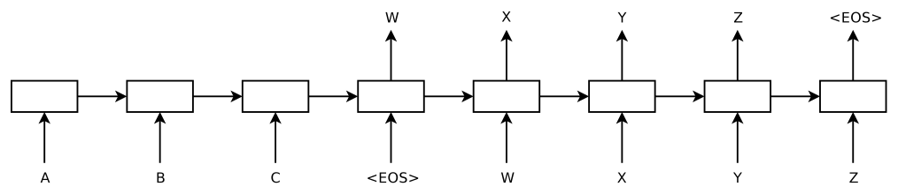
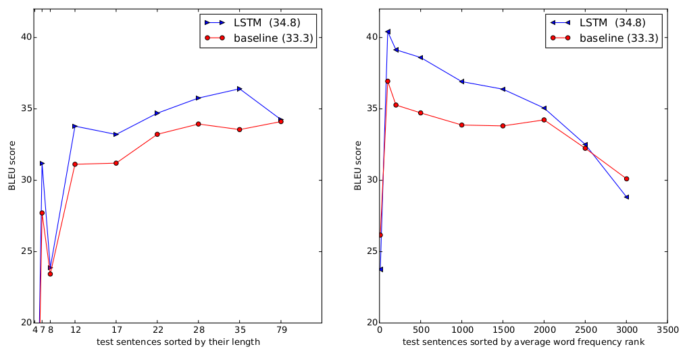
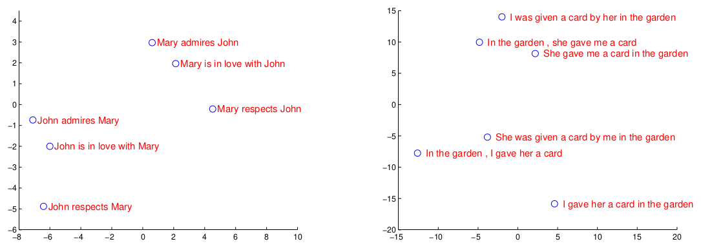

# 论文中文解读：《Sequence to Sequence Learning with Neural Networks》

> **基本信息**：Ilya Sutskever、Oriol Vinyals、Quoc V. Le（Google），arXiv:1409.3215（v3，2014 年 12 月 14 日）；[论文原文（arXiv 页面）](https://arxiv.org/abs/1409.3215)。
>
> **本文的读法**：本文覆盖原文的全部 3 张图和全部 3 张表。图取自论文 PDF 的原图，表为逐格核对后的中文转录（数字、模型名保持原样，表头译为中文）；每张图后有图中文字翻译和读图结论，每张表后有原文页码和读法。训练设置、公式、算法步骤和评测口径都在正文中讲清楚，因此不必再翻英文原文。图上读出的数值一律标“约”。

## 一、一句话结论

深度神经网络只能处理输入输出维度固定的问题，而机器翻译、语音识别、问答等问题的输入输出都是长度不定的序列。论文的做法很直接：用一个多层 LSTM 把输入序列逐词读完，得到一个固定维度的向量 $v$；再用另一个深层 LSTM 以 $v$ 为初始状态，逐词生成输出序列，直到产生句末符号 `<EOS>`。在 WMT'14 英译法任务上，5 个深层 LSTM 的集成直接解码得到 34.81 的 BLEU，超过了短语式统计机器翻译（SMT）基线的 33.30，这是纯神经翻译系统第一次在大规模翻译任务上明显超过短语式 SMT 基线；用同样的 LSTM 去重排序基线给出的 1000-best 列表，BLEU 提高到 36.5（比基线高 3.2），接近当时已发表的最好结果 37.0。一个简单但关键的技巧是**把源句的词序反转**（只反转源句、不反转目标句），它把 BLEU 从 25.9 提高到 30.6（正文 3.3 节的数字；表 1 中单模型的对应数字是 26.17 与 30.59）。

## 二、背景与动机

### 2.1 问题：定长向量与变长序列

深度神经网络（DNN）在语音识别、视觉物体识别等难题上表现出色，原因之一是它们能在不多的步骤里做任意的并行计算（论文举例：用只有 2 个隐藏层、规模为平方级的网络就能给 $N$ 个 $N$ 位数排序）。只要有足够的标注数据，有监督的反向传播就能找到好的参数。但 DNN 只能用于输入和目标都能合理编码成**固定维度向量**的问题，这是很大的限制：许多重要问题最好表示成长度事先未知的序列。语音识别和机器翻译显然是序列问题；问答也可以看作是把表示问题的词序列映射成表示答案的词序列。因此需要一种与领域无关、能把序列映射成序列的方法。

### 2.2 标准 RNN 的局限

循环神经网络（RNN）是前馈网络对序列的自然推广。给定输入序列 $(x_1,\dots,x_T)$，标准 RNN 迭代下面的式子得到输出序列 $(y_1,\dots,y_T)$：

$$
h_t=\operatorname{sigm}\bigl(W^{hx}x_t+W^{hh}h_{t-1}\bigr),\qquad y_t=W^{yh}h_t.
$$

当输入与输出之间的对齐事先已知时，RNN 很容易把序列映射成序列。但当输入输出序列长度不同、且对应关系复杂并且**非单调**时，如何用 RNN 并不清楚。最简单的通用做法是：用一个 RNN 把输入序列映射成定长向量，再用另一个 RNN 把这个向量映射成目标序列（Cho 等人也这样做过）。原则上这行得通，因为 RNN 拿到了全部相关信息；但由此产生的**长程依赖**会使 RNN 很难训练。LSTM 已知能学会有长程时间依赖的问题（见 [LSTM 论文的中文解读](../lstm/论文中文解读.md)），所以 LSTM 可能在这里成功。

### 2.3 相关尝试（引言与第 4 节）

- Kalchbrenner 与 Blunsom：第一个把整个输入句子映射成向量、再映射回句子的工作；他们用卷积网络把句子编码成向量，这会丢失词序。
- Cho 等人：用类似 LSTM 的 RNN 把句子映射成向量再映回，但主要目的是给短语式 SMT 系统产生的候选重新打分。
- Graves：提出了可微的注意力（attention）机制，让网络聚焦输入的不同部分；Bahdanau 等人把它的一个优雅变体成功用于机器翻译。（本文并不使用 attention。）
- 连接时序分类（CTC）是另一种把序列映射成序列的神经网络方法，但它假设输入和输出之间是**单调**对齐。
- Pouget-Abadie 等：把源句切成片段分别翻译以得到平滑的译文，类似短语式方法；论文猜测他们只需把源句反转来训练也许就能得到类似的提升。
- Hermann 与 Blunsom：用前馈网络表示输入和输出并映射到空间中相近的点，但不能直接生成译文，只能在预先算好的句子库里查最近向量，或给句子重新打分。
- 神经语言模型用于 MT 的最简单有效方式是给强 MT 基线的 n-best 列表重新打分（Mikolov 的 RNNLM、Bengio 的 NNLM）；Auli 等把 NNLM 与输入句的主题模型结合；Devlin 等把 NNLM 放进解码器并用解码器的对齐信息挑选输入句中最有用的词，取得了很大提升。

## 三、方法

### 3.1 模型：条件概率与 `<EOS>`

目标是估计条件概率 $p(y_1,\dots,y_{T'}\mid x_1,\dots,x_T)$，其中 $(x_1,\dots,x_T)$ 是输入序列，$y_1,\dots,y_{T'}$ 是对应的输出序列，长度 $T'$ 可以与 $T$ 不同。LSTM 的算法是：先读完输入序列，取 LSTM 最后一个隐藏状态作为输入序列的固定维表示 $v$；再用一个标准 LSTM 语言模型（LSTM-LM）的写法计算输出序列的概率，其初始隐藏状态设为 $v$：

$$
p(y_1,\dots,y_{T'}\mid x_1,\dots,x_T)=\prod_{t=1}^{T'}p(y_t\mid v,y_1,\dots,y_{t-1}).\qquad(1)
$$

式中每个 $p(y_t\mid v,y_1,\dots,y_{t-1})$ 用词表上的 softmax 表示；论文使用 Graves 的 LSTM 公式（正文没有重写这些公式）。注意：论文要求每个句子都以一个特殊的句末符号 `<EOS>` 结尾，这使模型能够定义一个覆盖所有可能长度的序列分布。

*图 1（原文 Figure 1，第 2 页）：模型读入输入句子“ABC”并产生输出句子“WXYZ”；输出 `<EOS>` 之后模型停止预测。原文图题还指出：LSTM 是把输入句子反过来读的，因为这样会引入很多短期依赖，使优化问题容易得多。*

**图中文字翻译与读法**：

- **底行（输入）**：依次是 A、B、C、`<EOS>`、W、X、Y、Z；**顶行（输出）**：只有在 `<EOS>` 之后才出现 W、X、Y、Z、`<EOS>`；中间一排方框是 LSTM 的各个时间步，箭头表示隐藏状态逐步向右传递。
- **读法**：前半段（输入 A、B、C）只读不写，信息被压进隐藏状态；输入 `<EOS>` 时模型输出第一个目标词 W，即同一个 `<EOS>` 既结束了输入、又触发了输出；之后每一步的输入是上一步的目标词（W、X、Y、Z），产生下一个目标词，直到输出 `<EOS>` 才停止。按式 (1)，每一步以前面所有目标词和 $v$ 为条件。（训练时这些“上一步目标词”取参考译文中的词，测试时是模型自己刚产生的词；论文没有使用“teacher forcing”这个词，这是对式 (1) 的标准实现解读。）
- **图与实际模型的差别**：图中画的是一个 LSTM 一条链、输入按 A、B、C 的顺序，这是概念示意；实际模型有两个不同的 LSTM，且输入是反转后的 C、B、A（见下一小节）。
- **读图结论**：整个模型就是“先读后写”的一条序列，输入输出长度可以不同；输出 W 要等读完 A、B、C 之后才产生，输入端与对应输出之间隔着好几个时间步，这就是后面要讲的“时间滞后”。

### 3.2 实际模型与上述简化描述的三点不同

论文的实际模型与上面的描述有三处重要区别：

1. **使用两个不同的 LSTM**：一个读输入序列（编码器），另一个生成输出序列（解码器）。这样做能在几乎不增加计算量的情况下增加模型参数，并使同时在多个语言对上训练变得自然。
2. **使用深层 LSTM**：论文发现深层 LSTM 明显优于浅层 LSTM，选择了 4 层。
3. **反转输入句子的词序**：例如，不是把句子 $a,b,c$ 映射到 $\alpha,\beta,\gamma$，而是让 LSTM 把 $c,b,a$ 映射到 $\alpha,\beta,\gamma$，其中 $\alpha,\beta,\gamma$ 是 $a,b,c$ 的译文。这样 $a$ 与 $\alpha$ 紧挨着，$b$ 与 $\beta$ 也相当近，依此类推，使 SGD 很容易在输入和输出之间“建立联络”。论文发现这个简单的数据变换大幅提升了 LSTM 的性能。

### 3.3 训练目标与解码（第 3.2 节）

训练是最大化在给定源句 $S$ 时正确译文 $T$ 的对数概率，所以训练目标是

$$
\frac{1}{\lvert\mathcal S\rvert}\sum_{(T,S)\in\mathcal S}\log p(T\mid S),
$$

其中 $\mathcal S$ 是训练集。由式 (1)，$\log p(T\mid S)$ 是整句各个目标词（含最后的 `<EOS>`）的对数概率之和；也就是说，损失按**句子对**平均，而不是按词平均。训练完成后，通过寻找 LSTM 下最可能的译文来翻译：

$$
\hat T=\operatorname*{arg\,max}_{T}\,p(T\mid S).\qquad(2)
$$

论文用一个简单的**从左到右的束搜索（beam search）解码器**近似求解：它维护 $B$ 个部分假设（译文的前缀）。每个时间步，把束中每个部分假设用词表中每个可能的词扩展，这会使假设数量大幅增加，于是只保留模型对数概率最高的 $B$ 个，丢弃其余。一旦 `<EOS>` 被接到某个假设后面，这个假设就从束中移出并加入完整假设集合。这个解码器是近似的，但实现简单。有意思的是，系统在束宽为 1 时就表现很好，束宽为 2 就得到了束搜索的大部分收益（见表 1）。论文没有提到长度归一化。

**重排序（rescoring）**：也可以用 LSTM 给基线 SMT 系统产生的 1000-best 列表重新打分：用 LSTM 计算每个假设的对数概率，再与 SMT 的原有得分取**等权平均**。

### 3.4 为什么反转源句有效（第 3.3 节）

**现象**：LSTM 虽能解决有长程依赖的问题，但论文发现，当源句被反转（目标句不反转）时，LSTM 学得好得多：测试困惑度（perplexity）从 5.8 降到 4.7，解码出的译文的测试 BLEU 从 25.9 提高到 30.6。

**论文的解释（作者自称没有完整解释）**：反转引入了许多短期依赖。通常把源句和目标句拼接起来时，源句里的每个词都离它在目标句里的对应词很远，所以问题有很大的“最小时滞”（minimal time lag，Hochreiter 与 Schmidhuber 的概念，见 [LSTM 解读](../lstm/论文中文解读.md) 的实验部分）。把源句反转后，源语言和目标语言中对应词之间的**平均距离不变**，但源语言的前几个词现在离目标语言的前几个词非常近，问题的最小时滞因此大大降低。于是反向传播更容易在源句和目标句之间“建立联络”，整体性能随之显著提高。

用一个具体的小例子说明（本文的演算，假设第 $k$ 个源词对应第 $k$ 个目标词）：把 $a,b,c$、`<EOS>`、$\alpha,\beta,\gamma$ 排成一列，位置依次为 1 到 7。**正序**时 $a,b,c$ 在位置 1、2、3，对应的 $\alpha,\beta,\gamma$ 在位置 5、6、7，三对词之间的距离都是 4；**反序**时源句变成 $c,b,a$，$a$ 在位置 3、$b$ 在位置 2、$c$ 在位置 1，三对词的距离变成 2、4、6：平均距离仍是 4，但最近的一对只隔 2 步，而不是 4 步。一般地，源句长 $n$ 时，正序每一对都隔 $n+1$ 步；反序时第 $k$ 个词隔 $2k$ 步，平均仍是 $n+1$，最小只有 2。

**作者起初的想法与后来的发现**：作者本以为反转输入只会让目标句前半部分的预测更有把握、后半部分更没把握；但用反转源句训练的 LSTM 在长句上比用原序源句训练的好得多（见 3.7 节），这表明反转使 LSTM 的记忆利用更好。作者在结论中还说：他们无法在不反转的翻译问题上训练出标准 RNN，并相信标准 RNN 在源句反转后应该很容易训练（但没有做实验验证）。

## 四、数据、训练与实现细节

### 4.1 数据与词表（第 3.1 节）

使用 WMT'14 英译法数据集，在 1200 万个句对的子集上训练，其中包含 3.48 亿个法语词和 3.04 亿个英语词（据此推算，平均每句约 29 个法语词、约 25 个英语词），这是 Schwenk 提供的一个干净的“selected”子集。选择这个任务和这个训练子集，是因为有公开可得的已分词的训练集和测试集，以及基线 SMT 的 1000-best 列表。

典型的神经语言模型要给每个词一个向量表示，所以两种语言都用固定词表：源语言取最常见的 160,000 个词，目标语言取最常见的 80,000 个词；每个词表之外的词都被替换成特殊记号“UNK”。

### 4.2 模型与训练设置（第 3.4、3.5 节）

论文发现 LSTM 模型相当容易训练。下表汇总了论文正文给出的全部设置（这是对 3.4、3.5 节文字的整理，不是原文表格）：

| 项目 | 设置 |
|---|---|
| 网络 | 编码器、解码器各一个 4 层的深层 LSTM，每层 1000 个单元，词向量 1000 维；输入词表 160,000，输出词表 80,000；输出端对 80,000 个词做朴素 softmax |
| 句子表示 | 论文原话：深层 LSTM 用 8000 个实数表示一个句子 |
| 参数量 | 384M，其中 64M 是纯循环连接（编码器 LSTM 32M，解码器 LSTM 32M） |
| 初始化 | 所有 LSTM 参数取 $[-0.08,0.08]$ 的均匀分布 |
| 优化 | 不带动量的随机梯度下降（SGD），固定学习率 0.7；训练满 5 个 epoch 之后，每半个 epoch 把学习率减半；共训练 7.5 个 epoch |
| 批量 | 每批 128 个序列，梯度除以批大小（128） |
| 梯度裁剪 | 对每个训练批，令 $g$ 为梯度除以 128，$s=\lVert g\rVert_2$；若 $s>5$，则 $g\leftarrow 5g/s$ |
| 批内长度 | 同一个 minibatch 里的句子长度大致相同，获得 2 倍加速 |
| 并行 | 一台 8 GPU 机器：4 层 LSTM 各占 1 块 GPU，每层算完立即把激活传给下一块；另外 4 块 GPU 并行 softmax，每块负责乘一个 $1000\times20000$ 的矩阵 |
| 速度 | C++ 实现在单 GPU 上约 1,700 词/秒；8 GPU 实现达到 6,300 词/秒（英法两种语言的词合计，批大小 128）；训练约十天 |
| 集成 | 集成中的模型只在随机初始化和 minibatch 的随机顺序上不同 |

几点说明：

- **梯度爆炸与裁剪**：论文指出 LSTM 虽然通常不受梯度消失之害，但可能有梯度爆炸，所以对梯度范数加了硬约束，在范数超过阈值时缩放梯度。
- **深度的作用**：深层 LSTM 明显优于浅层 LSTM，每多一层困惑度降低近 10%，可能是因为隐藏状态大得多。
- **批内按长度分组**：大多数句子很短（例如长度 20–30），也有一些很长（例如长度大于 100），随机抽取 128 个句子的 minibatch 会有许多短句、很少长句，导致大量计算浪费；让同一批句子长度大致相同可获得 2 倍加速。
- **自行验算（原文只给出 384M 与 64M 两个数字）**：每个 LSTM 有 4 层、每层 4 组门/单元权重、输入与循环权重各为 $1000\times1000$，共 $4\times4\times2\times10^6=32\text{M}$，两个 LSTM 合计 64M，与原文一致；其余 $384-64=320\text{M}$ 恰好是源语言词向量 $160000\times1000=160\text{M}$、目标语言词向量 $80000\times1000=80\text{M}$、输出 softmax 矩阵 $1000\times80000=80\text{M}$ 之和。“8000 个实数”按每层 1000 个单元、每层同时有隐藏状态与记忆单元状态推算为 $4\times1000\times2=8000$（论文没有逐项拆解，这是推算）。训练耗时也能验算：训练集合计约 $3.48+3.04=6.52$ 亿个词，按 6,300 词/秒每个 epoch 约 1.2 天，7.5 个 epoch 约 9 天，与“约十天”吻合。

## 五、实验结果（第 3.6 节）

### 5.1 评测口径

论文用**区分大小写的 BLEU**，在已分词的预测和参考译文上用 `multi-bleu.pl` 计算。这种算法与 Cho 等人、Bahdanau 等人的评测一致，并且能复现基线（Schwenk 的系统）的 33.3 分。不过，如果用同样方式评测当时 WMT'14 最好的系统（其预测可从 statmt.org 下载），得到的是 37.0，高于 statmt.org 上报告的 35.8。所以表中数字是这种“已分词 BLEU”下的结果，与官方榜单上的数字不能直接混比。

最好的结果来自**集成**：多个 LSTM 只在随机初始化和 minibatch 的随机顺序上不同。论文同时以两种方式使用 LSTM：直接翻译输入句子（不借助任何参考 SMT 系统），以及给 SMT 基线的 n-best 列表重新打分。

### 5.2 直接翻译：表 1

表 1：LSTM 在 WMT'14 英译法测试集（ntst14）上的表现（BLEU 越高越好）。

| 方法 | 测试 BLEU（ntst14） |
|---|---:|
| Bahdanau et al. [2] | 28.45 |
| Baseline System [29] | 33.30 |
| Single forward LSTM, beam size 12（单个正序 LSTM，束宽 12） | 26.17 |
| Single reversed LSTM, beam size 12（单个反序 LSTM，束宽 12） | 30.59 |
| Ensemble of 5 reversed LSTMs, beam size 1（5 个反序 LSTM 的集成，束宽 1） | 33.00 |
| Ensemble of 2 reversed LSTMs, beam size 12（2 个反序 LSTM 的集成，束宽 12） | 33.27 |
| Ensemble of 5 reversed LSTMs, beam size 2（5 个反序 LSTM 的集成，束宽 2） | 34.50 |
| Ensemble of 5 reversed LSTMs, beam size 12（5 个反序 LSTM 的集成，束宽 12） | **34.81** |

原文表 1，第 6 页。原文表注：5 个 LSTM 的集成配束宽 2，比单个 LSTM 配束宽 12 更便宜。读法：

- **反转源句**：单个 LSTM，正序 26.17、反序 30.59，提高 4.42；这是本文最关键的消融。（正文 3.3 节写的是 25.9 提高到 30.6，与表 1 的 26.17 与 30.59 略有出入，原文没有说明原因。）
- **集成与束宽**：5 个反序 LSTM 的集成，束宽 1 为 33.00，束宽 2 为 34.50，束宽 12 为 34.81；因此束宽 2 已拿到绝大部分收益（束宽 1 到 2 提高 1.50，2 到 12 只再提高 0.31），与正文“束宽 1 就表现很好、束宽 2 提供束搜索的大部分好处”一致。
- **集成规模**：2 个反序 LSTM 的集成（束宽 12）为 33.27，约等于基线 33.30；5 个时升到 34.81。
- **与基线比**：34.81 比短语式 SMT 基线（33.30）高 1.51。作者强调这是纯神经翻译系统第一次在大规模 MT 任务上以可观的优势超过短语式 SMT 基线，尽管它不能处理词表外的词；而且这个 34.81 是词表 80k 的 LSTM 得到的，每当参考译文含有不在这 80k 之内的词就被扣分。它没有超过当时最好的 WMT'14 系统（37.0，见表 2）。
- 表中 Bahdanau et al. 的 28.45 是他们的带 attention 的模型报告的直接翻译结果；它与 [Bahdanau 解读](../bahdanau_attention/论文中文解读.md) 表 1 中训练更久的 RNNsearch-50⋆ 在全部测试句上的 28.45 是同一个数。

### 5.3 与统计机器翻译结合：表 2

表 2：与 SMT 系统结合使用神经网络的方法，WMT'14 英译法测试集（ntst14）上的 BLEU（越高越好）。

| 方法 | 测试 BLEU（ntst14） |
|---|---:|
| Baseline System [29] | 33.30 |
| Cho et al. [5] | 34.54 |
| Best WMT'14 result [9]（WMT'14 最好的结果） | **37.0** |
| Rescoring the baseline 1000-best with a single forward LSTM（单个正序 LSTM 重排基线 1000-best） | 35.61 |
| Rescoring the baseline 1000-best with a single reversed LSTM（单个反序 LSTM 重排基线 1000-best） | 35.85 |
| Rescoring the baseline 1000-best with an ensemble of 5 reversed LSTMs（5 个反序 LSTM 的集成重排基线 1000-best） | **36.5** |
| Oracle Rescoring of the Baseline 1000-best lists（基线 1000-best 的 oracle 重排） | ∼45 |

原文表 2，第 6 页。读法：

- 用 5 个反序 LSTM 的集成重排基线的 1000-best，BLEU 从 33.30 提高到 36.5，提高 3.2 分，与最好的 WMT'14 结果 37.0 只差 0.5 分。
- 重排序时反转的作用很小：单个反序 LSTM 比正序高 0.24（35.85 对 35.61），而直接解码时高 4.42（表 1）。论文没有解释这一点（可能的原因是重排序时候选译文已经给定，LSTM 只负责打分；这只是本文的猜测）。
- oracle 重排序（从 1000-best 里挑最好的那一个）约 45 BLEU，说明 1000-best 列表里还有很大的提升空间。
- 表中 Cho et al. [5] 的 34.54 是他们把 RNN 编码器–解码器作为 SMT 系统的一部分得到的结果。

## 六、长句、定性例子与表示分析（第 3.7、3.8 节）

### 6.1 长句表现：图 3

作者本以为 LSTM 会因为记忆有限而在长句上失败（其他研究者用相似模型也报告过长句表现很差），但结果令人意外：LSTM 在长句上表现良好。

*图 3（原文 Figure 3，第 7 页）：左，系统性能随句子长度的变化；右，系统在含越来越罕见词的句子上的性能。*

**图中文字翻译与读法**：

- **左图**：横轴 test sentences sorted by their length（按长度排序的测试句），刻度标出的是实际序列长度（4、7、8、12、17、22、28、35、79）；纵轴 BLEU score（BLEU 分数）。蓝线是 LSTM（图例 LSTM (34.8)，即整个测试集上的 34.8），红线是基线（baseline (33.3)）。原文图题的结论是：句子少于 35 个词时没有退化，只有最长的那些句子有轻微退化。从图上读出的近似值：LSTM 在长度 12 到 35 的几组约为 33.8、33.2、34.7、35.8、36.4，基线约为 31.1、31.2、33.2、33.9、33.5；最长的一组（79）LSTM 约 34.2，基线约 34.1，两者接近。最短的几组（长度 4–8）曲线剧烈起伏，最左一点低于纵轴下限 20，原文没有解释。
- **右图**：横轴 test sentences sorted by average word frequency rank（按“平均词频排名”排序的测试句，越靠右含的罕见词越多），纵轴同样是 BLEU。从图上读出的近似值：词频排名在约 100–1500 的几组里 LSTM 约 40.4 到 36.4，明显高于基线（约 36.9 到 33.8）；在最罕见的一组（约 3000）LSTM 约 28.8，低于基线约 30.1。这与 LSTM 词表只有 80k、罕见词被 UNK 替代的设计相符（这一解释是本文的推断，原文只描述了曲线）。
- **读图结论**：在这个设置下，反序训练的 LSTM 对长句没有明显困难（最长一组与基线持平），但对罕见词更多的句子，优势消失甚至反转。图上的值是从曲线读出的近似数字，精确值以原图为准。

### 6.2 长句译文例子：表 3

表 3：LSTM 产生的几个长句译文及其参考译文（“Our model”是模型输出，“Truth”是参考译文）。法语原文如下逐字转录（保留原文的分词空格）；每个例子后的中文大意是本文翻译，仅用于帮助理解两者的差别。

| 类型 | 句子 |
|---|---|
| Our model | Ulrich UNK , membre du conseil d’ administration du constructeur automobile Audi , affirme qu’ il s’ agit d’ une pratique courante depuis des années pour que les téléphones portables puissent être collectés avant les réunions du conseil d’ administration afin qu’ ils ne soient pas utilisés comme appareils d’ écoute à distance . |
| Truth | Ulrich Hackenberg , membre du conseil d’ administration du constructeur automobile Audi , déclare que la collecte des téléphones portables avant les réunions du conseil , afin qu’ ils ne puissent pas être utilisés comme appareils d’ écoute à distance , est une pratique courante depuis des années . |
| Our model | “ Les téléphones cellulaires , qui sont vraiment une question , non seulement parce qu’ ils pourraient potentiellement causer des interférences avec les appareils de navigation , mais nous savons , selon la FCC , qu’ ils pourraient interférer avec les tours de téléphone cellulaire lorsqu’ ils sont dans l’ air ” , dit UNK . |
| Truth | “ Les téléphones portables sont véritablement un problème , non seulement parce qu’ ils pourraient éventuellement créer des interférences avec les instruments de navigation , mais parce que nous savons , d’ après la FCC , qu’ ils pourraient perturber les antennes-relais de téléphonie mobile s’ ils sont utilisés à bord ” , a déclaré Rosenker . |
| Our model | Avec la crémation , il y a un “ sentiment de violence contre le corps d’ un être cher ” , qui sera “ réduit à une pile de cendres ” en très peu de temps au lieu d’ un processus de décomposition “ qui accompagnera les étapes du deuil ” . |
| Truth | Il y a , avec la crémation , “ une violence faite au corps aimé ” , qui va être “ réduit à un tas de cendres ” en très peu de temps , et non après un processus de décomposition , qui “ accompagnerait les phases du deuil ” . |

原文表 3，第 7 页。原文表注：读者可以用 Google 翻译验证这些译文是合理的。中文大意与读法：

- **例 1**：模型：“Ulrich UNK，奥迪汽车制造商的董事会成员，称这是多年来的惯常做法，以便手机能在董事会会议前被收集起来，免得被用作远程窃听设备。”参考：“Ulrich Hackenberg，奥迪汽车制造商的董事会成员，说在董事会会议前收集手机、使它们不能被用作远程窃听设备，是多年来的惯常做法。”差别：人名 Hackenberg 是词表外的词，被输出成 UNK；句式不同但意思基本一致。
- **例 2**：模型的译文说手机“确实是个问题（原文写成 une question）”，不仅因为可能对导航设备造成干扰，“但我们知道，根据 FCC，它们在空中时可能干扰手机基站”，“UNK 说”；参考译文是“……还因为我们根据 FCC 得知，它们在飞机上使用时可能干扰移动通信中继天线”，“Rosenker 说”。差别：说话人名字再次成了 UNK；模型句中“mais nous savons”缺少连接成分，语法略显生硬，但整体意思保留。
- **例 3**：两句都表达“火葬时对所爱之人的身体有一种暴力感，很快化为一堆灰烬，而不是经过会伴随哀悼各阶段的分解过程”。模型写成“un sentiment de violence contre le corps d’un être cher”，参考写成“une violence faite au corps aimé”，用词不同、意思相同。
- **读法**：这三个例子只用来定性说明模型能翻译很长的句子；不能代替 BLEU 之类的整体指标，也看不出系统性问题（例如两个例子里的 UNK 说明词表外的专有名词会直接损失准确度）。

### 6.3 句子表示：图 2

LSTM 的一个吸引人的性质是：它能把变长的输入句子变成固定维度的向量。由于译文往往是原句的释义，翻译目标会鼓励 LSTM 找到捕捉句子含义的表示——含义相近的句子彼此接近，含义不同的句子相距较远。图 2 把 LSTM 处理完一些短语后得到的隐藏状态用 PCA 投影到二维。

*图 2（原文 Figure 2，第 6 页）：LSTM 处理图中各短语后得到的隐藏状态的二维 PCA 投影。*

**图中文字翻译与读法**：

- **左图**：6 个短语，每个点旁边标着对应的句子：Mary admires John（Mary 欣赏 John）、Mary is in love with John（Mary 爱上了 John）、Mary respects John（Mary 尊敬 John）、John admires Mary、John is in love with Mary、John respects Mary。三个“Mary 做主语”的句子在图的右上部（坐标约 $x$ 为 0.6 到 4.5，$y$ 约 3 到 −0.2），三个“John 做主语”的句子在左下部（$x$ 约 −7 到 −6，$y$ 约 −0.7 到 −4.9）。
- **右图**：6 个句子，分成两组，上面一组（约 $y>8$）是“她给了我一张卡片”类：I was given a card by her in the garden、In the garden , she gave me a card、She gave me a card in the garden；下面一组（约 $y\le-5$）是“我给了她一张卡片”类：She was given a card by me in the garden、In the garden , I gave her a card、I gave her a card in the garden。每组内部既有主动句又有被动句，也有把地点状语提到句首的变体。
- **原文图题的结论**：这些短语按含义聚类，在这些例子里含义主要取决于词序，这是词袋模型难以捕捉的；两个簇内部有相似的结构（左图中两组内部都是“admires、is in love with、respects”大致从上到下排列）。正文进一步说：表示对词序敏感，而对主动句换成被动句相当不敏感。
- **读图结论**：这是定性的证据，说明 LSTM 的句子向量里包含了“谁对谁做了什么”这样的结构信息；它只是 6 个句子的二维投影，不能当作对表示质量的定量结论。

## 七、结论、局限与证据边界

**论文自己的结论（第 5 节）**：

- 一个词表有限、几乎不对问题结构做假设的大型深层 LSTM，在大规模 MT 任务上可以胜过词表无限的标准 SMT 系统。
- 他们对反转源句带来的提升程度感到意外，由此得出：应当寻找一种问题编码，使短期依赖的数量最多，因为这会让学习问题简单得多。
- 他们也对 LSTM 能正确翻译很长的句子感到意外：起初他们确信 LSTM 会因记忆有限而在长句上失败，其他研究者用类似的模型也报告过长句表现不佳；然而用反转数据训练的 LSTM 翻译长句几乎没有困难。
- 最重要的是：一个简单、直接、相对未经优化的方法就能超过 SMT 系统，进一步的工作很可能带来更高的翻译精度，这些结果表明该方法很可能在其他有挑战性的序列到序列问题上也表现良好。

**局限与证据边界**：

- **只在一个语言对、一个数据集上验证**（WMT'14 英译法）；反转源句的有效性只在这个设置下验证，没有对其他语言对或其他任务做检验，也没有在标准 RNN 上验证（论文明说“没有实验验证”）。
- **词表有限**：输出词表 80k，其余用 UNK；论文自己说 34.81 是被这个限制惩罚后的数字，例 1、例 2 里的 UNK 也说明专有名词会直接损失准确度。
- **没有超过最好的系统**：直接解码的集成（34.81）低于最好的 WMT'14 系统（37.0）；超过的只是论文所用的短语式 SMT 基线（33.30）。
- **集成的成本**：最好的数字来自 5 个模型的集成，单个反序 LSTM 为 30.59，低于基线 33.30。
- **BLEU 口径**：已分词的 `multi-bleu.pl` BLEU（见 5.1 节），与官方评测的数字不能直接比；论文只有 BLEU 与几个定性例子，没有人工评测。
- **长句结论的范围**：图 3 的最长一组约 79 个词，没有更长的句子；“长句没有困难”不能外推到任意长度。右图还显示在罕见词最多的句子上优势消失。
- **没有 attention**：论文把 attention 当作相关工作提到，但自己的模型把整句压进一个固定维度向量；是否因此造成信息瓶颈，论文的长句实验并没有显示明显退化（见下方“常见误读”）。

**常见误读**：

- “Seq2Seq 论文发现固定向量在长句上明显失败”：不是。论文报告的是反序 LSTM 在长句上几乎没有退化（句子少于 35 个词没有退化，最长句子仅轻微退化）。“固定向量是瓶颈”是后来 Bahdanau 等人论证注意力机制时强调的观点，不是本文的实验结论。
- “反转源句让对应词的平均距离变短”：不是。平均距离不变，缩短的是**最小时滞**（前几个词变近）。
- “34.81 是单个模型的成绩”：不是，它是 5 个 LSTM 的集成加束宽 12；单个反序 LSTM 为 30.59。
- “论文证明纯神经系统超过了最好的翻译系统”：不是。它超过的是短语式 SMT 基线，距离最好的 WMT'14 系统还差；重排序达到 36.5，也仍低于 37.0。
- “论文提出了 teacher forcing / encoder–decoder 范式”：论文把 Kalchbrenner 与 Blunsom 称为第一个把整句映射成向量再映射回句子的工作，也承认与 Cho 等人的方法相近；论文没有使用 teacher forcing 这个术语。本文的新意在于用深层 LSTM、反转源句并在大规模数据上做到了有竞争力的结果。
- “暴露偏差（exposure bias）是本文的结论”：论文没有讨论训练与推理分布不一致的问题，这是后续研究提出的视角。

## 八、复现检查清单

- 数据：WMT'14 英译法 1200 万句对子集（Schwenk 的 selected 子集），分词方式要与 `multi-bleu.pl` 评测一致；词表源 160,000、目标 80,000，其余替换为 UNK。
- 输入处理：**只反转源句**，目标句不反转；每个句子以 `<EOS>` 结尾，源句读完的 `<EOS>` 同时是解码的起点。
- 模型：编码器、解码器各是 4 层、每层 1000 单元的 LSTM，词向量 1000 维，输出对 80,000 词做 softmax；参数初始化 $[-0.08,0.08]$。
- 优化：无动量 SGD，学习率 0.7，5 个 epoch 后每半个 epoch 减半，共 7.5 个 epoch；批大小 128，梯度除以 128；梯度范数超过 5 时缩放到 5；批内句子长度相近。
- 损失：对每个句对把各目标词的对数概率相加（含 `<EOS>`），再按批内句子数平均，而不是按词数平均。
- 解码：从左到右的束搜索，生成 `<EOS>` 的假设移入完成集合；报告束宽（论文的最好结果为 12，束宽 2 已有大部分收益）；论文没有提长度归一化，如果加了应单独说明。
- 重排序：LSTM 的对数概率与基线分数取等权平均，对 SMT 的 1000-best 重排。
- 集成：5 个模型只在初始化和 minibatch 顺序上不同。
- 评测：区分大小写的已分词 BLEU，用 `multi-bleu.pl`；先复现基线 33.30，再比较模型；明确区分单模型、集成、重排序。
- 消融：反转源句的消融要保持模型容量、训练步数、数据完全相同，并分别报告直接解码和重排序（两者的收益差别很大）。

## 九、与相关论文的关系

- 前置：[LSTM（1997）](../lstm/论文中文解读.md) 提供了能学长程依赖的记忆单元，也提出了“最小时滞”的概念；本文用深层 LSTM 做编码器和解码器，并用反转源句缩短最小时滞。
- 后续：[Bahdanau Attention](../bahdanau_attention/论文中文解读.md) 针对固定长度向量的信息瓶颈，让解码器在每一步动态地对齐源句的不同位置；[Transformer](../transformer/论文中文解读.md) 进一步去掉循环结构，用全局并行的自注意力。

## 原文证据导航

- [原论文 PDF](paper.pdf)：模型与式 (1) 在第 3 页，训练目标与式 (2) 在第 4 页，训练细节与并行化在第 5 页，表 1、表 2 与图 2 在第 6 页，表 3 与图 3 在第 7 页。
- [原文提取文本](paper.txt)
- [论文概要](论文概要.md)
