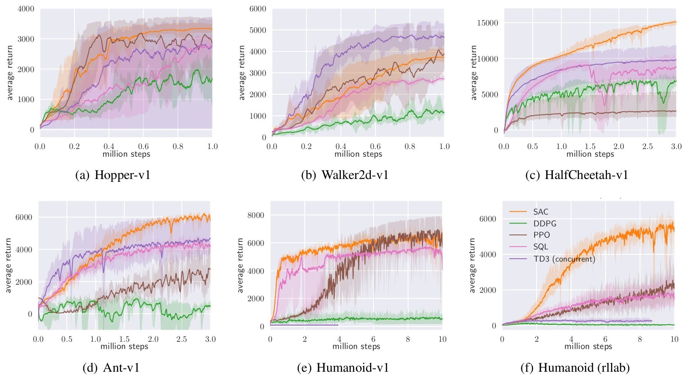
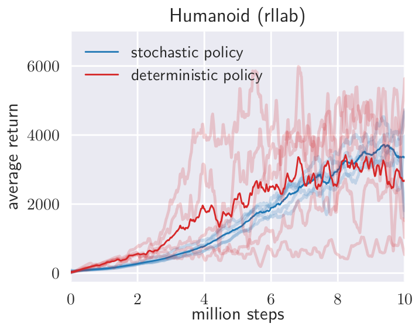
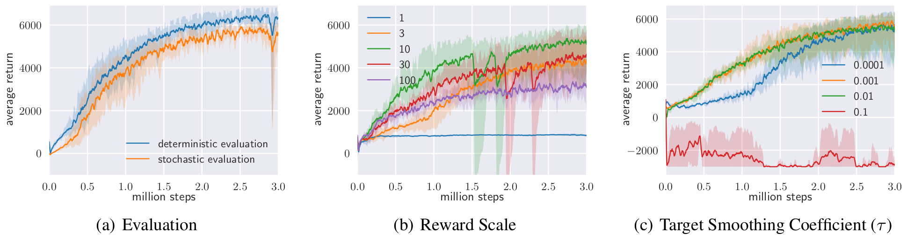

# 论文中文解读：《Soft Actor-Critic: Off-Policy Maximum Entropy Deep Reinforcement Learning with a Stochastic Actor》

> **基本信息**：Tuomas Haarnoja、Aurick Zhou、Pieter Abbeel、Sergey Levine（UC Berkeley，Berkeley Artificial Intelligence Research），Proceedings of the 35th International Conference on Machine Learning（ICML 2018，PMLR 80）；[论文官方页面](https://proceedings.mlr.press/v80/haarnoja18b.html)。本文讲的是这篇 ICML 2018 的原始 SAC（显式有 value 网络、靠 reward scale 调温度），不是后来常用的自动调温版本。
>
> **本文的读法**：图 1–3 取自论文原图；Algorithm 1 转写为代码块并逐行讲解；公式按论文编号 (1)–(13) 逐项解释。本地 PDF 只有正文和参考文献，**不含附录 A–E**（无限视野目标、定理证明、超参数表、额外基线与变体），凡是依赖附录才能核对的内容（如具体学习率、网络宽度）本文都不写。文中“第 N 页”指 PDF 页码。凡是我自己推导、读图估计的内容，都会标注“我的推导”“从图上读出的近似值”。

## 一、一句话结论

SAC（soft actor-critic）是一个 off-policy 的 actor-critic 算法，目标是**最大熵强化学习**：策略既要让期望回报大，又要让自身的熵大，即“完成任务的同时尽可能随机地行动”。它把最大熵框架里的软策略迭代做成可用 replay buffer 训练的实用算法：用一个随机 actor、一个 soft value 网络（外加它的目标副本）和两个 Q 网络。论文在 MuJoCo 连续控制基准（Hopper、Walker2d、HalfCheetah、Ant、Humanoid）上报告：简单任务上与基线相当，复杂任务（Ant、两个 Humanoid）上学习更快、最终回报更高，并且不同随机种子之间的表现很一致；DDPG 在 Ant 和 Humanoid 上完全没有进展。

## 二、背景与动机

### 2.1 无模型深度 RL 的两大障碍

论文开头指出，无模型深度强化学习用于真实问题有两大障碍：

1. **样本复杂度非常高**。即使简单任务也可能需要数百万步数据，高维观测下的复杂行为需要更多；
2. **收敛性脆弱，对超参数敏感**。学习率、探索常数等设置要为不同问题仔细设定。

样本效率差的一个原因是 on-policy 学习：TRPO、PPO、A3C 等常用算法每走一步梯度都需要新采样的数据。任务越复杂，所需梯度步数和每步样本数越多，代价很快变得难以承受。off-policy 算法希望复用过去的经验：这对传统策略梯度形式不能直接做到，但对基于 Q-learning 的方法相对简单（见 [DQN](../deep_q_network/论文中文解读.md)）。然而，off-policy 学习与高维非线性函数逼近（神经网络）结合，会给稳定性和收敛性带来大麻烦；在连续的状态和动作空间里，这个问题更严重，因为往往要用一个单独的 actor 网络来完成 Q-learning 里的最大化。常用的 DDPG 样本效率不错，但以极端脆弱、对超参数敏感著称。

### 2.2 最大熵框架与已有工作

最大熵强化学习用熵最大化项增广标准的最大回报目标。原目标可以用温度参数恢复。论文强调其两点好处：对模型和估计误差更鲁棒（Ziebart 2010），并通过学到多样行为来改善探索（Haarnoja 等 2017）。

已有工作的局限：

- 把熵最大化用于 on-policy 学习的方法，样本复杂度差；
- 基于 soft Q-learning（SQL）及其变体的 off-policy 方法，在连续动作空间中需要复杂的近似推断过程。SQL 并不是真正的 actor-critic：它的 Q 函数估计的是**最优** Q 函数，actor 除了通过数据分布外并不直接影响 Q 函数，所以 actor 只是一个近似采样器，收敛性取决于这个采样器逼近真实后验的好坏。相比之下，论文证明自己的方法无论策略如何参数化，都收敛到给定策略族中的最优策略；
- 很多 actor-critic 方法也考虑策略的熵，但把它当作正则项，而不是最大化的目标；
- 以往的最大熵方法从头学习时一般不超过 DDPG 这类最先进 off-policy 算法的性能。

### 2.3 SAC 的三个要素

论文说 SAC 包含三个关键要素：（1）策略网络与价值网络分开的 actor-critic 架构；（2）能复用以往数据的 off-policy 形式；（3）用熵最大化换取稳定性和探索。论文称，据作者所知，这是最大熵强化学习框架下第一个 off-policy actor-critic 方法。它与 SVG(0)（零步随机价值梯度）相近，区别在于 SVG(0) 优化的是标准的最大期望回报，并且没有单独的价值网络（作者发现单独的价值网络使训练更稳定）。论文同时与同期工作 TD3（在 DDPG 基础上引入 double Q-learning 技巧）比较。

## 三、最大熵目标

论文把目标取成带熵的回报总和（论文式 (1)）：

$$
J(\pi)=\sum_{t=0}^{T}\mathbb E_{(\mathbf s_t,\mathbf a_t)\sim\rho_\pi}\big[r(\mathbf s_t,\mathbf a_t)+\alpha\,\mathcal H\big(\pi(\cdot\mid\mathbf s_t)\big)\big].
$$

符号：$\rho_\pi(\mathbf s_t)$ 与 $\rho_\pi(\mathbf s_t,\mathbf a_t)$ 是策略 $\pi$ 诱导的轨迹分布在状态和状态–动作上的边缘分布；环境在每次转移给出有界奖励 $r:\mathcal S\times\mathcal A\to[r_{\min},r_{\max}]$；状态空间 $\mathcal S$ 和动作空间 $\mathcal A$ 都是连续的；$\mathcal H$ 是熵；温度参数 $\alpha$ 决定熵项相对于奖励的重要性，因而控制最优策略的随机程度。标准 RL 的目标可以在 $\alpha\to0$ 的极限下恢复。对无限视野问题引入折扣因子 $\gamma$ 使奖励与熵之和有限，写法更繁琐，论文放在附录 A（本地 PDF 未收录）。

**论文的一个重要简化约定**：“在本文其余部分，我们不再显式写出温度，因为它总可以通过把奖励缩放 $\alpha^{-1}$ 并入奖励。”所以后面的式 (2)–(13) 都没有 $\alpha$。如果想把温度写回来，需要在软价值的定义和式 (5)(6)(12)(13) 的 $\log\pi$ 项前乘上 $\alpha$，并把式 (4)(10) 里的 $\exp(Q)$ 改成 $\exp(Q/\alpha)$（我的整理）。这个约定也直接说明了为什么论文里调的是奖励尺度（reward scale）而不是 $\alpha$：奖励乘一个常数，就等价于改变相对温度。

论文列出最大熵目标的几个好处：

1. 策略被鼓励更广泛地探索，同时放弃明显没希望的方向；
2. 策略可以捕捉近似最优行为的多个模式：当多个动作看起来同样有吸引力时，策略会给这些动作分配相等的概率质量；
3. 前人观察到该目标改善探索；论文实验里也观察到它显著提高学习速度。

## 四、从软策略迭代到 Soft Actor-Critic

### 4.1 软策略迭代（表格情形的理论推导）

论文先在表格设置（有限动作，$\lvert\mathcal A\rvert<\infty$）下推导软策略迭代，便于做理论分析并保证收敛，再推广到连续情形。它交替进行两个步骤。

**软策略评估**。对固定策略 $\pi$，从任意函数 $Q:\mathcal S\times\mathcal A\to\mathbb R$ 出发，反复施加修改后的 Bellman 备份算子 $\mathcal T^\pi$（论文式 (2)、(3)）：

$$
\mathcal T^\pi Q(\mathbf s_t,\mathbf a_t)\triangleq r(\mathbf s_t,\mathbf a_t)+\gamma\,\mathbb E_{\mathbf s_{t+1}\sim p}\big[V(\mathbf s_{t+1})\big],
$$

$$
V(\mathbf s_t)=\mathbb E_{\mathbf a_t\sim\pi}\big[Q(\mathbf s_t,\mathbf a_t)-\log\pi(\mathbf a_t\mid\mathbf s_t)\big],
$$

其中 $V$ 称为软状态价值函数：它是动作价值再减去 $\log\pi$ 取期望，即“Q 加上策略熵”。与标准 Bellman 备份的唯一区别就是多了熵项 $-\log\pi$。

**Lemma 1（软策略评估）**：对算子 $\mathcal T^\pi$ 和映射 $Q^0:\mathcal S\times\mathcal A\to\mathbb R$（$\lvert\mathcal A\rvert<\infty$），令 $Q^{k+1}=\mathcal T^\pi Q^k$，则序列 $Q^k$ 在 $k\to\infty$ 时收敛到 $\pi$ 的软 Q 值。（证明在附录 B.1。）

**软策略改进**。把策略更新为指向新 Q 函数的指数。为了得到便于处理的策略，把策略限制在某个策略族 $\Pi$ 内（例如参数化的高斯分布族），并把改进后的策略投影回 $\Pi$。论文选用以 KL 散度定义的信息投影（论文式 (4)）：

$$
\pi_{\text{new}}=\arg\min_{\pi'\in\Pi}D_{\mathrm{KL}}\Big(\pi'(\cdot\mid\mathbf s_t)\ \Big\Vert\ \frac{\exp\big(Q^{\pi_{\text{old}}}(\mathbf s_t,\cdot)\big)}{Z^{\pi_{\text{old}}}(\mathbf s_t)}\Big).
$$

配分函数 $Z^{\pi_{\text{old}}}(\mathbf s_t)$ 把右边的分布归一化；它一般难以计算，但对新策略的梯度没有贡献，因此可以忽略。

我的推导（帮助理解，不是论文原话）：因为 $D_{\mathrm{KL}}(\pi'\Vert\exp(Q)/Z)=\mathbb E_{\mathbf a\sim\pi'}[\log\pi'(\mathbf a\mid\mathbf s)-Q(\mathbf s,\mathbf a)]+\log Z(\mathbf s)$，而 $\log Z$ 与 $\pi'$ 无关，所以最小化 KL 就是最大化 $\mathbb E_{\pi'}[Q-\log\pi']$，也就是“期望 Q 加上熵”。这解释了为什么 $Z$ 可以丢掉，也解释了软策略改进的含义。

**Lemma 2（软策略改进）**：设 $\pi_{\text{old}}\in\Pi$，$\pi_{\text{new}}$ 是式 (4) 的最优解，则对所有 $(\mathbf s_t,\mathbf a_t)\in\mathcal S\times\mathcal A$（$\lvert\mathcal A\rvert<\infty$），$Q^{\pi_{\text{new}}}(\mathbf s_t,\mathbf a_t)\ge Q^{\pi_{\text{old}}}(\mathbf s_t,\mathbf a_t)$。（证明在附录 B.2。）

**Theorem 1（软策略迭代）**：从任意 $\pi\in\Pi$ 出发，反复施加软策略评估和软策略改进，收敛到一个策略 $\pi^*$，使得对所有 $\pi\in\Pi$ 和所有 $(\mathbf s_t,\mathbf a_t)$ 有 $Q^{\pi^*}(\mathbf s_t,\mathbf a_t)\ge Q^{\pi}(\mathbf s_t,\mathbf a_t)$（假设 $\lvert\mathcal A\rvert<\infty$）。（证明在附录 B.3。）

论文自己强调：这个算法只能在表格情形下精确执行；连续域需要函数逼近器表示 Q 值，并且把评估和改进都跑到收敛在计算上太贵，所以要近似，由此得到实用算法 SAC。因此这个定理不等于深度网络版本的全局收敛保证。

### 4.2 Soft Actor-Critic：网络与损失

实用版本用函数逼近器表示 Q 函数和策略，并且不再把评估和改进运行到收敛，而是用随机梯度下降交替优化两个网络。论文考虑三组参数：参数化的状态价值函数 $V_\psi(\mathbf s_t)$，软 Q 函数 $Q_\theta(\mathbf s_t,\mathbf a_t)$，以及一个便于处理的策略 $\pi_\phi(\mathbf a_t\mid\mathbf s_t)$，参数分别为 $\psi$、$\theta$、$\phi$。例如价值函数用表达力强的神经网络，策略取均值和协方差由神经网络给出的高斯分布。

下表概括各个网络的角色（我据正文整理）：

| 网络 | 记号 | 作用 | 怎么训练 |
|---|---|---|---|
| 状态价值网络 | $V_\psi$ | 近似软价值 $\mathbb E_{\mathbf a\sim\pi}[Q-\log\pi]$ | 最小化平方残差 $J_V(\psi)$，式 (5) |
| 目标价值网络 | $V_{\bar\psi}$ | 给 Q 提供稳定的 bootstrap 目标 | 不做梯度更新：$\bar\psi\leftarrow\tau\psi+(1-\tau)\bar\psi$ |
| 软 Q 网络 ×2 | $Q_{\theta_1},Q_{\theta_2}$ | 近似软 Q 函数，两个独立训练 | 最小化软 Bellman 残差 $J_Q(\theta_i)$，式 (7) |
| 策略网络 | $\pi_\phi$ | 随机 actor | 最小化期望 KL，经重参数化得 $J_\pi(\phi)$，式 (12) |

**状态价值网络**。原则上不需要单独的状态价值函数近似器，因为它与 Q 函数和策略通过式 (3) 相关；这个量可以用从当前策略采的单个动作样本无偏估计。但实践中，加一个单独的软价值函数近似器能稳定训练，而且方便与其他网络同时训练。软价值函数最小化平方残差（论文式 (5)）：

$$
J_V(\psi)=\mathbb E_{\mathbf s_t\sim\mathcal D}\Big[\tfrac12\Big(V_\psi(\mathbf s_t)-\mathbb E_{\mathbf a_t\sim\pi_\phi}\big[Q_\theta(\mathbf s_t,\mathbf a_t)-\log\pi_\phi(\mathbf a_t\mid\mathbf s_t)\big]\Big)^2\Big],
$$

其中 $\mathcal D$ 是此前采样过的状态和动作的分布，即 replay buffer。其梯度的无偏估计为（论文式 (6)）：

$$
\hat\nabla_\psi J_V(\psi)=\nabla_\psi V_\psi(\mathbf s_t)\big(V_\psi(\mathbf s_t)-Q_\theta(\mathbf s_t,\mathbf a_t)+\log\pi_\phi(\mathbf a_t\mid\mathbf s_t)\big),
$$

这里的动作 $\mathbf a_t$ 是按**当前策略**采样的，而不是取自 replay buffer。这一点很关键：状态来自 buffer，动作每次由当前策略重新采样，所以价值函数评估的是当前策略，而不是产生数据的旧策略。

**软 Q 网络**。最小化软 Bellman 残差（论文式 (7)、(8)）：

$$
J_Q(\theta)=\mathbb E_{(\mathbf s_t,\mathbf a_t)\sim\mathcal D}\Big[\tfrac12\big(Q_\theta(\mathbf s_t,\mathbf a_t)-\hat Q(\mathbf s_t,\mathbf a_t)\big)^2\Big],
\qquad
\hat Q(\mathbf s_t,\mathbf a_t)=r(\mathbf s_t,\mathbf a_t)+\gamma\,\mathbb E_{\mathbf s_{t+1}\sim p}\big[V_{\bar\psi}(\mathbf s_{t+1})\big].
$$

随机梯度为（论文式 (9)，原文写成 $Q_\theta(\mathbf a_t,\mathbf s_t)$，参数顺序与别处不同，应是笔误）：

$$
\hat\nabla_\theta J_Q(\theta)=\nabla_\theta Q_\theta(\mathbf s_t,\mathbf a_t)\big(Q_\theta(\mathbf s_t,\mathbf a_t)-r(\mathbf s_t,\mathbf a_t)-\gamma V_{\bar\psi}(\mathbf s_{t+1})\big).
$$

更新用到目标价值网络 $V_{\bar\psi}$，其中 $\bar\psi$ 可以取为价值网络权重的指数滑动平均，已知这样做能稳定训练；也可以改成周期性地把目标权重更新成当前价值函数的权重（附录 E，本地 PDF 未收录）。注意：与 DQN 的每 $C$ 步硬拷贝不同，这里默认是软更新，$\tau=0.005$ 在所有任务中使用。

**策略网络**。可以直接最小化期望 KL 散度（论文式 (10)）：

$$
J_\pi(\phi)=\mathbb E_{\mathbf s_t\sim\mathcal D}\Big[D_{\mathrm{KL}}\Big(\pi_\phi(\cdot\mid\mathbf s_t)\ \Big\Vert\ \frac{\exp\big(Q_\theta(\mathbf s_t,\cdot)\big)}{Z_\theta(\mathbf s_t)}\Big)\Big].
$$

最小化 $J_\pi$ 有几种选择。策略梯度方法的典型办法是似然比梯度估计器（Williams 1992），它不需要把梯度反传穿过策略网络和目标密度网络。但在这里目标密度就是 Q 函数，由神经网络表示且可微，所以用重参数化技巧更方便，得到方差更低的估计器。具体做法是用神经网络变换重参数化策略（论文式 (11)）：

$$
\mathbf a_t=f_\phi(\epsilon_t;\mathbf s_t),
$$

其中 $\epsilon_t$ 是从某个固定分布（如球形高斯）采样的输入噪声向量。于是目标可改写为（论文式 (12)）：

$$
J_\pi(\phi)=\mathbb E_{\mathbf s_t\sim\mathcal D,\ \epsilon_t\sim\mathcal N}\Big[\log\pi_\phi\big(f_\phi(\epsilon_t;\mathbf s_t)\mid\mathbf s_t\big)-Q_\theta\big(\mathbf s_t,f_\phi(\epsilon_t;\mathbf s_t)\big)\Big],
$$

其中 $\pi_\phi$ 隐式地由 $f_\phi$ 定义，并且配分函数与 $\phi$ 无关，可以省略。第一项是 $\log\pi$（最小化它就是最大化熵），第二项是 $-Q$（最小化它就是推动高 Q 的动作）。式 (12) 的梯度可近似为（论文式 (13)）：

$$
\hat\nabla_\phi J_\pi(\phi)=\nabla_\phi\log\pi_\phi(\mathbf a_t\mid\mathbf s_t)+\big(\nabla_{\mathbf a_t}\log\pi_\phi(\mathbf a_t\mid\mathbf s_t)-\nabla_{\mathbf a_t}Q(\mathbf s_t,\mathbf a_t)\big)\nabla_\phi f_\phi(\epsilon_t;\mathbf s_t),
$$

其中 $\mathbf a_t$ 在 $f_\phi(\epsilon_t;\mathbf s_t)$ 处取值。读法：第一项来自密度 $\pi_\phi$ 自身对参数 $\phi$ 的依赖；第二项是通过动作 $\mathbf a_t=f_\phi$ 这条路径传来的梯度，里面的 $-\nabla_{\mathbf a}Q$ 就是 DDPG 风格的“沿 Q 的梯度方向移动动作”。论文说这个无偏梯度估计器把 DDPG 风格的策略梯度推广到任何易于处理的随机策略。

**两个 Q 函数**。为缓解策略改进步骤中已知会降低基于价值方法性能的正偏差（Hasselt 2010；Fujimoto 等 2018），算法参数化两个 Q 函数，参数为 $\theta_i$，独立训练去优化各自的 $J_Q(\theta_i)$；然后在价值梯度（式 (6)）和策略梯度（式 (13)）里取两个 Q 函数的最小值，这是 Fujimoto 等提出的做法。论文指出：只用单个 Q 函数，算法也能学习包括 21 维 Humanoid 在内的困难任务，但两个 Q 函数明显加快训练，特别是在更难的任务上。

### 4.3 Algorithm 1 逐行解释

下面是原文 Algorithm 1（第 5 页）的转写，行号是我加的：

```text
Algorithm 1: Soft Actor-Critic
 1  Initialize parameter vectors psi, psi_bar, theta, phi
 2  for each iteration do
 3      for each environment step do
 4          a_t ~ pi_phi(a_t | s_t)
 5          s_{t+1} ~ p(s_{t+1} | s_t, a_t)
 6          D <- D U {(s_t, a_t, r(s_t, a_t), s_{t+1})}
 7      end for
 8      for each gradient step do
 9          psi     <- psi     - lambda_V  * grad_psi    J_V(psi)
10          theta_i <- theta_i - lambda_Q  * grad_theta_i J_Q(theta_i)   for i in {1, 2}
11          phi     <- phi     - lambda_pi * grad_phi    J_pi(phi)
12          psi_bar <- tau * psi + (1 - tau) * psi_bar
13      end for
14  end for
```

逐行讲解：

1. 初始化价值网络 $\psi$、目标价值网络 $\bar\psi$、两个 Q 网络（统称 $\theta$，即 $\theta_1,\theta_2$）和策略网络 $\phi$ 的参数。replay buffer $\mathcal D$ 一开始为空；
2. 外层循环：每个 iteration 先收集一段经验，再做若干次梯度更新；
3. 环境交互阶段：每个环境步做 4–6 行；
4. 用**当前**随机策略采样动作 $\mathbf a_t\sim\pi_\phi(\cdot\mid\mathbf s_t)$。探索完全由策略自身的随机性（熵）提供，没有另外加噪声；
5. 环境按转移概率给出下一状态 $\mathbf s_{t+1}$；
6. 把转移 $(\mathbf s_t,\mathbf a_t,r(\mathbf s_t,\mathbf a_t),\mathbf s_{t+1})$ 存入 replay buffer；
7. 结束环境交互；
8. 梯度更新阶段：每个梯度步做 9–12 行；每个梯度步用的小批量数据取自 replay buffer；
9. 用式 (6) 的梯度更新价值网络，其中动作按当前策略重新采样，Q 取两个 Q 网络的较小值；$\lambda_V$ 是学习率；
10. 两个 Q 网络分别用式 (9) 的梯度更新，目标用目标价值网络 $V_{\bar\psi}$ 算出的 $\hat Q$；
11. 用式 (13) 的梯度更新策略网络，其中 $Q$ 取两个 Q 网络的较小值；
12. 目标价值网络向价值网络做指数滑动平均更新，$\tau$ 是平滑系数；
13–14. 结束两层循环。

论文的说明：该方法在“用当前策略收集经验”和“用从 replay buffer 采样的批量的随机梯度更新函数近似器”之间交替。**实际中，每走一个环境步，做一个或若干个梯度步**（具体超参数在附录 D，本地 PDF 未收录）。因为价值估计器和策略都可以完全用 off-policy 数据训练，所以使用 replay buffer 的 off-policy 数据是可行的。算法对策略的参数化是中立的，只要策略能对任意状态–动作对求值。

## 五、实验

### 5.1 设置

目标是弄清楚 SAC 的样本复杂度和稳定性与已有 off-policy、on-policy 深度 RL 算法相比如何。任务来自 OpenAI gym 基准套件（Hopper-v1、Walker2d-v1、HalfCheetah-v1、Ant-v1、Humanoid-v1）以及 rllab 实现的 Humanoid（Humanoid (rllab)，21 维动作，特别难）。论文强调，较简单的任务许多算法都能解；而更复杂的基准对 off-policy 算法异常困难；算法的稳定性也很重要：简单任务上调超参数更现实，而在最难的任务上，对敏感算法来说有效超参数的狭窄区域会变得小到无法使用。

对比的基线与评估方式（我据正文整理）：

| 基线 | 说明 | 评估时如何选动作 |
|---|---|---|
| DDPG | off-policy 的确定性 actor-critic，被认为是较高效的 off-policy 深度 RL 方法之一 | 关闭探索噪声 |
| PPO | 稳定有效的 on-policy 策略梯度算法（见 [PPO](../proximal_policy_optimization/论文中文解读.md)） | 关闭探索噪声 |
| SQL（soft Q-learning） | 近期的 off-policy 最大熵算法；论文的 SQL 实现也使用两个 Q 函数，作者发现这在大多数环境里提高了性能 | 带探索噪声评估 |
| TD3 | 与 SAC 同期提出的 DDPG 扩展，首次把 double Q-learning 技巧用于连续控制，用作者提供的实现 | 论文未单独说明 |
| SAC | 本文方法 | 取策略分布的均值动作 |

另外，Trust-PCL 和 SAC 的另外两个变体放在附录 E（本地 PDF 未收录）。

评测方式：每个算法用不同随机种子训练 5 个实例，每 1000 个环境步做一次评估 rollout；曲线中实线为 5 次试验的均值，阴影为最小到最大值。

### 5.2 与基线的比较（图 1）



*图 1（原文 Figure 1，第 6 页）：连续控制基准上的训练曲线。原图注称 SAC（图注写 yellow，图中实际显示为橙色）在所有任务上表现一致，并在最具挑战性的任务上优于 on-policy 和 off-policy 方法。*

**图中文字翻译与读法**：

- 六个子图依次是 (a) Hopper-v1、(b) Walker2d-v1、(c) HalfCheetah-v1、(d) Ant-v1、(e) Humanoid-v1、(f) Humanoid (rllab)。横轴 million steps（环境步数，单位百万；(a)(b) 为 0–1，(c)(d) 为 0–3，(e)(f) 为 0–10），纵轴 average return（评估 rollout 的平均回报）。
- 图例（出现在子图 (f) 里）：SAC（橙）、DDPG（绿）、PPO（棕）、SQL（粉）、TD3 (concurrent)（紫，“同期工作”）。实线是 5 个随机种子的均值，阴影是最小–最大范围。
- 从图上读出的各算法在横轴末端附近的近似回报（不是论文给出的数字，仅供大致比较；曲线有波动，读数误差可能达数百）：

| 任务（横轴末端） | SAC | TD3 | SQL | PPO | DDPG |
|---|---:|---:|---:|---:|---:|
| Hopper-v1（1M） | 约 3300 | 约 2800 | 约 2700 | 约 3000 | 约 1700 |
| Walker2d-v1（1M） | 约 3800 | 约 4700 | 约 2700 | 约 3900 | 约 1100 |
| HalfCheetah-v1（3M） | 约 15000 | 约 9800 | 约 8700 | 约 2700 | 约 6900 |
| Ant-v1（3M） | 约 5900 | 约 4700 | 约 4200 | 约 2800 | 约 500 |
| Humanoid-v1（10M） | 约 6500 | 约 100（曲线约 4M 步结束） | 约 5300 | 约 6300 | 约 500 |
| Humanoid (rllab)（10M） | 约 5500 | 约 300（曲线约 8.7M 步结束） | 约 1700 | 约 2200 | 约 0 |

**读图结论（论文的说法加我的读图补充）**：

- 论文：总体上，SAC 在较容易的任务上与基线表现相当，在较难的任务上无论学习速度还是最终性能都以很大优势领先；
- DDPG 在 Ant-v1、Humanoid-v1 和 Humanoid (rllab) 上没有任何进展，这与前人工作一致；
- SAC 比 PPO 学得快得多，原因是 PPO 为在高维复杂任务上稳定学习需要大批量；
- 另一个最大熵算法 SQL 也能学会所有任务，但比 SAC 慢，渐近性能更差；
- 我的读图补充：并非所有任务 SAC 都最优：在 Walker2d-v1 上，从图上看 TD3 的曲线最高（约 4700 对 SAC 约 3800）；在 Humanoid-v1 上 PPO 在约 8M 步之后追上 SAC，不过 SAC 在前约 1M 步内就升到约 5000，快得多；Hopper-v1 上多种算法的阴影带高度重叠；
- 论文还说，SAC 取得的定量结果与此前工作里别人报告的结果相比也很有利，因此 SAC 在这些基准上的样本效率和最终性能超过了当时的最好水平。

证据边界：“样本效率”按环境步数计，不含每步的梯度计算量、网络规模和 wall-clock 时间；off-policy 方法每个环境步可以做更多计算。基线的实现来源不同（如 TD3 用作者提供的实现，DDPG 基线代码由致谢中的 Vitchyr Pong 提供），所以图 1 不是跨代码库的绝对排行榜。另外评估方式也不一致：SAC 用均值动作（确定性）评估，而 SQL 用带探索噪声的随机动作评估；图 3(a) 显示确定性评估比随机评估高约一成，这对 SAC 与 SQL 的比较略有利于 SAC（我的观察）。

### 5.3 消融：随机策略与熵最大化是否带来稳定性（图 2）

论文问：熵出现在策略和价值函数两处。在策略里，它防止策略方差过早收敛（式 (10)）；在价值函数里，它通过提高“导向高熵行为的状态区域”的价值来鼓励探索（式 (5)）。为检验随机性和熵最大化的作用，论文对比一个 SAC 的**确定性变体**：它不最大化熵，与 DDPG 很接近，只是仍有两个 Q 函数、使用硬目标更新、没有单独的目标 actor、并且使用固定而不是学习得到的探索噪声。



*图 2（原文 Figure 2，第 7 页）：SAC（蓝）与 SAC 的确定性变体（红）在 Humanoid (rllab) 基准上各个随机种子的稳定性比较。原图注：比较表明随机性可以稳定训练，因为使用确定性策略时各种子之间的变化大得多。*

**图中文字翻译与读法**：

- 标题 Humanoid (rllab)，横轴 million steps（0–10），纵轴 average return（0–约 6000）。图例：stochastic policy（随机策略，蓝，即 SAC）、deterministic policy（确定性策略，红）。
- 每种方法各画了 5 条淡色细线（5 个单独的随机种子，论文说比较的是 5 次单独运行）；颜色较深的粗线我判断是 5 个种子的均值（图注没有明说，这是我的读图判断）。
- 从图上读出的近似情况（不是论文给出的数字）：蓝色的 5 条细线在大部分训练期间几乎重合成一束；红色的 5 条细线明显发散，有的在约 4–7M 步时升到 4000–6000，有的直到 10M 步都低于约 1500，并且上下起伏大。两种方法的均值线相近：红色均值在 1–6M 步之间还略高于蓝色，两者在 10M 步时都在约 2700–3400。
- 论文的说明：这一比较里，目标价值网络用的是硬更新（周期性覆盖），所以图中的 SAC 与图 1(f) 中用指数滑动平均的 SAC 并不是同一个变体（图 1(f) 的 SAC 在 10M 步约 5500，而这里约 3400）。全部基准上的平均性能对比放在附录 E。

**读图结论**：论文的说法：SAC 表现一致得多，而确定性变体在种子之间的差异非常大，说明稳定性显著更差；学习带熵最大化的随机策略能显著稳定训练，这在超参数难调的更难任务上尤其重要。注意证据的范围：这里说的是**种子间方差**，而不是平均性能更高（两者均值相近）；并且这个确定性变体与 SAC 不只有“是否最大化熵”这一个差别（目标结构和探索方式也不同），所以它不是只改变一个变量的干净消融。

### 5.4 评估方式、奖励尺度与目标平滑（图 3）



*图 3（原文 Figure 3，第 8 页）：SAC 在 Ant-v1 任务上对所选超参数的敏感性。（a）评估方式；（b）奖励尺度；（c）目标平滑系数 $\tau$。*

**图中文字翻译与读法**（三个子图横轴均为 million steps，0–3，纵轴为 average return）：

- **(a) Evaluation（评估）**：蓝线 deterministic evaluation（确定性评估，取策略分布的均值动作），橙线 stochastic evaluation（随机评估，按策略分布采样）。阴影为 5 个种子的范围。图注：用均值动作评估通常得到更高的回报；注意策略训练时还最大化熵，均值动作一般并不对应最大回报目标下的最优动作。从图上读出的近似数值：3M 步时确定性评估约 6300，随机评估约 5600。
- **(b) Reward Scale（奖励尺度）**：五条曲线对应奖励尺度 1、3、10、30、100（图例中的数字）。图注：SAC 对奖励缩放很敏感，因为它与最优策略的温度有关；最优的奖励尺度因环境而异，应针对每个任务单独调。从图上读出的近似数值：尺度 1 的曲线几乎不动，一直停在约 800；尺度 10（绿）最好，3M 步时约 5200；30 约 4600；3 约 4300；100 约 3200。
- **(c) Target Smoothing Coefficient（目标平滑系数）$\tau$**：四条曲线对应 $\tau$=0.0001、0.001、0.01、0.1。图注：目标价值平滑系数 $\tau$ 用来稳定训练；目标移动快（$\tau$ 大）会造成不稳定（红），移动慢（$\tau$ 小）使训练变慢（蓝）。从图上读出的近似数值：$\tau=0.1$ 的回报为负（约 -3000 到 -2000），完全失败；$\tau=0.0001$ 起步很慢，3M 步时才升到约 5400；0.001 与 0.01 几乎重合，3M 步时约 5600–5800。

三个结论（论文的文字说明）：

1. **评估方式**：因为 SAC 收敛到随机策略，最后让策略变确定通常对性能有利；评估时用策略分布的均值近似最大后验（MAP）动作。所有训练曲线画的都是奖励之和，这不同于 SAC 及其他最大熵 RL 算法（包括 SQL 和 Trust-PCL）优化的目标，后者还要最大化策略的熵。所以确定性评估得分更高并不矛盾，是两个目标不同；
2. **奖励尺度**：SAC 对奖励信号的缩放特别敏感，因为它起着最优能量策略的温度的作用，从而控制其随机性（论文原文写“较大的奖励幅度对应更低的 entries”，按上下文应指更低的熵，应是笔误，这是我的判断）。奖励幅度小时，策略几乎变成均匀分布，因此无法利用奖励信号，性能大幅下降；奖励幅度大时，模型起初学得很快，但随后策略变得几乎确定，由于缺乏足够探索而落入较差的局部极小值；奖励缩放合适时，模型平衡探索与利用，学习更快、渐近性能更好。论文发现奖励尺度是**唯一**需要调的超参数，它作为最大熵框架里温度的倒数，有很自然的解释；
3. **目标网络更新**：论文用带平滑常数 $\tau$ 的指数滑动平均更新目标价值网络。$\tau=1$ 对应每次迭代都把权重直接复制过去的硬更新，$\tau=0$ 对应完全不更新目标。作者发现合适的 $\tau$ 范围相当宽，所有任务都用同一个值 0.005。附录 E 还比较了另一个变体：每 1000 个梯度步把当前网络权重直接复制到目标网络，作者发现这个变体受益于在两次环境步之间做多于一个梯度步，这能提升性能，但计算成本更高。

## 六、这篇 SAC 与今天常用实现的差别（背景补充，不在本地 PDF 中）

以下内容来自作者后续的修订版本和社区常用实现，本地 PDF 里没有，请当作背景提示：

- 原论文版本：有显式 $V_\psi$ 与目标 $V_{\bar\psi}$；通过奖励尺度间接控制温度；策略、价值、Q 各自更新；
- 后续常用版本：消去独立的 value 网络，Q 的目标直接使用下一状态动作的 $\min Q-\alpha\log\pi$；把 $\alpha$ 作为参数，针对目标熵自动优化。

因此读代码时看到“两个 Q + actor + 目标 Q、没有 V 网络”并不表示实现有误，而是采用了后续修订版；做实验比较时必须锁定是哪个版本。

## 七、局限、证据边界与常见误读

论文自己指出的未来方向：把二阶信息（如信任域）或更有表达力的策略类引入最大熵方法。

证据边界：

- 理论保证只在表格、有限动作的情形下成立（Lemma 1、Lemma 2、Theorem 1 都要求 $\lvert\mathcal A\rvert<\infty$）；实用 SAC 用函数逼近、有限小批量和交替的一步更新，没有对应的全局收敛保证；
- 实验只覆盖 MuJoCo 类连续控制基准，每个算法 5 个种子，曲线用最小–最大阴影，没有显著性检验；
- 基线用不同来源的实现，评估方式也不同（见 5.2 节），超参数细节在附录里，本文无法核对；
- 奖励尺度需要按任务调：图 3 注明最优尺度因环境而异；
- SAC 并不天然适合纯离线 RL：actor 会去找数据支持之外、被 Q 高估的动作，这需要额外的保守性正则或行为约束（这是常识性提示，论文没有讨论）。

常见误读：

- 最大熵不是“越随机越好”：训练目标里是奖励加熵，评估时的任务分数只算环境奖励，并且评估用的是均值动作；
- SAC 的两个 Q 不是“集成学习”：它们独立训练，并在价值梯度和策略梯度里取较小值，目的是压低正偏差；
- 目标网络不是第二个 critic，而是价值网络的指数滑动平均副本；
- 软策略迭代的收敛定理不等于深度版本的收敛保证；
- “样本效率高”以环境步数衡量，不等于计算量小；
- 不同年份的 SAC 版本不同，写“SAC”时要说明是哪一版。

## 八、复现检查清单

1. 使用原始 SAC（有 $V$ 网络、手调奖励尺度）还是自动温度版；
2. 奖励尺度或 $\alpha$、目标熵及其优化方式；
3. 策略的参数化（论文正文只说例如高斯，动作边界处理等细节在附录里，本地 PDF 未收录）；
4. 两个 Q 是否独立初始化，价值梯度和策略梯度里是否取最小值；
5. replay buffer 大小、预热步数、每个环境步的梯度步数、批量大小、学习率（附录 D）；
6. 目标网络的更新方式：指数滑动平均（$\tau=0.005$）还是周期性硬拷贝；
7. 训练动作是随机采样，评估动作是均值还是随机采样；
8. 每个环境多个随机种子的均值与范围，而不是单次最好轨迹。

## 九、与本仓库其他论文的关系

- [DQN](../deep_q_network/论文中文解读.md)：SAC 同样依赖 replay buffer 和缓慢更新的目标网络，但面向连续动作，用可微的随机 actor 取代 DQN 里对所有动作取最大；目标网络用指数滑动平均而不是周期拷贝；
- [PPO](../proximal_policy_optimization/论文中文解读.md)：PPO 是 on-policy，数据用完即弃，稳定、易调试；SAC 是 off-policy，样本效率更高但对奖励尺度敏感；
- [MuZero](../muzero/论文中文解读.md)：MuZero 的策略目标来自 MCTS 的访问分布，并学习环境模型；SAC 无模型、无搜索，策略目标来自 Q 函数加熵，两者是连续控制与离散规划两条不同的路线。

## 原文证据导航

- [原论文 PDF](paper.pdf)
- [原文提取文本](paper.txt)
- [论文概要](论文概要.md)
