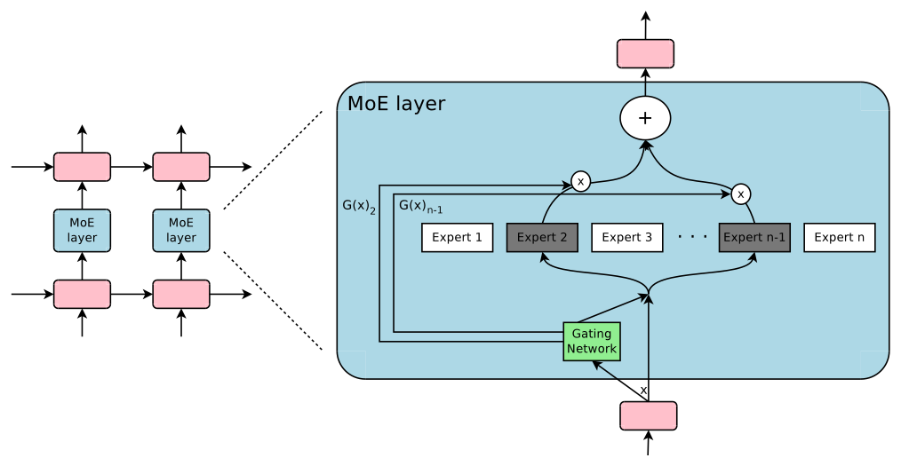
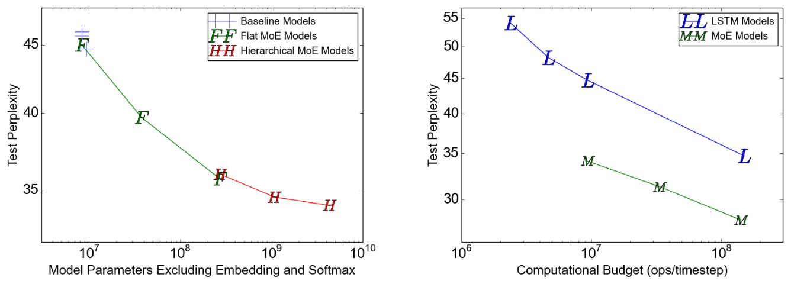
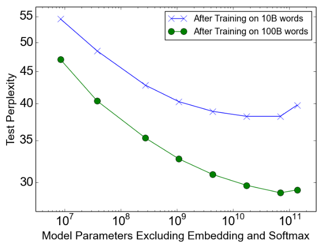
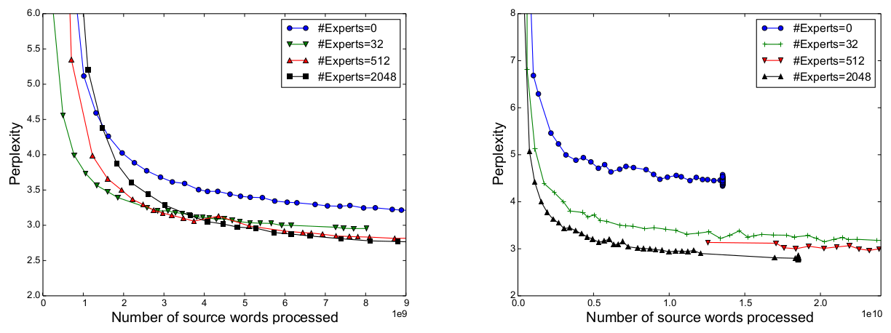

# 论文中文解读：《Outrageously Large Neural Networks: The Sparsely-Gated Mixture-of-Experts Layer》

> **基本信息**：Noam Shazeer、Azalia Mirhoseini、Krzysztof Maziarz、Andy Davis、Quoc Le、Geoffrey Hinton、Jeff Dean（Google Brain；Maziarz 来自 Jagiellonian University），ICLR 2017，arXiv:1701.06538（2017 年 1 月）；论文原文 [官方页面](https://arxiv.org/abs/1701.06538)。
>
> **本文的读法**：图均为从论文 PDF 中按图裁出的原图，表为逐格核对后的中文转录（数字与原文一致，表头和行名译成中文，模型名、数据集名保持原样）。每张图后有中文图题、图例与坐标轴翻译和读图结论；“约”表示从图上读出的近似值。公式沿用论文的编号（式 1–式 22），凡是笔者自己推导或举的例子都会明确标注，不会混入论文原有结论。

## 一、一句话结论

神经网络的容量（参数量）通常和每个样本的计算量绑在一起：参数翻倍，计算也翻倍。本文提出**稀疏门控专家混合层**（Sparsely-Gated Mixture-of-Experts layer，下称 MoE 层）：在两层 LSTM 之间放入最多数万个结构相同的前馈子网络（expert，专家），由一个可训练的**门控网络**（gating network）为每个位置只挑出 $k$ 个专家（本文 $k=2$ 或 $4$）去计算，其余专家完全不执行。为了让这种“条件计算”在 GPU 集群上真正有收益，论文同时解决两个工程问题：用数据并行与模型并行混合来保持每个专家的 batch 足够大；用 importance 与 load 两个辅助损失防止少数专家垄断。

主要结果：

- 每时间步约 8M 次乘加的预算下，专家数从 4 增到 4096，1B 词基准上的测试困惑度降低约 24%（45.0 到 34.1）。
- 在 100B 词语料上，65536 个专家（总参数 68.9B）比计算量相同的 4xLSTM-512 基线困惑度低约 39%（47.0 到 28.9）；扩到 131072 个专家反而略变差（29.2）。
- WMT'14 En→Fr、En→De 的 BLEU 分别达到 40.56、26.03，每时间步计算量 85M ops，GNMT 为 214M ops。
- 总参数最多约 1377 亿（137.7B），但每个位置只激活 4 个专家。

## 二、背景与动机

### 2.1 问题：容量靠参数，而稠密网络的成本随“参数 × 数据”增长

数据集足够大时，增大网络容量（参数数量）能明显提高预测精度，文本、图像、语音都是如此。稠密模型对每个样本都激活整个网络，所以当模型规模和训练样本数同时增长时，训练成本大致按平方增长（论文原话 roughly quadratic blow-up），而算力和分布式计算的进步跟不上这个需求。

**条件计算**（conditional computation）的想法是：对每个样本只激活网络的一部分，让容量增长而计算不成比例增长。此前已有不少理论和小规模工作（Bengio 等人 2013、2015，Eigen 等人 2013 等），门控决策可以是二值或稀疏连续、随机或确定的，训练方法有强化学习和反向传播，但论文认为“至今没有工作在模型容量、训练时间或模型质量上展示出大幅提升”，并把原因归结为五个障碍。

### 2.2 条件计算的五个障碍（论文第 1.1 节）

1. **GPU 擅长算术而不是分支**。因此多数工作主张一次开关网络中很大的一块，而不是细粒度地逐元素分支。
2. **大 batch 对性能至关重要**，因为它摊销参数传输和更新的开销；而条件计算会让被条件激活的那一部分网络看到的 batch 变小。
3. **网络带宽可能成为瓶颈**。GPU 集群的算力可能是设备间聚合网络带宽的数千倍；算法要想高效，计算量与网络传输量之比必须超过这个比值。embedding 层可以看作一种条件计算，它受限的正是这一点：embedding 往往要跨网络传输，（样本，参数）交互次数由带宽而不是算力决定。
4. **视方案而定，可能需要额外的损失项**来保证每个块、每个样本达到想要的稀疏度。Bengio 等人（2015）用了三个这样的损失项，这些会同时影响模型质量和负载均衡。
5. **模型容量对超大数据集最关键**。已有条件计算文献只处理最多 60 万张图像的小数据集，很难相信这些标签足以训练百万乃至十亿参数。

论文宣称这是第一次同时解决这五点，并以此得到“超过 1000 倍的模型容量提升，计算效率只有很小损失”。

### 2.3 与已有 MoE 工作的关系

专家混合（Mixture of Experts）的思想已有二十多年（Jacobs 等人 1991；Jordan 与 Jacobs 1994）。早期做法是“顶层混合”：整个模型就是一个 MoE，专家可以是 SVM、高斯过程、深度网络等。Eigen 等人（2013）提出把多个带各自门控的 MoE 作为深层模型的组成部分，并在结论里提到引入稀疏性、把 MoE 变成条件计算工具的可能性。本文建立在“MoE 作为通用网络组件”这一思路上，与之相比有三点不同：

- Eigen 等人堆叠两个 MoE，得到两组门控决策；本文把同一个 MoE 以“卷积方式”作用于文本的每个位置，每个位置有自己的门控决策；
- 本文真正做到了**稀疏**门控，并证明它是大幅增加容量的实用方法；
- 本文用 SGD 反向传播联合训练门控与专家，与 Bengio 等人（2015）使用布尔门控加 REINFORCE 式训练不同。

论文还指出：专家只是一个简单权重矩阵的 MoE 类似 Cho 与 Bengio（2014）的参数化权重矩阵；专家带一个隐层的 MoE 类似 Bengio 等人（2015）的 block-wise dropout（被丢弃的层夹在全激活层之间）。

### 2.4 阅读前的术语速查

| 术语 | 含义 |
|---|---|
| 困惑度（perplexity） | 语言模型在留出数据上的指标，等于平均每个词的负对数似然取指数，越低越好。论文按标准流程对所有词（含句末符）求和；翻译实验中的困惑度基于模型与 GNMT 共用的分词 |
| BLEU | 机器翻译质量指标，越高越好；论文报告 Moses 的 multi-bleu.pl 计算的 tokenized BLEU |
| ops/timestep | 每个训练样本、每个时间步在前向传播里的乘加次数，不含 softmax 层 |
| TFLOPS/GPU | 实测每 GPU 吞吐：训练一个 batch 所需浮点运算数除以实测步时间和 GPU 数。运算数比 ops/timestep 的口径更大：含反向传播、含基于重要性采样的 softmax 训练，且一次乘加记为两次运算 |
| 总参数 / 不含 embedding 和 softmax 的参数 | 论文的表同时给出两种口径。MoE 层的参数占绝大部分，所以后者更能反映“专家容量” |

## 三、方法：稀疏门控 MoE 层

### 3.1 MoE 层的结构（图 1、式 1）

MoE 层由两部分组成：$n$ 个“专家网络” $E_1,\dots,E_n$，以及一个输出为稀疏 $n$ 维向量的“门控网络” $G$。对输入 $x$，层的输出为

$$
y=\sum_{i=1}^{n}G(x)_i\,E_i(x)\qquad(\text{式 }1)
$$

原则上专家只需要输入、输出尺寸一致；本文限定为**结构相同、参数各自独立**的前馈网络：一个 ReLU 隐层加一个线性输出层（例如 $512\to1024\to512$，参数量 $512\times1024+1024\times512\approx1$M）。只要 $G(x)_i=0$，就不需要计算 $E_i(x)$。实验里专家多达数千到数万个，但每个样本只评估其中很少几个。

*图 1（原文 Figure 1，第 2 页）：一个 MoE 层嵌入在循环语言模型中，稀疏门控函数选出两个专家进行计算，它们的输出由门控网络的输出加权。*

**图中文字翻译与读法**：

- **左半部分**：一个堆叠的循环网络。粉色方块是循环层（本文为 LSTM），每个时间步（横向）都在两层 LSTM 之间插入一个浅蓝色的 “MoE layer”。这意味着 MoE 在每个位置各调用一次，各位置可以选出不同的专家组合。
- **右半部分（放大一个 MoE layer）**：底部粉色方块的输出 $x$ 同时送给绿色的 Gating Network（门控网络）和所有专家 Expert 1 … Expert n。门控网络给出 $G(x)_2$ 与 $G(x)_{n-1}$ 两个非零权重（两条从门控网络出发的折线），对应的 Expert 2 与 Expert n-1 被涂成深灰色，表示只有它们被选中并执行；Expert 1、3、n 为白色，表示本次不执行。被选中专家的输出各自乘（图中圆圈里的 x）对应的门控权重，再相加（圆圈里的 +），送往上层粉色方块。
- **读图结论**：稀疏性体现在“只有被选中的专家才计算”，加权求和就是式 1。

### 3.2 门控网络：从 softmax 到 noisy top-k（式 2–5）

**Softmax 门控**（Jordan 与 Jacobs 1994）是最简单的非稀疏门控：输入乘一个可训练权重矩阵 $W_g$ 再做 softmax。

$$
G_\sigma(x)=\operatorname{Softmax}(x\cdot W_g)\qquad(\text{式 }2)
$$

它对所有 $n$ 个专家都给出非零权重，所以不能省计算。论文加上两个成分：**稀疏**和**噪声**。先加可调的高斯噪声，再只保留最大的 $k$ 个值，其余设为 $-\infty$（使对应的门控值为 0），最后做 softmax：

$$
G(x)=\operatorname{Softmax}\big(\operatorname{KeepTopK}(H(x),k)\big)\qquad(\text{式 }3)
$$

$$
H(x)_i=(x\cdot W_g)_i+\operatorname{StandardNormal}()\cdot\operatorname{Softplus}\big((x\cdot W_{\mathrm{noise}})_i\big)\qquad(\text{式 }4)
$$

$$
\operatorname{KeepTopK}(v,k)_i=\begin{cases}v_i & \text{若 } v_i \text{ 属于 } v \text{ 中最大的 } k \text{ 个元素},\\ -\infty & \text{否则。}\end{cases}\qquad(\text{式 }5)
$$

逐项解释：

- $x\cdot W_g$：$x$ 是该层输入（本文中为前一层 LSTM 在某个位置的输出，维度 512 或 1024），$W_g$ 形状为 $d\times n$，得到 $n$ 个专家的“打分”（logits）。
- $\operatorname{StandardNormal}()$：标准正态随机数；按附录 A 的写法（保持其他分量已采样的噪声不变、只重采分量 $i$），各分量的噪声是分别采样的。
- $\operatorname{Softplus}(z)=\ln(1+e^{z})$，恒为正。$(x\cdot W_{\mathrm{noise}})_i$ 经过 Softplus 后充当该专家分量上噪声的**标准差**，所以每个分量的噪声大小由第二个可训练矩阵 $W_{\mathrm{noise}}$ 按输入决定（原文：The amount of noise per component is controlled by a second trainable weight matrix）。
- $\operatorname{KeepTopK}$：保留 $H(x)$ 中最大的 $k$ 项，其余置 $-\infty$。$\operatorname{Softmax}$ 把 $-\infty$ 变成 0，所以 $G(x)$ 恰好有 $k$ 个非零项，且它们之和为 1。
- 两处设计意图（论文的说法）：稀疏用来省计算；噪声“有助于负载均衡”（原文 The noise term helps with load balancing，细节在附录 A，见第五节）。论文也坦承这种稀疏在理论上会在输出里产生“可怕的不连续”（theoretically scary discontinuities），但没有在实践中观察到问题。

**一个玩具例子（笔者举例，不是论文数据）**：令 $n=4$，$k=2$，设 $x\cdot W_g=(2.0,\,1.0,\,0.5,\,-1.0)$，本次采样的噪声项（噪声乘以 Softplus）为 $(+0.1,\,-0.1,\,+0.9,\,+0.2)$。则 $H(x)=(2.1,\,0.9,\,1.4,\,-0.8)$，最大的两项是第 1 和第 3 个，所以 $\operatorname{KeepTopK}=(2.1,-\infty,1.4,-\infty)$，再做 softmax 得到 $G(x)=(0.668,\,0,\,0.332,\,0)$，输出 $y=0.668\,E_1(x)+0.332\,E_3(x)$。注意第 3 个专家的干净打分（0.5）本来低于第 2 个（1.0），是噪声把它推进了 top-2，这就是噪声带来的“边界处的随机性”。

**初始化**：论文把 $W_g$ 和 $W_{\mathrm{noise}}$ 初始化为全零（附录 A）。此时打分处处为 0，没有信号，只有噪声（标准差为 $\operatorname{Softplus}(0)=\ln2\approx0.693$，该数值为笔者代入计算），top-$k$ 的选择近似随机，因而训练刚开始时各专家的负载大致相等。这很重要：论文说软约束需要时间才起作用，必须一开始就避免极端不均衡导致显存溢出。

### 3.3 门控网络怎么训练

门控网络与模型其余部分一起用简单的反向传播训练。若选 $k>1$，被选中的 top-$k$ 专家的门控值对门控网络权重有非零导数；梯度也会通过门控网络回传到它的输入。论文指出这种“偶尔敏感”的行为类似 Bengio 等人（2013）关于带噪声整流器（noisy rectifier）的描述，并强调与 Bengio 等人（2015）的布尔门控加 REINFORCE 式训练不同。

为什么论文特别写“$k>1$”？由式 3 可直接推得（笔者的推导）：$k=1$ 时 softmax 只对一个保留项取值，结果恒为 1，主任务损失对门控权重的导数为 0，门控只能从辅助损失里得到梯度；$k\ge2$ 时被选中专家之间的相对打分会影响各自的权重，主任务损失就能教门控“哪个专家更好”。后来的 Switch Transformer 正是针对这一点：它指出 Shazeer 等人曾推测 $k>1$ 才有非平凡的梯度，而 Switch 对全体 $N$ 个专家做 softmax，再取被选专家的概率作为门控值，使 $k=1$ 时路由器依然可微（见第十一节）。

### 3.4 一次前向计算的完整流程（按论文描述整理，论文没有给出伪代码）

1. 各设备上的数据并行副本同步地处理各自的 batch，用常规层算出 MoE 层的输入 $x$（语言模型里是各时间步 LSTM 输出）。
2. 每个位置用门控网络（也是数据并行的）得到 $G(x)$，其中恰有 $k$ 个非零项。
3. 把所有数据并行 batch 里选了专家 $i$ 的位置汇集到专家 $i$ 所在的设备，形成专家 $i$ 的合并 batch（每个专家全局只有一份参数）。
4. 每个专家在自己的合并 batch 上做前馈计算。
5. 专家输出送回样本所在设备，按 $G(x)_i$ 加权求和，得到式 1 的 $y$，再经过 sigmoid（论文中 MoE 层输出过 sigmoid 再 dropout）、dropout 和残差连接进入下一层。
6. 反向传播沿同一路径逆向进行；门控网络与专家都得到梯度。

### 3.5 层次化 MoE（附录 B，式 12–14）

专家数量非常大时，可以用两层层次化 MoE 来降低分支因子：**主门控网络**选出若干“组”（每组本身是一个带自己门控网络的次级 MoE）。设共有 $a$ 组，每组 $b$ 个专家，主门控为 $G_{\text{primary}}$，次级门控为 $G_1,\dots,G_a$，专家为 $E_{i,j}$，则

$$
y_H=\sum_{i=1}^{a}\sum_{j=1}^{b}G_{\text{primary}}(x)_i\cdot G_i(x)_j\cdot E_{i,j}(x)\qquad(\text{式 }12)
$$

专家利用率的度量相应变为

$$
\operatorname{Importance}_H(X)_{i,j}=\sum_{x\in X}G_{\text{primary}}(x)_i\cdot G_i(x)_j\qquad(\text{式 }13)
$$

$$
\operatorname{Load}_H(X)_{i,j}=\frac{\operatorname{Load}_{\text{primary}}(X)_i\cdot\operatorname{Load}_i\big(X^{(i)}\big)_j}{\lvert X^{(i)}\rvert}\qquad(\text{式 }14)
$$

其中 $\operatorname{Load}_{\text{primary}}$ 与 $\operatorname{Load}_i$ 分别是主门控和第 $i$ 个次级门控的 Load 函数（定义见第五节），$X^{(i)}$ 是 $X$ 中满足 $G_{\text{primary}}(x)_i>0$ 的子集。论文解释：更简单的写法是 $\operatorname{Load}_H(X)_{i,j}=\operatorname{Load}_i(X_i)_j$，但这样对主门控网络没有梯度，所以才用上面的形式。论文没有发现需要更深的层次。

本文的层次化模型里每一级都取 $k=2$，因此每个样本恰好由 $2\times2=4$ 个专家处理；第一级分支因子等于 GPU 数（1B 词实验为 16），主门控用数据并行，每个次级 MoE 放在一个设备上。

## 四、系统设计：为什么“稀疏”不等于“省”

### 4.1 batch 缩小问题（shrinking batch problem）

CPU/GPU 都需要大 batch 来摊销参数加载和更新的开销。如果门控从 $n$ 个专家里为每个样本选 $k$ 个，那么一个 $b$ 个样本的 batch 里，每个专家只分到约 $kb/n\ll b$ 个样本。专家越多，朴素实现越低效。直接办法是把原始 batch 做大，但 batch 大小受限于前向到反向之间要存的激活。论文提出三项措施：

**（1）混合数据并行与模型并行**。常规分布式训练里，模型的多份拷贝异步处理不同数据，通过参数服务器同步参数。本文让这些 batch 同步运行，从而可以在 MoE 层合并：常规层与门控网络按数据并行分布，但每个专家只保留**一份**共享拷贝；MoE 层里每个专家收到的是来自所有数据并行 batch 的相关样本合并而成的大 batch。同一批设备既是数据并行副本（用于常规层与门控），又是模型并行分片（各自托管一部分专家）。若模型分布在 $d$ 个设备上、每个设备处理大小为 $b$ 的 batch，则每个专家收到约 $kbd/n$ 个样本，专家 batch 提高了 $d$ 倍。层次化 MoE 时，主门控用数据并行，次级 MoE 用模型并行，每个次级 MoE 驻留在一个设备上。

这使得专家数（也就是参数量）可以随设备数按比例增长：总 batch 随之增大，每个专家的 batch 不变；每设备的显存、带宽需求和步时间也保持不变；处理“等于模型参数数量那么多训练样本”所需的时间也不变。论文的目标是在万亿词语料上训练万亿参数模型，写作时还没有扩展到这个规模，但“增加硬件应该可以做到”。

> 论文没有使用 all-to-all 这个词，上面是它的原始说法；现代 MoE 实现里这一步通常就是一次 all-to-all 数据交换（笔者注）。

**（2）利用卷积性**。语言模型里，同一个 MoE 作用于前一层每个时间步的输出。等前一层全部算完之后，就可以把所有时间步合成一个大 batch 送入 MoE，输入 batch 大小因此乘以展开的时间步数。这也解释了为什么 MoE 被放在两层 LSTM 之间，而不是放在循环内部。

**（3）循环式 MoE 的 batch**。作者猜想更强的模型可能把 MoE 用于循环内部，例如用 MoE 替换 LSTM 的权重矩阵；但那样某一时间步 MoE 的输入依赖上一时间步 MoE 的输出，上面的卷积技巧失效。Gruslys 等人（2016）的内存高效 BPTT 可以用重算前向激活的方式大幅减少需存储的激活，从而允许更大的 batch；论文把这作为展望，没有实现。

### 4.2 网络带宽

专家参数固定在各自设备上（stationary），门控参数很少，所以通信主要是把专家的输入和输出在网络上来回发送。要保持计算效率，专家的计算量与其输入输出大小之比必须超过设备的“算力/网络容量”之比，对 GPU 来说这可能是几千比一。论文的专家是带一个含数千个 ReLU 单元的隐层的前馈网络：权重矩阵大小是 input_size × hidden_size 与 hidden_size × output_size，所以计算量与输入输出大小之比恰好等于隐层大小（笔者验算：乘加数 $h(d_{in}+d_{out})$ 除以传输元素数 $d_{in}+d_{out}$ 即 $h$）。因此只要把隐层做大，或者用更多隐层，就能提升计算效率（论文原话 Conveniently）。实验中专家隐层取 1024（语言模型）、2048（翻译）乃至 8192（MoE-143M、多语言翻译），与这一设计一致。

### 4.3 数量级感受（笔者用论文数字估算，论文没有给出这些数）

按式 $kbd/n$，把论文报告的整个训练 batch 当作全局大小 $bd$：

- 1B 词实验：全局 batch 约 300,000 词，平均每个专家收到的位置数，MoE-256（$k=4$）约 $4\times300000/256\approx4700$；MoE-4096-h 约 $4\times300000/4096\approx290$。
- 100B 词实验：全局 batch 约 250 万词，MoE-65536-h 约 $4\times2.5\times10^{6}/65536\approx150$；MoE-131072-h 约 76。

这些估计假设负载完全均衡，说明了两件事：一是专家 batch 随专家数增长迅速变小，所以必须同时增大总 batch；二是论文在附录 D 解释最大模型的 0.30 TFLOPS/GPU 偏低，原因正是为了和其他模型对比而没有按 GPU 数成比例增大 batch。

## 五、负载均衡：importance 与 load 两个损失

### 5.1 自我强化的失衡

论文观察到：门控网络倾向于收敛到“总是给同样几个专家很大权重”的状态。这种失衡是自我强化的：被偏爱的专家训练得更快，因而被门控选中得更多。Eigen 等人（2013）描述过同样的现象，并在训练开头用硬约束避开这个局部极小；Bengio 等人（2015）则对每个门控的 batch 平均值施加软约束。本文采用软约束。

### 5.2 Importance 损失（式 6–7）

一个专家相对于一批训练样本的 **importance（重要性）** 定义为该专家在这批样本上门控值的求和：

$$
\operatorname{Importance}(X)=\sum_{x\in X}G(x)\qquad(\text{式 }6)
$$

这是一个 $n$ 维向量，第 $i$ 项是专家 $i$ 的 importance。附加损失为这些 importance 值的**变异系数**（coefficient of variation，CV，标准差除以均值）的平方，乘以手工设定的系数 $w_{\text{importance}}$：

$$
L_{\text{importance}}(X)=w_{\text{importance}}\cdot\operatorname{CV}\big(\operatorname{Importance}(X)\big)^{2}\qquad(\text{式 }7)
$$

它鼓励所有专家的 importance 相等，并加到模型总损失里。笔者的补充：由于每个样本的门控值之和为 1，$\sum_i\operatorname{Importance}(X)_i=\lvert X\rvert$ 是常数，均值固定，所以最小化 $\operatorname{CV}^2$ 等价于最小化 importance 的平方和。

论文的脚注说明了它与 Bengio 等人（2015）三个损失的关系：控制每样本稀疏度的那个损失不需要（由固定的 $k$ 保证）；鼓励门控值多样化的那个也不需要，因为门控值会随专家分化自然多样化（良性循环）。

**但 importance 相等不等于样本数相等**：可能一个专家收到少数几个权重很大的样本，另一个收到很多权重很小的样本，这会在分布式硬件上造成显存和性能问题。因此还需要第二个损失 $L_{\text{load}}$ 来保证负载均衡。

### 5.3 Load 损失（附录 A，式 8–11）

专家收到的样本数是离散量，不能直接用于反向传播。论文因此定义一个**光滑估计量** $\operatorname{Load}(X)$ 来估计一个 batch 里分给各专家的样本数，光滑性使梯度可以穿过这个估计量，而这正是门控函数中噪声项的用途。

定义 $P(x,i)$ 为：在保持其他分量已采样的噪声不变、仅对分量 $i$ 重新采样噪声的条件下，$G(x)_i$ 非零的概率。$G(x)_i$ 非零当且仅当 $H(x)_i$ 大于 $H(x)$ 中**除去自身之外**第 $k$ 大的元素。因此

$$
P(x,i)=\Pr\Big((x\cdot W_g)_i+\operatorname{StandardNormal}()\cdot\operatorname{Softplus}\big((x\cdot W_{\mathrm{noise}})_i\big)>\operatorname{kth\_excluding}\big(H(x),k,i\big)\Big)\qquad(\text{式 }8)
$$

其中 $\operatorname{kth\_excluding}(v,k,i)$ 表示 $v$ 中去掉第 $i$ 个分量之后的第 $k$ 大分量。把噪声项移到一边，利用标准正态分布的对称性，得到闭式

$$
P(x,i)=\Phi\!\left(\frac{(x\cdot W_g)_i-\operatorname{kth\_excluding}\big(H(x),k,i\big)}{\operatorname{Softplus}\big((x\cdot W_{\mathrm{noise}})_i\big)}\right)\qquad(\text{式 }9)
$$

$\Phi$ 是标准正态分布的累积分布函数。再对 batch 求和得到 Load，并定义 load 损失：

$$
\operatorname{Load}(X)_i=\sum_{x\in X}P(x,i)\qquad(\text{式 }10)
$$

$$
L_{\text{load}}(X)=w_{\text{load}}\cdot\operatorname{CV}\big(\operatorname{Load}(X)\big)^{2}\qquad(\text{式 }11)
$$

**怎么理解**：式 9 是“专家 $i$ 还会不会被选中”的概率。分子是它的干净打分比“被选中的门槛”高多少，分母是噪声的标准差。打分远高于门槛时概率接近 1，远低于门槛时接近 0，处在边缘时在 0 到 1 之间变化，而且对 $W_g$ 和 $W_{\mathrm{noise}}$ 都可导，所以梯度能够推动边缘专家的概率，使各专家的期望负载接近。

**延续上面的玩具例子（笔者举例）**：对被选中的第 3 个专家，除去它之后的 $H$ 为 $(2.1,\,0.9,\,-0.8)$，第 2 大的值是 0.9；设它的噪声标准差为 $\operatorname{Softplus}=1.0$，则 $P(x,3)=\Phi\big((0.5-0.9)/1.0\big)=\Phi(-0.4)\approx0.345$，意思是：如果重新采一次它的噪声，只有约 34.5% 的概率它还能进 top-2。

**importance 与 load 的分工**：importance 控制各专家收到的门控权重总量；load 控制各专家实际收到的样本数，也就是真正决定分布式硬件上显存和耗时的量。

### 5.4 实验：两个损失到底有多重要（附录 A，表 6）

设置：模型结构相同（附录 C 的 MoE-256，4 个活跃专家），用不同的 $w_{\text{importance}}$ 与 $w_{\text{load}}$ 各训练 10 个 epoch，再在测试集上测困惑度；同时统计 Importance 与 Load 的变异系数，以及“负载最高的专家与平均负载之比”（对分布式硬件很关键）。所有指标在若干训练 batch 上取平均。

| $w_{\text{importance}}$ | $w_{\text{load}}$ | 测试困惑度 | $\operatorname{CV}(\operatorname{Importance}(X))$ | $\operatorname{CV}(\operatorname{Load}(X))$ | $\max(\operatorname{Load}(X))/\operatorname{mean}(\operatorname{Load}(X))$ |
|---:|---:|---:|---:|---:|---:|
| 0.0 | 0.0 | 39.8 | 3.04 | 3.01 | 17.80 |
| 0.2 | 0.0 | **35.6** | 0.06 | 0.17 | 1.47 |
| 0.0 | 0.2 | 35.7 | 0.22 | 0.04 | 1.15 |
| 0.1 | 0.1 | **35.6** | 0.06 | 0.05 | 1.14 |
| 0.01 | 0.01 | 35.7 | 0.48 | 0.11 | 1.37 |
| 1.0 | 1.0 | 35.7 | 0.03 | 0.02 | **1.07** |

（原文表 6，第 13 页。）读法：

- 不加任何均衡损失时，Importance 和 Load 的 CV 都超过 3，最忙的专家收到的样本数是平均值的 17.8 倍，困惑度 39.8。
- 只要有任何一个损失，困惑度就稳定在 35.6–35.7，比不加损失好约 4 个点；各组合之间的质量差异很小。
- $w_{\text{load}}$ 越大，最忙专家的负载越接近平均（1.47、1.15、1.14、1.07）；只用 importance 损失时 Importance 被压得很平（CV 0.06），但 Load 没有同等平均（CV 0.17，max/mean 1.47）。这印证了“importance 均衡不等于 load 均衡”。
- 论文的主实验采用的系数：1B 词语言模型 $w_{\text{importance}}=w_{\text{load}}=0.1$；机器翻译 $0.01$。

## 六、实验

### 6.1 1B 词语言建模基准

**数据集**：One Billion Word Benchmark（Chelba 等人 2013），由新闻文章里打乱的不重复句子构成，约 8.29 亿词，词表 793,471。**此前最好结果**：Jozefowicz 等人（2016）的一层或多层 LSTM，其 LSTM 层参数量 200 万到 1.51 亿不等，质量随参数量大增，计算量也大增。

**MoE 模型**（附录 C.1）：五层结构：词嵌入层、LSTM 层、MoE 层、第二个 LSTM 层、softmax 层。嵌入维度、各 LSTM 层单元数以及 MoE 层的输入输出维度都是 512。除 softmax 外每层的输出做 dropout（以概率 DropProb 丢弃，其余除以 $1-\text{DropProb}$），之后把上一层的输出加到该层输出上（残差连接）。每个专家是一个 ReLU 隐层大小 1024、输出层 512 的前馈网络，约 100 万参数；MoE 层输出过 sigmoid 再 dropout。专家数取：普通 MoE 为 4、32、256，层次化 MoE 为 256、1024、4096，对应模型名 MoE-4、MoE-32、MoE-256、MoE-256-h、MoE-1024-h、MoE-4096-h。普通 MoE 取 $k=4$，层次化每级取 $k=2$，所以每个样本恰有 4 个专家参与，共 4M ops/timestep；两层 LSTM 各贡献 2M，总计 8M。

**计算量对齐的稠密基线**（它们不含稀疏性）：

- MoE-4：4 个专家永远全部激活，没有稀疏性；
- MoE-1-Wide：MoE 层换成单个隐层大小 4096 的“专家”；
- MoE-1-Deep：单个“专家”含 4 个隐层，每层 1024；
- 4xLSTM-512：用两个额外的 512 单元 LSTM 层替换 MoE 层；
- LSTM-2048-512：一层 2048 单元的 LSTM，输出投影到 512 维（Sak 等人 2014），等价于 Jozefowicz 等人发表的一个模型，论文因训练配方不同而重跑，结果与已发表数字很接近。

**训练**：16 块 K40 GPU，按第四节的同步方法；每个 batch 约 30 万词；为节省时间限制为 10 个 epoch（27,000 步）；所有模型训练 12–16 小时，MoE-4 因所有专家计算只落在 16 块 GPU 中的 4 块上而用了 18 小时。优化器 Adam；学习率前 1000 步线性上升，之后与步数的平方根倒数成正比；softmax 输出层像 Jozefowicz 等人那样用重要性采样高效训练；对每个模型以 0.1 为步长搜索最佳 dropout 概率；$w_{\text{importance}}=w_{\text{load}}=0.1$。

**低计算量、变容量**：训练一系列计算量都约为 8M ops/timestep（前向、不含 softmax）的 MoE 模型，每个专家约 100 万参数，所有 MoE 层每输入 4 个专家活跃。

*图 2（原文 Figure 2，第 6 页）：左，计算预算约 8M ops/timestep 的模型的测试困惑度随模型容量变化；右，测试困惑度随计算预算变化。上线是 Jozefowicz 等人的 LSTM 模型，下线是 40 亿参数的 MoE 模型。*

**图中文字翻译与读法**：

- **左图**：横轴 Model Parameters Excluding Embedding and Softmax（不含 embedding 与 softmax 的模型参数量，对数轴，$10^7$ 到 $10^{10}$ 附近），纵轴 Test Perplexity（测试困惑度）。图例：Baseline Models（基线模型，蓝色十字）、Flat MoE Models（扁平 MoE，绿色 F）、Hierarchical MoE Models（层次化 MoE，红色 H）。绿色 F 点自左到右为 MoE-4、MoE-32、MoE-256，红色 H 点为 MoE-256-h、MoE-1024-h、MoE-4096-h，具体数字见表 7（45.0、39.7、35.7；36.0、34.6、34.1）。蓝色十字聚集在约 800 万参数、困惑度约 45–46 一带（表 7 的四个基线 44.7–46.1）。
- **右图**：横轴 Computational Budget (ops/timestep)（计算预算，对数轴，$10^6$ 到 $10^8$ 以上），纵轴 Test Perplexity。图例：LSTM Models（LSTM 模型，蓝色 L）、MoE Models（MoE 模型，绿色 M）。上线的 LSTM 点从左到右大约在 2.4M、4.7M、9.4M、151M ops 处，困惑度约 54、48、45、35（从图读出）；下线三个 MoE 点在 8.9M、33.8M、142.7M ops，困惑度 34.1、31.3、28.0（数字见表 1）。
- **读图结论**：左图中，4 个常开专家的 MoE-4 与计算量匹配的基线表现相近（不出意外），但专家数增加到 4096 时，困惑度比这些基线低约 24%（45.0 对 34.1）；超过约 10 亿参数后曲线变平，出现收益递减（34.6 到 34.1）。右图中，同样的计算预算下 MoE 明显优于 LSTM；例如 8.9M ops 的 MoE（34.1）已经好于 151M ops 的 LSTM（34.7，均为 10 个 epoch）。

**变计算量、高容量**：除上述最大模型外，再训练两个同样高容量（40 亿参数）但计算量更高的 MoE 模型，LSTM 更大、专家更少更大（附录 C.2）。MoE-34M 与 MoE-143M 把嵌入维度及 MoE 输入输出维度提高到 1024；MoE-34M 的 LSTM 为 1024 单元，用层次化 MoE（1024 个专家，各自隐层 2048）；MoE-143M 的 LSTM 为 4096 单元并投影到 1024，用层次化 MoE（256 个专家，各自隐层 8192）。两者 MoE 层都有约 40 亿参数。表 1 把这三个模型与此前最好结果比较，并列出训练时间与效率。设置：10 个 epoch 的测试困惑度，“最佳已发表结果”还给出 100 个 epoch 的最终困惑度；参数量不含 embedding 与 softmax 层；训练时间为 10 个 epoch；困惑度越低越好。

| 模型 | 测试困惑度（10 epochs） | 测试困惑度（100 epochs） | 参数量（不含 embedding 与 softmax） | ops/timestep | 训练时间（10 epochs） | TFLOPS/GPU |
|---|---:|---:|---:|---:|---|---:|
| Best Published Results（最佳已发表结果） | 34.7 | 30.6 | 151 million | 151 million | 59 hours, 32 k40s | 1.09 |
| Low-Budget MoE Model（低预算 MoE） | 34.1 | — | 4303 million | 8.9 million | 15 hours, 16 k40s | 0.74 |
| Medium-Budget MoE Model（中预算 MoE） | 31.3 | — | 4313 million | 33.8 million | 17 hours, 32 k40s | 1.22 |
| High-Budget MoE Model（高预算 MoE） | **28.0** | — | 4371 million | 142.7 million | 47 hours, 32 k40s | **1.56** |

（原文表 1，第 7 页。million 为百万；空白格在原文中为空。）读法：

- 以 10 个 epoch 为同一口径，最快的低预算 MoE（8.9M ops）就比最佳已发表结果（34.7）好，而计算量仅约 6%（8.9/151）；高预算 MoE 的计算量与已发表最佳模型相当（142.7M 对 151M），训练时间相近（47 小时对 59 小时），困惑度低 6.7 个点，约 19%（附录 C.2 正文写作 18%，按表中 34.7 与 28.0 计算为 19.3%）。
- 与此同时，MoE 模型的 TFLOPS/GPU（0.74–1.56）并不比稠密基线高多少，低预算 MoE 只有 0.74：计算量大幅下降带来的是总工作量的下降，而不是更高的硬件利用率。
- 表中“100 epochs”那一格只有已发表基线有：MoE 模型只训练了 10 个 epoch，因此“最终收敛后的比较”论文并没有给出。已发表基线训练 100 个 epoch 的 30.6 优于低预算、中预算 MoE（10 个 epoch）的 34.1 与 31.3。

**计算效率**（第 5.1 节）：用 TensorFlow 在 16–32 块 Tesla K40 上训练。MoE 模型里专家相关的浮点运算占总运算的 37% 到 46%。没有 MoE 的基线观测效率为 1.07–1.29 TFLOPS/GPU；低计算量 MoE 为 0.74–0.90 TFLOPS/GPU，4 个专家的模型除外（它没有充分利用可用并行度）；计算量最高的 MoE 达 1.56 TFLOPS/GPU，可能因为矩阵更大。这些数字占 NVIDIA 宣称理论峰值 4.29 TFLOPS/GPU 的相当一部分（笔者折算约 17%–36%）。完整数据见表 7。

**表 7（附录 C，完整的 1B 词模型对比）**：设置同上。带 \* 的模型来自 Jozefowicz 等人（2016）。“最终”困惑度指其论文里训练到收敛的结果。

| 模型 | 测试困惑度（10 epochs） | 测试困惑度（最终） | ops/timestep（百万） | 参数量，不含 embedding 与 softmax（百万） | 总参数量（十亿） | DropProb | TFLOPS/GPU（实测） |
|---|---:|---:|---:|---:|---:|---:|---:|
| Kneser-Ney 5-gram\* | — | 67.6 | 0.00001 | — | 1.8 | — | — |
| LSTM-512-512\* | — | 54.1 | 2.4 | 2.4 | 0.8 | 0.1 | — |
| LSTM-1024-512\* | — | 48.2 | 4.7 | 4.7 | 0.8 | 0.1 | — |
| LSTM-2048-512\* | 45.0 | 43.7 | 9.4 | 9.4 | 0.8 | 0.1 | 0.61 |
| LSTM-2048-512 | 44.7 | — | 9.4 | 9.4 | 0.8 | 0.1 | 1.21 |
| 4xLSTM-512 | 46.0 | — | 8.4 | 8.4 | 0.8 | 0.1 | 1.07 |
| MoE-1-Wide | 46.1 | — | 8.4 | 8.4 | 0.8 | 0.1 | 1.29 |
| MoE-1-Deep | 45.7 | — | 8.4 | 8.4 | 0.8 | 0.1 | 1.29 |
| MoE-4 | 45.0 | — | 8.4 | 8.4 | 0.8 | 0.1 | 0.52 |
| MoE-32 | 39.7 | — | 8.4 | 37.8 | 0.9 | 0.1 | 0.87 |
| MoE-256 | 35.7 | — | 8.6 | 272.9 | 1.1 | 0.1 | 0.81 |
| MoE-256-h | 36.0 | — | 8.4 | 272.9 | 1.1 | 0.1 | 0.89 |
| MoE-1024-h | 34.6 | — | 8.5 | 1079.0 | 1.9 | 0.2 | 0.90 |
| MoE-4096-h | 34.1 | — | 8.9 | 4303.4 | 5.1 | 0.2 | 0.74 |
| 2xLSTM-8192-1024\* | 34.7 | 30.6 | 151.0 | 151.0 | 1.8 | 0.25 | 1.09 |
| MoE-34M | 31.3 | — | 33.8 | 4313.9 | 6.0 | 0.3 | 1.22 |
| MoE-143M | **28.0** | — | 142.7 | 4371.1 | 6.0 | 0.4 | **1.56** |

（原文表 7，第 15 页。）读法：

- 四个稠密基线（LSTM-2048-512、4xLSTM-512、MoE-1-Wide、MoE-1-Deep）和 MoE-4 一样都约 8.4–9.4M ops，困惑度在 44.7–46.1 之间（MoE-4 为 45.0），构成“同计算量的稠密模型”这条参照线。
- 同样约 8.4–8.9M ops，MoE-32 到 MoE-4096-h 把困惑度依次降到 39.7、35.7（扁平）/36.0（层次化）、34.6、34.1，而 MoE 层参数从 37.8M 增长到 4303.4M。
- 总参数量里有一大块是 embedding 与 softmax（基线约 0.8B），所以 MoE-4 到 MoE-4096-h 的“总参数量”从 0.8B 增到 5.1B，而“不含 embedding 与 softmax 的参数量”从 8.4M 增到 4303.4M，后一列更能反映专家容量。
- 各 MoE 模型的 ops/timestep 在 8.4–8.9M 之间有零点几 M 的差别（例如 MoE-256 为 8.6、MoE-256-h 为 8.4），论文没有解释这些差别，统称约 8M ops/timestep。

### 6.2 100B 词 Google News 语料

在 1B 词语料上，MoE 层参数超过 10 亿后增加容量似乎收益递减（图 2 左）。作者猜想更大的训练集会让更高容量带来明显提升，于是构造了一个类似的训练集：Google 内部新闻语料中打乱的不重复句子，约 1000 亿词。与前面类似，测试一系列计算量约 8M ops/timestep 的模型：一个基线 LSTM，以及 MoE 层含 32、256、1024、4096、16384、65536、131072 个专家的模型，对应 MoE 层最多 1370 亿参数。

**模型与训练**（附录 D）：结构类似前面的 8M ops/timestep 模型；32 专家为普通 MoE，其余为层次化 MoE，第一级分支因子分别为 32、32、64、128、256、256（对应 256、1024、4096、16384、65536、131072 个专家）。32 块 Tesla K40 GPU 训练，最后两个模型用 64 块与 128 块 GPU（为了有足够显存放下所有参数）。训练 batch 约 250 万词，对约 1000 亿词只扫过一遍（once-through）。为了每块 GPU 装下最多 10 亿参数，做了两项内存优化：一是不保存专家隐层的激活，反向时重算；二是修改专家参数上的优化器以减少辅助存储：Adam 要为每个参数保存一阶、二阶矩估计，使内存变为三倍，于是令 $\beta_1=0$ 去掉一阶矩估计，并把二阶矩估计换成分解近似：对参数矩阵不保存完整的二阶矩矩阵，只保存按行和按列的平均向量；每一步把估计矩阵取为这两个向量的外积除以其中任一向量的均值。论文指出这种技术同样可以用到 Adagrad。

*图 3（原文 Figure 3，第 7 页）：在 1000 亿词语料上的语言建模，各模型计算预算相近（8M ops/timestep）。*

**图中文字翻译与读法**：

- 横轴 Model Parameters Excluding Embedding and Softmax（不含 embedding 与 softmax 的模型参数量，对数轴 $10^7$ 到 $10^{11}$ 以上）；纵轴 Test Perplexity（测试困惑度，约 28–56）。
- 图例：蓝色 × 线 After Training on 10B words（训练 100 亿词后），绿色圆点线 After Training on 100B words（训练 1000 亿词后）。8 个点自左向右依次为 4xLSTM-512 基线、MoE-32、MoE-256-h、1024-h、4096-h、16384-h、65536-h、131072-h，具体数字见表 8。
- **读图结论**：两条线都随容量下降；训练词数更多时（绿线）下降得更久也更深；蓝线在 16384–65536 个专家处走平，到 131072 个专家时上翘；绿线在 65536 个专家处最低，131072 个专家时略微回升。两条线之间的距离随容量变大而拉开，说明“容量对更大训练集帮助更大”（论文称这在意料之中）。

表 8 给出这组模型的数字。设置：计算量都在 8.4–9.7M ops/timestep；“.1 epochs”指训练 0.1 个 epoch，即约 100 亿词；“1 epoch”即约 1000 亿词；越低的困惑度越好。

| 模型 | 测试困惑度（.1 epochs） | 测试困惑度（1 epoch） | ops/timestep（百万） | 参数量，不含 embedding 与 softmax（百万） | 总参数量（十亿） | TFLOPS/GPU（实测） |
|---|---:|---:|---:|---:|---:|---:|
| Kneser-Ney 5-gram | 67.1 | 45.3 | 0.00001 | — | 76.0 | — |
| 4xLSTM-512 | 54.5 | 47.0 | 8.4 | 8.4 | 0.1 | **1.23** |
| MoE-32 | 48.5 | 40.4 | 8.4 | 37.8 | 0.1 | 0.83 |
| MoE-256-h | 42.8 | 35.3 | 8.4 | 272.9 | 0.4 | 1.11 |
| MoE-1024-h | 40.3 | 32.7 | 8.5 | 1079.0 | 1.2 | 1.14 |
| MoE-4096-h | 38.9 | 30.9 | 8.6 | 4303.4 | 4.4 | 1.07 |
| MoE-16384-h | **38.2** | 29.7 | 8.8 | 17201.0 | 17.3 | 0.96 |
| MoE-65536-h | **38.2** | **28.9** | 9.2 | 68791.0 | 68.9 | 0.72 |
| MoE-131072-h | 39.8 | 29.2 | 9.7 | 137577.6 | 137.7 | 0.30 |

（原文表 8，第 16 页。）读法：

- 训练满 1000 亿词时，困惑度在 65536 个专家（总参数 68.9B）处最低，为 28.9，比计算量匹配的 4xLSTM-512 基线（47.0）低约 39%（论文：39% lower）。扩到 131072 个专家时反而变差（29.2），论文推测“可能是稀疏过度的结果”（possibly a result of too much sparsity），这是论文的猜测而非实验验证的结论。
- 即使 65536 个专家（层稀疏度 99.994%），计算效率仍有 0.72 TFLOPS/GPU。
- 最大的模型只有 0.30 TFLOPS/GPU，很低。论文的解释是：为了与其他模型对比，没有把训练 batch 按 GPU 数成比例增大。
- Kneser-Ney 5-gram 基线的脚注（原文脚注 4）：语料原有 1300 亿词，神经网络最多训练 1000 亿词，而这两个 5-gram 模型分别用 130 亿与 1300 亿词训练，稍占优势。

## 七、机器翻译

### 7.1 单语言对翻译：设置（第 5.3 节与附录 E）

**模型**：GNMT（Wu 等人 2016）的修改版。为减少计算，把编码器和解码器的 LSTM 层数由 9 和 8 减到 3 和 2；在编码器第 2 层与第 3 层之间、解码器第 1 层与第 2 层之间各插入一个 MoE 层；编码器与解码器之间有注意力机制，第一个解码器 LSTM 接收注意力输出并为注意力提供输入。所有层的输入输出维度为 512；LSTM 隐层 2048 单元，带 512 维输出投影；所有 LSTM 与 MoE 层周围加残差连接；使用 wordpiece（子词）单位，源语言与目标语言共用 32K 词表；束搜索与 GNMT 相同。每个 MoE 层最多含 2048 个专家，每个专家一个 2048 单元的 ReLU 隐层，约 200 万参数，MoE 层输出过 sigmoid；两个 MoE 层合计给模型增加约 80 亿参数。变化的是专家数：基线无 MoE，扁平 32 个专家（$k=4$），层次化 512 个与 2048 个专家（每级 $k=2$），每个输入在每个 MoE 层里恰好由 4 个专家处理。**门控**用的是附录 F 的 strictly-balanced gating（见第八节）。

**训练**：Adam；学习率前 2000 步线性上升，再保持常数 8000 步，之后与步数平方根倒数成正比；dropout 0.4，用于所有 embedding、LSTM 和 MoE 层的输出；最多 64 块 GPU 同步训练，每块 GPU 每个 batch 约 16000 词；$w_{\text{importance}}=w_{\text{load}}=0.01$。**数据**：WMT'14 En→Fr 与 En→De，训练集分别有 3600 万与 500 万句对；newstest2014 作测试集，newstest2012 与 newstest2013 合并作开发集；另外还测了同一模型在 Google Production 英法数据上的表现。**指标**：困惑度与 multi-bleu.pl 计算的 tokenized BLEU。

### 7.2 结果（表 2、表 3、表 4）

**表 2：WMT'14 En→Fr（newstest2014）**。设置：困惑度越低越好，BLEU 越高越好；原文粗体为各列最优。

| 模型 | 测试困惑度 | 测试 BLEU | ops/timestep | 总参数量 | 训练时间 |
|---|---:|---:|---:|---:|---|
| MoE with 2048 Experts | 2.69 | 40.35 | 85M | 8.7B | 3 days/64 k40s |
| MoE with 2048 Experts (longer training) | **2.63** | **40.56** | 85M | 8.7B | 6 days/64 k40s |
| GNMT (Wu et al., 2016) | 2.79 | 39.22 | 214M | 278M | 6 days/96 k80s |
| GNMT+RL (Wu et al., 2016) | 2.96 | 39.92 | 214M | 278M | 6 days/96 k80s |
| PBMT (Durrani et al., 2014) | — | 37.0 | — | — | — |
| LSTM (6-layer) (Luong et al., 2015b) | — | 31.5 | — | — | — |
| LSTM (6-layer+PosUnk) (Luong et al., 2015b) | — | 33.1 | — | — | — |
| DeepAtt (Zhou et al., 2016) | — | 37.7 | — | — | — |
| DeepAtt+PosUnk (Zhou et al., 2016) | — | 39.2 | — | — | — |

（原文表 2，第 8 页。）

**表 3：WMT'14 En→De（newstest2014）**。

| 模型 | 测试困惑度 | 测试 BLEU | ops/timestep | 总参数量 | 训练时间 |
|---|---:|---:|---:|---:|---|
| MoE with 2048 Experts | **4.64** | **26.03** | 85M | 8.7B | 1 day/64 k40s |
| GNMT (Wu et al., 2016) | 5.25 | 24.91 | 214M | 278M | 1 day/96 k80s |
| GNMT +RL (Wu et al., 2016) | 8.08 | 24.66 | 214M | 278M | 1 day/96 k80s |
| PBMT (Durrani et al., 2014) | — | 20.7 | — | — | — |
| DeepAtt (Zhou et al., 2016) | — | 20.6 | — | — | — |

（原文表 3，第 8 页。）

**表 4：Google Production En→Fr 数据集**。

| 模型 | 验证困惑度 | 验证 BLEU | 测试困惑度 | 测试 BLEU | ops/timestep | 总参数量 | 训练时间 |
|---|---:|---:|---:|---:|---:|---:|---|
| MoE with 2048 Experts | **2.60** | **37.27** | **2.69** | **36.57** | 85M | 8.7B | 1 day/64 k40s |
| GNMT (Wu et al., 2016) | 2.78 | 35.80 | 2.87 | 35.56 | 214M | 278M | 6 days/96 k80s |

（原文表 4，第 8 页。）读法：

- BLEU：En→Fr 40.56、En→De 26.03；因为 MoE 模型没有使用 RL 精调，论文把它们与 GNMT（无 RL）比较，得到 1.34 与 1.12 BLEU 的提升（40.56 对 39.22，26.03 对 24.91）；笔者补充：对 GNMT+RL 则是 0.64 与 1.37（40.56 对 39.92，26.03 对 24.66）。困惑度也更好。论文脚注 2：困惑度基于模型与 GNMT 共用的分词。
- Google Production 数据集：测试 BLEU 高 1.01（36.57 对 35.56），而训练时间只有 1/6（1 天对 6 天）。
- MoE 模型每时间步计算量 85M，GNMT 为 214M；总参数 8.7B 对 278M。训练时间列硬件不同（K40 对 K80），不能直接按“天数”比较。

*图 4（原文 Figure 4，第 18 页）：WMT'14 En→Fr（左）和 Google Production En→Fr（右）数据集上，困惑度随已处理的源词数变化。训练初期各模型差别很大，是因为 batch 大小不同；除无专家模型外，所有模型计算预算相同（85M ops/timestep）。*

**图中文字翻译与读法**：

- 两张图的纵轴都是 Perplexity（困惑度），横轴 Number of source words processed（已处理的源词数）。左图横轴 $0$–$9\times10^{9}$，纵轴 2.0–6.0；右图横轴 $0$–$2.4\times10^{10}$，纵轴 2–8。
- 图例：\#Experts=0（无专家基线，蓝色圆点）、\#Experts=32（绿色）、\#Experts=512（红色）、\#Experts=2048（黑色）。
- **读图结论**：论文原话是，随着专家数增加到接近 2048，测试困惑度持续改善。左图中，训练到 $9\times10^{9}$ 词时，无专家基线约 3.2，32 个专家约 2.95，512 与 2048 个专家约 2.8（图上读出的近似值）。训练早期各曲线的差距，论文说明是各模型 batch 大小不同造成的（图中 32 个专家的曲线起初最低）；训练充分之后 512 与 2048 个专家的曲线落在最下面。右图（Google Production）里分层更明显：处理约 $1.2\times10^{10}$ 词时，无专家基线约 4.5，32 个专家约 3.3，2048 个专家约 2.9（近似读数）。

### 7.3 多语言机器翻译（第 5.4 节）

Johnson 等人（2016）把十二个语言对合并成一个超大数据集，训练单个 GNMT 模型；结果略差于十二个各自独立训练的单语言对 GNMT 模型，这并不奇怪，因为十二个模型有十二倍的容量和十二倍的总训练量。论文用单个 MoE 增强模型重复这个实验：使用同样的数据集，处理同样数量的训练样本（约 30 亿句对），因计算预算较低而训练时间更短。

结构与单语言对模型相同，只有以下区别：门控用第 3.2 节的 noisy top-$k$ 而不是附录 F 的方案；编码器和解码器里的 MoE 层都是非层次化的 $n=512$、$k=2$；每个专家的隐层增大到 8192，这使 MoE 层的计算量翻倍，整个模型的计算预算由 85M 提高到 102M ops/timestep。

设置：表中每个单元是对应语言对的测试 BLEU（越高越好）；GNMT-Mono 是每个语言对各自训练一个模型。

| 项目 | GNMT-Mono | GNMT-Multi | MoE-Multi | MoE-Multi 相对 GNMT-Multi |
|---|---:|---:|---:|---:|
| 参数量 | 278M / model | 278M | 8.7B | — |
| ops/timestep | 212M | 212M | 102M | — |
| 训练时间与硬件 | various | 21 days, 96 k20s | **12 days, 64 k40s** | — |
| 困惑度（dev） | — | 4.14 | **3.35** | -19% |
| French → English Test BLEU | 36.47 | 34.40 | **37.46** | +3.06 |
| German → English Test BLEU | 31.77 | 31.17 | **34.80** | +3.63 |
| Japanese → English Test BLEU | 23.41 | 21.62 | **25.91** | +4.29 |
| Korean → English Test BLEU | 25.42 | 22.87 | **28.71** | +5.84 |
| Portuguese → English Test BLEU | 44.40 | 42.53 | **46.13** | +3.60 |
| Spanish → English Test BLEU | 38.00 | 36.04 | **39.39** | +3.35 |
| English → French Test BLEU | 35.37 | 34.00 | **36.59** | +2.59 |
| English → German Test BLEU | **26.43** | 23.15 | 24.53 | +1.38 |
| English → Japanese Test BLEU | **23.66** | 21.10 | 22.78 | +1.68 |
| English → Korean Test BLEU | **19.75** | 18.41 | 16.62 | -1.79 |
| English → Portuguese Test BLEU | **38.40** | 37.35 | 37.90 | +0.55 |
| English → Spanish Test BLEU | 34.50 | 34.25 | **36.21** | +1.96 |

（原文表 5，第 9 页。）读法：

- MoE-Multi 的开发集困惑度比多语言 GNMT 低 19%；在 12 个语言对里的 11 个上 BLEU 明显好于多语言 GNMT（最多 +5.84，Korean→English），甚至在 12 个里的 8 个上好于各语言对单独训练的单语言模型。
- 唯一的退步是 English→Korean（-1.79）。论文认为这是严重过拟合的结果：对于较稀少的语言对，少量真实样本在训练语料中被大量过采样。
- 注意表中 ops/timestep 是 212M 对 102M，参数量是 278M 对 8.7B：MoE 用更少的每步计算、更多的存储换来质量。

### 7.4 专家真的“专业化”了吗（表 9）

论文发现专家确实在语法和（或）语义上高度专业化。例如，有一个专家在不定冠词 “a” 引出表示重要性或领导地位的动词短语的直接宾语时被使用。表 9 展示了 WMT'14 En→Fr 翻译模型编码器 MoE 层（2048 个专家）里的三个专家：对每个专家 $i$，把一个训练 batch 里的输入按 $G(x)_i$ 从大到小排序，列出对应位置周围的词。设置：粗体为专家最敏感的词。

| Expert 381 | Expert 752 | Expert 2004 |
|---|---|---|
| ... with **researchers** , ... | ... plays **a** core ... | ... with **rapidly** growing ... |
| ... to **innovation** . | ... plays **a** critical ... | ... under **static** conditions ... |
| ... tics **researchers** . | ... provides **a** legislative ... | ... to **swift** ly ... |
| ... the **generation** of ... | ... play **a** leading ... | ... to **dras** tically ... |
| ... technology **innovations** is ... | ... assume **a** leadership ... | ... the **rapid** and ... |
| ... technological **innovations** , ... | ... plays **a** central ... | ... the **fast** est ... |
| ... support **innovation** throughout ... | ... taken **a** leading ... | ... the **Quick** Method ... |
| ... role **innovation** will ... | ... established **a** reconciliation ... | ... rec **urrent** ) ... |
| ... research **scienti** st ... | ... played **a** vital ... | ... provides **quick** access ... |
| ... promoting **innovation** where ... | ... have **a** central ... | ... of **volatile** organic ... |

（原文表 9，第 18 页。）读法：Expert 381 对 research / innovation 一类词敏感；Expert 752 对“作为 plays / assume / taken 等动词的宾语开头的不定冠词 a”敏感（plays a core / critical / leading / central role 这类表示重要或领导的搭配）；Expert 2004 对表示快速的词（rapidly、swift、rapid、fast、quick）敏感。注意这些只是“几个”专家（a few of the 2048 experts）的定性样例，且按 $G(x)_i$ 排序取最高的位置，不能代表所有专家。

## 八、实现细节补充

### 8.1 Strictly balanced gating（附录 F）

由于基础设施的一些特点（后来已修复），论文做部分机器翻译实验时，如果每个专家恰好收到相同大小的 batch，模型跑得更快。为此用了另一种门控函数。回顾 softmax 门控 $G_\sigma(x)=\operatorname{Softmax}(x\cdot W_g)$（式 15，即式 2）。

**稀疏门控的另一种写法**：把 $G_\sigma(x)$ 与一个稀疏掩码 $M(G_\sigma(x))$ 逐分量相乘再归一化，掩码是 $G_\sigma(x)$ 的函数，指定每个样本被分给哪些专家：

$$
G(x)_i=\frac{G_\sigma(x)_i\,M\big(G_\sigma(x)\big)_i}{\sum_{j=1}^{n}G_\sigma(x)_j\,M\big(G_\sigma(x)\big)_j}\qquad(\text{式 }16)
$$

**Top-K 掩码**：取 $M(v)=\operatorname{TopK}(v,k)$，其中 $\operatorname{TopK}(v,k)_i$ 在 $v_i$ 属于 $v$ 中最大的 $k$ 个元素时为 1，否则为 0（式 17）。笔者验算：由于 softmax 的归一化项在分子分母中约掉，这与式 3 在数学上等价（只是没有噪声项）。

**Batchwise 掩码**：为强制每个专家收到完全相同数量的样本，引入作用于一批输入向量 $X$ 的掩码 $M_{\text{batchwise}}(X,m)$：不是对每个样本保留 top-$k$，而是对每个专家在整个训练 batch 上保留最大的 $m$ 个值，其中 $m=k\lvert X\rvert/n$，从而每个样本平均被送给 $k$ 个专家：

$$
M_{\text{batchwise}}(X,m)_{j,i}=\begin{cases}1 & \text{若 } X_{j,i} \text{ 是专家 } i \text{ 在整个 batch 上最大的 } m \text{ 个值之一},\\ 0 & \text{否则。}\end{cases}\qquad(\text{式 }18)
$$

**推理时的阈值掩码**：论文发现（Ioffe 与 Szegedy 2015 也观察到）训练时使用 batchwise 函数，推理时往往没有大 batch，必须修改。解决办法是训练一个每专家阈值向量 $T$ 来近似 batchwise 掩码的效果，推理时用：

$$
M_{\text{threshold}}(x,T)_i=\begin{cases}1 & \text{若 } x_i>T_i,\\ 0 & \text{否则。}\end{cases}\qquad(\text{式 }19)
$$

为了学习阈值，训练时再加一个损失，当 batchwise 掩码与阈值掩码相同时它最小：

$$
L_{\text{batchwise}}(X,T,m)=\sum_{j=1}^{\lvert X\rvert}\sum_{i=1}^{n}\big(M_{\text{threshold}}(x,T)_i-M_{\text{batchwise}}(X,m)_{j,i}\big)\big(X_{j,i}-T_i\big)\qquad(\text{式 }20)
$$

笔者对式 20 的验算：若阈值掩码为 1（说明 $X_{j,i}>T_i$，后一因子为正）而 batchwise 掩码为 0，乘积为正；若阈值掩码为 0（$X_{j,i}\le T_i$，后一因子非正）而 batchwise 掩码为 1，乘积也为非负；两个掩码一致时乘积为 0。所以每一项都非负，只有掩码一致时才为 0。按上下文，这里掩码函数的输入向量 $X$、$x$ 指各样本的 $G_\sigma$ 打分。

用途：单语言对翻译模型用这一方案（见 7.1），多语言翻译模型改回 noisy top-$k$ 门控。

### 8.2 注意力函数的小改动（附录 G）

GNMT 里的注意力函数是一个带 $n$ 个隐单元的前馈网络，对每个源时间步 $i$、目标时间步 $j$ 都要算一次：

$$
A_{\text{GNMT}}(x_i,y_j)=\sum_{d=1}^{n}V_d\tanh\big((x_iU)_d+(y_jW)_d\big)\qquad(\text{式 }21)
$$

出于性能考虑，本文改用

$$
A(x_i,y_j)=\sum_{d=1}^{n}V_d\tanh\big((x_iU)_d\big)\tanh\big((y_jW)_d\big)\qquad(\text{式 }22)
$$

这样可以用优化过的矩阵乘法同时对多个源时间步和多个目标时间步计算注意力函数；论文报告两种函数在质量上差别很小。其中 $U$、$W$ 是可训练矩阵，$V$ 是可训练向量。

## 九、局限、证据边界与常见误读

### 9.1 局限与证据边界

1. **架构是 LSTM 时代的**：MoE 层放在两层 LSTM 之间，专家是 ReLU 隐层的 FFN，输出过 sigmoid；没有 Transformer，没有“每隔一层替换 FFN”的做法。训练硬件是 K40/K80 GPU，网络拓扑与现代集群不同。
2. **比较口径不统一**：表 1 里已发表基线有 10 与 100 个 epoch 的两个数字，MoE 模型只训练了 10 个 epoch；“更好”的结论只在 10 个 epoch 同口径下成立，不要拿 MoE 的 10 epoch 与基线的 100 epoch 混比。
3. **训练硬件与时间不可直接比**：翻译表里 MoE 用 64 块 K40，GNMT 用 96 块 K80；训练时间、ops/timestep、总参数量要分列阅读。
4. **稀疏度与质量的关系有边界**：1B 词数据上容量超过约 10 亿参数后收益递减；100B 词数据上 131072 个专家变差，论文只给出“可能是稀疏过度”的猜测。
5. **效率不是免费的**：多数 MoE 模型的 TFLOPS/GPU 低于同表的稠密基线（100B 词实验里最大模型仅 0.30），专家相关运算只占 37%–46%；省的是每个位置的总计算量，不是硬件利用率。
6. **专家专业化是定性证据**：表 9 只展示三个专家，且按门控值排序挑最高位置；论文没有量化专业化的稳定性或随机种子之间的一致性。
7. **论文没有明确的事项**：噪声在推理时是否关闭（正文只在附录 F 谈到 batchwise 掩码需要修改推理），论文没有说明；复现时要自行决定。
8. **“>1000× 容量”**：这是摘要里的数量级概括。表中最大 MoE 层 1375.8 亿参数，相对表 7 里 1.51 亿参数的 LSTM 约 910 倍（笔者计算）。
9. **论文自身的小不一致**：附录 C.2 写“困惑度低 18%”，而表中 34.7 到 28.0 为 19.3%。

### 9.2 常见误读

- **“MoE 让计算成本不变。”** 只是在理想 FLOPs 模型里每位置的专家计算量约随 $k$ 而非 $n$ 增长。门控、数据重排、跨设备通信、小矩阵乘法、优化器状态都随专家数增长。论文的 TFLOPS/GPU 数据也说明了这一点：1B 词实验里低计算量 MoE 为 0.74–0.90（MoE-4 为 0.52），低于稠密基线的 1.07–1.29；100B 词实验里 MoE 为 0.30–1.14，基线 4xLSTM-512 为 1.23；只有计算量最高的 MoE-143M 达到 1.56。
- **“top-$k$ 是硬路由，所以没有梯度。”** 门控值是对保留的 $k$ 个打分做 softmax 得到的连续量；$k>1$ 时主损失对门控有非零梯度。$k=1$ 时没有（见 3.3）。
- **“噪声只是加随机探索。”** 噪声还让 $P(x,i)$ 成为可导的“被选中概率”，这是 load 损失能训练的技术基础（附录 A）。
- **“importance 均衡就是负载均衡。”** 论文明确反对：权重总量相等，样本数仍可很不同；表 6 里只用 importance 损失（0.2）时 max/mean 是 1.47，只用 load 损失（0.2）时是 1.15，两个损失都取 1.0 时最低（1.07）。
- **“均衡损失越强越好。”** 论文只测了 0.01 到 1.0 之间的组合，质量几乎不变（35.6–35.7）；它没有证明更强一定更好，只说明有损失远好于无损失（39.8）。
- **“137B 模型每个 token 都用到 137B 参数。”** 每个位置只激活 4 个专家；按 8M ops 系列模型每个专家约 100 万参数估计，MoE 层每个位置实际参与计算的参数约 4M（加上两层 LSTM 的约 4M，共约 8M ops），“137B”是总存储容量。

## 十、复现检查清单

- 同时记录并画出每个专家的样本数、门控权重总量（importance）和 Load 估计，而不是只看 loss；计算 $\operatorname{CV}$ 与 max/mean 负载比。
- 初始化 $W_g$ 与 $W_{\mathrm{noise}}$ 为全零，并检查训练初期各专家负载是否大致均匀。
- 记录 $k$、专家数、专家隐层大小、$w_{\text{importance}}$、$w_{\text{load}}$（论文取 0.1 或 0.01）、噪声设置与推理时的处理。
- 汇报总参数、不含 embedding 与 softmax 的参数、ops/timestep、TFLOPS/GPU，并分别报告专家计算、门控、通信各占的时间。
- 估算每个专家每步收到的样本数 $kbd/n$，检查它是否足够大；改变 batch、序列长度或设备数后重新检查。
- 比较时固定训练 epoch 或训练词数，不要混用 10 epoch 与 100 epoch；把参数量、计算量、训练硬件分开列。
- 做 expert collapse 检查：多随机种子下是否有专家长期无流量。

## 十一、与后续论文的关系

- [Switch Transformer](../switch_transformers/论文中文解读.md)：把 top-$k$ 简化为 top-1（$k=1$），用全体专家 softmax 概率作为门控值，并把 importance 与 load 两个损失合并为一个更简单的辅助损失，同时使用固定的专家容量与容量因子（capacity factor），溢出的 token 绕过专家、经残差连接前进。
- [MegaBlocks](../megablocks/论文中文解读.md)：用 block-sparse 内核去掉“padding 或丢 token 二选一”，直接处理本文暴露的动态、负载不均的专家 batch。
- [DeepSeekMoE](../deepseek_moe/论文中文解读.md)：细粒度专家切分与共享专家，在现代 Transformer 中继续改进专家专业化与均衡。
- [Event Tensor](../event_tensor/论文中文解读.md)：在 megakernel 内表示数据相关的 MoE 任务依赖。

## 原文证据导航

- [原论文 PDF](paper.pdf)
- [原文提取文本](paper.txt)
- [论文概要](论文概要.md)
