# 论文中文解读：《SpecInfer: Accelerating Large Language Model Serving with Tree-based Speculative Inference and Verification》

> **基本信息**：Xupeng Miao、Gabriele Oliaro、Zhihao Zhang、Xinhao Cheng 等 15 位作者（以 Carnegie Mellon University 为主，另有 Stanford、清华、上海交大、北大、UC San Diego 的合作者，最后作者 Zhihao Jia），arXiv:2305.09781（本文依据 2024 年 4 月的 v4），发表于 ASPLOS '24；代码随 FlexFlow 开源（[GitHub](https://github.com/flexflow/FlexFlow/)）；论文原文 [官方页面](https://arxiv.org/abs/2305.09781)。
>
> **本文的读法**：图取自论文原文（从 PDF 中按图裁出的原图），表为逐格核对后的中文转录（数字与原文一致，表头翻译为中文）。每张图后有中文图题、图中文字翻译和读图结论，因此不必再翻英文版。柱状图和折线图的具体数值，是整理者从 PDF 的矢量图坐标反算出的近似值（精度约 $\pm0.2$ ms），文中写“约”。凡标明“整理者补充”“整理者核算”的内容，是为了帮助理解而加的，不是论文自带的数字。

## 一、一句话结论

SpecInfer 是一个大语言模型（LLM）服务系统：先用一个或多个**小推测模型（SSM，Small Speculative Model）** 预测 LLM 接下来的输出，把预测组织成一棵 **token tree**（树里每个节点代表一段候选 token 序列）；然后让 LLM 不再逐 token 增量解码，而是充当**树验证器**，用新的 **tree-based parallel decoding**（树注意力、拓扑感知因果掩码、深度优先共享 KV cache）一次前向并行验证整棵树。验证时，贪心解码选取与 LLM 输出一致的最长路径；随机解码用新的 **multi-step speculative sampling（MSS，多步推测采样）** 保证输出分布与增量解码完全相同。论文报告：相对已有 LLM 服务系统，分布式推理加速 1.5–2.8 倍，单张 24GB A10 的 offloading 推理相对 FlexGen 加速 2.6–3.5 倍，且生成质量不变。

## 二、背景与动机

### 2.1 增量解码为什么低效

现有 LLM 服务系统普遍采用**增量解码（incremental decoding）**：先一次性算出 prompt 所有 token 的激活，然后每步用 prompt 和之前生成的所有 token 解码一个新 token（论文算法 1）。

```text
Algorithm 1  增量解码
输入：输入 token 序列 I
S <- I
while true:
    t <- Decode(LLM, S)        # 一次 LLM 调用，产出一个 token
    S.append(t)
    if t == <EOS>: return S
```

这种做法尊重了 token 之间的数据依赖，但：

- 单个请求内的并行度被严重限制，GPU 利用率有限；
- 注意力需要访问此前所有 token 的 key 和 value，为避免重复计算，系统要缓存它们（KV cache）。对长序列任务（如 GPT-4 支持最长 32K token），缓存带来很大的内存开销，使系统无法并行服务大量请求；
- 每生成一个 token 都要访问 LLM 的全部参数。对只有一块商用 GPU、要把参数放在 CPU 内存里再搬到 GPU 显存的 **offloading** 推理，这个问题更严重。

### 2.2 序列式推测推理的局限

受处理器里“推测执行”的启发，已有工作提出**序列式推测推理（sequence-based speculative inference）**：用一个小模型（SSM）生成一段 token 序列，再让 LLM 并行检查它们是否正确（Leviathan、Chen 等，见 [Speculative Decoding](../speculative_decoding/论文中文解读.md) 与 [Speculative Sampling](../speculative_sampling/论文中文解读.md)）。论文指出它的两点不足：

1. SSM 通常比 LLM 小 100–1000 倍，模型容量差距使一条序列很难与 LLM 对齐：**成功对齐的概率随期望对齐长度指数衰减**（整理者补充的直观例子：若每个位置的命中率是 0.7，连续 4 个位置全部命中的概率只有 $0.7^4\approx0.24$）；
2. 每一步只给 LLM 一个候选 token 去验证，推测效果因此次优。

反过来，如果每一步同时考虑**多个**候选，某一步“LLM 解码出的 token 恰好在候选池里”的概率会大大提高（见 4.1 节的表 1）。

### 2.3 SpecInfer 要解决的两个挑战

1. **候选空间极大**。现代 LLM 词表很大（OPT 系列的词表有 50,272 个 token），而要获得好的推测效果，需要预测未来多个 token；论文说 SpecInfer 平均能正确预测后面 4 个 token，对应 $50272^4\approx6\times10^{18}$ 种 token 组合。SpecInfer 的办法是用 SSM 的多样性去缩小搜索：**expansion-based**（单个 SSM 多路展开）和 **merge-based**（多个 SSM 合并）两种构树方式。
2. **验证**。许多应用用随机解码（从概率分布里采样下一个 token），SpecInfer 必须保证树式推测验证后生成下一个 token 所遵循的分布与增量解码**完全相同**，为此提出 MSS；同时要尽量降低验证整棵树的开销，为此提出 tree-based parallel decoding，在一次 LLM 解码步里同时验证树中所有 token。

## 三、系统总览

### 3.1 三种解码方式的时间线对比（图 1）

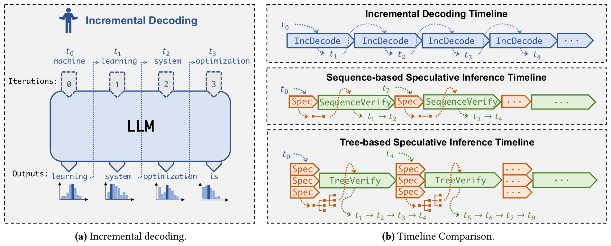

*图 1（原文 Figure 1，第 3 页）：左，增量解码；右，增量解码、序列式推测推理、树式推测推理的时间线对比。*

**图中文字翻译与读法**：

- **(a) Incremental decoding（增量解码）**：一个 LLM 方框，上方的 Iterations（迭代）0、1、2、3 依次接收输入 token $t_0$ machine、$t_1$ learning、$t_2$ system、$t_3$ optimization，下方的 Outputs（输出）依次是 learning、system、optimization、is，每次输出都对应一个概率分布直方图；虚线箭头表示上一次的输出被喂给下一次迭代。每次迭代只产出一个 token。
- **(b) Timeline Comparison（时间线对比）**：
  - **Incremental Decoding Timeline（增量解码时间线）**：一串串行的蓝色 `IncDecode` 块，每块产出一个 token（$t_1,t_2,t_3,t_4$）；
  - **Sequence-based Speculative Inference Timeline（序列式推测推理时间线）**：橙色 `Spec`（推测）块之后接绿色 `SequenceVerify`（序列验证）块，一轮验证产出 $t_1\to t_2$，下一轮产出 $t_3\to t_4$；
  - **Tree-based Speculative Inference Timeline（树式推测推理时间线）**：多个并排的 `Spec` 块（多个候选）合并成一棵树，再接一个 `TreeVerify`（树验证）块，一轮验证就产出 $t_1\to t_2\to t_3\to t_4$，下一轮产出 $t_5\to\dots\to t_8$。
- **读图结论**：这是示意图，不是实测数据；它表达的是“同样一次 LLM 调用，树式推测每次可验证并接受的 token 更多”，所以串行的 LLM 调用次数更少。

### 3.2 总览（图 2）

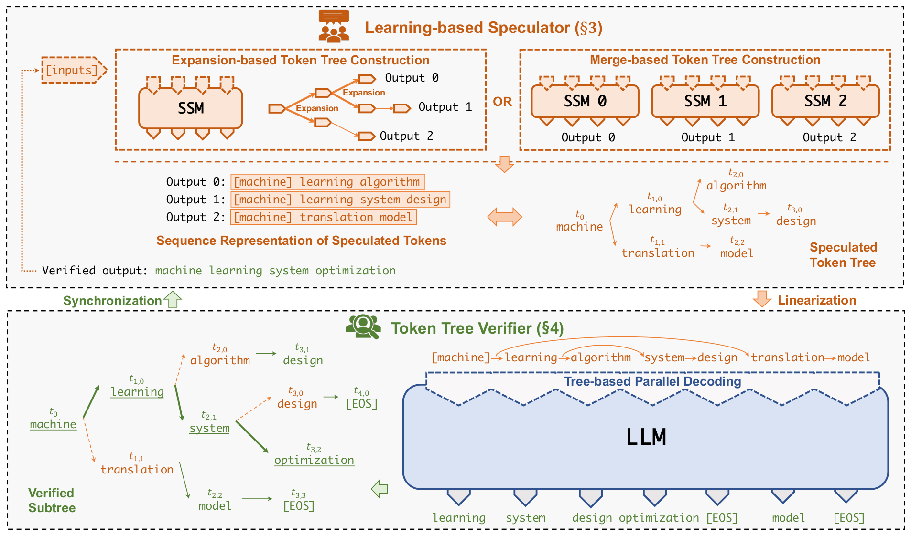

*图 2（原文 Figure 2，第 4 页）：SpecInfer 的树式推测推理与验证机制总览。*

**图中文字翻译与读法**：

- **上半部分 Learning-based Speculator（基于学习的推测器，原文第 3 节）**：输入 `[inputs]` 之后有两种构树方式（中间的 OR 表示二选一）——左边 **Expansion-based Token Tree Construction（基于展开的构树）**：单个 SSM 经 Expansion（展开）得到 Output 0、Output 1、Output 2 三条输出；右边 **Merge-based Token Tree Construction（基于合并的构树）**：SSM 0、SSM 1、SSM 2 各出一条输出。
- 下面的 **Sequence Representation of Speculated Tokens（推测 token 的序列表示）** 列出三条序列：Output 0：`[machine] learning algorithm`；Output 1：`[machine] learning system design`；Output 2：`[machine] translation model`。双向箭头连到右边的 **Speculated Token Tree（推测 token 树）**：根 $t_0$ machine，子节点 $t_{1,0}$ learning 和 $t_{1,1}$ translation；learning 有两个孩子 $t_{2,0}$ algorithm 与 $t_{2,1}$ system，system 再接 $t_{3,0}$ design；translation 接 $t_{2,2}$ model。共享的前缀 machine、learning 在树里只保存一次。
- **下半部分 Token Tree Verifier（token 树验证器，原文第 4 节）**：右侧经过 **Linearization（线性化）**，树被展平成 `[machine] learning algorithm system design translation model` 七个 token 送进 LLM 做 Tree-based Parallel Decoding（树式并行解码），LLM 在这七个位置上分别输出 learning、system、design、optimization、`[EOS]`、model、`[EOS]`。
- 左侧 **Verified Subtree（已验证子树）**：绿色加下划线的路径 machine → learning → system → optimization 是验证通过的部分，橙色是推测错误的节点；**Synchronization（同步）** 把验证结果送回推测器。图最上方写着 **Verified output（验证后的输出）：machine learning system optimization**。
- **读图结论**：这一轮里 LLM 只前向了一次，却产出了 learning、system、optimization 三个新 token（前两个是被树猜中的，最后的 optimization 是 LLM 在最后命中的节点 system 处自己输出的）。验证逻辑见 5.3 节。

### 3.3 主循环（算法 2）

SpecInfer 把推测与验证组织成下面的循环（论文算法 2 的主体）：

```text
Algorithm 2  SpecInfer 的推测与验证（主循环）
输入：输入 token 序列 I
S <- I
while true:
    N <- Speculate(S)                       # 推测器：根据当前序列 S 生成 token tree N
    O <- TreeParallelDecode(LLM, N)         # LLM 一次前向，为树中每个节点 u 产生一个 token O(u)
    if 贪心解码:  V <- VerifyGreedy(O, N)
    else:         V <- VerifyStochastic(O, N)
    for t in V:                             # V 是验证通过的 token 序列
        S.append(t)
        if t == <EOS>: return S
```

SpecInfer 把 LLM 当作**token tree 验证器**，而不是增量解码器。对树中每个 token，LLM 都把它在树里的**全部祖先**当作它前面的 token 来计算激活。例如图 2 中，节点 $t_{3,0}$（design）的注意力输出由序列 $(t_0,t_{1,0},t_{2,1},t_{3,0})$ 即 machine、learning、system、design 算出。论文强调这带来两个好处：

- **减少对 LLM 参数的访问**：增量解码每生成一个 token 就要读一遍全部参数，只要树与 LLM 的真实输出有重叠，SpecInfer 就能显著减少对 GPU 显存（以及 offloading 场景里 CPU 到 GPU）的访问，这也直接意味着更低的能耗，因为访问 GPU HBM 的能耗比浮点运算高两到三个数量级；
- **降低端到端延迟**：增量解码在一个请求内部是串行的，SpecInfer 则让一次验证 pass 同时检查整棵树，实现单个请求内的并行。

## 四、Learning-based Speculator：怎样构造 token tree

### 4.1 为什么一个候选不够：top-$k$ 命中率（表 1）

论文先做了一个观察：当 SSM 和 LLM 不一致（两者的 top-1 token 不同）时，LLM 选中的 token 通常落在 SSM 的前 $k$ 名里，且 $k$ 很小就够。表 1 统计了这件事：对 LLaMA-7B（LLM）和 LLaMA-68M（SSM），“验证成功”指的是 LLM 选出的（贪心时是 argmax，随机时是采样出的）token 落在 SSM 的 top-$k$ 之内。

**表 1：用 LLaMA-68M 的 top-$k$ token 去验证 LLaMA-7B 一个 token 的成功率**（五个 prompt 数据集的说明见 7.1 节；越高越好）

| 解码方式 | 数据集 | $k=1$ | $k=2$ | $k=3$ | $k=4$ | $k=5$ |
|---|---|---:|---:|---:|---:|---:|
| 贪心解码 | Alpaca | 68% | 77% | 81% | 84% | 85% |
| 贪心解码 | CP | 69% | 79% | 83% | 86% | 87% |
| 贪心解码 | WebQA | 62% | 72% | 77% | 80% | 82% |
| 贪心解码 | CIP | 70% | 81% | 85% | 88% | 89% |
| 贪心解码 | PIQA | 63% | 75% | 79% | 83% | 85% |
| 随机解码 | Alpaca | 54% | 81% | 91% | 95% | 97% |
| 随机解码 | CP | 56% | 82% | 92% | 95% | 97% |
| 随机解码 | WebQA | 52% | 80% | 90% | 94% | 96% |
| 随机解码 | CIP | 57% | 84% | 92% | 95% | 97% |
| 随机解码 | PIQA | 55% | 82% | 91% | 95% | 97% |

（原文表 1，第 5 页。）读法：

- 与只用 SSM 的 top-1 相比，用 top-5 可以把成功率从 70% 提到 89%（贪心，CIP）、从 57% 提到 97%（随机，CIP）；论文引言概括为“随机解码从 52–57% 提高到 96–97%”。
- 随机解码下，$k=1$ 的成功率明显低于贪心（52–57% 对 62–70%），但多给几个候选后提升更猛，$k=3$ 起就已超过 90%。整理者的解释：随机采样时 LLM 选出的 token 更分散，所以多给候选的收益更大。

### 4.2 token tree 的定义

**定义 3.1（Token Tree）**：token tree $\mathcal{N}$ 是一棵树，每个节点 $u\in\mathcal{N}$ 带一个 token 标签 $t_u$，$p_u$ 表示 $u$ 的父节点；对每个节点 $u$，$S_u$ 表示由 $S_{p_u}$ 与 $\{t_u\}$ 拼接得到的 token 序列（根节点 $r$ 的 $S_r=\{t_r\}$）。因此树里每个节点对应**从根到它的一条序列**。

### 4.3 基于展开（Expansion-based）的构树

做法：在一次 SSM 解码步里同时取出多个 token。如果每一步都选 top-$k$，候选序列数量会指数增长，推理延迟和内存开销都会大幅升高，所以论文采用**静态策略**：预设一个**展开配置** $\langle k_1,k_2,\dots,k_m\rangle$，其中 $m$ 是最多的推测解码步数，$k_i$ 是第 $i$ 步里对每个 token 要展开的子节点数。

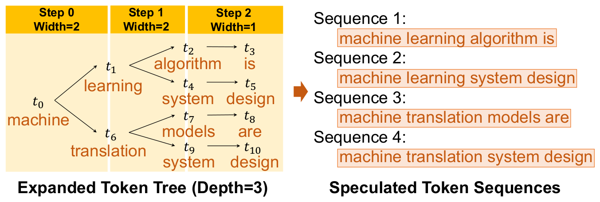

*图 3（原文 Figure 3，第 6 页）：展开配置 $\langle2,2,1\rangle$ 的 token tree 展开示意。*

**图中文字翻译与读法**：

- **左：Expanded Token Tree (Depth=3)（展开后的 token 树，深度 3）**：三个推测步依次是 Step 0（Width=2）、Step 1（Width=2）、Step 2（Width=1）。根 $t_0$ machine 展开成两个孩子 $t_1$ learning 和 $t_6$ translation；它们各再展开成两个孩子：learning 下是 $t_2$ algorithm 与 $t_4$ system，translation 下是 $t_7$ models 与 $t_9$ system；最后每个节点接一个孩子（$t_3$ is、$t_5$ design、$t_8$ are、$t_{10}$ design）。
- **右：Speculated Token Sequences（推测出的 token 序列）**：这棵树对应四条序列：`machine learning algorithm is`、`machine learning system design`、`machine translation models are`、`machine translation system design`。
- **读图结论**：配置 $\langle2,2,1\rangle$ 一共推测了 $2+4+4=10$ 个 token（$t_1\ldots t_{10}$）、4 条根到叶的序列。如果把四条序列分别送给 LLM，共 $4\times4=16$ 个 token 位置（含根），树只需 11 个节点，共享前缀被合并了（整理者核算）。

论文说明，实验表明哪怕是这样简单的静态策略也能得到相当准确的推测；**动态地**扩展 token tree 是一个开放问题，留作未来工作（[EAGLE-2](../eagle_2/论文中文解读.md) 后来正是沿着这个方向，用草稿模型的置信度动态决定树形）。

### 4.4 基于合并（Merge-based）的构树

做法：用多个 SSM 联合预测 LLM 的输出，每个 SSM 的输出都是一棵 token tree，再用 **token tree merge** 把它们合并成一棵树。

**定义 3.2（Token Tree Merge）**：$\mathcal{M}$ 是 $m$ 棵 token tree $\{\mathcal{N}_i\}$ 的合并，当且仅当对任意 $i$ 和任意 $u\in\mathcal{N}_i$，存在 $v\in\mathcal{M}$ 使 $S_v=S_u$，反之亦然。直观上，合并得到的新树恰好包含原来各树的全部 token 序列。

为了让多个 SSM 的输出互补，论文用**无监督的 boost-tuning**：借助自适应提升（adaptive boosting），在通用文本语料（实验中用 OpenWebText）上让一组 SSM 联合去对齐 LLM 的输出。具体做法是：

1. 把文本语料转成一批 prompt 样本，并让 LLM 为每个 prompt 生成后续 token 序列；
2. 先把**一个** SSM 微调到极致，并标记出 SSM 与 LLM 生成了相同后续 token 的所有 prompt 样本；
3. 过滤掉这些已被标记的样本，用语料里**剩下**的样本去把下一个 SSM 微调到极致；
4. 对池里的每个 SSM 重复这一过程。

这样得到的一组多样化 SSM，其聚合输出在训练语料上与 LLM 的输出大部分重叠。所有 SSM 的推理延迟相同，因此让它们分别在不同 GPU 上并行运行，不会比单个 SSM 增加推测延迟；系统还用**数据并行**在多 GPU 上服务 SSM，所以多个 SSM 也不会增加每块 GPU 的内存开销。论文还说，除 boosting 外，投票、bagging、stacking 等集成方法也可以用来组合多个 SSM，留作未来工作。

## 五、Token Tree Verifier：怎样一次验证整棵树

### 5.1 树注意力（Tree Attention）

先回顾标准的因果自注意力。输入张量 $X$，第 $i$ 个注意力头：

$$
Q_i=XW_i^{Q},\quad K_i=XW_i^{K},\quad V_i=XW_i^{V},\qquad A_i=\frac{Q_iK_i^{\top}}{\sqrt d},\qquad H_i=\mathrm{softmax}\big(\mathrm{mask}(A_i)\big)V_i,\qquad O=(H_1,\dots,H_h)W^{O},
$$

其中 $A_i$ 是 $l\times l$ 的注意力分数矩阵（$l$ 为序列长度），因果掩码为

$$
\mathrm{mask}(A)_{jk}=\begin{cases}A_{jk},& j\ge k,\\ -\infty,& j<k.\end{cases}
$$

即第 $j$ 个 token 看不到后面的 token（原文脚注：用 $-\infty$ 而不是 0，是为了保证 softmax 在这些位置输出 0）。

**定义 4.1（Tree Attention）**：对 token tree $\mathcal{N}$ 与任意节点 $u\in\mathcal{N}$，它的树注意力定义为在序列 $S_u$（即 $u$ 所代表的 token 序列）上做原本的序列注意力：

$$
\mathrm{TreeAttention}(u)=\mathrm{Attention}(S_u),\qquad\forall u\in\mathcal{N}.
$$

由于每条序列都被合并树里的某个节点覆盖，对 token tree 做树注意力就能得到所有序列的注意力输出。

### 5.2 树式并行解码：共享 KV cache 与拓扑感知因果掩码（图 4）

难点在于 KV cache：树里不同的序列可能有**冲突的 KV cache**。例如下图中，序列 $(t_2,t_3,t_4,t_5)$ 与 $(t_2,t_3,t_8,t_9)$ 在第三、第四个位置的 key 和 value 就不一样。

最直接的做法是沿用现有系统的**序列式解码**：把树拆成多条序列，每条序列用自己的 KV cache 和自己的 kernel（图 4 左）。但这样计算代价很高：共享前缀的序列在公共前缀上有相同的注意力输出，会被重复计算；而且每条序列启动一个 kernel，还带来额外的 kernel 启动开销。SpecInfer 用两项技术实现树式并行解码：

1. **用深度优先搜索更新 KV cache**：不再为每条序列单独缓存，而是让所有序列共用同一份 KV cache，按深度优先顺序遍历 token tree（图 4 中依次访问 $t_2,t_3,\dots,t_9$）并更新共享的 KV cache，使计算新 token 的注意力时总能得到正确的前序 key 和 value。
2. **拓扑感知因果掩码（topology-aware causal mask）**：为把所有 token 的树注意力融合进**单个 kernel**，SpecInfer 把整棵树（已验证 token $t_2$ 加全部推测 token $t_3,\dots,t_9$）按树拓扑而不是原序列拓扑一次性放进 KV cache 当作输入。这样做会让注意力分数违反因果依赖（例如 $t_7$ 的注意力用到了此前所有 token，包括不在 $t_7$ 序列里的 $t_5$），于是 SpecInfer 按树的拓扑更新因果掩码来修正这些位置。这样算出的注意力输出与增量解码**完全相同**，而 kernel 启动次数比序列式解码少得多。

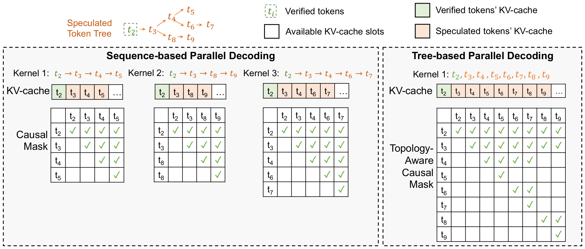

*图 4（原文 Figure 4，第 8 页）：SpecInfer 的树式并行解码与现有序列式解码的对比。*

**图中文字翻译与读法**：

- **顶部**：Speculated Token Tree（推测 token 树）：已验证 token $t_2$（虚线绿框 Verified tokens），其后 $t_3$ 分叉，一支 $t_4$，再分叉为 $t_5$ 和 $t_6\to t_7$，另一支 $t_8\to t_9$。图例：绿底是 Verified tokens' KV-cache（已验证 token 的 KV cache），橙底是 Speculated tokens' KV-cache（推测 token 的 KV cache），白底是 Available KV-cache slots（可用的空 KV cache 槽位）。
- **左：Sequence-based Parallel Decoding（序列式并行解码）**：三个 kernel 各处理一条序列——Kernel 1：$t_2\to t_3\to t_4\to t_5$；Kernel 2：$t_2\to t_3\to t_8\to t_9$；Kernel 3：$t_2\to t_3\to t_4\to t_6\to t_7$。每个 kernel 有自己独立的 KV-cache（如 $t_2,t_3,t_4,t_5$），以及自己的普通 Causal Mask（因果掩码）。
- **右：Tree-based Parallel Decoding（树式并行解码）**：只有一个 Kernel 1，输入 $t_2,t_3,\dots,t_9$ 全部 8 个 token，共用一份 KV-cache（$t_2$ 到 $t_9$ 依次排开），掩码是 Topology-Aware Causal Mask（拓扑感知因果掩码）。
- **掩码怎么读**：图中矩阵的**行是被关注的 token，列是发起关注的 token**，打勾表示允许。普通因果掩码是上三角（每个 token 只能被自己和之后的 token 看到）；拓扑感知掩码里，每一列的勾恰好是该 token 的祖先加它自己，例如 $t_7$ 一列的勾落在 $t_2,t_3,t_4,t_6,t_7$，没有 $t_5$。
- **读图结论**：序列式要处理 $4+4+5=13$ 个 token 位置并启动 3 个 kernel，公共前缀 $t_2,t_3$（以及 $t_4$）被重复计算；树式只处理 8 个 token，启动 1 个 kernel，KV cache 也只占 8 个槽而不是 13 个。

**数值例子（整理者补充，把图 4 的树式掩码按常见的“行是 query、列是 key”方向写出）**：树里父子关系为 $t_3\!\leftarrow\! t_2$，$t_4\!\leftarrow\! t_3$，$t_8\!\leftarrow\! t_3$，$t_5\!\leftarrow\! t_4$，$t_6\!\leftarrow\! t_4$，$t_7\!\leftarrow\! t_6$，$t_9\!\leftarrow\! t_8$。每个 token 只允许关注自己和祖先：

| query 与 key | $t_2$ | $t_3$ | $t_4$ | $t_5$ | $t_6$ | $t_7$ | $t_8$ | $t_9$ |
|---|:-:|:-:|:-:|:-:|:-:|:-:|:-:|:-:|
| $t_2$ | ✓ | | | | | | | |
| $t_3$ | ✓ | ✓ | | | | | | |
| $t_4$ | ✓ | ✓ | ✓ | | | | | |
| $t_5$ | ✓ | ✓ | ✓ | ✓ | | | | |
| $t_6$ | ✓ | ✓ | ✓ | | ✓ | | | |
| $t_7$ | ✓ | ✓ | ✓ | | ✓ | ✓ | | |
| $t_8$ | ✓ | ✓ | | | | | ✓ | |
| $t_9$ | ✓ | ✓ | | | | | ✓ | ✓ |

共 $1+2+3+4+4+5+3+4=26$ 个允许位置，与图 4 右侧矩阵的勾数一致。若改用普通下三角因果掩码（按深度优先顺序 $t_2,\dots,t_9$ 展平），$t_7$ 会看到 $t_5$，$t_8$ 会看到 $t_4,t_5,t_6,t_7$，都违反了“只看自己的前缀”这一条；而分别处理三条序列需要 $10+10+15=35$ 个允许位置（整理者核算）。实现提示（论文未讨论）：位置编码也应按树的深度而不是展平后的下标赋值。

### 5.3 验证：贪心解码

对给定的推测树 $\mathcal{N}$，SpecInfer 先用树式并行解码得到输出张量 $\mathcal{O}$，其中包含树里每个节点 $u$ 对应的 LLM 输出 token $\mathcal{O}(u)$（即 LLM 看到从根到 $u$ 的序列之后会生成的下一个 token）。然后根据解码方式验证：

```text
function VerifyGreedy(O, N):
    V <- 空；u <- N 的根
    while 存在 u 的子节点 v 满足 t_v == O(u):    # 某个子节点的 token 恰好等于 LLM 在 u 处的输出
        V.append(t_v);  u <- v                   # 命中：沿这个子节点继续
    V.append(O(u))                               # 没有子节点命中：补上 LLM 自己的输出，结束
    return V
```

**用图 2 的例子走一遍（整理者补充）**：LLM 的输出是 $\mathcal{O}$(machine)=learning，$\mathcal{O}$(learning)=system，$\mathcal{O}$(system)=optimization 等。从根 machine 出发：

1. $\mathcal{O}$(machine)=learning，根有子节点 learning，命中，$V=[\text{learning}]$，走到 learning；
2. $\mathcal{O}$(learning)=system，learning 的孩子里有 system（另一个是 algorithm），命中，$V=[\text{learning},\text{system}]$，走到 system；
3. $\mathcal{O}$(system)=optimization，而 system 唯一的孩子是 design，没有命中，于是把 $\mathcal{O}$(system)=optimization 补上，结束，$V=[\text{learning},\text{system},\text{optimization}]$。

本轮一次 LLM 前向得到 3 个新 token；如果只推测 Output 0 这一条链（machine learning algorithm），第二步 $\mathcal{O}$(learning)=system 与孩子 algorithm 不符，只能得到 learning、system 两个 token。多分支提高了命中机会。贪心验证的结果与增量解码逐 token 完全相同。

### 5.4 验证：随机解码与多步推测采样（MSS）

随机解码从概率分布 $P(u_i\mid u_0,\dots,u_{i-1};\Theta_{\mathrm{LLM}})$ 里采样下一个 token。SpecInfer 提出 **multi-step speculative sampling（MSS）**，伪代码是算法 2 里的 VerifyStochastic，过程在图 5 中示意。

```text
function VerifyStochastic(O, N):
    V <- 空；u <- N 的根
    while u 不是叶子:
        H <- child(u)                                   # u 的子节点集合
        while H 非空:
            随机选一个子节点 s ∈ H；r ~ U(0,1)；x_s <- H[s]
            if r <= P(x_s | u, Θ_LLM) / P(x_s | u, Θ_SSM_s):
                V.append(x_s);  u <- s;  break          # x_s 通过验证，沿它继续
            else:
                # 被拒绝：把 LLM 分布换成归一化的残差分布，并删掉这个子节点
                P(x | u, Θ_LLM) <- norm( max(0, P(x | u, Θ_LLM) - P(x | u, Θ_SSM_s)) )
                H.pop(s)
        if H 为空: break                                # 所有孩子都失败了
    x_next ~ P(x | u, Θ_LLM)      # 所有 SSM 都失败：从（残差）LLM 分布采样下一个 token；到叶子时则是多采的一个
    V.append(x_next)
    return V
```

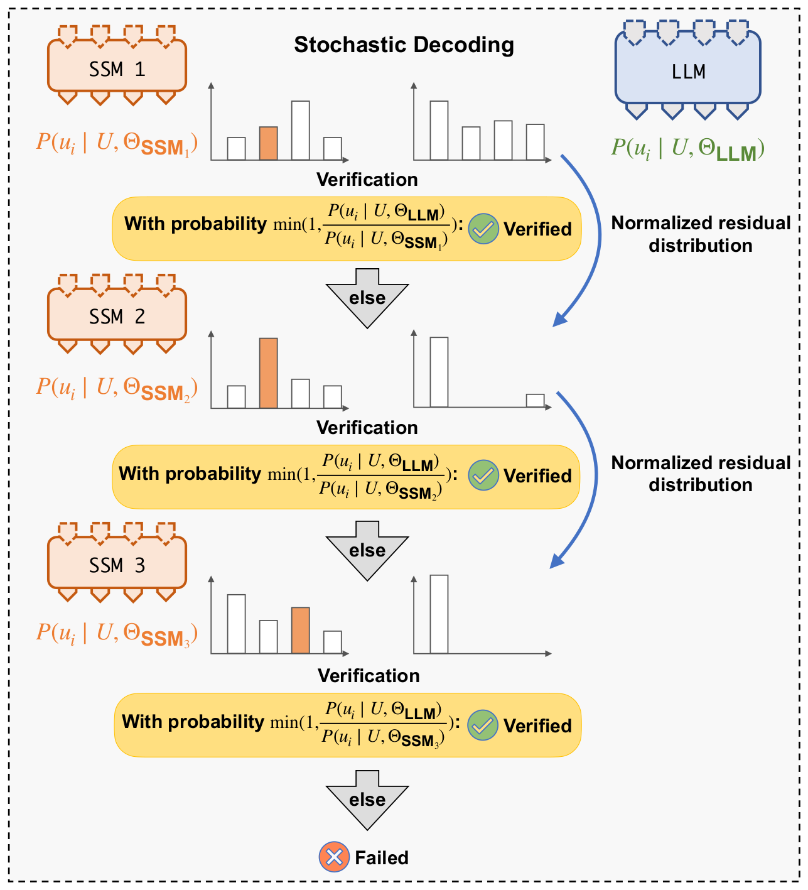

*图 5（原文 Figure 5，第 8 页）：用多步推测采样验证随机解码的 LLM 的机制示意。*

**图中文字翻译与读法**：

- 标题 **Stochastic Decoding（随机解码）**。左列自上而下是 SSM 1、SSM 2、SSM 3，每个 SSM 旁边的直方图是它给出的分布 $P(u_i\mid U,\Theta_{\mathrm{SSM}_k})$，橙色柱子是该 SSM 提议的那个 token；右上角蓝色的 LLM 是目标分布 $P(u_i\mid U,\Theta_{\mathrm{LLM}})$（右侧的直方图）。
- 每一层有一个 **Verification（验证）** 黄色框：**With probability** $\min\big(1,\tfrac{P(u_i\mid U,\Theta_{\mathrm{LLM}})}{P(u_i\mid U,\Theta_{\mathrm{SSM}_k})}\big)$：**Verified**（以这个概率通过验证）；**else**（否则）进入下一个 SSM。
- 蓝色弯箭头 **Normalized residual distribution（归一化残差分布）**：某个 SSM 的提议被拒绝后，LLM 的分布被更新为 $\mathrm{norm}(\max(0,P_{\mathrm{LLM}}-P_{\mathrm{SSM}}))$ 再用于下一个 SSM。图中第二层的 LLM 分布只剩第一根和最后一根很短的柱子，第三层只剩第一根。
- 底部 **Failed（失败）**：三个 SSM 都没通过验证。
- **读图结论**：多个候选是**依次**检验的，每次被拒绝都会把已经“被这个 SSM 覆盖的那部分概率质量”从 LLM 分布里扣掉，所以后面的检验面对的是越来越窄的残差分布；全部失败时从最后的残差分布采样，因此分布仍然精确。

**算法逐步解释**（以一个节点 $u$ 为例，记 LLM 在 $u$ 处的分布为 $P_L$，第 $s$ 个孩子对应的 SSM 分布为 $Q_s$）：

1. 在 $u$ 的所有孩子里**随机**挑一个孩子，设它的 token 是 $x_s$，它是由 SSM$_s$ 提议的；
2. 以 $\min\big(1,P_L(x_s)/Q_s(x_s)\big)$ 的概率接受：接受就把 $x_s$ 加入已验证序列，跳到这个孩子，在它那里继续（回到第 1 步）；
3. 被拒绝：令 $P_L\leftarrow\mathrm{norm}\big(\max(0,P_L-Q_s)\big)$，把这个孩子从候选里删掉，再从剩下的孩子里挑下一个；
4. 若所有孩子都被拒绝，就从当前（残差后的）$P_L$ 里采一个 token 作为本步的结果，验证结束；若沿着接受的路径一直走到叶子，则在叶子处从 $P_L$ 再多采一个 token。

当 $u$ 只有一个孩子时，这就是 [Leviathan 等与 Chen 等的单步推测采样](../speculative_sampling/论文中文解读.md)；“多步”就是在一个节点上对多个孩子**连续多次**尝试，并在每次失败后更新残差分布。

**数值例子（整理者补充，不是论文数字）**：词表 $\{A,B,C\}$。LLM 在节点 $u$ 的分布 $P_L=(0.5,0.3,0.2)$；两个 SSM 的分布分别为 $Q_1=(0.2,0.2,0.6)$ 和 $Q_2=(0.1,0.7,0.2)$。SSM$_1$ 提议了 C，SSM$_2$ 提议了 B，随机检验顺序先 C 后 B：

1. 检验 C：接受概率 $\min(1,\,0.2/0.6)=1/3$。设随机数 $r=0.5>1/3$，拒绝。
2. 残差：$P_L-Q_1=(0.3,\,0.1,\,-0.4)$，取正部分 $(0.3,0.1,0)$，归一化得 $P_L'=(0.75,\,0.25,\,0)$。
3. 检验 B（现在用 $P_L'$ 和 $Q_2$）：接受概率 $\min(1,\,0.25/0.7)=5/14\approx0.357$。设 $r=0.2\le0.357$，通过，已验证 token 是 B，沿 B 的子树继续。
4. 如果第 3 步 B 也被拒绝：$P_L'-Q_2=(0.65,\,-0.45,\,-0.2)$，取正部分归一化得 $(1,0,0)$，则下一个 token 必为 A。

**这套顺序检验到底有没有保持分布？** 整理者对这个小例子做了精确枚举：两个 SSM 各自独立地从 $Q_1$、$Q_2$ 采样一个 token（共 9 种组合），两个孩子的检验顺序各以 1/2 的概率随机选取（为了演示精确性，同一个 token 被两个 SSM 同时提议时，当作独立的两次检验；论文的树里则会把它合并成一个节点，原文没有展开这种情形）。最终输出 A、B、C 的概率恰好是 $(0.5,0.3,0.2)=P_L$。同时：

- 单个 SSM 提议一个 token 的接受概率是 $\sum_x\min(P_L,Q)=0.6$（对 $Q_1$ 与 $Q_2$ 都是 0.6）；
- 两个 SSM 都提议、用 MSS 检验时，“至少有一个提议通过”的概率是 $0.71$；
- 如果改用下面的**朴素采样**（先直接从 $P_L$ 采一个 token，再看它在不在提议集合里），命中概率只有 $0.504$。

**朴素采样（naive sampling，NS）与定理 4.2、4.3**：

- 一个更直接、同样**保持分布**的做法是：直接从 $P(u_i\mid U;\Theta_{\mathrm{LLM}})$ 采样下一个 token $x$，然后检查 $x$ 是不是推测树里 $u_{i-1}$ 的某个子节点。论文称之为朴素采样（NS）。它是正确的，只是命中率更低。
- **定理 4.2**：对给定的 LLM 和 $m$ 个 SSM，对任意前缀 $U$、token $u_i$，MSS 采样 $u_i$ 的概率分布与 LLM 的分布完全一致：$P(u_i\mid U;\Theta_{\mathrm{LLM}})=P_{\mathrm{SpecInfer}}(u_i\mid U;\Theta_{\mathrm{LLM}},\{\Theta_{\mathrm{SSM}_j}\})$。**证明在原文参考文献 [28]（同一 arXiv 编号 2305.09781 的 2023 年早期版本，题目略有不同）里，本 PDF（v4）不含证明**。
- **定理 4.3**：MSS 的拒绝概率不高于 NS：$P(\text{reject}\mid\text{MSS})\le P(\text{reject}\mid\text{NS})$，对所有 $U,\Theta_{\mathrm{LLM}},\{\Theta_{\mathrm{SSM}_j}\}$ 成立。证明同样在 [28]。
- 论文说明：已有工作提出的是面向序列式推测的**单步**推测采样；SpecInfer 用 token tree，需要不同的验证算法，对一个 token 的所有分支做**多步**验证，以在保持与增量解码等价的同时最大化成功率。MSS 既适用于多 SSM 的 merge-based 方法，也支持单个 SSM 配合 top-$k$ 采样的 expansion-based 方法。

## 六、系统设计与实现

### 6.1 运行时设计（图 6）

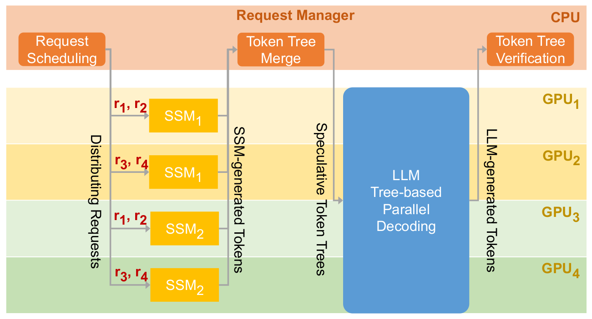

*图 6（原文 Figure 6，第 9 页）：SpecInfer 一次推测推理与验证迭代的工作流。SpecInfer 用数据并行服务 SSM，用张量模型并行加流水线模型并行服务 LLM。*

**图中文字翻译与读法**：

- 上方橙色条是 **Request Manager（请求管理器）**，运行在 CPU 上，包含三个模块：**Request Scheduling（请求调度）**、**Token Tree Merge（token 树合并）** 和 **Token Tree Verification（token 树验证）**。
- 下方是 GPU$_1$ 到 GPU$_4$。**Distributing Requests（分发请求）**：请求 $r_1,r_2$ 发给 GPU$_1$ 上的 SSM$_1$，$r_3,r_4$ 发给 GPU$_2$ 上的 SSM$_1$，$r_1,r_2$ 发给 GPU$_3$ 上的 SSM$_2$，$r_3,r_4$ 发给 GPU$_4$ 上的 SSM$_2$——两个 SSM 各占两块 GPU，用数据并行；
- 各 SSM 生成的 token（**SSM-generated Tokens**）回到 Token Tree Merge，合并成每个请求的推测 token 树（**Speculative Token Trees**），送给横跨四块 GPU 的 **LLM Tree-based Parallel Decoding（LLM 树式并行解码）**；LLM 生成的 token（**LLM-generated Tokens**）再回到 Request Manager 的 Token Tree Verification。
- **读图结论**：**验证是在 Request Manager（CPU 侧）里，用 LLM 输出的 token 对照推测树完成的**，LLM 一侧只负责树式并行解码；Request Manager 与 GPU worker 之间只传 token，不传这些 token 的向量表示，通信开销可忽略。

论文给出的系统要点：

- **请求调度**：沿用 Orca 的**迭代级调度**（continuous batching）：以 LLM 解码的一次迭代而不是整个请求为调度粒度，每次迭代后检查每个请求的状态、把已完成请求的结果发回客户端，新到达的请求不必等当前所有请求结束就能开始处理。
- **SSM 服务**：SSM 很小，一块 GPU 就放得下，SpecInfer 把 GPU 平均分给各个 SSM，并用数据并行服务它们；各 SSM 生成的 token 回到请求管理器，用 token tree merge 为每个请求合成一棵推测树。
- **LLM 服务**：采用 Megatron-LM 的混合并行策略：节点内用张量模型并行切分每个 Transformer 层，跨节点用流水线模型并行切分层。所有 GPU 都执行树式并行解码来计算树注意力分数，把 LLM 生成的 token 送回请求管理器做验证（见 5.3、5.4 节）。
- 请求管理器自己的开销（请求调度、树合并、验证）与 LLM 推理的执行时间相比可以忽略。

### 6.2 实现

- SpecInfer 建在 **FlexFlow** 之上（分布式多 GPU 的 DNN 运行时）。FlexFlow 提供按层定义 DNN 的 API，与 PyTorch 的模型定义兼容，HuggingFace 的开源 LLM 可以不改动直接导入；用户也可以指定每层的数据、模型、流水线并行度。
- **CUDA kernel 优化**：直接调用 cuBLAS/cuDNN 来算注意力会有较高的 kernel 启动开销，也没有利用现代 GPU 的共享内存，因此 SpecInfer 在 FasterTransformer 之上写了定制的注意力 kernel：每个线程块负责一个请求的一个注意力头，先把 query 张量载入共享内存；各线程分别算 query/key 乘积的一段并广播结果，用来求最大值和指数和。为支持树式并行解码，kernel 并行计算树里全部 token，并用拓扑感知因果掩码保证因果性。

### 6.3 推测与验证带来的开销

SpecInfer 以额外的内存和计算开销换取加速，论文分析认为这些开销通常比 LLM 本身的内存和计算开销小一到两个数量级。

- **内存开销**：(1) 保存一个或多个 SSM 的参数；实验表明用比 LLM 小 100–1000 倍的 SSM 就能取得显著提升，所以每个 SSM 使总内存需求增加不到 1%。(2) 树验证引擎要验证整棵树而不是解码一个 token，所以要额外为所有 token 缓存 key、value 并存储注意力分数；由于当今 LLM 服务必须支持很长的序列，论文观察到树带来的内存开销与 KV cache 相比可以忽略。
- **计算开销**：(1) SSM 要以增量解码方式生成候选 token；多个 SSM 时 SpecInfer 在多块 GPU 上并行处理它们以降低推测延迟。(2) 验证要为整棵树计算注意力输出，其中大部分与 LLM 的真实输出不匹配，对增量解码来说是不必要的计算；但现有系统的 KV cache 机制使它们无法并行服务很多请求，GPU 计算资源因此在增量解码下用不满，SpecInfer 的树验证正好利用这些闲置资源，所以相对增量解码的运行时开销可忽略。

### 6.4 论文点出的两个应用场景

- **分布式 LLM 推理**：现代 LLM 的内存需求超过单个计算节点，通常要把参数分布在多块 GPU 上（例如服务一个 GPT-3 175B 的推理流水线，用单精度存参数要 16 块以上 A100-40GB）。分布式推理主要受限于每个解码步里 GPU 之间传输中间激活的延迟。SpecInfer 并不直接减少 GPU 间通信量，但验证机制能**增大通信粒度、减少解码步数**。
- **基于 offloading 的 LLM 推理**：把 LLM 参数存在 CPU DRAM，每次只把一部分参数以流水方式搬到 GPU 计算（FlexGen）。SpecInfer 机会性地一次验证多个 token，减少解码步数和 CPU DRAM 与 GPU HBM 之间的总通信量。

## 七、实验

### 7.1 实验设置

- **LLM**：LLaMA-7B、OPT-13B、OPT-30B、LLaMA-65B；**SSM**：LLaMA-68M 和 OPT-125M；权重都来自 HuggingFace。（多个 SSM 如何 boost-tune，论文放在 arXiv 版的 [28] 里。）
- **数据集**：Chatbot Instruction Prompts（CIP）、ChatGPT Prompts（CP）、WebQA、Alpaca、PIQA 五个。只取其中的 prompt/问题来构造输入，模拟真实对话负载。
- **平台**：两台 AWS g5.12xlarge，每台 4 块 NVIDIA A10 24GB GPU、48 个 CPU 核、192 GB DRAM；节点间 100 Gbps 以太网。
- **构树方式与配置**：主实验用 expansion-based 构树，展开配置为 $\langle1,1,3,1,1,1,1,1\rangle$（论文说它在这些基准上表现好）；expansion 与 merge 两种构树方式的对比在 arXiv 版 [28] 里，**本 PDF 的实验不含 merge-based 的结果**。树宽、树式并行解码和 MSS 的消融分别在 7.4、7.5、7.6 节。
- **度量**：每个 prompt 让所有系统最多生成 128 个新 token，报告平均每 token 延迟；SpecInfer 因每次迭代可能验证多个 token，可能生成超过 128 个，此时截断到 128 个。

### 7.2 分布式 LLM 推理（图 7）

比较对象：vLLM、HuggingFace Text Generation Inference（TGI）、FasterTransformer；LLaMA-7B 在 1 块 GPU、OPT-30B 在 4 块 GPU（半精度、张量并行）、LLaMA-65B 因单节点 4 块 GPU 放不下，在两个节点共 8 块 A10 上（节点内张量并行、节点间流水线并行；vLLM 和 TGI 不支持流水线并行，无法服务多节点，所以 LLaMA-65B 只比较 FasterTransformer 与 SpecInfer）。为排除实现差异的影响，还设了两个 SpecInfer 自己的对照：**SpecInfer w/ Incremental Decoding**（推测器生成空树，验证器每步只验证一个 token，测的是本文实现在增量解码下的性能）；**SpecInfer w/ Sequence-based Speculative Inference**（用单个预训练 SSM 做序列式推测，作为现有推测推理系统的参照）。

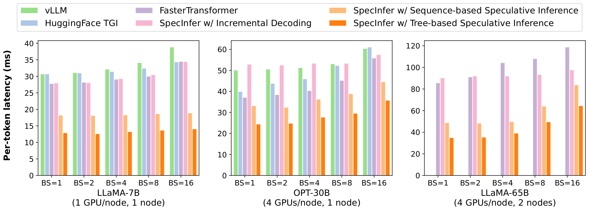

*图 7（原文 Figure 7，第 12 页）：SpecInfer 与现有系统的端到端推理延迟对比。括号里的数字是服务每个 LLM 所用的 GPU 数和节点数。所有系统都用张量并行（节点内）加流水线并行（节点间）。*

**图中文字翻译与读法**：

- 图例六个系统：vLLM、HuggingFace TGI、FasterTransformer、SpecInfer w/ Incremental Decoding（SpecInfer 增量解码）、SpecInfer w/ Sequence-based Speculative Inference（SpecInfer 序列式推测）、SpecInfer w/ Tree-based Speculative Inference（SpecInfer 树式推测，深橙色）。
- 三个子图依次是 LLaMA-7B（1 GPU/node，1 node）、OPT-30B（4 GPUs/node，1 node）、LLaMA-65B（4 GPUs/node，2 nodes）。横轴是 batch size（BS=1,2,4,8,16），纵轴是 Per-token latency (ms)（每 token 延迟，越低越好）。LLaMA-65B 子图没有 vLLM 和 TGI 的柱子。
- 下面三张表是整理者从矢量图坐标反算的柱高（单位 ms，精度约 $\pm0.2$ ms）：

**LLaMA-7B（1 块 GPU）**

| BS | vLLM | HF TGI | FasterTransformer | SpecInfer 增量解码 | SpecInfer 序列式推测 | SpecInfer 树式推测 |
|---:|---:|---:|---:|---:|---:|---:|
| 1 | 30.7 | 30.7 | 27.8 | 28.0 | 18.2 | 12.9 |
| 2 | 31.1 | 31.0 | 28.2 | 28.1 | 18.2 | 12.6 |
| 4 | 32.2 | 31.5 | 29.1 | 29.3 | 18.3 | 13.3 |
| 8 | 34.1 | 32.4 | 30.0 | 30.5 | 18.7 | 13.7 |
| 16 | 38.9 | 34.4 | 34.5 | 34.5 | 18.9 | 14.1 |

**OPT-30B（4 块 GPU，单节点）**

| BS | vLLM | HF TGI | FasterTransformer | SpecInfer 增量解码 | SpecInfer 序列式推测 | SpecInfer 树式推测 |
|---:|---:|---:|---:|---:|---:|---:|
| 1 | 50.2 | 40.0 | 37.2 | 52.9 | 33.2 | 24.5 |
| 2 | 50.6 | 43.8 | 38.5 | 52.6 | 32.5 | 24.9 |
| 4 | 51.3 | 46.0 | 40.4 | 53.4 | 36.3 | 27.7 |
| 8 | 53.2 | 52.3 | 45.3 | 53.4 | 38.9 | 29.6 |
| 16 | 60.4 | 61.1 | 55.9 | 57.5 | 44.6 | 35.8 |

**LLaMA-65B（8 块 GPU，两个节点）**

| BS | FasterTransformer | SpecInfer 增量解码 | SpecInfer 序列式推测 | SpecInfer 树式推测 |
|---:|---:|---:|---:|---:|
| 1 | 85.7 | 90.4 | 48.9 | 35.0 |
| 2 | 91.2 | 92.1 | 48.4 | 35.5 |
| 4 | 104.4 | 92.1 | 49.8 | 39.2 |
| 8 | 108.1 | 93.4 | 64.2 | 49.7 |
| 16 | 118.8 | 97.8 | 83.8 | 64.6 |

**论文给出的结论**：

- SpecInfer 用增量解码时与现有系统性能相当，因为各系统用相同的并行策略和相同的 kernel 库（cuDNN、cuBLAS、cuTLASS）；
- 用树式推测推理与验证，SpecInfer 相对增量解码系统：单节点多 GPU 推理快 **1.5–2.5 倍**，多节点多 GPU 推理快 **2.4–2.8 倍**，同时对所有 prompt 生成与增量解码**完全相同的 token 序列**；
- 相对**序列式推测推理**，树式再降低 LLM 服务延迟 **1.2–1.5 倍**，来自三点：用 token tree 提高推测效果、用树式并行解码并行验证整棵树、用 MSS 提高验证表现；
- 加速来自利用闲置 GPU 资源做树式并行解码，同时保持与增量解码相同的**每次迭代延迟**；batch size 增大时增量解码本身的并行计算更多，闲置资源变少，所以 SpecInfer 的优势随之缩小（但 batch 增大同样使每个请求的端到端延迟升高，见图 7）；总体而言 SpecInfer 对低延迟 LLM 推理最有利。

**整理者对照图上读数的核算与提醒**：

- 树式推测相对 FasterTransformer：LLaMA-7B 约 2.2–2.5 倍，OPT-30B 约 1.5–1.6 倍，LLaMA-65B 在 BS=1、2、4 时约 2.5–2.7 倍，BS=8 时约 2.2 倍，BS=16 时约 1.8 倍。**LLaMA-65B 在 BS=8、16 时低于正文给出的“2.4–2.8 倍”**，正文区间似乎只对应较小的 batch；整理者没有找到这个差异的原因。
- 相对 SpecInfer 序列式推测，树式的延迟比为 LLaMA-7B 约 1.34–1.44，OPT-30B 约 1.25–1.36，LLaMA-65B 约 1.27–1.40，与正文的 1.2–1.5 倍一致。
- “相对增量解码快多少”取决于选哪个基线：OPT-30B 在小 batch 下，FasterTransformer（约 37 ms）比 SpecInfer 自己的增量解码（约 53 ms）快得多，所以相对 FasterTransformer 只有约 1.5 倍，相对 SpecInfer 增量解码则约 2.2 倍。

### 7.3 基于 offloading 的 LLM 推理（图 8）

比较 SpecInfer 与 FlexGen，在单块 24GB A10 上服务 OPT-13B 和 OPT-30B（两者都超出一块 A10 的显存，必须 offloading）。SpecInfer 与 FlexGen 都把全部模型参数保留在 CPU DRAM 中，计算时把需要的权重从 CPU 加载到 GPU。

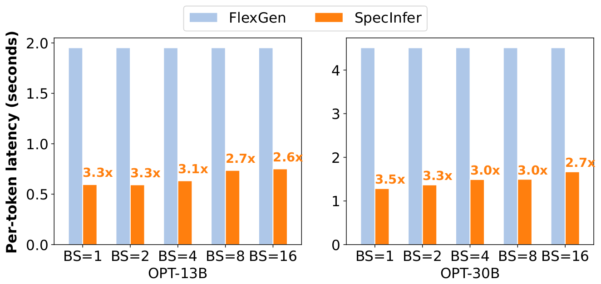

*图 8（原文 Figure 8，第 12 页）：FlexGen 与 SpecInfer 基于 offloading 的端到端推理延迟对比。两者都在单块 24GB A10 GPU 上用模型 offloading 服务 OPT-13B 与 OPT-30B。*

**图中文字翻译与读法**：

- 图例：浅蓝色是 FlexGen，橙色是 SpecInfer。左右两个子图分别是 OPT-13B 和 OPT-30B，横轴是 batch size（BS=1 到 16），纵轴是 Per-token latency (seconds)（每 token 延迟，秒；右图沿用左图的单位）。橙色柱子上方的数字是 SpecInfer 相对 FlexGen 的加速倍数。
- 下表是整理者从矢量图坐标反算的柱高（秒，约），加速倍数是原图标注：

| 模型 | BS | FlexGen（秒/token） | SpecInfer（秒/token） | 原图标注的加速 |
|---|---:|---:|---:|---:|
| OPT-13B | 1 | 约 1.95 | 约 0.60 | 3.3x |
| OPT-13B | 2 | 约 1.95 | 约 0.59 | 3.3x |
| OPT-13B | 4 | 约 1.95 | 约 0.63 | 3.1x |
| OPT-13B | 8 | 约 1.95 | 约 0.74 | 2.7x |
| OPT-13B | 16 | 约 1.95 | 约 0.75 | 2.6x |
| OPT-30B | 1 | 约 4.51 | 约 1.28 | 3.5x |
| OPT-30B | 2 | 约 4.51 | 约 1.37 | 3.3x |
| OPT-30B | 4 | 约 4.51 | 约 1.49 | 3.0x |
| OPT-30B | 8 | 约 4.51 | 约 1.50 | 3.0x |
| OPT-30B | 16 | 约 4.51 | 约 1.67 | 2.7x |

- **读图结论**：相对 FlexGen，SpecInfer 每 token 延迟降低 **2.6–3.5 倍**。论文的解释是 offloading 推理主要受 CPU DRAM 与 GPU HBM 之间加载 LLM 参数的通信瓶颈制约，SpecInfer 通过机会性地验证多个 token，减少了 LLM 解码步数和 CPU 与 GPU 之间的数据传输。FlexGen 的柱子在各 batch size 下等高（约 1.95 秒与约 4.51 秒），与“每一步都要把参数搬一遍”的说法吻合（整理者解释）。倍数随 batch 增大而下降：SpecInfer 的延迟从 BS=1 到 BS=16 增加约 26%（OPT-13B）和约 30%（OPT-30B），整理者推测这是因为 batch 越大，一次要验证的 token 越多，不再完全被权重搬运时间掩盖。

### 7.4 token 树的构造：树宽的影响（图 9、表 2、图 10）

用 LLaMA-7B 作 LLM、LLaMA-68M 作 SSM，展开配置取 $\langle1,1,k,1,1,1,1,1\rangle$（即在第三个 token 处展开），$k$ 就是树宽。整理者核算：这种树共有 $2+6k$ 个推测 token（$k=1,\dots,5$ 依次是 8、14、20、26、32 个），树宽为 1 时就是一条长度 8 的序列（即序列式推测）。

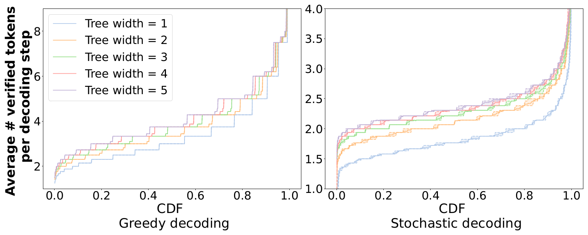

*图 9（原文 Figure 9，第 12 页）：SpecInfer 在不同 token 树结构下的推测表现（Alpaca 数据集所有 prompt 上，每个解码步平均验证的 token 数的累积分布 CDF）。*

**图中文字翻译与读法**：

- 左图 **Greedy decoding（贪心解码）**，右图 **Stochastic decoding（随机解码）**。横轴 CDF（累积分布，0 到 1，即把所有 prompt 按“每步平均验证 token 数”从小到大排序后的分位），纵轴 Average # verified tokens per decoding step（每个解码步平均验证的 token 数）。五条曲线对应 Tree width = 1、2、3、4、5，宽度越大曲线整体越靠上。
- **读图结论**：与序列式推测（树宽=1）相比，用 token tree 可把 LLM 的解码步数减少 **1.2–1.5 倍（贪心）、1.3–1.4 倍（随机）**。

**表 2：SpecInfer 每个解码步平均验证的 token 数**（LLaMA-7B 作 LLM、LLaMA-68M 作 SSM，推测长度为 8；越大越好；粗体是原表的树宽 5 一列）

| 解码方式 | 数据集 | 树宽 1 | 树宽 2 | 树宽 3 | 树宽 4 | 树宽 5 |
|---|---|---:|---:|---:|---:|---:|
| 贪心解码 | Alpaca | 2.95 | 3.07 | 3.21 | 3.33 | **3.43** |
| 贪心解码 | CP | 2.58 | 3.24 | 3.46 | 3.59 | **3.69** |
| 贪心解码 | WebQA | 2.27 | 2.69 | 2.86 | 2.98 | **3.07** |
| 贪心解码 | CIP | 2.73 | 3.40 | 3.62 | 3.79 | **3.91** |
| 贪心解码 | PIQA | 2.18 | 2.80 | 2.97 | 3.10 | **3.21** |
| 随机解码 | Alpaca | 1.79 | 2.11 | 2.26 | 2.32 | **2.38** |
| 随机解码 | CP | 1.69 | 1.99 | 2.15 | 2.23 | **2.28** |
| 随机解码 | WebQA | 1.64 | 1.93 | 2.08 | 2.15 | **2.21** |
| 随机解码 | CIP | 1.72 | 2.05 | 2.19 | 2.28 | **2.29** |
| 随机解码 | PIQA | 1.67 | 1.93 | 2.08 | 2.15 | **2.21** |

（原文表 2，第 13 页。）读法：

- 树越宽，每步被验证通过的 token 越多，例如 CIP 贪心从 2.73 增到 3.91，Alpaca 随机从 1.79 增到 2.38；树宽 5 相对树宽 1，贪心解码提升约 1.16–1.47 倍，随机解码约 1.32–1.35 倍（整理者按表中数字核算，与图 9 的“1.2–1.5 倍、1.3–1.4 倍”一致）。
- 边际收益递减：以 Alpaca 贪心为例，树宽每加 1，每步多验证的 token 依次只有约 0.12、0.14、0.12、0.10 个，而树里的 token 数从 8 个增加到 32 个。整理者核算：把“每步验证的 token 数减 1（扣掉 LLM 自己补的最后一个 token）”除以树里的推测 token 数，树宽 1 到 5 依次约为 24%、15%、11%、9%、8%（Alpaca 贪心），这就是 6.3 节所说“大部分验证计算最终不被采用”的量化。

更宽的树减少了处理一个请求所需的 LLM 解码步数，代价是验证开销升高，因为要验证更多 token。图 10 比较了不同树宽下的端到端延迟。

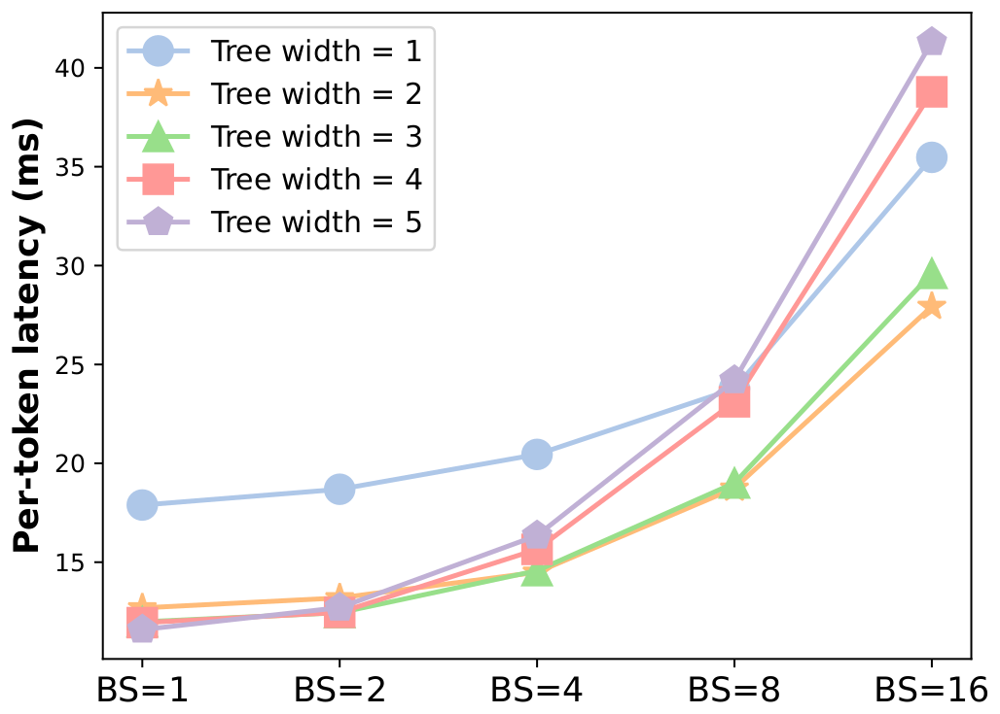

*图 10（原文 Figure 10，第 12 页）：SpecInfer 在不同树宽下的端到端推理延迟，LLM 为 LLaMA-7B、SSM 为 LLaMA-68M。*

**图中文字翻译与读法**：横轴是 batch size（BS=1,2,4,8,16），纵轴是 Per-token latency (ms)（每 token 延迟，越低越好），五条折线是 Tree width = 1 到 5。整理者从矢量图坐标反算的近似值（ms）：

| 树宽 | BS=1 | BS=2 | BS=4 | BS=8 | BS=16 |
|---:|---:|---:|---:|---:|---:|
| 1 | 17.9 | 18.7 | 20.4 | 23.8 | 35.5 |
| 2 | 12.7 | 13.2 | 14.5 | 18.7 | 27.9 |
| 3 | 12.0 | 12.4 | 14.6 | 19.0 | 29.6 |
| 4 | 11.9 | 12.4 | 15.6 | 23.1 | 38.8 |
| 5 | 11.6 | 12.7 | 16.3 | 24.2 | 41.3 |

**读图结论**：

- **小 batch（BS=1、2）**：大树宽能一致地降低每 token 延迟，因为 SpecInfer 能利用稀疏的 GPU 资源并行验证更多 token，同时保持相同的每迭代延迟；树宽 2 到 5 已比树宽 1 低约 30–35%（BS=1 时从约 17.9 ms 降到约 12–13 ms），再增宽收益很小。
- **大 batch（BS≥4）**：大树宽使验证一棵树的延迟升高，因为 SpecInfer 可利用的稀疏 GPU 资源变少；**树宽 2 或 3 在推测效果和验证延迟之间取得最好的平衡**。BS=16 时树宽 4、5（约 38.8、41.3 ms）比树宽 1（约 35.5 ms）还慢，树宽 2、3 仍比树宽 1 快（约 27.9、29.6 ms）。

### 7.5 树式并行解码 vs 序列式并行解码（图 11）

这一节评估树式并行解码本身的效果：现有 LLM 推理系统都用序列式解码，必须把 token tree 分解成多条 token 序列，并因 KV cache 冲突而用各自独立的资源处理这些序列（见 5.2 节）。

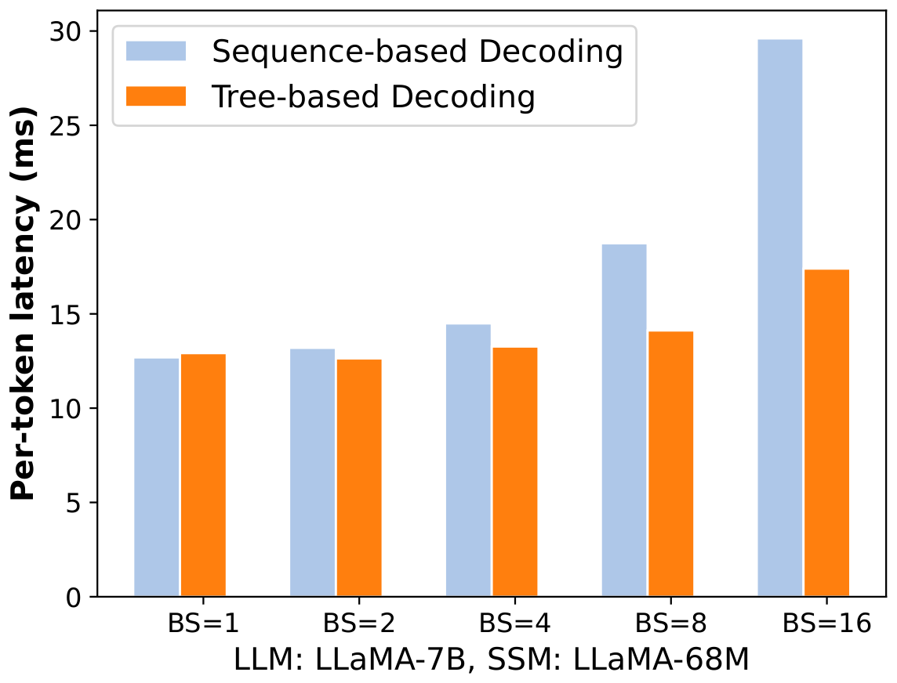

*图 11（原文 Figure 11，第 13 页）：SpecInfer 的树式并行解码与现有 LLM 推理系统所用序列式解码机制的对比。*

**图中文字翻译与读法**：横轴是 batch size（BS=1,2,4,8,16），纵轴是 Per-token latency (ms)（每 token 延迟）；浅蓝色是 Sequence-based Decoding（序列式解码），橙色是 Tree-based Decoding（树式解码）；下方注明 LLM: LLaMA-7B，SSM: LLaMA-68M。整理者从矢量图坐标反算的近似值（ms）：

| 解码机制 | BS=1 | BS=2 | BS=4 | BS=8 | BS=16 |
|---|---:|---:|---:|---:|---:|
| 序列式解码 | 12.7 | 13.2 | 14.5 | 18.7 | 29.5 |
| 树式解码 | 12.9 | 12.6 | 13.2 | 14.1 | 17.4 |
| 序列式 ÷ 树式（整理者核算） | 0.98 | 1.05 | 1.10 | 1.33 | 1.70 |

**读图结论**：树式并行解码在小 batch 下与现有序列式机制性能相当，在大 batch 下**最高快 1.8 倍**（论文原文；整理者按图上读数算得 BS=16 时约 1.7 倍）。收益来自：(1) 消除了共享前缀的序列上的重复注意力计算；(2) 通过拓扑感知因果掩码把所有 token 的树注意力融合进单个 kernel。

### 7.6 多步推测采样（MSS）vs 朴素采样（表 3）

评估 MSS 和 VerifyStochastic 在随机解码下对推测表现的提升。基线是朴素采样（NS）：SpecInfer 直接从 LLM 采下一个 token，看采到的 token 是否在推测树里（见 5.4 节）。因为不同采样算法的推测与验证开销一样，实验关注的是随机解码每步平均可验证的 token 数。

**表 3：不同采样算法下，SpecInfer 在一个随机解码步里平均验证的 token 数**（LLaMA-7B 作 LLM、LLaMA-68M 作 SSM；每棵树宽 5、深 8；越大越好）

| 数据集 | 朴素采样（Naive Sampling） | 多步推测采样（Multi-Step Spec. Sampling） | 提升 |
|---|---:|---:|---:|
| Alpaca | 1.87 | 2.38 | 1.27× |
| CP | 1.80 | 2.28 | 1.26× |
| WebQA | 1.73 | 2.21 | 1.28× |
| CIP | 1.79 | 2.29 | 1.28× |
| PIQA | 1.73 | 2.21 | 1.28× |

（原文表 3，第 13 页。）读法：

- 与朴素采样相比，MSS 在各个数据集上平均把每步验证的 token 数稳定提高 **1.2–1.3 倍**，同时保证输出分布与 LLM 相同。
- MSS 一列与表 2 的“随机解码、树宽 5”一行完全一致（Alpaca 2.38、CP 2.28、WebQA 2.21、CIP 2.29、PIQA 2.21），说明表 2 的随机解码用的就是 MSS。
- 舍入提醒：CP 一行用表中取整后的数字算是 $2.28/1.80\approx1.27$，表中写 1.26×，应是用未取整数据算出的。

## 八、局限、证据边界与常见误读

**论文自己承认或留作未来工作的部分**：动态地扩展 token tree（目前是静态展开配置）；用投票、bagging、stacking 等集成方法组合多个 SSM；与 TVM、Ansor、TASO、PET 等张量程序优化系统结合。

**证据边界（整理者归纳）**：

- **主实验只覆盖 expansion-based 构树**（配置 $\langle1,1,3,1,1,1,1,1\rangle$）；merge-based（多 SSM boost-tuning）的好处与成本，本 PDF 的实验里没有给出，需要看 arXiv 版 [28]。定理 4.2、4.3 的证明也在 [28] 中。
- **所有加速数字都绑定特定平台**：两台 AWS g5.12xlarge（A10 24GB，100 Gbps 以太网）、特定模型对、特定 SSM、特定树配置；“相对现有系统”与“相对 SpecInfer 自己的增量解码”不能混用，且换硬件、换基线版本倍数会变。
- **正文区间与图上读数并不完全吻合**：LLaMA-65B 在 BS=8、16 时按图 7 读数只有约 2.2、1.8 倍（正文说多节点 2.4–2.8 倍）；图 11 中树式相对序列式在 BS=16 约为 1.7 倍（正文最高 1.8 倍）。
- **跨图的绝对数值不一致**：同样是 LLaMA-7B + LLaMA-68M，BS=16 时图 7 的树式推测约 14.1 ms，图 11 的树式解码约 17.4 ms，图 10 的树宽 3 约 29.6 ms（图 7 用的正是树宽 3 的配置）；图 10 中树宽 2 在 BS=1、2、4、8 的数值与图 11 中序列式解码的数值一致。论文没有解释差异来源，**未解决**，所以跨图比较要谨慎。
- **树不是免费的**：更宽的树提高验证 FLOPs 和 kernel 复杂度，大 batch 时可能变慢（图 10）；树里大部分节点最终不被采用（见表 2 的核算）。
- **贪心与随机的保证不同**：贪心时输出与增量解码逐 token 相同（论文原文），随机时是“分布相同”（定理 4.2），复现时要分别验证。

**常见误读**：

- token tree **不是 beam search**。论文在相关工作里说明：beam search、top-$k$、top-$p$ 采样是直接作用于 LLM 输出概率、产生高概率序列的解码策略，并不减少解码步数；SpecInfer 是用 SSM 推测多个候选再由 LLM 并行验证，以减少解码迭代和延迟，两者是正交的，可以组合，SpecInfer 也支持 beam search、top-$k$ 与 top-$p$ 采样。
- “随机解码下不能用朴素的‘看采样出的 token 在不在树里’”**不对**：NS 同样保持分布，只是命中率不如 MSS（定理 4.3）。MSS 的价值是更高的接受率，不是唯一正确。
- 树验证的 LLM 计算量**比增量解码多**（要算整棵树的注意力），它之所以更快是因为这些额外计算利用的是闲置 GPU 资源、并且大幅减少参数访问次数；batch 越大，闲置资源越少，收益越小。
- SpecInfer 的 offloading 加速（2.6–3.5 倍）比分布式推理的加速幅度更大，符合系统机理：瓶颈是反复搬运 LLM 权重，每少一次解码步就少一次搬运。

## 九、复现检查清单

- 检查 tree mask：每个节点只能访问自己的祖先，并按深度正确设置 position id（论文未详述）；先用小树对照“逐条序列单独前向”的结果，确认树式并行解码与增量解码的 logits 一致。
- 报告树深、树宽、树里的节点总数，而不是只报“候选条数”；对比不同树宽下的“每步验证 token 数”和端到端延迟（表 2、图 10）。
- 分开测 SSM 构树、LLM 树式并行解码、验证（CPU 侧）和调度开销。
- 同时报 acceptance length（每步验证 token 数）与 latency；前者与硬件无关，但不包含 SSM 成本。
- batch size、context 长度、是否 offloading 都要与基线一致；基线要写清楚（FasterTransformer、vLLM、TGI、FlexGen 的版本与配置）。
- 随机模式要用大样本验证输出分布，不要把贪心一致性当作采样正确性的证据。
- 论文附录 A 提供了 artifact：仓库 `goliaro/specinfer-ae`，用两台 AWS g5.12xlarge（4×A10 24GB）；软件需要 CUDA 12.1、NCCL、Rust、CMake、Python3，多节点还需 UCX 和 MPI；环境准备约 2 小时、跑完实验约 6 小时、每个节点约 350GB 磁盘；代码是 Apache License v2.0（LLaMA 权重和 OPT 权重各有自己的许可）。

## 十、与相关论文的关系

- [Speculative Decoding](../speculative_decoding/论文中文解读.md) 与 [Speculative Sampling](../speculative_sampling/论文中文解读.md) 是 SpecInfer 的序列式前身：单条草稿链、单步推测采样；SpecInfer 把它们推广到 token tree 与多步（multi-step）校正。
- [Medusa](../medusa/论文中文解读.md) 把候选生成器缩成目标模型顶部的多个解码头，同样用树注意力验证多候选；
- [EAGLE](../eagle_speculative/论文中文解读.md) 在特征层面自回归地起草，[EAGLE-2](../eagle_2/论文中文解读.md) 再按上下文置信度动态改变草稿树的形状，正好对应 SpecInfer 留作未来工作的“动态扩展 token tree”。
- 树注意力、共享前缀验证与拓扑感知掩码，成为后续多候选推测方法的基础设施。

**论文自己在相关工作里的定位**：

- **无损加速**：Inference with reference（Yang 等）利用 LLM 输出与检索到的参考文档之间的重叠，由 LLM 检验参考片段是否合适；推测解码则用小语言模型产生一条 token 序列，再由 LLM 检验。SpecInfer 与它们有两点不同：一是它生成并验证的是 token tree，用树注意力并行计算，并复用共享前缀上的中间结果；二是以往工作通常只用单个小模型，难以与 LLM 对齐，SpecInfer 通过“单个 SSM 展开”和“多个微调 SSM 合并”大幅提高了对 LLM 输出的覆盖率。
- **有损加速**：BiLD 也是用单个 SSM 加速 LLM 解码的推测框架，但它是有损的（速度换来生成质量的可能下降）；量化、结构化剪枝等模型压缩同样会牺牲预测性能。SpecInfer 则不直接减少 LLM 推理的计算量，而是把计算重组得更易并行，以可控的内存和计算开销换取更少的内存访问和更低的延迟。
- **树结构注意力**：Nguyen 等的 tree-structured attention 用文本的句法分析树让 Transformer 捕捉层次结构，是用一棵树表示单个序列；SpecInfer 用树把多条候选序列的公共前缀压缩在一起，并且它的注意力输出的是 token 序列而不是树。

## 原文证据导航

- 图 1（时间线对比）、图 2（总览）：第 3–4 页；算法 1、算法 2：第 3、5 页
- 第 3 节 Learning-based Speculator：表 1（第 5 页）、图 3（第 6 页）、定义 3.1、3.2
- 第 4 节 Token Tree Verifier：树注意力（式 1–5）、图 4（第 8 页）、图 5（第 8 页）、定理 4.2、4.3（第 8–9 页）
- 第 5 节 系统设计与实现：图 6（第 9 页）、5.3 开销分析（第 10 页）
- 第 6 节 实验：图 7、8、9、10（第 12 页）；表 2、表 3、图 11（第 13 页）
- 附录 A：Artifact 说明（第 15–16 页）
- [原论文 PDF](paper.pdf)
- [原文提取文本](paper.txt)
- [论文概要](论文概要.md)
