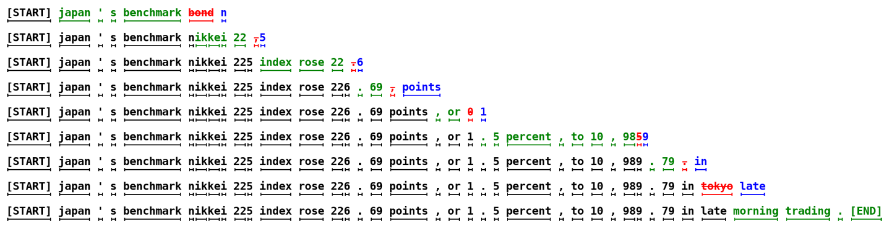
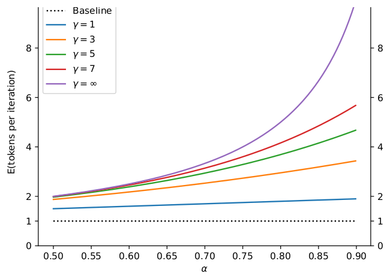
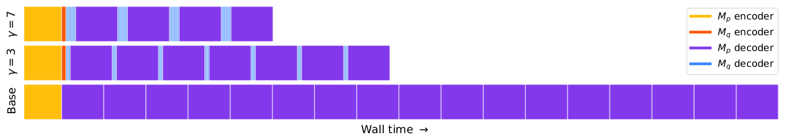
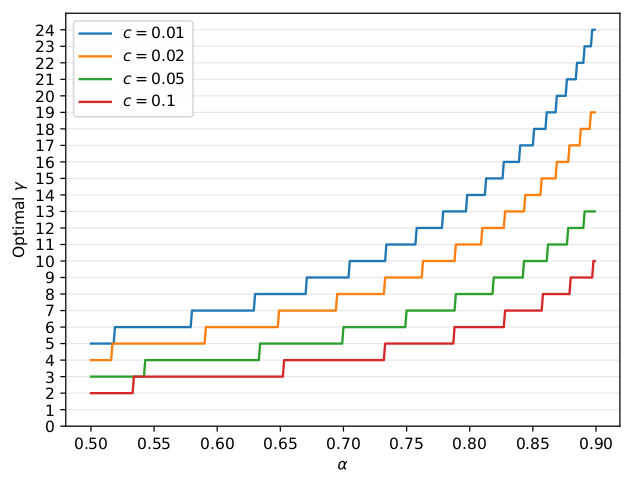
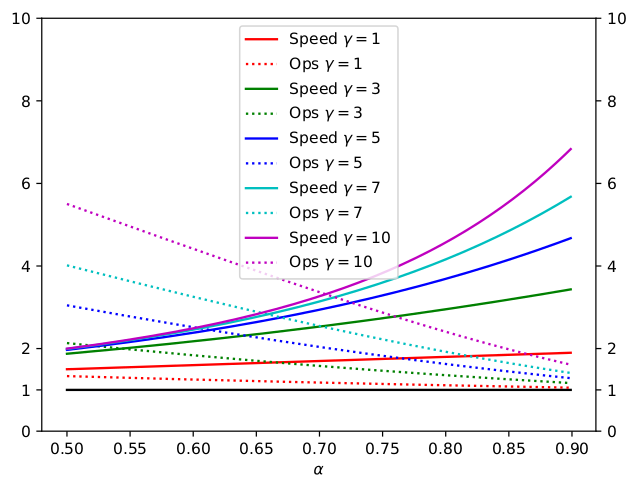

# 论文中文解读：《Fast Inference from Transformers via Speculative Decoding》

> **基本信息**：Yaniv Leviathan、Matan Kalman、Yossi Matias（Google Research），arXiv:2211.17192（2022 年 11 月提交，本文依据 2023 年 5 月的 v2），ICML 2023（PMLR 202）；论文原文 [官方页面](https://arxiv.org/abs/2211.17192)。
>
> **本文的读法**：图取自论文原文（从 PDF 中按图裁出的原图），表为逐格核对后的中文转录（数字与原文一致，表头翻译为中文）。每张图后有中文图题、图例和坐标轴翻译、读图结论，因此不必再翻英文版。凡标明“整理者补充”的推导和数值例子，是为了帮助理解而加的，不是论文里的数字。

## 一、一句话结论

大模型逐 token 解码很慢：生成 $K$ 个 token 要串行调用 $K$ 次模型，而且每一步往往卡在显存带宽而不是算力上。**推测解码（speculative decoding）** 让一个便宜的近似模型 $M_q$ 先自回归地“猜”出 $\gamma$ 个 token，再让目标大模型 $M_p$ **一次并行**地给这些位置（外加末尾一个位置）全部打分；然后用一种新的**推测采样（speculative sampling，修正拒绝采样）** 从左到右决定接受几个，在第一个被拒绝的位置从调整后的分布补一个 token，全部被接受则多送一个。于是每轮 $M_p$ 只跑一次，却产出 1 到 $\gamma+1$ 个 token，并且输出的**概率分布与只用 $M_p$ 采样完全相同**（不是近似）。方法不需要重训、不改模型结构：在 T5-XXL（11B）上相对标准 T5X 实现取得 2–3 倍墙钟加速（batch size 1，单个 TPU-v4）。代价是总算术量增加，所以它依赖“算力有富余”的场景。

## 二、背景与动机

### 2.1 串行解码为什么慢

自回归模型（例如 Transformer 解码器）按 $p(x_t\mid x_{<t})$ 一个 token 接一个 token 地生成：第 $t+1$ 个 token 要等第 $t$ 个被采样出来才能计算，所以**生成 $K$ 个 token 需要 $K$ 次串行的模型调用**。模型越大，单次调用越慢；串行又使得并行硬件没法把延迟摊薄。

论文的第二个观察是：大模型的单步解码往往**不受算术运算量限制，而受内存带宽和通信限制**，因此加速器上还有富余的算力可以用。整理者补充的背景解释：每一步解码都要把全部权重（以及 KV cache）从显存读一遍，却只对一个 token 做很少的计算；权重的读取量与“同时处理几个 token”基本无关，所以一次并行处理 $\gamma+1$ 个位置，耗时可以接近处理 1 个位置，直到计算本身成为瓶颈。

### 2.2 论文的两个关键观察

1. 难的语言建模任务里常混有较容易的子任务（例如补全一个被切开的词、延续上文已出现的内容），这些子任务用高效的小模型就能近似得很好；
2. 利用**推测执行（speculative execution）** 和一种新的采样方法，可以让大模型在小模型的输出上并行运行，一次产出多个 token，而且不改变输出分布。

**推测执行**是处理器里常见的优化：在“确认某个任务是否真的需要”的同时就并行地把它做了，换取更高的并发度，典型例子是分支预测。它要奏效，需要一个高效的机制来提议“很可能会被需要”的任务。论文把推测执行推广到**随机情形**——一个任务只以某个概率被需要。用在自回归解码上，就是从高效的近似模型采样出若干 token 作为大模型的“推测前缀”，并用推测采样最大化这些推测被接受的概率，同时保证输出分布与单独使用目标模型一致。

### 2.3 已有的加速方法为什么不够

- **对所有输入统一降成本**：蒸馏、稀疏化、量化、架构修改（如 multi-query attention）。
- **自适应计算（adaptive computation）**：对简单步骤少算，如只关注输入的一部分、early exit 等。它们通常既省时间又省算术量，但需要改架构、改训练流程、训练定制模型或重训，并且**会改变模型输出**。Wisdom of Committees 虽然使用现成的小模型，但靠启发式决定何时停止，同样失去“输出与目标模型一致”的保证。
- **两个更接近的前作**：Blockwise Parallel Decoding（Stern 等，2018）也并行解码多个 token，但只支持贪心（temperature=0），要额外训练定制模型，关注的是保持下游任务质量而不是保证输出相同。Shallow Aggressive Decoding（SAD，Sun 等，2021）只支持把输入复制到输出，只适用于输入输出很相似的任务（如语法纠错），同样不支持随机采样。

论文还指出，许多方法虽然改善了“访存/算术”比，但在这个比值仍然偏高的场景里，它们和推测解码可以叠加使用。

## 三、方法：推测解码与推测采样

### 3.1 记号与总体流程

- $M_p$：目标模型（要加速其采样的大模型），$p(x_t\mid x_{<t})$ 是它在前缀 $x_{<t}$ 之下的分布；
- $M_q$：同一任务上更高效的近似模型（草稿模型），分布记作 $q(x_t\mid x_{<t})$；
- $\gamma\in\mathbb{Z}^{+}$：每轮让 $M_q$ 猜的 token 数；
- 前缀明确时，简写为 $p(x)$、$q(x)$。

每一轮分三步：

1. 用 $M_q$ 自回归地生成 $\gamma$ 个候选 token；
2. 用 $M_p$ 并行评估这些候选，同时拿到每个位置在 $M_p$ 下的分布，接受那些“能导出相同分布”的候选；
3. 从一个调整后的分布里再采一个 token：修正第一个被拒绝的候选，或者在全部被接受时再多送一个。

因此每次并行运行 $M_p$ **至少产出 1 个新 token**（所以 $M_p$ 的串行运行次数即使在最坏情况下也不会比普通自回归解码多），**最多产出 $\gamma+1$ 个**，具体取决于 $M_q$ 对 $M_p$ 的近似有多好。

### 3.2 标准化采样（Standardized Sampling）

采样方法有很多：argmax、top-$k$、nucleus（top-$p$）、设置温度……流行实现通常在 logits 层面分别处理，但它们都可以统一成“从一个调整后的概率分布做标准采样”。例如 argmax 等价于把非最大的元素置零再归一化（得到一个 one-hot 分布）。因此论文只讨论对一个概率分布的标准采样，并约定：以下 $p(x)$ 和 $q(x)$ 就是 $M_p$、$M_q$ 按所用采样方法**调整之后**的分布。

### 3.3 推测采样：单个 token

要从 $p(x)$ 采样，改为：先从 $q(x)$ 采一个 $x$；

- 若 $q(x)\le p(x)$，直接保留；
- 若 $q(x)>p(x)$，以概率 $1-\dfrac{p(x)}{q(x)}$ **拒绝**，并从调整后的分布 $p'(x)$ 重新采一个 $x$：

$$
p'(x)=\mathrm{norm}\big(\max(0,\ p(x)-q(x))\big)=\frac{\max(0,\ p(x)-q(x))}{\sum_{x'}\max(0,\ p(x')-q(x'))}.
$$

合并起来，接受概率就是

$$
\Pr[\text{接受 }x]=\min\!\Big(1,\ \frac{p(x)}{q(x)}\Big).
$$

对任意分布 $p$ 和 $q$，这样采出的 $x$ 严格服从 $p$（证明见本文第五节，即原文附录 A.1）。直觉是：$q$ 偏爱的 token（$q>p$）被按比例“打折”，打掉的概率质量集中到 $p$ 比 $q$ 更看重的那些 token 上，由 $p'$ 补回。

把它用到解码上：先对前缀运行 $M_q$ 得到 $q(x)$，采出 $x_1\sim q(x)$；同时并行地对前缀运行 $M_p$ 得到 $p(x)$，并“推测地”对前缀加 $x_1$ 运行 $M_p$ 算出下一个 token 的分布。两个计算都完成后：如果 $x_1$ 被拒绝，就丢掉对 $x_2$ 的那次计算，并从调整后的分布重采 $x_1$；如果 $x_1$ 被接受，两个 token 都保留。算法 1 把这个想法推广到一次采 1 到 $\gamma+1$ 个 token。

### 3.4 算法 1（SpeculativeDecodingStep）逐行解释

下面是算法 1 的忠实改写（原文第 3 页），符号：$p_i$ 是目标模型在“前缀加 $x_1,\dots,x_{i-1}$”之后的分布，$q_i$ 同理。

```text
SpeculativeDecodingStep(Mp, Mq, prefix):
  # (a) 近似模型自回归地猜 γ 个 token
  for i = 1 .. γ:
      q_i(x) <- Mq(prefix + [x_1, ..., x_{i-1}])
      x_i    ~  q_i(x)
  # (b) 目标模型并行运行，得到 γ+1 个分布
  p_1(x), ..., p_{γ+1}(x) <- Mp(prefix), ..., Mp(prefix + [x_1, ..., x_γ])
  # (c) 确定被接受的草稿个数 n
  r_1, ..., r_γ ~ U(0, 1)
  n <- min( { i-1 : 1 <= i <= γ, r_i > p_i(x_i) / q_i(x_i) } ∪ { γ } )
  # (d) 必要时调整目标分布
  p'(x) <- p_{n+1}(x)
  if n < γ:
      p'(x) <- norm( max(0, p_{n+1}(x) - q_{n+1}(x)) )
  # (e) 返回：n 个来自 Mq 的 token 加 1 个来自 Mp 的 token
  t ~ p'(x)
  return prefix + [x_1, ..., x_n, t]
```

**(a) 草稿。** $M_q$ 自回归地串行运行 $\gamma$ 次，第 $i$ 次以前缀加已经猜出的 $x_1,\dots,x_{i-1}$ 为条件，采出 $x_i$，并保存当时的整个分布 $q_i$（后面验证要用）。

**(b) 并行验证。** 解码器型 Transformer 带因果掩码，一次前向就能对输入序列的**每个位置**同时给出“下一个 token 的分布”（训练时就是这样一次算出所有位置的损失）。所以把前缀和草稿 $x_1,\dots,x_\gamma$ 拼起来喂给 $M_p$ 一次，就得到 $\gamma+1$ 个分布：$p_1$ 是前缀之后的下一个 token 分布，$p_{i}$ 是在 $x_1,\dots,x_{i-1}$ 之后的分布，$p_{\gamma+1}$ 是整段草稿之后的分布。这里的并发度比普通解码高 $\gamma+1$ 倍，这就是论文反复强调的“要有足够算力支持更高并发度”。对 T5 这类编码器-解码器模型，编码器照常对输入只跑一次。

**(c) 接受检验。** $r_i$ 是 $(0,1)$ 上的均匀随机数。当 $r_i>p_i(x_i)/q_i(x_i)$ 时拒绝第 $i$ 个草稿；因为 $\Pr[r_i\le p/q]=\min(1,p/q)$，这正是上面 3.3 小节的接受概率。$n$ 是**第一个被拒绝位置的序号减 1**，如果没有任何拒绝，则 $n=\gamma$。

为什么必须“从左到右、遇到第一个拒绝就停”？因为第 $i+1$ 个及之后的草稿都是**以第 $i$ 个草稿为条件**采出的；第 $i$ 个被拒绝并被另一个 token 替换后，后面的草稿所依据的前缀已经变了，对应的 $p_{i+1},\dots$ 也就作废。（即使后面的 $r_j$ 都很小，也不能再用。）

**(d)(e) 补充 token。**

- 若 $n<\gamma$（在第 $n+1$ 个草稿处被拒绝）：从残差分布 $\mathrm{norm}(\max(0,p_{n+1}-q_{n+1}))$ 采一个 token $t$，它替代被拒绝的草稿。注意这里**用的是整个分布，不是被拒绝的那个 token**。
- 若 $n=\gamma$（全部被接受）：$p'=p_{\gamma+1}$，直接从目标模型采一个额外的 token，这一项是“白送”的，因为 $p_{\gamma+1}$ 已经在 (b) 中并行算好。

所以一轮的输出是 $x_1,\dots,x_n,t$ 共 $n+1$ 个 token，$0\le n\le\gamma$。

**temperature=0 时的特例（整理者推导）。** 此时 $p$ 和 $q$ 都是 one-hot。若两者的 argmax 相同，则接受概率为 1；若不同，则接受概率为 0，残差分布 $\mathrm{norm}(\max(0,p-q))$ 就是目标模型的 argmax。于是算法退化为：草稿与目标贪心结果一致就继续接受，第一次不一致时改用目标模型的 argmax——这正是贪心解码的“无损”推测版本。

### 3.5 一个完整的小数值例子（整理者补充，不是论文数字）

**例 1：单个 token，验证“无损”。** 词表只有 4 个 token。设目标分布 $p$ 和草稿分布 $q$ 为：

| token | A | B | C | D |
|---|---:|---:|---:|---:|
| $p(x)$ | 0.4 | 0.3 | 0.2 | 0.1 |
| $q(x)$ | 0.1 | 0.2 | 0.3 | 0.4 |
| 接受概率 $\min(1,p/q)$ | 1 | 1 | 2/3 | 1/4 |
| 被接受的质量 $q\cdot\min(1,p/q)=\min(p,q)$ | 0.1 | 0.2 | 0.2 | 0.1 |
| 残差 $\max(0,p-q)$ | 0.3 | 0.1 | 0 | 0 |

- 总接受率 $\beta=\sum_x\min(p(x),q(x))=0.1+0.2+0.2+0.1=0.6$；被拒绝的概率为 $1-\beta=0.4$。
- 残差之和 $0.3+0.1=0.4$，恰好等于 $1-\beta$；归一化后 $p'=(0.75,\ 0.25,\ 0,\ 0)$。
- 最终采出各 token 的概率 = 被接受的质量 + $(1-\beta)\,p'(x)$：A 为 $0.1+0.4\times0.75=0.4$，B 为 $0.2+0.4\times0.25=0.3$，C 为 $0.2+0=0.2$，D 为 $0.1+0=0.1$。与 $p=(0.4,0.3,0.2,0.1)$ **逐项相等**。
- 对照：$q$ 最爱提议 D（概率 0.4），但 $p$ 只给 D 0.1，所以 D 被接受的概率只有 1/4；$q$ 很少提议 A（0.1）而 $p$ 要 0.4，缺的 0.3 全靠拒绝后的 $p'$ 补回。
- 定义 $D_{LK}(p,q)=\tfrac12\sum_x\lvert p(x)-q(x)\rvert=0.4=1-\beta$，与下文 4.2 小节的引理 3.3 一致。

**例 2：一轮 $\gamma=3$ 的运行。** 为简单起见，假设每个位置的 $p$、$q$ 都与例 1 相同。设 $M_q$ 依次采出 $x_1=\text{B}$、$x_2=\text{C}$、$x_3=\text{D}$，抽到的随机数为 $r_1=0.35$、$r_2=0.50$、$r_3=0.80$。

| 位置 | 草稿 token | $p/q$ | 随机数 $r_i$ | 判定（$r_i>p/q$ 则拒绝） |
|---:|---|---:|---:|---|
| 1 | B | 0.3/0.2=1.5 | 0.35 | 接受（比值大于 1，必接受） |
| 2 | C | 0.2/0.3≈0.667 | 0.50 | 接受（0.50 不大于 0.667） |
| 3 | D | 0.1/0.4=0.25 | 0.80 | 拒绝（0.80 大于 0.25） |

于是 $n=2$。补充 token $t$ 从 $p'=(0.75,0.25,0,0)$ 采，比如得到 A。本轮输出 B、C、A 三个 token：$M_p$ 只运行了 1 次（一次前向同时算出 $p_1,\dots,p_4$ 共 4 个分布），$M_q$ 串行运行了 3 次；$p_4$ 以及 $x_3=\text{D}$ 对应的计算都被丢弃。

**例 3：期望产出多少、值不值得。** 仍设每个位置的接受率 $\alpha=\beta=0.6$（独立同分布），$\gamma=3$，则本轮产出 $n+1$ 个 token 的概率分别为：1 个 token 的概率 $0.4$；2 个 $0.6\times0.4=0.24$；3 个 $0.6^2\times0.4=0.144$；4 个 $0.6^3=0.216$（概率和为 1）。期望

$$
0.4\times1+0.24\times2+0.144\times3+0.216\times4=2.176=\frac{1-0.6^{4}}{1-0.6},
$$

与下文 4.1 小节的公式 (1) 一致。若草稿模型每步耗时是目标的 $c=0.05$ 倍，则一轮耗时约 $1+3\times0.05=1.15$ 个目标步，理论加速 $2.176/1.15\approx1.89$ 倍；若 $\hat c=0.05$，总算术量增加到约 $1.91$ 倍。把 $\gamma$ 从 1 扫到 8，加速分别约为 1.52、1.78、1.89、**1.92**、1.91、1.87、1.82、1.77 倍：在这组 $(\alpha,c)$ 下最优是 $\gamma=4$，再长的草稿反而变慢。

### 3.6 图 1：一次完整解码的样子



*图 1（原文 Figure 1，第 2 页）：无条件语言建模中推测解码的一次完整生成，每一行是算法的一次迭代。*

**图中文字翻译与读法**：

- 目标模型 $M_p$ 是 97M 参数的 GPT 式 Transformer 解码器，近似模型 $M_q$ 是 6M 参数的同类解码器，均在 lm1b 上训练，词表为 8k（BERT 分词）；`[START]` 和 `[END]` 是句首、句尾标记。
- **颜色含义**：黑色带下划线的是已经确定的前缀；**绿色**是 $M_q$ 提议并被 $M_p$ 接受的 token；**红色（带删除线）** 是被拒绝的提议；**蓝色**是拒绝处从调整后的分布补上的修正 token。下划线的短横标出的是 token 边界，一个英文单词可能被切成多个子词 token（例如 nikkei 被切成 n、ik、ke、i），所以 token 数比图上看到的单词数多。
- 例如第一行：目标模型只运行了一次，生成了 5 个 token（japan、'、s、benchmark 四个被接受，再加上拒绝 bond 之后补的 n）。整句共 38 个 token，只用了 9 次目标模型的串行运行，而生成这句话的概率与只用目标模型时**完全一样**（论文原文的说法）。
- **读图结论**：绿色段越长，这一轮省的串行步数越多；红色与蓝色成对出现的地方，就是小模型与大模型意见不一致的位置。每一行至多有一对红蓝（遇到第一个拒绝就结束本轮，后面的草稿作废），最后一行的绿色全部被接受，没有红蓝。整个句子里每次迭代新增的 token 数并不固定，既有只前进 1 个 token 的轮次（第 8 行），也有一次前进很多个 token 的轮次（第 6 行绿色最长）。

## 四、理论分析

### 4.1 每轮产出多少个 token

**定义 3.1（接受率）**：给定前缀 $x_{<t}$，接受率 $\beta_{x_{<t}}$ 是推测采样接受 $x_t\sim q(x_t\mid x_{<t})$ 的概率。$\mathbb{E}(\beta)$ 自然地度量了 $M_q$ 对 $M_p$ 的近似程度。简化假设各位置的 $\beta$ 独立同分布，记 $\alpha=\mathbb{E}(\beta)$。

此时一轮产出的 token 数 $L=n+1$ 服从一个**带上限的几何分布**：第 $k$ 个草稿被接受的前提是前面 $k-1$ 个都被接受，因此 $\Pr[L>k]=\Pr[n\ge k]=\alpha^k$（$0\le k\le\gamma$），期望为

$$
\mathbb{E}[L]=\sum_{k=0}^{\gamma}\Pr[L>k]=1+\alpha+\alpha^{2}+\cdots+\alpha^{\gamma}=\frac{1-\alpha^{\gamma+1}}{1-\alpha}.
$$

这就是论文的式 (1)。



*图 2（原文 Figure 2，第 3 页）：算法 1 每轮期望生成的 token 数，作为 $\alpha$ 的函数，对应不同的 $\gamma$。*

**图中文字翻译与读法**：

- 横轴是 $\alpha$（0.50 到 0.90），纵轴是 E(tokens per iteration)（每轮迭代期望生成的 token 数）。黑色点线 Baseline 是普通解码，恒为 1；蓝、橙、绿、红、紫曲线分别是 $\gamma=1,3,5,7,\infty$。
- 按式 (1) 计算（整理者核算，与图相符）：$\alpha=0.5$ 时五条线分别约为 1.5、1.88、1.97、1.99、2；$\alpha=0.9$ 时分别约为 1.9、3.44、4.69、5.70、10。
- **读图结论**：$\alpha$ 较低时各条曲线靠得很近（$\alpha=0.5$ 时 $\gamma=3$ 与 $\gamma=\infty$ 只差约 0.13 个 token），拉长草稿几乎没有收益；只有 $\alpha$ 很高时，长草稿才会带来大幅提升，而且上限由 $1/(1-\alpha)$ 封顶（$\gamma=\infty$ 的紫线）。

### 4.2 如何算 $\alpha$：$D_{LK}$ 与重叠面积

论文先定义一个散度：

**定义 3.2**：$D_{LK}(p,q)=\sum_x\lvert p(x)-M(x)\rvert=\sum_x\lvert q(x)-M(x)\rvert$，其中 $M(x)=\dfrac{p(x)+q(x)}{2}$。

**引理 3.3**：$D_{LK}(p,q)=1-\sum_x\min(p(x),q(x))$。

证明：$\lvert p-M\rvert=\tfrac12\lvert p-q\rvert$，而 $\min(p,q)=\tfrac12\big(p+q-\lvert p-q\rvert\big)$，两边对 $x$ 求和即得（用到 $\sum p=\sum q=1$）。

**推论 3.4**：$D_{LK}$ 是 $[0,1]$ 上的对称散度；$D_{LK}(p,q)=0\iff p=q$；$D_{LK}(p,q)=1\iff p$ 与 $q$ 的支撑集不相交。（整理者注：它就是 $p,q$ 之间的总变差距离。）

**定理 3.5**：$\beta=1-D_{LK}(p,q)$。

证明：$\beta=\mathbb{E}_{x\sim q}\min\!\big(1,\tfrac{p(x)}{q(x)}\big)=\sum_x q(x)\min\!\big(1,\tfrac{p(x)}{q(x)}\big)=\sum_x\min(p(x),q(x))$。

于是 **推论 3.6**：$\alpha=1-\mathbb{E}(D_{LK}(p,q))=\mathbb{E}\big[\sum_x\min(p(x),q(x))\big]$（原文写作 $\mathbb{E}(\min(p,q))$）。直观地说，$\beta$ 就是 $p$ 与 $q$ 两条分布曲线**重叠部分的面积**：越重叠，接受率越高。论文在表 3 中给出了各种设置下实测的 $\alpha$。

### 4.3 墙钟时间的改进

前面说明了调用目标模型的次数在 i.i.d. 假设下减少为原来的 $\frac{1-\alpha}{1-\alpha^{\gamma+1}}$。要换算成墙钟时间，还要计入运行 $M_q$ 的代价，并假设**能并行评估 $\gamma+1$ 个位置而不增加墙钟时间**（即算力足够，见下文 4.4 小节）。

**定义 3.7（代价系数 $c$）**：$c$ 是运行一次 $M_q$ 的时间与运行一次 $M_p$ 的时间之比。与 $\alpha$ 是模型和任务的内在性质不同，$c$ 取决于硬件配置和软件实现。论文说，在实验中 $M_q$ 通常比 $M_p$ 小两个数量级左右，$c$ 总是小于 0.05，常常小到可忽略（表 4 中的 T5-LARGE 只比 T5-XXL 小一个数量级，估计的 $c$ 是 0.11）。

**定理 3.8**：算法 1 的期望墙钟加速倍数为

$$
\frac{1-\alpha^{\gamma+1}}{(1-\alpha)(\gamma c+1)}.
$$

证明：记运行一次 $M_p$ 的时间为 $T$。算法 1 一轮要运行 $\gamma$ 次 $M_q$（共 $Tc\gamma$）和一次 $M_p$（$T$），总时间 $T(c\gamma+1)$，平均产出 $\frac{1-\alpha^{\gamma+1}}{1-\alpha}$ 个 token，所以每个 token 的期望时间是 $\frac{(c\gamma+1)(1-\alpha)}{1-\alpha^{\gamma+1}}T$；普通解码每个 token 耗时 $T$，相除即得。

注意这个定理假设生成足够长（例如因为至少要运行一次 $M_p$，加速倍数不可能超过生成的 token 数）。

**推论 3.9**：若 $\alpha>c$，则存在 $\gamma$ 使方法有改进，且改进倍数至少为 $\dfrac{1+\alpha}{1+c}$。

证明：如果对某个 $\gamma$ 有改进，则对任何更小的 $0<\gamma^{*}<\gamma$ 也有改进（整理者补充理由：加速大于 1 等价于 $\alpha,\alpha^2,\dots,\alpha^{\gamma}$ 的平均值大于 $c$，而这个平均值随 $\gamma$ 增大而下降），所以只需检验 $\gamma=1$，此时定理 3.8 给出 $\frac{1-\alpha^2}{(1-\alpha)(c+1)}=\frac{1+\alpha}{1+c}$。

**读法**：每多猜一个 token 要付出 $c$ 的代价，而第 $k$ 个草稿被用上的概率是 $\alpha^k$。只要第一个草稿的“收益”$\alpha$ 超过“成本”$c$，推测解码就值得做。

下面的 trace 图把这个账直观画了出来。



*图 5（原文 Figure 5，第 6 页）：完整编码器-解码器 Transformer 栈的简化 trace 图；横轴是墙钟时间。*

**图中文字翻译与读法**：

- 图例：黄色 $M_p$ encoder（目标模型编码器）、橙红色 $M_q$ encoder（近似模型编码器）、紫色 $M_p$ decoder（目标模型解码器调用）、蓝色 $M_q$ decoder（近似模型解码器调用）。三行从上到下是 $\gamma=7$、$\gamma=3$ 和 Base（普通解码）。
- 最左边的黄色块是对 $M_p$ 编码器的一次调用，紧随其后的橙色小块是对 $M_q$ 编码器的调用。$\gamma=7$ 一行里，每次 $M_p$（紫色块）调用之前都有 7 次 $M_q$（细蓝条）调用；$\gamma=3$ 一行是每次 3 次。
- 整理者从图上数得：这个示意里 Base 一行有 17 个紫色块，$\gamma=3$ 一行 7 个，$\gamma=7$ 一行 4 个，并且紫色块宽度相同——说明每个 $M_p$ 调用的时间没有因为一次处理更多位置而变长（这正是“并行评估 $\gamma+1$ 个位置不增加墙钟”的假设）。这是示意图，不是实测数据。
- **读图结论**：蓝色细条很窄（$c$ 小），所以推测解码的总时间主要由紫色块数决定；紫色块越少，整行越短。

### 4.4 算术运算量与内存访问：为什么 FLOPs 增加却可能更快

算法 1 并行运行 $\gamma+1$ 次 $M_p$，所以并发的算术运算量增长为 $\gamma+1$ 倍；而每轮最多产出 $\gamma+1$ 个 token，因此**总算术量可能高于标准解码**。当 $M_q$ 的草稿被接受时，增加的并发是“免费”的（忽略 $M_q$ 的成本，总运算量不增加）；当某个草稿被拒绝时，它之后位置上的计算就被浪费了。

**定义 3.10**：$\hat c$ 是近似模型 $M_q$ 每个 token 的算术运算量与目标模型 $M_p$ 的比值。

**定理 3.11**：算法 1 总算术量的期望增长倍数为

$$
\frac{(1-\alpha)(\gamma\hat c+\gamma+1)}{1-\alpha^{\gamma+1}}.
$$

证明：设标准解码每个 token 的运算量为 $\hat T$（即运行一次 $M_p$）。算法 1 一轮的运算量为 $\hat T\hat c\gamma+\hat T(\gamma+1)$（$\gamma$ 次 $M_q$ 加 $\gamma+1$ 次并行 $M_p$）；除以每轮的期望 token 数式 (1)，再除以 $\hat T$ 即得。

- $\alpha$ 低时算术量增加得多，反之则少。
- 论文指出：对 Transformer 解码器，算法 1 的总算术量（不计 $M_q$ 的运行）可以被**一次同尺寸 Transformer 编码器的运行**所上界。
- 与算术量不同，**内存访问总量可以下降**：目标模型的权重和 KV cache 每执行一次算法 1 只需读一遍，因此读取它们的内存访问次数缩小为原来的 $\frac{1-\alpha}{1-\alpha^{\gamma+1}}$（即式 (1) 的倒数）。

这就是推测解码的本质：用更多的算术换更少的串行步数和权重读取，所以它只在内存带宽是瓶颈、算力有富余时才有用。

### 4.5 怎么选 $\gamma$：图 3、表 1、图 4

给定 $c$ 和 $\alpha$，并假设算力足够，最优 $\gamma$ 就是使定理 3.8 的加速倍数最大的那个整数，可以数值求出。



*图 3（原文 Figure 3，第 5 页）：最优 $\gamma$ 作为 $\alpha$ 的函数，对应不同的 $c$。*

**图中文字翻译与读法**：

- 横轴是 $\alpha$（0.50 到 0.90），纵轴 Optimal $\gamma$（最优 $\gamma$，0 到 24）。蓝、橙、绿、红线分别是 $c=0.01,0.02,0.05,0.1$。
- 曲线呈阶梯状，因为 $\gamma$ 必须是整数。
- 从图上读出的近似值，并经整理者用定理 3.8 核算：$\alpha=0.5$ 时，四条线的最优 $\gamma$ 依次为 5、4、3、2；$\alpha=0.9$ 时依次为 24、19、13、10。
- **读图结论**：$\alpha$ 越高、$c$ 越低，最优的草稿长度越长；一旦 $c$ 较大（0.1），即使 $\alpha=0.9$ 也只值得猜约 10 个 token。

**表 1：总算术量与推理速度相对于基线的倍数**（假设 $c=\hat c=0$，即忽略草稿模型的开销；Operations 越小越好，Speed 越大越好）

| $\alpha$ | $\gamma$ | 总算术量（Operations） | 速度（Speed） |
|---:|---:|---:|---:|
| 0.6 | 2 | 1.53X | 1.96X |
| 0.7 | 3 | 1.58X | 2.53X |
| 0.8 | 2 | 1.23X | 2.44X |
| 0.8 | 5 | 1.63X | 3.69X |
| 0.9 | 2 | 1.11X | 2.71X |
| 0.9 | 10 | 1.60X | 6.86X |

（原文表 1，第 5 页。）整理者逐行用定理 3.8 和 3.11 在 $c=\hat c=0$ 下重算，六行都与表中数字一致。读法：同样 $\alpha=0.9$，$\gamma$ 从 2 加到 10，速度从 2.71 倍涨到 6.86 倍，算术量也从 1.11 倍涨到 1.60 倍——用多出来的算术换速度。



*图 4（原文 Figure 4，第 5 页）：加速倍数和算术运算量的增长倍数，作为 $\alpha$ 的函数，对应不同的 $\gamma$。*

**图中文字翻译与读法**：

- 横轴 $\alpha$（0.50 到 0.90）。实线是 Speed（速度倍数），点线是 Ops（算术量增长倍数）；红、绿、蓝、青、品红分别对应 $\gamma=1,3,5,7,10$，图中 $y=1$ 处还有一条未入图例的黑色水平线（基线）。设定与表 1 相同（$c=\hat c=0$）。
- 速度曲线随 $\alpha$ 增大而上升（$\gamma=10$ 的品红线在 $\alpha=0.9$ 约为 6.9），算术量曲线随 $\alpha$ 增大而下降（$\gamma=10$ 的品红点线在 $\alpha=0.5$ 约为 5.5，$\alpha=0.9$ 约为 1.6）。这些数与表 1、定理 3.11 的计算一致。
- **读图结论**：$\gamma$ 越大，速度上限越高，但低 $\alpha$ 时算术量会膨胀（$\alpha=0.5$ 且 $\gamma=10$ 时约 5.5 倍而速度只有约 2 倍）；$\alpha$ 高时算术代价反而较低。

**动态 $\gamma$（论文设想）。** 因为各位置的 $\beta$ 并不恒定，若能预测 $\beta$ 并在一轮中动态调整 $\gamma$，还可以进一步提升。设想有一个关于 $\gamma$ 的 oracle，则每轮期望 token 数为 $\frac{1}{1-\alpha}$；在典型的 $c$、$\alpha$ 下并假设算力无限，增强后的墙钟加速可比固定 $\gamma$ 高约 60%。这一上界仍假设 $M_p$ 会校验 oracle 的预测，论文把它留给未来工作。（EAGLE-2 后来用“根据草稿置信度动态决定树的形状”实现了类似思想，见 [EAGLE-2](../eagle_2/论文中文解读.md)。）

### 4.6 近似模型 $M_q$ 怎么选

推测采样、因而推测解码，对**任意**近似模型 $M_q$ 都保证输出分布不变（附录 A.1）；$M_q$ 只影响速度。

- **现成的小 Transformer**：论文的实验主要用现成的、与 $M_p$ 同架构、使用同样概率标准化的小模型。让 $M_q$ 比 $M_p$ 小约两个数量级通常最好，在 $\alpha$ 与 $c$ 之间取得平衡（定理 3.8）。
- **零代价模型（negligible-cost models）**：$c\approx0$ 的模型，期望墙钟加速为 $\frac{1-\alpha^{\gamma+1}}{1-\alpha}\le\frac{1}{1-\alpha}$，$\gamma$ 很大时逼近上界。典型例子是 **n-gram 模型**：评估只是一次查表。实测发现即使是平凡的 n-gram 也有非零 $\alpha$：英德翻译上 $M_p$=T5-XXL（11B）、$M_q$=bigram 时 $\alpha\approx0.2$，$\gamma=3$ 时得到 1.25 倍加速（整理者核算：$(1-0.2^4)/(1-0.2)=1.248$）。
- **简单启发式**：在长序列很可能重复的场合（摘要、聊天式界面里“把这个故事改个结尾”“让这个函数也做 X”这类迭代修改），一个“一旦在上下文中找到匹配前缀就把后续 token 复制下来”的近似模型可能得到很高的 $\alpha$；这类无参数模型还有部署上更简单的优点。
- **非自回归模型**（如 Stern 等 2018）：不需要算法 1 里的自回归循环，只调用一次即可。
- **随机选 token 的模型**：主要有理论意义，它也能保证对所有 $M_p$ 有一点（很小的）改进。

**公式小结**

| 量 | 公式 | 出处（原文） |
|---|---|---|
| 接受概率 | $\min(1,\ p(x)/q(x))$ | 2.3 节 |
| 残差分布 | $p'(x)=\mathrm{norm}(\max(0,p(x)-q(x)))$ | 2.3 节 |
| 单位置接受率 | $\beta=\sum_x\min(p,q)=1-D_{LK}(p,q)$ | 定理 3.5 |
| 每轮期望 token 数 | $\frac{1-\alpha^{\gamma+1}}{1-\alpha}$ | 式 (1) |
| 墙钟加速倍数 | $\frac{1-\alpha^{\gamma+1}}{(1-\alpha)(\gamma c+1)}$ | 定理 3.8 |
| 有改进的条件 | $\alpha>c$，此时至少 $\frac{1+\alpha}{1+c}$ | 推论 3.9 |
| 总算术量增长倍数 | $\frac{(1-\alpha)(\gamma\hat c+\gamma+1)}{1-\alpha^{\gamma+1}}$ | 定理 3.11 |

## 五、无损性的证明（附录 A.1）与它和经典拒绝采样的区别

### 5.1 为什么输出严格服从 $p$

设 $\beta$ 为接受概率（定义 3.1）。调整分布 $p'(x)=\mathrm{norm}(\max(0,p(x)-q(x)))=\dfrac{p(x)-\min(q(x),p(x))}{\sum_{x'}\big(p(x')-\min(q(x'),p(x'))\big)}$，其归一化常数为 $1-\beta$（由引理 3.3 和定理 3.5）。于是对任意 token $x'$：

$$
\Pr[x=x']=\Pr[\text{接受},\,x=x']+\Pr[\text{拒绝},\,x=x'].
$$

其中

$$
\Pr[\text{接受},\,x=x']=q(x')\min\!\Big(1,\frac{p(x')}{q(x')}\Big)=\min(q(x'),p(x')),
$$

$$
\Pr[\text{拒绝},\,x=x']=(1-\beta)\,p'(x')=p(x')-\min(q(x'),p(x')).
$$

两项相加，$\Pr[x=x']=\min(p(x'),q(x'))+p(x')-\min(p(x'),q(x'))=p(x')$。证毕。证明里对 $q$ 没有任何要求，这就是“任何近似模型都不改变输出分布”的原因；3.5 小节的例 1 是它的数值版本。

### 5.2 与经典拒绝采样的区别（附录 A.2）

经典拒绝采样是迭代过程：采 $x\sim q(x)$ 和 $r\sim U(0,1)$；若 $r<\dfrac{p(x)}{Mq(x)}$ 就返回 $x$，否则回到第一步重来；其中 $M=\max_x\frac{p(x)}{q(x)}$。它可以改成“非迭代版本”：只做一次，不成功就直接从未修改的 $p(x)$ 采样。但这比推测采样低效得多。其期望接受概率为

$$
\mathbb{E}_{x\sim q}\frac{p(x)}{Mq(x)}=\sum_x p(x)\min_{x'}\frac{q(x')}{p(x')}\ \le\ \sum_x p(x)\min\!\Big(1,\frac{q(x)}{p(x)}\Big)=\sum_x\min(p(x),q(x))=\alpha,
$$

可能远低于推测采样的 $\alpha$。在 3.5 小节的例 1 里，$M=0.4/0.1=4$，经典做法的接受概率只有 $1/M=0.25$，而推测采样是 0.6。区别的关键在于：推测采样被拒绝后**不重来**，而是从残差分布补一个 token，因此每次尝试都不浪费，并且正好适配“一次并行验证很多位置”的需要。

## 六、实验

### 6.1 设置

- **目标/近似模型**：标准的编码器-解码器 T5 v1.1（Raffel 等，2020）。两个任务：(1) 在 WMT EnDe 上微调的英译德；(2) 在 CNN/DM 上微调的文本摘要。两个任务都用 T5-XXL（11B）作 $M_p$；$M_q$ 试了现成的 T5-large（800M）、T5-base（250M）、T5-small（77M）检查点。
- **测量方式**：与 T5X 代码库中的实现比较墙钟时间；batch size 为 1，在单个 TPU-v4 上，分别测 argmax 采样（temp=0）和标准采样（temp=1）。
- **无需训练**：所有模型均用现成检查点，无需重新训练或改架构。

### 6.2 表 2：T5-XXL 11B 上的实测加速

**表 2：T5-XXL（11B）推理加速的实测结果**（Speed 为相对 T5X 基线的墙钟加速倍数，越大越好；原表对每个任务和温度中最快的行加粗并用 ★ 标记，原文未对 ★ 另做注释，从上下文看是 T5-SMALL 最快）

| 任务 | $M_q$ | 温度（Temp） | $\gamma$ | $\alpha$ | 速度（Speed） |
|---|---|---:|---:|---:|---:|
| EnDe | T5-SMALL ★ | 0 | 7 | 0.75 | **3.4X** |
| EnDe | T5-BASE | 0 | 7 | 0.8 | 2.8X |
| EnDe | T5-LARGE | 0 | 7 | 0.82 | 1.7X |
| EnDe | T5-SMALL ★ | 1 | 7 | 0.62 | **2.6X** |
| EnDe | T5-BASE | 1 | 5 | 0.68 | 2.4X |
| EnDe | T5-LARGE | 1 | 3 | 0.71 | 1.4X |
| CNNDM | T5-SMALL ★ | 0 | 5 | 0.65 | **3.1X** |
| CNNDM | T5-BASE | 0 | 5 | 0.73 | 3.0X |
| CNNDM | T5-LARGE | 0 | 3 | 0.74 | 2.2X |
| CNNDM | T5-SMALL ★ | 1 | 5 | 0.53 | **2.3X** |
| CNNDM | T5-BASE | 1 | 3 | 0.55 | 2.2X |
| CNNDM | T5-LARGE | 1 | 3 | 0.56 | 1.7X |

（原文表 2，第 6 页。）**读法**：

- 最优的是 T5-small（77M）：在翻译任务上 temp=0 得 3.4 倍、temp=1 得 2.6 倍；摘要任务上 temp=0 得 3.1 倍、temp=1 得 2.3 倍。论文摘要把这个范围概括为“2X–3X”。
- $\alpha$ 随 $M_q$ 变大而升高（EnDe temp=0：0.75、0.8、0.82），但 T5-large 的 $c$ 更大（见表 4，$c=0.11$），所以速度反而最低：**$\alpha$ 和 $c$ 要一起看**。
- argmax（temp=0）比标准采样（temp=1）的 $\alpha$ 和加速都更高：论文说“分布越尖锐，$\alpha$ 越高”。整理者补充的解释：temp=0 时只要两个模型的 top-1 一致就接受，而随机采样时分布差异会引发更多拒绝。
- 论文称这些实测与理论预测吻合得不错，差异来自实现细节（见表 4）。

### 6.3 表 3：各种设置下的实测 $\alpha$

论文虽然只对 T5 实现了完整方法，但还对更多任务、采样方法、目标模型和近似模型测了 $\alpha$：对每个设置，在 $M_p$ 生成的 10K 个 token 上计算推论 3.6 中的期望。

- **GPT-like（97M）**：decoder-only Transformer，在 lm1b 上做无条件语言生成，使用 GELU 激活。$M_p$ 为 97M 参数（维度 768，前馈维度 3072，12 层，12 个注意力头）；$M_q$ 为 6M 参数（维度 256，前馈维度 1024，2 层，4 个头），另外试了 unigram 和 bigram；全部使用 8k 词表的 BERT 分词。
- **LaMDA（137B）**：decoder-only，用于对话任务。$M_p$ 是 LaMDA 137B 的现成检查点，$M_q$ 用 LaMDA 8B、2B、100M。LaMDA 的输出始终经过 Top40 过滤（脚注 6：对 argmax 无影响，对标准采样有一定影响）。
- **T5-XXL（11B）**：设置同本文 6.1 小节。

**表 3：不同目标模型 $M_p$、近似模型 $M_q$ 和采样设置下的 $\alpha$**（T=0 表示 argmax，T=1 表示标准采样）。原表按 T=0、T=1 各占一半，共 36 行；这里把同一组 $(M_p,M_q)$ 的两个 $\alpha$ 放在同一行，数字逐格不变。

| 目标模型 $M_p$ | 近似模型 $M_q$ | $\alpha$（T=0） | $\alpha$（T=1） |
|---|---|---:|---:|
| GPT-like (97M) | Unigram | 0.03 | 0.03 |
| GPT-like (97M) | Bigram | 0.05 | 0.05 |
| GPT-like (97M) | GPT-like (6M) | 0.88 | 0.89 |
| T5-XXL (EnDe) | Unigram | 0.08 | 0.07 |
| T5-XXL (EnDe) | Bigram | 0.20 | 0.19 |
| T5-XXL (EnDe) | T5-small | 0.75 | 0.62 |
| T5-XXL (EnDe) | T5-base | 0.80 | 0.68 |
| T5-XXL (EnDe) | T5-large | 0.82 | 0.71 |
| T5-XXL (CNNDM) | Unigram | 0.13 | 0.08 |
| T5-XXL (CNNDM) | Bigram | 0.23 | 0.16 |
| T5-XXL (CNNDM) | T5-small | 0.65 | 0.53 |
| T5-XXL (CNNDM) | T5-base | 0.73 | 0.55 |
| T5-XXL (CNNDM) | T5-large | 0.74 | 0.56 |
| LaMDA (137B) | LaMDA (100M) | 0.61 | 0.57 |
| LaMDA (137B) | LaMDA (2B) | 0.71 | 0.71 |
| LaMDA (137B) | LaMDA (8B) | 0.75 | 0.74 |

（原文表 3，第 7 页。）**读法**：

- 比目标模型小两个数量级左右的近似模型，$\alpha$ 通常在 0.5 到 0.9 之间；$\alpha$ 随近似模型变大而上升。
- 对所有模型，调整后的分布越尖锐，$\alpha$ 越高。但“temp=0 比 temp=1 的 $\alpha$ 更高”**并非处处成立**：T5 上差别明显（EnDe：0.75 对 0.62），而 GPT-like 的 6M 近似模型是 0.88 对 0.89，LaMDA 2B 为 0.71 对 0.71，基本持平。
- 即使是平凡的 unigram、bigram 也有不可忽略的 $\alpha$：英译德上 bigram 的 $\alpha=0.20$，由于此时 $c=0$，得到 1.25 倍加速，虽然比 T5-small 低，但对这样简单的模型来说已经出乎意料。

### 6.4 表 4：公式预测与实测的对比（附录 A.3）

**表 4：期望加速倍数（Exp，由定理 3.8 预测）与实测加速倍数（Emp，即表 2 的实测）**。$c$ 由 profiler trace 估计。

| 任务 | $M_q$ | 温度 | $\gamma$ | $\alpha$ | $c$ | 预测 Exp | 实测 Emp |
|---|---|---:|---:|---:|---:|---:|---:|
| EnDe | T5-SMALL | 0 | 7 | 0.75 | 0.02 | 3.2 | 3.4 |
| EnDe | T5-BASE | 0 | 7 | 0.8 | 0.04 | 3.3 | 2.8 |
| EnDe | T5-LARGE | 0 | 7 | 0.82 | 0.11 | 2.5 | 1.7 |
| EnDe | T5-SMALL | 1 | 7 | 0.62 | 0.02 | 2.3 | 2.6 |
| EnDe | T5-BASE | 1 | 5 | 0.68 | 0.04 | 2.4 | 2.4 |
| EnDe | T5-LARGE | 1 | 3 | 0.71 | 0.11 | 2.0 | 1.4 |
| CNNDM | T5-SMALL | 0 | 5 | 0.65 | 0.02 | 2.4 | 3.1 |
| CNNDM | T5-BASE | 0 | 5 | 0.73 | 0.04 | 2.6 | 3.0 |
| CNNDM | T5-LARGE | 0 | 3 | 0.74 | 0.11 | 2.0 | 2.2 |
| CNNDM | T5-SMALL | 1 | 5 | 0.53 | 0.02 | 1.9 | 2.3 |
| CNNDM | T5-BASE | 1 | 3 | 0.55 | 0.04 | 1.8 | 2.2 |
| CNNDM | T5-LARGE | 1 | 3 | 0.56 | 0.11 | 1.6 | 1.7 |

（原文表 4，第 12 页。）**读法**：理论预测大体匹配实测。较大的差异来自：(1) 论文实现与基线之间的优化差异；(2) “$\beta$ 独立同分布”只是近似。具体看，T5-small、T5-base 的 CNNDM 实测反而高于预测，EnDe 的 T5-large 实测（1.7、1.4）明显低于预测（2.5、2.0）。整理者复核：用表中取整后的 $\alpha$、$c$ 代入定理 3.8，12 行中有 9 行与 Exp 一致；EnDe T5-BASE（temp=1）算得 2.35（表中 2.4）、EnDe T5-LARGE（temp=1）算得 1.93（表中 2.0）、CNNDM T5-LARGE（temp=1）算得 1.54（表中 1.6），相差不超过 0.07，应为 $\alpha$、$c$ 取整所致。这条推测并非论文说明。另外，整理者核算：表中使用的 $\gamma$ 与按定理 3.8 在各自 $(\alpha,c)$ 下求得的最优 $\gamma$ 相差 0 到 2，两者对应的预测加速至多相差约 0.05，说明这些实验的 $\gamma$ 已选得接近最优。

## 七、扩展：附录 A.4 与 A.5

### 7.1 Lenience：用一点点分布偏移换更多接受

算法 1 的一个强性质是输出分布不变。但如果允许有一点改变（并带保证），还能再提速。动机是：用同样架构、同样数据训练的两个模型，其分布本来就不会完全相同，所以适度“宽容”可能合理。论文中除本节外的所有结果都使用最严格的算法 1，不允许任何宽容。

引入 **lenience 参数** $l\in[0,1]$：在算法 1 中比较之前，把 $q(x)$ 乘以 $l$。这仍然保证**没有任何 token 被采样的概率超过 $p(x)/l$**。例如 $l=\frac1{10}$ 时，没有 token 的采样概率会超过其真实概率的 10 倍，因此极罕见的 token 仍然极罕见（但论文说明对最小概率没有保证，宽容可能损害样本的多样性）。论文只描述了接受判据的修改，没有写出对应的残差分布。

此时的接受率为

$$
\alpha=\mathbb{E}_{x\sim q}\begin{cases}1,&lq(x)\le p(x)\\ \dfrac{p(x)}{lq(x)},&lq(x)>p(x)\end{cases}\ =\ \mathbb{E}_{x\sim q}\frac{p(x)}{\max(p(x),\,lq(x))}=\sum_x\min\!\Big(\frac{p(x)}{l},\,q(x)\Big).
$$

**表 5：$M_p$=T5-XXL（11B）、英译德、标准采样时，不同 $l$ 的 $\alpha$**

| $M_q$ | $l=1$ | $l=0.5$ | $l=0.3$ | $l=0.1$ |
|---|---:|---:|---:|---:|
| Unigram | 0.07 | 0.1 | 0.11 | 0.16 |
| Bigram | 0.19 | 0.23 | 0.25 | 0.32 |
| T5-SMALL (77M) | 0.62 | 0.71 | 0.76 | 0.84 |
| T5-BASE (250M) | 0.68 | 0.8 | 0.83 | 0.90 |

（原文表 5，第 12 页。）$M_q$ 为 T5-small（77M）、$c=0.015$ 时，$l=1,0.5,0.3,0.1$（对应任何 token 的采样概率不超过真实概率的 1、2、3、10 倍）论文给出的加速是 2.5、3.1、3.6 和 5 倍。整理者注：论文没有给出这里使用的 $\gamma$；用表 5 的 $\alpha$、$c=0.015$ 并对每个 $\alpha$ 取最优 $\gamma$ 代入定理 3.8，整理者算得约 2.33、2.94、3.45、4.79 倍，比论文数字略低，无法复现论文的这四个数，原因未知。

**temperature=0 时**不能再用上面的方式，而是在标准化之前给一点宽容：例如只要 $x$ 满足 $p(x)\ge l\cdot\max(p)$ 就接受 $M_q$ 采出的 $x$（原文印成 $p(x)\le l\cdot\max(p)$；按语义，$l=1$ 应退化为严格的 argmax 接受、$\alpha=0.75$ 才与表 3 的 temp=0 一致，所以这里按 $\ge$ 理解，原文疑为笔误，属整理者判断）。实测 $\alpha$ 的提升与 temp=1 类似：英译德、T5-XXL 对 T5-small，$l=1,0.5,0.3,0.1$ 时 $\alpha$ 为 0.75、0.75、0.8、0.87；取 $c=0.015$、$\gamma=8$，加速为 3.3、3.3、3.9、4.9 倍（整理者核算：定理 3.8 给出 3.30、3.30、3.87、4.91，与论文一致）。脚注 7：此时 $l=0.5$ 并不带来加速提升。

### 7.2 束搜索（beam search）

方法可以（带一定性能损失地）应用到束搜索。设原始束宽为 $w$：用 $M_q$ 以束宽 $u\ge w$ 做 $\gamma$ 步束搜索；再用 $M_p$ 并行检查所有候选，计算预算为 $(w+u\gamma)$ 次 $M_p$ 运行；对每一步，只要 $\mathrm{top}_w(M_p)\subseteq\mathrm{top}_u(M_q)$，就接受 $M_q$ 的猜测，从而得到与单独使用 $M_p$ 的常规束搜索完全相同的结果（更精细的流程还能接受碰巧概率更高的候选）。论文把这种情形的详细分析留给未来工作。

## 八、局限、证据边界与常见误读

**论文自己承认的局限**：推测执行的延迟改善是靠提高并发度换来的，代价是总算术量增加；因此在没有额外算力的配置下，这个方法没有帮助。后续方向包括：与束搜索的兼容性、定制近似模型（定制尺寸、非自回归、启发式，或用来自 $M_p$ 的 soft target 蒸馏，甚至直接针对 $\alpha$ 优化 $M_q$）、层级版本（近似模型自己再被更快的模型加速）、推理中动态改变 $M_q$ 和 $\gamma$、在其他模态（如图像）上试用。论文还说，随机推测执行与推测采样也可用在自回归解码之外，例如物理仿真或强化学习中“一个大模型产生动作分布、另一个是世界模拟器”的流水线。论文的总体定位是：方法易于在生产环境中使用，不需要训练新模型，也不改变输出，所以在内存带宽是瓶颈而算力可用的常见情形下，可以作为加速 Transformer 这类自回归模型采样的一个好的默认选择。

**证据边界（整理者归纳）**：

- 实测墙钟加速**只在 T5-XXL、TPU-v4、batch size 1 上**取得；GPT-like 与 LaMDA 只报告了 $\alpha$。论文提到的 Chinchilla 70B 上 2–2.5 倍加速来自另一篇独立工作（Chen 等，2023，见 [Speculative Sampling](../speculative_sampling/论文中文解读.md)），不是本文数据。
- 理论分析依赖两个假设：各位置 $\beta$ 独立同分布；并行评估 $\gamma+1$ 个位置不增加墙钟。表 4 中 EnDe 的 T5-large 行预测与实测差距最大。
- 论文没有测大 batch、在线服务延迟分布等情形。

**常见误读**：

- “无损”是**分布层面**的保证：算法给出的样本与只用 $M_p$ 采样同分布。整理者补充：这不等于同一个随机种子下逐 token 完全相同，因为并行计算会改变浮点归约顺序，随机数的消耗顺序也不同；贪心时在近似并列的 logits 处也可能因数值误差改变 argmax。同期的 [Speculative Sampling](../speculative_sampling/论文中文解读.md) 在评测部分明确写到了这一点：两种方法对伪随机种子的处理方式和计算图都不同，不能期待输出相同，只能期待分布相同。
- 推测解码**没有减少计算量**，反而增加了总算术量（定理 3.11）；减少的是串行步数和权重/KV cache 的读取次数。
- “草稿模型越大越好”不对：表 2 中 T5-small 最快，T5-large 的 $\alpha$ 更高却更慢，因为 $c$ 大得多。
- $\alpha$ 高不一定快：推论 3.9 要求 $\alpha>c$，而且 $\gamma$ 要和 $(\alpha,c)$ 匹配。
- 2–3 倍不是平台无关的常数：它依赖 $\alpha$、$c$（即硬件与实现）、batch size 与任务。

## 九、复现检查清单

- $M_q$ 与 $M_p$ 必须共享 tokenizer（词表一致），且对两者做**相同的**温度、top-$k$ 等标准化后再计算接受率。
- 报告 $\alpha$、$\gamma$、$c$、每轮平均接受 token 数、目标模型前向次数和端到端延迟；$\alpha$ 可按论文做法在 $M_p$ 生成的约 10K 个 token 上估计，$c$ 用 profiler trace 估计。
- 用定理 3.8 对给定的 $(\alpha,c)$ 求最优 $\gamma$，再与实测比较（对照表 4 的 Exp 与 Emp）。
- 同时记录 batch size、提示/输出长度、硬件与延迟分位数；把草稿计算、目标验证、采样 kernel、KV cache 处理和通信都计入时间。
- 对随机采样做分布检验或大样本下游指标对照，而不是只看几条生成样例。
- 不要用理论上的“每轮至少前进一个 token”代替对墙钟不回退的实际验证。

## 十、与相关论文的关系

- [Speculative Sampling](../speculative_sampling/论文中文解读.md) 几乎同期独立提出同样的核心校正，并在 Chinchilla 70B 的分布式系统上验证；
- [SpecInfer](../specinfer/论文中文解读.md) 把单链草稿扩展为 token tree，并加入树并行注意力；
- [Medusa](../medusa/论文中文解读.md) 在目标模型上加多个解码头，省去独立草稿模型；
- [EAGLE](../eagle_speculative/论文中文解读.md) 在特征空间自回归地起草，[EAGLE-2](../eagle_2/论文中文解读.md) 再按上下文动态分配草稿树节点。

## 原文证据导航

- 算法与分布校正：第 2 节（2.1–2.3）、算法 1（第 3 页）
- 接受率、期望 token 数和加速公式：第 3 节（定理 3.5、3.8、3.11，推论 3.9）
- 实验：第 4 节、表 2–3；附录 A.3 表 4；附录 A.5 表 5
- 无损性证明：附录 A.1；与拒绝采样的对比：附录 A.2；束搜索：附录 A.4
- [原论文 PDF](paper.pdf)
- [原文提取文本](paper.txt)
- [论文概要](论文概要.md)
