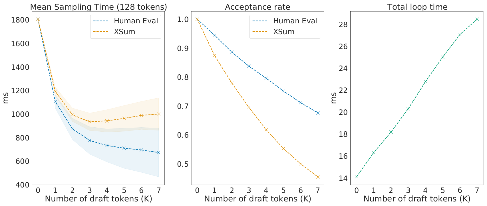

# 论文中文解读：《Accelerating Large Language Model Decoding with Speculative Sampling》

> **基本信息**：Charlie Chen、Sebastian Borgeaud、Geoffrey Irving、Jean-Baptiste Lespiau、Laurent Sifre、John Jumper（均来自 DeepMind），arXiv:2302.01318v1，2023 年 2 月；论文原文 [官方页面](https://arxiv.org/abs/2302.01318)。
>
> **本文的读法**：图取自论文原文（从 PDF 中按图裁出的原图），表为逐格核对后的中文转录（数字与原文一致，表头翻译为中文）。图后有中文图题、坐标轴翻译和读图结论，因此不必再翻英文版。凡标明“整理者补充”“整理者核算”的内容，是为了帮助理解而加的，不是论文自带的数字。
>
> **符号提醒**：本文把**目标模型**记作 $q$，**草稿模型**记作 $p$，与 [Leviathan 等人的论文](../speculative_decoding/论文中文解读.md)（目标 $p$、草稿 $q$）正好相反，读公式时不要把两篇的 $p$、$q$ 混淆。

## 一、一句话结论

大模型逐 token 采样慢，是因为它**受显存带宽限制**、**必须串行**，而且大模型还要跨多块加速器运行、带来通信延迟。DeepMind 提出的**推测采样（speculative sampling，缩写 SpS）** 让一个更快但更弱的**草稿模型（draft model）** 先自回归地生成长度为 $K$ 的短草稿，再让**目标模型（target model）** 一次并行地给这些位置全部打分，然后用一种**修正拒绝采样（modified rejection sampling）** 从左到右接受草稿的一部分，被拒绝处从残差分布补一个 token。于是目标模型每被调用一次可以产出 1 到 $K+1$ 个 token，并且**在硬件数值误差范围内恢复目标模型的分布**。在 16 块 TPU v4 上，用专门为低延迟训练的 4B 草稿模型加速 Chinchilla 70B：batch size 为 1、$K=4$ 时，XSum 上约 1.9–2.0 倍、HumanEval 上约 2.5 倍（14.1 ms/token 降到 7.00–7.52 ms/token 与 5.73 ms/token），下游指标与普通采样持平；摘要的概括是 2–2.5 倍，且不需要修改目标模型。

## 二、背景：为什么大模型解码慢

### 2.1 解码是显存带宽受限的串行过程

论文引言和“自回归采样”一节的论述可以概括为四点：

1. Transformer 采样通常**受显存带宽限制**（Shazeer, 2019）：对给定硬件，生成一个 token 的时间在一阶近似下与参数量及 Transformer 内存（如 KV cache）的大小成正比。
2. 模型太大还必须用**模型并行**，带来设备间通信开销（Pope 等，2022），资源需求也成倍增加。
3. 每个新 token 依赖过去的 token，所以采样一个序列要调用很多次 Transformer。
4. 一次受带宽限制的调用对 batch 里的每个序列只生成一个 token，所以生成多个 token 会在任何使用它的系统里引入大量延迟。

由此得到一个**硬上限**：所有参数至少要流经一块加速器芯片，因此“模型大小 ÷ 所有芯片的总内存带宽”就是自回归采样（ArS）速度的理论天花板。模型越大越严重，多加速器服务还会增加设备间通信这个新的延迟来源。

### 2.2 已有的加速思路

- **压缩模型**：量化到 int8 甚至 int4、蒸馏（如 TinyBERT、DistilBERT）可以在几乎不损失性能的情况下降低延迟；“模型大小对最终性能的贡献比预期小”（Chinchilla 的结论）也鼓励使用更小的模型。
- **缩小 KV cache**：如 multi-query attention，但这类技术主要提升**吞吐**（大 batch），对延迟帮助有限，尤其对大模型——因为带宽预算大部分被参数占用。
- **综合工程优化**：Pope 等（2022）结合上述技术加上若干 TPU 底层优化，大幅改善了 PaLM 540B 的服务延迟与效率。
- **并行化自回归采样**：block parallel sampling（Stern 等，2018）、aggressive decoding（Ge 等，2022），以及图像领域的若干工作。论文指出这些方法尚未适配典型的语言模型用法：要么只支持贪心采样，要么会使结果产生偏差，要么针对其他模态；而且据作者所知都没有扩展到分布式部署，而分布式正是上百亿、上千亿参数解码器所必需的。
- **同期工作**：论文说明它与 Leviathan 等人的 speculative decoding 是同时独立完成的；本文更侧重大模型的**分布式服务**设定并给出一些增量优化，但核心思想相同。

## 三、方法

### 3.1 普通自回归采样（算法 1）

```text
Algorithm 1  自回归采样 (ArS)
输入：自回归目标模型 q(.|.)，初始提示 x_1..x_t，目标序列长度 T
n <- t
while n < T:
    采样 x_{n+1} ~ q(x | x_1, ..., x_n)
    n <- n + 1
```

每次循环调用目标模型一次、产出一个 token。

### 3.2 推测采样（算法 2）逐步解释

论文在引言里把方法归纳成三步：

1. 生成长度为 $K$ 的短草稿。可以用并行模型（如 Stern 等 2018），也可以调用一个更快的自回归模型 $K$ 次；论文关注后者；
2. 用想要从中采样的更大更强的**目标模型**给草稿打分；
3. 用修正拒绝采样**从左到右**接受 $K$ 个草稿 token 的一个子集，同时恢复目标模型的分布。

直觉是：序列里常有“下一个 token 很显然”的位置；如果草稿与目标模型在某个 token 或某段子序列上高度一致，每调用一次目标模型就能产出多个 token。

下面是算法 2 的整理版（符号：$q_i$ 表示目标模型在“已确定的序列加草稿 $\tilde x_1,\dots,\tilde x_{i-1}$”之后的分布，$p_i$ 是草稿模型在同一位置的分布）。**说明**：原文伪代码在循环内一边更新 $n$、一边又用 $n+t$ 做下标，下标会重复计数，被拒绝后重采的 token 也没有执行 $n\leftarrow n+1$；下面按作者意图改写为用本轮开始时的长度 $n$ 固定下标，用 $a$ 记录本轮接受数（这是整理者对记号的修正，算法本身不变）。

```text
Algorithm 2  推测采样 (SpS)
输入：lookahead K，最小目标序列长度 T，目标模型 q(.|.)，草稿模型 p(.|.)，提示 x_0..x_t
n <- t
while n < T:
    # (1) 草稿：自回归地采 K 个，并保存每步的分布 p_i
    for i = 1..K:
        x~_i ~ p_i(x) = p(x | x_1..x_n, x~_1..x~_{i-1})
    # (2) 并行打分：目标模型一次前向，得到 K+1 组 logits
    q_i(x) = q(x | x_1..x_n, x~_1..x~_{i-1}),  i = 1..K+1
    # (3) 从左到右检验
    a <- 0
    for i = 1..K:
        r ~ U[0, 1]
        if r < min(1, q_i(x~_i) / p_i(x~_i)):
            a <- a + 1                       # 接受第 i 个草稿
        else:
            break                            # 第 i 个被拒绝，本轮到此为止
    # (4) 产出
    if a < K:
        x_{n+a+1} ~ (q_{a+1} - p_{a+1})_+    # 在第 a+1 个位置从残差分布重采
    else:
        x_{n+K+1} ~ q_{K+1}                  # K 个全部接受，再多采一个
    n <- n + a + 1
```

逐段解释：

- **(1) 草稿**：草稿模型串行运行 $K$ 次，每步以已确定的序列加之前的草稿为条件采样，并保留它的分布（验证要用）。
- **(2) 并行打分**：一次前向给出 $K+1$ 组 logits——前缀本身后面的下一个 token 分布、前缀加 $\tilde x_1$ 后的分布、……、前缀加整段草稿后的分布。这一步成立的前提，是论文的关键观察：**并行计算一小段 $K$ 个 token 的 logits，延迟与采样单个 token 非常接近**（见 3.3 节）。
- **(3) 逐个检验**：以 $\min(1,q_i/p_i)$ 的概率接受第 $i$ 个草稿；遇到第一个拒绝就停止，之后的草稿全部作废（它们是以被拒绝的 token 为条件采出的）。
- **(4) 产出**：被拒绝时，从**残差分布** $(q-p)_+$ 采样一个 token 替代它；全部被接受时，因为草稿最后一个 token 也有对应的目标 logits，可以“白送”一个 token。论文强调两点：每次草稿-接受循环**至少产出一个 token**（首个被拒时也会重采一个有效 token）；**最多产出 $K+1$ 个**，而不是朴素实现的 $K$ 个。
- 算法里的 $T$ 是**最小**目标序列长度：每轮可能多出几个 token，所以最终长度可能略超过 $T$。

### 3.3 条件打分（Conditional Scoring）：为什么一次打分 $K+1$ 个位置几乎不慢

论文关注按 Megatron 方式切分的大 Transformer。对这类模型，采样时间主要来自三部分，并且在 $K$ 较小时三者都几乎不随 $K$ 增加：

1. **线性层（Linear Layers）**：小 batch 时，每个线性层只处理很少几个 embedding，所以前馈层、$Q/K/V$ 计算和注意力输出投影里的稠密矩阵乘都是**受显存带宽限制**的；$K$ 较小时仍然受带宽限制，因此耗时相近。
2. **注意力（Attention Mechanism）**：注意力同样受带宽限制。采样时为避免重复计算，要保存此前所有 token 的 key 和 value（KV cache），它们很大，占注意力带宽利用的大头；而 KV cache 的大小不随 $K$ 增加，所以这部分几乎没有变化。
3. **All-reduce**：模型变大后参数要切分到多个加速器，产生通信开销；Megatron 在每个前馈层和注意力层之后各有一次 all-reduce。由于只传输少数几个 token 的激活，这个操作在采样和打分（$K$ 较小）两种情形下都通常是**延迟受限而不是吞吐受限**，耗时同样相近。

论文也给出限定：实现细节还会带来其他开销，位置编码的选择、解码方法（如 nucleus 采样可能需要排序）、硬件限制等都可能使打分与采样有差异；**只有当上述三项主导时**，小 $K$ 的打分才不会显著慢于采样。

整理者补充的 roofline 直觉（非论文内容）：权重矩阵读一次进来，处理的 token 数 $m$ 越多，每读一字节能做的运算越多，算术强度大约与 $m$ 成正比；而现代加速器的“计算与带宽平衡点”通常在每字节一两百次运算量级，所以 $m=K+1$ 只有几个时还远没到计算受限，多算几个 token 几乎是“免费”的。

### 3.4 修正拒绝采样（Modified Rejection Sampling）

目标：只靠草稿模型的采样结果，以及两个模型在这些 token 上的 logits，恢复目标模型的分布。

给定已确定的序列 $x_1,\dots,x_n$ 和草稿模型 $p(\cdot\mid\cdot)$ 生成的 $K$ 个草稿 $\tilde x_{n+1},\dots,\tilde x_{n+K}$，以如下概率接受 $\tilde x_{n+1}$：

$$
\min\Big(1,\ \frac{q(\tilde x_{n+1}\mid x_1,\dots,x_n)}{p(\tilde x_{n+1}\mid x_1,\dots,x_n)}\Big),
$$

其中 $q(\tilde x_{n+1}\mid\cdot)$ 和 $p(\tilde x_{n+1}\mid\cdot)$ 分别是目标模型与草稿模型在当前上下文下给 $\tilde x_{n+1}$ 的概率。

- 如果接受，就令 $x_{n+1}\leftarrow\tilde x_{n+1}$，再对 $\tilde x_{n+2}$ 重复同样的过程，直到某个 token 被拒绝或全部被接受；
- 如果 $\tilde x_{n+1}$ 被拒绝，就从下面的分布重采 $x_{n+1}$：

$$
x_{n+1}\sim\big(q(x\mid x_1,\dots,x_n)-p(x\mid x_1,\dots,x_n)\big)_+,\qquad (f(x))_+=\frac{\max(0,f(x))}{\sum_{x'}\max(0,f(x'))}.
$$

依次这样做，就能在硬件数值误差范围内恢复被接受 token 的目标分布（定理 1）。论文还指出：

- 标准采样方法（nucleus、top-$k$、调温度）只需**先按相应方式修改概率，再应用这套拒绝采样**；作者观察到整体接受率对具体参数设置比较稳健；
- 这个方法**不触碰 Transformer 主体**，所以可以和量化、multi-query attention 等其他加速或省显存的技术叠加使用。

### 3.5 无损性证明（定理 1）

**定理 1**：给定离散分布 $q$、$p$ 和一个草稿样本 $\tilde x\sim p$，设 $X$ 是最终得到的样本，则 $X\sim q$。

证明（逐步）：要让 $X=x$，要么先采到 $\tilde x=x$ 并被接受，要么在某个 $\tilde x$（任意取值）被拒绝后重采到 $x$。所以

$$
\Pr(X=x)=\Pr(\tilde x=x)\Pr(\tilde x\text{ 被接受}\mid\tilde x=x)+\Pr(\tilde x\text{ 被拒绝})\Pr(X=x\mid\tilde x\text{ 被拒绝}).
$$

1. 第一项：$p(x)\min\!\big(1,\tfrac{q(x)}{p(x)}\big)=\min(p(x),q(x))$。
2. 第二项里的条件概率由重采规则给出：$\Pr(X=x\mid\tilde x\text{ 被拒绝})=(q(x)-p(x))_+$。
3. 拒绝概率：$\Pr(\tilde x\text{ 被拒绝})=1-\sum_{x'}\min(p(x'),q(x'))=\sum_{x'}\big(q(x')-\min(p(x'),q(x'))\big)=\sum_{x'}\max(0,q(x')-p(x'))$。这正好是 $(q-p)_+$ 的分母，因此 $\Pr(\tilde x\text{ 被拒绝})\cdot\Pr(X=x\mid\tilde x\text{ 被拒绝})=\max(0,q(x)-p(x))$。
4. 合起来：$\Pr(X=x)=\min(p(x),q(x))+\max(0,q(x)-p(x))=q(x)$。

整理者补充：证明只针对单个位置，对整段序列用链式法则即可——每个位置输出的 token 在“已输出前缀”条件下服从 $q(\cdot\mid\text{前缀})$（草稿与目标用的是同一个已接受的前缀），所以整段序列服从目标模型的联合分布。证明对草稿分布 $p$ 没有任何要求，所以**草稿再弱也不会改变分布，只会降低接受率、浪费计算**。

### 3.6 小数值例子（整理者补充，不是论文数字）

**例 1：单个 token，验证无损。** 词表 $\{A,B,C,D\}$，目标分布 $q$ 与草稿分布 $p$ 为：

| token | A | B | C | D |
|---|---:|---:|---:|---:|
| 目标 $q(x)$ | 0.50 | 0.25 | 0.15 | 0.10 |
| 草稿 $p(x)$ | 0.20 | 0.30 | 0.10 | 0.40 |
| 接受概率 $\min(1,q/p)$ | 1 | 5/6 | 1 | 1/4 |
| 被接受的质量 $p\cdot\min(1,q/p)=\min(p,q)$ | 0.20 | 0.25 | 0.10 | 0.10 |
| 残差 $\max(0,q-p)$ | 0.30 | 0 | 0.05 | 0 |

- 总接受概率 $\sum_x\min(p,q)=0.20+0.25+0.10+0.10=0.65$，拒绝概率 $0.35$。
- 残差之和 $0.30+0.05=0.35$，恰等于拒绝概率；归一化得 $(q-p)_+=(6/7,\ 0,\ 1/7,\ 0)\approx(0.857,0,0.143,0)$。
- 最终各 token 的概率 = 被接受的质量 + $0.35\times(q-p)_+$：A 为 $0.20+0.35\times6/7=0.20+0.30=0.50$；B 为 $0.25+0=0.25$；C 为 $0.10+0.35\times1/7=0.10+0.05=0.15$；D 为 $0.10+0=0.10$。与 $q=(0.50,0.25,0.15,0.10)$ **逐项相等**。
- 直观看：草稿太爱提议 D（0.40，而目标只有 0.10），所以 D 大部分被拒绝；草稿很少提议 A（0.20，而目标要 0.50），缺的概率质量由拒绝之后的残差分布补回。

**例 2：两轮 $K=2$ 的运行（仍用例 1 的 $p$、$q$，假设每个位置分布相同）。**

- **第一轮**：草稿依次采出 $\tilde x_1=C$、$\tilde x_2=B$。$q/p$ 分别是 $0.15/0.10=1.5$（必接受）和 $0.25/0.30\approx0.833$；若抽到 $r_2=0.60<0.833$，则两个都被接受，再从 $q_3$ 多采一个 token（比如 D）。本轮目标模型只调用了一次，产出 $C,B,D$ 共 $K+1=3$ 个 token。
- **第二轮**：草稿采出 $\tilde x_1=D$，$q/p=0.10/0.40=0.25$；若 $r_1=0.70\ge0.25$，则 $\tilde x_1$ 被拒绝，从 $(6/7,0,1/7,0)$ 里重采（比如 A），本轮结束，$\tilde x_2$ 作废。本轮目标模型也只调用一次，但只产出 1 个 token（A）。

两轮表明每轮产出数在 1 到 $K+1$ 之间波动；$K$ 越大，波动范围越宽，这是图 1 里生成整段序列的时延方差随 $K$ 增大的一个直观原因（整理者解释，论文未展开）。

### 3.7 草稿模型怎么选

由于接受准则保证采样得到目标模型的分布，**只要草稿能给出 logits，且接受率足够高、延迟足够低到不亏本，就可以任意选择草稿方法**。论文列了几种思路：

- 把草稿生成并入目标模型，从头训练：如 Stern 等（2018）在 Transformer 里加多个 head 同时生成多个 token；
- 用序列级蒸馏（Kim 和 Rush, 2016）得到第二个模型，并行预测 $K$ 个 token：Ge 等（2022）采用此法；
- 把目标模型的一部分激活作为草稿模型的输入，并训练草稿模型使用该输入。

这些方法很可能产生很强的草稿，但需要大量由目标模型生成的数据，或要改动目标模型，序列级蒸馏尤其需要很大的算力预算，所以对大规模应用不太实用。论文选择更简单的路线：**直接用目标语言模型的一个较小版本作草稿**——大模型虽然样本更好，但总有“容易预测”的 token，小模型足以应付，因此可以得到高接受率；而且从工程和工作流角度也方便，因为训练目标模型时本来就有这类模型的成熟工具链。

（整理者联想：上面第一种思路后来发展为 [Medusa](../medusa/论文中文解读.md) 的多解码头，第三种“把目标模型的激活喂给草稿模型”与 [EAGLE](../eagle_speculative/论文中文解读.md) 利用目标模型特征的做法相近。）

## 四、实验设置与实现细节

### 4.1 为分布式部署专门训练的 4B 草稿模型

论文在 16 块 TPU v4（研究中通常用来服务 Chinchilla 的同款硬件）上训练了一个**为采样延迟优化的 4B 草稿模型**：使用与 Chinchilla 相同的 tokenizer 和数据集，宽度略小，**只有 8 层**。层数少使它的采样速度达到 **1.8 ms/token，而 Chinchilla 为 14.1 ms/token**。

为什么不直接选一个小模型？因为在分布式设置下，不同模型的最优推理配置不同：Chinchilla 70B 通常在 16 块 TPU v4 上服务（达到上述 14.1 ms/token）；而一个 chinchilla-optimal 的 7B 模型在 **4 块** TPU v4 上延迟最低（5 ms/token）。对较小的模型，增加的显存带宽和算力不足以抵消设备增多带来的通信开销——把 7B 放到 16 块 TPU 上服务，延迟**反而变高**。这意味着 7B 若按它自己的最优拓扑当草稿，只能带来有限的加速，而且起草时无法充分利用目标模型所占用的硬件。

论文的解法是训练一个**更宽、层数很少**的模型来最小化通信开销。已有观察表明语言模型的性能对宽深比变化相对稳健（Levine 等，2020），所以可以得到一个能在目标模型的同一套硬件上快速采样的强草稿。

**表 2：草稿模型的超参数**

| 模型 | $d_{\text{model}}$ | 注意力头数（Heads） | 层数（Layers） | 参数量（Params） |
|---|---:|---:|---:|---:|
| 目标模型（Chinchilla） | 8192 | 64 | 80 | 70B |
| 草稿模型（Draft） | 6144 | 48 | 8 | 4B |

（原文表 2，第 10 页。）整理者核算：草稿宽度是目标的 $6144/8192=75\%$，层数是 $1/10$，参数量约为 $1/17.5$（$4/70$），但单 token 延迟只降到约 $1/7.8$（$14.1/1.8$）。Megatron 切分下每层有两次 all-reduce（注意力后和前馈后），每个 token 草稿约要做 16 次、目标约 160 次，层数少正是延迟低的一个直接原因；延迟降幅（约 7.8 倍）小于参数量降幅（约 17.5 倍），说明还有不随参数量缩小的固定开销（如通信延迟），这是整理者的推测。

### 4.2 评测任务与测量方式

- **XSum**（Narayan 等，2018）：自然语言摘要任务，使用 1-shot 提示，共采样 11,305 条序列，最大序列长度 128；
- **HumanEval**（Chen 等，2021）：代码生成任务，表中标为 100 Shot，共生成 16,400 个样本，最大序列长度 512（整理者推断：HumanEval 有 164 道题，$164\times100=16400$，即每题采样 100 个，指标为 100 个样本里的通过率）；
- 都在 **batch size 为 1** 下比较 SpS 与 ArS。每次 SpS/ArS 循环的耗时方差很小，可以直接从 TPU profile 测得；为了得到平均加速、标准差等指标，论文记录了每次推测循环生成的 token 数。
- 作者特别说明：即使是贪心采样，数值上的一个 token 偏差也可能让两条序列面目全非。ArS 与 SpS 对伪随机种子的处理方式不同，不同的计算图又带来不同的数值，因此**不能期待输出逐 token 相同**；但应在数值误差范围内期待样本来自同一分布，并通过这些基准的指标来实证验证。

## 五、结果

### 5.1 表 1：Chinchilla 70B 的质量与速度

**表 1：Chinchilla 在 XSum 和 HumanEval 上用普通采样（ArS）与推测采样（SpS）的表现**。batch size 为 1，$K=4$；XSum 的 nucleus 参数 $p=0.8$，HumanEval 的 $p=0.95$、温度 0.8。“结果”列越大越好（ROUGE-2 或通过率），“平均每 token 时间”越小越好。

| 采样方法 | 评测 | 结果 | 平均每 token 时间 | 加速 |
|---|---|---:|---:|---:|
| ArS（Nucleus） | XSum（ROUGE-2） | 0.112 | 14.1 ms/token | 1× |
| SpS（Nucleus） | XSum（ROUGE-2） | 0.114 | 7.52 ms/token | 1.92× |
| ArS（Greedy） | XSum（ROUGE-2） | 0.157 | 14.1 ms/token | 1× |
| SpS（Greedy） | XSum（ROUGE-2） | 0.156 | 7.00 ms/token | 2.01× |
| ArS（Nucleus） | HumanEval（100 Shot） | 45.1% | 14.1 ms/token | 1× |
| SpS（Nucleus） | HumanEval（100 Shot） | 47.0% | 5.73 ms/token | 2.46× |

（原文表 1，第 6 页。）读法：

- 两个任务都有明显加速，HumanEval 接近 2.5 倍；而基准指标持平——论文据此认为，样本分布在数值误差内可证明相同，这在经验上验证了草稿模型没有给结果带来偏差。
- 在 HumanEval 和 greedy 的 XSum 上，这个加速超过了硬件对自回归采样的理论带宽上限（模型大小 ÷ 总显存带宽）。整理者粗估：70B 参数用 bf16 约 140 GB，TPU v4 单芯片 HBM 带宽按约 1.2 TB/s 计，16 块合计约 19 TB/s，上限约 7.1 ms/token；表中 7.00 与 5.73 ms/token 低于它，7.52 ms/token 略高于它，与论文的说法吻合。这只是数量级核对，精度和 KV cache 读取都会改变上限。
- 指标上的小差异（如 HumanEval 45.1% 对 47.0%）论文没有给出置信区间或显著性检验，只说“持平”；这个差异是否超出采样噪声，无法从论文判断（整理者提醒）。
- **表内的一处不一致（整理者发现）**：XSum（Nucleus）一行，$14.1/7.52\approx1.88$，并不等于表中写的 1.92×；另外两行的比值（$14.1/7.00=2.01$、$14.1/5.73=2.46$）都对得上。用图 1 的读数（见 5.4 节）反推，该行的每 token 时间约为 7.3–7.4 ms，对应 $14.1/7.34\approx1.92$。所以“7.52”可能是笔误，也可能 1.92× 另有算法，论文本身无法判定；引用时建议同时注明两个数。

### 5.2 为什么 HumanEval 加速更大：接受率随领域变化

接受率明显取决于应用场景和解码方法。HumanEval 的加速显著更大，论文假设是下列因素的组合：

- 代码里有大量常见的子序列（例如 `for i in range(len(arr)):` 对草稿模型来说相对容易猜）；
- 代码往往被分解成一个较小集合里的、较短的 token；
- 温度会让草稿和目标的 logits 同时变尖锐。

这是论文提出的**假设**，并未做对照实验验证。

### 5.3 图 1：草稿长度 $K$ 的权衡



*图 1（原文 Figure 1，第 7 页）：草稿 token 数 $K$ 的影响。左：生成 128 个 token 的平均时间（带标准差）；中：接受率；右：每轮循环的总时间。*

**图中文字翻译与读法**：

- **左图 Mean Sampling Time (128 tokens)（平均采样时间，128 个 token）**：横轴是 Number of draft tokens (K)（草稿 token 数 $K$，0 到 7），纵轴为毫秒（400 到 1800）。蓝色虚线是 Human Eval，橙色虚线是 XSum，浅色阴影带表示标准差。$K=0$ 即普通自回归采样，约 1800 ms（$14.1\times128\approx1805$）。论文指出：随着 $K$ 增大，整体加速会**进入平台甚至倒退**，XSum 在 $K=3$ 最优；时延**方差**随 $K$ 单调增大（阴影带越来越宽）。
- **中图 Acceptance rate（接受率）**：纵轴 0.5 到 1.0。论文定义它是“**平均接受的 token 数除以 $K+1$**”，用来衡量修正拒绝方案的整体效率；它随 lookahead 增大而下降——因为后面的 token 依赖前面的全部被接受。$K=0$ 时恒为 1，可见这里的“接受的 token 数”把每轮末尾补采的那一个 token 也算在内，即等于每轮产出的 token 数（整理者推断）。
- **右图 Total loop time（每轮循环总时间）**：纵轴为毫秒（14 到 28 以上），只有一条绿色虚线（原图未区分任务）。它随 $K$ **近似线性**增长，因为草稿模型的调用次数增加；论文说斜率略高于草稿模型自身的采样速度，是 nucleus 解码的额外开销所致。
- **读图结论**：更大的 $K$ 减少了目标模型的打分次数，理论上有更大加速；但每轮总时间随草稿调用次数线性增长，且打分时间也略有增加，同时被接受 token 的比例随 $K$ 下降，所以平均加速出现平台甚至退化；$K$ 稍大虽然平均加速可能略高，却会增加生成整段序列时间的方差，这在关心 P90、P99 延迟的场景下可能是问题。

**从图 1 读出的近似数值**（整理者用像素位置估读，误差约 $\pm0.01$ 或 $\pm10$ ms；“每轮 token 数”是整理者按上面的定义，用表中的接受率 $\times(K+1)$ 算出的）：

| $K$ | XSum 接受率 | XSum 每轮 token 数 | HumanEval 接受率 | HumanEval 每轮 token 数 | 每轮总时间（ms） |
|---:|---:|---:|---:|---:|---:|
| 0 | 1.00 | 1.00 | 1.00 | 1.00 | 约 14.1 |
| 1 | 0.88 | 1.76 | 0.95 | 1.90 | 约 16.3 |
| 2 | 0.78 | 2.34 | 0.89 | 2.67 | 约 18.2 |
| 3 | 0.70 | 2.80 | 0.84 | 3.36 | 约 20.3 |
| 4 | 0.62 | 3.10 | 0.80 | 4.00 | 约 22.8 |
| 5 | 0.56 | 3.36 | 0.75 | 4.50 | 约 25.0 |
| 6 | 0.50 | 3.50 | 0.71 | 4.97 | 约 27.1 |
| 7 | 0.46 | 3.68 | 0.68 | 5.44 | 约 28.5 |

左图中，XSum 生成 128 个 token 的平均时间约为：$K=1$ 时 1200 ms、$K=2$ 时 995 ms、$K=3$ 时 935 ms、$K=4$ 时 943 ms，之后缓慢回升到 $K=7$ 时约 1000 ms；HumanEval 则持续下降，$K=4$ 时约 735 ms，$K=7$ 时约 675 ms，但阴影带（方差）越来越宽。

### 5.4 用公式核对图 1 与表 1（整理者核算，基于上面读出的近似值）

1. **每个 token 的时间 = 每轮总时间 ÷ 每轮 token 数。** $K=4$ 时：XSum 约 $22.8/3.10\approx7.35$ ms/token（再乘 128 约 940 ms，与左图约 943 ms 吻合）；HumanEval 约 $22.8/4.00=5.7$ ms/token，与表 1 的 5.73 一致。XSum 的 7.35 ms 比表 1 的 7.52 低约 2%，见 5.1 节的说明。
2. **与 Leviathan 等人的公式互相印证。** 若每个位置的接受概率为 $\alpha$ 且相互独立，则每轮产出 token 数的期望是 $\frac{1-\alpha^{K+1}}{1-\alpha}$（见 [Speculative Decoding 解读](../speculative_decoding/论文中文解读.md) 的 4.1 小节）。用 $K=4$ 处的读数反推：XSum 的 $\alpha\approx0.76$，HumanEval 的 $\alpha\approx0.89$。再用它们预测其他 $K$ 的每轮 token 数，与上表读数相比，$K=1,\dots,7$ 的差别都在 1.5% 以内。这说明 DeepMind 测得的接受率曲线与“各位置独立、接受率相同”的理论模型吻合得很好。
3. **加速倍数。** 右图中每轮时间从 $K=0$ 的 14.1 ms 增加到 $K=4$ 的 22.8 ms，平均每个草稿 token 约 2.2 ms，约是目标单步 14.1 ms 的 0.15 倍；套用 Leviathan 的加速公式 $\frac{\mathbb{E}[L]}{1+Kc}$（$c\approx0.15$，$K=4$，分母约 1.62）得 XSum 约 $3.10/1.62\approx1.9$、HumanEval 约 $4.00/1.62\approx2.5$，与表 1 的 1.92×、2.46× 一致。
4. **打分开销很小的定量印象。** 若把每个草稿步按 1.8 ms 计，$K=4$ 时目标模型对 5 个位置打分约占 $22.8-4\times1.8=15.6$ ms，只比采样单个 token 的 14.1 ms 多约 11%；论文说斜率略高于 1.8 ms，所以真实打分开销还要略小一些。这是粗略估算，不是论文的数字。

## 六、局限、证据边界与常见误读

**论文的结论与定位**：推测采样不需要修改目标语言模型的参数或结构，在数值范围内可证明无损，使用合适的草稿模型可以很好地扩展，并与许多降低小 batch 延迟的现有技术互补；并且在下游任务中经验上验证了无损。

**证据边界（整理者归纳）**：

- **单一设置**：实验只有 Chinchilla 70B + 一个专门训练的 4B 草稿 + 16 块 TPU v4 + batch size 1 + $K=4$（表 1）；拓扑、batch、模型改变，结论会变。论文也没有评测大 batch 下的吞吐。
- **没有草稿设计的消融**：论文论证“宽浅草稿更适合这套拓扑”主要靠延迟数字（1.8 ms 对 5 ms 的 7B）；没有给出换用 7B 草稿或不同深宽比草稿的实测加速，也没有给出草稿模型的训练成本、数据量。
- **质量验证较粗**：表 1 只给了两个任务各一个指标的单点数，没有置信区间，也没有给出接受率的表格数值；“持平”是定性判断。
- **表内不一致**：见 5.1 节，XSum nucleus 一行 7.52 ms/token 与 1.92× 不自洽。
- **假设性解释**：HumanEval 为什么更快、$K$ 对不同领域的影响，都是论文提出的假设，没有对照实验。

**常见误读**：

- “无损”是**分布层面**的保证（在硬件数值范围内），不是逐 token 相同；论文明确说不能期待相同输出。
- 推测采样**不增加答案的正确率**：它让输出分布与目标模型一致，只减少墙钟时间；如果要提升正确率，要用 [Self-Consistency](../self_consistency/论文中文解读.md) 之类的多路径聚合方法，两者可以叠加。
- 一次打分 $K+1$ 个位置“几乎不慢”不是 Transformer 的恒等性质，而是在小 batch、小 $K$、三项主导的 roofline 区域内成立。
- 如果工程里改用更宽松的接受条件（如 lenience、typical acceptance）或跳过残差修正，就不能再沿用本文的无损证明，必须单独评价质量偏移（整理者补充）。

## 七、复现检查清单

- 固定目标模型、采样变换（nucleus、温度等）和 tokenizer；草稿模型必须与目标共享 token 空间，并对 logits 做同样的变换后再计算接受概率。
- 在**真实部署拓扑**上测草稿模型的延迟，而不是用参数量推断：同一个模型换设备数，延迟可能反而变高（7B 在 16 块 TPU 上的例子）。
- 扫描 $K$，同时报告接受率、每轮平均 token 数、每轮耗时和 P90/P99 延迟，而不是只看均值。
- 分任务、batch、上下文长度、输出长度报告；代码任务的结果不能代表摘要或对话。
- 用统计质量指标验证随机采样的分布，不要要求逐序列相等。
- 把训练和维护草稿模型的成本与线上节省分开记录。

## 八、与相关论文的关系

- [Speculative Decoding（Leviathan 等）](../speculative_decoding/论文中文解读.md)：同期独立提出同样的核心校正，侧重理论分析（接受率、期望加速、总算术量）和 T5 实验；本文侧重 70B 级模型的分布式服务与草稿模型设计。
- [SpecInfer](../specinfer/论文中文解读.md)：把单链草稿扩展为 token tree，并用树形注意力并行验证。
- [Medusa](../medusa/论文中文解读.md)：在目标模型上加多个解码头，省去独立草稿模型。
- [EAGLE](../eagle_speculative/论文中文解读.md) 与 [EAGLE-2](../eagle_2/论文中文解读.md)：在特征层面自回归起草，并动态调整草稿树。

## 原文证据导航

- 算法 1、算法 2：第 3 页；条件打分（三项开销）：第 3–4 页；修正拒绝采样：第 4–5 页
- 草稿模型的选择与 4B 草稿的训练：第 5–6 页；表 2：第 10 页
- 表 1（XSum、HumanEval）：第 6 页；图 1（$K$ 的权衡）：第 7 页
- 定理 1 的证明：第 10–11 页
- [原论文 PDF](paper.pdf)
- [原文提取文本](paper.txt)
- [论文概要](论文概要.md)
