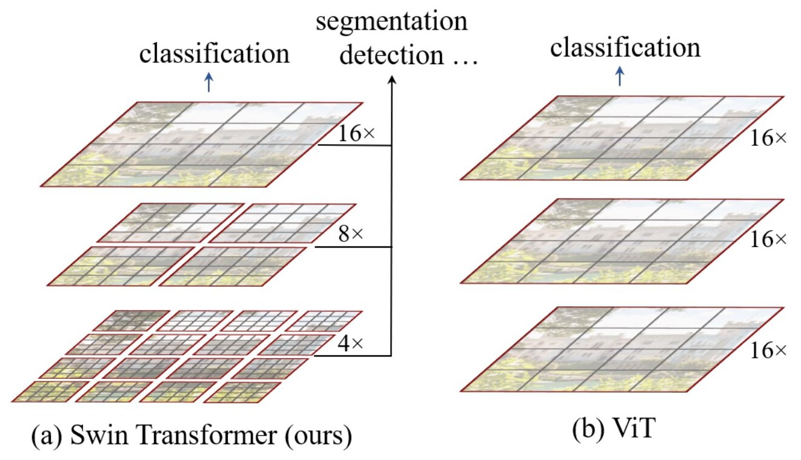
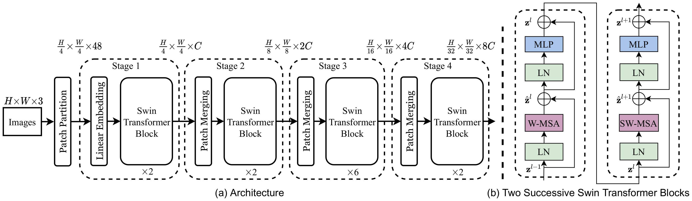
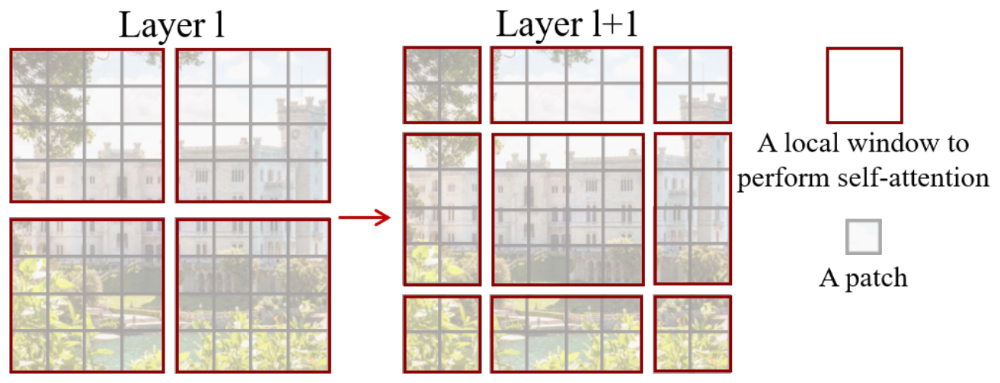
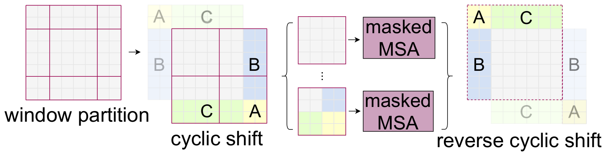

# 论文中文解读：《Swin Transformer: Hierarchical Vision Transformer using Shifted Windows》

> **基本信息**：Ze Liu、Yutong Lin、Yue Cao、Han Hu、Yixuan Wei、Zheng Zhang、Stephen Lin、Baining Guo（Microsoft Research Asia），arXiv:2103.14030（v2，2021 年 8 月 17 日）。本地 PDF 即该版本，共 14 页：正文到第 9 页上半部分的结论，附录 A1–A3 在第 9–11 页，其后是参考文献。代码与模型见 [microsoft/Swin-Transformer](https://github.com/microsoft/Swin-Transformer)；论文原文 [官方页面](https://arxiv.org/abs/2103.14030)。
>
> **本文的读法**：图是从 PDF 中按图裁出的原图（论文共 4 张图，全部收入），表是逐格核对后的中文转录（数字与原文一致，表头翻译为中文，论文共 10 张表，全部收入）；每张图后有中文图题、图中文字翻译和读图结论。公式右侧括号里的数字是原文的公式编号。标“本文计算”“本文推算”的内容是为帮助理解而加的核算，原文没有写；原文自身数字不一致的地方会单独指出。读完不必再翻英文原文。

## 一、一句话结论

ViT 把图像切成固定大小的 patch 后用全局自注意力，只产生单一低分辨率特征图，计算量随图像面积二次增长，很难直接当作检测、分割这类密集预测任务的骨干网络。Swin Transformer 的做法有四点：

1. **层级结构**：先用 $4\times4$ 的小 patch，逐阶段把相邻 $2\times2$ 个 patch 合并（patch merging），分辨率依次降为输入的 $1/4,1/8,1/16,1/32$，通道数依次加倍，得到和 ResNet、VGG 一样的特征金字塔，可以直接替换现有方法里的骨干；
2. **窗口自注意力**：自注意力只在不重叠的 $M\times M$ 窗口内计算（默认 $M=7$），每个窗口的 token 数固定，所以注意力的计算量随图像面积**线性**增长；
3. **移位窗口**：相邻两个 block 交替使用“常规窗口划分”和“整体移位 $\lfloor M/2\rfloor$ 的窗口划分”，使上一层互相隔离的窗口在下一层有了联系；用“循环移位 + 掩码”实现，不增加窗口个数，硬件上很高效；
4. **相对位置偏置**：在注意力 logits 上加一个可学习的、按窗口内相对位置索引的偏置，代替 ViT 的绝对位置编码。

主要结果（论文给出的数字）：ImageNet-1K 上 Swin-L（ImageNet-22K 预训练，$384^2$）top-1 87.3%；COCO test-dev 上 58.7 box AP / 51.1 mask AP（Swin-L + HTC++，多尺度测试），比此前最好结果高 +2.7 box AP / +2.6 mask AP；ADE20K val 上 53.5 mIoU，比此前最好高 +3.2 mIoU。同量级对比里，Swin-T 在 ImageNet 上比 DeiT-S 高 1.5 个点，在 COCO（Cascade Mask R-CNN）上比 ResNet-50 高 4.2 box AP。作者还验证了层级结构和移位窗口对全 MLP 架构（MLP-Mixer）同样有益。

| | ViT（原版） | Swin Transformer |
|---|---|---|
| token 划分 | 固定 $16\times16$ patch，整网同一分辨率 | $4\times4$ patch 起步，逐阶段 $2\times2$ 合并 |
| 特征图 | 单一分辨率（低分辨率，$16\times$ 下采样） | 4 个分辨率：$4\times,8\times,16\times,32\times$ |
| 注意力范围 | 全局 | 窗口内（$M=7$），相邻层交替移位 |
| 计算复杂度 | 随 token 数二次增长 | $M$ 固定时随 token 数线性增长 |
| 位置信息 | 加在输入上的绝对位置编码 | 注意力里的相对位置偏置，不用绝对位置编码 |
| 分类读出 | `[class]` token | 最后一个 stage 的特征图做全局平均池化 + 线性分类器 |

（本表依据原文第 1、3 节与附录 A2.1 整理。）

## 二、背景与动机

### 2.1 把 Transformer 搬到视觉的两个难点

在自然语言处理里 Transformer 已是标准架构，而视觉领域长期由卷积网络（AlexNet、VGG、GoogleNet、ResNet、DenseNet、HRNet、EfficientNet 等）主导。作者认为 Transformer 从语言迁移到视觉有两处根本差异：

- **尺度**：语言里的 token（词）是处理的基本单元，而视觉元素的大小差别很大，这个问题在目标检测等任务里一直受到重视。已有的 Transformer 模型（原版 Transformer、ViT）里 token 都是固定尺度，不适合这类任务；
- **分辨率**：图像像素的分辨率远高于文本段落里的词数。语义分割等任务需要在像素级做密集预测，而自注意力的计算量随图像尺寸二次增长，在高分辨率图像上无法承受。

ViT 的局限（原文第 2 节）：它用于分类效果很好，但其结构不适合当通用骨干，因为特征图分辨率低、复杂度随图像尺寸二次增长；已有的把 ViT 用于检测和分割的工作只是直接上采样或反卷积，性能相对较低。同期还有一些修改 ViT 结构以提升分类精度的工作（Tokens-to-Token ViT、CPVT、TNT 等），作者说自己的 Swin 在这些方法里取得了最好的速度-精度折中，尽管工作的重点是通用性能而不是分类本身（这一说法在本文收录的表里没有直接对应的对比，属于原文的断言）。另一个同期工作 PVT（Pyramid Vision Transformer）也在 Transformer 上构造多分辨率特征图，但它的复杂度仍随图像尺寸二次增长，而 Swin 是线性且局部的；作者认为局部性对建模视觉信号里的高度相关性有益（引用了 Hubel & Wiesel 等经典工作）。

### 2.2 滑动窗口自注意力为什么慢

此前也有“把自注意力限制在每个像素的局部窗口”的做法（用来替换 ResNet 里的部分或全部空间卷积，Local Relation Network、stand-alone self-attention 等）。它们在精度/FLOPs 上比对应的 ResNet 略好，但内存访问代价高，实际延迟明显更大：滑动窗口里**每个 query 像素的 key 集合都不同**，而在卷积里同一个卷积核的权重在整张特征图上共享，所以滑动窗口卷积在通用硬件上有高效实现，滑动窗口自注意力却很难做到高效的内存访问（原文脚注 1、2）。

Swin 的办法是不滑动，而是把图像划成**不重叠的窗口**：同一窗口里所有 query patch 共用同一个 key 集合，对硬件内存访问友好；再通过相邻层之间移位窗口来建立跨窗口联系。作者的实验结论是：移位窗口的延迟远低于滑动窗口，建模能力相近（见表 5、表 6）。

### 2.3 其他相关工作（原文第 2 节）

- **CNN 及其变体**：除了整体架构的演进，还有改进单个卷积层的工作，如深度可分离卷积、可变形卷积；
- **自注意力骨干**：在 ResNet 里用局部窗口自注意力替换空间卷积（见上）；
- **自注意力/Transformer 作为 CNN 的补充**：作为 backbone 的补充或放在 head 里，以编码远距离依赖或异质交互；最近 Transformer 的编码器-解码器结构（DETR 等）用于检测和实例分割。本文探索的是用 Transformer 做基础视觉特征提取，与这些工作互补；
- **基于 Transformer 的视觉骨干**：ViT 需要大规模训练集（JFT-300M）才表现好，DeiT 引入了一些训练策略，使 ViT 在较小的 ImageNet-1K 上也有效。

### 2.4 全文概念图（图 1）

*图 1（原文 Figure 1，第 1 页）：(a) Swin Transformer 通过在更深的层里合并图像 patch（图中灰色小格）构造层级特征图，并且只在每个局部窗口（红框）内计算自注意力，所以计算复杂度随输入图像尺寸线性增长。因此它可以作为图像分类和密集识别任务的通用骨干。(b) 相比之下，以往的视觉 Transformer 只产生单一低分辨率的特征图，由于全局计算自注意力，复杂度随输入图像尺寸二次增长。*

**图中文字翻译与读法**：

- **(a) Swin Transformer (ours)（本文方法）**：自下而上有三层示意：最底层标 **4×**（相对输入图像下采样 4 倍）：画面被分成 $4\times4$ 共 16 个红框窗口，每个窗口里是一小格一小格的灰色网格（patch）；中间层标 **8×**：$2\times2$ 共 4 个红框窗口，窗口里的 patch 变大了（由小 patch 合并而来）；最上层标 **16×**：只有一个红框窗口（覆盖整张图），里面是更大的 patch 网格。三层各引一条线汇到一根向上的箭头，箭头上写 **segmentation, detection …**（分割、检测等），表示这些多尺度特征可以直接给密集预测任务用；最上层再单独引出一个向上的箭头 **classification**（分类）。
- **(b) ViT**：三层都标 **16×**，每层画面只有一个红框，里面是同样大小的 patch 网格；只在最上层引出 **classification**。
- **读图结论**：Swin 的每个窗口里 patch 数固定（图中每个窗口的网格大小相同，约为 $4\times4$，从图上读出），窗口数量随图像变大而增多，所以总计算量线性增长；patch 越往深层越大、特征图越小，形成金字塔。ViT 每层的特征图大小相同、注意力覆盖整张图。示意图只画了 3 层（$4\times,8\times,16\times$），完整的 Swin 有 4 个 stage，最后还有 $32\times$（见图 3）。

## 三、方法（原文第 3 节）

### 3.1 整体架构

*图 3（原文 Figure 3，第 4 页）：(a) Swin Transformer（Swin-T）的架构；(b) 两个连续的 Swin Transformer block（记号与式 (3) 相同）。W-MSA 和 SW-MSA 分别是采用常规窗口划分和移位窗口划分的多头自注意力模块。*

**图中文字翻译与读法**：

- **(a) Architecture（架构）**：输入 **Images**（图像，$H\times W\times3$）$\to$ **Patch Partition**（patch 划分，输出 $\frac{H}{4}\times\frac{W}{4}\times48$）$\to$ **Stage 1**：**Linear Embedding**（线性嵌入，输出 $\frac{H}{4}\times\frac{W}{4}\times C$）+ **Swin Transformer Block** $\times2$ $\to$ **Stage 2**：**Patch Merging**（patch 合并，输出 $\frac{H}{8}\times\frac{W}{8}\times2C$）+ Swin Transformer Block $\times2$ $\to$ **Stage 3**：Patch Merging（$\frac{H}{16}\times\frac{W}{16}\times4C$）+ Swin Transformer Block $\times6$ $\to$ **Stage 4**：Patch Merging（$\frac{H}{32}\times\frac{W}{32}\times8C$）+ Swin Transformer Block $\times2$。
- **(b) Two Successive Swin Transformer Blocks（两个连续的 Swin Transformer block）**：左边的 block 自下而上是 $z^{l-1}\to$ **LN** $\to$ **W-MSA** $\to$ 加号（残差，得到 $\hat z^l$）$\to$ **LN** $\to$ **MLP** $\to$ 加号（残差，得到 $z^l$）；右边的 block 完全相同，只是把 W-MSA 换成 **SW-MSA**，输入 $z^l$、中间量 $\hat z^{l+1}$、输出 $z^{l+1}$。
- **读图结论**：整个网络就是 4 个 stage；每个 stage（除第一个）开头用 patch merging 把分辨率减半、通道加倍；每个 stage 里的 block 成对出现（W-MSA 一个，SW-MSA 一个），所以 Swin-T 的 $\{2,2,6,2\}$ 层数都是偶数。

**逐步解释（对应原文 3.1 节）**：

1. **Patch 划分**：像 ViT 一样把输入 RGB 图像切成不重叠的 patch。每个 patch 当作一个“token”，它的特征是原始 RGB 像素值的拼接。实现里 patch 大小取 $4\times4$，所以每个 patch 的特征维度是 $4\times4\times3=48$（图 3 中的“$\times48$”）。
2. **Stage 1**：先对这个 48 维原始特征做一次线性嵌入，投影到任意维度 $C$；然后接若干个 Swin Transformer block。这些 block 不改变 token 个数（$\frac{H}{4}\times\frac{W}{4}$）；线性嵌入加上这些 block 合称“Stage 1”。
3. **Patch merging（Stage 2 的开头）**：把每组相邻的 $2\times2$ 个 patch 的特征拼接起来（$4C$ 维），再接一个线性层把它变成 $2C$ 维。token 个数减为原来的 $1/4$（分辨率 $2\times$ 下采样），通道数加倍。之后接 Swin Transformer block 做特征变换，分辨率保持 $\frac{H}{8}\times\frac{W}{8}$。这个“patch merging + block”合称“Stage 2”。
4. **Stage 3、Stage 4**：同样的过程再重复两次，输出分辨率分别为 $\frac{H}{16}\times\frac{W}{16}$ 和 $\frac{H}{32}\times\frac{W}{32}$（通道数 $4C$ 和 $8C$）。

这些 stage 一起产生的层级表示，其特征图分辨率与典型卷积网络（VGG、ResNet）相同，所以 Swin 可以方便地替换已有方法里的骨干网络。

**具体数字例子（Swin-T，$C=96$，输入 $224\times224$）**：

| 位置 | token 个数 | 通道数 | 说明 |
|---|---|---:|---|
| 输入图像 | $224\times224$ 像素 | 3 | RGB |
| Patch 划分 | $56\times56$ | 48 | $4\times4\times3$ |
| Stage 1（线性嵌入 + 2 个 block） | $56\times56$ | 96 | $=C$ |
| Stage 2（patch merging + 2 个 block） | $28\times28$ | 192 | $=2C$ |
| Stage 3（patch merging + 6 个 block） | $14\times14$ | 384 | $=4C$ |
| Stage 4（patch merging + 2 个 block） | $7\times7$ | 768 | $=8C$ |

（本表依据原文 3.1 节和表 7 的数值整理；窗口大小 $M=7$，所以 stage 1–4 在 $224^2$ 输入下分别有 $8\times8=64$、$4\times4=16$、$2\times2=4$、$1$ 个窗口。）注意最后一个 stage 的特征图 $7\times7$ 恰好等于一个窗口，所以那里的窗口自注意力实际就是全局自注意力（本文推算）。

### 3.2 Swin Transformer block

Swin Transformer 的 block 就是把标准 Transformer block 里的多头自注意力（MSA）换成基于移位窗口的模块（见下面 3.3–3.5 节，对应原文 3.2 节），其他层不变。如图 3(b)：一个 block 由一个基于（移位）窗口的 MSA 模块、再接一个两层的 MLP（中间用 GELU 非线性）组成；每个 MSA 模块和每个 MLP 之前加 LayerNorm（LN），每个模块之后加残差连接（pre-norm 结构，与 ViT 相同）。MLP 的隐藏层扩张倍数 $\alpha=4$，每个注意力头的 query/key 维度 $d=32$（所有实验均如此）。

### 3.3 基于窗口的自注意力与复杂度

标准 Transformer 及其视觉版本（ViT）都做**全局**自注意力：每个 token 与所有其他 token 计算关系，复杂度随 token 数二次增长，不适用于需要大量 token 的密集预测或高分辨率图像。

**窗口内自注意力**：为高效建模，只在局部窗口内计算自注意力。窗口把图像均匀地、不重叠地分开；设每个窗口含 $M\times M$ 个 patch，图像有 $h\times w$ 个 patch，则全局 MSA 与窗口 MSA 的计算复杂度分别是（脚注 3：忽略 softmax 的计算）：

$$
\Omega(\mathrm{MSA})=4hwC^2+2(hw)^2C\qquad(1)
$$

$$
\Omega(\text{W-MSA})=4hwC^2+2M^2hwC\qquad(2)
$$

前者随 patch 数 $hw$ 二次增长；后者在 $M$ 固定时（默认 $M=7$）线性增长。全局自注意力对于很大的 $hw$ 通常无法承受，而窗口自注意力是可扩展的。

**这两个式子怎么来的**（原文没有展开，本文推导，计数的是乘加次数）：对 $n$ 个 token、$C$ 维通道的一次 MSA：生成 $q,k,v$ 的三个投影共 $3nC^2$；$QK^\top$ 为 $n^2C$；用注意力权重乘 $V$ 为 $n^2C$；输出投影 $nC^2$。合计 $4nC^2+2n^2C$。全局 MSA 取 $n=hw$ 就是式 (1)。窗口 MSA 取 $n=M^2$，得到每个窗口 $4M^2C^2+2M^4C$，共有 $hw/M^2$ 个窗口，相乘即式 (2)：第二项里的 $(hw)^2$ 变成了 $M^2\cdot hw$。

**数字例子（本文计算）**：Swin-T 在 $224^2$ 输入下，每个 stage 里一个注意力模块的乘加次数（只算 MSA 模块本身，不含 MLP）：

| stage | token 数 $h\times w$ | $C$ | 全局 MSA（式 1） | 窗口 W-MSA（式 2，$M=7$） | 倍数 |
|---|---|---:|---:|---:|---:|
| 1 | $56\times56$ | 96 | 2003.8M | 145.1M | 13.8 |
| 2 | $28\times28$ | 192 | 351.6M | 130.4M | 2.7 |
| 3 | $14\times14$ | 384 | 145.1M | 123.0M | 1.2 |
| 4 | $7\times7$ | 768 | 119.3M | 119.3M | 1.0 |

浅层 token 多，全局注意力的二次项主导，窗口化省得最多；stage 4 只有一个窗口，两者相同。把输入面积放大到 4 倍（$448^2$），stage 1 的全局 MSA 会涨到约 30.7G（增长 15.3 倍），W-MSA 约 0.58G（增长 4 倍），后者与图像面积成正比。另外，一个 block 里注意力的四个线性投影（$q,k,v$ 和输出）共 $4hwC^2$，MLP 的两层共 $8hwC^2$，合计 $12hwC^2$；从一个 stage 到下一个，$hw$ 缩小 4 倍而 $C^2$ 增大 4 倍，所以这一项在每个 stage 的每个 block 里基本不变（本文推导），各 stage 的 block 计算量大致相当。

### 3.4 连续 block 里的移位窗口划分

窗口自注意力缺少跨窗口的联系，限制了建模能力。为了在保持不重叠窗口的高效计算的同时引入跨窗口联系，论文提出**移位窗口划分**：在相邻两个 Swin Transformer block 之间，在两种划分配置之间交替。

*图 2（原文 Figure 2，第 2 页）：在 Swin Transformer 里用移位窗口方式计算自注意力的示意。在第 $l$ 层（左），采用常规的窗口划分，在每个窗口内计算自注意力。在下一层 $l+1$（右），窗口划分发生移位，产生新的窗口；新窗口里的自注意力计算跨越了第 $l$ 层窗口的边界，在它们之间建立了联系。*

**图中文字翻译与读法**：

- 左：**Layer $l$**（第 $l$ 层）：$8\times8$ 个 patch 被常规地划成 $2\times2$ 个窗口（红框），每个窗口 $4\times4$ 个 patch（灰色小格），即 $M=4$；右：**Layer $l+1$**（第 $l+1$ 层）：窗口整体移位后，画面被划成 $3\times3$ 共 9 个大小不一的窗口：四角是 $2\times2$ 的小窗口，上下两条是 $2\times4$（高 2 宽 4）、左右两条是 $4\times2$，中间是 $4\times4$。右侧图例：红框 **A local window to perform self-attention**（执行自注意力的局部窗口）；灰色小方块 **A patch**（一个 patch）。
- **读图结论**：新窗口的边界落在旧窗口的中间，所以新窗口里的 token 来自旧窗口里的好几个不同的窗口，原先相互隔离的窗口之间就有了信息交换。

**做法**（对应原文 3.2 节）：第一个模块使用常规窗口划分，从左上角像素开始，把 $8\times8$ 的特征图均匀划成 $2\times2$ 个大小为 $4\times4$ 的窗口（$M=4$）；下一个模块采用相对前一层移位的窗口配置，把窗口整体平移 $(\lfloor M/2\rfloor,\lfloor M/2\rfloor)$ 个像素（这里是 $(2,2)$）。图上的例子（行、列都从 1 数起）：移位后行方向的分界线落在第 2 行之后和第 6 行之后，所以 8 行被分成第 1–2 行、第 3–6 行、第 7–8 行三段，列同理，共得到 $3\times3=9$ 个窗口。

采用移位窗口划分后，连续的 Swin Transformer block 按下面方式计算（式 3）：

$$
\begin{aligned}
\hat z^{l}&=\text{W-MSA}\big(\mathrm{LN}(z^{l-1})\big)+z^{l-1},\\
z^{l}&=\mathrm{MLP}\big(\mathrm{LN}(\hat z^{l})\big)+\hat z^{l},\\
\hat z^{l+1}&=\text{SW-MSA}\big(\mathrm{LN}(z^{l})\big)+z^{l},\\
z^{l+1}&=\mathrm{MLP}\big(\mathrm{LN}(\hat z^{l+1})\big)+\hat z^{l+1},
\end{aligned}\qquad(3)
$$

其中 $\hat z^l$ 和 $z^l$ 分别表示第 $l$ 个 block 里（S）W-MSA 模块和 MLP 模块的输出特征；W-MSA 和 SW-MSA 分别表示采用常规窗口划分和移位窗口划分的窗口多头自注意力。移位窗口划分引入了前一层相邻的不重叠窗口之间的联系，在图像分类、目标检测、语义分割上都被证明有效（表 4）。

### 3.5 移位配置的高效批量计算：循环移位 + 掩码

移位窗口划分带来一个问题：窗口个数从常规配置的 $\lceil h/M\rceil\times\lceil w/M\rceil$ 增加到 $(\lceil h/M\rceil+1)\times(\lceil w/M\rceil+1)$，而且部分窗口会小于 $M\times M$。朴素的解决办法是把较小的窗口填充到 $M\times M$，并在计算注意力时把填充值遮掉。常规划分的窗口数较少时（例如 $2\times2$），这个办法增加的计算量相当可观：$2\times2\to3\times3$，是原来的 2.25 倍。

*图 4（原文 Figure 4，第 5 页）：移位窗口划分下自注意力的高效批量计算方式示意。*

**图中文字翻译与读法**：

- 自左向右四个部分：**window partition**（窗口划分：移位后的 $3\times3$ 窗口布局，洋红色线是窗口边界，灰色细线是 patch 网格）$\to$ **cyclic shift**（循环移位：整张特征图向左上方向移动，被移出画面的上边一条（标 **A**、**C**）和左边一条（标 **B**）从另一侧绕回来，补到下边和右边；淡色部分是它们原来的位置）$\to$ 若干个批量窗口，每个都送入 **masked MSA**（带掩码的多头自注意力）：上面一个窗口是普通窗口（灰色），省略号表示中间还有若干个，下面一个窗口由四个颜色不同的子窗口拼成（灰、蓝、绿、黄）$\to$ **reverse cyclic shift**（反向循环移位：把结果移回原位，A、B、C 回到左上角和左边、上边）。
- **读图结论**：循环移位后，窗口个数与常规划分相同，仍是 $2\times2=4$ 个，不是 9 个。

**做法**：论文提出沿左上方向做**循环移位**（cyclic shift）。移位后，一个批量窗口可能由几个在原特征图上并不相邻的子窗口组成，所以需要**掩码**机制，把自注意力限制在每个子窗口内部。这样窗口个数与常规划分一样，计算同样高效。（表 5 给出低延迟的证明。）

**用图 4 的例子具体走一遍**（本文推导，$8\times8$ 特征图、$M=4$、移位 2）：把特征图整体向上、向左各循环移 2 格后，再按常规 $4\times4$ 窗口划分：

- 左上窗口：对应原图中间的 $4\times4$ 区域，本来就连续，不需要掩码；
- 右上窗口：由原图右边缘的两列和左边缘的两列（后者在图中标为 B 区域）拼成，两部分在原图上并不相邻，需要掩码，两个子窗口互相不能看见；
- 左下窗口：由原图下边缘的两行和上边缘的两行（后者在图中标为 C 区域）拼成，同理，两个子窗口；
- 右下窗口：由原图四个角（含图中 A 区域）拼成，4 个子窗口，需要掩码。

做完带掩码的 MSA 后，再做一次反向循环移位，把特征放回原位。

实现补充：当特征图边长不是窗口边长的整数倍时，在特征图的右侧和下侧补零（原文脚注 4）。

### 3.6 相对位置偏置

在计算自注意力时，论文在每个头的相似度里加入**相对位置偏置** $B\in\mathbb{R}^{M^2\times M^2}$（遵循 T5、UniLMv2、Relation Networks、Local Relation Networks 等工作的做法）：

$$
\mathrm{Attention}(Q,K,V)=\mathrm{SoftMax}\!\Big(QK^\top/\sqrt d+B\Big)V\qquad(4)
$$

其中 $Q,K,V\in\mathbb{R}^{M^2\times d}$ 是 query、key、value 矩阵；$d$ 是 query/key 的维度；$M^2$ 是一个窗口里的 patch 数。因为沿每个坐标轴的相对位置取值范围是 $[-M+1,\,M-1]$，所以只需参数化一个更小的偏置矩阵 $\hat B\in\mathbb{R}^{(2M-1)\times(2M-1)}$，$B$ 里的值都取自 $\hat B$。

**具体数字例子**（$M=7$，本文推导）：窗口里 49 个位置两两之间的行偏移、列偏移都在 $[-6,6]$ 内，共 $13\times13=169$ 种相对位置；于是每个头只需 169 个可学习参数（$\hat B$ 是 $13\times13$ 的表），而 $B$ 是 $49\times49$ 的矩阵，第 $(i,j)$ 个元素等于 $\hat B$ 里对应相对位置 $(\Delta r,\Delta c)$（位置 $i$ 减位置 $j$）的那一项。偏置直接加在 softmax 之前的 logits 上。

**消融结论**（表 4，见第五节）：相对位置偏置比不加位置编码和比 ViT 式的绝对位置编码都有明显提升；在输入里再加上绝对位置编码，性能反而略降，所以论文没有采用。

**换窗口大小**：预训练里学到的相对位置偏置也可以通过**双三次插值**，用来初始化窗口大小不同的微调模型（沿用 ViT、DeiT 的做法）。

### 3.7 架构变体

作者以 **Swin-B** 作基础模型，让它的模型大小和计算复杂度与 ViT-B/DeiT-B 相近；另外引入 Swin-T、Swin-S 和 Swin-L，大小和计算复杂度分别约为 Swin-B 的 0.25 倍、0.5 倍和 2 倍。Swin-T 与 Swin-S 的复杂度分别与 ResNet-50（DeiT-S）和 ResNet-101 相近。窗口大小默认 $M=7$；所有实验里每个头的 query 维度 $d=32$，MLP 的扩张倍数 $\alpha=4$。四个变体的超参数是：

- Swin-T：$C=96$，层数 $=\{2,2,6,2\}$；
- Swin-S：$C=96$，层数 $=\{2,2,18,2\}$；
- Swin-B：$C=128$，层数 $=\{2,2,18,2\}$；
- Swin-L：$C=192$，层数 $=\{2,2,18,2\}$。

其中 $C$ 是第一个 stage 里隐藏层的通道数。

附录 A1 的表 7 给出了每个 stage 的详细规格（假设输入图像为 $224\times224$）。“concat $n\times n$”表示把一个 patch 里 $n\times n$ 个相邻的特征拼接起来，这个操作使特征图下采样 $n$ 倍；“96-d”表示输出维度为 96 的线性层；“win. sz. $7\times7$”表示窗口大小为 $7\times7$ 的多头自注意力模块。为便于阅读，这里把表 7 拆成两张表转录。

**表 7（上半）：每个 stage 开头的 patch 嵌入/合并层。**

| stage | 下采样率（输出尺寸） | Swin-T | Swin-S | Swin-B | Swin-L |
|---|---|---|---|---|---|
| stage 1 | $4\times$（$56\times56$） | concat $4\times4$，96-d，LN | concat $4\times4$，96-d，LN | concat $4\times4$，128-d，LN | concat $4\times4$，192-d，LN |
| stage 2 | $8\times$（$28\times28$） | concat $2\times2$，192-d，LN | concat $2\times2$，192-d，LN | concat $2\times2$，256-d，LN | concat $2\times2$，384-d，LN |
| stage 3 | $16\times$（$14\times14$） | concat $2\times2$，384-d，LN | concat $2\times2$，384-d，LN | concat $2\times2$，512-d，LN | concat $2\times2$，768-d，LN |
| stage 4 | $32\times$（$7\times7$） | concat $2\times2$，768-d，LN | concat $2\times2$，768-d，LN | concat $2\times2$，1024-d，LN | concat $2\times2$，1536-d，LN |

**表 7（下半）：每个 stage 里的 Swin Transformer block（窗口大小均为 $7\times7$；“dim”是通道数，“head”是注意力头数，“$\times n$”是 block 个数）。**

| stage | Swin-T | Swin-S | Swin-B | Swin-L |
|---|---|---|---|---|
| stage 1 | dim 96，head 3，$\times2$ | dim 96，head 3，$\times2$ | dim 128，head 4，$\times2$ | dim 192，head 6，$\times2$ |
| stage 2 | dim 192，head 6，$\times2$ | dim 192，head 6，$\times2$ | dim 256，head 8，$\times2$ | dim 384，head 12，$\times2$ |
| stage 3 | dim 384，head 12，$\times6$ | dim 384，head 12，$\times18$ | dim 512，head 16，$\times18$ | dim 768，head 24，$\times18$ |
| stage 4 | dim 768，head 24，$\times2$ | dim 768，head 24，$\times2$ | dim 1024，head 32，$\times2$ | dim 1536，head 48，$\times2$ |

（原文表 7，第 10 页。）读法：

- 每个 stage 的通道数是 $C,2C,4C,8C$；头数随通道数同比例增加，使每个头的维度恒为 32（如 $96/3=192/6=384/12=768/24=32$，$128/4=\dots=1024/32=32$，$192/6=\dots=1536/48=32$），与正文“每个头的 query 维度 $d=32$”一致；
- 深度的主要差别在 stage 3：Swin-T 是 6 个 block，Swin-S/B/L 都是 18 个；Swin-T、Swin-S 的宽度相同（$C=96$），Swin-S 只是更深；Swin-B、Swin-L 在 Swin-S 基础上把 $C$ 提到 128 和 192；
- 总 block 数：Swin-T 为 $2+2+6+2=12$，Swin-S/B/L 为 $2+2+18+2=24$。

**用结构手算核对表 1 的参数量和 FLOPs（本文计算）**：按上面的结构（patch 嵌入、每个 block 的 LN/qkv/投影/MLP/相对位置偏置表、patch merging 的 $4C\to2C$ 线性层、最后一层 LN 和 1000 类分类头）逐项累加，$224^2$ 输入下乘加次数和参数量如下；FLOPs 沿用论文的口径（乘加次数，忽略 softmax）。

| 模型 | 手算参数量 | 表 1 参数量 | 手算 FLOPs（$224^2$） | 表 1 FLOPs |
|---|---:|---:|---:|---:|
| Swin-T | 28.3M | 29M | 4.49G | 4.5G |
| Swin-S | 49.6M | 50M | 8.74G | 8.7G |
| Swin-B | 87.8M | 88M | 15.43G | 15.4G |

Swin-S、Swin-B 的参数量与表 1 吻合，Swin-T 手算为 28.3M，而表 1 写的是 29M（原文表 10 里与它几乎相同的 Swin-T/D24 写的是 28M，所以 29M 可能是笔误，原文没有说明）。FLOPs 三者都吻合。表 1 中 $384^2$ 的 Swin-B（47.0G）和 Swin-L（103.9G）只有把窗口取为 $M=12$ 才对得上：手算 $M=12$ 时分别为 47.1G 和 103.9G，而 $M=7$ 时为 45.3G 和 101.3G，说明 $384^2$ 的微调模型使用了更大的窗口（本文反推；原文只说学到的相对位置偏置可以通过插值用于不同的窗口大小，没有写 $384^2$ 时用多大的窗口）。

## 四、实验设置（原文第 4 节与附录 A2）

论文在三个任务上评测：ImageNet-1K 图像分类、COCO 目标检测与实例分割、ADE20K 语义分割；先与各任务上此前的最好方法比较，再对 Swin 的关键设计做消融。

### 4.1 ImageNet-1K 图像分类

- **数据**：ImageNet-1K，128 万张训练图、5 万张验证图、1000 类；报告单裁剪（single crop）的 top-1 准确率。分类时对最后一个 stage 的输出特征图做全局平均池化，再接线性分类器；作者发现这与像 ViT、DeiT 那样额外加一个 class token 一样准确（附录 A2.1）。
- **设置一：常规 ImageNet-1K 训练**（大体遵循 DeiT）：AdamW 优化器，训练 300 个 epoch，余弦衰减学习率，20 个 epoch 线性预热；batch 1024，初始学习率 0.001，权重衰减 0.05，梯度裁剪最大范数 1；使用 DeiT 的大部分数据增强和正则化（RandAugment、Mixup、CutMix、random erasing、stochastic depth），但**不用** repeated augmentation 和 EMA，因为它们没有提升性能；随模型增大使用更大的 stochastic depth 比例：Swin-T、Swin-S、Swin-B 依次为 0.2、0.3、0.5。作者特别指出，这与 DeiT 的结论相反——DeiT 里 repeated augmentation 对稳定 ViT 的训练至关重要。默认输入分辨率 $224^2$；其他分辨率（如 $384^2$）是在 $224^2$ 训练好的模型上微调，而不是从头训练，以减少 GPU 消耗。更大分辨率的微调：AdamW 30 个 epoch，恒定学习率 $10^{-5}$，权重衰减 $10^{-8}$，数据增强和正则化同第一阶段，只是 stochastic depth 比例设为 0.1。
- **设置二：ImageNet-22K 预训练 + ImageNet-1K 微调**：ImageNet-22K 含 1420 万张图、2.2 万类。分两阶段：第一阶段在 $224^2$ 输入上用 AdamW 训练 90 个 epoch，线性衰减学习率、5 个 epoch 线性预热，batch 4096，初始学习率 0.001，权重衰减 0.01；第二阶段在 ImageNet-1K 上以 $224^2$/$384^2$ 输入微调 30 个 epoch，batch 1024，恒定学习率 $10^{-5}$，权重衰减 $10^{-8}$。
- **吞吐量**：用 timm 开源库（Ross Wightman 的 pytorch-image-models）和一块 V100 GPU 测量，遵循 DeiT 的做法。

### 4.2 COCO 目标检测与实例分割

- **数据**：COCO 2017，11.8 万张训练图、5000 张验证图、2 万张 test-dev 图。消融用验证集，系统级比较报告 test-dev。
- **消融设置**：四种典型检测框架——Cascade Mask R-CNN、ATSS、RepPoints v2、Sparse R-CNN（在 mmdetection 里），统一设置：多尺度训练（短边 480–800、长边不超过 1333）、AdamW（初始学习率 0.0001、权重衰减 0.05、batch 16）、3× 训练计划（36 个 epoch，学习率在第 27、33 个 epoch 各衰减为 1/10）。比较时**只换骨干网络，其他设置不变**。Swin 和 ResNe(X)t 因为有层级特征图，可以直接用在上述所有框架里；DeiT 只产生单一分辨率的特征图，不能直接使用，为公平比较，仿照 SETR 用反卷积层给 DeiT 构造层级特征图。
- **系统级比较**：改进的 HTC（记为 HTC++），加上 instaboost、更强的多尺度训练（短边 400–1400、长边不超过 1600）、6× 训练计划（72 个 epoch，学习率在第 63、69 个 epoch 衰减 0.1）、soft-NMS，并在最后一个 stage 的输出后附加一层额外的全局自注意力，用 ImageNet-22K 预训练模型初始化；所有 Swin 模型用 0.2 的 stochastic depth。

### 4.3 ADE20K 语义分割

- **数据**：ADE20K 覆盖 150 个语义类别，共 2.5 万张图（2 万训练、2000 验证、3000 测试）。框架用 mmsegmentation 里的 UperNet（效率高）。
- **训练**：AdamW，初始学习率 $6\times10^{-5}$，权重衰减 0.01，线性衰减学习率，1500 次迭代线性预热；8 块 GPU、每块 2 张图，共 16 万次迭代；数据增强用 mmsegmentation 默认的随机水平翻转、$[0.5,2.0]$ 的随机缩放和随机光度失真；所有 Swin 模型用 0.2 的 stochastic depth。Swin-T、Swin-S 按以往方法的标准设置用 $512\times512$ 输入；Swin-B、Swin-L（带 ‡，表示 ImageNet-22K 预训练）用 $640\times640$ 输入。
- **推理**：多尺度测试，分辨率取训练时的 $[0.5,0.75,1.0,1.25,1.5,1.75]$ 倍。报告 test 得分时，按惯例训练集和验证集一起用于训练。

## 五、实验结果

### 5.1 ImageNet-1K 分类（表 1）

**表 1(a)：常规 ImageNet-1K 训练的模型。** 设置：均只用 ImageNet-1K 训练；吞吐量用 V100 和 timm 库测得（越大越快）；top-1 越高越好。

| 方法 | 输入尺寸 | 参数量 | FLOPs | 吞吐量（图/秒） | ImageNet top-1（%） |
|---|---|---:|---:|---:|---:|
| RegNetY-4G | 224² | 21M | 4.0G | 1156.7 | 80.0 |
| RegNetY-8G | 224² | 39M | 8.0G | 591.6 | 81.7 |
| RegNetY-16G | 224² | 84M | 16.0G | 334.7 | 82.9 |
| EffNet-B3 | 300² | 12M | 1.8G | 732.1 | 81.6 |
| EffNet-B4 | 380² | 19M | 4.2G | 349.4 | 82.9 |
| EffNet-B5 | 456² | 30M | 9.9G | 169.1 | 83.6 |
| EffNet-B6 | 528² | 43M | 19.0G | 96.9 | 84.0 |
| EffNet-B7 | 600² | 66M | 37.0G | 55.1 | 84.3 |
| ViT-B/16 | 384² | 86M | 55.4G | 85.9 | 77.9 |
| ViT-L/16 | 384² | 307M | 190.7G | 27.3 | 76.5 |
| DeiT-S | 224² | 22M | 4.6G | 940.4 | 79.8 |
| DeiT-B | 224² | 86M | 17.5G | 292.3 | 81.8 |
| DeiT-B | 384² | 86M | 55.4G | 85.9 | 83.1 |
| Swin-T | 224² | 29M | 4.5G | 755.2 | 81.3 |
| Swin-S | 224² | 50M | 8.7G | 436.9 | 83.0 |
| Swin-B | 224² | 88M | 15.4G | 278.1 | 83.5 |
| Swin-B | 384² | 88M | 47.0G | 84.7 | 84.5 |

（原文表 1(a)，第 6 页；RegNetY 即 RegNet，EffNet 即 EfficientNet。）读法：

- **对 DeiT**：同量级下 Swin 明显更准。Swin-T（81.3）比 DeiT-S（79.8）高 1.5 个点，FLOPs 相近（4.5G 对 4.6G）；Swin-B 在 $384^2$ 上比 DeiT-B 高 1.4 个点（84.5 对 83.1），FLOPs 更低（47.0G 对 55.4G），吞吐量几乎相同（84.7 对 85.9）。吞吐量并非处处占优：Swin-T 只有 DeiT-S 的 80%（755.2 对 940.4，本文计算），所以“延迟相近”是大致的说法。
- **对卷积网络（RegNet、EfficientNet）**：论文称 Swin 取得“略好”的速度-精度折中；从表里看，Swin-S（83.0，436.9 图/秒）与 RegNetY-16G（82.9，334.7）和 EffNet-B4（82.9，349.4）精度相当、更快；Swin-B（83.5，278.1）与 EffNet-B5（83.6，169.1）精度相当、约快 1.6 倍（本文计算）。作者强调 RegNet 和 EfficientNet 是经过彻底的架构搜索得到的，而 Swin 由标准 Transformer 改造而来，有很强的进一步改进潜力。
- **ViT-B/16、ViT-L/16 的 77.9 和 76.5**：这是 ViT 在 ImageNet-1K 上从头训练的结果（对应 [ViT 解读](../vit/论文中文解读.md) 表 5 中 ImageNet 预训练、ImageNet 微调的 77.91 和 76.53），说明在不用大数据预训练时，原版 ViT 明显不如卷积网络和 DeiT/Swin，也体现了 DeiT 训练策略的作用。
- **原文内部不一致**：正文写“Swin-B（83.3%/84.5%）比 DeiT-B（81.8%/83.1%）高 1.5%/1.4%”，附录表 8 里 Swin-B 的 $224^2$ 结果也是 83.3，而表 1(a) 写的是 83.5。84.5（$384^2$）三处一致。本文表里按表 1(a) 转录，引用 Swin-B $224^2$ 的 ImageNet-1K 精度时请注明出处。

**表 1(b)：ImageNet-22K 预训练的模型。** 设置：在 ImageNet-22K 上预训练，再在 ImageNet-1K 上微调；“-”表示原文未给出。

| 方法 | 输入尺寸 | 参数量 | FLOPs | 吞吐量（图/秒） | ImageNet top-1（%） |
|---|---|---:|---:|---:|---:|
| R-101x3 | 384² | 388M | 204.6G | - | 84.4 |
| R-152x4 | 480² | 937M | 840.5G | - | 85.4 |
| ViT-B/16 | 384² | 86M | 55.4G | 85.9 | 84.0 |
| ViT-L/16 | 384² | 307M | 190.7G | 27.3 | 85.2 |
| Swin-B | 224² | 88M | 15.4G | 278.1 | 85.2 |
| Swin-B | 384² | 88M | 47.0G | 84.7 | 86.4 |
| Swin-L | 384² | 197M | 103.9G | 42.1 | 87.3 |

（原文表 1(b)，第 6 页；R-101x3、R-152x4 是 BiT 的 ResNet，引自 Big Transfer。）读法：

- Swin-B 的 ImageNet-22K 预训练比 ImageNet-1K 从头训练提高 1.7（$224^2$，对表 1(a) 的 83.5）到 1.9（$384^2$）个点；正文写“1.8%~1.9%”；
- Swin-B（$384^2$）86.4% 比同吞吐量的 ViT-B/16 高 2.4 个点（84.7 对 85.9 图/秒；FLOPs 47.0G 对 55.4G）；更大的 Swin-L 达到 87.3%，比 Swin-B 再高 0.9 个点，也高于 ViT-L/16 的 85.2 和 BiT 的 R-152x4（85.4，参数量 937M、FLOPs 840.5G）。论文因此说与此前 ImageNet-22K 预训练的最好结果相比，Swin 的速度-精度折中显著更好。

### 5.2 COCO 目标检测与实例分割（表 2）

**表 2(a)：四种检测框架下 Swin-T 与 ResNet-50 的比较。** 设置：只换骨干，其余相同；AP 越高越好；FPS 越大越快；粗体为原文标出的该列较好者。

| 框架 | 骨干 | $\mathrm{AP}^{\mathrm{box}}$ | $\mathrm{AP}^{\mathrm{box}}_{50}$ | $\mathrm{AP}^{\mathrm{box}}_{75}$ | 参数量 | FLOPs | FPS |
|---|---|---:|---:|---:|---:|---:|---:|
| Cascade Mask R-CNN | R-50 | 46.3 | 64.3 | 50.5 | 82M | 739G | 18.0 |
| Cascade Mask R-CNN | Swin-T | **50.5** | **69.3** | **54.9** | 86M | 745G | 15.3 |
| ATSS | R-50 | 43.5 | 61.9 | 47.0 | 32M | 205G | 28.3 |
| ATSS | Swin-T | **47.2** | **66.5** | **51.3** | 36M | 215G | 22.3 |
| RepPointsV2 | R-50 | 46.5 | 64.6 | 50.3 | 42M | 274G | 13.6 |
| RepPointsV2 | Swin-T | **50.0** | **68.5** | **54.2** | 45M | 283G | 12.0 |
| Sparse R-CNN | R-50 | 44.5 | 63.4 | 48.2 | 106M | 166G | 21.0 |
| Sparse R-CNN | Swin-T | **47.9** | **67.3** | **52.3** | 110M | 172G | 18.4 |

（原文表 2(a)，第 7 页。）读法：在四个框架上 Swin-T 都比 ResNet-50 高 3.4–4.2 个 box AP（4.2、3.7、3.5、3.4），代价是参数量多 3–4M、FLOPs 多 6–10G、FPS 低约 12%–21%（本文计算：15.3/18.0=0.85，22.3/28.3=0.79，12.0/13.6=0.88，18.4/21.0=0.88）。作者说明 ResNe(X)t 是用高度优化的 cuDNN 函数实现的，而 Swin 用的是 PyTorch 内置函数，并没有都做过优化，彻底的 kernel 优化超出本文范围。

**表 2(b)：Cascade Mask R-CNN 下不同骨干的比较。** 设置：同上；† 表示用额外的反卷积层构造层级特征图。

| 骨干 | $\mathrm{AP}^{\mathrm{box}}$ | $\mathrm{AP}^{\mathrm{box}}_{50}$ | $\mathrm{AP}^{\mathrm{box}}_{75}$ | $\mathrm{AP}^{\mathrm{mask}}$ | $\mathrm{AP}^{\mathrm{mask}}_{50}$ | $\mathrm{AP}^{\mathrm{mask}}_{75}$ | 参数量 | FLOPs | FPS |
|---|---:|---:|---:|---:|---:|---:|---:|---:|---:|
| DeiT-S† | 48.0 | 67.2 | 51.7 | 41.4 | 64.2 | 44.3 | 80M | 889G | 10.4 |
| R50 | 46.3 | 64.3 | 50.5 | 40.1 | 61.7 | 43.4 | 82M | 739G | 18.0 |
| Swin-T | **50.5** | **69.3** | **54.9** | **43.7** | **66.6** | **47.1** | 86M | 745G | 15.3 |
| X101-32 | 48.1 | 66.5 | 52.4 | 41.6 | 63.9 | 45.2 | 101M | 819G | 12.8 |
| Swin-S | **51.8** | **70.4** | **56.3** | **44.7** | **67.9** | **48.5** | 107M | 838G | 12.0 |
| X101-64 | 48.3 | 66.4 | 52.3 | 41.7 | 64.0 | 45.1 | 140M | 972G | 10.4 |
| Swin-B | **51.9** | **70.9** | **56.5** | **45.0** | **68.4** | **48.7** | 145M | 982G | 11.6 |

（原文表 2(b)，第 7 页；X101-32、X101-64 即 ResNeXt101-32x4d、64x4d。）读法：

- **对 DeiT-S**：Swin-T 高 +2.5 box AP、+2.3 mask AP，参数量相近（86M 对 80M），推理速度明显更高（15.3 对 10.4 FPS）；DeiT 慢的主要原因是复杂度随输入图像尺寸二次增长；
- **对 ResNe(X)t**：在不同模型容量下，Swin-B 达到 51.9 box AP、45.0 mask AP，比参数量、FLOPs、延迟都相近的 ResNeXt101-64x4d 高 +3.6 box AP、+3.3 mask AP；每一档 Swin 都比同档 ResNe(X)t 高 3.6–4.2 box AP（+4.2、+3.7、+3.6，本文计算）。

**表 2(c)：系统级比较（COCO mini-val 与 test-dev）。** 设置：各方法使用各自的最佳设置，不能视为控制变量的比较；\* 表示多尺度测试；“-”表示原文未给出。

| 方法 | mini-val $\mathrm{AP}^{\mathrm{box}}$ | mini-val $\mathrm{AP}^{\mathrm{mask}}$ | test-dev $\mathrm{AP}^{\mathrm{box}}$ | test-dev $\mathrm{AP}^{\mathrm{mask}}$ | 参数量 | FLOPs |
|---|---:|---:|---:|---:|---:|---:|
| RepPointsV2\* | - | - | 52.1 | - | - | - |
| GCNet\* | 51.8 | 44.7 | 52.3 | 45.4 | - | 1041G |
| RelationNet++\* | - | - | 52.7 | - | - | - |
| SpineNet-190 | 52.6 | - | 52.8 | - | 164M | 1885G |
| ResNeSt-200\* | 52.5 | - | 53.3 | 47.1 | - | - |
| EfficientDet-D7 | 54.4 | - | 55.1 | - | 77M | 410G |
| DetectoRS\* | - | - | 55.7 | 48.5 | - | - |
| YOLOv4 P7\* | - | - | 55.8 | - | - | - |
| Copy-paste | 55.9 | 47.2 | 56.0 | 47.4 | 185M | 1440G |
| X101-64 (HTC++) | 52.3 | 46.0 | - | - | 155M | 1033G |
| Swin-B (HTC++) | 56.4 | 49.1 | - | - | 160M | 1043G |
| Swin-L (HTC++) | 57.1 | 49.5 | 57.7 | 50.2 | 284M | 1470G |
| Swin-L (HTC++)\* | **58.0** | **50.4** | **58.7** | **51.1** | 284M | - |

（原文表 2(c)，第 7 页。）读法：

- 最好的模型 Swin-L（HTC++，多尺度测试）在 test-dev 上取得 58.7 box AP、51.1 mask AP，比此前最好结果高 +2.7 box AP（对 Copy-paste 的 56.0，原文注明是不用外部数据的结果）和 +2.6 mask AP（对 DetectoRS 的 48.5）；
- 在更高的基线上（改进的 HTC 框架，X101-64 为 52.3 box AP、46.0 mask AP），Swin 的提升同样很大：Swin-B（HTC++）+4.1 box AP、+3.1 mask AP；
- 单尺度测试的 Swin-L（HTC++）在 test-dev 上是 57.7/50.2，多尺度测试再增加约 +0.9 到 +1.0 AP（本文计算）；单尺度的数字仍高于表中所有对比项（最高 56.0 / 48.5，本文计算）；
- 这个系统级比较包含很多不同点：ImageNet-22K 预训练、HTC++、instaboost、更强的多尺度训练、6× 训练计划、soft-NMS、额外的全局自注意力层等，不能把增益只归于骨干网络。

### 5.3 ADE20K 语义分割（表 3）

**表 3：ADE20K val 和 test 上的语义分割结果。** 设置：mIoU 越高越好；“test score”为 ADE20K 测试集得分（原文没有解释具体算法）；† 表示用额外的反卷积层产生层级特征图；‡ 表示 ImageNet-22K 预训练。

| 方法 | 骨干 | val mIoU | test 得分 | 参数量 | FLOPs | FPS |
|---|---|---:|---:|---:|---:|---:|
| DANet | ResNet-101 | 45.2 | - | 69M | 1119G | 15.2 |
| DLab.v3+ | ResNet-101 | 44.1 | - | 63M | 1021G | 16.0 |
| ACNet | ResNet-101 | 45.9 | 38.5 | - | - | - |
| DNL | ResNet-101 | 46.0 | 56.2 | 69M | 1249G | 14.8 |
| OCRNet | ResNet-101 | 45.3 | 56.0 | 56M | 923G | 19.3 |
| UperNet | ResNet-101 | 44.9 | - | 86M | 1029G | 20.1 |
| OCRNet | HRNet-w48 | 45.7 | - | 71M | 664G | 12.5 |
| DLab.v3+ | ResNeSt-101 | 46.9 | 55.1 | 66M | 1051G | 11.9 |
| DLab.v3+ | ResNeSt-200 | 48.4 | - | 88M | 1381G | 8.1 |
| SETR | T-Large‡ | 50.3 | 61.7 | 308M | - | - |
| UperNet | DeiT-S† | 44.0 | - | 52M | 1099G | 16.2 |
| UperNet | Swin-T | 46.1 | - | 60M | 945G | 18.5 |
| UperNet | Swin-S | 49.3 | - | 81M | 1038G | 15.2 |
| UperNet | Swin-B‡ | 51.6 | - | 121M | 1841G | 8.7 |
| UperNet | Swin-L‡ | **53.5** | **62.8** | 234M | 3230G | 6.2 |

（原文表 3，第 7 页。）读法：

- Swin-S 比计算量相近的 DeiT-S 高 +5.3 mIoU（49.3 对 44.0）；比 ResNet-101 高 +4.4 mIoU（对 UperNet 的 ResNet-101 为 44.9）；比 ResNeSt-101 高 +2.4 mIoU（46.9）；
- ImageNet-22K 预训练的 Swin-L 在 val 上 53.5 mIoU，比此前最好的模型 SETR（50.3，模型更大，308M）高 +3.2 mIoU；
- 比较时注意：Swin-B‡、Swin-L‡ 用 $640\times640$ 输入训练，Swin-T、Swin-S 和其他方法按标准设置用 $512\times512$，所以 Swin-B/L 的 FLOPs、FPS 与其他行不能直接比较；对 Swin 的评测还使用了多尺度测试（见 4.3 节）。

### 5.4 消融（原文 4.4 节）

**表 4：移位窗口与不同位置编码的消融。** 设置：均用 Swin-T，在三个基准上评测——ImageNet-1K 分类（top-1/top-5，%）、COCO 检测（Cascade Mask R-CNN，$\mathrm{AP}^{\mathrm{box}}$/$\mathrm{AP}^{\mathrm{mask}}$）、ADE20K 分割（UperNet，mIoU）。“w/o shifting”：所有自注意力模块都用常规窗口划分、不移位；“abs. pos.”：ViT 的绝对位置编码项；“rel. pos.”：默认设置，即额外加相对位置偏置项（式 4）；“app.”：式 (4) 的第一项缩放点积（内容相似度）。

| 设置 | ImageNet top-1 | ImageNet top-5 | COCO $\mathrm{AP}^{\mathrm{box}}$ | COCO $\mathrm{AP}^{\mathrm{mask}}$ | ADE20K mIoU |
|---|---:|---:|---:|---:|---:|
| w/o shifting（不移位） | 80.2 | 95.1 | 47.7 | 41.5 | 43.3 |
| shifted windows（移位窗口） | **81.3** | **95.6** | **50.5** | **43.7** | **46.1** |
| no pos.（无位置编码） | 80.1 | 94.9 | 49.2 | 42.6 | 43.8 |
| abs. pos.（绝对位置编码） | 80.5 | 95.2 | 49.0 | 42.4 | 43.2 |
| abs.+rel. pos.（绝对 + 相对） | 81.3 | 95.6 | 50.2 | 43.4 | 44.0 |
| rel. pos. w/o app.（只有相对位置偏置，去掉内容项） | 79.3 | 94.7 | 48.2 | 41.9 | 44.1 |
| rel. pos.（相对位置偏置，默认） | **81.3** | **95.6** | **50.5** | **43.7** | **46.1** |

（原文表 4，第 8 页；“shifted windows”与最后一行“rel. pos.”是同一个默认模型，所以数字相同。）读法：

- **移位窗口**：与每个 stage 只用单一窗口划分的对照相比，Swin-T 在 ImageNet-1K 上高 +1.1% top-1，COCO 上高 +2.8 box AP / +2.2 mask AP，ADE20K 上高 +2.8 mIoU，说明用移位窗口在前一层的窗口之间建立联系是有效的；移位带来的延迟开销也很小（表 5）。
- **相对位置偏置**：与“无位置编码”和“绝对位置编码”相比，相对位置偏置在 ImageNet-1K 上分别高 +1.2%/+0.8% top-1，COCO 上高 +1.3/+1.5 box AP、+1.1/+1.3 mask AP，ADE20K 上高 +2.3/+2.9 mIoU。
- **绝对位置编码的副作用**：加入绝对位置编码虽然提高分类精度（+0.4%，80.1 到 80.5），却损害检测和分割（COCO 上 -0.2 box/mask AP，ADE20K 上 -0.6 mIoU）；在相对位置偏置之上再加绝对位置编码，性能略降（COCO 50.5/43.7 降到 50.2/43.4，ADE20K 46.1 降到 44.0），因此默认不用。只有相对位置偏置而没有内容项时，ImageNet 上只有 79.3，说明位置偏置只是在内容相似度上做修正，不能取代内容项（本文解读）。
- **平移不变性**：作者的观察是，近期的 ViT/DeiT 在图像分类里放弃了平移不变性，尽管它长期被证明对视觉建模至关重要；而鼓励某种平移不变性的归纳偏置，对通用视觉建模仍然更好，尤其是检测和分割这样的密集预测任务。

**表 5：不同自注意力计算方法与实现在 V100 GPU 上的真实速度。** 设置：“MSA in a stage (ms)”为每个 stage（S1–S4）里一个自注意力模块的耗时（毫秒，越小越快）；“Arch. (FPS)”为整个架构 Swin-T/S/B（T、S、B）的吞吐量（越大越快）。

| 方法 | S1 | S2 | S3 | S4 | 架构 T | 架构 S | 架构 B |
|---|---:|---:|---:|---:|---:|---:|---:|
| sliding window（朴素实现） | 122.5 | 38.3 | 12.1 | 7.6 | 183 | 109 | 77 |
| sliding window（kernel 实现） | 7.6 | 4.7 | 2.7 | 1.8 | 488 | 283 | 187 |
| Performer | 4.8 | 2.8 | 1.8 | 1.5 | 638 | 370 | 241 |
| window（不移位） | 2.8 | 1.7 | 1.2 | 0.9 | 770 | 444 | 280 |
| shifted window（填充实现） | 3.3 | 2.3 | 1.9 | 2.2 | 670 | 371 | 236 |
| shifted window（循环移位实现） | 3.0 | 1.9 | 1.3 | 1.0 | 755 | 437 | 278 |

（原文表 5，第 8 页。）读法：

- **循环移位比朴素填充更高效**，越深的 stage 越明显（那里常规窗口数少，填充的额外开销占比大）：整体上让 Swin-T、Swin-S、Swin-B 分别加速 13%、18%、18%（本文核对：755/670=1.13，437/371=1.18，278/236=1.18）；
- **移位窗口的自注意力模块**在四个 stage 上比滑动窗口的朴素/kernel 实现分别快 $40.8\times/2.5\times$、$20.2\times/2.5\times$、$9.3\times/2.1\times$、$7.6\times/1.8\times$；整个架构上，基于移位窗口的 Swin-T、Swin-S、Swin-B 比基于滑动窗口的变体分别快 $4.1/1.5$、$4.0/1.5$、$3.6/1.5$ 倍（朴素/kernel，本文逐项核对表中数字与这些倍数吻合）；
- **移位的开销很小**：循环移位版相比不移位的窗口版，整体吞吐量仅低 2%、1.6%、0.7%（755 对 770，437 对 444，278 对 280，本文计算）；
- **与 Performer 比**（Performer 是最快的 Transformer 变体之一）：移位窗口的注意力计算和整体架构略快（Swin-T/S/B 吞吐量约高 18%、18%、15%，本文计算）。

**表 6：用不同自注意力计算方法时 Swin-T 在三个基准上的精度。**

| 自注意力计算方法 | 骨干 | ImageNet top-1 | ImageNet top-5 | COCO $\mathrm{AP}^{\mathrm{box}}$ | COCO $\mathrm{AP}^{\mathrm{mask}}$ | ADE20K mIoU |
|---|---|---:|---:|---:|---:|---:|
| sliding window（滑动窗口） | Swin-T | 81.4 | 95.6 | 50.2 | 43.5 | 45.8 |
| Performer | Swin-T | 79.0 | 94.2 | - | - | - |
| shifted window（移位窗口） | Swin-T | 81.3 | 95.6 | 50.5 | 43.7 | 46.1 |

（原文表 6，第 9 页。）读法：移位窗口与滑动窗口的精度相近（ImageNet 低 0.1，COCO 高 0.3 box AP/0.2 mask AP，ADE20K 高 0.3 mIoU），但快得多（表 5）；比 Performer 在 ImageNet-1K 上高 +2.3% top-1（81.3 对 79.0）。Performer 只在 ImageNet 上测了，COCO、ADE20K 没有结果。

### 5.5 附录中的补充实验

**表 8：不同输入图像尺寸下 Swin Transformer 在 ImageNet-1K 分类上的结果。** 设置：从 $224^2$ 训练好的模型微调到更大分辨率；top-1 为准确率（%），吞吐量单位为图/秒。

| 输入尺寸 | Swin-T top-1 | Swin-T 吞吐量 | Swin-S top-1 | Swin-S 吞吐量 | Swin-B top-1 | Swin-B 吞吐量 |
|---|---:|---:|---:|---:|---:|---:|
| 224² | 81.3 | 755.2 | 83.0 | 436.9 | 83.3 | 278.1 |
| 256² | 81.6 | 580.9 | 83.4 | 336.7 | 83.7 | 208.1 |
| 320² | 82.1 | 342.0 | 83.7 | 198.2 | 84.0 | 132.0 |
| 384² | 82.2 | 219.5 | 83.9 | 127.6 | 84.5 | 84.7 |

（原文表 8，第 10 页。）读法：输入分辨率越大，top-1 越高但推理越慢；从 $224^2$ 到 $384^2$，Swin-T 提高 0.9、Swin-S 提高 0.9、Swin-B 提高 1.2，吞吐量降到约 29%、29%、30%（本文计算）。Swin-B 在 $224^2$ 的 83.3 与表 1(a) 的 83.5 不一致（见 5.1 节）。

**表 9：COCO 目标检测中用 SGD 与 AdamW 优化器训练 ResNe(X)t 骨干的比较（Cascade Mask R-CNN 框架）。**

| 骨干 | 优化器 | $\mathrm{AP}^{\mathrm{box}}$ | $\mathrm{AP}^{\mathrm{box}}_{50}$ | $\mathrm{AP}^{\mathrm{box}}_{75}$ | $\mathrm{AP}^{\mathrm{mask}}$ | $\mathrm{AP}^{\mathrm{mask}}_{50}$ | $\mathrm{AP}^{\mathrm{mask}}_{75}$ |
|---|---|---:|---:|---:|---:|---:|---:|
| R50 | SGD | 45.0 | 62.9 | 48.8 | 38.5 | 59.9 | 41.4 |
| R50 | AdamW | 46.3 | 64.3 | 50.5 | 40.1 | 61.7 | 43.4 |
| X101-32x4d | SGD | 47.8 | 65.9 | 51.9 | 40.4 | 62.9 | 43.5 |
| X101-32x4d | AdamW | 48.1 | 66.5 | 52.4 | 41.6 | 63.9 | 45.2 |
| X101-64x4d | SGD | 48.8 | 66.9 | 53.0 | 41.4 | 63.9 | 44.7 |
| X101-64x4d | AdamW | 48.3 | 66.4 | 52.3 | 41.7 | 64.0 | 45.1 |

（原文表 9，第 10 页。）读法：Cascade Mask R-CNN 默认用 SGD，但用 AdamW 一般能提高精度，对较小的骨干尤其明显（R50 上 box AP +1.3、mask AP +1.6）；例外是 X101-64x4d，box AP 反而 SGD 更高（48.8 对 48.3）、mask AP 相近。因此与 Swin 比较时，ResNe(X)t 骨干统一采用 AdamW，这使基线更强（表 2 里的 ResNe(X)t 数字都是 AdamW 的结果：46.3、48.1、48.3）。

**表 10：Swin MLP-Mixer 在 ImageNet-1K 分类上的表现。** 设置：作者把层级设计和移位窗口用到 MLP-Mixer 架构上，称为 Swin-Mixer；D 表示每个头的通道数；吞吐量用 V100 和 timm 库测得。

| 方法 | 输入尺寸 | 参数量 | FLOPs | 吞吐量（图/秒） | ImageNet top-1（%） |
|---|---|---:|---:|---:|---:|
| MLP-Mixer-B/16 | 224² | 59M | 12.7G | - | 76.4 |
| ResMLP-S24 | 224² | 30M | 6.0G | 715 | 79.4 |
| ResMLP-B24 | 224² | 116M | 23.0G | 231 | 81.0 |
| Swin-T/D24（Transformer） | 256² | 28M | 5.9G | 563 | 81.6 |
| Swin-Mixer-T/D24 | 256² | 20M | 4.0G | 807 | 79.4 |
| Swin-Mixer-T/D12 | 256² | 21M | 4.0G | 792 | 79.6 |
| Swin-Mixer-T/D6 | 256² | 23M | 4.0G | 766 | 79.7 |
| Swin-Mixer-B/D24（不移位） | 224² | 61M | 10.4G | 409 | 80.3 |
| Swin-Mixer-B/D24 | 224² | 61M | 10.4G | 409 | 81.3 |

（原文表 10，第 11 页。）读法：Swin-Mixer-B（81.3%）显著好于原版 MLP-Mixer（76.4%），计算量还略小（10.4G 对 12.7G）；与 ResMLP 相比速度-精度折中也更好（如 Swin-Mixer-B 的 81.3、409 图/秒，对 ResMLP-B24 的 81.0、231 图/秒）；移位窗口使 Swin-Mixer-B 从 80.3 提高到 81.3；D 越小（头越多）精度略高（79.4、79.6、79.7）但略慢。这些结果说明层级设计和移位窗口具有一般性。表中“Swin-T/D24（Transformer）”是同样设置下的 Swin Transformer 对照（81.6，$256^2$）；原文没有说明 Swin-Mixer 内部窗口混合的具体结构。

## 六、局限、证据边界与常见误读

**论文自己指出的局限与展望**：

- 速度对比里，ResNe(X)t 用高度优化的 cuDNN 函数实现，Swin 用的是 PyTorch 内置函数，并没有都做过优化；彻底的 kernel 优化超出本文范围（原文 4.2 节）；
- 作者的展望：Swin 在多种视觉任务上的强表现希望能鼓励视觉和语言信号的统一建模，也期待把基于移位窗口的自注意力用到自然语言处理上（原文第 5 节）。

**证据边界（读数字时要注意）**：

- **速度数字的口径**：表 1 的吞吐量用 V100 和 timm 库测得；表 5 是在 V100 上测的自注意力模块耗时和整体吞吐量。检测、分割表（表 2、表 3）里的 FPS，原文没有说明测量时的输入尺寸和 batch 设置。不同实现的优化程度不同，FLOPs 相近不代表速度相近。
- **消融只在 Swin-T 上做**（表 4、表 5、表 6），没有重复实验的方差；ImageNet 上 0.1 个点这样的差别（如表 6 的 81.4 对 81.3）不能当作有意义的差异。
- **系统级比较混合了很多因素**（表 2(c)）：ImageNet-22K 预训练、HTC++、instaboost、更强的多尺度训练、6× 训练计划、soft-NMS、额外的全局自注意力层、多尺度测试；而且对比方法各自使用不同的技巧和数据。58.7 box AP 不能全部归功于骨干网络；骨干本身的受控对比是表 2(a)、2(b)。
- **ADE20K**：Swin-B‡、Swin-L‡ 用 ImageNet-22K 预训练和 $640\times640$ 输入，其余多为 $512\times512$；Swin 的测试用了多尺度测试；测试集得分按惯例是用训练集加验证集一起训练的结果。
- **预训练数据**：ImageNet-22K 预训练的 Swin（表 1(b)）与 ImageNet-1K 从头训练的 Swin（表 1(a)）不能直接比较，也不应与只用 1K 训练的 DeiT、卷积网络对比；论文自己把两种设置分开列表。
- **原文内部的数字不一致**：Swin-B 在 $224^2$ 的 ImageNet-1K 精度，表 1(a) 写 83.5，表 8 和正文写 83.3；正文说 ImageNet-22K 预训练带来“1.8%~1.9%”的提升，而按表中数字是 +1.7（对 83.5）或 +1.9（对 83.3）和 +1.9（$384^2$）；Swin-T 的参数量表 1 写 29M，本文按结构手算为 28.3M，而表 10 里几乎相同的模型写 28M。原文没有说明这些差异的来源。
- **没有覆盖的内容**：论文只评测了分类、检测、实例分割、语义分割；没有视频、没有稳健性评测；Swin-Mixer 的内部结构只给了结果（表 10）。
- **“在速度-精度折中上优于同期 ViT 改进工作”这一说法**是原文的断言，本文收录的表里没有对应的对比数据。

**常见误读**：

- “shifted window 就是滑动窗口 / 滑动卷积”：错。窗口是不重叠的，只是相邻两层把窗口划分整体平移 $\lfloor M/2\rfloor$；滑动窗口自注意力对每个 query 像素都有不同的 key 集合，速度慢得多（表 5：整体吞吐量慢约 1.5 到 4 倍），精度却相近（表 6）。
- “一次移位就能看到全图”：错。每层只在窗口（最多 $M\times M$）内混合信息，移位只是让相邻窗口产生联系，全局交互靠多层逐步形成。（在 $224^2$ 输入下，stage 4 的特征图 $7\times7$ 恰好是一个窗口，才是全局注意力，本文推算。）
- “线性复杂度意味着任何分辨率都便宜”：只有注意力项 $2M^2hwC$ 对 token 数是线性的（$M$ 固定时）；窗口越大，每个 token 的注意力成本越高（正比于 $M^2$）；并且整个网络的计算量还与 MLP、投影等（$12hwC^2$ 的部分）成正比，所以是“随图像面积线性增长”，不是“与分辨率无关”。表 1 里 Swin-B 从 $224^2$ 到 $384^2$（面积约 2.9 倍），FLOPs 从 15.4G 涨到 47.0G（约 3 倍）。
- “Swin 不需要位置信息”：错。它用相对位置偏置，并且绝对位置编码在检测和分割上有害（表 4）。
- “Swin-B/L 与 ViT-B/L 同规模”：只有 Swin-B 与 ViT-B/DeiT-B 规模相近（88M 对 86M 参数）；Swin-L 为 197M 参数、$384^2$ 下 103.9G FLOPs，而 ViT-L 为 307M、190.7G；Swin-T 对应的是 DeiT-S 一档。
- “58.7 box AP / 51.1 mask AP 是单个骨干网络的纯净对比”：不是，见上面的系统级比较说明。
- “Swin 需要 class token”：不需要，分类用最后一个 stage 的全局平均池化加线性分类器，作者发现与 class token 一样准确。

## 七、复现检查清单

- **数据与训练超参数**：见第四节。ImageNet-1K 从头训练：AdamW、300 epoch、余弦衰减、20 epoch 预热、batch 1024、学习率 0.001、权重衰减 0.05、梯度裁剪 1；不用 repeated augmentation 和 EMA；stochastic depth 0.2/0.3/0.5（T/S/B）。ImageNet-22K：90 epoch、batch 4096、权重衰减 0.01，再微调 30 epoch。
- **形状检查**：$224^2$ 输入，Swin-T 各 stage 的 token 为 $56^2,28^2,14^2,7^2$，通道 $96,192,384,768$，头数 $3,6,12,24$；每个头的维度恒为 32。
- **窗口划分和还原**：窗口划分后再还原应为恒等变换；特征图边长不是 $M$ 的整数倍时要在右侧、下侧补零。
- **循环移位 + 掩码**：移位量为 $\lfloor M/2\rfloor$、方向为左上，之后做反向移位；用单元测试验证“循环移位 + 掩码”与“显式切出各个小窗口再做注意力”结果一致，尤其是特征图边缘、角落处不同子窗口之间不能互相看见。掩码用一个很大的负数加在 logits 上（官方开源实现是 -100，论文原文没有写具体数值）。
- **相对位置偏置**：偏置表大小 $(2M-1)^2\times$ 头数；索引由窗口内两个位置的行、列偏移加 $M-1$ 得到；偏置加在 softmax 之前；换窗口大小微调时对偏置表做双三次插值。不要再加绝对位置编码。
- **Patch merging**：把相邻 $2\times2$ 个 patch 的特征拼接成 $4C$ 维，再用线性层变成 $2C$ 维；论文只在表 7 里写了“concat、通道数、LN”，没有说明 LN 与线性层的先后（官方开源实现是先对拼接后的 $4C$ 维做 LN 再做线性层，这是代码行为，不是论文原文）。
- **窗口不小于特征图时**：官方开源实现会取消移位并把窗口缩成特征图大小（如 $224^2$ 输入的 stage 4），这是代码行为，论文原文没有说明。
- **分类头**：最后一个 stage 的输出全局平均池化后接线性分类器。
- **$384^2$ 微调**：按本文反推，要把窗口取为 12 才能与表 1 的 FLOPs 吻合；与论文对照时核对窗口大小。
- **核对计算量**：用式 (1)(2) 和表 7 手算 Swin-T/S/B 在 $224^2$ 的 FLOPs，应得到约 4.5G、8.7G、15.4G。
- **速度测试**：吞吐量用 V100 和 timm 的基准流程；比较注意力模块的耗时时，分开报告每个 stage 的 W-MSA、SW-MSA 耗时和整网吞吐量，并说明实现方式（填充、循环移位、朴素或 kernel 滑动窗口）。
- **检测/分割**：对比时只换骨干、其余设置不变；ResNe(X)t 基线用 AdamW（表 9）；DeiT 需用反卷积层构造层级特征图。

## 八、与相关论文的关系

- **ViT**（[../vit/论文中文解读.md](../vit/论文中文解读.md)）：Swin 的出发点和直接对照。继承“切 patch、纯 Transformer block”的思路，但把单一分辨率、全局注意力、绝对位置编码、class token 分别改成层级金字塔、窗口注意力、相对位置偏置、全局平均池化。表 1(a) 里 ViT 在 ImageNet-1K 上的 77.9 和 76.5，就是 ViT 论文的从头训练结果。
- **Transformer**（[../transformer/论文中文解读.md](../transformer/论文中文解读.md)）：Swin block 里的 MSA、MLP、残差、LayerNorm 都来自标准 Transformer，只是把全局 MSA 换成（移位）窗口 MSA。
- **ResNet**（[../resnet/论文中文解读.md](../resnet/论文中文解读.md)）：Swin 的 4 个 stage 与 ResNet 的特征图分辨率（$4\times,8\times,16\times,32\times$）一一对应，所以能直接替换检测、分割框架里的骨干；论文里 ResNe(X)t 是主要的卷积基线。
- **Longformer**（[../longformer/论文中文解读.md](../longformer/论文中文解读.md)）：同样用局部窗口注意力把复杂度降到线性，但那是一维文本上的滑动窗口加全局 token；Swin 是二维、不重叠窗口加层间移位。这是本文补充的类比，Swin 论文自己没有和 Longformer 比较。
- **Performer**（[../performer/论文中文解读.md](../performer/论文中文解读.md)）：Swin 在表 5、表 6 里用它代表“最快的线性注意力 Transformer 变体”之一，作速度和精度的对照。
- **CLIP**（[../clip/论文中文解读.md](../clip/论文中文解读.md)）：Swin 的引言把 CLIP 作为 Transformer 用于联合视觉-语言建模的例子，并表达了视觉与语言统一架构的愿景。

## 原文证据导航

- [原论文 PDF](paper.pdf)
- [原文提取文本](paper.txt)
- [论文概要](论文概要.md)
